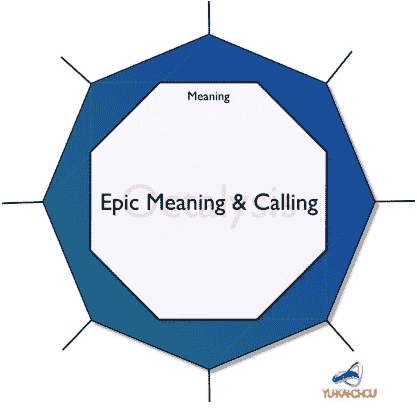
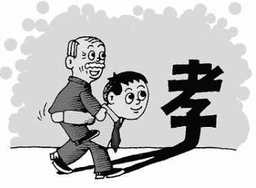
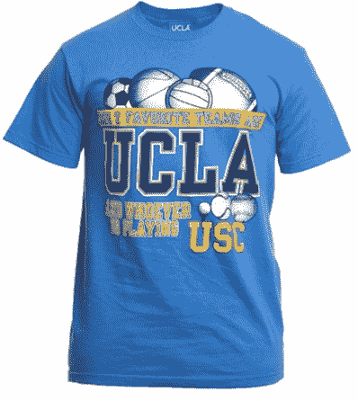

# 第五章：第一个核心驱动力 - 史诗意义与使命感

现在我们已经建立了八角框架的基础概述，是时候深入研究每个核心驱动力并发现其中的力量与魅力了。

如果你在读完本书后只记住一件事，那就是要通过思考 8 个核心驱动力来关注动机，而不是关注功能和功能。当然，要做到这一点，你需要熟悉 8 个核心驱动力才能正确运用它们，否则你甚至可能损害用户的动机。

### 高高在上的核心驱动力

史诗意义与使命感是八角游戏化的第一个核心驱动力。这就是人们因为相信自己参与的是比自己更大的事物而受到激励的驱动力。

游戏经常触发史诗意义与使命感核心驱动力。在许多游戏中，开场叙述会传达世界即将被毁灭，而 somehow，你作为玩家是唯一有资格拯救世界的人。这立刻创造了对冒险的兴奋和动力。

现实生活呢？我们是否会遇到由史诗意义与使命感驱动的场景？

- 你是否曾想过为什么人们会为非营利网站维基百科做出贡献？是什么会让某人花费数小时更新一个不付钱给她甚至不帮助她建立简历的网站？
- 为什么人们对苹果产品如此忠诚，以至于他们知道自己想要购买下一款产品，甚至在他们知道它是什么之前？
- 为什么学校间的竞争如此引人入胜，驱动着恶作剧、裸奔、暴力等激进行为，同时也为学校带来利润？
- 更高的目标是否也可以设计到育儿方式中，而不仅仅是通常的奖励和惩罚系统？

有趣的是，这些问题都可以由强大的白帽核心驱动力史诗意义与使命感来回答。在本章中，我们将尝试解答这些问题，并提供对这种无私核心驱动力的更多理解。

### 那本征服我的百科全书

> “Pwn 是源自动词 own 的 leetspeak 俚语，意为占有或征服以获得所有权。该术语主要在基于互联网的电子游戏文化中用来嘲讽刚刚被彻底击败的对手，暗示对对手的支配或羞辱，例如‘你刚刚被 pwn 了！’。” - Wikipedia³⁶。

当我于 2004 年创立我的第一家创业公司时，我对终于成为一名企业家感到非常兴奋，并希望到处宣传它。我了解到任何人都可以更新维基百科，因为它是用户生成的，并认为将我的公司纳入维基百科的庞大知识中将是一个绝佳的主意。我兴奋地花了整整一天时间精心制作关于我公司的精彩且信息丰富的部分——描述它何时成立、由哪些了不起的天才创立，以及它致力于解决的问题。

完成后，我自豪地点击了“发布”按钮。就在那里：我看到了我自己的公司作为一篇维基百科文章。耶！我们现在正式登上维基百科了！这真是一个史诗般的胜利！

然而，我“终于在生活中成功”的喜悦是短暂的。

在我发布大约三分钟后，我的帖子被一位“维基百科社区成员”标记，称该实体不够重要，因此不配出现在维基百科上。五分钟后，另几个人同意了这一观点，我的帖子被删除了。

就这样，我整整一天的工作在十分钟内消失了。

在我脑中出现许多“点点点”的时刻和额头上三条“|||”线之后，我脑中浮现的第一个问题是：“这些人是谁？他们难道没有生活吗？？”

看起来相当奇怪的是，一大群志愿者会定期访问维基百科，不是为了获得令人震惊的知识启迪，而是为了警察般地巡查平台，抓捕像我这样试图将无关或不重要内容偷偷塞进维基百科的害虫。

如果你曾经雇佣过实习生或初级员工并关注过他们的动机和感受，你可能会知道，要求人们在成山的页面上进行“审计工作”并标记过时内容会带来一个尴尬的情况。你知道没有人喜欢这种苦差事。这些聪明的年轻实习生和员工真的希望从你和你的公司那里学到伟大的技能，以便他们作为专业人士成长。但这种枯燥的工作几乎没有学习价值。公司里有人必须做这项工作，而自然而然地，初级实习生应该是执行那些没人愿意做任务的人。

因此，你会尝试平淡地告诉他们去做，这样他们就可以顺其自然而不去思考其令人沮丧的本质。或者你可能会选择花大量时间向他们解释这对公司的重要性以及他们的工作如何产生巨大影响。你也可以尝试让项目听起来有趣和令人兴奋。归根结底，你心里知道这是一项可怕的工作，年轻同事只需要“付出代价”然后才能让其他实习生做同样的事。

但当涉及到维基百科时，人们会自愿在工作之外花费宝贵的时间做完全相同的事情，却得不到任何“实际”好处！当你下班回家后，有很多事情可以做——练习每天抱怨老板的仪式、看电视、与另一半 Skype，甚至玩游戏。人们选择在所有这些活动之上巡查维基百科，是因为他们觉得自己是在保护人类的知识——比自己更大的事物。

当谈到史诗意义与使命感时，这并不是关于你作为个体的想要，也不是关于什么让你感觉良好。个人参与系统并采取行动，并不是因为它必然对他们有益，而是因为他们可以通过这样做将自己视为宏大故事中的英雄。这关乎为更大的利益发挥你的作用。

如果扮演我的角色不需要我作为殉道者牺牲我的生命，而只是需要我每天花几个小时监控维基百科上的奇怪活动，那这就是一个巨大的划算，值得去做。

根据麻省理工学院的一项研究，随机插入维基百科上的粗俗内容平均在 1.7 分钟内被移除³⁷。这些无偿的守护者确实在勤勉地维护着人类的知识。

然而，基于我后来对人类动机的理解，我也有一种预感，与其为在维基百科上投入数小时宝贵劳动而获得报酬，他们更有可能反而向维基百科付款。

经过一些研究，耶，我发现那些花费时间编辑维基百科的人，捐赠给维基百科的可能性几乎是只通过消费维基百科受益的人的九倍

the same or better capabilities than the iPhone but only a fraction of the cost?

Why are people so crazy about Apple products?

What we are seeing here is that these friends of mine (and I suspect yours too) have first self-identified as an “Apple Person.” Therefore, they need to do what “Apple People” do, which is to buy the newest iPhones and Macbooks, as well as act like “Apple Snobs” by walking around and making comments such as, “Oh, I never have that problem because I use a Mac.” I myself have also been guilty of this.

When confronted with the topic of many Android phones having better specs and lower prices than the iPhone, my response has usually been, “Well, I don’t know about the specs, but I do know that, when I’m using an Android phone, I feel frustrated; but when I’m using an iPhone, I feel happy. That’s probably worth something.” (By the way, in my opinion, it is often unfair to compare the market share of iPhones to Android Phones as a success measurement, since the iPhone is sold by one company, while Android Phones are sold by over a dozen companies throughout the world. When people freak out about “Oh look! There are more Android users than iPhone users now!”, that’s basically saying that all these non-Apple smartphone companies combined have surpassed Apple. Big deal.)

So the multi-billion dollar question is: So, how did Apple do this?

Besides offering stellar products with elegant design and meticulous engineering, Apple has been one of the few electronics companies that actually try to sell a higher meaning.

Let's examine two of the most successful commercials in history - both from Apple.

## The Crazy Ones in 1984

The first Apple commercial that reached massive fame and success, is the “1984” commercial, aired in 1984’s Super Bowl XVIII on CBS³⁹.

Neither of these campaigns actually talks about computers or electronics. They don’t talk about specs, RAM, color screens, or computers. You’re not even sure what they sell if you are unfamiliar with the company.

They sold a vision.

When people connect with a statement like, “Because of Apple Computers, 1984 will not be like Nineteen Eighty-Four,” many started to think, “Wow! That’s amazing! I don’t know what they do, but I want to be part of this!”

How do you “be part of it”? You buy the Macintosh computer.

Similarly, when people hear the deep wise voice concluding with, “Because the people who are crazy enough to think they can change the world, are the ones who do,” they become inspired and think, “Yes! I’ve always been hiding my true passions to conform with what people expected of me. I want to be one of the crazy ones that changes the world!” And of course, the way to think different and change the world is to buy an iPod and have a thousand songs in your pocket.

See the power of Epic Meaning & Calling? When every other company is selling how amazing their computers are, Apple sells a vision worth believing in. Interestingly, when Apple was developing the Think Different campaigns, the first rule was that there would be no products in the commercials. This is so counterintuitive, yet so *Human-Focused*.

As long as Apple can continue to make people think that it is a vision worth believing in, their customers will continue to be “Apple People” and buy Apple products. But if one day Apple does something stupid and breaks the trust of being a vision worth believing in, people will stop blindingly purchase their products and will begin to look at the specs again.

## Mjolnir is Not Just a Tool

Some companies have approached me during my all-too-good-sounding soapbox, and asked me, “Yu-kai, this Epic Meaning & Calling thing is great and all, but our product is just a tool. It’s not meant to change the world and

## Your Parents are Bigger Than You!

Some people mistake Octalysis and Gamification as technology solutions that are expensive to implement. In reality, they are design systems focused on motivation. So if the activity relates to motivation, you can apply gamification to it. Just like games – you can play with a complex 3D Virtual World technology like World of Warcraft, or you can play Hide-And-Seek, something that requires no technology at all. Children these days have both World of Warcraft and Hide-And-Seek available, and the last time I checked they still enjoy Hide-And-Seek.

Because of that, we can even apply Octalysis Gamification to things a bit more abstract, such as parenting. Parents often use two main Core Drives to motivate their children to behave well - Core Drive 2: Development & Accomplishment (reward when the child behaves), as well as Core Drive 8: Loss & Avoidance (punish/ground when the child does not behave).

However, the Chinese culture has “figured out” how to implement Core Drive 1: Epic Meaning & Calling into parenting, through the meaning behind a term known as “孝”. Pronounced “Sheeow,” (or “Xiao” in correct Pinyin spelling, but most people don’t know what to do with the X). It has no direct English translation, but it is a concept that translates into a belief that since the first day of your birth, you are indebted to your parents who you owe your life and existence to. As a result, “孝” mandates that you need to do everything possible to honor them and lift them up.

There are even popular expressions and idioms in Chinese literature such as “不孝之子, 天地不容,” which means, “For a son without ‘孝,’ there is no space/tolerance for him in heaven or earth.” This means that if you do not have “孝,” you are such an epic scumbag you don’t even deserve to have ever existed; both the heaven and the earth are so disgusted by your existence they are literally spitting you out of their presence.

Some sources translate the character “孝” to mean “Filial Piety” – “a virtue of respect for one’s parents and ancestors.” Yet, having grown up with this term I feel it goes a long way beyond the word “respect.” When I was little and just started to comprehend the world, I remember reading or listening to the thrilling and sometimes gruesome stories of the well-known children of “孝” in Ancient China. These children would fight tigers to protect their parents, warm up their parents’ mattresses before bedtime, or cut off their own flesh in order to feed their hungry parents. In one story, a sixty year old man of “孝” pretends to play on the ground in a humorous way in order to entertain his eighty-year-old parents. (Note: regardless of the tactics to educate such Epic Meaning & Calling, “孝” is truly a great virtue that is slowly being lost in a globalized “flat world” of instant gratification and self-centeredness).

Other examples of “孝” in the 24 Paragons of Filial Piety⁴⁷ include:

- a man sells himself into slavery to pay for his father’s funeral
- a man tastes his sick father’s stool to understand the health of his father
- a woman cooks part of her own liver to feed her mother
- an eight year old boy attracts mosquitoes to suck his blood so they won’t bother his parents
- a father decides to bury his three year old son so he can afford to care for his own mother. While digging the hole, he finds treasure and doesn’t have to kill his son.

While some of these actual stories are disturbing, it illustrates how important “孝“ is as a value within the culture. Of course, parents aren’t just hypocritically manipulating their children. The children who see their parents treat their grandparents poorly, regardless of whether these stories are told to them, will most likely not buy into the Epic Meaning of 孝. This is an important factor in using the motivation elicited through Core Drive 1 - it must feel authentic.

In Traditional Ancient Chinese Culture, when one’s parents pass away, they need to dress in mourning attire, abstain from all entertainment and sometimes meat, as well as exclude social relationships for three entire years to express his grief. This act is called “守孝”, which literally means “guarding 孝” and was traditionally set to be three years because Confucius stated that it takes three years for us to leave our parents’ arms; hence, it is proper to spend three years mourning for them. Of course, in today’s modern society, much of the three-year mourning is lost and reduced to days or weeks as a symbolic gesture to honor one’s parents.

And because of this culture of “孝,” Asian children grow up feeling that they have to do a lot for their parents – they have to study hard, they have to get into a good school that their parents can be proud of, they have to support their parents throughout life, they should live with their parents to always be available and make sure everything is taken care of for their parents’ life-long wellbeing. As an example, I have a close relative in his fifties who has left his wife and son in the United States for close to a decade now - so he could live with and take care of his aged mother in Taiwan; only visiting his immediate family a few times each year.

In contrast, in many Western societies where the concept of “孝” is not as prevalent, people still respect their parents immensely. However, once they form their own families, they generally become more disconnected and simply bring their children to grandpa and grandma once or twice a year, instead of constantly making life decisions that are tailored to their parents.

Even today, if my parents told me I don’t have 孝 because of any behavior, it would crush me emotionally and motivate me towards almost anything to amend for it. Just because I understand the nature of the motivation does not mean I am exempt from it. It is something deeply ingrained within me and my values. In similar faith, my parents have never made that accusation towards me, because it would be one of the greatest insults a parent could give a child. It is that serious and tangible when it comes to this type of motivation.

## 游戏技巧在史诗意义与使命中的运用

现在你已经了解了核心驱动力 1：史诗意义与使命的主要概念，问题是如何将其实现到你的体验中。下面我将介绍几种游戏技巧，如果设计得当，可以激发史诗意义与使命的感觉。请记住，在我的术语中，当我提到游戏技巧时，我指的是结合游戏元素（包括游戏机制）来驱动动机的技巧。

你还会注意到，每个提到的游戏技巧后面都跟着许多“游戏技巧编号（#s）”。这些游戏技巧编号是源自我的网站 YukaiChou.com 的寻宝游戏的一部分。我的读者会尝试收集所有编号，这些编号最终将在未来为 Octalysis 带来一些令人着迷的应用。

需要记住的一个关键点是，Octalysis 设计框架的整个前提是，不应过于执着于游戏机制、游戏技巧或设计的任何外在表现。相反，应专注于核心驱动力以及它如何以可操作的方式激发动机。游戏技巧以及相关的编号都只是优秀动机设计的点缀。如果不专注于核心驱动力，它只会拥有一个引人入胜的游戏的外壳，而非本质。

### 叙事（游戏技巧 #10）

大多数游戏都以一个叙事开始，为玩家提供**为什么**应该玩游戏的背景。许多叙事都与拯救世界、公主、破案有关，甚至只是帮助一只龙或鳄鱼洗澡。那么为什么不利用叙事为其他事物提供背景呢？

将史诗意义与使命灌输给用户群体的更有效方式之一是通过引人入胜的叙事。这使你能够引入一个故事，通过与你的公司、产品或网站的互动，为人们提供更高意义的背景。

Zamzee，一家为儿童提供“可穿戴技术”的公司，利用叙事为儿童灌输史诗般的幻想，以激励他们多锻炼。通过其在线软件界面，Zamzee 为孩子们提供幻想任务，例如成为一名巫师学徒。为了学习你的第一个咒语，你需要上下楼梯跑 15 次。即使该行为本身与叙事脱节，仅让他们假装具有魔法的意义就能激励孩子们多锻炼，因为他们现在受自己想象力的驱动。Zamzee 表明，参与这些想象任务的孩子比不参与的孩子多运动 59%。48

### 人类英雄（游戏技巧 #27）

如果你能将世界使命融入你的产品中，就能在入职过程中获得更多认同。有一家公司在灌输人类英雄感方面做得非常出色，那就是 TOM’s Shoes，每当你向他们下单时，他们就会向第三世界国家的儿童寄送一双鞋子49。你每次购买都能帮助弱势儿童的想法极具激励性。此外，当顾客穿着这些鞋子时，他们会让他人知道自己正在帮助世界，这就是核心驱动力 5：社会影响与归属感中的奖杯架（游戏技巧 #64）的一种形式。

*FreeRice* 是另一个利用人类英雄技巧的例子。FreeRice.com 是一个网站，每当你在其网站上正确回答教育问题时，就会捐赠 10 粒大米。资金来自广告以及回答问题所产生的页面浏览量。迄今为止，FreeRice 已捐赠了 6100 公吨大米，共计 930 亿粒大米，足以养活 1000 万人。50

通常，如果你能将你的系统与许多人关心的事业联系起来，你就可以建立一个以他人善意为基础的整个业务。

### 精英主义（游戏技巧 #26）

允许你的用户或客户基于种族、信仰或共同兴趣形成自豪的群体，也会让他们觉得自己是更大事业的一部分。精英主义灌输群体自豪感，这意味着每个成员都会通过采取特定行动来维护群体的自豪感。群体还会试图挫败其对手，这可能导致双方为了击败竞争对手而加大行动力度。

这就是为什么大学竞争如此引人入胜。当我在 UCLA（加州大学洛杉矶分校）就读时，很难不感受到对 USC（南加州大学）的强烈竞争。从大一新生入学指导（入职）开始，就不乏内容和笑话来营造与 USC 的竞争氛围。在体育赛季期间，这种竞争达到顶峰，双方会激烈地、甚至暴力地互相侮辱。甚至还有印有文字的 T 恤：“我最喜欢的两支球队是 UCLA，以及正在与 USC 比赛的球队。”

双方都认为这种竞争大于自身，并凭借新灌输的精英主义感，参与许多不理智的活动，因为他们“应该”作为该校的自豪代表这样做。

即使竞争对学生来说引人入胜甚至有趣，谁从这些竞争中获益最多？更常见的是，大学本身。创造一个学生“应该痛恨”的外部敌人，会创造更多的“学校精神”，学生们会团结在一起并在狂热中做出*期望的行为*。与

相信上帝只是为了善待同胞，因此他们也增加了捐款。同样，双方的贡献都比原本会做的更多，仅仅因为他们觉得自己是在为比自己更大的目的而做——保护他们群体的声誉。 （免责声明：我本人是基督教信仰者）。

### 新手运气（游戏技巧 #23）

新手运气专注于史诗意义与使命中的*使命*部分。使命让人们认为自己注定要做某事。与新手运气一起，人们会觉得自己是少数被选中采取行动的人——这使得他们更有可能采取行动。如果一名游戏玩家在玩游戏的第一天，随机获得游戏中其中一把最强大的剑，甚至资深玩家也难以轻易获得，那么他很可能不会在第一天就退出。他很可能会用那把强大的剑疯狂地杀怪，直到游戏中的下一个钩子出现。

游戏设计师很可能会通过设计奖杯架（游戏技巧 #64）来加入社会影响与归属感（核心驱动力 5），奖杯架是允许用户隐式展示他们引以为傲之物的机制。如果游戏设计师还通过护城河（游戏技巧 #67）加入稀缺与不耐烦（核心驱动力 6），告诉用户他只有在击败某个特别困难关卡的所有对手后才能装备这把剑，那么用户现在就会痴迷并想尽一切办法征服该关卡。

### 免费午餐（游戏技巧 #24）

沿着“使命”主题，给特定人群提供 normally not free 的免费赠品，并以将其与更大主题联系起来的方式赠送，可以让客户感到特别并鼓励他们采取进一步行动。

例如，Spoleto 是一家巴西连锁餐厅，在巴西、西班牙和墨西哥拥有超过 200 家餐厅，它在国际妇女节之际，向任何告诉他们自己很漂亮的女性提供了一顿真正的免费午餐。52 这有助于推广积极的信息并让女性

活动背后的目的，并当正确引入时加强其他七个核心驱动力。在后面的章节中，我们还将探讨一些公司如何利用史诗意义与使命（以及其他白帽游戏化核心驱动力）来激励员工更有激情地工作，并在其他公司提供更大金钱激励时仍留在组织中。

核心驱动力 1：史诗意义与使命的弱点在于实施可信度的难度，以及动机中缺乏紧迫性。虽然人们不断渴望成为更大事物的一部分，并在真正采取行动时会感到很棒，但他们往往会拖延和推迟这些行动。因此，为了创造期望的行为，游戏化设计师需要 Octalysis 中其他核心驱动力的帮助。

## 为了最大化本书的收获，请立即选择以下其中一个选项执行：

- **简单：** 想一个核心驱动力 1：史诗意义与使命激励你或他人采取某些行动的例子。它是否让人行为更无私？

- **中等：** 确定你正在进行的一个项目。思考是否有办法将核心驱动力 1：史诗意义与使命安装到体验中。你能将体验与更大的主题联系起来吗？

**在 Twitter 或你偏好的社交网络上使用标签 #OctalysisBook 分享你的想法，看看其他人有什么想法。**

## 新章节解锁！- 获取灵感

现在你已经熟悉 Octalysis 框架，请查看我的 TEDx 演讲，了解八种不同的世界级产品如何利用每种 8 个核心驱动力让世界变得更美好。TEDx 演讲可通过 [http://yukaichou.com/tedx](http://yukaichou.com/tedx) 访问，或你只需在 Google 上搜索“Gamification Tedx”。

