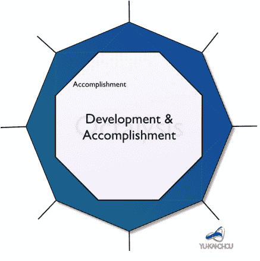
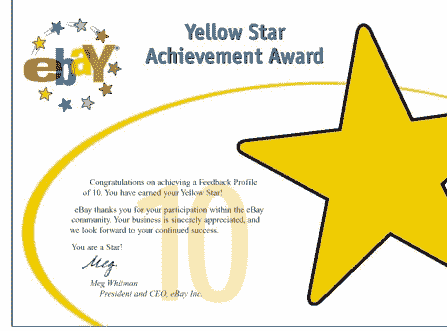
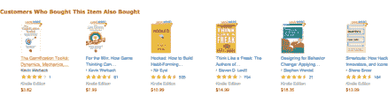
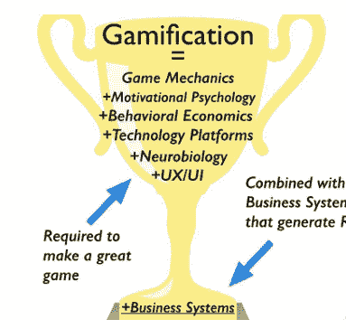
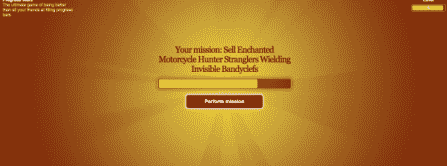
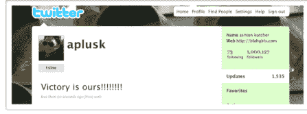
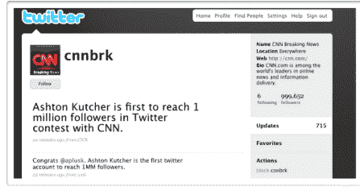

# 第六章：第二核心驱动力 - 成长与成就

成长与成就 是游戏化框架 Octalysis 的第二核心驱动力。这是人们因成长感和达成目标需求而被驱动的核心驱动力。它让我们专注于职业道路，激发我们学习新技能的热情和承诺，并最终通过向我们展示我们走了多远、成长了多少来激励我们。

许多人记得幼儿园老师会给他们发金星来强调良好行为。即使这些贴纸不会变成真正的奖品，孩子们也常常极其渴望获得更多星星，并会专注于如何最好地获得它们。这是对成长与成就效果的一个非常直接的演示，以及将其融入体验是多么容易。

这也是我们在市场上看到的最常见的游戏化实现方式，因为大多数 PBL —— 积分、徽章和排行榜 —— 都强烈地迎合了这一驱动力。

### 游戏中的成长与成就

几乎所有游戏都会向你展示某种通往 *胜利状态* 的进展。胜利状态通常是一个用户克服了某种挑战的场景 —— 这就是胜利状态中的“胜利”。游戏将用户挑战分解为阶段，以帮助用户感觉始终在进步。

我们的大脑有一种自然的渴望去实现目标并体验成长，以便感觉到生活中正在取得真正的进步。我们需要胜利状态。游戏能够维持长达四十小时甚至四千小时的玩家旅程，因为它们使用独特的阶段和 Boss 战来在途中认可用户的成就。

为了展示那种成就感，一些游戏会显示积分，其他游戏使用等级、徽章、阶段、进度条、更好看的装备、胜利动画…… 列表还在继续。然而，仅凭你 *看到* 通过这些元素取得的进展，并不一定意味着你 *感觉* 到成就。

核心驱动力 2：成长与成就 的关键是确保用户为克服为他们设定的挑战而感到自豪。著名游戏设计师兼表演研究博士 Jane McGonigal 将游戏定义为“我们自愿去攻克的不必要障碍。”53（这最初由哲学家 Bernard Suits 提出）。

McGonigal 指出，挑战和限制正是让游戏变得有趣的原因。例如，如果高尔夫只是一个没有限制的游戏，每个玩家都会直接把球捡起来放到洞里来获胜。每个人都会得分很高，而每个已经超越“把圆 peg 插进圆孔”游戏的人很可能会感到无聊。

通过增加不必要的障碍，例如要求使用奇怪的球杆、特定距离和地形障碍，高尔夫变得有趣，因为玩家在克服这些挑战后确实感到自己取得了成就。游戏化旨在将这种成长与成就的感觉融入到你的产品或服务中的日常体验中。

### 我上瘾的第一个游戏化网站

我在网站上最受欢迎的博客文章之一是“十大将彻底革新购物的电子商务游戏化案例”列表。在这个列表的顶部是 eBay（全文披露 —— 我在 2013 年与 eBay 合作过几个项目）^54。

eBay.com 是一个在线拍卖网站，于 1995 年成立，在万维网时代相当早。它成为 Dot Com 泡沫时代最成功的公司之一，截至今天，它是硅谷领先的科技公司之一。它也是最早将游戏化融入其核心 DNA 的电子商务公司之一。如果你计划创建一个简单、通用的电子商务网站，并非直观地包含竞争性竞价系统或评分的买家-卖家反馈界面。也不明显的是提供通过成就符号升级的“升级路径”，例如黄色、紫色和金色星星，以及创建 Power Seller 状态系统。

eBay 是触发我创办第一家企业的平台。没有 eBay，我很可能不会成为一名企业家，结果你也就读不到这本书了。

当我即将进入 UCLA 作为一名新生时，有一个当地的烧烤活动，二年级的学生在那里与我们“菜鸟”分享他们的经验和建议。在那个活动中，有抽奖活动，奖品是赛季第一场比赛的两张橄榄球门票。我很方便地被选中为从盒子里抽出一个获胜者名字以赢得这两张票的学生。称之为神意、命运、巧合，或是什么；我从盒子里抽出了我自己的名字。

当我宣布是我的名字时，每个人都感到震惊，活动组织者眨着眼开玩笑说，“恭喜！只要确保你不要在 eBay 上卖掉它！我们会查的！”

当时，我想“eBay 是什么？我以前听说过。”我研究了一下 eBay，不久之后我就通过该平台卖掉了我的两张票（我希望烧烤组织者不要读我的书）。

那笔交易对我来说出乎意料地令人兴奋和有趣。当我从互联网上的一个匿名陌生人那里收到第一个出价时，我几乎要跳起来（文化笑话：但我没有被卡住）。不久之后，当另一位竞标者加入“战争”时，我变得痴迷地盯着屏幕。

在拍卖的几天里，这是我脑子里唯一的想法。我不断检查我的 listing，试图看看人们是否会超过最后的出价者。当然，当我每隔三分钟检查一次却没有人出新价时，那是令人绝望的！顺便说一下，这就是我现在称之为“折磨式中断”（游戏技巧 #66），用户必须等待一段时间而不管他们的行为如何，这是一种将在核心驱动力 6：稀缺与不耐烦下探讨的游戏技巧。

当我最终以几百美元的价格卖掉这两张票时，我欣喜若狂。我觉得我刚刚完成了一件伟大的事情（对于一个刚高中毕业的人来说）。我作为卖家赚到了第一笔钱！我开始在 eBay 上寻找其他东西来出售。在这段时间里，我注意到 eBay 拍卖的最终价格通常取决于 listing 结束的日期时间部分。这是因为大多数人喜欢在最后几分钟等待出价并抢走交易。

在这种疯狂中，人们在时间用完之前迅速相互竞价。这种效果是倒计时器（游戏技巧 #65）和最后冲刺驱动（游戏技巧 #53）的结合，用户感觉自己离目标如此之近，以至于急于完成它。顺便说一下，这些大多采用黑帽技巧。

观察到这种效果后，我开始了一项小生意，买卖 TI-83 计算器，这通常是高中和大学数学课的要求。我会开始购买我在凌晨 2 点结束 listing 的所有能找到的 TI-83，当时没有人竞价，通常是 40 美元。然后我会以在下午晚些时候结束拍卖的方式转售，当时每个人都在相互竞价，通常是 60 美元。与经济学课堂上枯燥的数学理论和大学派对中的社交交往相比，这正是我需要掌握的游戏。

忠于游戏化精神，当我在 eBay 上卖出第十件商品时，我收到了来自 eBay 本身的电子邮件！它是一份来自“Meg”这个人的证书，祝贺我成为有价值的 eBay 卖家，并给我一份黄色星星证书！我对这个成就符号（游戏技巧 #2）感到如此兴奋，以至于我把它打印出来并放在我的宿舍房间里多年。即使今天，我想它仍然在我的父母家某个盒子里。

即使这不是我收到的原始证书，它看起来也像下面的图像。

最终我会出售大量其他商品，包括数码相机、iPod、GPS 设备，甚至我写的一些弦乐四重奏歌曲！在我大学二年级时，在我 eBay 生涯的巅峰，我获得了 100% 的满意度评分，超过 1,100 条正面反馈。作为结果，我被授予了红色星星排名。

### “我为我的产品多付了钱。去吧，笨蛋们！”

基于以上内容，很容易看出 eBay 如何使用核心驱动力 2：成长与成就 来使卖家的体验更有趣、更上瘾。但买家呢？是什么让买家想要持续在 eBay 上购买？

从买家的角度来看，eBay 的精妙之处在于，当购买完成时，你不仅仅像在

其他电商平台则不然。在这里，你不会觉得自己只是花钱换回一些商品，而是会感觉自己真的**赢了**！

当然，在最后肾上腺素飙升的出价争夺过后，你可能最终支付了比原本愿意出的价格多出10%的金额，但至少你战胜了那十一个和你竞价的其他混蛋！

> “接招吧，傻瓜们！这东西是我的了！”

你不是简单地用钱买到成功——那是任何人都能轻松做到的——而是付出了努力，真正赢得了一种“胜利状态”！你感到成就感，这份快乐的价值远远超过你最终为这件商品多付的钱。在eBay上，你不是在花钱购买，而是在花钱游玩。

这与人们在游戏中花钱去攻克无法通过的难关有相似之处。确切地说，人们买的并不是*胜利*本身。如果在人们付费给游戏公司后，屏幕上立刻弹出消息说“恭喜你！你赢了！”，几乎没有人会感到兴奋。任何人都能花钱买来东西。玩家们真正花钱购买的，是那种“我很厉害”的感觉。他们花钱购买强力武器或增益道具，从而能快速击败一群敌方怪物，最终取得压倒性的胜利。

另一个基于相同原理的例子是通用磨坊旗下的贝蒂克罗克蛋糕粉。在几十年前首次推出时，它被设计成最省事的蛋糕粉，主妇们只需在粉料中加水，然后放进烤箱就能烤出美味的蛋糕。不幸的是，销量一直相当停滞不前，公司最终聘请了商业心理学家来帮助找出原因。

其中一个假设是：蛋糕粉制作起来太容易了，顾客们*感觉*不到自己真的在烘焙，因此也就没有成就感或胜任感。基于这一思路，通用磨坊并没有通过简化步骤让过程变得更轻松，反而决定*增加*额外的步骤。他们去掉了贝蒂克罗克蛋糕粉中那种方便的脱水蛋粉，要求烘焙者在放入烤箱前自己加入新鲜鸡蛋。

令许多人惊讶的是，这款产品立刻取得了突破性的成功。增加了“自己打一个鸡蛋进去”这个额外步骤后，人们*觉得*自己确实在烘焙一道美味的甜点来搭配正餐。这让他们对自己、以及对家庭的贡献都感觉很好。[^55] “游戏就是我们要自愿去克服的非必要障碍”这一哲学在这里体现得淋漓尽致——多出几个步骤反而提升了体验中的核心驱动力2：发展与成就感。

由于上述这些游戏化系统的存在，很多人声称上eBay会“上瘾”。它最终从一个个人爱好发展成了市值超过700亿美元的财富200强公司。[^56]

## 那亚马逊呢？

看完eBay，你可能会问：“亚马逊呢？他们不是更成功吗？我没看到他们的平台上有任何游戏化元素。”确实，亚马逊成立于1994年，仅比eBay早一年，如今已是市值约1500亿美元的财富50强巨头，而且他们确实不做“游戏化”。

嗯，他们不做那种整合积分、徽章、剧情、头像或升级路径的游戏化。然而，他们投入了大量资源来打磨“以人为本的设计”中的许多技巧，以及八大核心驱动力中的许多要素——这些正是成功游戏的支柱驱动力。

如果你还记得前面的章节，优秀的隐含式游戏化往往像门把手一样隐形——你甚至不会注意到它的存在，但你确实会下意识地用它来开门、关门。通过亚马逊的优化设计，我们可以看到一些核心驱动力被运用得效果卓著。

首先，亚马逊业务背后的核心驱动力是核心驱动力4：所有权与占有感。正如第3章提到的，这一核心驱动力的前提是：如果你感觉自己拥有某样东西，你就会倾向于去改进它、保护它，并想获得更多。

亚马逊致力于精简“所有权与占有感”这一流程。它就像一台优化过的引擎，让你能够快速、准确、毫无麻烦地拥有和占有东西。它已将自身打造成“获得更多物品”的最佳场所，而且你知道自己很可能买到的是市场上的最低价。有了亚马逊，你知道自己可以更快地拥有更多。

此外，亚马逊在不断学习你的偏好，并根据你的个性来个性化你看到的内容——我称之为“阿尔弗雷德效应”（游戏技巧#83）。这样一来，所有权与占有感会进一步增长，因为人们会将它识别为一种独特的“我的亚马逊”体验，这是任何其他电商网站都无法提供的。

## 别落后于你的邻居！

伴随“阿尔弗雷德效应”而来的是亚马逊的推荐引擎，这在个性化行业已经尽人皆知。根据亚马逊自己的说法，他们的推荐引擎带来了30%的销售额[^57]。对于一家每月已经赚取数十亿美元的公司来说，这是一个相当重要的因素。事实上，《财富》和CNN财经的撰稿人JP·曼加林丹认为，亚马逊从2011财年第二季度到2012财年第二季度的29%销售增长中，很大一部分要归功于推荐引擎。[^58]

那么这个推荐引擎长什么样呢？

> “购买此商品的顾客也购买了……”

亚马逊很快意识到，当你知道与你相似的其他人在买什么时，你购买同样商品的可能性也会高得多。你能想到是哪一种核心驱动力在推动这种行为吗？

你可能已经猜到了（如果没猜到，我也不会怪你）——核心驱动力5：社会影响与关联感。通过知道其他相似的人在买什么，社会认同和关联感能帮助消费者更自信地做出决策。这帮助亚马逊提高了销售额和后续的追加销售。

当然，亚马逊早期成功的另一个重要的“社会影响与关联感”因素，是数百万条关于书籍和其他商品的用户评论。

> “我朋友鲍勃说那个医生是错的——他读过很多健康方面的书。”

萨斯喀彻温大学的研究人员姚旺和朱莉塔·瓦西列娃，以及佐治亚理工学院的米纳克希·古普塔、保罗·贾奇和穆斯塔法·阿马尔等人关于点对点网络中的信任与声誉的研究发现，普通消费者更偏爱、更信任同行而非专业评论家的评论[^59][^60]。这有点奇怪，因为专业评论家把区分优劣当成了毕生的使命。对于每一篇发表的评论，他们都会花大量时间收集所有必要的信息，亲身经历整个过程，最终写出一篇深思熟虑的文章，体现他们的知识深度和投入。

但归根结底，消费者似乎更愿意看到其他消费者的想法和意见，那些人可能对产品并没有同等水平的专业知识和理解，更不用说花同样的时间去体验和评价这个产品了。说到底，我们更看重那些与自己有共鸣之人的想法，往往胜过权威专家的声音。

在亚马逊的评论界面中，你会看到类似“4.6颗星（满分5星）”的提示，接着是一个评论“排行榜”，体现着社区的投票倾向。最高赞的评论写着：“445人中有400人认为以下评论有用。”巧合的是，这条评论来自一位名为“书鲨”的用户，其标签是“前500名评论者”。

哦等等，亚马逊上也有排行榜、社区投票和身份标签？如果你认为亚马逊不使用游戏化，那你可要再想想了。在你思考的时候，试着回忆一下上次握过的门把手是什么颜色。

## 永远不要让用户觉得自己笨

在此我想稍作停顿，指出一点：虽然本章的重点是核心驱动力2：发展与成就感，但如果不考虑其他七种核心驱动力，就无法评估一个好的体验或产品，因为它们错综复杂地交织在一起，共同创造出一体化、富有激励性的体验。尽管亚马逊的成功可以从许多其他核心驱动力来审视，比如稀缺与急迫感，以及创意的赋能与反馈，但让我们还是把焦点拉回到“发展与成就感”这个主题上来。

除了提升排名和获得徽章之外，一种非常重要的情感成就感就是“觉得自己聪明”。我们都喜欢感觉自己有能力、有胜任力，而无力或无能的感觉则可能给人生带来最深的创伤。

无论技术多么出色，一个让用户感觉自己很蠢的产品，往往都是失败的产品。根据我的经验，**如果一个用户在界面上花费了四秒钟仍无法弄清楚该做什么，他们会觉得自己很蠢，并开始在情感上脱离。**

Google 搜索引擎确保这种情况不会发生。在 Google 成为“Google”之前，Yahoo! 是典型的“搜索引擎”巨头。然而，Yahoo! 将自己视为一个在线门户，让人们发现新内容，而不是纯粹的搜索引擎。

有趣的是，当 Google 的创始人想以区区 100 万美元的价格将他们的搜索引擎卖给 Yahoo 时，Yahoo 拒绝了，即使他们承认 Google 是一个更高效的搜索引擎，能更快地让人们到达目的地。这是因为这与 Yahoo 的门户战略相悖，该战略是向用户展示大量可点击的链接，从而产生更多可点击的链接（核心驱动 7：不可预测性与好奇心核心驱动的运用）。同时，还提供广告链接供点击。[^61]

因此，当你访问 Yahoo 的主页时，你会看到大量内容以及链接。尽管它确实为许多用户带来了大量点击和探索性活动，但对于无法在众多选择中导航和做出决定的用户来说，它可能有点令人望而生畏，甚至令人瘫痪。相比之下，Google 则专注于其发展与成就核心驱动的战略。

当你访问 Google.com 时，你通常只会看到两件事：Google 的标志和一个搜索框。你几乎没有机会对下一步该做什么感到困惑。你在搜索框中输入你的查询。即使你并不完全确定要搜索什么（一种感觉部分无能的时刻），自动填充功能也会立即跳出来为你提供建议。

Google 很早就理解了这一点。根据 David A. Vise 和 Mark Malseed 所著的书籍 *The Google Story*，该公司在保持简洁主页的战略上如此明确，以至于他们拒绝了许多可以从其启动点利用的绝佳变现机会；甚至直到今天也是如此。[^62] 据说，一个组织的战略并非在于他们选择做什么，而在于他们坚持不做什么。

不幸的是，Google 对让用户感觉聪明的理解和精妙程度，并没有总是渗透到其其他产品线中。
Google+ 就是一个典型的例子，说明伟大的技术如何让用户感觉愚蠢并失去吸引力。

尽管 Google 喜欢吹嘘 Google Plus 的“活跃用户”数量使其成为全球第二大社交网络，但普通消费者明白，这正是因为他们在使用 YouTube 或 Gmail 时不知不觉中被“强迫”进入了 Google+ 界面，我称之为 *brute force distribution*（这里没有游戏技巧）。尽管有数亿“活跃用户”，根据 ComScore 和 Nelson 的数据，平均每个用户每月使用 Google+ 的时间不到 7 分钟。与 Facebook 每月 400 分钟相比，这显然不是每个人都聚集的地方。

其他精通网络的用户也继续使用 Google+，因为据称它对营销有搜索引擎优化优势，这归功于搜索引擎本身的出色工作，而非社交平台的优点。⁶³ 毕竟，有些人甚至会吃昆虫，如果这有助于提高他们的搜索排名的话。

尽管是“全球第二大社交网络”，如果你查看 Google 自己的博客，其用户受众最偏向 Google 产品，你会经常看到每篇文章上的推文和 Facebook 点赞数远远多于 Google +1。 一位不愿透露姓名的 Google 员工曾告诉我，“在 Google，有个笑话是，‘如果你组织一个派对并且不想让任何人知道，就在 Google Plus 上分享吧。’”

## Star of Bethlehem - Guiding Users Forward

如果你玩过热门游戏 Candy Crush，你是否曾想过，为什么当你几秒钟不做移动时，游戏会显示一个“发光选择”（游戏技巧 #28）的 *可能* 解决方案，而这个解决方案通常不是匹配宝石的最佳方式？在几乎所有情况下，如果你盲目地遵循 *发光选择*，你最终会输掉游戏。为什么他们要向我展示一个不会让我获胜的解决方案？这是陷阱吗？

绿洲看起来翠绿多汁，并潜意识地暗示在这个选项后面有一个获胜状态。

最后，亚马逊从不忘记向你展示一个被划掉的虚假标价，其下方是真实的售价，并告诉你如果你没有支付虚假标价，你节省了多少金额和百分比。这再次让人们感觉自己在做出明智的选择，获得了超值优惠。对这一概念的误解导致 J.C. Penney 解雇了其前 CEO Ron Johnson，他以开创 Apple Store 而闻名，在“公平公正”活动中取消“虚假”折扣数字后，导致零售史上最大的失败之一。64

## The Premium Price of Smarty Pants

让用户感觉聪明的虚假价格无处不在。在行为经济学畅销书《Predictably Irrational》中，Dan Ariely 描述了一个案例，其中一群 MIT 学生被要求在为《经济学人》杂志数字版一年订阅支付 59.00 美元，或支付 125.00 美元订阅数字版和印刷版一年之间做出选择。大多数学生（68%）选择了 59.00 美元的数字版。65 谁愿意为实体杂志多付 66 美元，当你可以用一半的价格数字阅读时呢？

然而，当在上述两个选项中间插入另一个 125.00 美元的选项，即仅购买印刷版杂志一年的订阅时，一切都改变了。从技术上讲，这不应该有任何影响，对吧？为什么有人会为印刷版杂志支付 125 美元的订阅费，当他们可以用同样的 125 美元价格获得印刷版和数字版时？而且我们已经确定，上面很少有人愿意为 125 美元购买两个版本。添加一个甚至更不受欢迎的选项如何改变用户行为？

但令人惊讶的是，当向新的 MIT 学生群体展示这三个选项时，没有人选择我们可能预期的新仅印刷版选项（毕竟他们是聪明的 MIT 学生），但压倒性多数的学生（84%）突然想要订购 125 美元的数字版和印刷版订阅，只有 16% 的学生想要 59 美元的仅数字版。

如果你是《经济学人》杂志，这意味着添加一个没人想要的无用选项会突然使你的总收入增加 44.6%！这怎么可能有意义？秘密在于 **人们并不采取必然最经济的行动，而是采取让他们感觉最聪明的行动。**

我个人见过富有的女性花费数十个小时剪优惠券，以便将 20 美元的商品降至 0.60 美元。她们需要额外的节省吗？不需要。这是对她们时间的最高效利用吗？可能不是。但她们这么做是因为这让她们感觉聪明。她们可以用一张一美元钞票买到 20 美元的商品，甚至还能找零！同样，在杂志的案例中，当一个人看到仅获得印刷版需要 125 美元，但获得印刷版 *和* 数字版也需要 125 美元时，数字版现在感觉是 *免费* 的！通过设置诱饵参考价格，人们现在感觉购买那个看似理所当然的好交易更聪明。有时感觉聪明会付出奢侈的代价。

## Limitations of eBay’s Design

由于上面提到的发光选择、个性化推荐、同行评议和沙漠绿洲设计元素，亚马逊用户永远不会对下一步该做什么感到困惑。你迅速朝着获胜状态前进，尤其是如果你做出了“感觉聪明”的决定购买 Amazon Prime，你的商品将在两天内送到家中，并提供轻松的退货和退款选项。

另一方面，eBay 并没有享受让用户感觉聪明的同样的奢侈。首先，eBay 的界面有点像 Google+，用户并不真正知道在哪里找到他们想要的东西。屏幕上同时存在各种水平和垂直菜单，以及多个下拉菜单，很容易让用户在弄清楚要去哪里之前花费超过四秒钟。

此外，由于 eBay 的 DNA 是竞价市场，它对用户体验的控制没有那么多。当用户最终

购买商品后，eBay 无法保证商品能在两天内送达。事实上，eBay 完全受制于业余卖家，他们甚至可能一周都不发货。即使卖家已经发货，有时也不会登记为已发货，更别提提供跟踪单号了。在等待期间，买家完全不知道商品是否已经发货，也不知道何时能到。这显然无法让人产生胜任感。

幸运的是，当那个梦寐以求的商品终于到手时，喜悦又回来了，这种延迟满足感会推动你再次在 eBay 上购物。不幸的是，当收到的商品并不是你想象中的样子时，eBay 的局限性就暴露出来了。尤其作为一个二手商品市场，你可能会收到与描述不符、在运输过程中损坏，或者根本就不是你花钱买的东西。而且，eBay 不能直接给你退货退款，必须由那个当初鬼鬼祟祟把商品卖给你的卖家来处理。

当然，你可以选择在 eBay 的评价系统中留下差评，但多年来一直存在一种奇怪的评价僵持现象，使得后续行动陷入瘫痪。当有过不愉快的经历时，双方都因为害怕遭到差评报复而拒绝先给出差评。即使我在 eBay 购物有过不愉快的经历，我也不想给卖家差评，因为卖家可能会反过来说我是个差劲的买家，损害我的声誉。这种僵局是另一种糟糕的体验，让用户感到不安，并且对这次购物决定感到不是很明智（注：近年来这种体验已经有所改善）。

当然，用户可以把这种糟糕的体验投诉到 eBay，甚至可以在 PayPal（eBay 旗下）上举报欺诈，但这个过程十分折磨人，需要大量等待、充满挫败感，而且沟通往往不畅。让用户陷入官僚程序（或是在电话等待中被来回转接）肯定会让他们感到无助。

想象一下你在玩一个游戏，当你努力通关并达到胜利状态后，你还要等一个星期才知道奖励何时发放。而奖励真正到来时，它可能实际上是惩罚而非奖励，唯一解决的办法是经过漫长的协商和官僚程序。你还会愿意玩多少次这个游戏？放弃它并且再也不回头，要容易得多。也许这也会成为用户日常抱怨的又一个好素材。

当然，尽管我坚信亚马逊和 eBay 都可以通过更好的游戏化和以人为本的设计大幅提升它们的指标，但这两家公司都成功得令人难以置信、也令人敬畏。凭借数十亿美元的收入，每家公司都强有力地运用着不同的核心驱动力，使它们成功、吸引人，甚至让人上瘾。

## 等等，这并不新鲜！

也许在这一点上，有些人会说：“让用户使用起来更方便、让他们感觉自己更聪明……这根本没什么深奥的！所有可用性、用户界面、用户体验以及所谓的以用户为中心的设计工作，不都在做这些吗？游戏化或以人为本的设计又有什么不同呢？”

我认为，以人为本的设计与其他提到的领域之间的主要区别在于，它们主要关注做事活动的“容易性”，而不是关注其背后的动机。可用性专注于让用户更直观地完成任务，假设用户本身就想做这项活动；而 Octalysis 游戏化则首先关注的是做这些任务的动机。

尽管大多数用户体验（UX）专家也关注体验的轻松性和流畅性，但我没看到多少 UX 专业人士尝试通过用户能相信的更高史诗愿景来提升动机，也没有通过保留体验的某些部分来制造情感稀缺。重点截然不同。

实际上，游戏化是游戏设计、游戏动态、动机心理学、行为经济学、UX/UI、神经生物学、技术平台以及驱动投资回报率的业务系统的组合。有趣的是，游戏拥有上述所有要素，唯独缺少最后一项：驱动投资回报率（ROI）的业务系统。

要制作一款伟大的游戏，就需要出色的游戏动态、优秀的 UX/UI，通过其虚拟经济来理解行为经济学、动机心理学和奖励安排，还要理解达成胜利状态与多巴胺释放之间错综复杂的关系。如果这些因素中任何一个出了问题，玩家就会干脆放弃游戏。

正因如此，当我们研究优秀的游戏化/游戏设计时，我们也势必会引入许多关于行为塑造和出色体验的概念，这些概念在其他许多领域也同样适用。

## 发展与成就中的游戏技巧

你已经更深入地了解了核心驱动力2：发展与成就的动机和心理本质。为了让它更具可操作性，我在下面列出了一些游戏技巧，它们大量运用这一核心驱动力来吸引用户。

### 进度条（游戏技巧＃4）

发展与成就最简单、最著名的例子之一就是 LinkedIn 的进度条。作为全球最大的职业社交网络，LinkedIn 意识到，它的价值完全取决于人们愿意向系统输入多少信息。但在 LinkedIn 上填写个人资料和工作经历非常繁琐，用户往往在入门引导的早期就很快流失。

LinkedIn 意识到，仅仅让界面更容易操作还不够，他们需要让界面更具激励性。于是，LinkedIn 在用户档案旁边引入了一个小小的进度条（游戏技巧＃4），用来显示个人资料的完整度。我们的大脑讨厌不完整的东西在眼前晃来晃去。当我们看到进度条嘲讽我们只完成了 70% 时，它就会给我们额外的动力去完成期望行为，并达到完整的胜利状态。

令人惊讶的是，这个进度条并没有花开发者多少时间编码，却将 LinkedIn 的档案完整度提高了 20%。考虑到他们为实现这一目标已经花费了数百万美元，这是一个了不起的变化⁶⁶。

如今，进度条在很多地方都能看到，也常用于新手引导体验中。它是最简单的游戏化设计技巧之一。当然，如果设计不当，它也无法创造有意义的参与感。Jakob Skjerning 的戏仿作品*进步大战*展示了一个毫无意义的游戏：每点击一次按钮，进度条就会填满，让用户升级⁶⁷。这是一个绝佳的例子，说明在缺乏核心驱动力支撑的系统中加入游戏设计技巧，最终会导致很低的参与度。

### 摇滚明星效应（游戏技巧＃92）

摇滚明星效应是一种游戏化设计技巧，它让用户感觉所有人都迫不及待地想与他们互动。本质上，如果你让人们觉得自己是*凭实力*成为摇滚明星的，他们就会为此感到非常自豪，并继续实施期望行为，建立更大的粉丝群并与他人分享。

Twitter 就是运用摇滚明星效应的绝佳例子。大多数人记住的 Twitter 创新是每条消息仅限 140 个字符（这是核心驱动力6：稀缺与不耐烦，结合核心驱动力3：创造力与反馈的赋能之间的一种有趣平衡），但很少有人记得 Twitter 的另一个关键创新是单向关注。

过去，社交关系是双向的——要么双方同意互为好友，要么就不存在关系。2006 年 Twitter 上线时，带来了这种全新的单向关注系统，用户可以关注有趣人物的消息更新，而对方不必反过来关注自己。由于这种关系的单向性，许多人把获得大量粉丝视为一种真正的成就——这意味着每个人都想听你宝贵的观点，即使你根本不在乎他们的观点。

人们竭尽全力去“赢得”粉丝——发布诙谐评论、分享有价值的链接、转发别人的内容来吸引关注。有些人甚至给非科技圈的朋友施压，让他们关注自己，只为在 Twitter 上看起来更出色。这对许多人来说成了一场游戏，目标就是获得最多的粉丝和转发。

后来，有影响力的人开始互相竞争，看谁的粉丝更多。起初，这种隐性的比较发生在科技圈的意见领袖之间，比如 Guy Kawasaki 或 Robert Scoble。这是许多新兴科技公司都会经历的典型状态——博客作者和硅谷人士热爱这些平台，但主流大众还不知道它们的存在。

然而，正因“成就感”深植于 Twitter 的 DNA 之中，当 Ashton Kutcher 等名人也加入到与其他名人比拼粉丝数的“粉丝竞赛”中，特别是官方的 CNN Breaking News Twitter 频道也加入时，Twitter 终于吸引了大量主流关注。

在 2009 年，阿什顿·库彻公开向 CNN Breaking News 发起挑战，看谁能最先达到 100 万粉丝。⁶⁸ 双方都不想输掉这场竞争，开始在所有媒体渠道上宣传 Twitter 以及他们自己的 Twitter 资料，希望成为第一个达到“黄金百万”的人。阿什顿·库彻的粉丝们喜欢他的电影，但对 Twitter 一无所知，也开始写博客文章并制作 Youtube 视频，告诉其他人关注他。

在最后阶段，阿什顿·库彻确实取得了胜利，在 CNN Breaking News 之前率先在 Twitter 上达到 100 万粉丝。正因为他认为这是一项真正的成就，他便带着喜悦和自豪，用九个感叹号来炫耀。

另一方面，CNN Breaking News 则表现得像个体育精神十足的大公司一样。在上面的截图中，你可以看到阿什顿·库彻获胜时，CNN Breaking News 拥有 999,652 名粉丝，与获胜仅相差数百人。它们没有气愤地说：“好险！我们只差几百人”，而是优雅地向世界宣布“阿什顿·库彻在与 CNN 的 Twitter 竞赛中率先达到 100 万粉丝”，并在下面的推文中写下“恭喜”。

这场竞赛对 CNN 和阿什顿·库彻这两个品牌名称来说都是非常积极的，但最大的受益者是 Twitter，它获得了价值数百万美元的免费宣传，受众中很多人之前并不熟悉该平台。

## 成就象征（游戏技巧 #2）

正如在第 2 章中所讨论的，积分和徽章常常会破坏良好的游戏化设计，因为所谓的“游戏化专家”会把它们贴到他们看到的一切事物上。然而，它们是推动发展与成就的有用工具，在游戏化系统中占有其位置。

徽章是我所说的“成就象征”，可以有多种形式——徽章、星星、腰带、帽子、制服、奖杯、奖牌等。关于成就象征的重要之处在于，它们必须象征“成就”。如果你进入一个网站，点击一个按钮，突然弹出一个窗口说：“恭喜!!! 你刚刚获得了‘点击我的第一个按钮徽章’！点击这里查看你可以获得的其他酷徽章！”你会兴奋吗？

可能不会。

你甚至可能会想，“嗯，这挺无聊的……还有什么？‘向下滚动徽章’？‘点击关于我们页面徽章’？”你几乎会感到被冒犯。

但如果你凭借创造力解决了并非人人都能解决的独特问题，并因此获得一个象征该成就的徽章，你会感到自豪和成就感。现在动机才是有效的。

成就象征仅仅反映成就本身，并不是成就本身。一个类似的例子源于徽章的起源——军队。如果你加入军队，立刻在胸前获得一个徽章，“加入军队徽章！”第二天，又一枚徽章别在你胸前，上面写着“挺过我的第一天徽章！”随后是“结交我的第一个朋友徽章！”和“结交五个朋友徽章！”你可能不会感到有成就感，也不会把所有这些徽章带到社交聚会。你更有可能感到无动于衷甚至被冒犯。但如果你表现出英勇行为——冒着生命危险拯救了一名战友，并因此在胸前获得荣誉勋章，你很可能会真正感到自豪和有成就感。

请记住，其中一些“冒犯性徽章”对孩子来说效果很好，因为对年幼的孩子来说，这些确实是成就和功绩。更常见的是，当你长大成人时，结交第一个朋友并不是一件值得大肆庆祝的事情。

因此，当我与客户一起进行游戏化工作时，我从不问他们，“你有徽章吗？”我问的是，“你让你的用户感到有成就感吗？”拥有徽章（或任何游戏元素本身）并不意味着用户会被激励朝着胜利状态前进。这就是为什么我们关注 8 大核心驱动力而不是游戏元素。

## 状态积分（游戏技巧 #1）

在动机系统中，有两种类型的 *积分*：状态积分和可兑换积分。状态积分用于记录进展的分数。内部而言，它允许系统知道玩家距离胜利状态还有多远。外部而言，它为玩家提供跟踪其进展的反馈系统。作为 *Octalysis Strategy Dashboard* 中“反馈机制”的一个很好的候选者（将在第 17 章中更详细地讨论），向人们展示他们的分数以及分数如何根据微小改进而变化，通常会激励他们朝着正确的方向前进。

在状态积分中，还有更小的类型划分。例如，绝对状态积分（衡量旅程中获得的总积分）与边际状态积分（为特定挑战或某一时间段专门设置的积分，可以在该挑战或时间段结束后重置）。另一个例子是单向状态积分（只能上升）与双向状态积分（如果用户未能实现胜利状态，积分也会下降）。

你如何设计积分的获得与损失，以及积分背后的意义，可以显著改变用户对产品的感知。做得不正确，会导致用户贬低整个体验并对你作为系统设计者的意图产生不信任。

在我担任以色列公司 *Captain Up* 的行为科学家顾问角色一年前，我正在寻找一个好的 PBL 平台来用于我自己的博客 *yukaichou.com*。⁶⁹

我发现 Captain Up 的游戏化平台在当时是我所选择的选项中最可定制且最易于使用的。

当我使用 Captain Up 平台设计我的积分和徽章系统时，我做的第一件事就是更改默认设置中的几乎所有内容。当时的默认设置奖励观看视频和在我的博客上评论获得少量积分，而在 Facebook 上转发和分享帖子则获得更多积分。这种设计总体上是合理的，尤其是因为我确实在读者向他人分享我的内容时获得更多价值。然而，我觉得默认的积分/奖励经济并没有得到优化。

我更改的第一件事，是将评论我的博客的价值提高到 100 分，观看视频的价值提高到 40 分。Facebook 点赞和推文仅值 25 分和 10 分。在我对平台进行更改后，Captain Up 的支持团队成员联系我以确保我对他们的平台感到满意。他们还问，“仅仅评论就值 100 分是不是太多了？”

这是一个非常好的问题。

在玩家的旅程中发现和入职阶段（最初两个阶段），你想传达给用户的第一件事是“这是一个值得玩的游戏吗？”通过你设定的规则，你正在与用户建立互动并传达你的价值观。

如果你只是为了让人们为你做营销就给他们一堆积分，或为每件小事奖励他们虚拟物品，用户会觉得游戏很肤浅——这不是一个值得玩的游戏。如果用户知道游戏设计师只是在试图为自己谋利而不是关心他们的社区，他们对游戏就没有兴趣。例如，如果有积分、进度条和徽章用于“你向网站所有者捐赠了多少钱”，人们会因你拙劣地试图利用他们谋取个人利益而感到被冒犯。

人们知道在 Twitter/Facebook 上分享主要是对我有利的，所以我不想告诉他们我的游戏是关于分享的。当我说明在我的网站上评论的价值超过其他任何事情时，我表达的是我更重视与你的互动。我想与你交流，这就是我看重的。如果你不想跟我说话，至少看我的视频以便学到东西！当然，如果你愿意与朋友和家人分享我的内容，我会非常感激，但我不会在我的网站上把它作为一个大胡萝卜。

这告诉用户，这个游戏的关键是“参与”。我希望你参与其中，学到很多东西，并在社区中发挥作用。这成为一个值得玩的游戏。

当你设计你的状态积分系统时，确保它基于有意义的东西——用户自己想要参与的东西。否则，积分就只是无意义的计数器，旨在让人们感到压力。

## 排行榜（游戏技巧 #3）

排行榜是一个游戏元素，你根据受用户行为影响的一组标准对用户进行排名。即使排行榜旨在激励人们并带来地位，如果设计不当，它往往会产生完全相反的效果。

如果你使用一个网站几个小时获得了 25 分，然后看到前 20 名榜单上第 20 名已经有 25,000,000 分，这很可能会让你对继续尝试感到沮丧。

这曾是地理位置移动应用 Foursquare 多年前遇到的问题，该应用将签到过程游戏化。经常有新用户签到一家新咖啡店，然后意识到那里的“市长”已经完成了 250 次签到，并且每天都在增加总次数。“争夺市长职位”可能不是用户感兴趣的事情，因为他知道取得进展和感到有成就感的机会非常低。

用户需要的是 *紧迫的乐观主义*，这是 Jane McGonigal⁷⁰ 提出 的另一个术语，用户会乐观地认为自己能够完成任务，同时又感受到立即行动的紧迫感。当你设置排行榜时，有几种变体被证明更有效。

首先，你总是希望将用户定位在排行榜显示的中间，这样他们看到的只是排名在他们之上的一名玩家，以及排名在他们之下的一名玩家。看到前十名玩家有多高并不是很有动力，但当看到曾经在他们之下的人突然脱颖而出时，就会极具动力。

另一个被证明成功的变体是设置 *团队排行榜*，排名基于团队的共同努力。在这种情况下，即使不是每个人都具有竞争性并且需要名列前茅，大多数人也不想成为拖累团队的落后者。因此，每个人都会因为社会影响力与归属感（核心驱动力 5）而更加努力工作。

下一个变体是设置不断刷新的排行榜，每周数据都会刷新，排行榜将重新开始追踪进度；因此没有人会落后太多，并且始终保持一种重生的希望感，从而导向那种紧迫的乐观主义。最后，实现微型排行榜是一个好主意，其中只有用户的朋友或非常相似的人进行比较。与其看到自己在 100 万用户中排名 95,253，不如看到自己在 22 位朋友中排名前五。

有效整合排行榜的关键方式是确保用户能够快速识别推动他们达到获胜状态的行动项目。如果没有实现的机会，就没有行动。

## 核心驱动力 2：更大的图景

由于发展与成就是最容易设计的核心驱动力，许多公司专注于这个核心驱动力——有时几乎完全专注。因此，市场上许多游戏化平台也专门针对这个核心驱动力。然而，如果你计划将这些游戏元素融入你的产品中，请确保你这样做得谨慎而优雅。始终关注你希望用户感受到什么，而不是你想使用什么游戏元素。

核心驱动力 2：发展与成就在其他核心驱动力得到良好实施后往往会自然产生，例如核心驱动力 3：创造力赋能与反馈，核心驱动力 4：所有权与占有，以及核心驱动力 6：稀缺与不耐烦。通常，它也会导致核心驱动力 5：社会影响力与归属感，用户希望与朋友分享那种成就感和满足感。我们将在接下来的几章中更多地了解这些核心驱动力。

## 为了最大程度地利用本书，请立即选择以下其中一个选项进行：

**简单**：想一个核心驱动力 2：发展与成就激励你或他人采取某些行动的例子。它是否让人们保持更长时间的参与？

**中等**：回想一下你上次看到积分或成就符号系统是什么时候。积分或成就符号是否代表着有意义的东西？还是毫无意义的？你会如何改变它们以代表真正的进步和成就感？

**困难**：针对你自己的项目，通过电子表格创建一个状态点数和成就符号经济。定义期望的行动，根据它们对用户的意义程度为这些行动分配点数值，并根据比“哇！你做了这个动作一百次！”更具创造性的因素分配成就符号。

在 Twitter 或你喜欢的社交网络上使用标签 #OctalysisBook 分享你的成果，看看其他人有什么想法。

## 调查体验

在本章中，我谈到了我如何彻底改造了我博客上的 Captain Up 系统，以创建一个“值得玩的游戏”。访问我的博客

[YukaiChou.com](YukaiChou.com) 并体验右侧 Captain Up 小部件的动机设计。玩过之后，阅读我关于设计决策的完整博客 http://bit.ly/YukaiCup，或简单地在 Google 上搜索“how yu-kai chou designed his blog”。

如果我有更多时间，我仍然希望对游戏化体验进行许多更改和添加。请大胆提出改进方法并与我分享你的发现。
