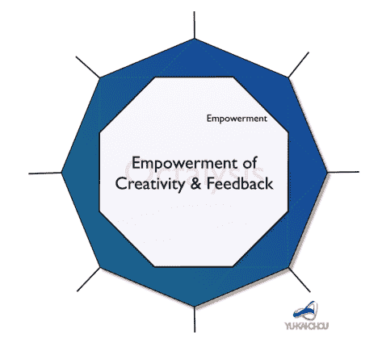
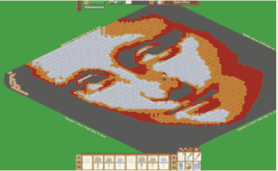
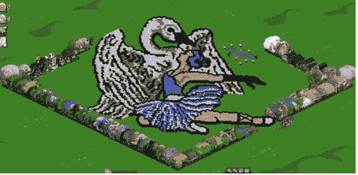
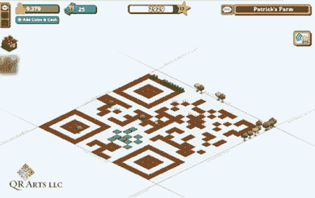

# 第 7 章：第三个核心驱动力 - 创造力赋能与反馈

> “那个一生都在执行几种简单操作的人，这些操作的效果也许总是相同，或几乎相同，他没有机会发挥自己的理解力，也没有机会在克服从未出现过的困难时发挥自己的发明才能。因此，他自然而然地失去了这种努力的习惯，通常变得像人类可能变得那样愚蠢和无知。” - 亚当·斯密，《国富论》

Octalysis 游戏化的第三个核心驱动力是创造力赋能与反馈，它真正强调了大多数人所称的“玩”。我成长过程中最美好的回忆之一就是玩乐高积木，组装、拆卸和重建基本结构，可以有几乎无限的组合方式。它给我和世界各地数百万人带来了巨大的快乐和满足感，仅仅因为它允许人们发挥创造力并立即看到成果。我可以欣赏自己想法的成果，同时确保我可以一遍又一遍地重新校准我的努力，将我的想象变为现实。我相信人类天生就是创造性的，我们渴望学习、想象、发明，并参与创造性过程，其中旅程本身就带来幸福。

这个核心驱动力的美妙之处在于它能够在我们生命中的每一个时刻持续不断地吸引我们。回顾 Octalysis 的结构，上下核心驱动力为白/黑帽，左右核心驱动力为外在/内在，你会注意到核心驱动力 3：创造力赋能与反馈位于右上“黄金角落”。这意味着它是白帽——意味着它具有长期积极的情绪，以及右脑——强调内在动机。不幸的是，这个核心驱动力也是可能最难正确实施的。

## 成为全国性运动的电脑游戏

在一个大型体育场里，超过 10 万名观众认真地坐在舞台前。这些玩家都付了不菲的费用才来到这里，兴奋地等待着他们长期崇拜的偶像与联赛中的其他职业选手竞争。

两位专业解说员正在营造氛围，介绍这场比赛在整个赛季背景下的重要性，以及它对每位对手选手和他们的职业生涯意味着什么。他们根据选手的优势、劣势、比赛风格以及在这场关键比赛中可能出现的创新来推测每位选手的胜算，同时穿插一些笑话。

同时，超过一百万人正在通过电视和互联网观看舞台，世界上一些最大的赞助商的标志在上面醒目地展示。

这是一个典型的职业体育赛事的场景。唯一的区别是，在舞台上，在几块巨大的屏幕下方，只有两个电脑“工作站”，每个都由隔音玻璃包围。坐在工作站前的是两位“明星竞争者”，都大约二十岁岁，在关键比赛前进行赛前仪式。

这是在“电子竞技”行业中的一场锦标赛，这是一个新兴领域，人们在全球范围内观看全职职业游戏玩家相互竞争。⁷¹

这个行业是由暴雪娱乐的热门游戏星际争霸开创的。星际争霸是一款于 1998 年⁷²推出的实时战略（RTS）游戏。在开始 RTS 游戏时，玩家通常会从几个可以开采资源的工人开始。然后资源可以用来创造更多工人、建造具有不同功能的建筑、招募战斗单位、研究科学技术和/或解锁某些能力，目的都是为了防御并击败也在建立自己领地的其他玩家。

用户不断根据时间和资源的稀缺性做出快速决策。他们应该招募更多战斗单位并进入敌方领地，还是投资于缓慢发展但占主导地位的技术，同时冒着被选择在期间训练战斗单位的敌人击败的风险？

星际争霸（以及大多数 RTS 游戏）中的每一场比赛持续大约十分钟到一个小时，每个玩家在每一轮都从零开始。这意味着除了玩家的技能外，没有任何东西可以从之前的游戏努力中积累。

此外，RTS 游戏的“实时”部分意味着你能更快地做出正确的决策并执行它们，你就能成为更强的玩家。优秀的星际争霸玩家有 APM 的概念——每分钟操作数

APM：表示玩家每分钟可以执行的操作次数。操作可以是任何事，从命令士兵守卫某个位置，到选择建筑开始新的科研。

对于星际争霸新手来说，通常只有10-20 APM，因为通常需要几秒钟来确定可以做什么并决定做什么。对于更有经验的爱好者来说，这个速率可以提高到50-60 APM，大约每秒一个操作。星际争霸（或大多数电竞游戏）令人震撼的是，顶尖职业选手的APM常常高达300-400！这意味着他们实际上每秒都在游戏中执行五到六个操作。

这在即时战略游戏中非常重要，因为如果你的每个操作对手都能执行两个操作，那么在双方判断和策略相当时，你注定会被智取和“碾压”。在纪录片《The Hax Life》中，当被问及如何训练提升自己时，一位顶尖星际争霸选手回答，他会在练习时在手腕上绑上沉重的沙袋，这样在真实比赛中，他无拘无束的手和手指会移动得更快⁷³。

事实上，星际争霸在韩国变得如此流行，以至于十多年来一直有专门的电视频道播放职业选手之间的星际争霸比赛。最顶尖的星际争霸选手每年可以赚超过30万美元，尤其是还有大品牌的赞助。我知道对我所有富有的读者来说这不算什么，但对于韩国这样的国家来说，这被认为是相当大的成就，尤其是对于25岁以下的人来说。不仅职业星际争霸选手越来越出名，顶尖职业星际争霸解说员也越来越著名。

星际争霸在美国也非常受欢迎。加州大学伯克利分校率先开设了最早的星际争霸及其策略课程之一，而其他学术机构的许多学生也将星际争霸中的经济动态和决策策略作为其研究论文和学位论文的关键主题⁷⁴。

2009年，即星际争霸首次发布10年后，普林斯顿大学的学生建立了“大学星际争霸联赛”（Collegiate Starleague），这是一个季节性的校际联赛，供成员机构之间进行比赛。超过100所北美高校参与，包括哈佛、耶鲁、康奈尔、麻省理工等[^75]。

当2010年《星际争霸II》发布时，对星际争霸I的狂热并未消退，许多玩家坚持认为星际争霸I仍然更好。当然，几年后，大多数职业选手从星际争霸I转到了星际争霸II。

这实际上很好地证明了出色的终局设计以及核心驱动力3：创意与反馈的赋能（Empowerment of Creativity & Feedback）如何消除所谓的“游戏化疲劳”。

## 游戏化疲劳？

每隔一段时间，我演讲或工作坊的参与者就会问：“Yu-kai，我想在我的公司加入游戏化，但大多数游戏不都是短暂的吗？如果我们实施游戏化，岂不是搬起石头砸自己的脚？”

没错，许多有趣的游戏只会玩两到八个月，之后玩家就会转向新游戏。然而，这并不意味着游戏化你的系统会自动导致同样的情况，原因有两个。

首先，记住我之前提到过，玩游戏通常没有真正的*目的*；也就是说，大多数人从来不用*必须*玩游戏。一旦游戏不好玩，人们就会离开去玩其他游戏，或者去YouTube/Facebook/邮箱。因此，两到八个月后，游戏往往无法再吸引人们，于是他们退出。希望你所设计的系统实际上有它的目的，因此即使它变得无聊（这很可能就是当前的状态），你的用户仍然有理由留下来。

第二个原因是大多数这类游戏在设计时并未考虑在“终局”阶段（玩家旅程的第四个也是最后一个阶段）持续激励。如果终局体验不再吸引人，你自然会转向其他游戏。

许多设计精良的游戏，如星际争霸，成功地吸引了玩家兴趣超过十年。其他游戏如扑克、高尔夫、国际象棋、麻将，都经受住了时间的考验，在几个世纪后仍然流行。现在有很多方法可以设计一个吸引人的终局，但为什么这么多游戏能经受住时间的考验，很大程度上是因为它们利用了核心驱动力3：创意与反馈的赋能。

在伦敦玛丽女王大学和伦敦大学学院2013年发布的一项研究中，研究人员比较了不同游戏对大脑的影响。经过六到八周，研究显示，每天玩大约一小时星际争霸的学生提高了记忆力、视觉搜索和信息过滤能力，以及其他认知技能（冷知识：我恰好在这项研究的《华尔街日报》文章中被引用）。76

当用户能够持续发挥创意并获得几乎无限的可能性时，游戏设计师不再需要不断创造新内容来让事情变得吸引人。用户的思想成为常青的内容，持续将他们的注意力吸引到体验中。这就是核心驱动力3：创意与反馈的赋能长期留住用户的力量。

## 井字和棋（Tic-Tac-Draw）

几乎每种文化都有井字棋游戏，有些地方叫别的名字，比如“X和O”77。我们许多人年轻时喜欢这个游戏，因为只需一支笔和一张纸（或一根棍子和沙地）就能轻松开始，并且半分钟内就能结束。

然而，随着我们长大，这个游戏变得不那么有趣了78。为什么？因为在某个时候它变得太简单了。大多数游戏最终以平局告终，唯一的刺激是试图骗一个新对手因鲁莽/草率的动作而走出失误的一步（这就是核心驱动力7：不可预测性与好奇心）。只要学到一点策略，它就变得无聊⁷⁹。

由于创意和反馈的赋能存在限制，井字棋对用户的吸引力大大降低。

另一方面，国际象棋是一款被严肃研究和玩了几个世纪的游戏。今天，世界上一些最强棋手之间的比赛仍然激动人心，令人兴奋。

当我高中一年级时，刚搬到美国，我意识到自己的英语水平很差。（事实上，在11年级时，我遇到一个两年没见我的朋友，他公开惊呼：“哇，你现在会说英语了！太疯狂了！”）为了弥补我沟通技能的不足，我经常和美国同学下国际象棋，因为它在很多方面和我在台湾玩的中国象棋很相似。我和几个朋友以及指导老师Richard Gill先生一起成立了蓝谷高中国际象棋俱乐部。

当时我很害羞，无法想象自己会公开发言。（事实上，很长一段时间，只要看到别人在台上讲话，我就会手心出汗。）我在高中的名声（除了是那里为数不多的亚洲人之一）就是“人很好”。大多数研究说服心理学的人都会同意，在大多数情况下，“人很好”的名声并不太具有激励作用。像“真诚”、“热情”或“光芒四射”这样的描述才是相似但更吸引人的人格特质。

尽管我还没有建立作为个体的自信，但到10年级时，我被选为国际象棋俱乐部主席。我为拉票发表的演讲实际上是：“我的姓是最容易写下来的。投我一票吧！”在意外赢得选举后（我猜大家喜欢这种幽默），我突然感到一种责任感——史诗意义与召唤！这不再只是关于我，而是关于组织的更大利益！此时我决心成为一名更强的棋手，以便能够带领和指导我们的团队取得更大胜利。在两年多的时间里，我沉浸在开局、策略和变招中

每天花四小时下棋，试图扩展我对位置布局的理解并确立自己作为棋手的风格。

在国际象棋中，开局变化的数量相当庞大，可能的走法线呈指数级扩展，远超可观测宇宙中原子的总数（仅在前 4 步之后，就有超过 2880 亿种可能的局面）。

1996 年，当时的世界国际象棋冠军加里·卡斯帕罗夫与 IBM 的专用国际象棋超级计算机深蓝展开对弈。当时深蓝每秒可计算 1 亿个局面。深蓝和卡斯帕罗夫各自大约有三小时思考时间，深蓝还在卡斯帕罗夫走棋时进行计算。如果你将每秒 1 亿个局面乘以三小时，那就是大量的国际象棋局面。

比赛开始时，卡斯帕罗夫输掉了首局，这似乎让他感到惊讶。随后，他轻松赢下三局并战平两局，从而赢得比赛。⁸⁰

1997 年，进行了复赛。IBM 有一个完整的团队，其唯一职责是提升深蓝的国际象棋水平。届时深蓝每秒可检查 2 亿个局面，是前一年能力的两倍。这场比赛以卡斯帕罗夫赢一局、平两局、负两局告终，导致他落败。⁸¹

第二场比赛震惊了国际象棋界——首次有强大的计算机能够击败人类顶尖选手。在我看来，这相当奇怪。直觉上，当然计算机可以击败强大的人类棋手。国际象棋不就是关于记忆和计算吗？计算机显然可以“记住”并以远超人类的速度和精度进行计算。

这就像震惊于机动车辆开始跑得比人类跑步者更快，或人类在乘法竞赛中输给计算器一样。我认为，与其惊讶于计算机终于在国际象棋上击败人类，人们更应该惊讶于人类竟然还有机会！一台处理数十亿个局面和结果的计算机，怎么会看不到失败即将到来并阻止它呢？

计算机无法简单地主宰人类棋手的原因，即使在今天，也是因为国际象棋不仅仅是计算和记忆。*国际象棋需要创造力、直觉和理解。* 国际象棋如此复杂，以至于最强大的计算机仍无法完全破解它以对抗人类的创造力和直觉。

国际象棋计算机可以计算，但它们无法*理解*。即使国际象棋计算机能够精确算出局面在十五步后会是什么样子，除非有明显的提示，如将死或重大损失，否则计算机并不知道该局面是“好”还是“坏”。人类另一方面，无法完全确定十五步后局面会是什么样，但他们有直觉上的理解：“我的骑士将占据一个非常强势的位置。它将做什么，我还不完全确定，但我知道它会以某种方式让我受益。”正是这种理解和分析能力让人类棋手有时能够战胜强大的计算机。

我前面提到国际象棋的可能走法远超宇宙中的原子数量，理性的怀疑者可能会认为我只是为了夸张而从脾脏里掏出数字。然而，如果你真正查阅数字，一盘长 40 步的国际象棋对局会有 10¹²⁰ 种可能变化，这相当于已知宇宙中原子数量的 10⁴⁰ 倍。82

我提出这些事实的原因是为了说明这一点：正因为国际象棋存在如此多的可能变化，所以存在丰富的策略和下棋风格。这种多样性对于利用核心驱动 3：创造力赋能与反馈来创建出色的游戏化活动至关重要。一些国际象棋选手狂热地进攻，一些则防守性地布局；有些人喜欢慢慢挤压对手致死，而另一些人则追求制胜的残局。你几乎可以根据他们下的棋来判断是谁在下棋。

在 UCLA 时，我曾写过一篇论文，探讨每位世界国际象棋冠军的风格如何反映他们时代的历史事件。第三位世界冠军何塞·卡帕布兰卡生活在古巴和平的黄金时期，因此他的棋风和谐而优雅，
积累微小优势最终导致胜利。下一位世界冠军亚历山大·阿廖欣生活在俄罗斯革命时期，经常逃避迫害并面临死亡。因此，他的风格以猛烈进攻著称，用牺牲冲垮敌王的防御工事。另一位世界冠军米哈伊尔·博特温尼克生活在苏联“钢铁与工程”实力鼎盛时期。因此他的风格是进攻性的位置布局，类似于组装一辆坦克然后以不可阻挡的力量碾压敌方领土。

美妙之处在于，要登上国际象棋世界的顶峰，你不需要以一种特定的“最佳”方式下棋。你可以通过*有意义的选择*创造自己的下棋风格，这些选择反映你的个性和风格。只要你投入严谨的努力，保持承诺，并对游戏充满热情，你就有机会成为伟大的国际象棋选手。

这种让玩家表达无边界创造力、看到即时反馈并提供有意义的选择来展示不同下棋风格的能力，正是核心驱动 3：创造力赋能与反馈对游戏玩家、用户、客户和员工都如此有吸引力的原因。**当你设计一个出色的游戏化系统时，你要确保没有一种标准的获胜方式。相反，为用户提供足够的有意义选择，让他们能够以截然不同的方法更好地表达创造力，同时仍能达成获胜状态。**

至于我的国际象棋俱乐部，到我读完 11 年级时，蓝谷高中已成为堪萨斯州我们组别的堪萨斯州冠军，并连续五年成功卫冕。除了这之外，俱乐部在全国锦标赛中也取得了优异成绩。这段经历也教会了我如何成为领导者，并在我几乎一无所有时建立了我的自信。我无法足够感谢国际象棋和 BVHS 国际象棋俱乐部带我走到今天。

## 教育中的将军胡萝卜

当你为核心驱动 3：创造力赋能与反馈进行设计时，重要的是创造一个设置，让用户被赋予目标，以及多种工具和方法来制定策略以实现该目标。经常你的用户缺乏动力，因为他们不理解活动的意义，不清楚活动的目标，和/或缺乏有意义的工具来创造富有表现力的策略以实现目标。

在过去几十年里，实体对战卡牌游戏如 *宝可梦* 或 *万智牌* 已成为一种新现象，在许多国家获得了显著的关注⁸³。与国际象棋或 *星际争霸* 类似，有许多专门的锦标赛，年轻和年长的玩家在那里决战以成为游戏冠军。

这个现象有趣的地方在于，实际上为了玩好游戏需要记住大量信息。有数百张卡牌，每张都有其独特的属性和数字（如 hp、攻击等）。擅长这些卡牌游戏的孩子不仅记住所有卡牌和属性，他们甚至还记得哪些卡牌克制哪些，以及哪些卡牌反过来克制那些卡牌。

如果你算一下数字，那实际上是比元素周期表的内容还要多得多的信息去记忆。这就好像孩子不仅记住了元素周期表上的每一个元素，还记住了每个元素的确切重量和位置，以及每个元素如何与每个其他元素相互作用。

*这相当令人震惊。*

但如果你问同一个聪明的孩子元素周期表上的第五个元素是什么，你很可能会得到类似“呃……氧气？”的回答。为什么会这样？显然孩子并没有突然从天才变成白痴。这种巨大差异不是智力的转变，而仅仅是动机的改变。

当孩子记忆元素周期表时，他们看不到这样做的目的。这只是为了通过考试、取得好成绩、取悦父母。因此，孩子只努力学习到足以通过考试，然后之后就忘记了大部分内容。但在这些卡牌游戏中，孩子是为了想出很棒的

strategies, beat their friends, and feel accomplished. Also, since they personally own many of these cards, they are anxious to study them, understand their strengths and weaknesses, and research what other cards are out there (an effect within Core Drive 4: Ownership & Possession).

If the *means* to that end is to memorize thousands and thousands of terms and stats, it becomes worth it, even fun. As designers, it is important to recognize that they understand the goal (beating their friends), build ownership and familiarity with their tools, and use their unique strategies and experience towards that.

## Folding into the Crowd

One of the best examples of Empowerment & Creativity & Feedback is seen in the new trend of Crowdsourcing. Crowdsourcing is the activity of throwing a challenge or activity into the public and having the masses collaborate or competitively solve the problem.

Well known examples such as the *XPRIZE* allows individuals and teams to engineer new solutions in advanced technology such as aerodynamics and space travel to advance the human race; while Kaggle allows the brightest mathematical minds to solve predictive modeling and analytics problems⁸⁴.

A very popular example in the *serious game* space has been FoldIt introduced in Chapter 4. For many years, scientists have tried to decipher the crystal structure of an AIDS virus labelled as the Mason-Pfizer monkey virus (M-PMV), in order to advance their understanding of AIDS treatment and prevention. Unfortunately, after fifteen years of research, this problem remained unresolved⁸⁵.

Fortunately, in 2008, David Baker from the University of Washington launched the FoldIt project, where through an interactive game-play interface, players could modify various protein structures with objectives such as “maximizing the surface area of this protein.”

Surprisingly, this problem, which had baffled researchers for over fifteen years, was solved in a mere ten days. By tapping the efforts of thousands of

As people walked up and down the stairs, they started to hear notes playing. Soon, many commuters who heard others go up the stairs started taking the stairs too themselves to see if it would work for them. Eventually, some individuals attempted to play some simple tunes.

When you empower people by allowing them to easily play an instrument, you make the simple activity of walking more fun and engaging. During the pilot, the piano staircase led to an increase in commuters taking the stairs by 66%.86

From an Endgame design point of view, the staircase does have its limitations. The actual tunes people can play is fairly limited since jumping up and down staircases in producing a pleasing rhythm is rather challenging. Pedestrians could quickly lose interest after stepping through the same notes over and over. Once the initial surprise and novelty wears off, the repetitive tones may become boring. However, many people may still prefer this over a regular staircase, just to get some delightful feedback on each step.

This is an example of a Core Drive 3 implementation that focused well on the feedback it gave users, but it didn’t provide them full control to express wider ranges of their creativity.

## Empowerment and Creativity in the Corporate Space

Core Drive 3: Empowerment of Creativity & Feedback also applies to the workplace and employee motivation.

Occasionally, my friends with corporate positions reach out to me about making the switch towards a career in entrepreneurship. More often than not, the reason they want to start their own companies is simply due to the frustration of not seeing feedback on their creative ideas in the corporate environment. Frequently, months will pass after they have proposed a plan or concept before there is any response or feedback through the corporation’s bureaucratic channels. More often than not, the employee never hears back on that creative idea.

In a bureaucratic organization, though everyone likes to talk about innovation, innovation requires risk, and the corporate ladder trains people to be risk averse. If anything new is happening, it is only after authorization through many signatures - to the point where no one could claim full responsibility if things went wrong. Managers often push everyone to come up with innovative ideas, but when they actually hear something new, they immediately respond with, “Hmm, has any other company done that before?”

This is incredibly frustrating for those who have creative ideas which may positively impact the status quo, especially when their ideas are immediately shot down or the approval process is dragged out indefinitely. It is a sad scenario - as companies grow larger and more bureaucratic, they become less agile, less adaptive to changing business conditions. As a result, younger and more nimble companies adapt to changing business models more swiftly than their cumbersome counterparts and quickly take advantage of new opportunities. All too often many great companies from the past century eventually fall into extinction.

In the Motivational Psychology Bestseller *Drive*, Daniel Pink explains that allowing employees to have full *autonomy* over what they work on, how they work, who they work with, and when they work often becomes greater motivators than giving them a raise.⁸⁷ Convincingly, researchers from Cornell University studied 320 small businesses, half of which empowered employees to work through autonomy, while the other half had a top-down management structure. For the group of companies which gave their employees more control in using their own creative processes to perform their work, business growth was four times the rate of the other group, with only one third of the turnover rate.⁸⁸

An example of a company who attempted to embed Empowerment of Creativity & Feedback into their workplace was Google. They implemented a program called *20% Time* – where one day in the week, employees can work on any project they would like, as long as the Intellectual Property belonged to Google.

Many employees who wanted to become an entrepreneur mostly did so because they had great ideas and wanted to see it become reality. But most of them still don’t enjoy the risk and the hassle of starting a company. With *20% Time*, employees no longer felt a need to start their own companies because they could simply build their ideas in the safe and comfortable haven of Google.

As a result, some of the most successful product lines such as Gmail were spawned from an emphasis on this Core Drive of Creativity. Unfortunately, 20% Time was shut down as Google became larger and wanted to “put more wood behind fewer arrows.”⁸⁹

## Draw a Gun for Bad Endgame Design

While we talked about how Core Drive 3: Empowerment of Creativity & Feedback can often create Endgame Evergreen Content, if it is not thoughtfully designed for the Endgame, it may still fail in the long run.

For example, Draw Something (essentially Pictionary, where one side draws something with a pen and the other side guesses) was an extremely popular and fun mobile game for a short while in 2012. They amassed 35 million downloads within seven weeks of launch, and later that year was sold to Zynga for close to $200M.⁹⁰

The game was fun because it allowed people to utilize their creativity in determining how to best draw a picture of the challenge word, so that the other person can understand and guess the correct answer. The game even monetized by having people unlock certain colors and drawing tools, so that they would have a richer variety of ways to express their creativity in helping the other person guess better (this is what I call a *booster*, which we will cover later in this chapter).

Furthermore, Draw Something brought in an addictive Social Influence & Relatedness element (Core Drive #5) that made people curious to see if their friends could guess the meaning of their drawings (which adds Core Drive 7: Unpredictability & Curiosity). All these elements contributed to the huge success of Draw Something during its time.

## 《你画我猜》的衰落

尽管这款游戏利用了这些核心驱动力，但在 Zynga 收购它之后，各项数据便开始下滑。由于游戏未能提供新鲜内容和挑战，无法让人体会到持续进步的感觉，也无法为玩家提供进一步精通游戏所需的新条件，许多用户开始流失。

或许，《你画我猜》的开发商 OMGPOP 因忙于与 Zynga 团队整合，而没能为词库添加更多单词，于是相同的单词挑战开始反复出现。当人们一遍遍画着同样的图画时，创意元素也消失了。

在这里，我们看到了一种不能被视作常青内容（Evergreen Content）的情况——尽管一个事物有很多种画法。如果公司不为玩家持续增加新的单词挑战，创意性就会减弱，游戏也会变得枯燥。

另一个问题在于，当你同时要应付太多进行中的游戏时（游戏设计会让你很自然地在每局结束后开启新对局，并邀请更多朋友开新局），回答所有这些游戏可能会成为一种沉重的负担，而不是让你对游戏本身感到兴奋。众所周知，游玩应当是自愿的。一旦你感到自己无法掌控游戏，你便会陷入黑帽动机（Black Hat motivation），最终导致玩家参与的长期流失。

最后，这款游戏还失去了吸引力，因为许多用户干脆绕开创意元素，开始通过绘制答案的字母而不是图画来“钻系统空子”。结果，很多高分玩家其实是作弊者。人们会以多种方式发挥创意，包括想出各种手段去欺骗系统。

在我的客户工作坊中，我经常探讨一个观点：一个“可钻空子”的系统并不一定是坏事，如果设计得当，甚至可能对公司有利。然而，若处理不当，它可能会严重拉低游戏体验，并明显打击那些试图正当参与的玩家的积极性。

如果你阻止用户以有益于生态的方式发挥创造力，他们最终会利用自己的创造力去寻找漏洞，并通过“在你背后搞小动作”来占得先机。

## 创意赋权与反馈中的游戏技巧

你已经深入了解了核心驱动力3——创意赋权与反馈——的动机与心理本质。为了让这些内容更具可操作性，我在下面列出了一些大量运用这一核心驱动力来吸引用户的游戏技巧。

## 增益道具（游戏技巧 #31）

你是否玩过《超级马里奥》，并在吃到蘑菇或花朵让自己变强时欣喜若狂？它们就是游戏中的增益道具；玩家获得这些东西，是为了更有效地达成胜利状态。

与单纯的升级或习得新技能不同，增益道具通常只在特定条件内有效。只要不受到伤害，你就可以尽情享受砸砖块和喷火球的乐趣。一旦被敌人击中，你就回到使用增益道具之前的“自然状态”。

在《超级马里奥》中，获得“跳跃星星”这类增益道具受时间限制，会暂时赋予玩家无敌能力。在接下来的十几秒里（为了写这本书，我确实上了 YouTube 数过秒数），玩家会尽最大可能向前猛冲（有时还会掉进坑里），同时享受使用这股转瞬即逝的力量带来的肾上腺素飙升感（其中还带着一丝核心驱动力6：稀缺感与急迫感）。

这种被注入新的、但有限制的强化道具的感觉令人兴奋，也是推动期望行为的极强动力。很少有人愿意在星星无敌效果尚未消失时停下游戏。

在《糖果传奇》这类游戏中，增益道具同样是极为强大的机制，尤其是在商业化方面。玩家可以赚取（或购买）数量有限的增益道具，帮助自己克服特定阶段中最棘手的挑战；例如召唤一只泡泡糖巨怪打败危险的巧克力，或者用一个类似迪斯科球的彩色炸弹移除所有同色糖果。如果没有各种增益道具和强化效果，这款游戏的吸引力将远不如今天。

## Superbook.tv 中的增益道具示例

我的客户之一 Superbook.tv 制作了一部质量极高的计算机图形（CG）动画系列片，在线上和国际电视上拥有数百万粉丝。Superbook.tv 隶属于非营利组织基督教广播网络（Christian Broadcast Network），目标是通过鲜明的画面、现代相关性（核心驱动力5）和古怪的幽默，向儿童讲述《圣经》故事。它甚至有一个名叫 Gizmo 的搞笑红色机器人，一边说着蠢萌的话，一边表演让人目瞪口呆的绝活——比如假装自己是机器海盗时，让一只机器宠物鹦鹉从胸口飞出来。

除了这些高质量影片之外，SuperBook.tv 还运营着一个网站，旨在吸引孩子们深入了解剧集背后的故事。在我与客户合作时，总会先请他们定义第17章中将讨论的“八角行为分析战略仪表盘”中的五个项目：业务指标、用户、期望行为、反馈机制和激励。虽然大多数客户把收入增长或活跃用户列为第一业务指标，但 Superbook 的创意媒体总监 Gregory Flick 说：“我们的第一业务指标是让孩子们更多地参与《圣经》。”

为了吸引孩子的注意力，Superbook 的策略是在网站上提供种类丰富的趣味游戏，让孩子们乐于游玩。这些游戏提供了积累“超级积分”的机会，这些积分以后可用来兑换周边产品、礼品卡和其他奖励。

当孩子们沉浸在这些游戏中时，其中一些人会开始探索网站上的其他内容，包括“剧集指南”。这些指南详细介绍了每集背后的许多故事，如当时的历史背景、人物以及其他有趣的冷知识。

最终目标是利用剧集指南，将孩子们导向圣经应用（Bible App），让他们在那里与《圣经》进行更多互动。这是一个非常清晰的漏斗策略：玩游戏 -> 探索剧集指南 -> 与圣经应用互动。

## 反向漏斗

漏斗策略的缺点是，漏斗底部往往只有顶部的一小部分。许多孩子会玩游戏，也许有些孩子会注意到剧集指南，但其中只有少数人会尝试圣经应用。如果进入剧集指南和圣经应用本身就能成为游戏的一部分，而不是仅仅依靠好奇心去发现，那就更好了。

一个可能的解决方案是将增益道具同时嵌入剧集指南和圣经应用。打个比方，孩子通过完成剧集指南中与《圣经》相关的挑战（这些挑战需要善用圣经应用才能完成），就能提高自己的“知识分数”，这个分数在网站上玩趣味游戏时可以用来倍增超级积分。

## 《植物大战僵尸》中的里程碑解锁

*《植物大战僵尸》* 是一款动态的“塔防”游戏，玩家需要制定创造性的策略，利用资源和“植物”解谜，抵御僵尸进攻。秉承核心驱动力3的精神，这款游戏允许人们发挥创造力，针对同一个问题提出各种不同的解决方案。有意思的是，这是我母亲和我妻子唯一双双沉迷的“战斗”游戏，也是唯一一款让她们都很投入的“僵尸”游戏。

就游戏技巧而言，《植物大战僵尸》把里程碑解锁运用到了极致。每当你通关一个关卡，通常会解锁一株新植物来帮助抵御僵尸。这不是巧合：这株新植物往往恰好能克制你刚刚击败的那一关中最难对付的僵尸；如果你早点拥有它，之前会轻松得多！

当然，这时候通常不是放下游戏的时候。如果你不马上进入下一关试试这些新获得的力量，你会躺在床上，整晚都在想这件事！

## 毒药选择/选择感知（游戏技巧 #89）

大量研究表明，与只有一个选项相比，人们在拥有选择时会更加喜欢某个事物。即使多个选项不如唯一的选项有吸引力，这一结论也依然成立。任何家里有两岁孩子的父母都会明白选择感知的影响力。

> “你想在吃鸡肉之前还是之后吃蔬菜？”

孩子两岁时，很快会发现自己拥有一种名为“自由意志”的特殊力量。而一旦发现这种力量，他们就会熟练地加以运用。

*“你想要哪一个？”*

“…”

“你想要A吗？”

“不要！”

“那好吧。你想要B吗？”

“不要！”

“好吧，你必须做个选择。A还是B？”

“不要！”

“那么你什么都不想要。我把它们拿走，好吗？”

“不要！”*

与孩子谈判是严肃的育儿工作。你必须让孩子认为，无论发生什么，都是他们自己决定的结果，而不是别人的建议。（有趣的是，我们这方面并没有随着年龄增长而改变。）当孩子不知道自己想要什么时，这是最棘手的，因为他们无法自己做选择。但如果他们听从了别人的建议，他们还是会讨厌。

小时候，妈妈让我学弹钢琴。这让我非常沮丧，很多次我都愤怒地哭喊。学了两年钢琴后，妈妈看到它给我带来的痛苦，对我说：“好吧，如果你这么讨厌它，你可以不用再弹钢琴了。但你必须学一种乐器。你想学什么？”那时我看到台湾的一位流行歌手王力宏在大型演唱会舞台上拉小提琴，给我留下了深刻印象。于是我告诉妈妈，我想学小提琴。

从我改学小提琴之后，事情不一定变得更容易。但因为选择拉小提琴是我自己做的决定，我忍了下来，并以更好的态度去练习。毕竟，如果我也讨厌拉小提琴，那就意味着我之前的选择是“错误的”。而人们讨厌犯错！当我开始抱怨时，妈妈会问我：“那你讨厌拉小提琴吗？”我会立刻反驳：“不！谁说讨厌拉小提琴？我爱拉小提琴！我只是需要……更多练习。”

这对父母来说是多大的胜利啊！

选择感知的关键在于，选择本身不一定有意义，而只是让人感觉他们有权在不同路径和选项中做选择。在我的例子中，我仍然被强迫学一种乐器——我没有选择停止学习的权利——但因为我觉得自己可以选择学哪种乐器，我感到有了自主权。

当我说选择没有意义时，可能是指用户面对一个好选项和一个坏选项，自然会被引导选择更好的那个（通常，用户在这种情况下会感到更开心，而不是被迫接受更好的选项）；也可能是指所有选项都太局限，彼此之间没有区别。

杰西·谢尔在他的著作*《游戏设计艺术——透镜之书》*中介绍了两个透镜：自由透镜和间接控制透镜⁹³。谢尔描述道：“我们不必总是给玩家真正的自由——我们只需给玩家自由的感觉。……如果一个聪明的设计师能让玩家感到自由，而实际上玩家的选择很少，甚至没有选择，那么我们就能两全其美——玩家拥有美妙的自由感，而设计师也设法经济地创造了一种具有理想兴趣曲线和理想事件集的体验。”

根据谢尔的说法，这可以通过以下方式实现：1）为玩家选择添加约束；2）激励玩家采取实际符合玩家目标的某些选择；3）创建引导用户执行所需操作的界面；4）添加视觉设计以吸引玩家目光；5）提供社交引导（通常通过游戏中的电脑生成角色）；6）通过音乐控制影响玩家行为。

选择感知在许多其他重要方面影响我们的决定，例如浪费时间和精力让无意义的门或选项保持开放，即使这些选项之前已被视为不良选项，仅仅是为了维持一种有选择的感觉。⁹⁴

显然，由于选择感知意味着缺乏有意义的选择，它在实际应用中往往并非理想，因为它并不能真正激发用户的创造力。如果太多选项明显毫无意义，也可能会冒犯用户。然而，对许多企业来说，设计师将选择感知融入系统比实际创造有意义的选择更容易。

## 植物选择器/有意义的选择（游戏技巧 #11）

除了那些让人感到有自主权的选择之外，还有一些选择是真正有意义的，并且体现出的偏好并非明显优于其他选择。我把这些技巧称为“植物选择器”，因为就像决定在花园里种什么一样，它通常是对风格和策略的偏好，这正是核心驱动力3的燃料。

如果你创建一个有100名玩家的游戏化环境，而这100名玩家都以完全相同的方式达到胜利状态（例如“执行A行动，获得积分，执行B行动，获得徽章，执行C行动，获胜！”），那么就不存在有意义的选择。（通常情况下，如果游戏化系统存在一个无需思考的支配性策略⁹⁵，那就属于选择感知。）如果30名玩家用这种方式玩游戏，30名用另一种方式，剩下40名再换一种方式，那么你就有一定程度的有意义选择。如果100名玩家都以不同的方式玩游戏，那么你就有大量的有意义选择。

如果你让一百个孩子坐下来玩一套乐高积木，从统计上讲，不可能会有两个孩子用完全相同的顺序搭建出相同的东西（当然，除非互相模仿）。这种意义上的有意义的选择和游戏，是核心驱动力3：创造力与反馈的赋能的终极状态。

## 植物大战僵尸策略

我上面提到过成就里程碑解锁在《植物大战僵尸》出色游戏设计中是多么重要的组成部分。它成功的另一个方面是植物选择器。当你开始一局《植物大战僵尸》时，你面临一个挑战——一波僵尸，每个都有不同的优势和能力。你作为玩家，在游戏前只能“预选”有限数量的植物来抵御那些僵尸。有阳光资源可以让你种植植物，并且放置它们的格子数量有限。

要击败《植物大战僵尸》中的一关，有各种不同且都极其有效的方式和策略，同时也有很多完全行不通的方法。玩家可以选择先用大量收集阳光的植物和较少的防御植物来增强经济；布置基本豌豆射手；积攒资源使用威力更大的强大植物；完全专注于爆炸物和陷阱；或者使用臭洋葱把所有僵尸引到一条线路上，然后用穿透攻击将它们全部消灭。

通常，玩家会用一种策略击败一个关卡，然后重玩一遍来测试另一个玩家构思的新策略。能够选择许多选项，每个选项都有其独特的优势和劣势，并产生各种基于风格和创造力的策略，这就是植物选择器技巧的核心本质。

不幸的是，当《植物大战僵尸2》首次发布时，它完全忘记了最初的设计根源，把植物选择器变成了有毒选择器，一些植物过于强大，而另一些在前期则完全无用。

## Farmville 艺术

我认为《Farmville》实际上并不是一款“有趣”的游戏，因为它没有使用很多内在动机，尽管它仍然创造了一台引人入胜且令人麻木的机器，巧妙地利用所有黑帽游戏机制来激发我们的核心驱动力。

通常，在终局阶段，进行日常乏味运作并不有趣。然而，一些玩家在《Farmville》中创造了自己的终局，我认为这是积极且有趣的，因为原因正确——它让每个人都能通过自己的农场创造性地表达自己。

当《Farmville》玩家参与游戏足够久，解锁了各种各样的植物和颜色之后，其中一些人甚至成为了《Farmville》艺术家来表达他们的创造力。许多人通过《Farmville》的数字像素创作出了令人惊叹的艺术作品。当然，使用像*Microsoft Paint*这样的实际绘图技术可能仍然更高效，但是嘿，画布就是你的农场！

因为你可以用你的作物做很多事情，所以《Farmville》的这一元素可以被视为一种常青机制。用户可以持续保持参与，而无需添加任何额外内容，就像颜料和画笔可以是常青材料一样。这里棘手的地方在于，玩家必须快速种下艺术品然后截图，因为几个小时之内植物就会枯萎凋谢。

以下是一些相当值得注意的艺术作品：

## 基本组件；无限组合

有意义的选择让诸如乐高、国际象棋甚至《我的世界》这样的游戏变得有趣。你的选择会在游戏玩法中产生切实的差异，并塑造体验随时间演变的方式。通常，可供选择的构建模块只有少数几个，但根据情境、挑战和约束条件，这些构建模块会在不同场景中以不同方式发挥作用。

在《游戏设计快乐之道》一书中，游戏设计师拉夫·科斯特介绍了一个假设的游戏，其中只有一把锤子、只能做一件事，这很可能导致一种枯燥的体验。科斯特将其与井字棋游戏进行比较，后者同样不需要有意义的能力范围和策略。相比之下，跳棋玩家可以开始学习逼迫对手进行不利跳跃的重要性。“大多数游戏会随着时间推移逐步展开能力，直到在较高水平时你拥有许多可能的策略可供选择。”

游戏设计师杰西·谢尔指出，添加有意义的选择最令人兴奋和有趣的方式之一是让玩家在稳妥行事、获得小奖励，或冒大风险、争取大奖励之间做出选择。这种动态，他称之为*三角性*，在许多成功且引人入胜的游戏中都能看到。

归根结底，在您的体验中实施有意义的选择并没有放之四海而皆准的解决方案。如果有的话，那将是一个悖论。您必须决定并仔细设计用户需要解决哪些挑战、用户可以选择哪些植物，以及不同的植物选项如何将用户体验重塑为新的、令人灵感迸发的茂密森林。

## 核心驱动力3：更宏大的图景

核心驱动力3：创造力与反馈的赋能是一个在许多不同层面上都很棒的核心驱动力。它通过为我们提供工具和力量来引导我们自己的游戏玩法，并赋予我们通过自己的想象力影响周围环境的能力，从而挖掘我们与生俱来的创造欲望。

不幸的是，核心驱动力3通常是最难融入产品设计的，主要是因为在一个注意力已经匮乏的社会中，它需要如此多的关注。在信息过载的时代，人们的注意力持续时间更短，以便过滤掉他们每天被轰炸的所有无价值内容。所以，除非你精心设计你的体验，否则人们很可能会回避投入创造性地做某事所需的时间和精力。这就是为什么核心驱动力3更常见于搭建阶段和终局阶段中能有效发挥作用，而不是在发现阶段和入门阶段。

一旦你能够解锁核心驱动力3：创造力与反馈的赋能的力量，它常常会引发其他核心驱动力的涌动，例如发展与成就、通过协作游戏产生的社交影响与关联感，以及不可预测性与好奇心。当有效实施时，这个核心驱动力成为一个关键的常青引擎，可以成为短暂花朵与永恒红杉之间的区别。

## 为了充分利用这本书，现在只选择以下选项之一来做：

- 简单：想一个核心驱动力3：创造力与反馈的赋能激励你或他人采取某些行动的例子。它是否让人们更长时间地保持参与？

- 中等：想想你上一次沉浸在真正吸引你的活动中的时刻。它是否涉及大量的创造力、策略或有意义的选择？如果是，描述这些元素被激发出来的过程。如果不是，思考如何将这些组件添加到体验中。那会不会让活动更具吸引力？

- **困难**：对于你自己的项目，想想如何将里程碑解锁实施到体验中，并在用户达到里程碑时用助推器奖励他们。这些助推器是用户会以积极态度看待的东西，因为它们允许用户做他们想做的事情，但更高效吗？还是说，它们会被用户视为一种控制工具，用来让你*自己*想要的事情更高效，而不关心用户的利益？

**在 Twitter 或你喜欢的社交网络上分享你的想法，带上标签 #OctalysisBook，看看别人有什么想法。**

## 初试身手

既然你已经深入《Octalysis》游戏化和动机的迷人世界，试试我网站上的 Octalysis 工具吧。玩玩核心驱动力滑块，在每个核心驱动力上添加简短备注以帮助更好地理解它们，并阅读自动生成的 Octalysis 洞察，以更好地理解设计的优势和劣势。把这当作一个创造性的过程，并将这些洞察视为对你分析的反馈。Octalysis 工具可以免费访问：[YukaiChou.com/octalysis-tool](YukaiChou.com/octalysis-tool)。
