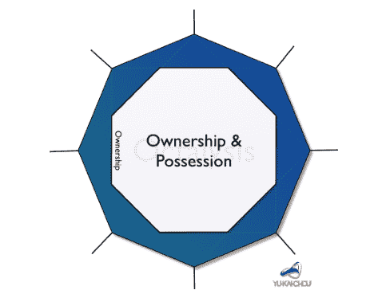
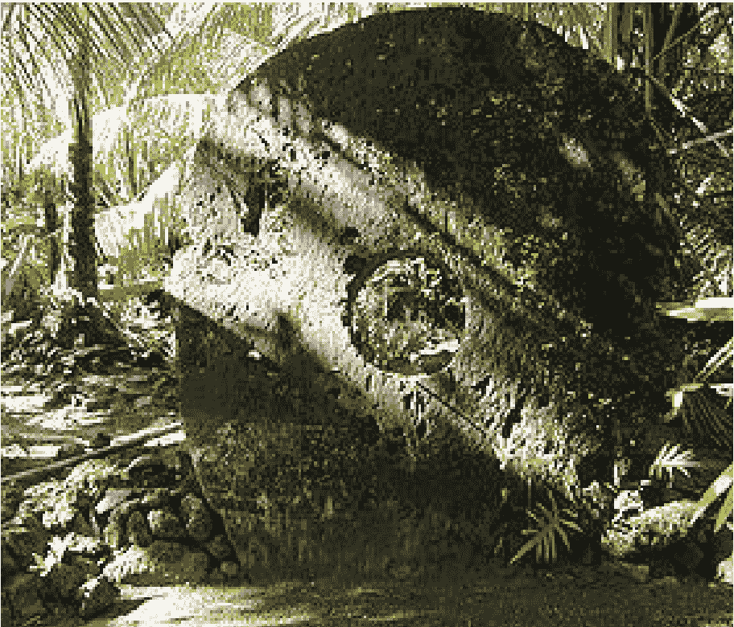
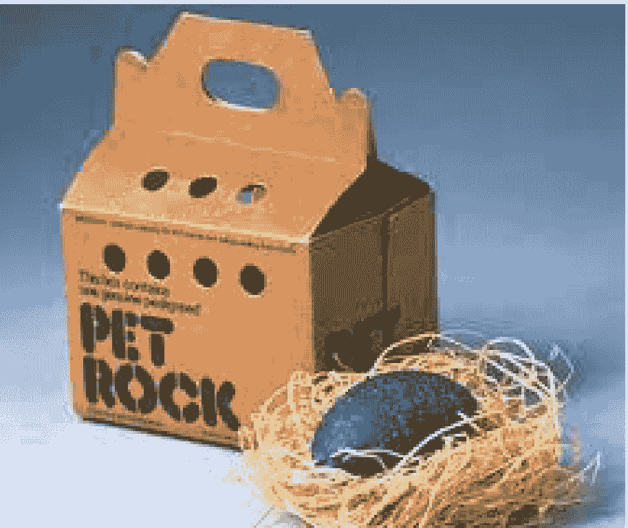
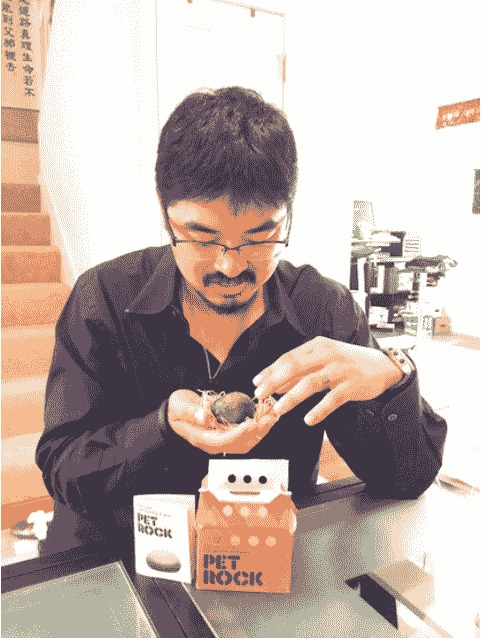
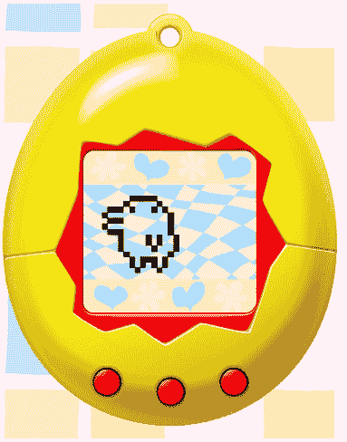
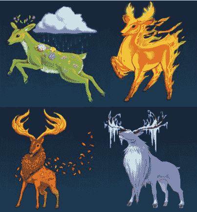
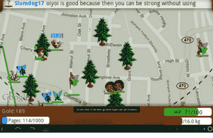
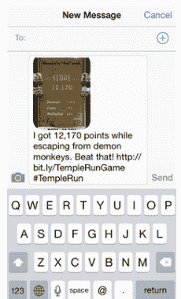

# 第8章：第四个核心驱动力——所有权与占有感

所有权与占有感是 Octalysis 游戏化中的第四个核心驱动力。它代表由我们对拥有某物的感觉所驱动的动机，以及随之而来的改进、保护和获得更多它的欲望。

这个核心驱动力涉及虚拟商品和虚拟货币等许多元素，但它也是迫使我们收集邮票或积累财富的主要驱动力。在更抽象的层面上，核心驱动力4与我们将时间或资源投入到按照自己喜好定制某物有关。这也可以体现在一个系统不断了解你的偏好，以塑造一种独特适合你的体验。

所有权与占有感位于 Octalysis 框架的最左侧，因此代表了与左脑（再次强调，这不是科学上的地理概念，而更多是象征性的）分析性思维相关联的最强影响力的核心驱动力。在这里，决策主要基于逻辑和分析，并由对占有的欲望作为主要激励因素而强化。

例如，在《Farmville》中，你不断努力通过开发土地、提高作物产量以及改善牲畜的数量和质量来增加你的资产价值。你可以进一步发展你的地产的基础设施和住所——在你梦想的庄园上建立那座乡村别墅。

正因为如此，你发现自己不断投入更多时间和精力来扩张你的农场。积累更多的奶牛、植物和水果，以及购买马厩来安置你的马匹，或购买美容服务让它们看起来“更漂亮”。

### 等等，这是我的？等等，那我在乎了！

我们的大脑会与我们拥有的东西形成自然的联系。暂时假装你通常更喜欢大多数饮料而不是啤酒（对许多读者来说，这个练习会非常困难）。如果我们在一个聚会上，我给了你一瓶啤酒，你可能会回答：“哦，没关系，我不是很喜欢啤酒。”然后我回答说：“不，拿着吧！我把它放在你旁边。”

这时，你可能仍然不关心这瓶啤酒。你甚至可能在站起来离开时丢弃它。但在那一刻，如果有人走过，拿起啤酒开始喝，你很可能会忍不住说：“嘿！你在干什么？”他们可能会回答：“有什么大不了的？反正你也不喝！”你很有可能会不高兴。“即使这样，你也应该在拿走之前问问。”

一旦你对某物产生了拥有感，它的地位就会提升，并开始以不同的方式影响你的行为。如果你一瓶无所谓的啤酒都能引起你对某人的不快，想象一下，如果它是你深切关心的事物，你会受到多大的影响。

我的一个叫克里斯·罗比诺的朋友曾经向我解释，他从来都不擅长数学，直到他开始经营自己的生意，并在数字上加了一个美元符号。数学突然变得非常引人入胜，他很快就掌握了他需要知道的一切。

凭借他对金钱新的掌控感，他迅速将自己的事业打造成了一家成功且利润丰厚的咨询公司。克里斯开玩笑说：“一旦这些数字开始代表我自己的钱，我立马就变成了天才。”

与啤酒的例子类似，当他的大脑意识到这些无聊的数字现在代表了他所拥有和关心的事物时，动机和参与度的性质完全改变了。

### 理智的邮票

所有权与占有感核心驱动力最常见的表现之一，就是收集东西的欲望，比如邮票或棒球卡。我们很多人都有过收集某些物品的经历，这些物品本身相对

功能性很低，但它们之所以有意义，只是因为它们是更大集合中的一部分。

起初，一些读者可能会觉得核心驱动力 4 只是指积累更多物品的行为，但它也能为那些仅仅沉浸于这些物品的人提供情感上的慰藉。这就像拥有昂贵汽车或画作的主人，他们花费数小时欣赏和享受自己珍爱的物品，而无需对它们做任何事。有些人甚至会把画作藏起来以免被偷，同时仅凭*知道*画作在保险箱里就获得了满足感。

在 Malcolm Gladwell 的书 *大卫与歌利亚* 中，Gladwell 描述了 1950 年代一位在儿童医院工作的医生，他正在治疗患有严重儿童白血病且持续出血的年轻患者。Gladwell 写道：

> 孩子们全身都在流血——从粪便、尿液里流出——这才是最糟糕的部分。他们把天花板都染红了。他们从耳朵、皮肤里流血。所有东西上都是血。护士们早上穿着白大褂上班，回家时浑身是血。[...] 孩子们会在肝脏和脾脏内部出血，导致极度疼痛。他们在床上翻身就会留下可怕的淤青。甚至一个鼻出血都可能是致命事件。”101

在那个年代，死亡率高达九十 percent，孩子们会在六周内因失血而死亡。在如此令人沮丧的环境中工作，你可以想象大多数医生都坚持不了多久。Gladwell 描述了这位医生在经历了一天情绪上的打击后回到家，每晚唯一想做的就是安静地坐在他的邮票收藏前。

这让我觉得非常奇怪。这个人每天眼睁睁看着孩子死在自己手里，而让他感觉好一点的东西竟然是一套邮票？而且，看起来他每晚都会花上相当长的时间坐在邮票前。他当时到底在想什么？他只是看着它们，好像忘了自己拥有哪些邮票，或者只是因为它们而感到开心？

这就是拥有与占有的力量——它不仅有吸引人的能力，还有安慰人并带来幸福感的能力。你在棒球卡、钢笔，甚至是整齐摆放在书架上却无人阅读的精美书籍上也能看到同样的现象（希望我的书不要成为其中之一）。人们就是喜欢展示它们并为此着迷数小时，同时似乎在“享受”这个过程。

## 你能有多“石化”

关于拥有感的一个引人入胜的例子，出现在西太平洋加罗林群岛的一个小岛 Yap 上。除了听起来令人愉快且无忧无虑之外，“雅浦人”以使用一种名为 *Rai* 的货币而闻名。

Rai 的运作方式与大多数货币类似，只是它们通常是大型圆形石盘，由方解石和霰石晶体构成的石灰岩雕刻而成。一些 Rai 体积非常庞大的问题在于，它们几乎不可能携带，更不用说传递给他人了。事实上，一些 Rai 大到通常根本不切实际去移动，因此就被留在野外。因此，当雅浦人用 Rai 购买东西时，他们只需口头记录 Rai 的所有权已转移给另一个人。

Eric Günther 拍摄的 Rai 石像

在最极端的情况下，有一块著名的 Rai 石在运输途中从船上掉落并沉入海底。即使一个多世纪以来无人见过它，雅浦人仍认为它在那里，所以海洋中那块 Rai 石的合法所有者仍可以用该所有权交换其他商品。这真是太疯狂了，这里顺便来个双关语。

如果我告诉你，世界上某处有一块大石头在我名下，我会用它和你交换一百万美元。但是，你将无法移动它，它必须留在原地，就像我之前的拥有者那样。你会怎么想这个安排？

你可能会觉得我吸毒了或疯了，并选择你喜欢的方式与这样的人互动。（常见选项包括：嘲笑我，对我大喊，奇怪地看着我，假装认真对待我只是为了取乐，假装认真对待我只是为了礼貌——这些都是我在 2003 年至 2008 年间谈论游戏化时收到的反应）。

然而，这正是我们在现代发达社会中经常看到的。如果一个商人告诉你，他拥有一栋芝加哥的著名建筑或纪念碑，如果你付给他 1 亿美元，他就会把所有权转让给你，突然之间这就不算疯狂了——除了你可能没有那么多钱的事实。

你甚至可能从未见过这处房产——购买时并非严格要求，尤其是如果它已经众所周知——而且你也无法把它搬到任何地方，但现在它被认为是一项任何人都会认真对待的合法商业交易。当然，为了确保你能证明所有权的转移，在这种情况下你更希望这份协议是写在纸上而不是口头记忆。所有权的奇怪本质就是如此。

所有权往往是一种感觉或协议，但它也可以是一种想法的形式。我拥有 Octalysis Framework，很多人想借用或许可它时会征求我的许可，因为他们认可并尊重这种所有权。我对 Octalysis 的所有权将保持不变，直到我同意所有权应转移给他人。一旦我同意并签署转让给他人，啪，我对这个想法或方法的所有权瞬间消失。

## 完美的宠物

核心驱动力 4：拥有与占有独特方面的另一个有趣例子是宠物石头。¹⁰³ 宠物石头是由加州广告自由职业者 Gary Dahl 在 1975 年推出的一个奇怪而流行的产品。在听到朋友们抱怨他们的宠物后，他构想出了完美的宠物，它

不需要喂养、洗澡、梳理、如厕训练、遛弯，也不会变得不听话、生病，甚至死亡。完美的宠物就是石头。

短暂时期内，宠物石头成为一种流行现象。它装在一个带孔的盒子里（以防它需要呼吸），并配有柔软的稻草供其舒适使用。还有一本使用手册，上面说明如何发出“坐下”和“待着”等指令，以及如何用正确的手势让宠物石头“翻滚”、“跳跃”和“攻击”。

终于，有了人们可以爱、可以握在手中、可以珍惜的东西，而无需处理生物宠物的所有身体麻烦和情感困难。

为了写这本书，我在 eBay 上花了 14.75 美元加上税费和运费购买了一只原版 1975 年的宠物石头。

尽管这股热潮短暂，但在 1975 年至 1976 年间，售出了超过 150 万只宠物石头。截至今天，其中许多仍在每天“坐下，待着”，不过我想大多数现在都成了流浪宠物。爱没有持续下去。

当然，Gary Dahl 并不太关心宠物石头是否被爱，因为他因此赚了数百万美元。他唯一的遗憾可能是 70 年代没有互联网，否则宠物石头会更具病毒式传播。

当人们觉得自己拥有某样东西时，他们自然会想要照顾和保护它。不幸的是，宠物石头没有提供核心驱动力 3：赋能创造力与反馈。因此，人们转向了能够提供一些反馈机制的概念宠物。

## 第一个虚拟宠物游戏

我在五年级时，是我回到台湾的第三年，在此之前我在南非生活了六年。那几年对我来说在学业和

socially. 我的中文水平明显落后于所有同学，成绩也很差。

当时会有中文测验，每次写错一个字，就需要作为惩罚抄写一整列同样的字来练习。大多数同学每次测验后只需要抄写两三列“惩罚练习”，但我经常要抄写三到四页。我记得我在三年级时，会在凌晨3点还在抄写这些惩罚字，妈妈在我旁边，眼泪不断。我所知，这对大多数三年级学生来说并不典型。

更难的是，我因为来自不同的文化，总是显得格格不入。我真的融入不进去，其他孩子会嘲笑我。正是在这段时期，我开始密切关注不同环境下不同类型的人的想法和感受。我也花了大量时间试图理解我该如何让人们接受我作为他们的同伴，或许有一天还能尊重我。虽然痛苦，但这可能帮助我变得更有韧性，并激发了我对人类动机的智力好奇心——这后来体现为8大核心驱动力。

当我拼命努力在同学中显得“酷”时，我意识到他们几乎都沉迷于一种叫做Tamagotchi的新事物，孩子们会随身携带这种像小蛋一样带有一个小数字显示屏的设备。显示屏里，你一开始有一个蛋。一旦你设定好时间和选择名字，蛋很快就会变成一个小宝宝球，你需要抚养它。里面有几个简单的选项来喂养宝宝、陪它玩、管教它、清理它的“臭臭”，以及在它生病时给它吃药。

在数周的细心照料下，小宝宝会长成一个对你所有温柔活动都有反应的更大的“动物”。在某些版本中，宠物在死去前会下蛋，这样你就可以重新开始游戏，而不会觉得自己失败了。当时我正努力融入并获得接纳，我真的很想要一个这样的宠物。幸运的是，我和一个同学在男卫生间里发现了一只被遗弃的小宠物。我们对这可怜的小东西充满同情，于是决定把它当作自己的来养。

几个月里，我们轮流照顾这只小东西，定期决定在它哭叫时喂它吃什么，并在它的电子世界里带它散步。虽然这项活动本身相当枯燥，也不一定“有挑战性”或“不可预测”，但我们为谁来照顾这只小宠物争吵，因为我们觉得它就是我们的。在这种意义上，做这些家务对我们来说是愉快的，甚至“有趣”。

最终，这只动物长成了一只腕龙。实际上它是一只电子恐龙！有趣的是，对于这个特定设备，它会变成什么类型的恐龙是由你选择喂什么食物决定的。如果你喂它更多的蔬菜，它就会变成腕龙；如果你喂它更多的肉，它就会变成霸王龙。我很遗憾太晚才发现这一点，因为我真的很想要一只霸王龙。（你能识别出这个游戏机制吸引的是哪一个核心驱动力吗？）

多年后，我了解到Tamagotchi是一场席卷日本和西方世界的巨大热潮。1996年在日本推出，它是创造一个

同样，Pelham发现名字以“Geo”开头的人，如“George”或“Geoffrey”，成为地球科学研究人员的可能性不成比例地更高。五金店老板的名字以字母“H”开头而不是字母“R”的可能性高出八十个百分点，而屋顶工人的名字中带有字母“R”而不是字母“H”的可能性高出七十个百分点。¹¹⁴

而且，人们倾向于搬到与自己名字相似的地方。搬到佛罗里达的人不成比例地更可能叫Florence，而搬到路易斯安那的人则更倾向于叫Louise。华盛顿先生也比杰斐逊先生更可能住在华盛顿街。顺便说一下，我很高兴我从未考虑过医学职业，否则我可能最终会成为一名泌尿科医生！

尽管没有人会承认或承认他们的名字在决定这些重要人生选择方面发挥任何作用，但我们对自己身份的依恋变得如此强烈，以至于与该身份相连的任何事物都变得对我们有吸引力。研究甚至表明，我们更喜欢提醒我们自己名字的品牌甚至配偶¹¹⁵¹¹⁶。它必须很好，因为，好吧，它让我想起我自己！

## 一致性：珍视我们曾经的样子

源于对自己身份的依恋的是与过去行为保持一致的需求。Dan Ariely将此描述为自我放牧，我们根据之前的行为认为某事是好（或坏）的。¹¹⁷。经常我们只是因为过去买过某些商品和品牌，并且希望与自己的选择保持一致而购买它们，即使该特定产品或品牌可能不再是最适合我们当前需求的。

事实上，研究表明，人们在下注于某匹赛马的瞬间，会立刻对这匹赛马更有信心。¹¹⁸这就像一个人估计一匹马有30%的获胜几率（考虑到赛道上有多少匹马，这已经相当不错了），在下注之前，然后在下注后突然相信这匹马有60%的获胜几率。这是因为马突然从“一个不错的赌注”变成了“我的赌注”，我们从禀赋效应中学到，一旦某物成为我们自己的，我们会立即赋予它更高的价值。

我们与过去保持一致的需求也可能导致我们为他人做不合理的事情。1966年，心理学家Jonathan Freedman和Scott Fraser做了一项实验，他们挨家挨户询问加州居民是否同意在他们前院竖立一个大型公共服务广告牌。

研究人员展示了一张几乎被一个六英尺乘三英尺、字迹潦草的广告牌完全遮挡的漂亮房子照片，上面写着“DRIVE CAREFULLY”，并询问居民是否同意安装它。可以理解的是，只有17%的居民同意。

然而，有一群特定的居民对这个提议反应积极，其中76%的人同意安装¹¹⁹。为什么这一特定群体反应如此积极？事实证明，在这个侵入性提议之前的两周，另一名“志愿者”去拜访那些居民，询问他们是否愿意在窗户上展示一个无害的3英寸见方的标志，上面写着“BE A SAFE DRIVER”。由于请求相当微不足道，几乎每个人都同意了。

居民们没有料到的是，这个小小的公共服务行为会让他们开始相信自己是关心社区的公众意识人士，在乎邻里的司机。因此，当两周后提出那个令人望而生畏的请求时，为了与他们公众意识的自我形象保持一致，他们更倾向于毫不犹豫地接受此类提议。当然，其中也涉及核心驱动力1：史诗意义与使命的元素，但正如你可以在对照组实验中看到的那样，仅凭史诗意义与使命是不足以激励人们放弃他们美丽的家居景观的。

令人惊讶的是，即使对于第三组居民，他们两周前只被要求签署一份支持“保持加州美丽”的请愿书，“DRIVE CAREFULLY”广告牌的遵从率仍上升到50%——尽管请愿书与安全驾驶无关。这表明遵从性与重复启动效应¹²⁰的关系较少，而更多与对成为负责任公众人士的拥有感有关。

Robert Cialdini的书《影响力》的一位读者写道，当他的保险销售人员开始问，“我想知道你能否告诉我你为什么选择在[我们公司]购买保险。”而不是简单地安排一个签署文件的会面时，销售额立即从9%上升到19%¹²¹。这之所以有效，是因为当人们复述他们预约的理由时，他们在说服自己坚持某些价值观并付诸行动。

## 承诺：写下来的力量

当我们做出承诺时，尤其是当我们写下来时，我们对一致性的需求变得更强。社会心理学家Morton Deutsch和Harold Gerard曾经做过一项实验，他们要求学生小组估计所显示的线条长度。

一组学生只需在脑海中估算，另一组学生则必须将估算结果写在魔法写字板上，但在任何人看到之前将其擦掉。第三组学生不仅要写下自己的估算结果，还要公开宣布他们的数字。

随后，研究人员提供了新的误导性信息，暗示学生最初的估算是错误的，并给他们机会修改答案。有趣的是，那些只在脑海中记下最初判断的学生最不愿意坚持原先的判断，并且会根据新信息迅速改变答案。

当新的矛盾信息出现时，那些写下估算结果但没有让任何人看到的学生则明显更不愿意修改答案。当然，在核心驱动力5：社交影响与关联性的少许帮助下——我们将在下一章介绍这一点——公开分享估算结果的那组学生在改变答案时最为顽固，坚持认为自己从一开始就是正确的¹²²。

这种对承诺的高度一致性，正是汽车销售员经常试图用下面这句话让你做出明确承诺的原因：“在和经理谈过之前，我不能保证什么，但如果我能给你这个价格，你今天就会买这辆车，对吗？”¹²³ 一旦你做出了承诺，而他果真带着报价中的价格回来，你就会强烈地感觉自己需要与先前的承诺保持一致，尽管你完全有权说“不”。

同样，一位餐厅老板曾分享说，在预约电话中，他把“如果不得不取消，请打电话告知”改成“如果不得不取消，您会打电话告知吗？”之后，爽约率从30%降到了10%。这是因为当人们对这个问题回答“是”时（面对如此合理的请求，大多数人如果回答“不”都会觉得自己像个混蛋），他们在情感上会觉得自己对预约承担了更多责任，也更加坚定地履行承诺。¹²⁴

通常，让用户填写自己的表格，会增强他们对某种行为的承诺。当上门推销员开始要求新客户自行填写销售表，而不是代替客户填写时，利用“冷静期”法律的人就变少了。根据这些法律，消费者在受到黑帽动机技巧的说服后，可以反悔并退回产品。由此看来，如果医院要求患者自行填写下次预约单，而不是代替他们填写，或许也能降低取消预约的比例¹²⁵。

这也是宝洁和通用食品等公司经常举办征文活动的原因：让人们为它们撰写“25字、50字或100字以内”的产品推荐语，并以“我喜欢这款产品，因为……”开头。当人们热情地描述这些产品有多么出色时，他们会开始承认并维护自己的言论，也会以更积极的眼光看待这些产品。当然，他们也会开始把自己视为这样的人：“如此喜欢这家公司产品，甚至愿意参加产品推荐语比赛的人。”

这种对自身身份、过去决定和承诺的归属感，是核心驱动力4：所有权与占有之中较为微妙的动机因素之一。毕竟，你已经知道，赚更多钱、收集邮票或保护昂贵资产会强烈激励你；但当你的决定仅仅是基于你的名字是什么、上周吃了什么时，你可能就不会意识到这一点。

## 所有权与占有中的游戏技巧

### 从零开始构建（游戏技巧#43）

当你创建产品或服务时，通常希望用户在其创建过程中增强自身的投入感和所有权。因此，让用户尽早参与开发过程很有价值——也就是“从零开始构建”。

从零开始构建意味着，不是把完整的设置直接交给他们——例如一开始就给他们一栋布置完毕的房子和一个开发完成的头像——而是希望他们从头开始装饰房子。让他们亲自在房子里选择并摆放床铺，为头像选择发色和发型，并挑选自己喜欢的时尚风格。当人们从零开始构建某样东西时，他们会产生这样的感觉：“这是我的。这是属于我的东西。”

但如果你一开始就给他们一个完美迷人的角色或一间完全装饰好的房子，他们可能不会那么投入。即使你告诉他们：“嘿，你可以重新装饰或添加东西”，人们也很可能会缺乏那么强的所有权感，参与度也会降低。

研究¹²⁶表明，人们对廉价的宜家家具产生的依恋，甚至超过对昂贵高端家具的依恋，主要是因为他们花了更多时间亲手组装宜家家具。这种个人所有权感也会促使他们更频繁地向朋友谈论自己的宜家家具。花园箱、长凳或鸟舍等小型木工项目也同样如此。事实上，行为科学家丹·艾瑞里和迈克·诺顿开始将这一现象称为“宜家效应”。¹²⁷

需要注意的一点是，如果“从零开始构建”技巧使人们偏离了第一次重大胜利状态（用户第一次惊呼“哇！太棒了！”的时刻），那么这就不是一个好的设计。你要么应该为用户提供“从零开始构建”的选项，并配备一些能让他们快速推进、之后再进行定制的模板；要么就应确保“从零开始构建”技巧本身就是一次第一次重大胜利状态，让用户对此感到兴奋。

### 收集套装（游戏技巧#16）

运用核心驱动力4：所有权与占有的最强大、最有效的方式之一，就是收集套装。比如，你可以给人们一些物品、角色或徽章，并告诉他们这些东西属于一个具有特定主题的收藏套装。这会激发他们收集所有元素、完成整套收藏的欲望。

### 现在它属于我，鹿就是我的

Loki Studio开发的游戏《Geomon》就是收集套装的一个绝佳例子。我曾在2010年至2012年期间担任这家游戏公司的顾问（后来该公司被雅虎收购，很遗憾，这款游戏也停止运营了）。

《Geomon》是一款怪物捕捉与训练游戏，类似于《宝可梦》，但玩家能够捕捉到哪些怪物，取决于移动设备确定的实际位置。例如，如果玩家在海滩上，就可以捕捉海洋Geomon；而在山中徒步的玩家，则可以捕捉山地Geomon。

游戏中有一个“四季鹿”主题，其中包含四种独特的生物供玩家捕捉：春之植物鹿、夏之火焰鹿、秋之风鹿和冬之冰鹿。

如果玩家碰巧捕捉到了这四只鹿中的两只或三只，他们会立刻产生收集完整套装的冲动。毕竟，只拥有四季鹿中的两只，多少会让人觉得不太完整。问题在于，玩家只有在实际对应的日历季节中，才能捕捉到某一种特定的鹿。这意味着玩家必须等待三到六个月才能完成套装。在游戏世界里，这段时间长得令人备受折磨！

因此，许多玩家开始痴迷于交换稀有且高价值的宠物，以获得自己缺少的那只鹿——有些人甚至愿意花真钱购买它们。令人惊讶的是，这些四季鹿其实并不强大，大多数玩家在真正的战斗中根本不会使用它们。人们想要它们，仅仅是因为……他们就是必须拥有它们。

这种程度的所有权感令人震撼：玩家会对自己在游戏中捕捉并训练的Geomon产生极其强烈的依恋。当游戏宣布即将关闭时，玩家们——主要是学生——联合起来筹集了70万美元，想看看能否让游戏继续运营。这是一个相当惊人的数字，其主要动机来自核心驱动力4：所有权与占有，以及核心驱动力8：损失与逃避。事实上，在更高阶的八角行为分析研究中，你会看到，构建核心驱动力4往往会增强核心驱动力8的力量，而禀赋效应则直接连接到我们非理性的损失厌恶感。

### 垄断数十亿

收集套装的另一个绝佳例子，可以在麦当劳的“大富翁游戏”¹²⁸中看到。麦当劳希望人们从它那里购买更多快餐——这就是期望行为，所以

在游戏化系统之外，与最初获得积分的用户进行交易。每种积分各有利弊，许多优秀的游戏化系统（以及游戏）会组合运用上述类型，以确保其经济体系对用户保持价值。许多公司认为，只要给用户可兑换积分，让他们换取奖励，就能让系统充满激励。毕竟，现在系统里有了“经济体系”！

但这些公司往往没有意识到，运营一个有效的经济体系是极其困难的。你必须仔细权衡劳动、时间、可交易性和奖励之间的正确比例，同时不断调整平衡，确保人们持续重视你的积分和货币体系。如果系统不再以相应的感知价值来回报适当的劳动，经济体系就会失去其合法性。

任何国家的联邦储备银行或中央银行都知道，经济体系极其敏感，需要精细运作。他们明白，利率哪怕只变动区区3%，也可能导致消费者、银行、保险公司、房地产开发商和企业行为发生重大甚至剧烈的变化。在尝试引入可交易积分的市场经济学时，必须尊重这种复杂性。一家认为仅仅拥有经济体系就能自然吸引用户参与的公司，是在依赖一个非常危险的假设。

关于这个主题，无需单独写一本书（毕竟这本书叫《*超越积分、徽章和排行榜*》），但要密切关注的关键点之一就是经济的稀缺性控制。这意味着用户绝不应感到可兑换货币或商品过于充裕。这通常由*时间*的真正稀缺性来控制，即系统中的劳动与相应奖励保持平衡。我们将在第10章“核心驱动力6：稀缺与 impatient 的等待”中深入探讨这一主题。

## 监视依恋（游戏技巧 #42）

监视依恋是一种游戏技巧，让人们发展出对某物的更多拥有感，从而使他们持续监视或关注它。

当用户在监视某物的状态时，他们自然希望该状态持续改善。如果你不断盯着某些数字的进展，你会自动对数字的成功和增长更加投入。这正是我对我的拓麻歌子如此在意的重要驱动力。作为它的监护人，监视效应会随着时间推移不断增强，而让这只小恐龙吃饱、健康、安全就成了我一个人的责任。

这种关系也体现在你与最喜欢的本地咖啡馆之间随时间发展出的纽带中。你对员工变得友好，了解整个菜单，并且有你定期光顾的“专属座位”。你对这家店产生了熟悉感，这反过来让你觉得自己作为忠实社区成员和顾客，部分“拥有”了这个地方。

这种喜欢熟悉事物的倾向，在著名心理学家罗伯特·扎荣茨的论文《单纯曝光的态度效应》¹²⁹中有所描述。因为我们的潜意识不擅长区分安全、舒适、可取、真实、容易或熟悉的事物，当我们感到某事物熟悉时，大脑会自动将其与安全和可取的事物联系起来。认知放松在我们决定关心什么、投入时间做什么方面起着重要作用。

## Google Analytics 带来的游戏化

在监视依恋的基础上，一个让用户参与的好方法常常是不断向他们展示他们关心的事物的统计数据、图表和图形。例如，我个人认为，推动博客圈的最大动力不是任何博客平台，而是 Google Analytics¹³⁰。

博客作者早期是孤独且令人沮丧的。你花费数小时不断倾吐内心的见解，觉得自己是在为世界贡献独特的价值和内容；但你也知道几乎不会有人阅读你的文章。你可能在 Facebook 上与朋友分享，有些人可能会点击“赞”按钮。然而，你也知道，直接给这些人打电话，一个一个告诉他们同样的见解，也许更节省时间。

在这个时期，非常容易放弃并决定去做其他事情。但常常让博客作者坚持下去的是 Google Analytics 的仪表板，以及他们不断盯着它看访问人数是否从三人增加到了四人。Google Analytics 让任何博客作者都能看到有多少访问者访问他们的博客、每人停留了多长时间以及他们读了哪些文章，而且完全免费。

正因为这个简单的工具，许多博客作者每天登录 Google Analytics 十几次，监视着他们博客几乎不存在的流量活动，并关注任何可能的变化（融入核心驱动力7：未知与好奇心）。当一个人花大量时间监视某事的成果时，他们很可能会想出改善这些成果的新方法，从而在“创新与反馈的赋能”（核心驱动力3）中进一步投入。

人们开始看到，提供大量指向其他文章和网站的链接能让流量小幅增长；他们看到，写吸引眼球且有争议的标题能带来更多点击；他们看到，在一天中的特定时间发布文章能产生更多流量。监视依恋开启了一个全新的白帽动机世界，即使博客作者远谈不上“人气”。

如果你能设计一种体验，让用户持续监视某事物的渐进产出（即使有时数字在下降），你就有很大机会将用户吸引到更深的拥有感和参与度中。

## 阿尔弗雷德效应（游戏技巧 #83）

阿尔弗雷德效应是指用户觉得某个产品或服务如此贴合自己的需求，以至于无法想象会使用其他服务。

当我们走向一个追求更方便、现成选项的快餐式世界时，人们开始渴望一种真正属于自己的更深层体验。这就是为什么一些富裕的人愿意花十倍的价格去定制产品，使其独一无二地符合自己的风格和偏好。

通过大数据，我们现在能够根据智能系统收集的用户偏好和习惯，为用户提供那种个性化定制的感觉。

在游戏中，系统不断了解用户，并根据过去的行为定制体验。游戏会知道：“这个玩家处于第3级；他学会了这四项技能，但没有学那六项；拾取了这三件物品，打败了这些怪物，与这两个角色交谈过，但没有和其他三个角色对话。因此，这扇门不会打开。”

游戏几乎记住玩家在游戏中的一切行为，并据此改变体验。玩家对这种个性化程度习以为常：如果在第3级时，游戏忘记了玩家在第1级所做的某些细节，玩家往往会勃然大怒并弃游。

在现实世界中，大多数网站无论你做什么，都只会给你相同的静态体验。一些较先进的网站会根据地区或性别提供不同体验，但大多数提供的体验非常肤浅。然而，当用户感觉到某个系统已经完全定制化以满足他们的需求时，即使其他服务提供更好的技术、功能或价格，用户也强烈倾向于留在这个系统中，因为它现在能独特地理解他们。

如今，一些大型网站正在将阿尔弗雷德效应融入其体验中，尽管大多数还不理想。像 Amazon 这样的网站以根据你的所有活动来了解你的偏好并推荐不同产品而闻名[^131]，而 Google 搜索现在根据你的搜索和浏览历史显示个性化搜索结果[^132]。Facebook 也会显示你或你的朋友最可能关心的内容[^133]，而 Netflix 预测你会喜欢的电影甚至比你的朋友还要准[^134]。

除了自动系统定制之外，一些人会花时间手动调整他们的操作系统或浏览器以适应自己的需求和偏好。其他人则建立了定制的 Dropbox 文件夹体系，完美契合他们的工作流程——想象一下从当前使用的平台切换到完全不同的文件管理平台；我相信这很难做到。甚至一个人的工作台也常常被定制以满足其需求和习惯，从而产生更多的参与感和依恋感。

一个很好的例子是导航应用 *Waze*。除了所有保存的地址和历史目的地数据（这极大地促成了阿尔弗雷德效应），随着使用次数的增多，它会根据情境记住你的常用地点。如果你在下午6点打开 Waze，它会立刻知道下午6点是回家的时间，并询问你是否要回家；如果你在晚上8点打开它，它可能会记得周三晚上8点是健身时间，并询问你是否要去健身房。像这样的个性化定制体验会产生对这个体验的强烈依恋。

## 核心驱动力4：更大的图景

核心驱动力4：拥有与占有是一种强大的激励因素，它能吸引我们做出许多非理性的事情，但也能给我们带来巨大的情感安慰和幸福感。它往往是一个核心焦点，与其他许多核心驱动力紧密协作。

与核心驱动力6：稀缺与 impatient 的等待合作时，人们会不断被一根胡萝卜所吸引。与核心驱动力8：损失与规避结合时，人们会尽一切努力保护自己已获得的东西。与核心驱动力7：未知与好奇心搭配时，人们会对结果以及能否获得珍贵物品产生痴迷。当然，成功积累物品会导向核心驱动力2：发展与成就感，并且

当拥有感激发了变得更好和创新的需求时，核心驱动力 3：创造力赋能与反馈就发挥作用了。

在这里你可以看到全部 8 个核心驱动力如何协同工作，形成动态流动，彼此支持并创造出更高动机的光谱。然而，你也必须警惕那些核心驱动力相互破坏的设计。作为一个更具外在动机的核心驱动力之一，如果设计不当，它可能会让人变得更自私，消除智力好奇心，并摧毁任何更高创造力的希望。我们将在第 13 章《左脑 vs 右脑核心驱动力》中更深入地探讨这一点。

## 为了最大化本书的收获，请立即只选择以下其中一个选项来做：

- **简单：** 想想你收集过或对之有独特拥有感的东西。你是否觉得“很有趣”能花时间与它相处，即使从旁观者角度看，你似乎什么也没做？
- **简单：** 想想你生活中出现的阿尔弗雷德效应。它们是如何实现的，你又是在什么时候意识到该效应已经生效？它能否被设计成让用户更早意识到？
- **中等** 想想你如何在当前正在进行的一个项目中引入一个收藏集，以激励用户朝向期望行为。收藏集可以使用什么样的主题？ 你希望每件物品在用户执行期望行为时作为“应得的午餐”发放，还是作为“神秘盒子”，在期望行为后随机出现碎片？

在 Twitter 或你偏好的社交网络上分享你的想法，使用标签 #OctalysisBook，看看其他人有什么点子。

## 开始收集

我相信你已经注意到在不同章节中，每个游戏技巧后面都跟着的游戏技巧哈希编号（#s）。这实际上最初是为我的博客受众设计的一个收藏集，让他们收集在我博客、视频、工作坊以及其他内容如本书中出现的游戏技巧编号。后来，那些拥有相当完整的游戏技巧 #s 集合的人，将能够将其用作学习我最先进内容的指南表。内容例如游戏技巧组合，我们确定哪些游戏技巧最适合彼此搭配以创造各种动机效果，以及它们的顺序，还有其他有趣的东西。

这完全是自愿的，仅针对那些真的想深入挖掘我的内容并有一天能够掌握 Octalysis 力量的人。当然，即使你不打算挖那么深，这样一份游戏技巧清单也会成为你在设计项目时，随时查阅自己工具库中有哪些可用资源的实用备忘单。

## 偷走我人生的导师

在 2012 年，我正在研究一些画面并不出色，但从参与度和变现角度来看非常成功的游戏（是的，我的工作一部分就是研究和玩游戏，除此之外还有其他艰苦的活动，比如谈论游戏、环游世界，以及在拍摄视频时想出随机评论）。

在这段时间里，一款名为 *Parallel Kingdom* 的游戏进入了我的视野¹³⁵。

Parallel Kingdom 是一款基于位置的移动 MMORPG（大型多人在线角色扮演游戏），允许玩家访问并在一个基于玩家 GPS 位置、叠加在现实世界之上的虚拟世界中成长。游戏的画面相当粗糙且不令人印象深刻，但变现能力出色，作为一个小型团队赚取数百万美元。

当我开始对这款游戏进行初步研究时，我最初计划最多花两小时了解其游戏机制设计以及它如何如此有效地吸引玩家。之后，我就会回到专注于其他工作。

入职体验的初始阶段平平无奇，有基本的教程和对游戏背景故事的解释。我发现游戏有趣的地方在于，玩家可以在反映现实世界的虚拟地图上，在自己实际的家的位置上方建立王国（这与核心驱动力 4：拥有与占有以及核心驱动力 7：不可预测性与好奇心相关）。界面并不十分直观，而且有很多情况下我觉得自己需要在信息不足的情况下做决定。

像大多数首次使用任何网站的用户一样，三十分钟内我觉得自己已经了解了游戏的大致内容，并计划离开系统。反正我的工作也落后了。

但在游戏进行四十分钟后（可能足够游戏判断我是一个认真的玩家），我收到一条消息说：“嘿，[用户 X] 已被分配为你的导师。他会在下次登录时联系你。” 消息本身很有趣。通过表明导师不能立即与我交谈，这更让人信服他是一个真正的玩家，而不是一台电脑或公司员工。

这培养了一些好奇心和期待感（核心驱动力 7：不可预测性与好奇心以及核心驱动力 6：稀缺性与不耐烦）。我想知道这个用户是谁，他会对游戏说什么。也许他是一个人工智能机器人或人类管理员？如果他是真正的玩家，也许我可以从他那里学到更多关于脚手架和终局阶段的知识。

当我的“导师”二十多分钟后登录时，他请求传送到我的位置。我授予了他权限。他出现了，并迅速开始分享一些关于我应该如何在游戏中思考“职业发展”的建议——学习哪些技能会很有用，游戏中可以追求哪些可行交易和职业，以及收集的最佳物品。

他还开始给我装备——他知道我需要变得更强大的物品，比如剑、盾、头盔、靴子等。我默认的剑只给我 +2 伤害，但他给我的新剑（是他不再需要的旧装备）有 +7 伤害。这对我自己能找到的任何东西来说都是一个显著的提升。有了这套更强大的装备，我迫不及待地想回到我之前挣扎的地下城（或关卡），向那些怪物展示我的新力量。在我能展示新力量并感到有所成就之前，我不会退出游戏。

那时，我脑中闪过一个念头。这个导师给了我所有这些我自己无法获得的 amazing 物品；至少不是在游戏的前几个小时内。如果我拿了他的物品然后退出游戏，我就会浪费所有这些“有价值的东西”，他也可能会对此非常失望。道德上或责任上，我不能退出游戏……至少不是在稍晚之前。

那时，他让我跟他进入一些低等级的地下城。我照做了。哇。这些地下城里的怪物很强，即使对我新的装备来说也是如此！我尽力尽可能熟练地与它们战斗，但我仍多次濒临死亡。我的导师随后开始攻击怪物，每一击都会消灭一批怪物。对他来说似乎如此轻松和毫不费力。那时，一个潜意识的感觉悄悄进入我的脑海。

> “我希望有一天能像他那样。”

这个想法很有趣，因为那时我并不真的在乎这个游戏。但当我们看到别人轻松完成我们苦苦挣扎的事情时，我们的大脑会自动产生一种嫉妒的感觉。人们处理这种嫉妒的方式可能不同——有些人会受到启发，“我希望有一天能像他那样！”，而另一些人则进入否认，“好吧，我永远也做不到，但这一切本来就很愚蠢。” 这款游戏巧妙地设计了前者。

当你设计一个环境让人们容易对他人产生嫉妒时，你要确保为他们提供一条现实的路径来实现他们所嫉妒的东西。否则你只会产生用户否认和脱离。我们将在第十章关于核心驱动力 6：稀缺性与不耐烦中更深入地探讨这一主题。

在跟随我的导师几个小时征服了几个地下城后，另一个想法开始浮现。“天啊……这个家伙是一个高级玩家。他

他应该在高等级地牢里战斗。他在这里一无所获，只是在浪费时间。他在投资我！我当然不能现在退出。我会成为有史以来最令人失望的人！”

结果，我没有退出，而是加入了他的王国，成为他团队中的正式成员，并帮助王国收集木材、水果、石头和装备等资源。原本只打算玩两小时，结果我玩了整整两个月，才强迫自己退出，以便开始研究其他游戏。遗憾的是，当我退出时，王国里有一位成员确实对我相当不满，因为他花了很多时间帮助我的角色成长，希望我能成为王国中的一股强大力量。那时，我觉得自己让大家如此失望，心里非常难受。

这就是导师制的力量，它是核心驱动力5：社交影响与关联性中的游戏技巧之一，我们将在本章中介绍。

你有多少次试图退出志愿者团体、团队、教会，甚至一段关系，却因为不想让其他人失望而觉得异常困难？

我们与朋友和家人在一起时，会获得一些最快乐的体验，而当这些关系出现问题时，我们会感到压力和焦虑。我们天生是社会性动物，自然拥有同理心。我们会被他人对我们的感受和看法所影响。

了解社交影响与关联性的动态，是每一位优秀的八角行为分析游戏化设计者都应熟悉的。

## 我们内心深处都是匹诺曹

1972年，“保持美国美丽”组织发起了一场以“污染由人开始，也能由人终止”为主题的广告宣传活动。这被认为是史上最感人、最有效的公益广告之一。该广告活动中，一位美洲原住民面对环境遭到广泛破坏，流下了一滴沉重而有力的眼泪。

多年后，该组织想再次沿用这一主题，于是制作了一幅新的防污染宣传海报：同样是那位美洲原住民流下那滴沉重而有力的眼泪，标语是“应大众忽视而回归”。

不幸的是，这一次广告活动不仅没有效果，反而可能适得其反，导致更多人污染环境。你能说出原因吗？

我再给你举一个例子，看看你是否能找出这些宣传活动的问题所在。多年来，亚利桑那州的石化森林国家公园因硅化木被故意破坏和盗窃而损失惨重。他们想出一条能够减少此类盗窃的告示。

> “你们的遗产正在每天遭到破坏，硅化木每年被盗走14吨，大多一次一小块。”

这条告示似乎很有道理，它告诉人们这些小过错有多么严重，希望能唤起人们的核心驱动力1：史诗意义与使命感，以及部分核心驱动力4：所有权与拥有感。

然而，当这块告示牌竖起来后，盗窃和故意破坏行为反而都增加了。*为什么？*

这里我们学到，仅仅试图唤起各种核心驱动力并不意味着就能巧妙而有效地做到（这就是为什么我们要研究游戏，学习它们是如何成功做到的）。但更重要的是，这条告示造成了一种反向核心驱动力，即激励人们*不去*做期望行为。这两条信息都暗示：“污染、偷窃和破坏是压倒性的*常态*。请不要像他们那样。”

虽然世界上有些人会刻意标新立异、与众不同，甚至古怪（我可能也有点符合），但大多数人都会以其他人的行为作为自己的参照标准。*保持美国美丽*运动的新标语“应大众忽视而回归”告诉人们：“嘿，污染实际上很流行。”尽管他们想传达的信息是你不应该这样做，但它实际上鼓励人们去迎合这种常态。

不信吗？一群行为心理学家做了进一步调查来证明这一点¹³⁸。研究人员在亚利桑那州的同一国家公园进行了一项分组测试，设置了两种不同的告示牌，并设置了一个对照组，以观察人们的行为如何根据三种不同信息发生变化。他们还在沿途放置了许多“容易被偷”的硅化木碎片，以衡量有多少被偷走。告示牌内容如下：

告示牌#1——社会规范：“许多过去的游客都从公园带走了硅化木，破坏了石化森林的自然状态。”（旁边配有一张公园游客拿走木头的图片。）

告示牌#2——非社会规范：“请不要带走公园里的硅化木，以保持石化森林的自然状态。”（这块告示牌上有一位独自偷木头的游客，并带有通用的“禁止”符号——一个红色圆圈加一条斜线。）

最后一种情况是完全没有告示牌，作为这项研究的对照组。

令人震惊的是，他们发现完全没有任何告示牌时，盗窃率为3%；而放置告示牌#1（社会规范）时，盗窃率达到了7.9%。这意味着，比起完全没有告示牌，社会规范告示牌使盗窃率增加了160%！“每个人都在偷窃并破坏环境”的告示不仅没能阻止盗窃，实际上*助长了*盗窃。

另一方面，告示牌#2（非社会规范）的表现符合预期，将盗窃率降低到了1.67%。

我们从这里看到了什么？我们眼中所谓的*社会规范*极大地影响着我们的决策和行为，其影响力往往超过个人利益甚至道德标准。在极端情况下，这种“社会规范覆盖”可以解释纳粹士兵犯下的许多毁灭性行为——如果他们当时生活在另一个国家，也许会是正派的人¹³⁹；也可以解释人民圣殿农业计划的大规模自杀事件¹⁴⁰）。

著名的虚构木偶匹诺曹有一个梦想——成为一个像其他人一样的普通男孩。也许我们内心深处都有一点匹诺曹的影子。

## 普通人认为自己高于平均水平

关于“社会规范”如何影响我们的行为，已有大量研究。通常，当我们看到其他人的表现时，我们会开始将自己与常态进行比较，并随之做出调整。我们在同龄人中的社会地位，无论我们是否认为他人认可我们的地位，最终都会成为一股强大的激励因素。

有趣的是，当研究人员研究人们如何看待自己与他人的相对关系时，大多数人认为自己在几乎所有方面都“高于平均水平”。这当然是统计上不可能的。

对内布拉斯加大学教职员工的一项调查显示，68%的教职员工认为自己的教学能力位居前25%¹⁴¹。类似地，一项针对斯坦福大学MBA学生的调查表明，87%的人认为自己的学业成绩在中等以上¹⁴²。即使在高中生中，1976年SAT考试附带的一项调查也显示，85%的学生认为自己比一般人的社交能力更强，70%的人认为自己的领导能力在中等以上。事实上，有25%的学生认为自己的社交能力属于前1%¹⁴³。很多时候，当你向这些“高于平均水平”的人展示他们其实并没有那么高于平均水平时，他们才会决定改变自己的行为。

一项关于社会认同力量的有名研究涉及酒店浴室的告示，这些告示以环保为由敦促客人重复使用毛巾^[144]。在多种不同版本的告示中，一条社会认同告示写道：“加入你的同住客们，一起帮助拯救环境”，并指出75%的客人参与了毛巾重复使用计划。

结果表明，看到75%的其他客人重复使用毛巾（确立了一种“社会规范”）的人，自己重复使用毛巾的可能性提高了25%。有趣的是，他们还测试了一种针对客人所在房间的告示，上面写着“近75%住过*这个房间*的客人都重复使用了毛巾。”这个告示取得了更好的效果，因为“关联性”原则表明，你与一个群体的关联越强，就越可能遵守该群体的社会规范。

这种行为中还出现了核心驱动力1：史诗意义与使命感，以及核心驱动力5：社交影响与关联性的有趣结合。

核心驱动力5显而易见——当你相信社会规范是重复使用毛巾时，你就更倾向于这样做，尤其是在有高度*关联性*的情况下。然而，这里还有一种奇特的史诗意义与使命感被唤起。无论你是否重复使用毛巾，没有人会注意到，那么这种社会影响为何会影响你？这可以追溯到史诗意义与使命感中的精英主义主题。因为你感觉自己是一个更大群体的一部分，你需要表现得像那个群体中的成员那样——这是一个超越你个人的事业，即使你的群体永远不会知道你做了什么。你的行动或不行动，都会让人质疑你的诚信。

当然，如果酒店告诉你，你的照片和重复使用毛巾的行为将向所有曾经住过你房间并重复使用过毛巾的客人公开（假设不考虑隐私问题），那么针对期望行为的社交影响与关联性水平就会突然变得更高（这大多是以黑帽方式进行的，我们将在第14章讨论）。

为了进一步强化这一概念，请考虑另一项研究，该研究旨在考察社会从众现象，研究中在加州圣马科斯的数百户家庭门把手上悬挂了公共服务信息。这些信息都鼓励居民使用风扇而不是空调，但使用的理由和动机各不相同。

一些信息告诉居民，他们每月可以在水电费上节省 54 美元。其他信息解释说，每月将有 262 磅温室气体避免排放到环境中。第三条信息告知人们，保护环境、改用风扇是他们的社会责任。第四条信息告知居民，他们 77% 的邻居已经改用风扇而不是空调，并且这是“您社区的热门选择！”到现在为止，你大概能猜出哪一个获胜了。与另外三条利用较弱形式的 Core Drive 4 和 Core Drive 1 的信息相比，关于“和你一样的人都在做”的强力 Core Drive 5 信息遥遥领先，居民的能源消耗比对照组减少了 10%。所有其他组的消耗量减少均不到 3%。¹⁴⁵.正如研究所表明的那样，简单地告知用户他们的同行“精英”用户是如何行为的，是显著提升该活动 Desired Actions 的一种简单方法。

## 社会影响 vs. 团队中的史诗意义

在团队关系和领导实践中，还可以进一步看到 Core Drive 1：史诗意义与使命感 和 Core Drive 5：社会影响与归属感 之间有趣的动态。

在一个团体中，领导者通常受史诗意义与使命感驱动。他们通常是拥有团体长期愿景的人，并理解该愿景如何与团队中的每个个体产生关联。为了让这一愿景成功，他们通常愿意牺牲自己的福祉，以实现他们充满热情的更高意义。

然而，团体中的团队成员通常受社会影响与归属感驱动。他们执行任务是因为团队领导希望他们这样做，并且他们不想被认为是不努力的人——这属于损失与回避的要素）。他们不一定像领导者那样相信更高的意义和愿景以至于驱动其行为，但如果领导者具有说服力或魅力，他们仍会致力于实现该愿景的 Desired Actions。

通常，领导者的目标是激励每个队友都受史诗意义与使命感驱动。领导者如果成功，每个人都会对项目或公司使命的更高意义充满热情，并愿意做出一些个人牺牲，以成功推动他们的共同议程向前发展。

另一方面，如果领导者失去了史诗意义与使命感，而仅仅受社会影响与归属感驱动，团队将从内部开始瓦解。现在领导者不再受团体更高愿景的驱动，而只是为了取悦队友而工作。他们现在变成了一个缺乏安全感的领导者，而缺乏安全感的领导者就是无效的领导者。

当你领导一个团队时，永远不要失去对史诗意义与使命感的关注。当然，你始终希望密切关注每个队友的感受和动机，以及激励他们的核心驱动力。然而，如果让他们感觉良好成为你日复一日思考的优先事项，那么你可能会最终拥有一个快乐但寸步不前并最终失败的团体。反之亦然：忽视团队的福祉，你就会拥有一个沮丧、精疲力竭且难以完成使命的团体。

## 企业竞争作为自相矛盾

与领导主题并行的是职场竞争的概念。当潜在客户联系我寻求内部游戏化支持时，他们中的许多人都会问我关于职场竞争的问题，以及如何正确实施它以提高工作场所生产力和办公室动态。

我谈过的几乎每家公司都认为竞争总是让事情变得有趣，并且对健全的办公室文化至关重要。不幸的是，虽然在不同场景下职场竞争可能非常有用，但它往往会适得其反，并从长远来看打击团队士气。

职场竞争的问题在于，很容易衡量活动量的暂时激增，尤其是在通常推动大部分衡量指标的顶尖 10% 人群中。然而，更难追踪的是其他 90% 员工逐渐下降的动机，以及竞争在工作场所产生的反协作压力。

许多竞争性工作场所创造了不健康的环境，员工将个人利益置于公司甚至客户利益之上。不是为了公司和客户的双赢而努力，个人只是专注于击败内部竞争对手并在同事中脱颖而出。

即使竞争通常会产生肾上腺素激增并为努力增添紧迫感，但大多数人类并不喜欢处于持续竞争的状态。当我们的祖先专注于野外生存时，这种肾上腺素激增本意是用于生存目的的短暂爆发，而不是长期状态。

我的同事 Mario Herger，他是职场游戏化竞争的领先专家之一，指出竞争往往与公司的本质意义相悖。公司是为了将人们聚集在一起并以协作方式汇聚他们的不同优势而成立的[^146]。有效公司的基本设计利用其集体才能，打造出比其个体部分更伟大的事物。

如果篮球比赛中的队员彼此竞争而不是与对手竞争，他们会更自私地打球，避免传球，并试图把自己塑造成明星球员。事实上，在职业和大学篮球中，除了 2 分投篮、3 分投篮、篮板等标准数据和其他个人表现指标外，还有一个重要数据叫做 *Assists*。Assists 代表立即导致得分的传球次数。

研究表明，大多数成功的进攻球队在得分努力中助攻比例很高。这是因为助攻带来更高质量的投篮，进而带来更高的投篮命中率和更大的场上成功。事实上，已显示助攻数较高的 NBA 球队赢得约 72% 的比赛[^147]。在“凡是被衡量的都会被改进”的前提下，强调 *assists* 将导致更多协作的比赛和团队合作，即使球员仍受自我成功的驱动。

当我们在工作场所实施竞争时，我们需要审慎分析风险和收益，以确定是否会对员工以及最终企业造成重大且长期的伤害。

在员工日常面临的挑战中增加竞争驱动的压力，往往会增加倦怠和绩效失真的概率。员工可能更想让彼此失败，甚至寻找其他机会。在我自己的经历中，当我周围的人不断谈论辞职时，更多时候是因为他们老板和/或同事之间 dysfunctional 的人际动态，而不是任务本身太困难。

一个众所周知的 dysfunctional 职场竞争例子是通用电气的“Rank-and-Yank”制度，该制度定期解雇组织中表现最差的 10% 员工。另一个例子是微软的“Stack Ranking”制度，员工的晋升期望基于他们在同行中的排名。

> 我多年前在 GE 工作的一位私人朋友表示，“那里的 Rank-and-Yank 制度确保每个人都雇佣比自己弱的人，这样他们就永远不会有被解雇的危险。当我们面试一位出色的候选人时，我们确保他们永远得不到这份工作，因为这会使我们自己陷入危险或可能导致奖金减少。”

> Vanity Fair 记者 Kurt Eichenwald 的文章援引称，“我采访的每一位现任和前任微软员工——每一个人都提到 stack ranking 是微软内部最具破坏性的流程之一.[^148]”Forbes 的 Peter Cohan 表示，“[Stack Ranking] 指示 [微软员工] 阻止他们的同行获得出色的绩效

reviews and brag about their accomplishments to each member of the management committee that determined their relative ranking.¹⁴⁹”

正如你所见，职场竞争会极大地破坏公司士气，尤其是在经济疲软、不确定的时期，人们 preoccupied with getting laid off。另一方面，协作式的团队动态在初创公司中更为常见，因为员工通常以股权形式获得报酬。在这种情况下，员工只有在整个公司能够在市场上与停滞不前且内部竞争的行业巨头保持竞争力时才“获胜”。这是一种协作式的 Group Quest，而非个人化的 Leaderboard，它促使员工的动机去实现公司的使命并创造后续的股权价值。

## 那么如何正确地实施竞争？

Mario Herger 建议在将竞争设计进职场时考虑以下几点。¹⁵⁰

## 竞争奏效时：

- 在玩家旨在掌握任务的情况中
- 在以收益为导向的场景和心态中，玩家专注于成为赢家
- 当参赛者达到其个体最佳功能区 Individual Zone of Optimal Functioning (IZOF) 时，这意味着他们的焦虑和唤醒水平达到高度专注的程度¹⁵¹。
- 当玩家关心团队的福祉时
- 当玩家被激发去克服障碍，而不是他们达到目标后会做什么时
- 带有情境性愤怒的对抗
- 当比赛势均力敌且玩家觉得自己真的有机会时
- 当玩家关心竞争对手时（与朋友竞争，而不是与世界上每一个陌生人竞争）

## 竞争不起作用时：

- 在以学习为重点的环境中
- 在以预防为导向的情况和态度中，玩家专注于不成为输家
- 当团队过于和谐，竞争变得尴尬时
- 当需要创造力时
- 当竞争被视为不公平且几乎没有获胜机会时

虽然游戏机制和元素可以用来激励员工并促进公司希望看到的行为，但每个竞争性举措都应经过深思熟虑，并以相当的细致程度设计。对竞争建模的游戏元素的随意使用可能对短期销售活动有用，但在长期来看可能具有破坏性和反生产力。

与其采取零和的方法来激励最佳表现者，我们应该考虑将个人优势结合起来并产生有效合作的策略。从长远来看，这种公式通常会优于职场激励的个人主义范式。

合作性游戏可以帮助保持和改善积极的企业文化，同时支持和鼓励人才和技能的发展。与此同时，它在真正重要的地方——市场外部——增强了竞争力。

## 游戏技巧 within Social Influence & Relatedness

你已经了解了 Core Drive 5：社会影响力与归属感的动机和心理本质。为了使其更具可操作性，我在下面列出了一些 Game Techniques，它们大量利用这一核心驱动力来吸引用户。

## Mentorship (Game Technique #61)

在章节开头，我分享了导师制在 Parallel Kingdom 这样的游戏环境中是多么强大，但它也是在每一个需要持续动机的活动媒介中都始终有效的工具。

美国大学以其由高度活跃的兄弟会和姐妹会组成的学生社交团体而闻名。许多兄弟会有相当漫长且复杂的入会仪式。对于新成员来说，在加入兄弟会的严格过程中，会采用“Big Bro/Little Bro”制度，即组织中的经验丰富的成员会与正在经历为期一个学期的培训过程“pledging”的新潜在成员配对。

Big Bro 在那里担任导师，不仅提供方向性指导，还提供情感支持，以确保繁琐的入会过程变得更容易忍受。这种做法已经延续了一个多世纪，并被证明可以改善加入组织的成员的入职体验。

拥有导师可以帮助员工更好地与职场文化和环境建立联系。这可以有效提高整体工作满意度并降低离职率。

不幸的是，大多数组织要求个人主动寻找自己的导师，这使得他们很难找到合适的匹配。因此，让公司创建系统化的导师制计划，根据兼容性为员工匹配是有益的。我甚至建议在面试过程中就开始导师关系，面试官不仅仅是“刁难”面试者，而是寻求帮助他们改进。

说这样的话：“如果你能在这里获得 offer，我将成为你的导师并帮助你发展潜力”会让你的公司变得更有吸引力，无论面试者是否被录用。此外，这很可能会提高收到 offer 的候选人接受率，因为他们会觉得你的公司会从一开始就照顾他们。这将在加速他们融入办公室文化和环境方面大有帮助。

导师制的另一个好处是，它也有助于老玩家在 Endgame Phase 保持参与度。在玩家旅程的四个体验阶段中，我们了解到 Endgame 是最被忽视的阶段之一，也是最难优化的阶段。Endgame 中良好的导师制设计也会让老手感觉他们已经足够努力地证明了自己的地位，并通过与新员工的导师关系展示他们的技能。（我们将在第 20 章更详细地介绍如何为 Endgame 设计）。

虽然在组织内部利用导师制的益处显而易见，但如何利用导师制来激励组织之外的人呢？

## Mentorship Design within Customer Support

导师制可以成为为面向消费者的网站，例如电子商务市场及其相关的在线社区，提供超强动力的绝佳方式。

我在为电子商务公司咨询时观察到，大多数在线社区支持呼叫通常不是关于技术问题或错误，而是集中在“怎么做？”的问题上。通常，客户支持代理会耐心地引导用户完成非常简单的培训流程来回答这些问题。序列可能从类似“现在点击右上角的‘设置’。很好！现在向下滚动直到看到‘隐私’。”这样的内容开始。

这种模式并不太有效，因为：

- 1. 用户在与“客户服务”运营商交谈时并不完全着迷，因为他们认为这些代表并不真正同情他们的问题或理解他们的需求。当代表看起来来自另一个国家时更是如此（缺乏归属感）。
- 2. 客户服务的成本可能非常高，尤其当大部分成本用于解决这些“如何操作”界面问题时。
- 3. 网站新手对平台或用户社区没有情感上的投入。他们也没有动力以社区管理者的身份良好行事。
- 4. 网站的老手不会感受到达到更高地位的满足感，并可能开始感到情感上不投入。

解决方案？让老手支持新手！如果每次老手登录网站时，都有一个小叠加小部件，他们可以在上面移动一个滑块，上面写着“我可用于导师制”。这使他们能够通过站内聊天界面向新手提供问题解答。

在这种情况下，每当电子商务市场上的新卖家有问题时，他们就有机会连接到一位老卖家——一位“经历过的人”，可以帮助指导新手实现他们渴望的销售目标。老手导师可以提供有用的信息，例如：“要调整你的隐私设置，你需要去设置底部。哦，另外，确保你每次出售某物时至少上传四张图片。那些通常卖得最好。我在弄明白这一点后几乎翻倍了我的评分。”

当然，如果老手专家无法回答问题，新手可以立即点击一个按钮，上面写着“与真正的客户代表交谈”。但人们通常会喜欢有机会与经验丰富的导师交谈的机会，他们不仅可以帮助解决界面问题，还可以作为他们可以向往成为的优秀榜样。

不用说，电子商务公司也会喜欢这一点，因为每个跳过枯燥教程的新卖家现在可以以一种引人入胜的方式学习如何成为优秀的卖家。

每个月结束时，电子商务网站可以计算老手积累了多少“导师小时”，并将其应用于某种类型的费用折扣或免费运费积分。由于成功的老手通常以大批量销售，因此这些福利将成为有吸引力的激励。正如第 7 章所述，当你可以给予用户“助推器”作为奖励以帮助增强他们的核心活动时，那是最理想的。助推器，例如用于更好拍照的白屏，或将商品直接从卖家家中送达的运输服务，会进一步增加对期望行为的参与度。

这对电子商务网站来说仍然是经济高效的，因为与昂贵支持团队的巨大成本相比，费用折扣或免费运费计划将被视为微不足道。这样，老手可以获得他们的地位特权和奖金，新手可以得到问题的解答并感觉自己是更大社区的一部分，而网站可以节省开支

在支持成本大幅减少的同时，让平台上的卖家更投入、更专业。何等美妙的三赢局面。

## 自夸按钮（游戏技巧 #57）和奖杯架（游戏技巧 #64）

自夸是指一个人明确且大声地表达自己的成就，而奖杯架则允许一个人隐晦地展示自己取得的成就，而无需真正说出来。

直觉上鼓励用户炫耀和展示他们的成就，在招募新玩家和保持老玩家活跃方面非常有用，但这两种技巧适用于不同的场景。

自夸按钮是用户可以采取的期望行为，以便广播他们感到自豪的事情——由核心驱动力 2：发展与成就驱动。换句话说，自夸按钮是用户广播自己有多棒的小行动工具和机制。以游戏《神庙逃亡》为例。每当游戏结束时，用户只需轻点一个按钮，就能快速轻松地将自己的高分截图分享到 Facebook、Instagram 和 Twitter。

随着游戏人气飙升，人们开始与那些得分达到数百万的人竞争，而高分用户则很自豪地将自己的分数发布给所有人观看。

如今，许多游戏和网站都在每个界面上鼓励用户与朋友分享更多。然而，其中大多数自夸按钮都被忽略了，因为它们没有得到强烈的核心驱动力 2 动机支持（每个核心驱动力之间的动态和关系以及它们如何相互驱动将在更高级别的 Octalysis 中研究）。你希望在用户真正对自己刚刚完成的事情感到很棒的主要获胜状态时实施自夸按钮。

另一方面，奖杯架是一个明显的展示，展示了用户的成就。换句话说，用户只需放置架子，之后所有经过的人都会看到并认可这些伟大的成就。

当你走进某人的办公室时，你会看到奖杯架，在他们的墙上可以看到各种奖项、证书和资质。这些专业人士并不一定想时时刻刻向所有人炫耀自己以优等成绩毕业于斯坦福大学并拥有 Octalysis 4 级证书，但通过将其挂在墙上，他们就隐含地展示了出来。

从这个意义上说，在个人简介中在其姓名后加上博士头衔通常被视为奖杯架。然而，一旦他们口头自我介绍为“约翰·多伊博士”，他们就按下了那个自夸按钮。

在游戏中，奖杯架通常表现为皇冠、徽章或头像。在许多游戏中，一些头像装备或物品只能在达到困难或独家里程碑后才能获得，例如击败某个 Boss、邀请 100 个朋友加入游戏，或仅仅是在游戏发布时就加入。这让每个人都能清楚地看到该用户取得了很多成就，而无需该人一直烦人地提起。

请记住，当有人炫耀或展示某物时，需要一定程度的关联性。当人们相互理解达到某一水平所需的艰苦工作时，他们更有可能炫耀或展示自己的分数，因为他们知道其他人认识到获得这些分数有多么困难。

《神庙逃亡》做得非常出色，通过利用自夸按钮的机制吸引了新用户。这帮助它成为有史以来最成功的移动游戏之一，整个系列的下载量超过十亿152。对于一个单调的不断向前奔跑的游戏来说，这并不算差。

不幸的是，《神庙逃亡 2》的界面削弱了自夸按钮的选项，我认为这会根据我们在第 6 章中讨论的光辉选择和甜点绿洲游戏技巧，导致人们分享分数的频率略有下降。

## 团队任务（游戏技巧 #22）

另一种从核心驱动力 5：社会影响与归属感中汲取力量的游戏技巧是团队任务。团队任务在协作游戏以及病毒式营销中非常有效，因为它要求在任何个人能够实现获胜状态之前必须有团队参与。

一个成功利用这一点的游戏是《魔兽世界》（WoW），这是暴雪娱乐153制作的另一款极其成功且令人上瘾的游戏。在《魔兽世界》中，有许多任务具有如此大的挑战性，以至于需要一整个由四十名满级玩家组成的团队协同合作，各自负责自己的职责，然后才有机会完成任务。在设计良好的实例中，即使 40 名玩家的硬性要求并非由程序强制执行，用户也发现如果只有 39 名玩家就很难成功。

这促使许多玩家聚集在一起组成氏族和公会，定期组织突袭活动。正因如此，人们被鼓励定期登录，而不是因社会压力而退出。

Zynga 的《农场大亨》是另一款拥有团队任务的游戏。这些任务要求用户邀请一群农场好友在 24 小时内生产一定产量的农作物。游戏迫使你不仅邀请朋友加入，而且还要与你一起参与，这比“嗨！我刚开始玩这个游戏。点击这个链接！”的垃圾信息更有力量。

团队任务在游戏中已有数十年的历史，但直到最近才被引入商业世界。2008 年底，初创公司 Groupon 意识到，如果为企业和消费者提供确保消费者只要有足够多的人报名就能获得大幅折扣的团队任务，他们将高度 motivated 。[^154]

他们宣传如果“超过 200 人购买此优惠”，即可享受 60% 的折扣。从本质上讲，只有当团队中足够多的人朝着获胜状态采取期望行为时，每个团队成员才能获得折扣。自然地，想要获得巨大折扣的人会邀请朋友“一起参与”，这使得该公司在当时取得了巨大成功。

尽管后来 Groupon 因运营问题未能实现后期投资者所期望的全部潜力，但在 2013 年，它仅靠团队任务这一游戏技巧就产生了 25.7 亿美元的收入，利润为 14.8 亿美元[^155]。类似的团队任务模式，如 Kickstarter 和 Indiegogo，也已成为非常受欢迎的服务，它们众筹资金以支持无法从机构投资者筹集资金的创新项目的开发。

游戏中还有如此多引人入胜的概念，我们才刚刚开始将其提取到现实世界。如果我们只是理解这些技巧并将其有效地应用于有意义的项目，我们甚至可能创造出下一个十亿美元的企业。

## 社交宝藏（游戏技巧 #63）

社交宝藏是只能由朋友或其他玩家赠送给你的礼物或奖励。

在《农场大亨》的时代，某些类型的虚拟商品无法通过常规渠道获得，包括用真钱购买。获得这些物品的唯一方法就是让朋友点击“赠送给好友”按钮并将其发送给你，而朋友在过程中不会失去任何东西。因此，这种设计的结果是，当人们想要这些独特的社交宝藏物品时，他们就会互相赠送，确保双赢局面。

这当然促使人们让朋友加入游戏，以便他们有更多机会获得这些 *社交宝藏*。

很快，人们开始在 Facebook 上不断向朋友请求物品，不停地纠缠朋友给他们各种物品。虽然这变得令人厌烦，甚至让许多 Facebook 用户感到恼火，但它有效地吸引了更多用户加入游戏，并在数百万页面上大规模宣传了游戏。

我记得大约在 2007 年左右，人们一直在我的 Facebook 墙上发帖，要求我给他们在《农场大亨》中送一只 *山羊*。收到几次之后，我感到厌烦了，简单回应说：“我不玩农场大亨”，我收到的回复是：“嘿！没关系，只要创建一个农场大亨账号，我也可以给你一只山羊！”令我惊讶的是，这些人认为我也会如此重视一只山羊，以至于我会被激励去创建一个农场大亨账号。

社交宝藏如今在 *糖果粉碎传奇* 等游戏中很常见，用于获得更多生命，或在 *愤怒的小鸟史诗* 中，你可以获得更多“重掷”机会用于其奖励老虎机/骰子机。

在现实世界中，社交宝藏最常见的形式是 *投票*。除了你自己的投票外，你无法（合法地）为自己争取更多选票，即使你准备好并有能力花钱。你获得更多选票的唯一方式就是其他人把票给你。

许多公司举办的“人气竞赛”利用社会影响力，让人们竞争谁的投稿获得的选票最多。为了从他们的社交网络中获得更多选票，申请人会向朋友发送投稿链接的轰炸，这直接向数千人推广了该公司。

## 社交提示（游戏技巧 #62）

另一个经常出现在核心驱动力 5 中的游戏技巧是社交提示。社交提示是一种付出极少努力就能创造社交

而赞许（Endorsements）则属于社交助推（Social Prods）——它们被设计成没什么实际意义，但执行起来很容易。在设计的早期，甚至还有按钮可以让你一次给四个人点赞，从而在甚至不看一眼的情况下快速给几十个人点赞。人们甚至会恳求：“我不是刷分党，但我除了睡觉之外真的每小时都在线。请让我加入你的队伍！”对于常驻玩家来说，在《Battle Camp》里每周花上50到100美元并不罕见。

需要注意的一点是，当你把一个类似论坛的饮水机（Water Cooler）引入系统时，它很容易陷入长期不活跃的状态。一般来说，论坛并不擅长创建社区，但擅长在已经建立的社区中促进交流。如果人们访问一个新论坛，发现它相对空旷，这会强化负面的社会认同。正如我们在本章中学到的，这是一个大忌，只会让人们失去对期望行动（Desired Actions）的动力。

关键是要先建立一个本身就有很多话题可聊的强大社区，然后再引入饮水机来释放社交能量。否则，你最终会得到一个有饮水机却没有员工的办公室。

## 核心驱动力5：宏大使命（The Bigger Picture）

社交影响与关联性（Social Influence & Relatedness）是游戏化中研究最深入、实践最充分的右脑核心驱动力之一，而发展与成就（Development & Accomplishment）则是研究同样深入的左脑核心驱动力。

大多数人都认为和朋友共度时光本身就是一种有趣的活动。社交影响与关联性为核心驱动力3：创意授权与反馈（Empowerment of Creativity & Feedback）以及核心驱动力7：不可预测性与好奇心（Unpredictability & Curiosity）增添了更多乐趣。它让核心驱动力1：史诗意义与使命感（Epic Meaning & Calling）更有意义，让核心驱动力2：发展与成就（Development & Accomplishment）感觉更像真正的成就。此外，它还给了人们一个衡量自己在核心驱动力4：所有权与占有感（Ownership & Possession）上表现如何的基准，并且当别人拥有自己却没有的东西时，还会产生嫉妒（核心驱动力6：稀缺性与 impatient 紧迫感）。

然而，也存在过度饱和的问题：许多平台滥用这些机制进行大规模的刷好友邀请，失去了原本的社交乐趣和协作目的。如果你的朋友都觉得你做的每件事都是为了左脑式的自私利益，你就会开始失去他们的信任，被当作一个纯粹为了赚钱而出卖朋友的网络营销者。

## 为了充分从这本书中获益，请立即从以下选项中选择一项来做：

简单：想一个你有导师的时刻。你的行为是否因为导师而改变？如果你从未有过导师，制定一个获得导师的计划。

简单：想想你收到过的一份社交珍宝（Social Treasure），或者被要求送出的一份社交珍宝。它是否被设计用来鼓励参与者传播某个品牌或项目的名字？

中等：想想另一个大量利用一致性锚点（Conformity Anchors）来改变行为的例子。它是如何被利用的，又能否被改进？

困难：想想你如何将一项团队任务（Group Quest）实施到你现在正在做的项目中，以激励用户朝着期望行动前进。它有主题吗？能否利用收集套组和助推器来使其更具吸引力？

在 Twitter 或你喜欢的社交网络上分享你的想法，并带上标签 #OctalysisBook，看看其他人有什么点子。

## 加入这场运动：

如果你读到了这里，你已经非常适合加入我们的 Facebook 群组“Octalysis Explorers¹⁵⁹”，这是一个八角分析 enthusiasts 的社群。去 Facebook 上搜索这个群组，然后请求加入，看看其他和你一样的学习者是如何运用八角分析的。非常感谢 Mike Finney 发起并管理这个群组。

