# 第10章：第六核心驱动力：稀缺与渴望

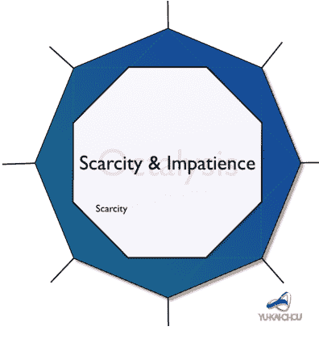

“稀缺与渴望”是八角行为分析框架中的第六核心驱动力。它激励我们的原因很简单：要么是我们无法立刻得到某样东西，要么是获得它存在极大的困难。

我们天生倾向于追求得不到的东西。如果桌上放着一碗葡萄，你可能毫不在意；但如果它们放在一个够不着的架子上，你可能就会开始惦记那些葡萄：“它们甜吗？我能吃吗？什么时候才能吃到？”

就我个人而言，第六核心驱动力是我最后才了解到的核心驱动力，也是最能引起我兴趣的一个，尤其是因为它可能给人完全违反直觉、非理性且情感上难以运用的感觉。

在本章中，我们将探讨这个黑帽/左脑核心驱动力，了解它的威力，并学习一些利用它来促成行为改变的游戏技巧。

## 专属却毫无意义之物的诱惑

*《南方公园》*是一部由特雷·帕克和马特·斯通创作的热门美国动画情景喜剧，它有很多关于人类行为的教训可以教给我们（前提是你能够忍受那些满嘴脏话和血腥场面）。

其中一集《卡特曼乐园》160中，备受争议的主角埃里克·卡特曼从已故祖母那里继承了100万美元。他决定用大部分资金买下一个经营不善的主题公园，只为让自己在那里玩得开心，不用排队。

卡特曼不但没有想办法改善经营，反而制作了一支整整38秒的电视广告，展示“卡特曼乐园”有多么有趣，并强调除了他自己，没人能享受。“卡特曼乐园乐趣无穷，但你进不来！”就是这个朗朗上口的广告语。

在意识到自己需要更多钱来雇佣一名保安把朋友们挡在门外后，卡特曼开始每天只接待两位顾客，以支付保安费用。他很快又意识到，自己还需要支付维护费、水电费和其他运营服务费，于是他开始把公园开放给每天三位、四位、几十位，然后是上百位游客。

由于人们都曾目睹“卡特曼乐园”对他们而言多么难以进入，所以当得知它开始接待更多人时，他们便蜂拥而至。

最终，所有人都想去卡特曼乐园，它从一个濒临破产的主题公园变成了当地最受欢迎的乐园之一。剧中的专家甚至称“你进不来！”广告活动是天才百万富翁埃里克·卡特曼绝妙的营销策略。

不幸的是，心爱的公园里人越来越多，卡特曼变得痛苦不堪，最终把公园又卖回给了原主人。随后，他又因税务管理不善而失去了所有钱，这很符合卡特曼的风格。

这里展示的是一个经典的通过排他性制造稀缺的例子。尽管这是一个夸张的例子，但在本章中，你会看到我们的大脑天生就倾向于追逐那些“仅限少数人拥有”的东西。

瑞安·宾厄姆：你将获得终身行政会员资格。你可以见到机长梅纳德·芬奇。

娜塔莉·基纳：哇。

瑞安·宾厄姆：而且他们还会把你的名字写在飞机的一侧。

娜塔莉·基纳：男人把名字写在东西上就会特别来劲。你们这些人真长不大，就像要到处撒尿标记地盘似的。

除了收集、地位和成就（核心驱动力4、5和2）之外，对瑞安来说非常重要的一点是：“我将是第七个做到这件事的人。登上过月球的人比这还多。”这表明，因为这是他（以及其他数十亿人）目前无法得到的东西，他更加珍视获得它的机会。正因为其排他性，它才更具吸引力。

### 稀有像素的价值

在前面提到的游戏《Geomon》中，玩家尝试捕捉怪物以彼此战斗。这款游戏类似《宝可梦》，但会根据玩家手机GPS所在的真实环境而受到影响，例如在河边或沙漠附近。

在《Geomon》中，有些怪物只会在非常有限或特殊的情况下出现。正因为这些怪物极其稀有，人们愿意花真金白银去获取它们。

其中一个例子就是“Mozzy”，一只由火焰构成的炽热狐狸。

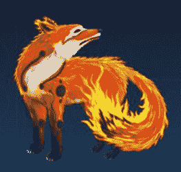

Mozzy只在炎热的天气里、并且靠近Mozilla组织（Mozilla Firefox浏览器的创造者）运营的办公室时才能被捕捉到。这意味着，对于一款玩家遍布全球的游戏来说，普通人要捕捉到Mozzy极其困难，有时甚至不可能。在论坛上，人们有时会说：“今年夏天我爸妈要带我去旧金山。我打算租辆车一路开到山景城。也许我能抓到一只Mozzy。太兴奋了！”

这一驱动力在游戏过程中，通过《Geomon》玩家在游戏内聊天中的实时评论得到了进一步体现。下面这张截图是我在玩游戏时随手拍的，注意玩家们对获得Mozzy有多么渴望。所有大写字母强调了——“为了Mozzy，我什么都愿意做。”

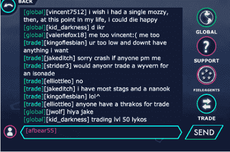

尽管上面这种绝望的恳求看起来相当极端，但下面这段对话有过之而无不及：

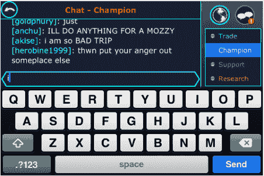

在这里，你会看到“Vincent7512”声称（调整了大写）：“我只要能拥有一只Mozzy，在人生的这个时刻，我就能死而无憾了。”

你可能会以为，当有人这样说时，其他人会回应：“拜托……清醒一点！这不过是个游戏！”但并没有。三行之后，你会看到“Valeriefox18”附和着同样的情绪：“我也是，文森特 :( 我也是。”

这是一个玩家社区，他们对获得Mozzy如此执着，以至于不是更多地玩游戏，而是泡在聊天板上自怨自艾，并感受彼此之间的“联结”（核心驱动力5：关联感）。相当极端，对吧？

《Geomon》中的另一个例子是*Laurelix*，一只华丽的金色凤凰。

要抓到Laurelix，你所在的位置温度必须极高，可能超过110华氏度或40摄氏度。这种设计的结果是，曾经全世界只有3名玩家拥有Laurelix。你可以想象，每个人都想要一只。有一次，游戏工作室甚至接到一位玩家母亲的电话，她说：“我儿子已经病了两周了，他说除非拥有一只Laurelix，否则没什么能让他开心起来。我不知道那是什么，但他说你们有。我愿意花20美元买一只Laurelix。你们能给我儿子一只吗？”

有趣的是，Mozzy和Laurelix并不是游戏中最强大的地灵——游戏中有很多地灵比它们更强大。但正因为这两只太难获得，它们的感知价值急剧上升，帮助公司更好地实现了游戏的商业化。

令人惊叹的是，当某样东西稀缺到这种程度时，它同时还具有巨大的粘性。作为该公司的顾问，我玩了一段时间这个游戏（好吧，不止一段时间），参与维护在线社区，并帮助公司重新设计和平衡了所有的能力技能树和战斗系统。在那之后，我成了一个挂名顾问，退出了游戏，转而去做我的“其他工作”。

整整七个月，我都没有玩这个游戏，也没有想起它（除了与CEO会面并为他们提供管理和商业化策略建议的时候）。但有一天，我出差旅行，发现自己身处一个酷热难耐的地方，热到如果直接暴露在阳光下，我感觉自己都要被烤焦了。

那一刻，我并没有大喊大叫或抱怨天气，而是脑海中冒出的第一个念头，也是脱口而出的话是：“我想知道我能不能在这里抓到一只Laurelix……”这当然让我那位正带我游览他的伟大国家的客户感到困惑。

尽管我再一次重申，我已经不在乎玩这个游戏了，而且已经半年多没玩了，但因为Laurelix实在太稀有，我自然而然会想：“嗯，既然我能抓到一只，那我大概应该抓！”

## 剩下的东西不只是剩下的

我们大多数人都希望相信，我们的购买决策是基于商品的价格和质量。购买被视为一种非常理性的交换，用金钱换取我们想要的物品。如果价格高于我们从价值中获得的“效用”或幸福感，那么我们就不会进行购买。

然而，心理研究一次又一次地表明，这只是部分正确。我们购买东西并不是因为它们的实际价值，而是基于它们的*感知*价值，这意味着很多时候我们的购买并不理性。

1975年，研究人员 Worchel、Lee 和 Adewole 进行了一项实验，以测试不同饼干罐中饼干的期望程度。[^162] 实验使用了两个饼干罐，一个里面有十块饼干，另一个只有两块。尽管饼干完全相同，但实验显示，当罐子里只有两块饼干时，人们更看重这些饼干。他们更看重这些饼干，主要有两个原因：1) 社会认同——似乎每个人都出于某种原因更喜欢这些饼干，以及 2) 稀缺性——人们觉得饼干快用完了。

团队进行的一个第二实验中，受试者看着“十块饼干”罐里的饼干数量减少到两块，而另一组则看到“两块饼干”罐被填满到十块饼干。在这种情况下，人们开始更看重前者并贬低后者。当人们看到原本只有两块饼干的第一个罐子现在变得充足时，他们甚至比第一次实验中一开始就有十块饼干的“十块饼干”罐里的饼干更不看重这些饼干。

在这里我们看到，当存在*感知到的充足*时，动力开始减弱。奇怪的是，我们的感知往往受相对变化的影响，而不是绝对值。拥有 1000 万美元的人会对其财富有不同的感知（并感觉不同），如果他们前一年只有 100 万美元，与前一年拥有 10 亿美元相比。

他们正在努力应对大量来电，只是为了跟上订单的需求。即使这条信息暗示购买产品会带来不便，仅凭感知到的稀缺性就足以促使人们迅速打电话，以免产品可能售罄。

我父亲是台湾的外交官，有时他会和一位被派往东欧前共产主义国家的同事交谈。我曾听那位同事说过：“如果你在街上看到排队，不要浪费时间去弄清楚他们在排什么队。直接排队吧。一定是像肥皂或卫生纸这样必不可少的物品。钱有没有都无所谓。如果该地区没有卫生纸，你的钱就毫无用处。” 在这里，稀缺性和社会认同带来的巨大不便可以迫使一个相对富有的人排队数小时。

在《Pitch Anything》中，Oren Klaff 也提到了另一个例子，宝马推出了一款特别版 M3，要求买家签署一份合同，承诺保持车辆清洁并照顾好特殊漆面。没有这份书面承诺，他们甚至不允许你购买这辆车！在这种情况下，宝马是在抬高其价值，让买家相信驾驶这辆车是一种特殊且独有的特权。也许这就是约会文化中难以获得策略如此盛行的原因。通过核心驱动 6：稀缺性与不耐烦，你可以让你的潜在伴侣保持警惕。

## 经济学中曲线比杯子更好

当我在 UCLA 学习经济学时，我的教授们反复谈到的一个基本教训是供需曲线。它基本上解释了，如果物品的价格下降，需求就会增加。如果物品完全免费，曲线将显示将获得它的最大买家数量。

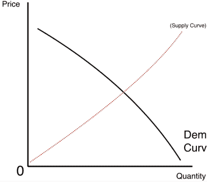

然而，如果你研究行为心理学、游戏化设计和/或以人为本的设计，你会发现故事的另一面。事实证明，稀缺性是消费者行为的另一个驱动力。在经济理论中，稀缺性是被很好理解的，但仅限于客观限制与消费者从购买中获得的*效用*相匹配的意义上。

这与本章讨论的稀缺性不同，后者与*感知稀缺性*有关，而不是客观稀缺。有时客观稀缺存在，但人们从未感受到或知道它。另一些时候，即使没有真正的限制，也会产生感知稀缺的感觉。

这里的区别在于，新古典经济理论从三个关键假设开始[^166]。

- 1. 消费者行为理性
- 2. 消费者拥有完整且相关的信息
- 3. 消费者试图最大化其效用（或从经济消费品中获得的幸福感）

但在现实世界中，前两个假设几乎从未成立——人们通常是非理性的，并且永远不会拥有完美的信息。有时他们对定价的反应是另一种更令人惊讶的方式：某样东西越贵，人们赋予它的价值（效用）就越高。这导致需求增加。因此，销售额实际上可能随着价格的上涨而增加。

通常，如果一件物品是免费的（需求曲线的极右端），所有想要该产品的人都会免费获得它。假设有 100 人想要该产品免费。但在某些情况下，如果产品异常昂贵，之前不在乎的人可能会突然渴望它。现在销售额可能超过 150 件！由于这种稀缺效应，某些产品的修正需求曲线可能会产生 C 形，而不是向右下方倾斜的直线。

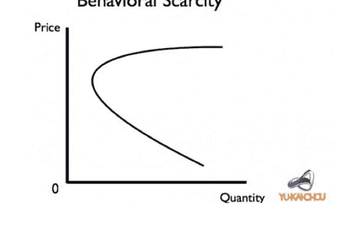

稀缺之所以有效，是因为人们认为如果某物更昂贵或更难获得，其价值就更高。因为人们没有“完美信息”，他们通常并不知道自己对某种商品的效用。因此，他们依赖线索——例如某物有多昂贵或多有限——来确定其价值。如果每个人都想要它，它一定很好！这与上一章关于核心驱动 5：社会影响与归属感的内容相辅相成。

当然，在某个时刻，C 曲线需要向左（数量为零）弯曲，因为物品变得过于昂贵，超出任何人的财富，在图表上产生反向 S 形。客观稀缺（金钱）最终仍会在极端情况下胜过感知稀缺。

## “这家伙还不够贵。”

我个人亲眼见过许多例子，无论是亲身经历还是间接听说，提高价格实际上使人们卖得更多。

2013年，我的一个客户正在两家公关服务提供商之间做出选择，一家每月收费 8,000 美元，另一家每月收费 10,000 美元。我告诉他，我认为每月 8,000 美元的提供商会提供更好的服务。然而，我的客户仍然怀疑，觉得每月 10,000 美元的提供商必须更有能力才能收取该价格。我告诉他，仅仅因为一家服务提供商有胆量（我用了更粗俗的词）收取更多费用并不意味着他更好。但我的客户仍然无法决定。

最终，我的客户决定在三个月的时间里同时使用这两项服务。虽然昂贵，但这对我个人来说很棒，因为它让我能够收集他们实际表现的宝贵数据并进行比较。期限结束后，很明显每月 8,000 美元的提供商非常出色，而每月 10,000 美元的提供商证明非常令人失望。我的客户解雇了 10K 的那个人，之后保留了 8K 的那个人。

奇怪的是，如果较弱的服务提供商意识到自己不太适合该项目，并且只收取 6,000 美元而不是 10,000 美元，他可能不会被考虑第二次。他的激进定价策略为他赢得了一个新机会和额外的 30,000 美元！当然，这里最终的教训应该是专注于为你的客户创造强大的价值——这样你就不会在 3 个月后丢掉工作。

在另一次，我有一个客户需要一次每次点击费用（CPC）活动审计。我联系了一位来自东欧的朋友，他是该行业最好的。由于我过去曾为他做过一些好事，我能够说服他免费为我的客户进行审计，而他通常会收取数千美元的费用。

尽管我的客户对这个安排感到兴奋，但他犹豫不决，行动非常缓慢。我催促我的客户，他说：“让我担心的是免费的价格……他真的像你说的那么好吗？” 他有

我意识到我的朋友的服务其实并不被认为很有价值，因为它是免费提供的。这就是为什么收取一笔较小的费用，比如审计费 $500，可能比提供无偿服务更有优势。

## “购买后口袋太鼓时我会感觉不舒服”

这种情况并不只发生在高端服务上。在《影响力：科学与实践》一书中，罗伯特·西奥迪尼也描述了一个朋友的故事，她在亚利桑那州经营一家印度珠宝店，在旅游旺季尝试销售一些高质量的绿松石饰品167。

尽管她不断努力推广、交叉销售并向店内访客强调这些饰品的重要性，却没有人似乎对购买它们感兴趣。终于，在一次外地采购之旅前夜，店主得出结论，她需要降低价格，让这些饰品对顾客更有吸引力。因此，她给头牌销售员留了一张纸条，指示将价格降低“x½”。

然而，销售员误解了纸条，错误地将价格翻倍了。几天后返回时，店主惊喜地得知所有饰品都已售出。将每件商品的价格翻倍实际上让她卖出了更多，因为它们的感知价值提高了。

由于你对珠宝除了向他人（或自己）展示之外并无其他用途，其价值通常基于感知而非功能。你可能会迅速否定架子上一个丑陋且开裂的陶器碎片的价值，直到有人告诉你它是在 1,200 年前为一次具有历史意义的事件制作的。陶器本身在功能上或美学上并没有变得更有价值，但由于稀缺性原则，其感知价值立即上升。

到目前为止，你可能已经观察到，核心驱动力 6 中的高价原则对珠宝等几乎没有功能用途的奢侈品，或提供必备专业知识的昂贵服务而言效果非常强大。令人惊讶的是，它对日常功能性物品也同样有效。

就在撰写本章前一周，意识到我的膝盖疼痛在加重后，我决定去一家运动用品店。我想买一些膝盖护具，用于徒步或在电话会议期间上下楼梯时使用。进入商店后，我看到有两种护具，一种是 $24.99，另一种是 $49.99。

我心想：“嗯，我的膝盖对我来说非常重要。我最好不要为了省几个钱而最终导致膝盖受损。” 作为这一想法的延伸，我拿起了一副 $49.99 的护具并买下了它们。

直到撰写本章并寻找例子时，我才意识到我自动假设更贵的膝盖护具比便宜的更好。我甚至懒得仔细阅读产品说明。如果你问我 $49.99 的那款比 $24.99 的那款好在哪里，我无法给出答案。我可能会说类似这样的话：“嗯，$49.99 的更贵，所以我相信它对膝盖的保护更好或更舒适。可能两者兼有。”

这非常有力量，因为在我脑海中，我并没有思考两款膝盖护具的实际差异。我只是思考我是否想要“省钱买低质量”，还是“不要吝啬，为长期的健康投资优质商品”。

《思考，快与慢》的作者丹尼尔·卡尼曼将我们大脑的新皮质称为我们的“系统 2”，它大致控制着我们的有意识思考¹⁶⁸)。由于我们大脑新皮质的处理能力有限，我们经常在不知不觉中依赖心理捷径，即启发式。在这种情况下，心理捷径是“昂贵等于质量”，尽管事实可能并非如此。

另一个心理捷径可以是，“专家自信地说——我会假设它是真的而不深入探究。” 有时人们会放过一些明显的失误和疏忽，仅仅因为权威专家或科学家这么说了。他们让自己的“系统 2”变得懒惰，仅仅受核心驱动力 5：社会影响与归属感的驱动。

也许只有我一个人因为膝盖护具更贵而显得愚蠢且财务上不负责任地购买了它们。但很有可能，在你生命中的某个时刻，你也曾基于可能并不总是成立的假设而采取心理捷径。也许你曾根据价格之外的极少信息购买了一瓶葡萄酒或洗涤剂，仅仅因为商家标了低价而鄙视某些选择。

## 稀缺与不耐烦中的游戏技巧

你已经了解了核心驱动力 6：稀缺与不耐烦的动机和心理本质。为了使其更具可操作性，我在下面列出了一些 heavily 利用这一核心驱动力来吸引用户的游戏技巧。

## Dangling（游戏技巧 #44）和 Anchored Juxtaposition（游戏技巧 #69）

许多社交和移动游戏利用核心驱动力 6：稀缺与不耐烦中的游戏设计技巧来 heavily 货币化其用户。其中最受欢迎的组合之一是我所称的 Anchored Juxtaposition（游戏技巧 #69）和 Dangling（游戏技巧 #44）。

例如，当你玩 Farmville 时，你最初可能会想：“这游戏有点好玩，但我绝不会为这种愚蠢的游戏付真钱。” 然后 Farmville 部署了他们的 Dangling 技巧，并定期向你展示一座你想要却得不到的诱人豪宅。最初几次，你只是将其 dismiss，因为你本能地知道获得它在资源上并不划算。但最终你开始对那座 constantly 被 dangled 在那里的豪宅产生一些渴望。

带着一点好奇心，一点研究显示游戏要求你在 20 小时游戏后才能负担得起豪宅。哇，这需要很多农耕！但随后，你看到只需花费 $5.00 即可立即获得那座豪宅。“花 $5 省下我 20 小时的时间？这太划算了！” 现在用户不再是花 $5 买屏幕上的像素。他们花 $5 来节省时间，这

变成了一笔极好的交易。你能看出游戏设计如何通过在时间和金钱之间交替来影响人们的价值感吗？

这个现象有趣的地方在于，这些游戏中的大多数都可以免费玩，而人们却在花钱，只是为了能玩 *更少* 的游戏。从这个意义上说，很难判断游戏本身是否真的被认为“愉快”或“有趣”。与核心驱动力 3：创造力赋能与反馈不同，这一黑帽左脑核心驱动力更多是关于说服和强迫性的，但用户不一定享受这个过程。

在使用 Dangling 技巧时需要考虑的一个重要因素是获得奖励的路径。你必须让用户知道获得奖励非常具有挑战性，但并非不可能。如果被认为是不可能的，那么人们就会启动核心驱动力 8：损失与回避模式，进入自我否定。“反正这也是给失败者准备的。”

例如，如果一个独家俱乐部的横幅在你面前 dangled，但你发现加入的前提是你必须通过王室血统成为王子或公主，你可能甚至不会去看该组织做什么。相反，你可能会想，“谁会在乎一群自命不凡、被宠坏的孩子。” 因为没有资格的机会，它激活了核心驱动力 8 作为反核心驱动力——不执行期望行为的驱动力。

然而，如果横幅写着，“加入前提：通过王室血统的王子/公主，或曾跑过马拉松的个人。” 现在你就有了动力，甚至可能会思考跑马拉松所需的努力。只要有 realistic 的 *机会* 进入，稀缺性通过排他性就足以吸引你。有趣的是，在这一点上你甚至还没有确定该组织实际做什么！在没有任何关于其实际功能的信息的情况下，以人为中心的稀缺动机足以让你考虑跑马拉松。

这就引出了我所称的 *Anchored Juxtaposition* 游戏技巧。利用这种技巧，你将两个选项并排放置：一个花费金钱，另一个需要付出大量努力去完成将使系统受益的期望行为。

例如，一个网站可能会给你两种获得某种奖励的选项：a) 现在支付 20 美元，或 b) 完成大量荒谬的期望行为。期望行为的形式可以是“邀请你的朋友”、“上传照片”，和/或“连续 30 天留在网站上”。

在这种情况下，你会发现许多用户会不理性地选择完成期望行为。你会看到用户为此奴役般地工作数十个，甚至数百个小时，只为了节省 20 美元来实现目标。有一段时间，许多人会意识到这需要花费大量时间和精力。在那一刻，20 美元的投资变得更有吸引力，他们最终还是购买了。现在你的用户既做了：付给你钱，又投入了大量的期望行为。

值得记住的是，奖励可以是物质的、情感的或智力的。奖励不必是财务上的，也不需要以徽章的形式出现——人们很少为此付费。事实上，基于核心驱动力 3：创造力与反馈赋能原则，最有效的奖励通常是助推器，让用户能够回到生态系统中更有效地进行游戏，从而在过程中形成流畅的活动循环。

使用锚定并置，你*必须*为用户提供两个选项。如果你只是给奖励定价并说，“现在付款，或离开”，许多用户会回到核心驱动力 8 的否认模式并认为，“我永远不会给那些贪婪的混蛋付一分钱”——然后离开。相反，如果你只是在网站上写，“嘿！请完成所有这些期望行为，例如邀请你的朋友并完善你的个人资料！”用户不会被激励去采取行动，因为他们清楚地认识到这对系统有利，但对自己没有好处。

只有当你把这两个选项放在一起——因此称为并置，人们才会对两个选项都更开放，并且随着时间的推移，往往会连续承诺两者。但这在现实世界中，在游戏之外有效吗？你可以肯定。

*Dropbox* 是一家总部位于旧金山的在线文件托管服务，获得了非凡的流行度和成功。当你第一次注册 Dropbox 时，它会告诉你，你可以 a) 付费获得大量存储空间，或 b)

邀请你的朋友获得更多空间。一开始，大多数人都是从邀请朋友开始的。

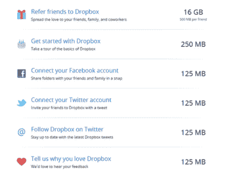

最终，许多正在完成期望行为的用户决定，邀请/骚扰他们的朋友工作量很大，但他们仍然需要大量存储空间，于是他们最终成为付费用户（就像我一样）。再次，由于锚定并置，用户既承诺了期望行为，又为完整产品付费。

Dropbox 的病毒式设计，加上出色的无缝产品设计，加速了公司的增长，据报道在 2013 年筹集了超过 3 亿美元，估值约为 100 亿美元，收入超过 2 亿美元。对于一家在七年前还不存在的公司来说，这成绩不算差。

## 磁性上限（游戏技巧#68）

磁性上限是对用户可以执行某些期望行为次数的限制，这会刺激更多动力去执行它们。

当我与客户咨询时，我经常提醒他们，他们很少应该创造一种充裕的感觉。充裕的感觉并不能激励我们的大脑。另一方面，稀缺性对我们的行为来说是极具激励性的。即使用户通过支付大量金钱完成了终极期望行为，说服系统设计师也应该只给人们一种暂时的充裕感。几周或几个月后，稀缺感应该再次出现，并为用户提供新的目标——也许是在他们用完所有虚拟货币并需要购买下一批时。

优秀的系统设计师应该始终控制稀缺的流动，并确保系统中每个人仍在为一个目标而努力，这个目标难以实现，但并非不可能。未能做到这一点会导致一个令人满意的系统崩溃，用户会为更好的体验而放弃它。

这很好地契合了 Mihaly Csikszentmihalyi 的心流理论[^169]，其中挑战的难度必须随着用户的技能水平而增加。挑战过多会导致焦虑。挑战过少会导致无聊。

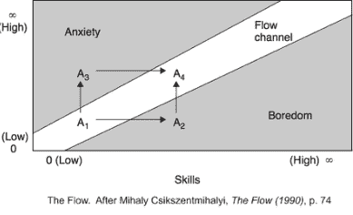

有很多有趣的研究表明，只需对某事物设置限制，人们对其的兴趣就会增加。如果你引入一个可以随意使用的功能，通常很少有人会真正使用它。但一旦你对该功能设置使用限制，更多时候，你会发现人们热情地利用这个机会。

在 Brian Wansink 的书 *Mindless Eating: Why We Eat More Than We Think* 中，他描述了当杂货店只展示一个促销标志写着，“每人不限量”时，人们通常只买几件促销商品[^170]。然而，如果标志写着，“每人限购 12 件”，人们会开始买更多——事实上，多 30% - 105%，取决于

其他变量。这又是稀缺的另一个奇怪特征：通过设定限制，我们会被*吸引*向限制。

这意味着如果你想增加某种行为，你应该对该活动设置限制。当然，你并不一定希望磁性上限将活动限制到让你损失大于收益的程度。设定限制的最佳方式是首先找到期望指标的当前“上限”，并以此作为上限，以创造一种*感知稀缺感*，但并不一定限制行为。行为设计师可能会推测“虽然我们希望用户选择无限数量的爱好，但我们 90% 的用户在网站上选择的爱好少于五个。”在这种情况下，将限制设为五个或六个爱好而不是没有限制是合适的。

那 10% 超过六个爱好的用户——“重度用户”，你问？他们不重要吗？是的，他们很重要（如果你问了这个问题，这意味着你已经为某些体验而系统化。例如，当你看到美丽的东西时，它会触发打开 Instagram 的欲望。Facebook 的触发器，另一方面，是无聊。

一个朋友曾经告诉我，有一天他正在使用 Facebook 突然感到无聊。令人惊讶的是，他本能地打开浏览器新标签页并输入“Facebook.com”。网站加载后，他震惊了，“哦，我的天。我已经在 Facebook 上了。为什么我又打开了 Facebook？”再次，这就是内部触发器的力量，它与无聊这样常见的感觉相连——例如，当你在排队等候时你会做什么？

在预约动态中，触发器是时间。我的垃圾车每周二早上来，所以在周一晚上，我会自动有一个内部闹钟提醒自己把垃圾拿出去。如果垃圾车每天都来，我可能会拖延直到垃圾溢出才拿出去。

一个极其创新的例子（我很少称某事物为“创新”）利用预约动态的公司是韩国一家大型购物中心 eMart。该公司意识到，他们在一天中的大多数时间里客流量和销售额通常都很好，但在午餐时间，客流量和销售额会显著下降。为了激励人们在午餐时间出现（期望行为），他们运用了核心驱动力 6：稀缺与不耐烦的原则以及一点核心驱动力 7：不可预测性与好奇心。他们最终启动了一项名为“Sunny Sale”的活动，并在商店前建造了一个奇特的雕像。

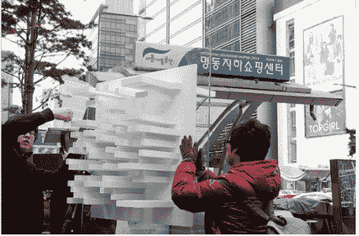

这座雕像本身看起来相当抽象，似乎与任何物体都不相似。然而，在正午时分，神奇的事情开始发生。当太阳在正午达到最高点时，这座雕像的影子突然变成一个完美的二维码，人们可以用手机扫描并看到独特的内容。

这难道不酷吗？由于二维码只能在中午12点到下午1点之间的有限时间段内扫描，人们现在争相及时赶到那里。老实说，在那个时候，二维码的内容是什么并不重要——稀缺性和好奇心（源于核心驱动力7：不可预测性与好奇心）就足以让人们现身。以eMart为例，该二维码链接到一张优惠券，消费者可以立即兑换用于在线购物。

据报道，这一策略使eMart的午间销售额提升了25%。当你已经是业内最大的玩家时，这相当不错。

## 折磨中断（游戏技巧#66）

到目前为止，你可能已经注意到，核心驱动力6：稀缺与急躁的另一种游戏技巧可以利用“急躁”，即不允许人们*立即*做某事。在过去，大多数主机游戏试图让用户尽可能长时间地留在游戏中。如果玩家连续五个小时“粘在屏幕前”，那对游戏来说就是巨大的胜利。如今，社交移动游戏的做法完全不同。

许多社交移动游戏不会让你玩太久。游戏会允许你玩三十分钟，然后告诉你：“停！你不能再玩了。你需要8小时后再回来——因为你必须等待你的作物生长/你需要等待你的能量恢复/你需要疗伤。”

对于一些不了解核心驱动力6的家长来说，这种设计让他们非常高兴。“太好了！这些游戏设计师太有责任心了——现在我儿子的游戏时间会受到限制！”但事实上，他们没有意识到的是，游戏正在实施我所说的“折磨中断”来驱动强迫行为。

折磨中断是对期望行为的突然且通常是触发的暂停。而“预约动力”更多地基于人们期待的绝对时间（每周一早上垃圾车会来；7月4日当你打开应用程序时，你会获得巨额奖励），折磨中断通常是用户通往期望行为路径上意想不到的硬性停止。它通常带有一个基于中断触发时间的相对时间戳，例如“从现在起5小时后回来”。

我对这两种游戏技巧的区分可能与Priebatsch的定义有所不同。尽管它们经常协同工作（有时在触发折磨中断后，紧接着会出现预约动力），但注意它们的区别很重要，这样你才能准确地规划你的游戏化系统。

以社交移动游戏为例，由于玩家被迫停止游戏，他们很可能会整天继续想着游戏。通常，他们会在三小时、五小时、六小时后重新登录，只是为了看看自己是否终于能玩了——尽管他们的大脑清楚地知道规定的八小时还没到。

如果允许玩家想玩多久就玩多久——比如说三个小时，他们很可能会感到满足，停止游戏，一两天内不再想起游戏。因此，全知的游戏设计师或许会允许他们玩两小时五十九分钟，然后触发折磨中断。此时，他们会痴迷地试图弄清楚如何玩完最后一分钟。有时游戏甚至可能

提供另一个选项——“立即支付1美元以解除折磨中断！”

另一款游戏*糖果传奇*，从许多指标来看，被认为是世界上最成功的游戏之一，每天约赚300万美元¹⁷³，它很好地融入了折磨中断机制。失去一条生命后，游戏会暂停，迫使你等待25分钟，才能获得另一条生命并进入下一关。

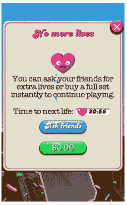

这吸引玩家不断思考那些缓慢流逝的25分钟间隔，并在被这种痴迷占据时难以规划其他活动。

当然，游戏还会给你两个选择：请朋友送你一条生命（社交宝藏），或立即支付（锚定并置）。你看所有这些游戏技巧如何协同作用，成为一个面向期望行为的整体激励系统？

## 意外失败有时会变成一种祝福

折磨中断的另一个好例子是Twitter早期的“失败鲸鱼”。2007年，Twitter网站经常宕机。尽管这让许多用户感到沮丧，但他们更急切地等待服务恢复，同时在Facebook上讨论这件事。

从一开始就分手，当他们被甩时，他们可能会痴迷于想要与对方复合。他们希望按照自己的条件分手。但被迫分离时，这变成了一种折磨中断，让他们渴望和解。

这种行为很像人们拉动老虎机的操纵杆，希望但未必期待好的结果。Twitter上也出现了同样的效应：用户痴迷于每分钟查看网站，看服务是否已恢复，最终当服务恢复时，他们会感到欣喜。

## 进化用户界面（游戏技巧#37）

我经常向客户推荐但遭到抵触的技巧之一是进化用户界面（Evolved UI）——“进化用户界面”的缩写。大多数用户界面的问题在于，在入门阶段它们过于复杂，而在最终阶段又过于基本。

在广受欢迎的游戏现象《魔兽世界》中，如果你观察顶级玩家，他们的界面可能会让你眼花缭乱。可能会有近十几个小窗口打开，全都显示不同的数据、选项和图标。它显示大量信息，包括你的队友状况、首领状况、每个人的位置以及你自己的资源。信息量如此之大，以至于你几乎看不到自己角色战斗的动画！它确实是周围最复杂的用户界面之一。

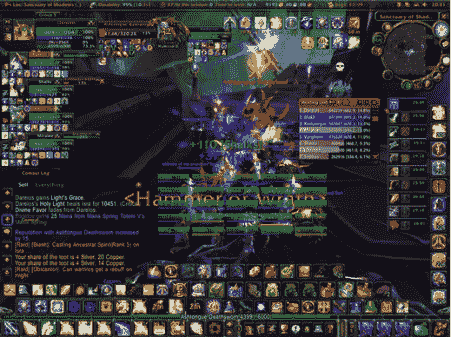

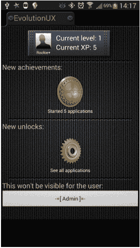

一旦用户表现出他们已经掌握了基本用户界面，例如打开5个应用程序，他们就会解锁一项成就，进而解锁新功能。这样，用户体验的难度永远不会超过用户的技能水平，遵循了前面提到的米哈里·契克森米哈赖的心流理论原则。

那么，一开始用户界面过于复杂的后果是什么？Google Plus。如前所述，即使有很多很棒的特性和功能，Google Plus 也没有获得持久的吸引力，因为它需要学习成本。大多数主流用户在使用YouTube或Gmail时被无意中推到Google Plus时感到困惑，因此很快离开了这个平台。

另一方面，Gmail 实现了进化用户界面的一个小型版本，以 Gmail Labs 的形式体现。在Gmail中，用户默认拥有一组基本特性和功能。但是，还有许多很酷的功能可以通过Gmail设置中的“实验室”标签解锁，一旦用户觉得准备好了，就可以开放复杂但有用的功能。

## 太好了！那么现在该怎么办？

当然，理解稀缺与急躁并不意味着初创公司应该故意关闭服务器，或在系统中设置虚假而老套的限制。一些用户可能会变得痴迷，但你很可能会赶走许多其他用户，他们迅速进入拒绝模式，再也不回来。

基于核心驱动力6原则，初创公司最明显的应用是推出时采用自信的定价策略。与其只免费提供一切或让它们轻易获得，不如采用更高级的定价模式或结构良好的排他性设计，这样可以增强用户/买家的信心，从而提高转化率。

当然，如果你将商品定价超出目标市场的承受能力，这显然会适得其反。但通常情况下，当顾客不购买你的产品时，不是因为他们买不起，而是因为他们感知到的产品价值不值得这个代价。有时，这种代价表现为时间、精力投入，或他们在组织中的声誉。

除了定价，你可能还想在发现和入门阶段的每一步营造一种专属感。一种设计，让服务使他们感觉这是独一无二的，而且他们只是获得访问资格——类似于Facebook早期的营销策略。

在每一步中，你都想向用户展示他们可能想要但还不能拥有的东西。稀缺性只有人们知道奖励确实存在时才能成为激励因素，所以*当有疑问时，就吊吊胃口吧*（但在法庭上别说是从我的书里学到的）。对于会导致奖励和投入的行动，考虑使用更具限制性的选项。对一个人可以采取的行动（或他们可以做出的投入）设置上限，会让他们更加渴望这些行动。

通过提高感知价值，顾客和用户更有可能保持参与，并对你的事业产生更大兴趣。这将有助于确保你不会把自己辛苦得来的一切几乎免费地送出去。

## 核心驱动 6：大局观

稀缺性和不耐烦被视为黑帽核心驱动，但如果使用得当，它在驱动动机方面可以非常强大。通常，核心驱动 6 是在系统中产生核心驱动 3：创造力与反馈赋能 的首要来源。克服稀缺感可以带来更高程度的核心驱动 2：发展与成就感。

当与核心驱动 7：不可预测性与好奇心 融合时，核心驱动 6 成为推动在线消费者行动的强大引擎。最后，与核心驱动 8：损失与规避 并肩工作时，稀缺性和不耐烦成为一种强大的力量，它不仅推动行动，而且以极强的紧迫感推动行动。

### 为了最大程度地利用本书，请立即选择以下其中一个选项进行：

- 简单：想想你想要某样东西的时刻，主要是因为它具有排他性，或者因为你觉得自己独一无二地有资格获得它。尝试从稀缺性与不耐烦的角度描述那种感受的本质。

- 中等：想想一家公司试图实施一种老套的稀缺形式，结果适得其反，因为它导致人们产生否认心理。公司可以怎么做才能真正正确地实施稀缺原则？

- 困难：想想如何将悬置、折磨式中断、进化式 UI 和锚定并置 组合到你自己的项目中。它是否会自动增加对其他核心驱动的渴望？还是会阻碍它？它推动的是长期参与，还是短期痴迷？

在 Twitter 或你偏好的社交网络上分享你的想法，使用标签 #OctalysisBook 并查看其他人有哪些想法。

## 分享你的知识！

除了分享我自己的研究和兴趣之外，我还定期邀请客座博主在我的博客 YukaiChou.com¹⁷⁶ 上发布他们关于游戏化、动机心理学、行为设计等的研究。如果你有有趣的知识可以通过自己的经验和研究来分享，请考虑通过网站发送消息并提供客座文章来推广你的工作。我做这一切工作都是为了让你能从我这里学到一点东西。我也很乐意有机会向你学习！
