# 第十一章：第七核心驱动 - 不可预测性与好奇心

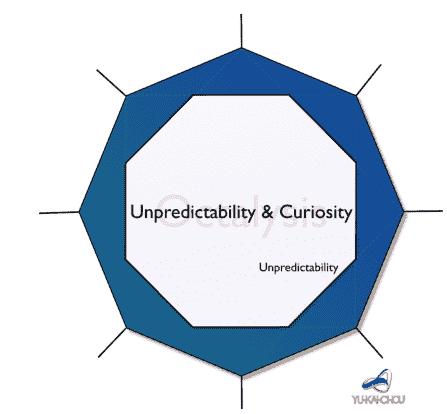

不可预测性与好奇心是 Octalysis 游戏化框架中的第七个核心驱动，是我们对不确定且涉及偶然的体验着迷的主要力量。如前几章所述，我们的智力意识本质上是懒惰的，如果手头的任务不需要立即关注，新皮质就会将精神劳动委托给我们的潜意识，即根据经济学诺贝尔奖得主和心理学家丹尼尔·卡尼曼¹⁷⁷ 所说的“系统 1”。

智力意识只在绝对必要时才想被打扰，例如当存在威胁时或当大脑遇到以前从未处理过的新信息时。

事实上，《Pitch Anything》的作者奥伦·克拉夫指出，在会议期间，人们会注意你说的话，直到他们能将你纳入之前已识别的模式¹⁷⁸。一旦他们将你纳入已识别的模式，就会立即走神。因此，重要的是要提出一个不断提供意外和不可预测信息的推介，以保持人们的参与度。

与此相伴的是我们探索未知的自然好奇心。探索未知虽然危险，但帮助我们的祖先适应不断变化的环境并发现新的资源以生存和繁荣。游戏设计师、《游戏设计的艺术：透镜之书》的作者杰西·谢尔甚至进一步将“有趣”这个词定义为“伴随惊喜的愉悦。”¹⁷⁹ 为什么“惊喜”元素在有趣中如此重要？

在本章中，我们将探讨这一不可预测性与好奇心的核心驱动如何激励我们的行为，以及系统设计师如何有效地将其融入他们的体验中。

### 而且，现在它变得有趣了

如果我告诉你玩一个游戏，你不断按一个按钮，每按十次你给我 5 美元——你会玩吗？理性的读者不仅会拒绝这个提议，而且会感到极度侮辱，因为我试图诱骗他们玩游戏。现在如果条件改变，我告诉你在一百个人中，有两个人玩这个游戏会赢回 10 美元？你可能会思考片刻，但仍然会拒绝。它没有像之前那样侮辱人，只是没有经济吸引力。

但如果我告诉你，每次按按钮时，你可能会定期赢回一些钱，并且有极小但可能的几率赢得 10,000 美元呢？

我无法准确预测我的聪明理性读者在这种情况下会怎么做，但我知道每天全世界有数百万人都在玩我上面提到的游戏。更常被称为老虎机赌博，玩家每次拉动杠杆或按下按钮时都在持续输钱，但他们对赢回大量钱的不可预测机会感到投入，甚至上瘾。拥有合适的风险/回报激励，游戏突然变得如此有趣！

研究表明，当有获胜的可能性时，我们对体验的参与度更高，而不是当我们确切知道我们的几率时¹⁸⁰。如果我们*知道*会收到奖励，我们的兴奋只反映奖励本身的情感价值。

然而，当我们只有机会获得奖励时，我们的大脑会被是否获胜的刺激所吸引。

### 斯金纳箱中的核心驱动

关于未知和不可预测如何吸引和吸引我们的大脑，有大量研究。其中最著名的动机设计案例研究之一是探索这一现象的斯金纳箱¹⁸¹。

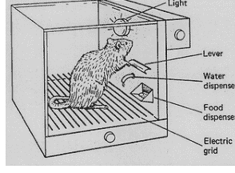

斯金纳箱是由科学家 B. F. 斯金纳进行的一项实验，他将啮齿动物和鸽子放在一个装有杠杆的箱子里。在第一阶段，每当动物按下杠杆（*期望行为*）时，就会释放出一部分食物。只要动物持续按下杠杆，食物就会继续发放。

最终结果是，当动物不再饥饿时，它会停止按下杠杆。这很有道理——动物不再饥饿，也不需要食物了。

然而，第二阶段在测试机制中引入了不可预测性。当动物按下杠杆时，不再保证会像以前一样发放食物。有时食物出来，有时什么都没有，有时甚至出来两块食物。

斯金纳观察到，在这些机制下，动物会不断按下杠杆，无论它是否饥饿。系统只是“戏弄”它的大脑：“*会出来吗？会出来吗？会出来吗？*”

在这里我们看到，满足我们燃烧的好奇心对我们原始的大脑来说是内在激励的，有时甚至超过食物的外在奖励。你有没有见过一个如此沉迷于赌博的人，以至于他忘记了自己累了、饿了，甚至渴了？

我经常听到关于游戏化中积分、徽章和排行榜的批评，认为它们只是把世界变成了一个大斯金纳箱，人们被操纵去无意识地做无意义的任务。我认为斯金纳箱更深刻的教训不是积分和徽章激励人们，而是源自核心驱动 7 的不可预测结果可以驱动痴迷行为。

### 抽奖和彩票

在第 5 章史诗意义与使命 中，我提到我之所以创办第一家公司，是因为在 UCLA 烤肉聚会上举行的一次小型抽奖。抽奖相当受欢迎，因为它们为活动增添了“有趣”的元素，人们被赢得奖品的可能性所吸引。大多数时候，“期望行为”是让人们待到活动结束，因此抽奖结果通常在日程表接近尾声时公布。尽管主要由核心驱动 7 驱动，这些活动也从核心驱动 4：所有权与占有欲（赢得奖品的欲望）中汲取力量，以及一点 CD8：损失与规避（如果我太早离开，我就会失去获胜的机会……）。

正如你记得我第一次讲述我的故事时，当我从帽子里抽出自己的名字时，我还被强烈的*使命感*（来自核心驱动 1）击中，觉得自己注定要创办自己的企业。我的感知到的*使命感*促使我在创业生涯中一些黑暗的日子和艰难挑战面前保持坚持。很多次，在失败的边缘，我觉得想放弃。但因为我相信我注定要走这条路，我坚持了下来，并变得更加确信我可以在创业世界中作为一名年轻企业家坚持下去。正如你可以看到

你看，在随机几率情境中“走运”能带来更高的使命感和目标感。新手幸运（游戏技巧 #23）的效应也是如此：当人们在初次尝试某件事时异常走运，他们会觉得自己冥冥之中注定要做这件事。

如你所见，抽奖的力量远超任何单个奖励的价值。除了奖品本身（本质上是外在的，源于核心驱动力 4），“我会不会走运？”这一想法背后的内在动机，在确保人们持续参与过程中扮演着重要角色。

在更大的范围内，许多利用社交媒体营销的公司如今正在成功地运用抽奖等技巧，让用户与他们的品牌和讯息互动。通常，这些公司会发布一个任务，凡是完成期望动作的人都有机会赢得某种推广奖品。抽奖活动的形式可以多种多样。期望动作可以简单到在 Facebook 上“点赞”公司的主页。梅西百货（Macy's）的营销活动就是这样一个例子：粉丝“点赞”其 Facebook 主页即有机会赢得 500 至 1,000 美元的礼品卡¹⁸³。

期望动作也可以更为复杂，例如家乐氏（Kellogg's）的“超级 Eggo 华夫饼大赛！”，参赛者提交自己最好的华夫饼食谱，就有机会赢取 5,000 美元¹⁸⁴。他们还通过将“社交宝藏”游戏技巧融入抽奖活动，运用了核心驱动力 5：社交影响与关联感。参赛者赢得比赛的几率可以完全基于社区投票，或至少部分受到投票结果的影响。这样一来，“向所有朋友宣传我们的品牌！”这一附加期望动作便生效了。这对“超级 Eggo 华夫饼大赛”这样的比赛效果绝佳，因为用户会把让人垂涎欲滴的华夫饼图片发给朋友，请他们为自己的作品投票。养眼的美食图片屡试不爽。

有些抽奖活动是基于主题的，与核心驱动力 4：所有权与拥有感，甚至核心驱动力 1：史诗意义与使命相关联。多芬（Dove）就采用了这种以视觉吸引用户的主题式抽奖。在“真美应当被分享”竞赛中，多芬邀请粉丝分享为什么他们的朋友“代表了真美”¹⁸⁵。获奖者获得的不是金钱奖励，而是成为加拿大大型零售连锁店 Shoppers Drug Mart 旗下多家门店的新“多芬面孔”。

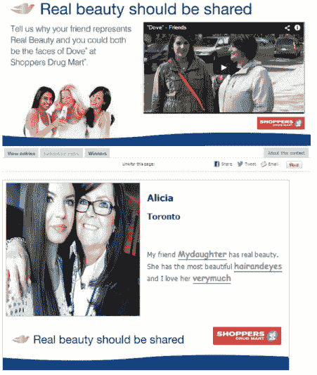

这是一个出色的设计，因为活动包含了美丽/自信女性的照片，能吸引眼球。它所倡导的理念能让参赛者的朋友们都愿意支持并声援，而奖品既带来身份地位上的吸引力，又赋予用户更高的拥有感。

另一个效果较差的主题式抽奖例子是 Tires Plus 推出的*父亲节时钟大赠送*活动，它采用征文比赛形式，要求参赛者写出他们认为谁最有资格成为最好的爸爸。然后参与者投票选出他们最喜欢的爸爸，来决定最终谁能把米其林人偶时钟带回家¹⁸⁶。这个抽奖设计的可取之处在于，它的主题契合 Tires Plus 的目标人群——喜欢汽车的人。其实施过程中的一个微小设计缺陷在于，期望动作需要付出相当大的努力。尽管他们使用了与多芬相同的游戏化技巧，但撰写和阅读征文这一期望动作需要投入大量时间，而且与汽车无关——仅仅为了一份简单的外在奖品。核心驱动力 8：损失与规避让许多人望而却步。在我的理论框架中，这被称为“反核心驱动力”，我们将在第 16 章详细探讨。

有些品牌决定在核心驱动力 7：不可预测性与好奇心上加倍投入，让抽奖活动的每一个环节都充满不可预测性。可口可乐（Coca-Cola）就是走在创意和创新产品促销前沿的品牌之一。你常常可以看到，可口可乐的广告试图通过魔法王国、宣扬快乐和友善的北极熊，把饮用碳酸糖水这一简单行为变成一种核心驱动力 1：史诗意义与使命的体验。

该公司在香港为青少年推出了一场特别有吸引力的抽奖竞赛。用户可以获得一款名为“Chok”的免费应用。每晚都会播放一则电视广告，邀请粉丝打开应用并摇动手机来捕捉虚拟瓶盖，赢取手机游戏、折扣和抽奖资格¹⁸⁷。这促使人们热情地在电视屏幕前摇动手机，期待可能会有、也可能不会出现的奖品。由于活动的时间、是否能中奖以及中奖者将获得什么都充满未知，因此产生了强烈的兴奋感。

即便是在活动的发现阶段（用户首次决定尝试某款产品或体验的阶段，这一阶段通过营销和所谓的*增长黑客*手段协同运作），如果你正和别人一起看电视，看到广告播出时有人突然摇动手机，你的好奇心必定会被勾起，也许还会促使你加入其中。

可口可乐将这一活动与其品牌战略巧妙地配合起来，Chok 在推出后一个月内仅香港用户就下载了 38 万次。这家饮品巨头称，这是他们 35 年来在香港最成功的营销活动。

## 与 LuckyDiem 共度幸运日

在没有保密协议约束的时候，我很乐意宣传我的客户和他们所做的工作。我的一些客户从事营销工作，他们努力实施优秀的游戏化设计，以显著改善各种业务的关键营销指标。其中一个例子是总部位于纽约的 LuckyDiem 公司。

LuckyDiem 将不可预测性与好奇心同其他核心驱动力协同运用，把品牌推广营销提升到了一个全新水平。通过老虎机、问答挑战和幸运转盘等一系列游戏装置，LuckyDiem 的移动平台让任何品牌都能与客户互动，并将其目标市场转变为忠实的传播者。听起来像营销陈词滥调？下面这些数字讲出了一个令人信服的故事。

在其中一个项目中，LuckyDiem 与 La Quinta Inns and Suites（一个由 700 多家酒店和加盟店组成的国际连锁酒店集团）合作，通过一项名为“Play & Stay”的全新游戏化活动为其忠诚度计划注入强劲动力。在一份公开的案例研究中，La Quinta 向邮件列表中的 83,600 位潜在客户发送了推广 Play & Stay 游戏的电子邮件。在全部邮件接收者中，有 2,000 人注册了 LuckyDiem 推广计划，即 2.4% 的电子邮件转化率。这些是比较普通的电子邮件营销数据。此后没有进行任何额外的推广。

令人惊叹的是，在三个月内，这 2,000 名用户最终带来了 10,700 个新的推荐注册，即 K 因子¹⁸⁸为 5.3 倍（或病毒系数为 530%）。其中 34% 的用户每天都会回来，平均在游戏上花费 3.75 分钟，为 La Quinta 带来了 23,000 次独立用户邀请、10,000 个新的 Facebook 点赞和 4,500 个新的 Twitter 关注者。更重要的是，这些用户转化为了客户。最终有 14.1% 的用户成为了付费客户，LuckyDiem 平台为 La Quinta 带来了 1,784 笔新预订，与对照组相比销售额提升了 712%。对于任何一家本就极为成功的成熟连锁企业或公司来说，这都是一个巨大的胜利。

## LuckyDiem 是如何做到的？

LuckyDiem 最初推出的是一个大多数人都非常熟悉的老虎机游戏。用户点击巨大的“旋转”按钮，有机会赢得积分或收藏品（请记住核心驱动力 2 的原则：这个按钮被称为“沙漠绿洲”——一个巨大的胜利状态动作，在视觉上吸引用户与之互动）。

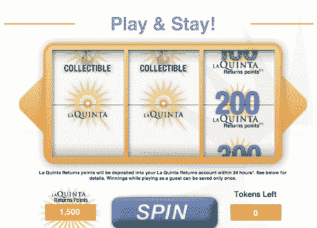

要玩游戏，用户需要虚拟代币，这很好地运用了核心驱动力 6：稀缺性与急迫感。代币会定期补充，而且还有一个额外的幸运转盘游戏，当初始代币用完后可以生成更多代币。

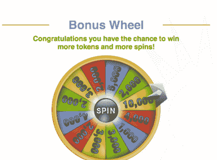

此外，还有“即时大奖”可供赢取，例如每次旋转都能赢得的“10 晚免费住宿”大奖。赢得大奖的几率很小，并没有多大程度地阻止人们，因为赢得大奖的希望足以让体验变得有趣且上瘾。由于奖品极具诱惑力，人们有很强的动力继续游戏，同时又确信自己在游戏过程中积累的 La Quinta 积分——这是一种核心驱动力 2 与核心驱动力 4 的结合。这些技巧被称为抽奖和滚动奖励，我们将在本章后面讨论。

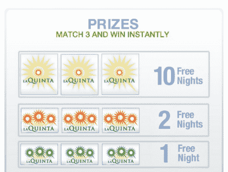

最后，奖励被悬在玩家面前，包括奖励的图像以及一个用于兑换的大型操作按钮。

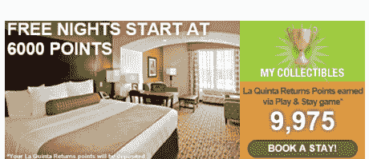

如果你一直在研究我的作品，你会知道以上内容只是一个游戏的“外壳”。虽然这是一个非常成功的案例，但如果你只是复制他们的游戏装置和机制用于自己的项目，你可能不会获得同样的成功。工作的深度蕴含在数月的规划、辛苦收集的研究，以及数小时的界面设计和平衡调整之中。

最终，深思熟虑的设计和实施创造了一个精彩且引人入胜的用户体验，为 La Quinta 带来了强劲的成果。FrugalTravelGuy.com 的撰稿人 Ariana Arghandeval 在一篇关于 La Quinta 的 Play & Stay 游戏的文章中写道：

> > “警告：这款游戏极具上瘾性。[...] 你可以赢得 La [Quinta] 积分、额外旋转、实质上增加旋转次数的代币、免费住宿等。我最初对此嗤之以鼻，因为我不认为自己很快会入住 La Quinta，但这款游戏非常上瘾，我在过去两天玩它时已经赚了 3,000 积分。” [¹⁸⁹]

正如你所见，即使一个人认为自己并不一定在乎奖品，人本设计也促使她玩得比预期时间长得多。正如上面的数据所示，像她这样的许多用户最终都成为了付费客户。

我大多数客户都希望我为他们做的工作保密。所以当我有机会获得一份公开的、指标出色且不夸大的引述时，我会迅速抓住这个机会（还记得 Brag Button 游戏技巧吗？）：

> > “Yu-kai 的见解在帮助 LuckyDiem 让客户 La Quinta 的每用户预订量提升 206%，以及每用户增量收入提升 157 美元（较对照组提升 132%）方面发挥了关键作用。能够实现 530% 的病毒系数，我会向任何企业推荐与 Yu-kai 合作并学习他的 Octalysis 框架。” — Andrew Landis，LuckyDiem 的创始人兼首席执行官

在 2015 年，Lucky Diem 决定利用这些强大的游戏设计技巧，专注于帮助实体企业吸引和留住客户。很快我们就会看到该公司能否正确地将经过验证的模式转化为新市场。

## 悬念与神秘的混合

许多公司也利用核心驱动力 7 通过为营销活动增添悬念和神秘感来推广其品牌。一个经典的例子是 Blendtec 的 *Will It Blend?* 活动。Blendtec 是那种售价高达 300-400 美元的强力搅拌机——大约相当于一台 iPad Mini 的价格。绝不便宜，但由于它承诺的价值是长期的健康和对家庭的关爱，人们如果相信它明显优于其他搅拌机，就会购买它。

Blendtec 的创始人 Tom Dickson 凭借极具创意的营销，决定在 YouTube 上推出一个名为 *Will It Blend?* 的视频系列。在一系列长视频中，这位首席执行官穿着实验室白大褂扮演科学家，将小说、高尔夫球、扫帚柄以及 iPhone 或 iPad 等价值很高的产品投入搅拌机。在搅拌物品之前，Dickson 会提出著名的提问：“它会搅拌吗？”

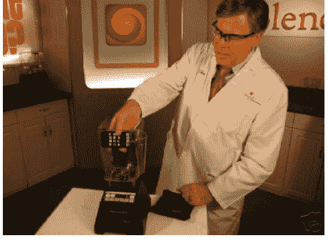

不用说，这引起了极大的悬念和好奇，人们观看以便知道他是否会真的毁掉一部全新的 iPhone。经过一段视觉上引人入胜且噪音很大的展示后，iPhone 果然变成了一堆黑色粉尘。这些视频如此有趣和引人入胜，最终被数百万人观看。

拥有这么多观众是件好事，但问题仍然是：这是否带来了高投资回报率（ROI）？尽管数百万观众纯粹为了娱乐而观看视频，但当他们最终考虑购买搅拌机时，脑海中首先浮现的名字是 Blendtec：“嗯，Blendtec 搅拌机可以将高尔夫球粉碎成粉尘。我敢肯定我的蔬菜不会那么糟糕。”

作为额外奖励，当朋友和家人提到需要新搅拌机时，该公司也成为了自然的推荐对象。据活动结束后几年发布的一份案例研究显示，Blendtec 的收入飙升了 700%¹⁹⁰。

截至 2014 年，Blendtec 的视频在 YouTube 频道上已有超过 2.42 亿观众——接近美国的人口数量。对一台搅拌机来说不算差。

## 假装走向病毒式传播

另一个利用核心驱动力 7 的良好营销例子是 Adobe 的 *Real or Fake* 活动。2008 年，Adobe 希望消费者了解其 Adobe *Photoshop* 和 *Illustrator* 产品的能力。随着新 Facebook 平台被视为触达大学生的一种潜在营销工具，一个名为 *Real or Fake* 的活动在 Adobe 的学生 Facebook 页面上创建。每周都会发布五张看起来怪异的图像，大学生被挑战判断这些图像是真实的还是假的。

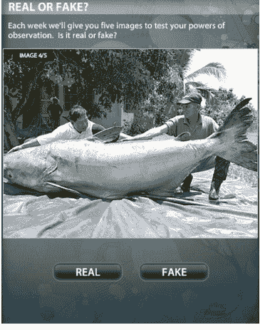

参与用户极度受这些照片是否真实或“被 photoshop 过”的神秘感所驱动。参与的动机也很大程度上受核心驱动力 3：创造力赋能与反馈的驱动。“这不可能真实。一定是假的。但看起来太真实了……连阴影和纹理都完美无缺。我必须弄清楚。”

因此，这促使学生重返页面并定期参与挑战。这种设计的美妙之处在于，即使学生答错了，也只证明了 Adobe 的 Photoshop 和 Illustrator 程序是多么强大。

在一个月的活动结束时，大多数用户对 Adobe 的产品印象深刻。据当时 Adobe 的高级营销经理 Elisa Haidt 称，该游戏被玩了 14,000 次（请记住，当时 Facebook 仍是一个年轻的平台，其覆盖面远小于今天），其中 22% 的用户查看了产品教程，6% 与朋友分享，6% 点击了“立即购买”按钮。191

现在想象一下，如果移除了悬念和神秘的元素，Adobe 只是开展一个活动说：“看看我们用 Adobe 产品制作的惊人照片！”我相当确定他们不会取得其游戏化营销努力的成功。

那么为什么 Google 会在主页上放置这样一个愚蠢的功能，而这会让他们损失大量收入呢？

有几个原因：一方面，如果你相信 Google 的搜索引擎智能，你会定期使用这个按钮，并知道它会更快地带你到达目的地。另一方面，这个按钮提供了一个很好的内部反馈机制，激励 Google 继续优化其搜索引擎算法，以便更多人选择点击该按钮。毕竟，在 Google 之前，搜索引擎表现相当糟糕，即使它们在一页上列出 30 个结果。Google 希望炫耀其为用户找到 *唯一* 正确搜索结果的能力。

从用户动机的角度来看，这个按钮创造了一种有趣且不可预测的体验，推动了与 Google 的更多互动。请注意，该按钮被命名为“我很幸运”而不是“一键搜索”。后者会设定错误的期望，并导致用户认为技术很糟糕，如果它不能完美捕捉搜索查询。

Google 的 playful 文化也曾通过其周期性的标志更改而著名地体现出来。重大节日、历史日期或值得注意的时事会定期以标志涂鸦的形式呈现，这在用户中激发了大量的核心驱动力 7。第一个涂鸦是在 1998 年创建的，以纪念公司第一次为期一周的 Burning Man 节庆的全体出游。

涂鸦和“我很幸运”按钮在公司文化中一直保留下来，尽管它们在 2010 年代初期转变为“更企业化”。

最近，Google 修改了“我很幸运”按钮，以便忠于核心驱动力 7 原则，当用户将鼠标悬停在其上时，会出现一个老虎机

从机制上可以看到，核心驱动 6：稀缺性与不耐烦也产生了巨大的影响。通常，当你在下午 4 点登录时，尤其是在 Woot! 早期的日子里，该商品可能已经被售罄。你第二天上午 11 点登录时，新商品仍然售罄；有时 8 点也无法成功。随着用户对获取下一件商品的渴望不断增加，他们会不断返回网站。最终，网站的默认机制间接训练用户每天（期望的行为）在 23:59 登录并刷新页面，直到新商品出现为止。以显示价格购买新产品成为触及网站获胜状态的奖励。

与本章主题一致，Woot.com 最受追捧的商品是一种叫做“垃圾袋”的东西。这实际上是一个装着随机物品的袋子，他们会通过邮件寄给用户。这些袋子通常包含未通过审核的旧演示产品，以及一些幽默物品。实际上，有博客文章在讨论获得垃圾袋的最佳策略，因为它相当难以获得。下面是博主“BiomedGirl”提供的一些重要提示片段，帮助你获得你的垃圾袋¹⁹⁵：

在预计出现垃圾袋之前，先注册一个 Woot.com 账号并始终先登录。如果你最终加载出页面后再登录账号，你会浪费宝贵的时间。类似地，确保登录时你的账号信息都是正确的。这包括收货地址和账单地址，以及信用卡信息。另一个好主意是记住卡上的安全码或将其复制到剪贴板，以便在需要时粘贴。狂暴 F5（刷新）方法。这是尝试抢夺垃圾袋最常见的方法，因为它没有花哨的东西。你根据上述提示估算出备受追捧的垃圾袋何时会出现，然后打开浏览器访问 Woot! 网站并持续刷新页面，直到看到垃圾袋出现。当页面似乎拒绝加载时，你可以判断垃圾袋是正在抢购的商品。此时我通常会打开几个标签页/窗口并观察它们，直到其中一个加载出来。一旦你看到‘我要一个！’按钮出现，点击并等待下一页。你需要确认你的账号信息（你应该已经提前完成）并输入你的安全码，然后点击‘此信息正确’，然后在最后一页点击‘购买’并希望它能成功。

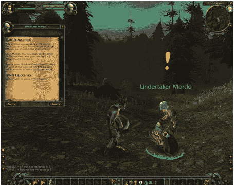

《魔兽世界》的发光选择截图

一旦参与其中，角色将揭示以下任务或下一个线索，帮助玩家在游戏中继续前进。玩家现在知道下一个期望的行为，并且永远不会感到迷失方向。

与第 6 章中提到的沙漠绿洲游戏技巧形成对比，在该技巧中设计师通过清除其周围的一切来突出期望的行为，发光选择技巧是关于在复杂环境中应用一个像明亮星星一样闪耀的覆盖物。你可以通过在应用中对代表用户需要被引导的期望行为的关键功能进行强烈强调来应用此方法。许多应用通过在关键功能上放置一个问号，或一个直接指向他们希望潜在客户关注的内容的箭头来实现这一点。我总是告诉我的客户，“永远不要让你的用户偶然遇到糟糕的体验。”如果用户在 4 秒内无法弄清楚该做什么，他们就会失去兴趣。如果用户点击任何按钮或标签并到达死胡同，他们就会因执行期望的行为而受到惩罚。

良好设计的关键是确保用户不需要思考是否要执行期望的行为。事实上，如果用户不想执行，用户应该必须努力思考并决定不采取期望的行为。如果应用内有一个巨大的动画箭头指示你应该点击某个按钮，用户仍然可以选择不点击，但他们的脑子必须工作

从池中替换礼物。
随后的参与者重复此过程，可以从池中选择，也可以“偷走”之前玩家中的任一礼物。这持续进行，直到最后一名玩家选择最后一个礼物或从他人处偷走，这会导致被偷礼物的个人打开最后一个礼物。同样，在这种情况下，每个人都知道一旦完成游戏，就会获得奖励，但奖励是什么只能在最后确定。
白象交换实际上是一个非常有趣的游戏，我个人非常喜欢。它几乎融合了 Octalysis 中的每一个核心驱动。你应该在有机会时和家人朋友一起尝试。

随机奖励的第二个例子可以从一家 literally 叫做 Mystery Box Shop¹⁹⁷ 的公司看到。客户通过每月订阅费加入该服务。与 Woot 的“垃圾袋”类似，每个月月初，一个包含 5 到 10 件“精彩奇物”的包裹会被寄给客户。每个包裹的内容遵循当月的主题。最近的主题包括“永不长大”、“万圣节超赞”、“另一个世界”和“老派”。承诺会很酷、好奇、奇特，甚至古怪，每个神秘盒都提供了一种好奇的元素。由服装、玩具、小工具、零食、电子产品等混合组成，每次送货就像打开你生日礼物一样。它让客户不断回来寻求更多。

## 复活节彩蛋/突然奖励（游戏技巧 #30）

不同于神秘盒，复活节彩蛋（或突然奖励）是在用户事先未意识到的情况下给予的惊喜。换句话说，神秘盒是基于某种*预期*触发器的意外奖励，而复活节彩蛋则是基于*意外*触发器的奖励。

我们的大脑会被惊喜元素所吸引，而且由于这些奖励如此出乎意料，额外的兴奋感和好运感使体验极其激动人心。突然奖励激励客户不断回来，希望他们能无意中再次感受到同样的喜悦。在这种情况下，对奖励的无知*确实*带来幸福。

复活节彩蛋有效的方式有两种：它们能获得很好的口碑传播，因为每个人都喜欢分享发生在自己身上的令人兴奋且意外的事物。在告诉朋友们好运后，他们的朋友也可能对这段经历感到兴奋。

复活节彩蛋还会引发人们对触发原因的猜测。如果复活节彩蛋似乎是随机的，参与者会想知道如何复制这种体验以“玩弄”系统。他们会开始形成关于自己如何获胜的理论，并一遍又一遍地执行假设的期望行为，以证明或证伪这些理论。

一个很好的复活节彩蛋例子是 *Chase Picks Up The Tab* 程序¹⁹⁸。Chase 希望客户更多地刷他们的借记卡，因为公司与信用卡相比会有更好的利润率。因此，在 *Chase Picks Up The Tab* 程序中，每当 Chase 客户刷他们的 Chase 借记卡（期望的行为）时，就有很小的几率客户会收到 Chase 的短信，内容大致为：“Chase 刚买单！你的 5 美元将被退回你的账户。祝你有美好的一天。”虽然奖励金额不大，但它促使消费者定期使用 Chase 卡而不是其他卡刷卡，以看看是否能重复成功并“再次获胜”。通常，用户还会告诉朋友他们获胜的消息，这可能会促使朋友也注册这个“游戏”看看是否也能获胜。

另一个很好的复活节彩蛋例子是由 Foursquare 之前的版本实现的（Foursquare 是游戏化领域的先锋应用，最近已转型）¹⁹⁹。Foursquare（现为 Swarm）允许用户在他们访问的不同地点“签到”，与朋友分享他们的位置，并根据令人印象深刻的签到模式获得徽章。某个地点的签到次数最多的用户会获得“市长”身份，除了炫耀权之外，还可能获得特定地点的奖励，如免费饮料或零食（存在一些设计缺陷，但这超出了本章范围）。

《企业游戏化》的作者 Mario Herger 几年前与 Foursquare 的复活节彩蛋有过有趣的经历。在 2011 年秋季，他

曾是一名中等程度的 Foursquare 用户。在史蒂夫·乔布斯去世的那天，很多人涌向帕洛阿尔托的 Apple Store，在墙上摆放鲜花并留下纪念留言。Mario 当时就在 Apple Store，于是决定在 Foursquare 上签到。没想到，他解锁了一个名为“Jobs”的新徽章，副标题为，“致疯狂的人们。#ThankYouSteve”

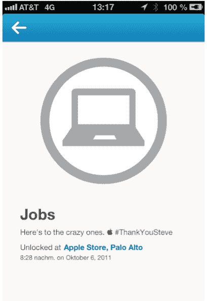

据我们所知，这是一个只能在极少数地点、在非常狭窄的时间窗口内获得的徽章。正如你所料，这对 Mario 来说是一个巨大的惊喜（丝毫不削弱史蒂夫·乔布斯去世这一沉重事件的意义），这促使他更频繁地在 Foursquare 上签到，并在之后经常谈论这段经历，以至于我现在在本书中分享它。

## 彩票/滚动奖励（游戏技巧 #74）

另一种由核心驱动 7：不可预测性与好奇心驱动的奖励情境是滚动奖励，有时也称为“彩票”。滚动奖励的关键思想是规则规定每个周期都必须有人获胜。因此，只要用户“留在游戏中”，获胜的机会就会线性增加。

在较小的团体环境中，滚动奖励设计表现为“每周员工”之类的形式，员工们努力工作，希望有一天自己能获得该称号和认可。 （注：Mario Herger 在他的书《企业游戏化》中指出，每周员工计划在不赞成个人认可的国家和文化中行不通[^200]。）

另一种滚动奖励形式是雇主或大客户声明：“项目结束后，你们中将有一人获得为期两周的毛伊岛免费度假！”事实上，在大多数工作场所，某天被提拔的想法本身就是一种滚动奖励——必须有人成为新的副总裁：希望是我。

在参与者数量庞大的更大规模下，滚动奖励计划的参与门槛很低，奖励丰厚（想想州级或国家级彩票），但无论你玩“游戏”多久，中奖的几率都非常渺茫。是的，个人可以通过执行更多期望行为来增加中奖几率，例如购买额外的彩票或收集额外的参赛资格。但同样，项目越大，几率就越令人望而生畏。

彩票之所以如此有效，是因为我们的大脑在区分小百分比方面非常糟糕。我们无法在概念上理解“十万分之一”和“一亿分之一”之间的区别。我们只是将这两种几率都登记为“非常小的机会”，而没有真正理解你可能在赢得“一亿分之一”奖一次之前，先赢得“十万分之一”奖十次！

研究彩票的莱斯布里奇大学教授 Robert Williams 表示，“我们进化史上没有任何东西能为我们准备或激发我们，没有任何智力架构，能让我们把握这些几率的遥远程度。”[^201]。因此，只要有一丝机会，人们就愿意投入少量金钱来获得巨额奖励。

大学毕业生，而第二名将赢得 $6,200，其次的奖项一直递减到 $7。

由于这种“统一发票彩票”制度，消费者现在要求商家提供收据和发票，防止商家通过地下现金交易（或使用比特币购买）逃税。此外，消费者更有可能花更多钱，因为每次购买都有可能获奖，从而促进经济。

就连我的祖母在过去二十年里，仅通过她一直都在做的事——购买杂货和必需品——就赢得了许多 $7 和 $31 的小奖。

因此，统一发票彩票使财政部在 1951 年相比 1950 年征收的税收收入增加了 75%。对于政府的努力来说，这是一个很好的投资回报率[^202]。该计划非常成功，他们在 2011 年将最高奖金提高到超过 $330,000，希望能让更多消费者要求收据。

2006 年，台湾政府也开始将这些统一发票过渡到电子发票，减少了 2.5 亿美元的处理成本，并每年节省 80,000 棵树[^203]。

我们应该看到更多的政府通过激励和吸引其选民参与，而不是仅仅更严厉地打击或使违规惩罚更严重，来实施创新解决方案。

## 核心驱动 7：大局观

核心驱动 7：不可预测性与好奇心是一个强大的黑帽核心驱动，本身就极具刺激性。对于任何参与设计来说，问自己一个有成效的问题是：“是否有任何方法可以在过程中加入一点随机性和偶然性？”通过使用为好奇心和不可预测性而设计的技巧，公司可以推动客户参与其产品，并在终局阶段更长时间地留住这些客户。

与白帽核心驱动一起工作时，核心驱动 7 是一种激发史诗意义与使命、激发创造力与反馈的赋能、并提高所有权与占有价值的绝佳方式。与其他黑帽核心驱动一起工作时，不可预测性与好奇心与稀缺性与不耐烦相匹配，会产生强迫性和成瘾性行为，而与核心驱动 8：损失与回避相匹配时，会大幅放大恐惧和担忧的负面情绪。

## 为了最大化本书的收获，请立即选择以下其中一个选项执行：

简单：想想你最喜欢的电视剧（如果你有的话），你总是被它牢牢吸引。看完一遍后，你会独自再看一遍吗？当不可预测性减弱时，你的动机发生了什么变化？

中等：不可预测性放大了我们对收益（核心驱动 4）和损失（核心驱动 8）的情绪。想想一个不可预测性附加在收益上的场景，它使整个体验比保证获得收益更有趣、更令人兴奋。然后，想想一个与损失相连的场景，以及它如何比损失有确定的发生几率时更能瘫痪活动。你能看出不可预测性如何以黑帽内在的方式使任何事件更具情感参与度吗？

困难：在你自己的项目中，尝试设计一个团体任务神秘盒组合，如果整个团体完成各种期望行为，就会给每个人一个惊喜奖励。评估这与仅仅给予团体固定行动奖励相比的利弊，在固定行动奖励中，每个人都已经确切知道如果他们做了期望行为会得到什么奖励（已赚取的午餐）。

在 Twitter 或你喜欢的社交网络上分享你的想法，使用标签 #OctalysisBook，并查看其他人有哪些想法。

## 以不可预测的方式探索 Octalysis 内容

我在互联网上创建的一个内容是名为 *Beginner’s Guide to Gamification* 的视频教程系列。它基本上是 Octalysis 和游戏化知识的结合，你正从本书中阅读这些知识，加上我环游世界各地（美国、印度、中国、丹麦、巴林王国、英国、德国、夏威夷等）的拍摄片段，以及我做的一系列傻气活动，只是为了防止观众过早离开这些视频。我在这些视频中做的一些事情如此离谱，以至于我仍然感到尴尬向人们展示。它可能是一种有趣的方式，让你以更娱乐的方式回顾从本书中学到的内容。该视频系列可在我的网站 http://www.yukaichou.com/video-guide204 上访问。
