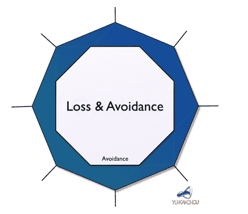
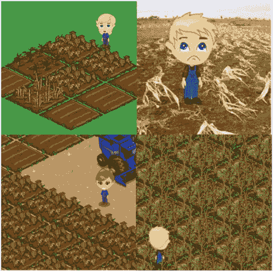
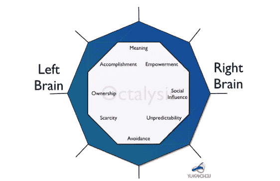

# 第十二章：第八个核心驱动 - 损失与回避

损失与回避是我 Octalysis 框架中的第八个也是最后一个核心驱动。它通过对失去某物或发生不 desirable 事件的恐惧来产生动力。

许多流行游戏中的一个概念是，为了进入下一轮而保持存活。根据游戏的设计，角色死亡或受伤意味着你现在被迫重新开始或失去一些重要的东西——无论是硬币、金钱、生命值，还是其他使达到获胜状态变得更困难的挫折。

这种对损失的厌恶显然不仅限于游戏。在现实世界中，我们有许多情况是基于害怕失去代表我们投入时间、精力、金钱或其他资源的东西而采取行动。为了维护我们的自尊和自我意识，核心驱动 8：损失与回避有时会表现为我们拒绝放弃并承认到目前为止我们所做的一切都变得毫无用处。

即使是被感知为正在消退的新机会，也会表现出一种损失与回避的形式。如果人们没有立即对这个暂时性的机会采取行动，他们会觉得自己永远失去了行动的机会。

一个常见的例子可以在定期寄来的优惠券中看到。假设你收到了一张提供你完全没有兴趣光顾的热门连锁店10%折扣的优惠券，并且优惠券标明在2月12日到期。

你的大脑可能绝对确定，如果你让优惠券过期，下个月你会收到完全相同的优惠券，到期日为3月12日。但你可能会产生一种烦人的感觉，如果不在到期日前使用优惠券，就好像在失去某些东西。理智上这并不重要，但你被迫多想一想这个优惠。结果，你变得更有可能为了一个你可能并不真正关心的折扣而去商店。

## 收割你的损失

许多社交游戏有效地运用了核心驱动力8：损失与回避来激励玩家采取期望的行为。在现在熟悉的Farmville例子中，如果我们看一下他们入职阶段的早期部分，我们可以看到回避设计已经整合到系统中，诱使用户“登录”每天多次。

Farmville的前几分钟似乎非常积极，因为玩家花时间创建自己的头像并开始用初始的免费Farm Cash池来经营农场。然而，Farmville很快要求每个玩家通过常规的农场杂务来维护他们的作物和牲畜——主要是以回来点击作物和牲畜收获产品形式出现。

如果你没有在作物档案确定的时间内返回收获，就像你可以选择种植哪种作物一样，这涉及到核心驱动力3：创造力与反馈的赋能，你将失去投入的辛苦工作，并被展示作物枯萎死亡的令人沮丧的图像。这种轻微的沮丧事件让用户不安，迫使他们频繁重新登录以保持作物存活。玩家积极参与避免这种负面结果。

当玩家失去作物时，不仅要花费Farm Cash来替换，还要花费时间，因为他们必须重新种植和维护新的作物。每当你看到令人沮丧的死作物图像时，你都会受到三重打击：你失去了时间、精力和资源。

多年前我惊讶于这种设计有多有效，因为我的技术厌恶的母亲突然沉迷于玩Farmville。那时，我的母亲是那种认为技术是污染社会和削弱真实关系的邪恶来源的人；她仍然很少检查她的电子邮件。

但在2009年，由于她亲密朋友的热情推荐——这是一个很好的核心驱动力5：社会影响与归属感的例子，我的母亲在Facebook上注册并开始玩Farmville。入职阶段的开始很顺利也很愉快，因为她利用游戏放松头脑并与朋友联系。

然而，在玩了几个月后，我的母亲有时会在早上5:00醒来只是为了收获她的作物，防止它们枯萎。情况变得如此糟糕，以至于当我的母亲需要外出旅行时，她会打电话给我表哥，问他是否可以登录她的Facebook账号并帮助管理她的农场。她需要确保她的作物不会死掉。（她也曾经问过我，作为一个在第5章讨论的缺乏“孝”的儿子，我最终推卸了责任，以便我能专注于我的“其他”重要工作）。

当时，这让我震惊。我最初认为大多数人玩游戏的原因是因为他们在现实世界中有太多责任，需要沉浸在幻想世界中逃避这些责任。然而，这里你有一个全新的虚拟责任集合，给日常生活增加了更多的压力和焦虑。这说不通。

当然，今天我理解了黑帽动机的本质和力量。在一段时间里，Farmville能够成功提高其日活跃用户指标并降低短期流失率，采用这种损失与回避设计。那就是，直到用户遇到“黑帽反弹”，他们最终会筋疲力尽并找到勇气追求Farmville之外的自由。

## 被挟持的感情

2014年初，我受邀到中国深圳的全球性企业集团*华为*做几次关于游戏化的研讨会。在这次旅行中，我有一位指定的导游带我去美丽的*茶溪谷*进行了一整天的旅行。（你可以在我的视频系列——*游戏化入门指南*中看到这次旅行的许多内容，包括我的骆驼骑行和令人震惊的舞狮表演。）在所有这些兴奋之后，我旅行的教育部分来到了最后。

当我离开茶溪谷时，我看到有人在兜售铅笔画肖像。我的导游正在上洗手间，所以我决定去看看他们画得怎么样——这就是核心驱动力7：好奇心的力量。他们看到我走近，问我是否想要一幅肖像，我礼貌地拒绝了。

我正要离开时，我看到另一位艺术家根据另一位顾客的iPhone照片画肖像。我问（当然是用普通话），“哦，所以如果我给你一张手机照片，你也可以画吗？”他回答说，“当然可以！你要一个吗？”

我决定这将是我带回给妻子的一件好东西，让她知道我在远离家乡的漫长旅途中一直在想她。与其在机场货架上买一件昂贵的东西，一幅手绘的她的肖像会更个人化、更令人难忘。它会让她知道我确实花时间让一件独特和定制的物品为她制作。

我问艺术家，“所以一个多少钱？”他告诉我大约相当于50美元。我想，“哇，这太贵了，即使按美国标准来说。”与其和他讨价还价，我一般不喜欢这样做，因为它需要太多的情感能量，我决定使用核心驱动力6：稀缺与不耐烦中的走开战术。

“对不起，对我来说太贵了。”当我开始走开时，他急忙说，“如果我能做到35美元呢？”我很高兴我的稀缺战术奏效了，但35美元仍然太贵，所以我说，“不，就像我说的，太多了。”当然，我不是在虚张声势。那时我真的不打算买任何东西。

他然后说，“好吧……我可以做到25美元。由于一天快结束了，我就帮你一个忙，收尾这个。”在这一点上，即使它仍然不是很便宜（相比之下，深圳90分钟的按摩只有25美元），我认为我讨价还价做得很好，把他原来的要价砍掉了50%——感受到核心驱动力2。他还使用了核心驱动力5：社会影响与归属感的战术“因为我喜欢你，所以我会帮你一个忙”，所以我想我还是同意吧。我反正正在享受一次有趣的旅行。

工作了二十分钟后，他几乎完成了肖像。它还不错。它不算好，但你可以看出它像我妻子。（这是我的主要目标——我不想让她以为我在画另一个女人！）

当他收尾时，他问，“你想给画加上透明的保护层吗？它会保护铅笔芯不被弄脏。”我说，“当然，听起来不错！”他给了我一个担忧的表情并说，“不过那样会更贵。”我有点惊讶，问，“贵多少？”他漫不经心地告诉我，保护层要额外花费我15美元。

我然后意识到他的狡猾战术并感到相当恼火。我用一种情绪受扰的语气回应，“那就别了。我不会只为那层东西付15美元。”

然后，他用非常担忧和体贴的面部表情解释说，“但如果你不加保护层，铅笔芯肯定会在你的行李袋里弄脏，毁掉整幅画。看看铅笔芯有多容易掉落。”他然后用拇指擦拭肖像的一个角落，果然一层石墨落在了他的拇指上。“如果这幅漂亮的画被毁掉，那该多遗憾啊！”

*你在这个情况下会怎么做？*

正如你所想象的，这是一个非常不舒服的情况。尽管如此，这也是一次非常引人注目的教育经历。核心驱动力8：损失与回避的力量占据了我的行为，我最终为一幅相当平庸的画支付了40美元。而且如果你还记得，就在几分钟前我拒绝了同一幅画的35美元！

我走开了，反复提醒自己，“我不是花40美元买他的绘画技巧。我是花40美元买我妻子的幸福。这完全值得。”

从这次互动中，应该对说服性设计做出几个非常重要的观察。

我被高度迫使采取期望的行为。我最终为艺术家20分钟的工作支付了40美元，即使我理智上明白价格不公平也不诚实。“艺术家”赚到了他的钱。此外，我在采取期望行为后感到极度不舒服，从那时起，我再也不会强烈倾向于在中国街头小贩那里购买东西了。

这非常重要，需要理解。利用这种黑帽核心驱动力在促使某人采取期望行为方面极其强大，但从长远来看，它会削弱用户的体验并造成倦怠，从而导致高流失率。一旦他们完成了期望行为，人们就不想再让自己置于同样的境地。

在上面的情况中，艺术家仅靠一次性游客赚钱，这种策略只会伤害中国其他街头小贩，所以可能值得这么做。至少在几年后所有游客都知道要避免从狡猾的街头小贩那里买东西之前——不幸的是，包括诚实的人。在你自己的体验设计中，我猜你希望用户在第一次期望行为之后，在脚手架阶段和终局阶段继续采取更多期望行为。

因此，当我们在体验中利用吸引核心驱动 8：损失与规避的设计元素时，只应在你真的需要用户采取期望行为的关键节点使用。这之后应跟随一系列白帽核心驱动力，以鼓励并平衡用户的动机。我们将在第 14 章《白帽与黑帽动机》中进一步探讨这一主题。

这就是八角框架的魅力所在（从我的角度来看）。我们不仅可以用它来理解如何为动机进行工程设计和设计，还可以理解并优化这种动机的本质，以确保它同时实现我们的短期目标和长期目标。

如果你一定要知道：回到加州后，我妻子认出了画像中的自己，并被这个举动深深感动。我也感到极其有成就感（核心驱动 2），因为她非常开心，而且我的计划像魔术一样奏效。

也许那 40 美元最终还是值得的。

## 扑克中的“你为什么不拿走我所有的钱？”

同类型的核心驱动 8 行为在心理赌博游戏如扑克205中也经常发生。考虑以下德州扑克玩家经常遇到的情况：

在一场比赛开始时，你可能一开始就拿到了一手非常强的牌。在不吓跑其他玩家的情况下，你会小幅加注，这样任何对本局牌局仍有希望改善手牌的人都会留下。随着更多公共牌（大家都可以用来“共享”来组成手牌的中心牌）翻开，你的手牌依然强劲，每个人都继续跟注你的小注，通过向底池增加少量筹码来跟注。这通常意味着玩家对自己的牌没有信心，但他们还不想弃牌（放弃），希望能拿到更好的牌，所以他们继续投入最少的钱留在这一轮。

你对自己的手牌感到非常好，尤其是与对手相比。最后，当最后一张中心牌翻开，再也没有什么可看或可期望的时候，你觉得是时候收割 winnings 了。但知道其他人很可能手牌更弱，你仍然不想吓跑整张桌子。所以你决定投入 40% 的筹码，看看是否有人会用同样数额挑战你。你希望能让一个手牌还算不错的人认为你可能在诈唬并与你对赌。

在这种强势表现下，大多数人会弃牌，因为他们意识到你真的有一手强牌，而他们只有平庸的牌。但一个人突然“All-In”，把他所有的筹码都推到中央。

这对扑克玩家来说是一个艰难的时刻。你已经完全展示了对自己手牌的信心和实力。即使另一个玩家也认为自己有一手好牌，他也可以简单地跟注你的赌注而不是加注。这样他就可以控制金额，以防你的手牌比他更强。

但通过“All-In”，这个人表明他对击败你的大牌如此自信，以至于不在乎你可能有什么牌。在扑克中，玩家能得到的更差的手牌不是桌上最小的手牌，而是第二大的手牌。当你知道自己有一手小牌时，你只需弃牌，只损失几枚筹码。但当你认为自己有桌上最大的手牌但最终没有时，你就有输掉所有筹码的风险。

在这种情况下，你迅速在脑中做了一些计算，得出结论：有三种可能的手牌，虽然极不可能，但这个人可以用它们击败你。也许他只是在诈唬？你开始紧张，开始思考他在最近几步中是如何打牌的。你的理性大脑完全确信这个人没有在诈唬，并且已经击败了你的牌。你输了。

如果你是一台电脑，你的计算会迅速认识到，损失 40% 的钱比损失超过 40% 的钱更好。因此你会弃牌并接受损失。

然而，人类思维是不同的。在这一刻，我们倾向于把眼睛盯在桌上的钱上。我们开始感受到损失 40% 筹码的痛苦，然后开始产生第二想法：“如果他有一手更小的牌呢？如果他是在诈唬呢？如果他实际上有一手小牌，但他以为它很大呢？”

我们忘记了我们的理性大脑已经确定这个人没有在诈唬并且已经击败了你的牌。现在思考的是我们的情绪大脑。你也不想在自信地加注后，第一次遇到挑战就退缩而在别人面前显得像个失败者（核心驱动 5）。自尊是件昂贵的东西。

最后，核心驱动 7：不可预测性与好奇心发挥作用，提升了损失与规避的另一个方面。如果你现在弃牌，你永远不会知道那个人是否有一手更好的牌（在扑克中，如果挑战没有被同等或更高的赌注满足，玩家无需亮牌）。你可能会在余生中都在想他是否真的击败了你的牌，而这是一件可怕的经历！

因此，你最终做出了非理性的决定：你把所有的钱都推了进去，只是因为你不想放弃已经投入的 40%。通过这样做，你选择接受对手的挑战并亮出双方的手牌，看看谁的更大。

最后，正如你心里早已知道的那样，对方透露他确实有一手比你更好的牌。原本你只需要损失 40% 的钱，现在你却输光了。

这就是为什么在扑克中，“Tough Muck”一词指的是玩家在下注大量钱后弃掉一手非常强牌的情况。任何玩家在真正拥有最好牌时都能赢钱，但只有真正的专业人士才知道在需要时如何执行艰难的弃牌。

## 好钱追逐坏钱

同样的现象在投资中也会发生。假设你很有钱，并向一家名为 LOSR 的生物技术公司投资了 10 亿美元。多年后，他们的资金快用完了，但仍未取得任何确定性结论。他们告诉你他们已经非常接近，只需要再 4 亿美元就能取得重大突破。

现在如果你刚开始了解这家公司，你可能会根据所见的进展得出结论，管理团队完全无能，你甚至不会向他们投资 20 美元。为什么要把钱扔进水里？

与扑克例子一样，我们无法应对沉没成本，促使我们采取非理性行为——投入好钱去追逐坏钱。你最终不情愿地向 LOSR 投入额外的 4 亿美元，以挽救你已经投入其中的 10 亿美元。

当然，公司有可能取得重大突破，在这种情况下，世界会认为你很聪明且有远见。然而，你做出投资并非因为机智，而是仅仅因为你对已经损失的东西的恐惧和执着。

从财务理性角度来看，这里正确的决定是止损，并将你的 4 亿美元投资到其他更有前景的机会中。（当然，除非你出于非财务原因投资——例如防止疯狂科学家因缺乏资金而在自己身上做实验，从而成为毁灭文明的超级反派）。

忠于黑帽动机的本质，你会被强烈驱使去采取期望的行为，但并不一定对这种行为感到舒适。

## 僵尸让你更苗条

尽管大量黑帽动机让我们感到沮丧，但一点点黑帽可以为体验增添刺激和兴奋感。温和形式的倒计时、小惩罚，甚至是好玩的恐惧战术，都能进一步让用户投入到体验中。

“好玩”的损失与规避的一个很好的例子是移动应用《僵尸，跑！》。这款应用将用户沉浸在一个虚构的末日设定中，僵尸已经占领了世界。用户扮演“跑者5号”在名为“阿贝尔”的小镇中。有时，阿贝尔镇会耗尽资源，“跑者5号”必须走出荒野去完成任务拯救小镇。

戴上耳机，在现实世界中边跑边听一系列旁白，用户被激励去跑步，因为他们“不想被僵尸吃掉”。在跑步的战略性部分，“阿贝尔镇广播电台”会激励用户在特定时间内冲刺，仅仅因为他们通过想象中的望远镜看到有快速移动的僵尸正跟在用户身后。

而 Nike+ 主要让用户因为成就感而跑步，僵尸，跑！则是让用户因为不想被僵尸吃掉而跑步。

我举办季度在线 Octalysis 游戏化工作坊时，经常有很多人提到僵尸，跑！是让他们重新开始跑步的完全投入的应用。我自己也非常印象深刻，它如何很好地驱动用户进行规律且重复的锻炼。

当然，为了成为一种引人入胜的体验，僵尸，跑！在激励用户时使用了超越损失与规避的多种白帽和黑帽核心驱动。游戏的背景故事让跑者5号踏上拯救他被困社区免受僵尸侵害的使命，这将核心驱动1：史诗意义与召唤引入了叙事中。每一次任务的完成都强烈地作用于核心驱动2：发展与成就。他在跑步时“收集”的资源，可用于重建角色的社区，这利用了核心驱动4：所有权与占有。

最后，核心驱动7：不可预测性与好奇心通过情节得到驱动。因此，如果用户想知道为什么另一个剧情中的同伴跑者突然无缘无故地剧烈咳嗽，他们必须跑更多来弄清楚同伴跑者是否被僵尸感染。

## 翻转其他核心驱动

核心驱动8：损失与规避之所以能与许多其他核心驱动互补，有一个有趣的原因：它通常表现为其他核心驱动的逆转。你不想让比自己更大的事物分崩离析，核心驱动1，因此你采取行动；或者你不想在朋友面前看起来像个失败者，核心驱动5，因此你做出购买。

有些人可能会争辩说这并不构成一个独立的核心驱动。例如，批评者可能会指出，人们回到 Farmville 是因为他们想要成就感或所有权的感觉，而失去这种感觉只是这些驱动的移除。然而，从设计角度来看，将损失与规避视为其自身核心驱动是很重要的。

这是因为从动机的角度来看，获得某物和防止损失是截然不同的。研究206207208一再表明，我们更有可能改变行为以避免损失，而不是为了获得收益。它迫使我们以不同的方式行动，并遵循不同的心理规则。事实上，诺贝尔奖得主丹尼尔·卡尼曼指出，平均而言，我们对损失的厌恶是寻求收益的两倍209。这意味着我们只有在认为潜在收益是潜在损失的两倍时，才倾向于承担风险。

通过使用 Octalysis 框架，这种区分通过专门识别整合主动损失规避机制的机会来改善行为设计，从而产生更微妙的动机动态。

## 终极损失 vs 可执行损失

核心驱动8：损失与规避是一个棘手的核心驱动，管理不当会让用户感到沮丧并导致流失。

需要记住的一件重要事情是，损失与规避是以成比例的方式产生动机的。用户对损失与规避的反应通常与他们已经投入到体验中的程度成正比。

如果用户玩了一个游戏或使用一个产品十个小时，他们会感受到比只投入十分钟时更实质性的损失。在失去后重新开始，对投入了几天时间并处于37级的玩家来说，肯定比刚开始且处于2级的玩家影响更大。

这里的关键策略是，体验设计师应该悬挂一个重大挫折的威胁，即终极损失，但应仅在必要时实施小的边际挫折，即可执行损失，以在情感上训练用户更认真地对待终极损失。可执行损失强化了规避。

根据我自己的经验，一般规则是，可执行损失绝不应超过用户已投入的时间和/或资源总量的30%，理想情况下不应超过15%。通常2-5%的小损失足以激励用户认真对待活动。如果用户损失超过他们最初投入的30%，他们感到沮丧并放弃的可能性变得极高。

由于用户实际遭受重大损失对任何人都无益，最好将“终极损失”用作一种期望管理形式，系统创造用户欣赏但不会滥用的“宽容系统”。

例如，在工作场所，经理可能会明确表示，低于某一水平的绩效将导致被解雇。因此，每个人都会在一定但有限的程度上被激励去避免可怕的损失。这种核心驱动8的经理甚至可能会执行从训话、将员工调离重要任务到公开斥责他们的范围内的微小损失事件，提示：通常是个糟糕的主意。所有这些都是为了确保员工在情感上承认这种损失感，并被激励更努力地工作。

然而，当员工未能达到绩效目标并完全期望被解雇时，经理可能会执行另一个选项。充分了解人员流动和重新培训新人才是最不理想的结果，经理可以告诉员工组织感谢他的努力和辛勤工作，并将给他另一次机会达到目标。

正如你所见，这里终极损失实际上并未实施，而是作为黑帽动机工具来使用。此后，员工可能会感激第二次机会并变得更有动力去工作。这就成为核心驱动8：损失与规避为核心驱动5：社会影响与归属感铺路的例子，在这种情况下，员工可能会因为对经理产生新的感激之情而开始更努力地工作。

期望与幸福和动机息息相关。一个生活在贫穷国家的饥饿青少年将极难理解为什么一个发达国家的完美主义学生会因为在学校得了“B”而抑郁三周。另一方面，一个期望不及格的班级的学生在获得B时可能会庆祝一周。

同样，一个亿万富翁因损失大量钱财而变成百万富翁可能会自杀210，而平均人获得一百万美元则会变得欣喜若狂。根据我自己的观察，我们的幸福几乎完全由我们的期望与我们处境的匹配程度决定。基于这一点，成为快乐的最简单方法可能是调整我们的期望并珍惜我们所拥有的

破伤风感染211。实验中学生分为三组：第一组收到了警告小册子，但没有预防破伤风感染的明确步骤。第二组收到了警告小册子以及安排破伤风注射的具体计划（指向期望行为的 *触发器*）。最后一组收到了安排破伤风注射的具体计划，但没有收到高恐惧警告小册子。

正如你所预料的那样，只有同时收到*高恐惧*警告小册子*和*补救计划的组，才会高度有动力去采取期望行为。正如核心驱动力 2：发展与成就中所提到的，我们只有在让我们感觉聪明的行动时才愿意行动。如果用户在思考如何应对这一潜在威胁时感到困惑（因此觉得自己很愚蠢），他们宁愿完全忽视它，也不愿因此感到无能。

正如 Noah Goldstein、Steve Martin 和 Robert Cialdini 所精妙地指出，也许我们应该将美国总统富兰克林·罗斯福的著名名言212修改为，“我们唯一需要害怕的就是恐惧*本身*”213。

## 游戏技术在损失与规避中的应用

你已经了解了核心驱动力 8：损失与规避的动机和心理本质，为了使其更具可操作性，我在下面列出了一些游戏技术，它们大量利用这一核心驱动力来吸引用户。

### 正当继承权（游戏技术 #46）

一种常见的利用核心驱动力 8：损失与规避的游戏技术，我称之为 *正当继承权*。这是指系统首先让用户相信某物本就属于他们（记住期望很重要？），然后让他们感觉如果不采取期望行为，就会失去它。

正当继承权游戏技术有时可以通过简单的措辞改变来实现。你是否曾在网站上随意点击，直到偶然进入转化页面（“注册”或“购买”），然后看到类似“立即购买即可享受 20% 折扣！”或“立即注册即可获得 3000 免费积分”的优惠？通常，我们会将这些优惠视为噱头，是对核心驱动力 4：所有权与占有的一种拙劣吸引，于是我们忽略它们。

然而，一些网站通过利用我们的损失厌恶倾向，将游戏技术融入体验。想象一下，当你在网站上随意点击时，会弹出一个小部件，显示“太棒了！你的操作为你赢得了 500 积分！”当你继续点击其他地方时，它会继续说“太棒了！你的操作为你赢得了 1500 积分！”最后，当你进入落地页时，文字显示“你现在拥有 3000 积分。注册以便稍后保存你的积分！”

尽管这与“立即注册即可获得 3000 免费积分”结果完全相同，但体验设计让注册感觉更有说服力。之前，注册的麻烦不足以换取 3000 积分，但现在你感觉这些积分是自己通过“辛苦”点击网站“赚”来的，而失去自己应得的东西的想法显得荒谬。因此，你注册的可能性大大提高。

对于电子商务网站，想象一下如果一个小部件向你显示类似“感谢您在工作时间访问我们的网站。您已获得 5% 折扣码。点击此处获取代码。”的信息。当你 dismiss 这个小小的 5% 折扣并继续浏览时，信息会说“感谢您在我们网站上比较价格！您已获得 10% 折扣码！点击此处获取代码”，然后紧接着“感谢您查看我们很棒的用户评价。您已获得 15% 折扣码。点击此处获取代码。”最后，一个醒目的信息显示“您已获得最高 20% 折扣！点击此处获取代码。”

此时，你可能会觉得自己通过“辛苦”浏览电子商务网站而“赚”到了折扣码。即使你不想购买，你也会觉得无论如何都应该拿到这个代码。一旦你获得了 20% 折扣码，类似之前提到的即将过期的邮件优惠券，损失与规避的另一层推动力出现了。你现在会觉得如果不在代码过期前使用它，就会失去一些东西。因此，你为了使用折扣码而进行购买的可能性增加了。

在初创公司世界中，公司通常会给员工提供舒适数量的股权形式期权，但附带几个条件。第一个是“归属时间表”，员工只有在公司工作特定时期——通常为 4 年——后才能获得全部期权，每月获得承诺股权的 1/48。

另一个条件是“悬崖期”，即员工开始实现其归属期权的时期（通常为一年）。因此，如果员工在 3 个月后离职，他们将一无所有。待满一年后，他们会立即获得全部股权包的 1/4，然后从那时起每月累积 1/48。悬崖期的目的是确保不会有一大批几乎没有为公司做出贡献的前员工拥有股权。

由于这种设计，我见过许多想离开公司的员工，比预期待得更久，因为他们不想失去自己应得的已归属月份。当然，如果公司无法通过安装更多白帽元素如目标、自主性和精通来扭转员工的离职动机（提示：可能因为老板不好），员工会在悬崖期结束后立即离开。

具有讽刺意味的是，大多数公司不会在员工表现良好时给予应得的加薪或晋升，而是在员工因核心驱动力 8：损失与规避而受到激励时才给予——即员工已经接受了另一家公司的 offer。基于合理的动机设计，公司实际上应该在员工执行期望行为、表现良好时奖励他们；而不是在员工做出不期望的行为如要求加薪或寻找其他 offer 时才奖励。如果你只在人们做不期望的行为时奖励他们，你只是在鼓励他们（以及所有同事）做更多这样的行为。214

正当继承权游戏设计技术在许多场景中都非常有用，可以激励用户采取行动。类似于一些兄弟姐妹为了他们几乎不配得的大额遗产而狡猾地互相争斗；当人们觉得某物是他们的正当继承权时，他们往往会为之奋斗到底215。

### 短暂机会（游戏技术 #86）和倒计时计时器（游戏技术 #65）

短暂机会是指如果用户不立即采取期望行为，该机会就会消失的时机。游戏《暗黑破坏神 III》中最大的刺激之一就是一种叫做宝藏哥布林的小怪物。宝藏哥布林是一种随机出现的敌对生物，被攻击时会逃跑而不是攻击玩家。拥有大量生命值（HP，生命或血量），玩家都会急忙攻击逃跑的宝藏哥布林。击败宝藏哥布林有时（但并不常见）会获得丰厚宝藏。然而，如果在特定时间内没有击败宝藏哥布林，它会跳入传送门并消失。

当发现宝藏哥布林时，玩家常常会忽略正在攻击他们的其他怪物， solely 追逐哥布林以获得其宝藏的机会。一些 YouTube 游戏主播曾说过类似的话：“我只是想向你展示如何击败这个 Boss，所以现在我要忽略这些怪物尽快到达 Boss……哦，看！一个宝藏哥布林！快来，别跑！哎呀，这些怪物挡路了。别往那边走！啊！我被杀了……我怪这些怪物。”即使在现场表演中，短暂机会也抢尽风头。

在现实世界中，每一个限时优惠，迫使你决定是否购买产品或永远失去优惠，都使用了这种游戏技术。二手车销售员喜欢告诉你，“听着，我刚刚和我的老板大吵一架，关于如果你今天以这样的优惠买下这辆车，你会如此高兴以至于成为终身忠实客户。这终于说服了他！我简直不敢相信！当然，你成为终身客户并没有什么实际压力，但你必须今天就接受这个优惠。如果你走开，我保证我的老板会很快恢复理智并改变主意。”

你嗤笑，因为你知道汽车销售人员使用的套路，并本能地在心理上对其筑起防线。但慈善募款人呢？“我们刚刚获得了一位慷慨的捐赠者，他说在接下来的一个小时内，我们每筹集一美元，他就匹配一美元！你的捐款将产生双倍的影响！”

短暂的机会促使我们迅速行动，害怕错失良机。与此技巧完美契合的简单反馈机制就是倒计时器。

倒计时器是一种视觉显示，用来传达时间流逝至某个具体事件的过程。有时倒计时器是为了引入一个绝佳机会的开始，而在其他时候则是为了标志机会的结束。

我们之前提到过，对用户施加终极损失对任何人都无益，而可执行损失只是为了让用户更认真地对待终极损失。较小的损失旨在强化对重大损失的规避。然而，如果用户并未意识到损失，整个动机因素就会被浪费。

倒计时器确保用户比单纯的到期日期更能认识到短暂机会的存在，因为用户不断看到机会窗口在缩小，从而在过程中建立起紧迫感。本能地为此目的，倒计时器应显示适当的最短时间间隔（更常见的是——秒），而不是显示周或月等较长间隔。

## 现状懒惰（游戏技巧 #85）和 FOMO 重击（游戏技巧 #84）

有时核心驱动 8：损失与规避的表现形式仅仅是不想改变行为。我称这种行为惯性的懒惰倾向为现状懒惰。

每隔一段时间，一位初创企业家就会对我说：“嘿，余凯，绝对没有理由客户不用我们的产品。我们为他们节省时间，我们为他们省钱，我们让他们的生活更美好！”在幸运的情况下，甚至客户自己也会说：“是的，绝对没有理由我不用你的产品。它节省我的时间，它为我省钱，它让我的生活更美好。我明天一定会报名！”

对于有过推出新颖产品经验的人来说，你可能会认识到这里的关键短语是“我明天一定会报名”。更常见的是，“明天”的真正含义是“永不”。并非因为那个人不真诚，而是由于生活中干扰太多，根本没有足够的动力去执行期望行为。

作为体验设计师，我们的目标是在产品的终局阶段构建现状懒惰，通过开发高度吸引人的活动循环，让用户将期望行为转变为习惯。

尼尔·埃亚尔，习惯养成产品构建专家，提出了*Hook Model*来描述一个*触发、行动、奖励和投入*的循环，最终吸引用户在不费任何脑力努力的情况下进行日常活动²¹⁶。事实上，一旦活动成为习惯，用户实际上需要在永久摆脱习惯之前*花费*持续的心理和情感能量。

这个 Hook Model 专注于创造内部和外部的*触发*，提醒用户每天采取*期望行为*。用户执行期望行为后，会提供可变的（并且通常是情感上的）*奖励*，最后促使用户投入*投资*，用户在下一次触发返回时通过此建立自身价值。投资就像添加照片、标记朋友、自定义文件夹，用户在其中为此过程建立价值（与核心驱动 4：所有权与占有相一致）。

如果做得正确，用户开始因现状懒惰而感到有动力，这意味着他们甚至可能更努力地*防止*行为改变。

另一方面，为了对抗正在阻碍你的现状懒惰，我称之为“FOMO 重击”的东西可能会被实施。

FOMO 代表“害怕错过”，它的诀窍是对核心驱动 8：损失与规避进行反向运用。

在生活中，我们害怕失去我们拥有的东西，但我们也害怕失去本可以拥有的东西。这种对后悔的恐惧，如果正确触发，可以穿透现状懒惰的行为惯性并触发期望行为。

当史蒂夫·乔布斯想招募百事高管约翰·斯卡利加入苹果担任新 CEO 时，他 famously 说：“你想用余生卖糖水，还是想有机会改变世界？”

砰！这是一次强有力的 FOMO 重击，促使斯卡利思考如果他在百事“浪费”余下职业生涯，他将错失一生一次的机会。他后来回忆道，“我只是吞咽了一下，因为我知道我会为此余生都在想我错过了什么。”²¹⁷（具有讽刺意味的是，斯卡利的持久遗产可能为人所知的是那个解雇史蒂夫·乔布斯并让苹果陷入困境的人——只是为了让史蒂夫·乔布斯回来并将其复活）。

正如上下文所暗示的那样，FOMO 重击在体验的发现阶段可以非常有效，当用户尝试新体验时。相比之下，现状懒惰技巧在终局阶段发挥更大作用，当设计师希望让老玩家留在系统中时。

## FOMO 重击的实际应用

公司经常问我，他们的内部游戏化系统是否应该对员工强制。 我们普遍知道游戏必须是自愿的²¹⁸。如果一个人被迫做某事，即使是游戏，也不再被视为“游戏”。

从这个意义上说，游戏化系统本质上应该是自愿的，因此发现阶段的设计变得重要，以便诱使员工参与游戏。由于员工无论是否有游戏化系统都必须执行与工作相关的期望行为，他们可能会尝试该系统如果它提供了他们自然渴望的能力感、社会认可和自主性。

然而，由于现状懒惰，员工往往不愿意改变行为去尝试新事物。这时 FOMO 重击就可以发挥作用。管理层可以传达他们错过了实现精通、提高公司认可度以及获得更多乐趣的机会。

另一个 FOMO 重击的例子是荷兰的“邮编彩票”。每周，邮编彩票会向一个随机的邮政编码（类似于邮政编码但家庭数量要少得多）颁发“街道奖”。在该编码内购买彩票的每个人都将赢得约 12,500 美元的等值奖金。当然，住在该邮编区但未购买彩票的人除了看着邻居庆祝胜利的痛苦之外什么也得不到。

2003 年的一项研究表明，邮编彩票比其他彩票项目更成功，因为荷兰居民害怕邻居在他们之外获胜²¹⁹。由于我们更可能基于损失预防而非收益预期来改变行为，人们购买彩票是因为他们害怕邻居赢得奖品并举办盛大的社区聚会——然后用“太糟糕了，朋友，你这次没参与。要我请你喝一杯啤酒吗？”来推动他们。

> “大脑对损失非常敏感——即使是低概率的损失，”南加州大学经济学和心理学副教授乔尔乔·科里切利解释道。“所以如果你把某件事框定为损失，在生物学上就有一种避免它的冲动。我们对它有厌恶感。”²²⁰

有了核心驱动 4、5、6、7 和 8 都被构建到设计中，邮编彩票成为如此巨大的成功也就不足为奇了。

## 沉没成本监狱（游戏技巧 #50）

也许核心驱动 8：损失与规避中最强大也最危险的机制是我称之为沉没成本监狱的东西。这

发生这种情况时，你投入了太多时间在某件事上，以至于即使它不再令人愉快，你仍然会因为不想承受放弃一切的损失感，而继续执行期望的行为。

想象一个场景：你玩了一款游戏很长时间，它开始变得无聊且毫无意义。你问自己为什么还要继续玩，但潜意识里你意识到，如果你退出游戏，你会感受到失去所有投入的时间、积分、货币、地位和自定义设置所带来的痛苦。退出将导致那种丑陋的感觉，即承认你真正浪费了数百小时，而这些时间最终化为乌有。

因此，为了避免那种令人沮丧的损失和空虚感，你反而说服自己使用那把强大的崭新宝剑去杀死更多怪物，或动用你辛苦赚来的两百万金币，试图再次感受到很棒。最终你又投入了更多小时在游戏中，并积累了更多可能失去的东西。你陷入了一个致命的螺旋之中，这可能会变得相当令人沮丧。

从设计的角度来看，如果你确保用户正在积累——并且知道他们正在积累——如果他们离开你的系统就会消失和浪费的东西，那么在终局阶段让用户离开将会非常困难。

沉没成本监狱虽然强大，但遵循的是黑帽原则，让用户感到不舒服。因此，它们始终应伴随白帽核心驱动力，（例如允许用户认识到他们实际上是在帮助世界，并且不应该放弃到目前为止积累的影响力）。这种技术只应在用户有快速离开系统的冲动时使用，例如被其他公司使用的黑帽技术所吸引。（例如，一个用户必须注册的特别“限时”促销。）

Facebook 是社交媒体网站的绝佳例子，它完美地体现了沉没成本监狱。我有很多现实中会见面的个人朋友，但我没有他们的电话号码也没有电子邮件。联系这些人的唯一方式是通过 Facebook。

如果我突然停用我的 Facebook 账户，我会觉得与这些个人朋友的所有联系都会丢失。更不用说，我花了多年时间在 Facebook 上上传照片、对话和帖子。如果我注销账户，所有这些都将难以访问或分享。

雪上加霜的是，我将无法访问和使用我在 Facebook 游戏中积累的所有虚拟商品和货币。Facebook 在设计产品时很聪明，人们使用它的频率很高并投入了太多，以至于他们很难离开——这确实是一个沉没成本监狱。

另一方面，即使 Google 的搜索引擎极其流行，它并不会在你停止使用时积累会失去的东西。它只是碰巧是市场上最好的搜索引擎（在我坚定不移的观点中），所以每个人都尽可能使用它。

但只要一个念头改变，“嗯，今天我想用 Bing 搜索而不是 Google”，Google 就会失去那个用户。如果有一天，某种原因让所有人都确信另一个搜索引擎更好，Google 可能会在一夜之间失去所有吸引力——不过目前看来在不久的将来这种情况不太可能发生。

当然，Google 正在通过引入核心驱动力 4 的阿尔弗雷德效应来对抗这一点，通过提供更个性化的搜索结果——Google 了解**你**，因此如果你停止使用 Google，你将失去所有其他搜索引擎无法为你提供的定制结果和体验。这不如 Facebook 的“我们扣押了你所有朋友”那么强，但这是一个正确的方向。

当你设计你的体验时，你应该定期思考是什么让用户不愿放手，从而让他们在你的系统中停留更长时间。

## Core Drive 8: The Big Picture

核心驱动力 8：损失与规避

核心驱动力 8：损失与规避是一种强大的动机，被各种组织和系统直截了当地利用。核心驱动力 8 产生

黑帽结果，例如高度的紧迫感和痴迷。然而，从长远来看，这会让用户处于不适状态。

在许多情况下，核心驱动力 8：损失与规避与核心驱动力 6：稀缺与不耐烦携手并进，因为排他性和限时优惠通常伴随着失去这种排他性或优惠消失的预期恐惧。这两个核心驱动力并不一定必须共存。例如，核心驱动力 6 游戏技巧锚定并置（你为用户提供完成期望行为的两个选项，核心驱动力 6 和 3 的结合）并没有从损失与规避中获得太多力量。

与核心驱动力 7：不可预测性与好奇心相匹配，核心驱动力 8 的情感恐惧会被放大，甚至变得更加致命。有趣的是，丹尼尔·卡尼曼富有洞察力的四重模式表明，在低概率损失事件中，我们会变得厌恶风险，以防止这种小风险发生。然而，在高概率损失事件中，我们被迫选择确定的（100%）损失，或 90% 的机会损失 200 美元和 10% 的机会损失 nothing，我们会变得寻求风险，并选择我们可以看到一丝希望的路线221。毕竟，恐惧是我们保持活力的动力，但希望是我们许多人最终为之而活的东西。

## 为了充分利用本书，请立即选择以下其中一个选项执行：

Easy: 思考你目前参与的任何活动，这些活动不再令人愉快或有意义，但你因为核心驱动力 8：损失与规避而继续做下去。这让你感觉如何，又需要什么才能停止这种行为？

Medium: 思考一个你仍然喜欢使用的产品，但如果你有一天想退出，很可能被困在沉没成本监狱中。你的大量个人数据，例如照片或劳动成果，是否存储在该服务中？重要的联系人或关系是否被封锁在平台内？重要的组织数据和洞察是否记录在系统中，基本上无法导出？仔细思考公司在你仍然享受他们服务的同时如何精心构建沉没成本监狱，以及当你想转换时你如何可能逃脱它。

**Hard:** 短暂的机会、倒计时计时器和 FOMO 重击经常一起工作来对抗现状懒惰和沉没成本监狱。你能否以最佳方式设计这三种游戏技巧的组合，让人们离开他们之前的习惯舒适区并尝试你的项目？在你把用户吸引到你的体验中后，你将如何添加白帽游戏技巧让他们享受它并感到被赋能？

在 Twitter 或你喜欢的社交网络上分享你的想法，使用标签 #OctalysisBook 并查看其他人有什么想法。

## 不要错过！在 Twitch.tv 观看 Yu-kai 研究热门游戏

还记得我说过，唯一完全理解游戏如何使用 8 个核心驱动力来促使我们产生痴迷行为的方法就是真正玩游戏吗？我相信有很多游戏你听说很受欢迎但似乎太复杂而无法自己尝试。2016 年，我开始在 Twitch.tv 上直播我对热门游戏的游戏设计研究。我展示自己游玩这些热门游戏，同时评论它们的游戏设计以及它们如何使用各种游戏技巧诱使我每天回来并花更多钱购买虚拟商品。

我从暴雪的新卡牌对战电脑游戏 *Hearthstone* 开始，并计划最终转向像 Minecraft、League of Legends 等游戏。我这样做是为了我自己的研究，但如果你去我的频道 https://www.twitch.tv/yukaichou，你也许能看到我进行实际游戏研究的直播。我还在我的 Twitter 账户 http://www.twitter.com/yukaichou 上宣布我计划直播的时间，所以那里也是体验 FOMO 重击的地方。

好了，是时候我再做一次研究了。我会在游戏直播期间见到你。

