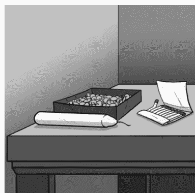
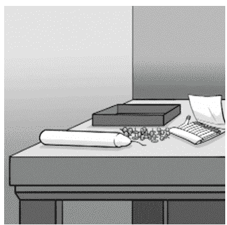

# 第13章：左脑与右脑核心驱动力

## 在现实世界中运用八角分析法

现在我们已经完成了8大核心驱动力的旅程，值得记住的是，这些核心驱动力驱动着我们所采取的每一个行动，无论在游戏内部还是外部。如果8大核心驱动力全部缺席，就没有动机，因此也就不会产生任何行动（隐藏的第九大核心驱动力：感觉除外）。

你可能已经注意到，我总是为每个核心驱动力附带一个特定的编号，在某些情况下，我只提到了核心驱动力的编号而没有完整的名称。读完这本书并继续理解和实施八角行为分析游戏化之后，你会发现了解这些核心驱动力的编号将变得非常有用。

当我和我的八角分析法设计师团队一起处理客户项目时，我经常说这样的话：“在这里你可以清楚地看到一个核心驱动力6的设计，它强化了核心驱动力3，进而促进核心驱动力2，并最终导向核心驱动力5。”

如果你不熟悉这些核心驱动力编号，你自然会难以跟上对话。8大核心驱动力被设计为“相互独立且完全穷尽”（也称为MECE）。遗憾的是，每个核心驱动力的完整名称都过于冗长。通过使用编号，你可以在长对话中节省时间和精力，转而专注于创造有价值的解决方案。

对我来说，八角分析框架非常有用，因为它不仅在视觉上帮助理解动机的复杂性，还揭示了其本质：每个核心驱动力在八角形上的位置提供了视觉线索，帮助设计师判断其产生的是长期还是短期效应，或者这些体验是内在设计还是外在设计的。

八角分析框架还使我们能够预测动机在后续阶段如何演变，并帮助我们识别设计中的弱点，从而加以解决和改进。

## 左脑与右脑核心驱动力

八角分析框架的一个关键方面是左脑与右脑核心驱动力之间的区别。

左脑核心驱动力涉及与逻辑、所有权和分析性思维相关的倾向。它们体现在以下三个核心驱动力中：
-   核心驱动力2：进步与成就感
-   核心驱动力4：拥有与占有感
-   核心驱动力6：稀缺性与迫切感

右脑核心驱动力的特征是创造力、社交性和好奇心，如下所示：
-   核心驱动力3：创意授权与反馈
-   核心驱动力5：社交影响与关联感
-   核心驱动力7：未知性与好奇心

> （注：本章后面有几处你可能需要回溯参考以上内容。）

同样值得指出的是，“左脑核心驱动力”和“右脑核心驱动力”这两个术语并不一定意味着它们在物理上位于我们大脑的左侧或右侧。这些称谓只是象征性的，因为某些核心驱动力更多地受到“逻辑大脑”的影响，而另外一些核心驱动力则更多地受到“情感大脑”的影响。

过去曾有人试图攻击我的工作，指出“左脑与右脑”模型已被证伪，因此不再具有科学有效性。在我看来，这只是一个语义问题，因为我完全可以把情感类核心驱动力称为“彩虹核心驱动力”，把逻辑类核心驱动力称为“石头核心驱动力”——这实际上会给它们增添一种很好的游戏感。

然而，当前的术语对于设计目的而言是理想的，因为“左脑/右脑”这一术语在社会科学中被广泛理解。因此，我特意将左脑核心驱动力设计在八角形的左侧，而将右脑核心驱动力置于右侧。我本身就是一名设计师，所以即使我一开始就不觉得左脑/右脑术语有什么问题，我也更倾向于有用的工具，而不是仅仅“语义准确”的工具。

我相信，我最初设定的目标——将这些核心驱动力组织成视觉清晰图表中的直观模式——是成功的。这让我和我的学生们能够以平易近人的方式遵循复杂的动机和行为设计原则。反过来，这使我们能够设计出确保持久指标得以维持的体验。

方便的是，左脑/右脑框架结构还使我们能够区分并针对外在动机和内在动机之间的差异进行设计。

## 外在动机与内在动机

左脑和右脑核心驱动力的分组，与许多动机理论家所理解的外在动机和内在动机相关联。

外在动机是源自目标、目的或奖励的动机。任务本身不一定有趣或吸引人，但因为有目标或奖励的存在，人们会变得有驱动力和积极性去完成任务。很多时候，人们每天去上班并不是因为他们真的热爱那份工作，而是因为他们想谋生、推进职业发展，并获得更高成就的认可。

例如，假设你有一份糟糕的工作。你的任务是每天花几个小时把粪便从地里挖出来。它劳动强度大，气味难闻，你恨透了这份工作。但这时有人出现说：“你每挖出一块粪便，我给你1万美元。”

突然间，你变得兴奋起来，挖粪的动力十足，心想：“哇！这钱也太好赚了！哈哈哈！”你现在投入、快乐、充满动力。士气高昂，你开始比以前快得多地工作。

然而，重要的是要记住，任务本身仍然不好玩。你之所以有动力，是因为外在奖励极具吸引力，它制造了一种你享受这项活动的错觉。一旦外在奖励消失，你就会重新憎恨这项任务——而且可能比之前更甚，正如我们很快会看到的那样。

另一方面，内在动机仅仅是指你从本质上享受任务本身所获得的动力。这些事情即使要你*付费*你也愿意去做，因为你太喜欢做它们了。例如，你不需要达到任何目标就能享受发挥创造力的乐趣；你不需要物质奖励就能享受与朋友相聚的时光；你也不需要任何报酬就能沉浸在不可预测性的悬念之中。

事实上，当你去赌场时，你得到的与回报相反。大多数人都知道他们在“统计上被赌场坑了”——赌场正是这样赚取大量金钱的。但他们走出来时却说：“我输了200美元，但我玩得很开心！”为什么？因为在整整五个小时里，他们一直在想：“也许这次我会赢！”

他们花200美元是为了购买“可能”获胜的内在愉悦。如果移除了不可预测性，人们确切地知道按下那些按钮五个小时后会得到40美元，他们就不会再觉得有趣了。事实上，这会变得非常类似于工厂中令人痛苦的劳动。

左脑核心驱动力本质上是目标导向的，而右脑核心驱动力是体验导向的。外在动机关注结果，而内在动机关注过程。

## 与自我决定理论的细微语义差异

内在动机与外在动机是游戏化领域中的热门话题，由丹尼尔·平克的著作《驱动力》广泛推广。该书探讨了人们不是被金钱（核心驱动力4：拥有与占有感）和惩罚（核心驱动力8：损失与避免）所激励，而是更多地被目的、自主和精通所激励。

虽然我认为《驱动力》及其所倡导的自我决定理论都非常出色，但我应该指出，在内在动机的构成上，我的术语与平克略有不同。

当一个篮球运动员每天通过投篮练习一千次时，他们的动机是实现精通，这在平克的理论中被描述为内在动机。然而，在八角分析框架中，活动本身仍然是单调无聊的。它之所以具有激励性，只是因为运动员有一个目标——这是一种外在动机。话虽如此，我们将在下一章中探讨自我决定理论如何与我框架中的白帽动机相连接。

这里是我通常用来判断某事是外在动机还是内在动机的测试：如果目标或目的被移除，这个人是否仍会被激励去采取期望的行为？

换句话说，到了最后，如果篮球运动员知道无论他们做什么，他们都会失去所有“进步”以及所获得或积累的一切，他们是否仍会选择去投篮？

社交聚会和创造性活动，例如解决有趣的谜题，会通过内在动机的测试。然而，积累物品、赚取积分，甚至朝着精通迈进则很可能不会。如果你知道世界明天肯定会终结，你会花时间做什么？你不太可能会决定练习投篮——尽管你可能会决定和你所爱和关心的人一起打一场篮球游戏。

再次强调，这些只是术语和分组上的差异，而不是对人们动机的根本信念的差异。丹尼尔·平克只区分内在动机和外在动机，而我则使用白帽动机与黑帽动机这一额外维度进行分类（你很快就会看到，精通属于白帽动机阵营）。因此我们的分类和语言略有不同，而我们对这些驱动力的本质和有效性的整体信念则没有差异。

类似地，参与平台 Lithium 的首席科学家 Michael Wu 区分了内在/外在动机和内在/外在奖励226。

动机是我们去做任何行动的驱动力，而奖励是我们执行期望行为后所获得的东西。

一个人可能在执行某项任务后获得内在奖励，例如获得他人的赞赏或产生一种成就感。然而，由于内在动机源于活动本身而不考虑未来结果，如果一个人为了任何奖励而做某事，包括任何内在奖励，这就不是基于内在动机。

这有点难以理解，但沿着 Michael Wu 的概念，核心驱动力 2：发展与成就可能会利用内在奖励，但最终并不专注于内在动机。左脑核心驱动力以结果（目标）为导向，而右脑核心驱动力以过程（旅程）为导向。核心驱动力 2 专注于进步和成就，因此在我的框架中基于外在动机。

## 游戏化活动中的动机陷阱

大多数游戏化活动通常采用忠诚度计划、徽章、进度条和奖品奖励，这些都专注于左脑核心驱动力。这是因为在期望的活动中添加外在奖励比真正让活动变得内在有趣或愉快要容易得多。

然而，使用过多外在动机技巧而牺牲内在动机，会产生许多动机陷阱227。

让我们假装一下，我喜欢画画并且经常在没有任何报酬的情况下画画。研究表明，让我停止画画的最好方法之一是先付钱给我画画，然后在一段时间后停止付钱228。

事实上，从我自己的经验来看，我认为更有效的方法是你逐步减少支付，直到达到一个非常侮辱性的金额——比如每幅画 0.02 美元。到了那时，我会感到受辱，并且不再有继续画画的欲望，尽管在我遇见你之前我很乐意免费画画。这是因为通过核心驱动力 3：创造力与反馈赋能的绘画内在动机，现在已经转变为通过核心驱动力 4：所有权与占有而为钱画画的外在动机。

随着报酬的减少，绘画对我来说 simply 变得不值得花费时间。从技术上讲，这被称为“过度合理化效应”——我主要参与奖励，这随后消除了并取代了我最初拥有的内在动机。

更糟糕的是，如果你仍然以可接受的金额支付我的画作，比如 20 美元，十之八九，我会被激励去尽可能快速地绘制粗糙的画作，以最大化我赚取的钱。实质上，只要我仍能得到报酬，我对作品*质量*的关注就会小于对作品*完成*的关注。事实上，许多研究表明，外在动机，例如付钱给人们完成任务，实际上会降低人们执行任务的创造能力。

《可预测的非理性》的作者 Dan Ariely 在他的实验中证明，被支付最多的人（5 个月工资）完成一些相对快速的任务的表现远不如被支付更少的人（只支付一天或两周的工资来完成同样的任务）229。

当人们在想钱时，它会分散他们对表现的注意力。甚至伦敦政治经济学院在多次实验后也得出结论：“我们发现，经济激励确实可能降低内在动机并削弱遵守工作场所社会规范（如公平）的道德或其他原因。因此，提供激励可能会对整体绩效产生负面影响。”230

这是因为当我们为了外在激励因素做某事时，我们的眼睛盯着目标，并试图使用最快和最省力的路径去实现它。因此，我们往往放弃了创造力、扩展性思考和完善工作的能力。

Daniel Pink 指出，“奖励本身就具有缩小我们注意力的性质。当有明确的解决方案路径时，这是有帮助的。它们帮助我们直视前方并跑得更快。但‘如果-那么’的激励因素对于像[创造性]蜡烛问题这样的挑战是糟糕的。”

当然，在那些不需要任何创造力且本身内在动机就很少的例行和枯燥任务中，外在动机确实通常会因为它产生的目标驱动焦点而提高绩效和结果。Dan Ariely 在他的《纽约时报》文章《大奖金的价值是什么》231 中指出，“只要任务只涉及机械技能，奖金就会按预期发挥作用：报酬越高，表现越好”，但如果任务需要任何“基础认知技能”，更大的奖励“在其实验中导致表现更差”。

## 教育体系的问题

从内在动机向外在动机的负面转变是我们教育体系中的一个大问题。

我坚信我们作为一个物种天生具有学习的渴望，通常由核心驱动力 7：不可预测性与好奇心——一个右脑核心驱动力，以及核心驱动力 3：创造力与反馈赋能——右脑利用这些知识以不同方式运用的渴望所驱动。然而，当谈到学校和培训时，学习的内在动机很快转变为获得好成绩、取悦父母和老师、获得同学的尊重以及获得享有盛誉的、职业所需的文凭的外在欲望。所有这些都由左脑核心驱动力如核心驱动力 2 和 4 驱动。）

正因如此，学生们往往不再关心学习本身，而是做最少的工作以实现那些外在结果（有时甚至涉及抄袭彼此的家庭作业或在考试中作弊）。他们甚至可能忘记自己为什么要学习这些材料。

在 2014 年初，我对一名高中高年级学生进行了关于各种游戏的研究访谈。他是一名成绩优异的学生，比同龄人早两年完成高中学业。他对自己申请的精英大学几乎无所不知。在我们交谈的过程中，他说（当然是转述），“嗯，斯坦福在这方面很棒，但我不确定这一点。哈佛在这方面还不错，但他们有一个很棒的项目，可以帮助我的未来。”

然后，在交谈的某个时候，我提到数学是一门为职业生涯做准备非常有用的科目。令我惊讶的是，这位一直礼貌而热情的青少年突然几乎以一种轻蔑的方式回应：

“拜托，育凯。人们从学校毕业后，*到底*什么时候会用到高等数学？”

我觉得自己必须辩解一下：“我是认真的。数学真的很有用。如果你想当科学家，就需要用到大量高等数学。”

他睁大了眼睛：“真的吗？”

“当然是真的。你需要数学来计算声波、重力、卫星定位信息等等。而且，如果你想成为工程师、经济学家，甚至会计师，也需要数学。否则，你怎么告诉总统，如果他不拿出九十亿美元救助某些银行，经济就会枯竭？或者计算出需要多少天才能让一颗得克萨斯州大小的小行星撞上地球？”我说。

他惊叹道：“哇，我从来没想过这一点，但确实很有道理！”

所以，眼前这个青少年正在做他*应该*做的所有事情——取得好成绩，考出好的SAT分数，参加课外活动，在大学申请中写出有分量的文章，并研究他想申请的学校。然而，除了进入一所好大学、或许还能找到一份好工作之外，他不知道自己为什么要学数学。

这让我大开眼界，看到目标导向的教育对我们的学习影响有多糟糕。我可以根据自己的经验来说：许多荒废学业、总是惹麻烦的学生并不是因为他们愚蠢或不喜欢学习。他们只是看不到学习课堂上所教科目的意义。

这种倾向在大学阶段也屡见不鲜。我与多所大学合作，做了不少工作来改进大学的教学方法。我经常问教授们，来参加答疑时间的是哪些学生。如果人类真的对学习充满热情，你会以为这些学生会因为遇到一位才华横溢、花费数十年研究某个学科、并且愿意花时间把知识传授给他们的教授而感到兴奋不已！

既然如此，每个学生都应该为有机会参加每一次答疑时间去“掏”教授们的“脑”而兴奋。（不知为何，我一直觉得这个说法有点血腥，就像汉尼拔·莱克特那样。）

事实证明，大多数真正来答疑的学生只会在成绩出问题时才出现。他们来找教授，要么是因为课程快要不及格了，要么是因为觉得教授改分有误、想把分数要回来。

由于这种外在导向，学生们常常在考试结束后立刻忘记所学的内容。

我还是学生的时候，曾对几个朋友说：“你们知道吗，既然大多数人在考试后会忘记所学内容的80%，那么如果你不是忘记80%，而是记住80%，你就立刻比其他所有人好四倍。这不仅仅是20%或30%的提升，而是400%的提升！还有什么方法能让你在同一专业里迅速比别人好四倍呢？”

令我惊讶的是，朋友们回答说：“哇，育凯，这倒是真的！但是……那有什么意义呢？我们已经考完试了。”当时，我不知道该怎么回应这样的话，但我想最合适的回答应该是：“你们错了。你们还要记着这些内容应对期末考试呢！”

你可以看到，外在动机的设计和目标已经明显损害了我们的求知欲，也损害了我们好奇探索那些有益于社会的话题的意愿。

## 付钱反而不玩

还记得我说过，核心驱动力3：创意赋能与反馈是黄金核心驱动力，人们在其中发挥创造力并“玩耍”吗？通常，如果你能在体验中建立起强大的核心驱动力3要素，它就会成为一种常青机制，无需增加更多内容也能持续吸引用户的注意力。

不幸的是，有许多例子表明，核心驱动力4：所有权与拥有感（以金钱奖励的形式）压过了核心驱动力3：创意赋能与反馈。

有研究表明，当我们被给予金钱奖励时，我们的创造性解决问题的能力会下降。其中比较著名且有效的演示就是前面提到的“蜡烛问题”。

许多读者可能在其他文献中见过蜡烛问题，但如果你没有见过（谢谢你优先选择我的书而不是其他文献！），请先看下面的图片：

卡尔·邓克尔（Karl Duncker）是20世纪30年代提出蜡烛问题的著名心理学家。这个问题的目标是想办法只用给定的工具，将一支点燃的蜡烛固定在墙上，使融化的蜡不滴到桌子上。

后来在20世纪60年代，一位名叫萨姆·格卢克斯伯格（Sam Glucksberg）的心理学家将参与者分成两组来解决这个问题。一组成员被承诺，如果他们能快速解决，就能得到5到20美元——几分钟的工作，报酬不算差。另一组只是被告知，他只是想让他们测定人们解决这个问题通常需要多长时间。

我很快就会演示这个问题的解法，但最初的发现相当惊人。事实证明，那些被金钱奖励所驱动去解决问题的人，平均比没有金钱奖励的人多花了三分半钟。233

获得报酬导致左脑的核心驱动力4：所有权与拥有感压倒了右脑的核心驱动力3：创意赋能与反馈，从而产生了较差的结果。

在我展示解决方案之前，这里还有一张同一问题在不同场景下的图片。

还记得我们说过，外在奖励会增强对简单直白、不需要太多创造力的任务的专注度并提升表现吗？如果用上图来表述这个问题，解决方案就会变得更加明显。在这个版本中，获得奖励的人确实比没有奖励的人稍微更快地解决了问题。

如果你还没有解出这个问题，别担心——因为你现在处于“读书”模式，不太可能高度专注于解题。答案如下：

正如你所看到的，解决这个问题的方法是要“跳出盒子”思考，并且真的使用那个不起眼的盒子本身。

当一个人在没有报酬的情况下解决问题时，这个活动就像在玩耍。大脑会寻找新颖、有创意的做事方式。这使得正确的解决方案更容易被找到，因为大脑是灵活而动态的。

相比之下，当一个人获得奖励时，情况立刻变得毫无玩耍可言。除非给这个人清晰、简单的指令，否则表现反而会下降，因为大脑会执着于完成这项任务。

## 市场情境如何逆转社会情境

通过核心驱动力4：所有权与拥有感给予人们金钱奖励，不仅会降低我们的求知欲（核心驱动力7）和创造性解决问题的能力（核心驱动力3），还会将焦点从我们的社交大脑（核心驱动力5）转移到经济大脑。根据游戏化设计者的实际目标，这可能对预期的结果产生不利影响。

在*《怪诞行为学》*中，丹·艾瑞里（Dan Ariely）明确指出，这不仅仅是两种不同的思维方式；它们是两种完全不同的行为模式，使我们在做每一件事时表现各异。艾瑞里将这两种差异定义为*社会规范*与*市场规范*，以显示这两种范式之间的显著对比^{236}。

例如，艾瑞里证明了人们通常非常愿意完成琐碎的任务、给别人留下糖果、提供免费的法律服务、教武术、解决难题、搬动大件家具以及参与开源项目，所有这些都不需要任何物质奖励^{237}。这是因为他们的大脑正处于社会规范模式：“我愿意帮他们一个忙，因为我们彼此欣赏。只要力所能及，我们就会互相照顾。”

但一旦我们为这项服务提供金钱，大脑就会立刻切换到市场规范模式。如果我们只提供1美分的服务费，人们会因为金额而感到受辱，不仅拒绝进行这项活动，还会质疑这段社会关系本身。社会纽带会削弱直至断裂，一切都归结为：“你付我的报酬配得上我为你做的事情吗？”

假设你愿意免费帮我一个忙，因为你真心喜欢帮助我改善处境。但接着我请求你：“你能帮我做这件事吗？我可以付你5美元。”你不太可能认为你是像最初设想的那样获得了帮助我的乐趣，*同时*还能额外赚到5美元。我们的大脑要么使用社会规范，要么使用市场规范。一旦我提出付你钱，你就会开始想：“我的时间远不止5美元。这是一种侮辱。”

艾瑞里还举了另一个假设场景来说明这一点^{238}：如果你付给岳母几百美元，感谢她准备了丰盛的感恩节大餐和美好的夜晚，会发生什么？你立刻把情境从社会规范转变为市场规范，不难预测，她对这份慷慨的“礼金”会反应相当糟糕。

在进行了几项实验后，艾瑞里发现，当美味的瑞士莲巧克力松露的价格从10美分降到5美分再降到1美分时，大学生对它的需求量分别增加了240%和400%，这与传统经济模型非常吻合。

然而，当价格从1¢变为免费时，与基本经济理论预测的大幅需求增长相反，每个学生拿走的松露（无需成本）数量立即减少到一个。最终这导致整体需求下降了50%。

当价格从1¢改为免费时，我们的大脑从市场规范“这是一笔好交易！我必须多拿一些！”转变为社会规范，“我不想成为一个混蛋而拿太多。如果用完了，其他人就没得吃了怎么办？”

在 Octalysis 框架中，这是一个完美的例子，说明左脑核心驱动力4：拥有与占有 转变为右脑核心驱动力5：社会影响与归属感。当你用金钱激励人们时，他们会失去部分社会利他主义和慷慨，这意味着他们不再像原本那样无私地协作和分享有用信息。他们更像理性的经济计算器，并且倾向于只有在报酬合理时才更努力工作。（当然，前提是环境中没有更强的右脑核心驱动力。）

一个有趣的例外是，当你提供礼物而不是现金时，实验表明社会规范的规则仍然适用。你不太可能因为在感恩节晚餐时带了一瓶好酒作为礼物而让你的岳母感到冒犯。这是因为“赠礼”（或社会宝藏）仍然主要属于核心驱动力5：社会影响与归属感，所以互动仍然具有内在性。

然而，一旦你提到礼物的美元金额，社会规范就会再次转变为市场规范。在 Dan Ariely 的另一项实验中，仅仅提到类似“你能帮忙做点什么吗？我会给你这块50¢的巧克力棒，”就导致申请者立即切换到市场规范模式并将该陈述解读为侮辱。239

但当实验者只是说，“你能帮忙做点什么吗？我会给你这块巧克力棒，”许多人都很乐意帮忙，因为他们仍然在社会规范内运作。

进一步探索，让我们看一个约会场景。当你为约会对象买礼物时，一旦你说出诸如，“我很乐意为你买这块80美元的牛排！”或甚至“我现在已经在我们的约会上花了不少钱了。也许我们应该更进一步？”这种情况就会发生戏剧性转变。对方可能会感到冒犯，因为你已将社会规范转变为市场规范。你可能无法实现你打算实现的目标，因为潜在的伴侣更可能希望将你们的关系视为“社会”关系而不是“市场交换”关系。再一次，当应用左脑核心驱动力技巧时，右脑核心驱动力就会减弱。

当然，我们的大脑很容易被欺骗。一种巧妙地绕过这种赠礼不便的装置被称为 *礼品卡*。尽管实际上它像现金一样运作，因为价值存储在卡上且只能在特定地点使用，人们仍将其视为礼物。有时他们甚至附上收据，以便收件人甚至可以将礼品卡退换成现金！然而，由于它仍然是 *礼物*，而不是真正的付款，人们会接受它而不会转变为市场规范——除非你说，“这里有一张价值50美元的礼品卡。我希望你拥有它。”

中国和一些亚洲文化也用“红包”来掩饰他们的现金礼物。尽管它仍然只是纯现金，但信封代表好运，因此它被视为社会宝藏而被接受。但一旦某人从信封中取出现金并交给他人，交换就变成了市场规范，因此再次令人冒犯。毕竟，人们不喜欢被当作乞丐对待。最好把它装进红包里或投资一张礼品卡。

## 外在动机设计的优势

显然，设计外在动机并非全是负面。除了增强人们专注于完成单调的例行任务外，它还能产生对活动的初始兴趣和渴望。

通常，在发现阶段（人们首次尝试体验之前）如果没有外在动机，人们就找不到令人信服的理由去参与体验。宣传“如果你注册，你将获得100美元礼品卡”通常听起来更有吸引力

而不是“你将发挥你的创造力，并与朋友一起处于有趣的不可预测状态！”（尽管两者实际上都利用了核心驱动力6：稀缺与不耐烦。）

当人们认为自己“太忙”时，他们不会为尝试你的体验而证明花费时间是合理的。但当你提供外在奖励让他们尝试体验时，他们至少会尝试一下，当然前提是奖励不会是对用户时间投入价值的侮辱。

奖励用户2美元让他们尝试一个新搜索引擎整整一个月是很微弱的，而付给人们3美元让他们花几周时间去商店、拍照并与朋友分享也是走向失败的道路。最好根本不给他们奖励！

当然，正如我们之前所见，如果人们持续为高外在奖励而证明做某事是合理的，随着过度合理化效应 的确立，他们的内在动机就会减弱。

因此，正如 Lithium 的 Michael Wu 所指出的，最好先用外在奖励（礼品卡、现金、商品、折扣）吸引人们进入体验，然后通过内在奖励（认可、地位、准入）过渡他们的兴趣，最后利用内在动机确保他们的长期参与。通过这个过程，用户会开始如此享受活动，以至于他们会专注于品味体验本身，而不去思考能从体验中获得什么。

## 如何使体验更具内在性

由于本书名为 *Actionable Gamification*，我们希望确保你有一套步骤和工具来帮助你开发自己的项目。本章寻求回答的终极问题是：“我如何让我的用户更具内在动机？”

好吧，我们之前注意到内在动机通常源于右脑核心驱动力，与核心驱动力3、5和7相关。因此，将内在动机添加到体验中的可行方法是思考如何在体验中实现这些核心驱动力。

## 1. 使体验更具社交性

近年来商业世界一直在使用的常见右脑核心驱动力之一是核心驱动力5：社会影响与归属感。许多公司都在寻求通过融入社交媒体并不断垃圾邮件轰炸用户让用户垃圾邮件轰炸他们的朋友来使事情更具社交性。

当然，使你的体验更具社交性有更好和更差的方法。需要注意的第一个原则是，用户只有在首先认同其价值时，才会本能地对邀请朋友参与体验感兴趣。这通常发生在首次重大获胜状态，这是指用户第一次说“哇！这太棒了！”的时刻。

许多公司犯了一个巨大的错误，即在用户注册后的入职阶段开始就要求用户邀请他们所有的 Facebook 朋友。用户甚至不知道自己是否会喜欢该体验，更不用说冒着友谊风险去垃圾邮件轰炸他人了。事实上，这种提示界面实际上延迟了首次重大获胜状态，这可能对整个体验造成破坏。

体验设计师需要准确识别首次重大获胜状态所在，并计算用户到达那里需要多少分钟——因为在此之前每多一秒你就会看到流失。一旦用户达到首次重大获胜状态，那就是要求他们邀请朋友或评价产品的最佳时机。（我们将在讨论玩家旅程体验阶段的章节中重申这些关于首次重大获胜状态的重要观点。）

除了找到提示好友邀请的正确时间外，确定正确的消息类型也很重要。我见过许多公司要求用户分享默认文本，例如，“我刚刚使用了公司 A，B 领域的领导者，来解决我所有的问题！立即注册可享受30%折扣！”这是一条明显不真诚的信息，会导致用户感觉自己被诱导分享糟糕的促销信息。

如果你实施可变奖励，无论是采用神秘盒的形式（用户预期有奖励，但不知道具体是什么），还是彩蛋的形式（用户完全没有预期到奖励），你都可能建立起积极的期待和不可预测性。在《上瘾》一书中，尼尔·埃亚尔确认：“可变奖励是公司用来吸引用户的最强大工具之一。”240

获得奖励本身是外在的。然而，当你让奖励变得可变时，就增加了一层内在的兴奋感，就像斯金纳箱中的动物即使不再饥饿，也会继续按压杠杆以获取更多食物一样。

不过要小心，因为核心驱动力7：不可预测性与好奇心本质上属于右脑和黑帽核心驱动力，它可能会让一些用户感到不安，他们会因为无法掌控自己的命运而不适。如果我告诉一名员工：“努力工作一年，你可能会得到一份惊喜奖励，也可能不会！”也许这种悬念和猜测会让这一年内在变得更加“有趣”。然而，这也可能导致员工离开我的公司，因为当一个人长期暴露在黑帽激励因素下，会感到非常不舒服。

在你窃笑太久之前，值得注意的是，这也正是大多数公司在加薪和晋升方面向员工隐含传达的信息：努力几年，也许你就会得到某种晋升！那么，公司抱怨员工缺乏忠诚度，一拿到即时更高的薪酬包就跳槽到竞争对手那里，这还有什么好奇怪的呢？一旦你接触到了黑帽激励，*并且*已经获得了外在奖励，你往往有很高的概率会离开游戏，去寻找更“赋能”的环境。

与任何事物一样，设计有正确的方式，也有错误的方式。理想情况下，如果你使用可变奖励，你应该确保获得奖励的动作相对短暂且容易，比如拉下老虎机的杠杆，或者刷新你的Facebook首页信息流。

如果我告诉你：“你能帮我把沙发上的水晶球拿过来吗？你拿过来时，我可能会给你一份惊喜奖励。”由于期望动作很快，我的可变奖励提议听起来很诱人，尤其是与直接说明奖励是什么相比。如果我让你去镇子的另一边拿我的水晶球，那么好奇因素就会减弱，你也不太愿意为我采取这种耗时的行动。当然，如果你认为我地位很高，并想赢得我的好感，核心驱动力5：社交影响与关联性可能仍然是一个促使你采取期望行动的激励因素。

如果你必须拖延期望动作，建议确保所有可变奖励都对用户有吸引力，并且用户事先知道这一点。如果我向员工承诺，如果他们努力工作一年，就可以免费去意大利、法国或丹麦度假，这很可能比完全模糊地说明奖励是什么要更有吸引力。在这种情况下，员工有足够的信息对奖励感到兴奋。也许他们甚至会为了期待最终会提供哪个度假选项而在公司待得更久。

## 3. 增加更多有意义的选择和反馈

既然我提到在你的体验中加入不可预测性会利用黑帽核心驱动力，你可能会想知道如何通过白帽方法让体验更具内在性。我已经多次提到，核心驱动力3：创造力与反馈的赋能位于八角行为分析框架的右上角，代表着既属于白帽又本质内在的“黄金角落”。在这个核心驱动力中，过程变成了“游戏”，并产生让用户持续参与的常青机制。遗憾的是，它也是最难以实现好的核心驱动力。

在你自己的体验设计中，你要确保用户能够做出尽可能多的有意义的选择，以反映他们的风格、偏好和策略（回想一下，这是通过“植物选择器”游戏技巧实现的）。

如果一百个用户经历你的体验，所有人都采取完全相同的操作来达到胜利状态，那么就没有有意义的选择供用户表达创造力。如果这一百人中有三十人走一条路径，另外三十人走第二条路径，最后四十人走第三条路径来达到胜利状态，那么就会产生更强的有意义选择的感觉。

如果一百个用户都以不同的方式玩这款游戏，并且最终都达到了胜利状态，那么你的体验就在生成最佳有意义选择设计方面取得了成功。

如果你让一百个孩子用一盒乐高积木搭建出很棒的东西，从统计学上讲，几乎不可能有任何两个孩子会以完全相同的顺序搭出相同的东西（除非孩子们互相抄袭）。在这种体验中，核心驱动力3：创造力与反馈的赋能感会非常强烈。

你应该问自己：“有没有办法让我的用户走多条路线，但仍然达到同样的目标？有没有什么地方可以让他们做出有意义的选择，来打造自己的体验？”这些问题往往难以回答。但如果你能用深刻的设计机制来解决它们，你会看到巨大的价值，表现为热情、忠诚且投入的用户，他们会紧紧粘在体验上——从入门阶段一直到终局阶段。记住，要想成功，这必须超越仅仅提供一种浅层的选择*感知*。

还要记住，我们的大脑讨厌没有选择，但也不喜欢有太多选择。后者会导致决策瘫痪，最终让我们觉得自己很愚蠢。这是核心驱动力2：发展与成就感中的一个反核心驱动力，我也称之为“Google+问题”。在Google+中，每项功能背后都有惊人的技术和工程时间投入，但用户会感到迷失、无力，最终很快离开。你应该避免这种情况，让用户在任何一个节点都有两到三个有意义的选择，这样他们既能感到赋能，又不会被压垮。

## 别忘了强化道具！

最后，设计多种强化道具作为奖励，可以增加体验中的策略性和创意玩法。如果用户可以选择不同的路径来获取不同的能力增强道具，这些道具可以协同作用，共同朝向不同的目标，那么他们就可以优化要使用的组合和要走的路径。

标志性游戏《洛克人》（Megaman，在非美国公司中称为Rockman）在1987年引入的最大创新是，它允许玩家选择想要挑战的关卡和首领。这与传统的线性设计相反，传统设计中玩家需要依次挑战第1关、第2关、第3关²⁴¹。

除了让每位玩家每次回来都能以不同的方式玩游戏（这在游戏能够“保存”进度之前），它还允许玩家根据沿途获得的强化道具能力来制定自己的最佳游戏路径。当洛克人击败一个首领时，他会吸收首领的能力，并可以在其他关卡和首领身上使用该能力。有些能力是其他首领和场景的完美解决方案，这会激励玩家仔细选择早期要打哪些首领，以及后期要打哪些首领。

在现实世界中，当你看到人们想方设法通过多次中途停留来最大化他们的航空里程积分，注册各种信用卡来优化消费和奖励，或者收集各种优惠券将20美元的商品减到1美元时，你看到的是核心驱动力3：创造力与反馈的赋能在让外在奖励更具内在激励方面得到了强有力的实施。最终奖励通常很美好（核心驱动力2和4），但真正吸引个人的往往是制定策略和优化的过程。

## 左脑与右脑核心驱动力：宏观图景

当你想要吸引用户尝试你的体验时，通过左脑核心驱动力提供的外在奖励效果相当不错。然而，大多数游戏化活动从这些努力中看到了立竿见影的结果，最终却不断沿用同样的技巧，导致体验变得陈旧停滞。这会导致过度合理化效应、动机减弱，甚至倦怠。非常重要的是，要迅速过渡到右脑核心驱动力，并开始实施诸如有意义的选择、社交纽带、刷新内容（游戏技巧#73）和可变……

将奖励融入体验中。否则会威胁到活动的长期成功。

此外，考虑实施各种白帽和黑帽核心驱动力的全部影响也至关重要，我们将在下一章中更深入地探讨这些内容。

### 为了充分利用本书，请选择以下选项之一立即执行：

-   简单：尝试在不查看任何备忘单的情况下背诵左脑核心驱动力和右脑核心驱动力。
-   中等：思考一家公司过去如何通过提供奖励，用左脑核心驱动力吸引你，并反思奖励活动结束后，这是否影响了您对该公司本身的整体热情。
-   中等：思考如何将至少一种右脑核心驱动力融入你过去完成或正在进行的项目中。这会提高任务本身的动力和参与度吗？
-   困难：尝试设计一个完整的参与活动，先用给予奖励的左脑核心驱动力（核心驱动力4）吸引用户，然后让用户感到成就感（核心驱动力2），同时在体验中展示新的可解锁内容（核心驱动力6）。然后过渡到右脑核心驱动力，给用户提供需要大量创造力、有意义选择和助推器的团队任务（核心驱动力5）。在每次期望行为后，提供不可预测的奖励或内容（核心驱动力7）。经过这一设计实践，你是否觉得在掌握这8种核心驱动力时，能够更好地把控所有能做到的事情？

在Twitter或你喜欢的社交网络上分享你的想法，带上#OctalysisBook标签，并查看其他人有哪些点子。

### 与伙伴一起练习

既然你已经掌握了大量八角行为分析的知识（我猜想你仍然对此感觉非常积极，因为你已经一路读到了这一章），是时候练习向他人解释这门学问了。运用任何知识的一部分在于你能否很好地说服并向他人解释。我在咨询生涯早期就学到，如果你成为自己领域的佼佼者，并能帮助客户提升指标，但如果无法在情感上说服他人认可你的价值，那么所有这些知识都将变得一文不值。如果你想让你的经理、大学院长、工程师或伴侣理解并配合你的新设计技能（无论你是否称之为游戏化），你最好懂得如何清晰而令人信服地传达它。

找一个你信任的人（即使你搞砸了或说得没有条理，也不会看不起你），练习向他们讲述以人为本的设计（相对于以功能为中心的设计）的概念、8种核心驱动力，以及各种核心驱动力本质上的差异。思考你应该使用哪些核心驱动力来传达这些概念（也许是一些不可预测性？稀缺性？社会影响？史诗意义？）。观察这个人是否真正情绪激动、感兴趣（但主要是因为你是朋友），或者感到无聊但仍保持礼貌。

另一个找到八角行为分析伙伴的好地方是Octalysis Explorers Facebook小组。如果你尚未加入该小组，请考虑加入，并找一个人一起学习/练习。正如我们在核心驱动力5中学到的，协作游戏会让一切更具内在意义。
