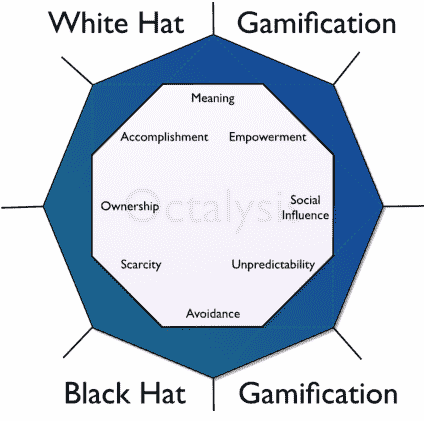
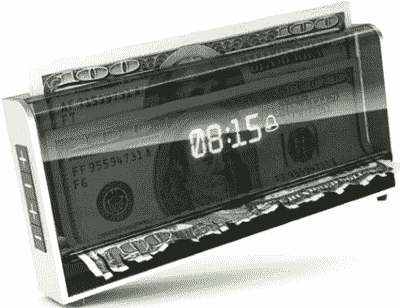

# 第14章：白帽与黑帽游戏化之谜

在上一章中，我们探讨了左脑核心驱动力和右脑核心驱动力在动机的*本质*以及设计方法论上的差异，从而产生了各种短期和长期效应。

在本章中，我们将研究白帽和黑帽核心驱动力引人入胜的复杂性，以及如何在设计中平衡它们。

白帽核心驱动力由八角行为分析图顶部的核心驱动力表示：

-   核心驱动力1：史诗意义与使命感
-   核心驱动力2：发展与成就感
-   核心驱动力3：创造力赋能与反馈

黑帽核心驱动力由八角行为分析图底部的核心驱动力表示：

-   核心驱动力6：稀缺与不耐烦
-   核心驱动力7：不可预测性与好奇心
-   核心驱动力8：损失与回避

### 理论起源

读到本书此处，你应该对白帽和黑帽核心驱动力如何运作有了相当好的理解。本章我们将讨论何时以及如何使用它们来构建最佳的激励系统。

尽管八角行为分析框架中的每一个核心驱动力都已被单独研究和撰写过（包括内在动机与外在动机之间的差异），但我相信我在白帽与黑帽游戏化理论方面的研究是相当原创的，并提供了一种独特的设计视角。

我是在研究不同游戏的终局阶段时开始发展白帽/黑帽概念的。我很好奇为什么大多数成功的游戏会在数月内让人沉迷上瘾，然后出现大量用户流失，大批玩家继续自己的生活。

另一方面，我观察到像扑克、国际象棋、麻将，甚至填字游戏这样的少数游戏经受住了时间的考验，对玩家来说永不厌倦。星际争霸、魔兽世界、远古守卫（缩写为DotA²⁴²，最终衍生了更大的热门游戏《英雄联盟》²⁴³），以及类似射击游戏的重制版如反恐精英²⁴⁴或使命召唤²⁴⁵等电子游戏，无论玩家玩了多少年，都持续流行且引人入胜。

通过进一步的研究和观察，我意识到这些游戏在设计上存在巨大差异，以及在晚期搭脚手架阶段和终局阶段，哪些核心驱动力在激励其用户。那些病毒式传播但保质期较短的游戏，似乎利用了制造迷恋、紧迫感和成瘾性的核心驱动力。玩家会被游戏牢牢吸引，但到了终局阶段，快乐和乐趣不再像以前那样强烈，然而玩家却机械地继续花费大量时间“辛苦”通关。由于核心驱动力8中提到的沉没成本囚笼，玩家感到士气低落，但无法放弃。

最终，有些人确实找到了力量最终退出并继续自己的生活。这可能是由于重要的责任，或者转向了新游戏，这些新游戏通过史诗般的发现阶段营销给他们带来强烈冲击。一旦发生这种情况，社会影响与关联性就会促使大量人最终离开游戏，希望能再次找到那种快乐和激情。

但对于那些相当永恒的游戏（直到它们自己的续作出现），当玩家处于终局阶段时，似乎有一种持续的幸福感和满足感，就像人们演奏乐器或被召唤去实现一个目标时的喜悦一样。基于这项研究，我开始将一些核心驱动力标记为“白帽”，另一些标记为“黑帽”，这借鉴了我在SEO（搜索引擎优化²⁴⁶）方面的背景知识。

在搜索引擎优化中，“白帽SEO”指按照谷歌等搜索引擎意图的方式设计和推广你的网站。因此，当用户搜索相关术语时，他们会把你的网站排在前面。另一方面，“黑帽SEO”指的是一套不诚实地利用搜索引擎的规则、僵化性和弱点来让你的网站获得高排名的方法。

不用说，搜索引擎讨厌黑帽SEO，它们拥有庞大的工程师团队，不断让搜索引擎变得更智能、更难被利用，同时严厉惩罚任何被发现使用黑帽SEO技术的网站。有时，搜索引擎公司甚至将网站完全从搜索结果中屏蔽，这首先就破坏了黑帽SEO的目的。在SEO领域，千万不要做黑帽——这不值得。

不幸的是，我们的大脑无法像谷歌那样不断更新自己以变得更难被利用。我们也无法有效地将那些不断对我们施加黑帽动机技巧的人列为黑名单（我们也不希望这样，因为其中一些人有着最终使我们受益的善意）。最终结果是，我们会潜意识地被事物

Black Hat Gamification 创造了系统设计师常常需要的那种紧迫感，以实现他们的目标并改变行为。仅靠 White Hat Gamification 通常无法实现这一点。

如果一家公司仅仅实施 White Hat Gamification，而用户却不断地从其他来源（如电子邮件、预约或 Facebook 上的干扰）接触到 Black Hat 刺激，他们很可能没有机会体验该体验。当然，这位用户也会感到很糟糕，因为他们会继续拖延，而不是去做更有意义、让他们感觉良好的事情。不幸的是，由于 Black Hat 激励的本质，他们仍会继续这样做。

## Zynga 和 Black Hat Gamification

我关于 Black Hat 与 White Hat Gamification 的理论经常可以用来解释或预测为什么某些公司在不同阶段会成功或失败。

一个这样的例子是社交游戏公司 Zynga²⁴⁷，该公司以 Farmville、Words with Friends 和 Zynga Poker 等游戏而闻名。

Zynga 精通如何实施各种 Black Hat 游戏技巧——当然，他们并没有一个框架来将这些技巧视为“Black Hat”。相反，他们将其视为“数据驱动设计²⁴⁸”，乍一看似乎极其聪明且合法。由于 Black Hat 设计，他们的所有即时指标看起来都很不错：货币化、病毒系数、日活跃用户、用户成瘾等。然而，由于人们玩 Zynga 游戏一段时间后感觉不佳，当他们能够退出系统时，就会退出。

这对于后期的 Scaffolding 阶段以及 Endgame 阶段尤其如此，因为在这些阶段，所有新颖性、创造性和真正的成长感都会耗尽。这使得他们所有新的换皮游戏——基本上是城市版的 Farmville、城堡版、厨房版等等——更难取得长期成功。当这种情况发生时，就好像用户仍在玩同一个 Endgame——就在 Onboarding 阶段！

由于这些 Black Hat 机制，如果用户已经被上一款 Zynga 游戏耗尽，他们很快就会感到厌倦。Farmville 2 从一开始就注定失败，除非他们能够在其中实施更好的 White Hat 设计以确保长期成功。

2014 年初，Zynga 通过决定在像 Riches of Olympus²⁴⁹ 这样的赌场老虎机游戏上“加倍下注”证明了我的 Octalysis 理论是准确的。当然，由于他们致力于坚持 Black Hat 游戏设计（显示出快速的数据驱动结果），他们唯一能使用的持久参与元素就是右脑核心驱动 7：不可预测性与好奇心。尽管如此，即使一个人对赌博上瘾，他们也不会对自己和自己的活动感到很棒。这仍可能导致后期的倦怠。

在伴随 Riches of Olympus 上线的一篇 Venturebeat 文章中，记者 Jeffrey Grubb 询问了当时 Zynga 赌场部门负责人 Barry Cottle，他在说 Zynga 专注于“体验质量和执行卓越”时是什么意思。Cottle 解释说，Zynga 希望打造看起来和感觉都好的东西。Cottle 特别提到了游戏 Candy Crush Saga，该游戏“具有简单的解谜机制，玩家由于额外的动画和特效而对其反应良好。”²⁵⁰

如果 Zynga 认为额外的动画和特效是 Candy Crush 成功的原因，就不足为奇他们作为“游戏设计公司”已经挖好了自己的坟墓。如果额外的动画和特效如此重要，为什么像 Minecraft 这样的游戏会如此成功？与 Candy Crush 相比，Candy Crush 的画面甚至都不算那么惊艳，而其他看起来相似但成功率不到 Candy Crush 一十分之一的游戏也是如此。

如果你一直是 Octalysis Framework 的积极学习者，你会知道这些游戏之所以如此受欢迎，是因为它们能够在最长时间内保留核心驱动 3：创造力赋能与反馈。大多数 Zynga 游戏都没有持久的核心驱动 3，因此参与度会下降。

当然，在 Zynga 中始终排名靠前的两个游戏是 *Zynga Poker* 和 *Words with Friends*²⁵¹。如果你注意一下，由于它们建立在像 Poker 和 Scrabble²⁵² 这样永恒的游戏设计之上，Zynga 偶然复制了健全的核心驱动 3 设计，而未必意识到这一点。两款游戏都激发了比其他 Zynga 游戏更高的策略和解决问题的水平。因此，它们在进入 Endgame 后仍能展现出长期成功。

有了对 White Hat 和 Black Hat 游戏设计的良好理解，你就可以开始分析和预测任何激励系统的优势和持久性。如果没有任何 Black Hat 技术，很可能不会有突破性成功；如果没有任何 White Hat 技术，用户会很快倦怠并离开去寻找更好的东西。

根据 Octalysis Framework，除非 Zynga 开始构建更多 White Hat 游戏技术并继续赋能用户，否则永远无法取得长期成功。相反，他们应该减少对 Black Hat 操纵技术的过度强调，而应为更长期的参与而设计。

## 带着清晰意识的 Black Hat

我想在这里澄清一下，仅因为某物被称为“Black Hat Gamification”并不意味着它必然是坏的或不道德的。有些人自愿使用 Black Hat 游乐化来强迫自己更健康地生活并实现短期和长期目标。我个人非常希望能对吃更多蔬菜或面对我倾向于拖延的任务上瘾。之所以称之为 Black Hat，是因为一旦设计得当，我们会被迫更快地采取某些行动，而不会完全感觉自己在掌控中。

然而，它是“好”还是“坏”取决于这些行动的意图和最终结果。我们可以用 Black Hat 设计来激励人们朝着好的行为发展，也可以用 Black Hat 设计来激励人们朝着邪恶发展。同样，历史上一些最臭名昭著的人物也用核心驱动 1：史诗意义与使命感（以及其他核心驱动）来激励他人走向邪恶和种族灭绝，即使这种激励本身的*性质*是 White Hat。

Black Hat 激励朝着良好行为发展的例子是闹钟应用 SnuzNLuz。SnuzNLuz 如果用户按下贪睡按钮（“10 分钟后叫醒我”按钮——给我的外国读者），就会自动将用户的钱捐给他们讨厌的非营利组织。

一个更具视觉冲击力（但非法）的概念是 Shredder Clock，当你按下贪睡按钮时，它会物理性地销毁你的钱。

在这些产品中，人们因核心驱动 8：损失与规避而醒来——他们不想失去自己的钱，尤其是捐给他们讨厌的非营利组织！（SnuzNLuz 也有一个奇怪的核心驱动 1 角度，因为它确实会为某个事业捐赠给非营利组织）

但人们对这种 Black Hat 设计是可以接受的，因为这是*他们*想要的目标。他们很乐意接受那些迫使他们做他们本意就想做但缺乏意志力去做的事情的设计。

人们讨厌的是公司、政府、讲师或营销人员利用这些 Black Hat 技术让他们购买不需要的东西、屈服于暴政、加班工作并获得他们不在乎的成绩。请记住，这些人通常仍会执行期望的行为，因为，同样，这些倾向是强迫性的和/或成瘾性的。他们只是不会对这些行为感到良好，并会随着时间的推移而倦怠或反抗。

## 游乐化、操纵与伦理

在我的会议演讲中，我经常收到人们问我游乐化是否是一种操纵形式，因此使用它是不道德的。虽然这个问题没有“正确答案”，并且本书的重点是有效设计行为改变而非伦理，但我会尝试分享我自己的看法。

我的简短回答：是的，游乐化是一种操纵形式。然而，尽管“操纵”是一个带有巨大负面含义的强词，我们在日常生活中经常接受它，甚至期望它。

如果你想想，说“请”就是一种操纵形式。你本来不会为朋友做某事，但你的朋友以真诚的方式说了“请”（核心驱动 5），即使交易中没有实质性变化，你现在也愿意并乐意为他们做。

这就是*操纵*。

当你的朋友说“谢谢”时，这是一种情感奖励，让你觉得这个行动是值得的。如果你朋友提供报酬（某种程度上，付钱让人做活动是如今人们不抱怨为“操纵”的唯一方式之一），你甚至可能会感到冒犯。

在我们的社会中，我们似乎并不反对人们说“请”和“谢谢”。事实上，我们期望那样，做那样，并对不这样做的人感到生气。它让我们的脑袋感到快乐并改善我们的生活质量。我们喜欢这种操纵。

当你希望员工更努力工作并将工作转变为更有趣、更吸引人的东西（而不是支付更多报酬）——这是剥削他们吗？提供他们更强烈的目标感、成就感或自主感呢？

我有一个试金石来判断游乐化或以人为本的设计是否合乎道德：

- a) 其预期目的是否完全透明？
- b) 用户是否明确或默许地选择加入该系统？

如果你有一位极具魅力的朋友，正试图说服你去参加一个你并不感兴趣的聚会，你可能会面带微笑地拒绝他。于是，他会投入更多精力，说出类似这样的话：“来嘛！大家都去！你一定要来！”

即使你仍然不想去，你也开始受到说服。但你绝不会因此认为你的朋友这样做是不道德的。他想让你做什么是完全透明的。当你允许朋友说服你时，你也选择“加入”了这一过程，尤其是在你面带微笑地拒绝他的时候。你可能会改变主意，也可能不会，但由于他的意图是透明的，而且你已经选择继续接受他的劝说，因此你不会觉得自己受到了负面操纵。

然而，我认为，当游戏化背后存在用户并不知情的隐藏目的时，游戏化就完全是不道德的。例如，用户以为自己是在注册某种服务，但实际上却是在注册另一种东西。虚假陈述、谎言以及缺乏真实透明度，都会造成不道德的互动。

要判断透明的操纵是否有害，可以考虑催眠这一领域，这是一个非常典型的例子。催眠可以被视为操纵的终极形式，因为据说一个人一旦被催眠，就会完全服从催眠师希望他做的任何事情。

然而，催眠通常并不被认为是不道德的，因为：a) 催眠师试图达成什么目的，是透明的；b) 当事人完全自愿接受催眠。

归根结底，游戏化并不是精神控制。当我们看到一些令人惊叹的案例，声称游戏化让转化率提升了100%时，这些指标往往只是从8%提升到了16%。仍有高达84%的用户可以、也仍然会选择不参与期望行为。如果某个行为无法为一个人创造情感或实际价值，那么他仍然不会去做。但优秀的游戏化设计能够激励那些处于犹豫状态的人——他们对最终结果感兴趣，只是需要一点额外动力来坚持下去。

一开始就不想使用某项服务的人不会注册（除非营销存在欺骗行为）。正如你不必因为别人对你说“请”就答应对方一样，你也不必最终同意那位正试图说服你去做讨厌之事的魅力朋友。如果你真的不想去朋友的聚会，你仍然不会去。

## 何时使用白帽游戏化设计

由于白帽和黑帽游戏化各自的特性，我们可以采用一些主导策略来判断何时以及如何使用它们。由于员工激励和职场游戏化关注的是长期参与度，企业应当使用白帽设计，确保员工感受良好、与企业共同成长，并愿意长期留任。

职场游戏化通常关注八角行为分析法中的前三项核心驱动力：创造*意义*、提供精通之路，以及确保有意义的自主性。你可能会发现，这些内容也是自我决定理论²⁵⁶以及*驱动力*²⁵⁷中的相关概念，我们将在下一章中进行更详细的介绍。

大多数大型企业都会错误地认为，既然他们支付了员工薪酬，员工就必须完成工作，而不管企业是否采取剥削性政策、上司是否缺乏 appreciation，以及职场文化是否糟糕。结果，员工努力工作的程度，只够让自己领到薪水（核心驱动力4：所有权与占有），并且不至于丢掉工作（核心驱动力8：损失与逃避）。

谷歌²⁵⁸是一家挑战这一趋势的企业。很早以前，谷歌就假设自己的每一位员工要么是企业家，要么希望成为企业家。因此，如果员工在谷歌工作时感到“不快乐”，他们就会直接离开并创办自己的公司，甚至可能成为谷歌的竞争对手。

还记得我曾经说过，游戏化是以人为本的设计，而游戏之所以最早掌握了这种设计，是因为没有人必须玩游戏吗？当你设计一种体验时，如果始终相信：一旦你的体验不再具有吸引力，人们就会离开你的系统——那么你很可能会创造出更出色的以人为本的设计。

在谷歌的案例中，他们将许多白帽设计融入了公司文化。

谷歌做的第一件事，是实施核心驱动力1：史诗意义与使命感。谷歌广为人知的使命宣言是“整合全球信息，使人人皆可访问并从中受益”，同时还拥有一句朗朗上口的口号：“不作恶。”因此，许多优秀工程师会觉得：“我在哪里都能挣到一份工资，但在谷歌，我正在对世界产生影响。不仅如此，我还是好人阵营的一员，而这对我来说非常有价值！”

关于核心驱动力2：发展与成就，除了常规的加薪和晋升之外，谷歌意识到，并非每位工程师都能成为管理者，但每位工程师都需要感受到进步与发展的成就感。因此，他们设置了八个工程师级别，让那些不应该或不想成为管理者的工程师也能继续“升级”。2013年，谷歌甚至设立了第九级，称为“谷歌高级院士”，据称是因为他们需要一种方式来晋升传奇工程师杰夫·迪恩²⁵⁹。

关于核心驱动力3：创造力与反馈的赋能，我们在第7章中讨论过，谷歌引入了“20%时间”制度，允许员工将20%的工作时间用于处理自己想做的任何事情，只要相关知识产权归谷歌所有。

他们还利用了部分核心驱动力4：所有权与占有，允许员工完全拥有自己项目的所有权（当然，也能拿回丰厚的薪酬）。他们通过打造类似大学校园的园区，以及一种让懒惰和停滞在健康社交关系中变得极不受欢迎、备受鄙视的职场文化，运用了核心驱动力5：社会影响与关联性。

所有这些例子都属于白帽影响，有助于员工保持长期参与。不幸的是，随着谷歌规模不断扩大，并逐步调整政策，使其更像其他那些更加高效地专注于利润的大型企业，谷歌原本充满玩乐精神的文化似乎正在减弱。²⁶⁰

## 何时使用黑帽游戏化设计

另一方面，当人们从事销售工作或运营电子商务网站时，他们通常并不关心长期的参与度和动机（尽管他们可能应该关心）。他们想要的只是让顾客进来，尽快买点东西，然后离开。

因此，他们经常会采用黑帽游戏化技术：“明天会有什么惊喜发布？这项优惠的购买机会将在四小时后结束。如果你不买，最后的处境就会比别人更糟！”

在更早的一章中，我们曾讨论过，Woot.com如何凭借两项核心驱动力——稀缺性与急迫感，以及不可预测性与好奇心——成为极其成功的电子商务网站。由于黑帽游戏化能够制造紧迫感，当你需要某人立即采取行动或完成交易时，黑帽技术往往会成为最有效的解决方案。

这种动态同样适用于销售和筹款。我的一位客户 Morf Media 提供了一个游戏化培训平台，旨在让金融机构员工的 SEC 合规培训变得更具参与感和趣味性。²⁶¹

金融机构天生厌恶风险（核心驱动力8），也不倾向于与新技术公司合作。你可以为它们提供大量白帽激励，它们可能会感兴趣、受到吸引，甚至感到兴奋，但它们很可能会花很长时间才采取行动，因为承担任何潜在风险都缺乏紧迫感。

这里的关键在于，要让公司相信，他们的员工没有一个喜欢进行 SEC 合规培训（这并不难推销），并且每一天

他们的员工不合规会增加他们的风险。诉讼就像地雷一样提前摆在眼前。从这个意义上说，不与 Morf Media 合作的风险，比与他们合作的风险更大。我们已经把黑帽核心驱动 8：损失与规避给扭转过来了。（注：我们很可能会在未来的书中探讨扭转反核心驱动的策略和流程）。

## 筹款中的黑帽动机

在筹款领域，我经常会被初创企业家找上门，他们希望得到一些支持来帮助他们应对来自天使投资人以及风险投资人的融资（我也经常被很多投资人找上门，但那是完全不同的一套动机挑战——主要是白帽）。

投资者的特点是，他们通常受贪婪和恐惧两种力量的驱动。贪婪的力量——强烈渴望赚到十亿美元（核心驱动 2 和 4）；恐惧的力量——害怕亏掉所有钱（核心驱动 8）。

起初，企业家可能会宣传公司很多优秀的特质，吸引投资者对核心驱动 1、2、4 甚至如果有良好的社会认同则对 5 的感受。（在这里你可以看到记住每个核心驱动的数字的价值。不用担心你现在记不住这些数字，但请注意它们大多在白帽的一侧。）投资者开始表现出很多兴奋，企业家觉得交易已经尘埃落定。

然而，随着投资者越来越接近写支票，害怕亏掉所有钱的恐惧开始占据他们的心，这是由核心驱动 8：损失与规避驱动的。他们开始要求更多指标、更多 traction 以及进一步的社会证明。经常，六个月过去了，仍然没有资金承诺。

根据我的个人经验，投资者通常只有在*确信*如果不承诺就会失去这笔交易时才会迅速成交。如果企业家*令人信服地*告诉投资者已经有很多人在参与这笔交易，如果投资者本周不行动，轮次就会满员，只有在这种情况下他们才会最终做出反应。黑帽创造紧迫感并促成交易。

当我大学毕业后试图为我的游戏化初创公司筹集 60 万美元时²⁶²，我发现这段经历极其困难且令人清醒。我们是一个非常年轻的团队，这个“游戏化”的东西看起来像个半成品的疯狂想法。

在为维持我们的小团队运转而苦苦挣扎筹集一笔适度的资金一段时间后，我们终于从三位投资者那里获得了 65 万美元。此时，我给所有潜在投资者写了一封邮件，他们在一年多里不断“想要看到更多”和“对这个游戏化东西不确定”。我只是告诉他们：“我们将关闭本轮融资，但感谢你们持续的（且不存在的）支持！”

此时，许多这些整整一年都不愿承诺的投资者突然充满热情、兴奋，甚至愤怒地回应。“Yu-kai。我以为我们已经同意我可以在你们公司投资这么多钱。为什么你要告诉我你们要在没有我的情况下关闭轮次？”我在想，“嗯，你们其实有一整年时间可以这么做…”但他们却奇怪地让我觉得如果不接受他们的钱我就是在断绝关系。

结果，我们试图将轮次上限提高到 80 万美元而不是 60 万美元，但做不到。我们试图上限提高到 90 万美元也做不到。我们试图上限提高到 100 万美元仍然做不到。最后，我将轮次上限设为 105 万美元，同时拒绝了一些投资者的资金，只是为了表明我们对上限是认真的。（我也听过其他企业家多次转述过同样的经历。）

这说明了核心驱动 6：稀缺与不耐烦以及核心驱动 8：损失与规避的非理性力量（同时也很好地说明了白帽动机的局限性）。所有这些“潜在投资者”显然喜欢我所做的事情。他们在收到我的好消息时都会感到鼓舞。他们看到这有可能让世界变得更美好。但他们直到看到交易被拿走时才采取行动。仅凭白帽动机，人们总是会打算做，却永远不会真正去做。

好奇的人请注意，最终我的初创公司推出了 RewardMe，一个将线下商业体验游戏化的产品。RewardMe 的表现比我们最近的竞争对手公布的数字高出十倍以上。（抱歉——由于这些公司仍在运营，我在此不引用来源以尊重它们目前的成功。）在我任职的后期，我们甚至与一家全国连锁店达成了 150 万美元的销售交易。

初创公司是有风险的，不幸的是，仅拥有惊艳的产品并不意味着公司会成功。RewardMe 上线几年后，我们遇到了人员、资金和法律问题的组合。我辞去了 CEO 职务，最终公司倒闭了。如果我当时拥有 Octalysis 知识，很多事情可能会有所不同，这就是为什么我希望我的读者在我自己在公司遇到问题之前先学习这些动机要素。

幸运的是，辞去 RewardMe 的 CEO 职务后，我腾出了大量时间来进一步研究游戏化、以人为本的设计，并开发 Octalysis 框架。

今天，即使我的 Octalysis Group 组织变得越来越忙，我比经营科技初创公司时要幸福得多。这是因为我现在主要受白帽核心驱动的驱动，而不是黑帽核心驱动——比如不断计算在死亡前还能撑多久的跑道²⁶³。

## 从白帽设计到黑帽设计的糟糕转变

当你从白帽动机切换到黑帽动机时，你需要确保了解潜在的负面后果。例如，以色列的一家托儿所曾遇到家长迟到接孩子的问题。研究人员 Uri Gneezy 和 Aldo Rustichini 决定进行一项实验并实施了一项测试政策，即家长每次迟到将被收取 3 美元²⁶⁴。

典型的经济学家会告诉你，这种惩罚会导致更多家长按时接孩子，因为他们不想损失金钱。然而，该计划适得其反——迟到的家长反而更多了。更糟的是，当托儿所意识到这不起作用并决定取消罚款时，更多家长*继续*迟到。

该计划适得其反，因为他们将家长的动机从核心驱动 1：史诗意义与使命感（以及核心驱动 5）转变为一种弱化的核心驱动 8：损失与规避。起初，家长试图按时接孩子，因为他们本能地想要成为*好*的、有责任心的父母。他们也不想给托儿所和工作人员带来负担，所以他们努力准时出现。

但当托儿所给迟到贴上货币价值时，基本上是在告诉家长，只要支付适度的费用，迟到是可以接受的。因此，那些在开会或分心的人因此能够为迟到辩解，因为商务会议对他们来说比 3 美元更有价值。避免离开会议的损失比避免损失 3 美元的损失更有力量。

回到比例损失的概念，我们看到尽管损失与规避通常是一种强大的动机，但 3 美元的费用在这种情况下太低，无法适当激励家长。记住我讨论过，当你使用损失与规避时，损失必须是具有威胁性的？如果托儿所收取的费用远高于 3 美元，损失与规避的动机就会变得更有威胁，更多家长可能会（勉强地）遵守，这会导致他们很快更换托儿所）。

目前，有些托儿所收取每分钟 1 美元的迟到费。这种设计能更频繁地让家长准时。这不仅是因为损失更有威胁，也因为家长感受到核心驱动 6：稀缺与不耐烦的结合，以及一点核心驱动 3：创造力与反馈的赋能感，因为他们对最终结果有更强的掌控感。

### 在白帽与黑帽之间谨慎转换

所以现在我们已经介绍了白帽和黑帽游戏化的本质和差异，我们如何将这些知识融合到我们的设计体验中呢？

通常来说（也存在一些例外），最好先构建一个白帽环境，让用户感到强大而舒适，然后在需要用户为转化而采取那一个“期望行动”的时刻，实施黑帽设计。在那个节点，用户很可能会采取期望行动，但不会感到太舒服。这时你要迅速切回白帽动机，让他们对自己的体验感到满意。

此前提到的游戏《Battle Camp》中就有这样的例子。在《Battle Camp》中，你常常会和另外二十四名玩家身处一个“战队”，整支队伍需要一起攻打一个大Boss。通常，你们有八个小时的时间攻打这个Boss，每个人都需要在能量重新充满时（每五十分钟）回来一趟（记住，这一技巧被称为“折磨式休息”），然后用这些能量攻击Boss。

有些时候，在七个半小时后，Boss仍然剩余20%的血量，这时你会开始意识到，自己的战队恐怕无法击败它。此时，你基本上有两个选择。

-   选择一：输给Boss，二十五名玩家白白浪费八个小时，更不用说还会落后于其他战队——那些战队在击败各自的Boss后，排名会远高于你们。
-   选择二：花10美元购买更多能量，以便击败Boss。

因为所有人白白损失八小时宝贵时间，是一件极具打击性的事，所以你很有可能会觉得不得不选择选项二——购买击败Boss所需的能量，尤其是如果你同时还是战队的队长。

同样，我们可以看到，驱动你做出这次购买的是核心驱动力8：损失与逃避——它确实非常诱人，但事后你会相当难受。击败Boss之后，如果一切仅止于此，之后没有再发生任何特别的事，你会十分沮丧，甚至可能下意识地希望自己别玩这个游戏了。

然而，就在这个时候，游戏会开始用白帽动机将你包围，向你展示你因击败Boss而完成了多么伟大的成就（核心驱动力2：发展与成就），以及你获得的奖励或奖杯（核心驱动力4：所有权与占有）。除此之外，你的队友也往往会开始为你欢呼（核心驱动力5：社交影响与关联感）：“哇！你花了真金白银来拯救我们战队。你是我们的英雄！”被这样的情感彩带洒满一身，人们往往会想：“嗯，也许那10美元终究花得很值！”这最终会训练他们的大脑，使其在之后必要时更愿意再花10美元购买能量并击败Boss。

## 没有来自TOMS的买家懊悔

与《Battle Camp》的例子类似，企业应当考虑营造一个白帽动机的环境，用黑帽技巧转化用户，然后再回到白帽策略，让用户重新感到舒适。

最初的白帽环境，是为了让人们第一时间对你的系统产生兴趣和好感。风险投资人如果一开始不认为某个初创公司能改变世界、是一项明智的投资（核心驱动力1和2），就不会愿意投资，即使存在令人信服的担忧——他可能错失这笔交易。（奇怪的是，尽管有些投资人此前已经认定某个想法毫无价值、没有未来，他们仍然会在稀缺与损失的压力下贸然出手。）

一旦用户在你的系统中感到舒适，却不一定采取强烈的期望行动（比如购买），你就可以利用核心驱动力6和8（有时还有核心驱动力5）中的黑帽技巧来促成交易。如果用户最终购买了产品，你要向他们确认：如果事实如此，这的确是最明智的购买（核心驱动力2），而且还有大批人也做出了同样的决定（核心驱动力5），并且它能积极地改善世界（核心驱动力1）。这样做很可能会确保顾客不会产生买家懊悔。

当你买了一双TOMS鞋，并开始为这笔昂贵的消费感到一丝后悔时，他们会用再次确认的信息冲击你：你的这次购买给一个非洲贫困儿童带来了巨大改变——这个孩子买不起鞋，为了替家人取水不得不光脚走在路上。看到这一切，你立刻又对自己的购买感到欣慰。此后，每当你看到这双鞋，它都会提醒你，你是一个有益于世界的善良之人。

对发展中国家儿童的捐赠也是同样的道理。当你做出承诺后，非营利组织会不断寄来照片、感谢信，有时甚至还有“被资助”孩子亲手写的内容，让你感到自己真正影响了他们的生活。当然，出于如此崇高的事业，向捐赠者寄送这些照片和信件（只要不是伪造的）并没有任何不妥，因为这些捐赠者确实在为不幸者的生活带来巨大改变。事实上，任何慈善组织如果不展示自己在世界上所产生影响的可视化和社会化信息，那将是一个错误。在采取期望行动之后，我们所有人都希望看到一些反馈机制。

当你设计体验时，永远不要忘记：如果你想要好的终局设计，就必须让用户沉浸在白帽游戏化技巧之中。

## 那么核心驱动力4和5呢？

你可能已经注意到，我在这章中数次提到核心驱动力4：所有权与占有，以及核心驱动力5：社交影响与关联感（都处于白帽语境），并且可能好奇它们在这套体系中处于什么位置。它们位于八角模型的中间，那么它们到底是黑帽还是白帽？

一般而言，核心驱动力4和核心驱动力5具有双重性，既可以成为白帽，也可以成为黑帽。对于核心驱动力4：所有权与占有，拥有东西往往会让我们觉得自己处于掌控之中、事情井井有条、整体幸福感不断上升；我们会感到强大而充实。

然而，有时我们拥有的东西反过来开始拥有我们。你可以想象一个人买了一辆极其稀有的老爷车，然后便不敢把它开去任何地方，因为他害怕损坏它或增加里程；同时，他也不想把它留在家中，因为害怕它被偷走。

也有人过于痴迷于积累更多财富，以至于忽略了家庭、健康、友谊等其他一切重要的东西。还有人会强迫性地整理物品，以至于无法再专注于那些真正能带给自己快乐的重要事情。到了这种地步，黑帽就开始接管，个体不再为自己的行为感到愉快，而仅仅是觉得自己不得不这样做。

另一方面，就核心驱动力5：社交影响与关联感而言，我们显然乐于和朋友在一起闲逛、建立深厚的友谊、互相表达欣赏，并从中获得乐趣。即使我们是为了建立人脉和发展事业而交朋友（这会增加某些左脑核心驱动力，例如核心驱动力2：发展与成就，以及核心驱动力4：所有权与占有），我们对这种体验的感受也相当正面。

然而，同伴压力有时也会造成我们生命中最糟糕的时刻。当我们感到环境在逼迫自己做出某些行为、或与自己心爱的人争吵不休时，它就会以几乎没有其他事物能做到的方式将我们逼疯。

事实上，社会压力有时会强大到让人仅仅因为无法忍受他人的评判而选择自杀。对这些人来说，结束自己的生命比面对现实更容易——哪怕它不过是诸如不敢回家告诉父母自己考试不及格这样的小事。你可以清楚地看到，核心驱动力5也能产生黑帽影响。

归根结底，每一种核心驱动力都拥有巨大的力量，设计师必须谨慎地以合乎伦理的目的进行设计——确保对期望行为完全透明，同时给予用户自由选择加入或退出的权利。如果这一点没有认真做好，游戏化设计就无法兑现它“让生活更有趣、更有成效”的承诺，只会成为痛苦与苦涩的源头，并很可能最终被彻底抛弃。没有人希望那样。

老生常谈的一句话是：“能力越大，责任越大。”当你理解了如何激励和改变行为时，你可以通过帮助他人实现*他们*的生活、事业、健康和人际关系目标来改善世界。相反，你也可以运用这些知识让人们更加沉迷于有害物质、养成坏习惯、让破裂的关系持续下去。最终，当你的体验设计变得极其成功时，你必须照照镜子，问自己：“这是我想对世界产生的影响吗？”

## 为了充分利用这本书，现在请只从以下选项中选择一项来做：

**简单：** 尝试不看内容，背诵三个白帽核心驱动力和三个黑帽核心驱动力。你能解释它们的区别吗？

**中等：** 回顾你自己的人生以及你做出的所有重大决定：申请学校、换工作、寻找伴侣、搬去新地方。是什么核心驱动力促使你做出这些决定？它们主要出于白帽原因还是黑帽原因？你对从白帽核心驱动力做出的决定是否更满意？对于受黑帽核心驱动力驱动的决定，你是否感到不那么自在，但在做出决定时又觉得自己别无选择？

**困难：** 想一个你可以为自己的项目设计的活动。尝试想出办法，用白帽游戏化来创造动机和渴望，然后转向黑帽游戏化来触发重要的期望行动。最后，理解如何将用户动机转回白帽核心驱动力，以便他们在做出期望行动后充分享受体验，并在情感上获得回报。

在 Twitter 或你偏好的社交网络上分享你的想法，使用标签 #OctalysisBook，并看看其他人有什么想法。

## 分享你的人生反思。

如果你选择了上面的中等挑战，请将你的人生道路和选择作为自我介绍的一部分，分享到 Octalysis Explorers Facebook 群组。识别一路激励你的核心驱动力，并反思你在这些人生选择中的感受。这样，社区不仅能更好地了解你，也能通过你的经历更多地了解这 8 种核心驱动力。

如你所知，社区能让体验变得引人入胜且有趣，也会让你投入在这本书上的所有时间更有成就感。很可能，群里还会有其他人有着与你相似的人生经历和选择，能够通过 8 种核心驱动力帮助你更好地理解你的人生动机。
