# 第 15 章：用 Octalysis 理解其他游戏化和行为框架

到目前为止，我们已经涵盖了 Level I Octalysis 设计中几乎需要学习的一切。我写这本书的目标是深入探讨一种方法论和框架（也就是我自己的框架），然后在掌握这个框架之后，用它来理解其他框架。

2012 年，当我参加全球最大的游戏化会议——年度 GSummit 时，我对那些知识渊博的专家小组成员和演讲者留下了深刻印象。然而，我猜想普通与会者可能会被会议上呈现的各种演讲和框架弄得不知所措——从 Richard Bartle 的四种玩家类型、Mihaly Csikszentmihalyi 的心流理论、Nicole Lazzaro 的 4Keys2Fun，以及其他大量框架！

归根结底，虽然与会者对于游戏化改变世界的潜力感到兴奋和鼓舞，但他们可能仍然对下一步该做什么感到困惑。所有这些框架放在一起，似乎传达了关于大脑的抽象知识。但如何以整体反映我们思维的方式将它们连接起来，这个问题很难回答。当人们需要为各种项目确定使用哪个框架时，这就变得更加困难。

正因为如此，我希望我的读者能够深入理解我自己的模型，而不是对不同概念只有肤浅的了解。但我也希望我的读者了解其他著名的游戏化理论以及动机心理学和行为经济学中的关键模型，这些理论本身都很出色。因此，在本章中，我们将讨论这些概念，并用我们的“Octalysis 眼镜”来审视它们。

我喜欢 Octalysis 框架的一点是，它通过将其他专家的研究和发现置于适当的视角，帮助我更好地理解他们的工作。既然我们都拥有相同的大脑，我相信关于大脑和动机的各种研究可以相互融合，提供更丰富的理解。

希望你对 Octalysis 的理解能帮助你快速领会这些其他框架。当然，如果你想深入了解那些框架，有很多优秀的书籍值得推荐。

### 科学研究与游戏研究

偶尔会有人问我，我的 Octalysis 框架是否是基于对我在本书中提到的所有文献和科学研究的深入研究而创建的。

事实上，Octalysis 100% 来源于我玩游戏的体验和对游戏的研究。我希望它有一个更令人印象深刻的起源，但实际上，创建 Octalysis 框架所需的一切，都来自我多年玩游戏和分析游戏的经验。这就是为什么我把它视为一个游戏化框架，而不仅仅是像其他人认为的那样，是独立于游戏的单纯心理学和行为学研究。

框架创建后，我开始研究行为经济学、动机心理学和神经生物学，以确认（或扩展）核心驱动力背后的原理。我知道这些核心驱动力在激励我们，但直到很久以后，我才有科学出版物来支持这一点。幸运的是，大多数听说了我在 Octalysis 方面工作的人，都能联想到自己的个人经历和观察。这促使他们在我用科学证明*为什么*它有效之前，选择暂且相信我的观点。这是核心驱动力 5 在*关联感*上的一次胜利。

关于这一点，让我解释一下为什么我认为研究游戏足以获得对动机理论和行为预测的全面理解——欢迎反驳我，我不会生气。

正如前几章反复提到的，游戏的一个重要方面是你从来*不必*去玩。再说一次，你*必须*去上班，*必须*报税。这些事可能非常令人痛苦，但你仍然只能硬着头皮坚持下去。我称之为“被污染的动力”。

但是在游戏中，没有人*必须*去玩。一旦游戏不再有趣，人们就会离开去做或去玩别的东西。

在某种意义上，每个游戏都可以被视为一个关于动机和行为的实验。

我们获得的大部分行为心理学理解，来自于参与者（通常是五十到两百名大学生）被置于受控环境中，并根据某些变量测试其反应的实验。这些经过同行评审的实验结果成为合法的科学研究，让我们深入了解人类思维。

另一方面，每个游戏都可以被视为一个培养皿，成千上万（甚至数亿）的“测试对象”自愿根据环境变化调整自己的行为。这些大规模的“实验”自然而然地告诉我们，某些体验和机制在影响人类行为方面是有效的还是无效的。

我喜欢做的事情之一就是研究游戏的“克隆品”，以理解为什么有些克隆品无人问津，而另一些却比原作更成功。当两个游戏看起来几乎相同，但一个（有时是不那么吸引人的那一个）成为爆款，而另一个却失败时，这就创造了一个绝佳的机会去研究设计中那些产生巨大差异的细微元素。有时差异微小到消息弹出前的秒数、挑战引入的顺序，或者经济系统中稀缺性控制得多好。

从我自己的研究来看，这些细微差异在游戏化甚至游戏设计文献中并未得到充分覆盖。但我发现它们对体验的成功最为重要——比图形、动画甚至主题都更重要。归根结底，问题不在于是否

还记得之前我们谈到游戏是如何结合行为经济学、动机心理学、神经生物学、用户体验/用户界面（UX/UI）设计、技术平台，以及显而易见的游戏设计动力学的吗？同样，你需要所有这些元素来创造一款伟大的游戏。

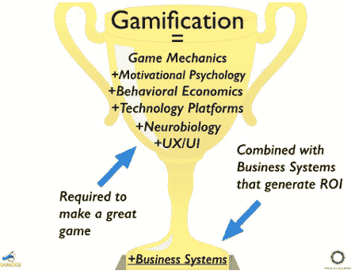

在本章中，我们将看到Octalysis如何应用于各种行为心理学和游戏设计理论。对于刚接触游戏化或行为设计的人来说，本章可能有点深奥。如果你不记得或不懂所有其他框架，别担心。如果将来你再遇到它们，本章会帮助你以最全面的方式消化它们。

## Octalysis视角下的自我决定理论

到目前为止，我们已经多次提到Ryan和Deci的自我决定理论。自我决定理论是一种关于动机的理论，用以理解我们以有效和健康的方式行事的自然或内在倾向²⁶⁹。该理论表明，人们并非纯粹通过奖励和惩罚获得激励，实际上更多是通过三个要素获得激励：*能力*、*关联性*和*自主性*。

*能力*是对自我效能感和精通体验的需求。*自主性*是成为自己生活的动因并控制自己选择的渴望。*关联性*是普遍存在的与他人互动、建立联系并感受被关爱的需求。

构成学生动机自我决定理论的三种先天心理需求

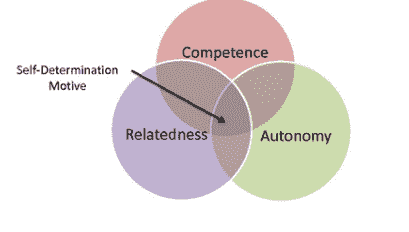

来源：Deci, E.L. & Ryan, R.M. (2000). The "What" and "Why" of goal pursuits: Human needs and the self-determination of behaviour. Psychological Inquiry, 11, 227-268.

如果你从Octalysis的角度来看这个理论，你会注意到能力与核心驱动力2：发展与成就感一致。按照同样的思路，自主性对应于核心驱动力3：创意授权与反馈，而关联性自然归属于核心驱动力5：社交影响与关联性。

在《驱动力》（*Drive*）一书中，丹尼尔·平克为这一理论补充了第四个要素：*目的*。（他还用了更有吸引力的表述“精通”来重新定义能力²⁷¹。）如果我们戴上Octalysis眼镜，目的可以被视为直接与核心驱动力1：史诗意义与使命感相关联。

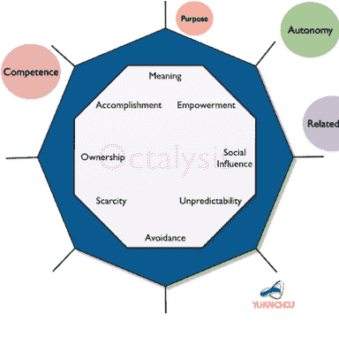

上图以图表方式展示了自我决定理论对应的核心驱动力。图中非常清楚的是，这些元素也被视为白帽核心驱动力。通过强调*关联性*，自我决定理论也通过核心驱动力5：社交影响与关联性融入了右脑（内在）动机。

自我决定理论是一个非常好的模型，它认识到积极、白帽和内在动机背后的力量。然而，它并不一定能解释为什么人们会沉迷于赌博，或者为什么排他性本身常常驱动我们的行为。尽管该理论涵盖了动机中的所有积极情绪，但它并未包括行为的“阴暗面”，后者以黑帽核心驱动的形式呈现（通常被视为“非自我决定”的动机²⁷²）。

考虑到自我决定理论专注于激励员工和学生，尤其是朝向创造性工作，这实际上很有道理。为此，该理论是一个强大的框架，可帮助引导公司为员工创造长期白帽激励环境。

从第14章我们了解到，由于员工激励需要长期投入，我们通常应在设计中应用白帽核心驱动力。尽管如此，公司也会使用一些黑帽激励技术来激发员工短期生产力爆发（例如机会稀缺、截止日期、社会压力、竞争）。自我决定理论并不关注这些，因为如果应用不当，这类动机可能会导致长期倦怠。

话虽如此，像Octalysis这样的框架能让你把自我决定理论放在更广阔的视野中，理解它涵盖了什么、没有涵盖什么，从而扩展和微调你对人类行为的理解。

## 理查德·巴特尔的四种玩家类型

游戏设计领域中另一项非常著名的研究是理查德·巴特尔的四种玩家类型²⁷³。理查德·巴特尔是一位游戏研究者，他在20世纪70年代发明了第一个MUD（多用户地牢）游戏，这种游戏后来演变为我们今天所知的角色扮演游戏（RPG）。他意识到，在虚拟环境中，通常有四类主要玩家人群在进行四种不同类型的活动。

有*成就者*，他们试图掌握游戏系统内所有可做的事。有*探索者*，他们只想出去探索世界中的一切内容，不太专注于克服挑战。有*社交者*，他们进入虚拟世界只是为了彼此互动、交谈和建立友谊。然后是*杀手*——这些玩家不仅力求登顶，还以在过程中击败竞争对手为荣。此外，他们需要沐浴在胜利中，并被所有人钦佩。

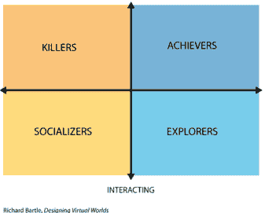

许多从事游戏化和游戏设计工作的人都在理查德·巴特尔的四种玩家类型基础上进行发展。游戏设计师艾米·乔·金以使用理查德·巴特尔的玩家类型而闻名，并将其演变成为金的社交行动矩阵。在这个模型中，金为各种玩家类型分配动词和行为，以确定如何在游戏中设计一个有趣且引人入胜的环境。这些行为动词变成了：*探索、创造、竞争*和*协作*。（试着看看这些行为动词如何对应各种核心驱动力。）

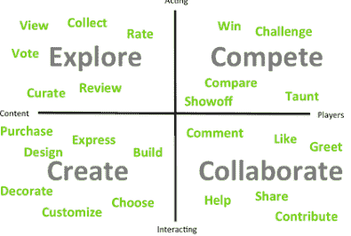

安德烈·马尔切夫斯基也是游戏化领域的一位影响者，他进行了广泛研究，在理查德·巴特尔的玩家类型基础上为企业工作场所构建模型。他得出了六种用户类型以供设计：颠覆者、慈善家、自由灵魂、社交者、成就者和玩家。这些用户类型中的每一种都会受到不同活动和体验的更多激励。

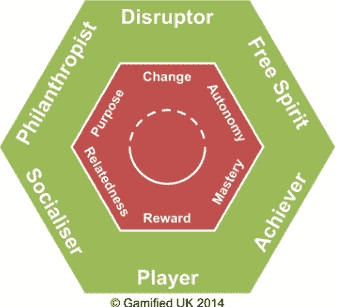

这一模型通常被推荐用于工作场所环境，因为理查德·巴特尔本人曾说过，他的玩家类型可能不适用于自愿虚拟世界之外的环境。[^279]

为简单起见，让我们用Octalysis的视角来审视理查德·巴特尔的四种玩家类型，以了解哪些核心驱动力激励每种玩家类型。这将帮助你确定如何更好地为这些玩家类型进行设计。

*成就者*主要受核心驱动力2：发展与成就感以及核心驱动力6：稀缺性与急迫感驱动。他们总是在努力完成下一个目标，完成时便感到成就感。当然，在某种程度上，他们也在乎运用创造力克服挑战，以及积累成功的结果（核心驱动力3和4）。

*探索者*主要受核心驱动力7：未知性与好奇心驱动，这促使他们去发现以前从未见过的新奇内容。其中也包含核心驱动力2、3和6的种子。他们不断运用创造力寻找新方法来测试所有限制他们的边界，当他们成功时，会有一种成就感。

*社交者*主要受核心驱动力5：社交影响与关联性驱动。他们喜欢与他人交往和建立联系。在较小程度上，他们也会受驱动去思考巧妙的办法更多地吸引他人（核心驱动力3），他们喜欢新的或不可预测的信息，甚至八卦（核心

Drive 7)，有时会对朋友产生领地意识（Core Drive 4）。

最后，*Killers* 主要由 Core Drive 2：发展与成就 和 Core Drive 5：归属感的社会影响 的混合体所驱动。他们不仅需要为高目标而努力，还需要他人认可他们的成就并承认他们的优越性。从更小的角度来看，他们也驱动于想出击败竞争对手的最佳方式（Core Drive 3）、避免被杀或被视为自己软弱（Core Drive 8），最终，统计他们的胜利和成就（Core Drive 4）。

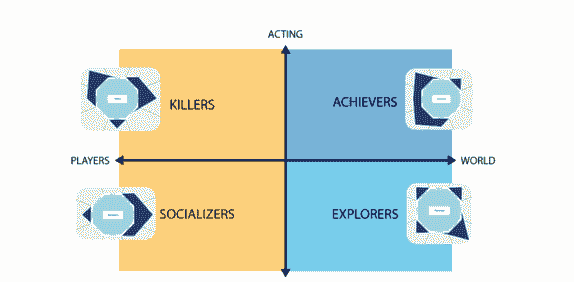

通过上图，我们可以更好地理解这些玩家类型独特的动机，并为他们设计合适的游戏技巧。在你 Octalysis 之旅的后面，你将开始投入大量精力来定义你自己的玩家类型，并利用 Level 3 Octalysis 设计出独特吸引他们的系统。（不幸的是，我们无法在本书记载的范围内涵盖这一点。）

那么那些上面未涵盖的其他核心驱动力，尤其是史诗意义与召唤，以及在某种程度上损失与回避，又如何呢？

Core Drive 1：史诗意义与召唤 可以被任何玩家类型利用：为了实现达到更高目标、被朋友更尊重、探索新区域，以及击败较弱玩家的目标。它只是身处游戏环境本身的背景。但由于 Richard Bartle 正在创建一个开放的虚拟世界，似乎并没有超越虚拟世界理想主义的更高使命的真正意义。

有时在虚拟世界中，用户为了他们相信的更高使命而团结起来时，会产生一种较小的史诗意义与召唤感。但这与这里研究的玩家类型无关。

在 Andrzej Marczewski 的模型中，工作场所中有一个独特的 user 类型叫做 *Philanthropists*，他们从帮助他人中获得快乐，因而获得游戏感。他们受 Core Drive 1：史诗意义与召唤 的驱动，公司应该鼓励 Philanthropists 的行为，以确保更多的协作努力和更强的团队合作。不幸的是，大多数公司环境惩罚 Philanthropists，同时奖励那些只追求自身外在回报的人。这些在 Andrzej Marczewski 模型中的 *Players*，高度受 Core Drive 4：拥有与占有 的驱动，其目的是最大化他们的奖金、奖励、晋升和加薪。

就 Core Drive 8：损失与回避 而言，在任何事业中不成功的威胁始终存在。尤其是，如前所述，当 *Killers* 试图避免被羞辱时。然而，并没有真正专注于避免坏事的玩家类型。正如我们所学到的，如果你只受黑帽驱动力的驱动，你根本就不想身处一个开放且自愿的虚拟世界中。这在工作场所往往是另一回事。

归根结底，这八个核心驱动力在某种程度上驱动着我们所有人，因为我们普遍渴望这些核心驱动力，只是程度和时间不同。Octalysis 框架使我们能够理解某些核心驱动力在某些人身上是否更强，以便我们能够意识到并适当为这些差异设计。

## Nicole Lazzaro 的 4 Keys To Fun

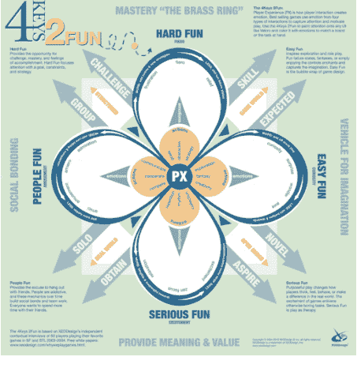

*4 Keys to Fun* 是另一项由游戏设计师和 XEODesign 总裁 Nicole Lazzaro[280] 创建的设计框架。Lazzaro 花了多年时间研究和设计引人入胜的游戏。基于她的经验，她得出了四种在游戏中吸引人的乐趣类型。

4 Keys to Fun 是：*Hard Fun, Easy Fun, People Fun,* 和 *Serious Fun.*

*Hard Fun* 是从克服挫折并实现 Win-State 中获得的快乐。这使玩家处于 *Fiero* 状态，即克服逆境后的胜利感。

*Easy Fun* 是做有趣活动时获得的乐趣，你不需要很努力就能简单地享受放松和游戏的体验。这在孩子与父母一起玩的游戏中很常见，例如桌游或绘画。

*Serious Fun* 是因为它对现实世界产生影响而引人入胜的乐趣，例如提升自我、赚更多钱或对环境产生影响。

最后，People Fun 是因为你与其他人互动并建立关系而获得的乐趣。

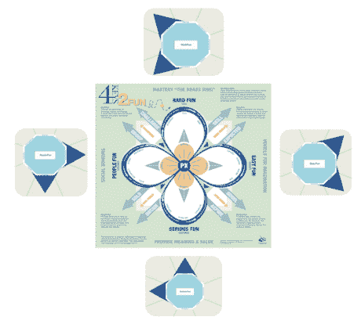

如果你再次戴上你的 Octalysis 眼镜来理解这一点，你会看到 Hard Fun 是 Core Drive 2：发展与成就 以及 Core Drive 6：稀缺与不耐烦 的结合——达到 Win-State 的难度和挫折感正是驱动用户动机的原因，以及实现它后的成就感。

Easy Fun 就像 Core Drive 3：创造力赋能与反馈 以及 Core Drive 7：不可预测性与好奇心 的结合。它就像玩黏土或乐高，你可以随心所欲地做任何事，也不会真正失败。无论你做什么，你都在赢，因为你在享受时光并看到你创造力的反馈。

具有固有随机性的情况也会激发好奇心，让事情变得有趣和轻松。玩 Yahtzee 或看卡通片让我们在不需要投入太多努力和专注的情况下享受时光。事实上，在游戏设计行业中，人们都知道，使游戏更容易的一种最佳方式（惩罚硬核竞争玩家但惠及主流休闲玩家）是在游戏中增加更多随机性和偶然性281。父亲可以认真地和他五岁的女儿玩骰子游戏而不总是赢，但如果他和她下棋，他可能需要对她手下留情。

另一方面，*Serious Fun* 可以被解释为 Core Drive 1：史诗意义与召唤 以及 Core Drive 4：拥有与占有 的结合。

史诗意义与召唤是在一个人从事某项活动是因为他们看到了其在世界上的真实影响时产生的。在每次参与都能让你赚钱的令人振奋的活动中，这是 Core Drive 4：拥有与占有 的结果。

*People Fun* 通常是明显的 Core Drive 5：社会影响与归属感 以及在某种程度上 Core Drive 8：损失与回避 的结合。

这是因为当你与他人协作时，你会承受更大的压力，同时你试图避免表现糟糕、说错话、被排斥，或在排行榜上失去位置。*People Fun* 也延伸出有趣的竞争，而 *hide-and-seek* 或 *catch* 的刺激往往源于适度的 Core Drive 8：损失与回避。

当然，我受到了“完整性”感（Core Drive 4）的驱动，才将全部 8 个核心驱动力与 4 Keys To Fun 模型中的每种乐趣类型对应起来。如果你觉得 Core Drive 8：损失与回避 并非 People Fun 所独有，我也愿意接受这一点。

## Mihaly Csikszentmihalyi 的 Flow 理论

我认为现在是时候转向 Mihaly Csikszentmihalyi 的 *Flow Theory* 了。Csikszentmihalyi 是心理学和管理科学领域的世界知名学者，以创建结合用户技能水平与挑战难度的 *Flow Theory* 而闻名。

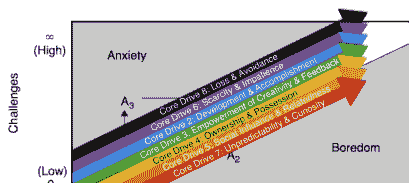

The Flow。After Mihaly Csikszentmihalyi, The Flow (1990), p. 74

正如你在这里看到的，Flow 顶部的区域是挑战远比玩家能承受的更困难。这受 Core Drive 8：损失与回避 的驱动，用户实际上只是努力求生。正如我们已经知道的，这使人们处于极度焦虑的状态。

现在如果你稍微降低难度相对于用户技能水平，我们现在进入 Core Drive 6：稀缺与不耐烦 的区域。此时用户感到受挑战并偶尔感到沮丧。然而，只要他们迅速采取行动并通过技能或计划跨越一道护城河（Game Technique #67），他们就有机会克服挑战并实现 Win-State。

在 Core Drive 6 下方我们有 Core Drive 2：发展与成就。这是挑战适中且用户感到有成就感和胜任的区域。用户处于 Flow 中，他们感觉自己正在实现目标并建立信心。

再往下一点我们有 Core Drive 3：创造力赋能与反馈。这是 Flow 的核心，用户再次发挥创造力并调整策略以发现更好的做事方法。这个过程使许多人处于 Flow 状态，尤其是在 Core Drive 3 和 Core Drive 2 之间快速轮换时——当他们的创造力带来成就时。

从核心驱动 3 再往下走一级，你会得到核心驱动 4：拥有与占有，这通常是无意识地收集东西、整理东西、把东西拼凑起来的行为——你在类似《农场游戏》那样的游戏中经常会做的事。相对于用户技能水平而言，这通常在难度上要容易得多，并且会让大脑放松。

大多数情况下，为了满足拥有与占有核心驱动，用户所需要做的只是花更多时间在上面，根据适度的计划采取行动，或是整理他们的系统。没有任何焦虑感。如果设计不当，这有时甚至会产生无聊感。想想那些只是为了薪水而做数据录入工作的员工；任务并不困难，但参与度也不强。

核心驱动 4 之下是核心驱动 5：社会影响与归属感。这基本上就像去一个聊天室。你不需要太多技能，你只需说出你想表达的任何内容，甚至可以戏弄他人。这在我们第九章讨论过的“水冷器”游戏技巧中经常可以看到。该活动仍然可能很有趣，但它大多非常容易。即使你看不到来自你机智评论的反馈（核心驱动 3）并给他人留下深刻印象（核心驱动 2），与他人相关的归属感、接纳感和联结感也会让体验变得愉快和放松。

如果再往下看一个层级，你可以说核心驱动 7：不可预测性与好奇心处于心流的最低层级。我们之前提到过，增加随机性和偶然性是让游戏变得更容易的好方法。大多数赌博游戏、抽奖和彩票不需要任何技能。你基本上只是参与其中，采取期望行为，然后等待结果。这也是为什么玩涉及随机性的游戏，如《大富翁》或《大富翁》（包括机会卡）时，往往比纯技能型游戏如国际象棋产生更多笑声。

现在你可以争辩说，被核心驱动 7：不可预测性与好奇心所吸引的人并不真的处于“无聊”状态，尤其是当他们在看电影或试图读完一本书时。然而，当你从技能与挑战的视角（心流图表）来看时，用户并不是因为技能使用而享受该活动。他们是以另一种方式被娱乐，这种方式驱动着愉悦感。

在 Csikszentmihalyi 的一张图表中，如下所示，他将“放松”作为一种状态，即技能远远超过挑战的结果。核心驱动 7 因此不会导致无聊，而是适当的放松。

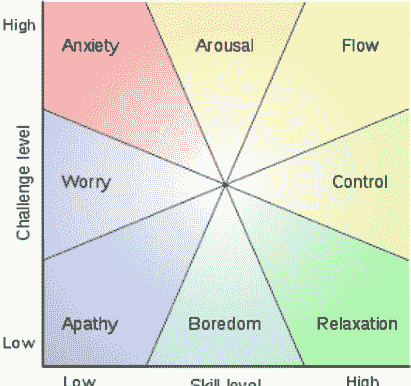

你可以在这里看到，在 *Flow* 模型中，唯一缺失的核心驱动是核心驱动 1：史诗意义与使命。那是因为核心驱动 1 完全超出了玩家技能水平与挑战难度这一背景，因为当涉及到承诺比自己更大的事物时，这两个因素是无关紧要的。核心驱动 1 并不能真正融入 *Flow* 模型，但它推动了人们为何首先参与任何体验的原因。

## 雾行为模型

斯坦福大学人类行为学教授 BJ Fogg 创建了一个模型，将所有行为归结为三个因素：*动机*、*能力* 和 *触发器*。

*动机* 是个人想要采取行动或获得期望结果的程度。*能力* 是个人在采取该行动方面的配备程度；换句话说，对用户执行该行动来说有多容易或多方便。第三个因素是 *触发器*，或提醒用户采取行动的东西。

激励和吸引人。事实上，最受尊敬的 *游戏* 定义之一是“自愿尝试克服不必要的障碍”285

Fogg 本人说，随着你完成你的微小习惯，你的动机会增加，因为你感到有所成就，这反过来又形成了一个积极循环，不断建立在自身之上。最终做更多俯卧撑感觉更容易了，你不需要太多动机来维持这种更高的活动水平。这种思维方式与我们对核心驱动 2 的理解一致。

Fogg 通过说，与其“激励”人们去做他们不想做的事，公司应该专注于人们已经想做的事情，只是让它变得更容易，来支持他专注于 *能力* 的策略。

这很有道理。然而，从我自己的设计经验来看，我们发现即使用户有成为健康的动机，他们不一定有使用你特定健康应用的动机。即使人们想与朋友联系，仍然没有激励他们与朋友分享你的产品的动力，除非你为此设计。而且即使人们已经想做伟大的工作，他们也不一定愿意为一个对待他们很差的微观管理老板而努力工作。在这些情况下，提高老板如何激励员工的方式（通过赞赏、自主性、明确目的等方法）会更有成效，而不是试图让他们令人厌恶的工作变得更容易。

微小习惯对于个人层面的自我提升目标非常有效，但有时在员工参与或病毒式营销系统方面效果就不那么理想了。如果你只是专注于让事情变得更容易，用户可能无法或无法产生足够的动机来执行你想要创造的新行为。

产生动机的另一面是通过让事情变得更困难。 从核心驱动 6：稀缺与不耐烦 的角度来看，我们已经通过许多例子看到，当某件事太容易时，人们不一定会欣赏它。

如果将“让事情变容易”的策略用于约会怎么办？ 假设你想让某个人成为你的伴侣（期望行为），

所以你邀请那个人出去（一个 *触发器*），但此时他们的动机仍然非常低，因为他们只是在试图弄清楚你是否是一个理想的伴侣。 在这种情况下，如果你尽一切努力让那个人与你约会变得极其容易，比如每周任何一天都随时有空，或每天发送几十条短信让对方可以轻松回复（*触发器* 和 *能力* 提升）——根据我自己的经历……我的意思是，我的观察来看，这不会很成功。嘘。别笑。

有时适度收敛会增加期待和悬念，从而产生动机。 结果是，尽管期望行为的难度增加，稀缺性却创造了更多期望行为。 我们在之前的章节中已经看到，给用户制造不便或从交易中退出（如果做得正确），也可以严重提升动机和行动。

所以虽然 Fogg 的行为模型本身在理解行为及其影响方面极其有用，但 Fogg 和我对改善流程的可行步骤得出了略有不同的结论。 具体来说，Fogg 专注于他模型中的 *能力* 方面，而我专注于 *动机* 方面。 当然，我也在努力提高每个期望行为的易用性，我相信 Fogg 也会花时间提高动机；我们的优先事项似乎只是不同。

话虽如此，确实大多数产品都过于复杂和难以使用，让用户感到愚蠢和沮丧（反核心驱动 2）。 这在入职阶段尤其是一个问题，当用户没有足够的动机去投入大量精力弄清楚事情时。 因此，让活动变得如此简单，以至于用户不需要费力思考是否要执行行动，仍然是一个高优先级。

就 *动机* 而言，Fogg 指出动机源于六个因素：寻求愉悦、避免痛苦、寻求希望、避免恐惧、寻求社会接纳、避免社会排斥286。 这是核心驱动 2、4、5、7、8 以及隐藏核心驱动 9：感官 的混合。287

对于像核心驱动力 6：稀缺性与不耐烦这样的驱动力，以及核心驱动力 4：拥有与占有中的禀赋效应，这些在其他行为模型中往往没有被解释。它们是我们大脑中采取的心理捷径，在学术上被称为 *认知偏差* 和决策 *启发式*^288^。有一份包含数十种启发式^289^ 的清单，包括锚定（在我脑中一切都是相对的）、虚幻优越感（我肯定高于平均水平）、宜家效应（我珍视我所建造的东西）以及损失厌恶（我不会冒着损失 10 美元的风险去赚取 15 美元），我们在之前的几章中讨论过这些。

将 Fogg 的六个动机要素加上行为启发式的清单结合起来，就构成了一个相当完整的行为全景图；尽管它们可能无法解释我们为何有时会为更大的事业而死——史诗意义与召唤。对我自己的设计工作而言，我更倾向于拥有一个更具包容性的通用框架，能够涵盖我们的心理核心驱动力以及它们如何促进并相互作用。与其在设计引人入胜的体验时思考一长串例外情况，不如简单地使用一个框架来得容易。

最后，如果我们通过 Octalysis 来审视 *触发* 要素，那就是 Octalysis 策略仪表板中的反馈机制的作用——这是我们在未来的文章中会更深入探讨的内容^290^。反馈机制允许用户关注他们需要做什么，通常通过收到的电子邮件或短信、显示可操作信息的用户界面，或朋友对你新 Facebook 照片的“点赞”，从而促使你返回网站。这些都是由反馈机制传递的触发。

所有反馈机制也都在其内部融入了各种动机核心驱动力，取决于触发本身是什么。积分和徽章是核心驱动力 2 的触发，倒计时器是核心驱动力 6 的触发，旋转幸运轮是核心驱动力 7 的触发，而好友点赞则是核心驱动力 5 的触发。当你为反馈机制或触发进行设计时，你需要了解它们是旨在驱动用户的求知欲、成就感、内在社交压力，还是其他核心驱动力。如果不是，反馈机制就会变成空洞的信号，无法触发任何期望的行为。

## Jane McGonigal 的理论

作为本章的最后基石，我们将来看 Jane McGonigal 的理论。McGonigal 是一名游戏设计师，也是书籍 *Reality is Broken*²⁹¹ 的作者。她最著名的是在现实世界中关于游戏力量的两场 TED 演讲。

McGonigal 描述了游戏让人们变得更好、更有韧性的四个要素：*史诗意义*、*紧迫乐观*、*愉悦生产力* 和 *社会结构*。

其中有几个要素我们可以很容易地与 Octalysis 对应起来。史诗意义当然呼应了核心驱动力 1：史诗意义与召唤——让你感觉自己正在改变世界。社会结构显然与核心驱动力 5：社会影响与归属感相符，这关乎人们在共同承担任务时之间建立的信任纽带。

*紧迫乐观* 通过 Octalysis 眼镜来看则稍显难以理解。在 *Reality is Broken* 中，McGonigal 将紧迫乐观定义为，“我们成功成为现实之前的希望时刻，我们感到有动力竭尽全力、做到最好。”²⁹² 在我自己的解读中，这是一种只要你立即行动，就能完成目标并达成胜利状态的感觉。在这种意义上，玩家始终信任游戏设计师会提供获胜的方法，只要玩家在朝着明显设计好的目标采取迅速行动。

现在戴上我们的 Octalysis 眼镜，*紧迫乐观* 通常是核心驱动力 2：发展与成就 以及核心驱动力 6：稀缺性与不耐烦 的结合。核心驱动力 2 存在是因为玩家乐观地认为自己有能力达成胜利状态并感到成就感。另一方面，核心驱动力 6 也会发挥作用，因为玩家不能无限期等待去执行期望行为——他们必须现在就做，因为这是紧迫的。因此，这些左脑核心驱动力的白帽与黑帽组合会让玩家真正投入其中。

最后一个要素是 *愉悦生产力*²⁹³，最初由印第安纳大学的一组计算机科学家在研究《魔兽世界》玩家异常高的耐力时提出。

McGonigal 将愉悦生产力定义为“沉浸于能产生即时且明显成果的工作中的感觉”。

在我看来，愉悦生产力是你随着在某件事上花费更多时间而感到自己在成长、积累或改进某物的感觉。有时任务本身可能有点单调，但只要玩家感觉到有进展，这个过程就会产生愉悦和喜悦的感觉。

这通常是核心驱动力 2：发展与成就、核心驱动力 3：创造力赋能与反馈 以及核心驱动力 4：拥有与占有 的结合。用户正在积累、成长或组织某物（核心驱动力 4），并且会持续获得关于这些活动的反馈，以便调整、优化并感到成就。

正如你所见，这些四个核心驱动力组合非常出色，能够让用户深度享受游戏以及游戏之外的体验。随着你深入 Octalysis 游戏化学习之旅，你将开始识别并定义出远超这四个要素的更多核心驱动力组合，并作为体验设计师开创自己的工作。例如，从上述分析中我们可以看到核心驱动力 7：不可预测性与好奇心 并不是很突出，我们可以思考如何在体验中加入更多悬念、惊喜和不可预测性，超越这四个要素。

## 世界是你的游乐场

我们都有同样的脑子，所以关于我们动机和行为的所有可靠研究都应该能够相互融合。本章的主要观点并不是 Octalysis 优于任何其他框架，但至少对我而言，它可以是一个非常有用的工具，帮助理解和驾驭行为科学、游戏和游戏化中的其他模型。在我自己的经验中，能够使用一个框架来分析它们所有并帮助完善我们对行为设计的理解，既方便又令人满意。

基于核心驱动力 7 的营销材料中的触发。在终局阶段，触发变为内部触发，用户通过核心驱动力 4 和 8 得到激励。）尝试将你的 Octalysis 理解完全沉浸到 Hook 模型中。

在 Twitter 或你偏好的社交网络上分享你的成果，使用标签 #OctalysisBook 并查看其他人的想法。

## 开始设计

你即将接近本书的结尾，现在是开始设计你自己的项目的时机。构思一个与人类动机相关、你想要改进的项目。

思考你想要改进的 *可量化指标* 是什么。你要针对的 *用户* 是谁，他们由哪些核心驱动力驱动？你需要他们执行哪些 *期望行为*？你可以通过哪些媒介与他们沟通，向他们展示反馈机制并展示触发？最后，你可以为用户提供哪些 *奖励和激励*？

合在一起，这就构成了 Octalysis 策略仪表板，它在任何游戏化设计活动中都很有用。这将成为第 17 章的良好基础。有关 Octalysis 策略仪表板的更多信息可以在我的博客上找到：

*http://www.yukaichou.com/gamification-study/the-strategy-dashboard-for-gamification-design/*
