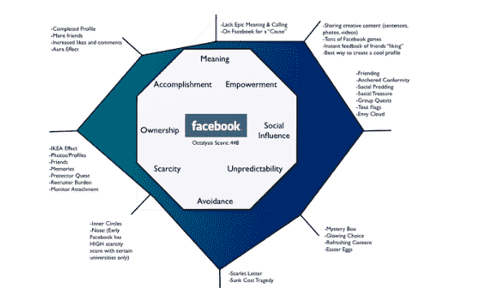
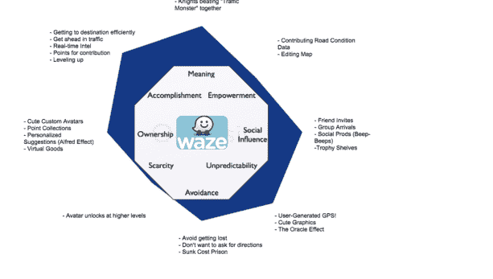
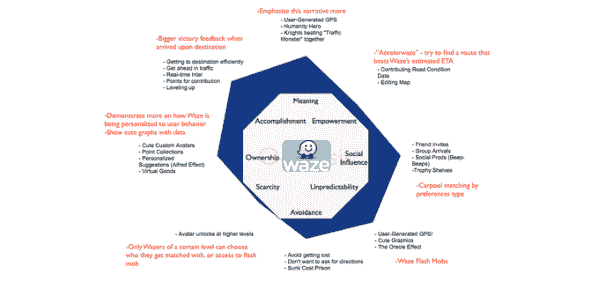

# 第 16 章：第一层 Octalysis 实践

现在我们已经考察了第一层 Octalysis 的所有各种要素，让我们看看一切如何结合起来。一般来说，使用 Octalysis 有两种方法：

第一种方法是分析现有产品，以确定它们在朝着期望行为产生动机方面的优势和劣势。它使我们能够识别出哪种动机薄弱，从而可以在体验中引入新的改进，通常以游戏设计技巧的形式出现。这通常被称为 Octalysis 审计。

第二种方法是基于 Octalysis 和 8 个核心驱动力创建一个全新的体验。通过一个非常系统的过程，我们可以创造一个引人入胜的体验，满足体验设计师的目标。

让我们先来看前者。

### Facebook 的 Octalysis 评测

使用 Octalysis 作为工具的第一步是破译体验中存在的动机核心驱动力。在第 3 章中，我们简要地通过 Octalysis 的视角审视了 Facebook。让我们利用你对 8 个核心驱动力的新熟悉程度，更仔细地看一下。

一般来说，Facebook在大多数核心驱动力上都表现得相当强劲，因此才取得了如今的巨大成功。Facebook的核心是核心驱动力5：社交影响与关联感。人们总是希望与他人保持联系，分享自己的经历，同时了解别人在做什么。Facebook运用了大量社交提示、社交宝藏和从众锚点，来营造更具参与感的体验。

另一方面，这种体验中也有大量的核心驱动力7：不可预测性与好奇心。用户每次登录Facebook，都在寻找值得浏览和分享的新奇内容。

《上瘾》作者尼尔·埃亚尔甚至暗示，每次我们打开Facebook（或Twitter）的信息流，或者“下拉”刷新信息更新，就像拉下老虎机的拉杆——他称之为“狩猎奖励”。294每当我们执行期望行动时，都是在试图看看自己是否会被奖励更多有趣的内容。如果我们没有“赢”，就会再次拉动拉杆，看看下一次会不会更幸运。

Facebook内部还有强烈的核心驱动力4：所有权与占有感。Facebook上的核心活动之一是积累和整理更多朋友与经历的照片。此外，由于许多人的Facebook个人资料代表他们的社交身份，人们对这些资料有强烈的所有权感。这符合核心驱动力4的特性。

由于这些公益项目或群组每天都会变化，并且会包含他们正在经历的具体细节，人们至少会感到在每天访问Facebook时能更了解世界的问题。通过大幅提高对群组的捐赠，Facebook可以真正地说，他们不仅改变世界，而且随着用户每天登录，他们还在*拯救*世界。

最后，如果Facebook能够让用户轻松找到并寻求导师或学习伙伴的帮助，这可能会让Facebook受益。这会让人认为使用Facebook非常“高效”，从而减少他们对它的抵触情绪。

## 八角评分是个烟雾弹

多年来，很多人喜欢问我八角行为分析（Octalysis）的评分代表什么。当你看一些八角图表时，你可能也有同样的疑问。我们知道，分数往往能吸引人们的兴趣，每个人都想了解它们。然而，我通常尽量避免花太多时间解释八角评分，因为它在八角行为分析领域中实际上是最不具备可操作性的元素。

有用的做法是，使用八角图表来确定哪些核心驱动力薄弱并需要改进，同时理解主导核心驱动力在白帽/黑帽和左脑/右脑方面的性质。八角评分本身在某种程度上只是有趣和花哨的。但既然人们不断问起，我想我应该分享一下我是如何得出这些数字的。

通常，对于每个核心驱动力，我们根据“该核心驱动力在多大程度上激励用户采取期望行动”来设定一个0到10之间的数字。0意味着该核心驱动力在体验中不作为激励因素存在。在标尺的最高端，10通常意味着该核心驱动力已经无法进一步改进，而且几乎所有接触过该核心驱动力的人都会采取期望行动。

之后，我将八个数字分别平方并相加。这意味着八角评分的最高可能值是800（10的平方乘以8），最低是0。在我自己的评分中，大多数成功的游戏都在350分以上，而大多数非游戏产品在150分以下。事实上，大多数不注重以人为本的设计的产品都会低于50分。

然而，由于评分相对主观，不同的人会对同一产品给出不同的分数。当人们问我如何知道每个动机的具体分数时，我只是说这是基于*体验*系统后的直觉感受。然而，正如我之前提到的，精确数字其实没那么有用，只要你的分数偏差不太大就行。无论你给某个核心驱动力打2分还是3分，只要你知道它不是7分或8分，就不会对你的设计产生什么影响。正如我所说，八角行为分析是一种让人们基于自己的正确判断进行更好设计的工具。（毕竟，所有模型都需要正确判断，无论是*SWOT分析*295、BJ Fogg的*B=MAT*，还是波士顿咨询集团的*BCG矩阵*296）。

在我看来，真正重要的是你能够在概念上认识到这些事情：例如，你的体验中没有*不可预测性*，或者你严重依赖黑帽核心驱动力。一般来说，只要知道哪些核心驱动力强、哪些弱，就能让你针对体验进行恰当的设计，而不是把宝贵的时间浪费在纠结精确数值上。

从八角评分公式中可以得出一个见解：与其在各个方面都有一点，不如在少数几个核心驱动力上做到极强。八个核心驱动力各得1分，八角评分只有8分；而两个核心驱动力各得9分，八角评分则达到162分。这就是为什么在游戏化设计中选择具有所需特性的*正确*核心驱动力如此重要。如果你只需要挑选几个核心驱动力，就要确保你基于具体场景选择最有效的那些。

话虽如此，如果一个核心驱动力完全缺失，通常比已经很强的核心驱动力更容易改进。在没有不可预测性、社交性或稀缺性时，增加一点点通常是相当容易的。但如果已经存在很高的社交影响力，那么进一步增强它就困难得多

这个概念最初由旧金山的Kevin Richardson向The Fun Factory提出，2010年由总部位于瑞典斯德哥尔摩的瑞典国家道路安全协会实施。超速摄像头彩票设备利用现有的交通摄像头和速度抓拍技术，检测所有经过的驾驶员的速度，并拍摄他们的车牌照片。

LED显示屏向每位经过的驾驶员显示车速，并配以竖起大拇指或拇指向下的标志，表示他们是否守法。被拍照的超速者会收到罚单，罚款收入将进入现金池。另一方面，遵守限速规定的驾驶员也会被记录，然后参加抽奖，有机会赢取超速者缴纳的部分罚款。

许多游戏化行业内的人士都看过这个案例研究，人们常常感叹：“这真是一个有创意的解决方案！我怎样才能想出这样的创意解决方案来解决我自己的问题呢？”

在这里我们可以看到，通过八角行为分析流程，人们有可能想出超速摄像头彩票等创意解决方案，甚至更多。

## 问题：让人们低于限速行驶

在每一个游戏化活动中，首先必须定义要解决的问题以及如何衡量成功。如果我们把减少超速驾驶者作为一个持续进行的活动，那么就可以通过八角行为分析的8个核心驱动力来分析它。

一般来说，在没有人为干预的情况下，在限速内驾驶只由核心驱动力1：史诗意义与使命感驱动——安全、负责任的驾驶是为了比自我更伟大的事业。这无疑促使许多人对自己的驾驶速度施加了某种限制，使道路整体上更加安全。

问题是，大多数人并不总是将开快车等同于“危险”驾驶。对许多人来说，如果回报是更快到达目的地的即时满足感或体验快速行驶的快感，那么忽视限速仍然是值得的。因此，大多数

政府引入了核心驱动力8：损失与规避——当人们被发现超速驾驶时，会对他们进行罚款。人们希望避免因快速驾驶而被罚款，因此切实降低了车速。这就是大多数人避免危险驾驶的原因。

然而，执法是一种非常昂贵的解决方案，尤其是当它需要无处不在的时候。而且，由于超速时被抓住的几率相对较低，许多人仍然不会因偶尔超速的习惯而却步。

随后，另一种解决方案被引入，它利用了核心驱动力3：创意授权与反馈。你可能见过那些不会给超速者开罚单、而只是显示他们行驶速度的超速探测器。由于驾驶员能够控制自己的“分数”并看到即时反馈，这鼓励许多人在发现车速过高时进一步减速。

这里的问题是，胜利状态（Win-State）对驾驶员来说仍然不太清晰。限速是多少来着？我是超过还是低于？请记住，人们通常不愿意在不必要时使用他们活跃的大脑去思考。如果人们需要自行计算自己是否达到胜利状态，许多人会变得懒惰而不去理会。此外，事实证明，有些人还会做出与期望行为相反的事情，试图看看自己在反馈设备上能记录到的最高速度是多少，这完全违背了设计的初衷。

## 超速摄像头彩票的创新

因此，超速摄像头彩票应运而生。超速摄像头彩票增加了四个额外的核心驱动力来解决这个问题。

- 核心驱动力4：所有权与占有感。通过超速摄像头彩票，玩家现在如果表现良好并达到胜利状态，就有机会“赚到”钱。在这种情况下，实实在在的现金奖励本身就是一种相当强的激励，使人们有兴趣参与。
- 核心驱动力7：不可预测性与好奇心。我们知道，只要存在彩票或抽奖系统，就涉及核心驱动力7。有10%的机会赢得100美元，往往比必然获得10美元更能吸引人们参与，因为他们会不断思考自己是否会赢。这种期待让事情变得更加激动人心和引人入胜。
- 核心驱动力2：发展与成就感。超速摄像头彩票不再是模糊地显示驾驶员是否达到胜利状态，而是当驾驶员达到胜利状态时显示明显的绿色竖起大拇指，未达到时显示红色大拇指向下。通过以绿色显示等于或低于限速的速度，以红色显示超速，进一步强化了这一点。这种即时反馈机制让用户达到胜利状态时能直观地感到更有成就感和满足感。
- 核心驱动力5：社会影响与关联性。在展示超速摄像头彩票的爆款YouTube视频中，我们看到超速摄像头彩票被实施在一条繁忙的街道上，附近有许多其他驾驶员和乘客。除了渴望表现出色并赢得一些钱之外，驾驶员会意识到周围每个人都能看到他们是得到拇指朝上还是朝下。尽管大多数观众只是陌生人，但我们自然不希望别人认为我们是违反法律的“拇指朝下失败者”。我们更希望别人看到我们是获得绿色拇指朝上的守法公民。

超速摄像头彩票将四个额外的核心驱动力融入体验中，使其在试点期间能够将过往驾驶员的平均速度降低20%以上。尽管由于缺乏终局（Endgame）设计，超速摄像头彩票并非万无一失的解决方案，但我们可以看到，通过将八角行为分析（Octalysis）和8个核心驱动力应用于现有问题，我们能够创新并设计出强化期望行为的新体验。

如果说我希望读者从这本书中带走一样东西，那就是不断思考动机和8个核心驱动力，而不是特性、功能和系统。当你从以人为中心的设计（而非以功能为中心的设计）开始时，我相信你设计的任何东西都会更吸引人、更令人愉快、更成功。

## Waze导航应用的八角行为分析

除了对体验进行高层次的八角行为分析概述之外，我们还可以在玩家旅程的4个体验阶段分别分析体验：发现、上手、搭建和终局。

与超速摄像头彩票有些类似，“游戏化驾驶”领域的另一个案例是导航应用Waze。如第5章所述，Waze是一款极受欢迎的GPS应用，它通过众包实时交通和道路状况数据，正在改变我们导航交通的方式。它经常获得成千上万用户平均五星的评价，其粉丝将平凡的驾驶体验转变为一种愉快的沉浸式冒险，并带来有回报的社交体验。

让我们通过将八角行为分析应用于其设计和机制，更深入地了解Waze是如何实现这一点的。

大多数导航系统只是将提供路线作为达到目的的手段（以功能为中心）。它们主要通过两个核心驱动力来激励我们：

- 核心驱动力2：发展与成就感。用户不断看到朝向目的地的进展，并在高效达到胜利状态时感到非常胜任。
- 核心驱动力8：损失与规避。用户避免迷路或感到困惑的挫败体验。

但所有导航系统都满足这两个核心驱动力，只是有些做得更好。作为行业的新进入者，Waze需要在体验中融入更多核心驱动力，以创造差异化的成功。

Waze通过启用社交组件来创建本地化的驾驶员社区。虽然公司拥有地图权，但实际的导航系统是由众包用户数据驱动的，驾驶员不断贡献更新。这些更新包括路况、碎片、交通、警察的位置，以及其他对使用该应用的驾驶员有帮助的特定细节。这有点类似于维基百科社区参与背后的精神。

Waze的目标不仅仅是给人们提供路线。他们想要创造愉快而有趣的驾驶*体验*，为用户日常通勤带来更多乐趣。

让我们深入探讨Waze如何在4个体验阶段中吸引用户，涵盖8个核心驱动力。

### Waze的发现阶段体验

发现阶段是用户决定开始尝试某种体验的阶段。许多其他游戏化/游戏设计框架将其第一阶段定义为*上手*或*身份*³⁰⁰，即用户注册体验之时。然而，我认为服务的用户体验不是从人们注册服务时开始的，而是从他们第一次听说它时开始的。他们如何听说它、在什么背景下、受哪些核心驱动力激励，都会影响用户在上手和搭建阶段的行为。因此，我们希望仔细分析和设计我们正在设计的任何服务的发现体验。

许多人发现Waze应用是因为一种温和的核心驱动力7：不可预测性与好奇心。他们从某处听说它，通过在线媒体网站读到它，或者只是在应用商店中偶然发现它。Waze通过展示可爱的图形来吸引用户，并激发人们对用户生成导航应用的好奇心。由于大多数GPS应用都是集中编程的，看起来过于严肃，这激发了用户对其他人无法获得的信息的好奇心，以便更好地在交通中穿行。

另一个在搭建阶段开始增强的关键核心驱动力是核心驱动力4：所有权与占有感。当用户使用Waze驾驶时，它收集关于用户习惯和驾驶行为的具体数据。因此，该应用能够对用户形成深入而个性化的理解，并定制他们的体验。

作为第9章讨论的阿尔弗雷德效应（Alfred Effect）的一个例子，Waze可能会问驾驶员：“您现在想去上班吗？”因为它知道驾驶员在工作日上午8:30去上班。但在周三晚上8点，Waze可能会问：“您想去健身房吗？”因为它知道周三晚上是这个用户的健身之夜。个性化的“阿尔弗雷德效应”激励用户保持与该应用的互动和忠诚度，即使其他更先进的技术出现。相比于更聪明的系统，用户更愿意坚持使用了解自己的系统。

Waze在搭建阶段的另一个强大核心驱动力是核心驱动力7：不可预测性与好奇心。当用户收到路边有故障车辆的警报时，他们的思维会突然变得投入。“它会在那里吗？它会在那里吗？”这就是我所说的神谕效应（游戏技巧#71），即对未来的预测导致用户充分投入，以查看“预言”是否会成真。通常用户会保持专注，直到“哇！”他们看到那辆无法行驶的汽车停在路肩上——预言应验了！即使车子不在那里，用户也会想：“真扫兴。也许下次我能亲眼看到警报中的事件。”当你拉动老虎机的杠杆时，有时赢，有时输。这种好奇心在Waze体验中增加了一层额外的乐趣。

在某个时刻，在持续看到并受益于他人贡献的可靠信息后，用户也开始考虑运用他们的核心驱动力3：创意授权与反馈。突然，用户开始分享一些自己的道路信息，在驾驶时点击几个大图标，分享有一个警察藏在陡坡底部。（注意：这不一定安全。）这给了

用户因此感受到一种“自主感”，因为他们觉得自己能够自主地向有用的数据池贡献自己想要的内容。

我们知道，要让核心驱动力 3 生效，它还需要快速的“反馈”，而且如果这种反馈与核心驱动力 5：社会影响与归属感混合，反馈往往会更强。Waze 的情感回报之处在于，经常当你与社区分享信息时，几秒钟后你可能会收到几条弹出提示，显示有人在感谢你。（同样，这对分享者或感谢者来说并不一定安全；游戏化设计师需要认真思考其设计的后果）。当用户似乎从其他欣赏他们的用户那里获得即时反馈时，他们会感到愉悦，并且更倾向于未来继续分享。每次期望的行为之后都必须有一个令人愉悦的时刻。

当然，系统中仍然存在一些核心驱动力 6：稀缺与不耐烦的设计，因为该应用仍然 dangling 一条通往精通的路径，成为“Waze 皇室”。然而，由于解锁的奖励并不会赋予用户更有用的能力，也实际上并不代表对他人而言令人印象深刻的地位，从我的观察来看，它并不会大幅改变用户行为。

对于核心驱动力 8：损失与规避，人们讨厌为汽油、啤酒或杂货等商品支付过高的价格，因此导航服务确实可以帮助人们避免支付过高的价格，通过将路线引导至沿途最便宜的地点。此外，当某人试图在前往目的地的途中搜索餐厅时，大多数导航应用会显示位置或绕行路线，这些路线实际上离路很远。

Waze 通过在用户前往目的地时显示更便宜的加油站和更短的绕行路线，使用户能够避免这些痛苦。它甚至会在用户承诺前往任何地点之前告诉用户绕行与原路线相比需要多长时间。这最终会带来更多核心驱动力 2：发展与成就，因为人们会觉得自己很聪明，没有浪费太多时间和金钱去寻找加油站或吃饭的地方。

## Waze 的终局阶段

终局阶段开始于用户已经长时间经历活动循环，并且在其自身认知范围内已经做完了所有能做的事情。这时我们评估他们为何仍想留在系统中并承诺更多期望的行为。

幸运的是，对于 Waze 来说，导航功能本身就是许多人日常需要的实用目的。因此，人们很难像对待游戏那样轻易退出。然而，如果没有细致的设计，仍可能没有任何东西阻止用户迁移到提供类似功能导向收益的其他导航服务。这就是良好的终局设计变得非常重要之处。

在终局阶段，长期参与的核心用户开始更自豪地成为社区的一部分，这加强了核心驱动力 1：史诗意义与使命。正如我们所知，核心驱动力 4 中的阿尔弗雷德效应会持续增长，这也增强了核心驱动力 8：损失与规避，因为用户不希望离开并失去所获得的系统智能以及系统中保存的地址和“收藏”。

此外，在这个阶段，一些核心驱动力 3：创造力赋能可以被利用，因为人们开始实际使用可用的在线地图编辑器来更新地图并进行改进。当然，由于物理世界在比喻上是“坚不可摧”的，因此可以从这个过程中获得的创造力仍然有限。此外，说“这里有一块垃圾或一辆警车”的方式也只有那么几种（任何超出最简单的方式都会对驾驶构成危险），因此对于资深用户来说，核心驱动力 3 仍然非常有限。

另一方面，只要 Waze 继续提供比其他竞争对手更快的路线，核心驱动力 2：发展与成就在终局阶段很可能会保持强劲。然而，许多其他导航应用都在宣称它们在寻找更快路线以避开交通方面同样智能或更智能。无论这种说法是否准确，这种可能性带来的感知以及一些黑帽发现阶段设计，都可能迅速将用户从 Waze 夺走，如果他们仅依赖这一点的话。

关于核心驱动力 5：社会影响与归属感，即使 Waze 中的轻度社交互动在终局阶段仍然有趣，互动和关系的深度也不一定会扩展。因为人们在驾驶时，每次友谊互动都基于轻触，人们偶尔会以“Beep-Beep”或快速消息的形式向你发送社交提示。友谊的程度并不一定会通过 Waze 变得更深或更有意义。

核心驱动力 6：稀缺与不耐烦以及核心驱动力 7：不可预测性与好奇心也减弱了，因为用户已经解锁了高等级头像，新奇因素（包括由于变化甚微而产生的预言效应）很可能已经降低。这意味着 Waze 在终局阶段并没有太多黑帽动机。当然，Waze 中的头像等级是“基于百分位”的，这意味着如果你停止使用 Waze 而其他人勤勉追赶，你可能会失去头像等级。这意味着当资深用户因使用缓慢而掉级时，仍有动力继续使用。这里我们看到这种游戏化设计的另一个潜在副作用可能是，人们会为了保持等级而更多地使用 Waze 驾驶，即使根本不需要驾驶。这可能会无意中对环境产生负面影响。

从上面的分析可以看出，Waze 的终局体验主要集中在核心驱动力 1、2、3、4 和部分 8 上。这并不一定是坏事，因为我们知道白帽核心驱动力会刺激更长的参与度。只要人们喜欢这种体验，减少黑帽核心驱动力设计是可以的。然而，Waze 长期成功的关键在于它们如何吸引核心驱动力 2——用户是否真的觉得使用 Waze 比使用其他导航应用更聪明——以及核心驱动力 3——是否有更多方式利用创造力并获得反馈，同时不危及安全驾驶。当然，如果 Waze 能在终局设计中扩展核心驱动力 5：社会影响与归属感，那将使其体验更具吸引力。

## 下一步：为 Waze 识别潜在改进

一旦我们分析了 Waze 的渐进式体验，下一步就是提出新的创意想法来增强这 8 个核心驱动力。为简单起见，我们将只进行一次简单的十分钟一级 Octalysis 头脑风暴，这会很有启发性，但绝非详尽无遗。免责声明：截至本文撰写时，我从未与 Waze 合作过，所以这不是真正的咨询建议，而仅仅是使用 Octalysis 框架进行的一种有趣的头脑风暴。

通过这次快速分析，Waze 首先需要改进的是更强调核心驱动力 1：史诗意义与使命。我之前提到过，“交通怪兽”的 onboarding 图像在早期存在，但后来已被更多与社交相关的信息所取代。即使公司想强调核心驱动力 1 的“ playful fantasy”部分，他们也应该在脚手架和终局体验中持续提供“帮助社区战胜交通”的史诗意义。不幸的是，Onboarding 是许多反馈机制元素存在的唯一地方。

为了改进核心驱动力 2：发展与成就，Waze 应该考虑让每次到达目的地都成为更大的胜利状态。播放胜利的曲调，显示一个兴奋的弹出窗口，写着“你已安全到达。太棒了！”也许甚至像其他一些导航应用那样显示目的地的图像，以便用户知道该寻找什么。所有这些都比平淡的 GPS 语音“您已到达目的地”要好得多。我可能会更频繁地使用 Waze，如果每次我到达目的地时，有 25% 的几率机械女声会说，“您已到达目的地。你很棒。”当然，这也加入了一丝核心驱动力 7 复活节彩蛋设计的融合。

对于核心驱动力 4：所有权与占有，我们提到过 Waze 的一大优点是阿尔弗雷德效应，因为它开始提供个性化

suggestions. 问题是，大多数用户在脚手架阶段后期之前并不知道 Waze 正在智能地学习他们的偏好。如果更多用户知道这一点，也许在他们意识到该功能存在之前，流失的人会更少。应用可以考虑为自己添加一个“智能分数”，每次你使用 Waze 驾驶时，其智能分数都会随着它对你偏好的了解越来越多而上升。这可能比单纯的积分更具上下文意义，并为体验中即将发生的事情营造一些期待。

另一个关于核心驱动力 4 的想法是开始展示可爱的图形和图表，反映用户的驾驶行为。图表可以反映诸如，“你知道你今年去了 105 次健身房，总共停留了 5,775 分钟吗？”或者，“你知道你去年通勤上班花费了 9,422 分钟吗？”这些确实可以在体验中加入更多核心驱动力 4。

即使这些信息不一定有用，人们也喜欢它，因为它反映了他们的身份，并让他们更好地理解自己的行为。这将增加他们更频繁使用 Waze 的欲望，以确保数据以及由此产生的洞察具有更高的完整性并变得更有趣。

核心驱动力 3：创造力赋能与反馈实际上很难设计，因为导航应用的目的是尽可能高效地让用户到达目的地。几乎没有空间让用户进行创造性选择和有意义的选择，这些选择可能会使用户分心或浪费时间。然而，一个潜在的想法是引入一个名为“Accelerwaze”的功能，允许用户尝试击败 Waze 预先设定的“预计到达时间”。

当你为 Waze 设置目的地时，它会告诉你到达目的地的最佳方式，以及如果你走那条路线时的“预计到达时间”。用户可以选择“挑战”Waze，说：“我相信如果我走另一条路线，我会比 Waze 的预计到达时间更快到达。”这将使驾驶体验变得更有趣、更动态，同时也允许 Waze 了解新的驾驶路线以升级其自身系统。人们甚至可能想在他们完全知道如何到达的目的地上使用 Waze，例如他们每天通勤上班的路线。

当然，这里存在潜在风险，为了证明他们的路线更快，司机可能会更鲁莽地驾驶并闯红灯。对于你设计的每个激励功能，你都必须在实施之前考虑意想不到的后果和负面影响。希望这些“Accelerwaze”司机在经过许多测速摄像头彩票时，会减速以赢得奖品。

Octalysis 允许你提出正确的问题，并利用 8 个核心驱动力来设计动机。但仅仅因为你有一堆有趣的想法并不意味着它们都是合理的想法。判断哪些功能是合理的，哪些需要进一步完善，取决于设计师的判断。

记住，我们之前提到过 Waze 的游戏化系统可能会激励人们不必要地多开车并伤害环境？幸运的是，核心驱动力 5：社会影响与归属感中也有一些想法可以帮助减少驾驶。既然 Waze 知道谁每天通勤到哪里，他们就可以潜在地引入拼车匹配服务，让个人节省汽油、能源和环境。 同时结交新朋友。Waze 可以通过声明的兴趣、行业，甚至同一家公司来匹配人们，定期一起通勤。

如果他们真的想这样做，Waze 甚至可以创建一个约会服务，并将第一次约会安排为拼车。当然，这里的玩笑是几乎每个人都会有第二次约会，因为潜在的情侣至少要一起拼车返回通勤。只是不要成为那个糟糕到对方会叫朋友来接他们，这样他们就不用再忍受和你一起坐车的痛苦的人。

对于核心驱动力 7：不可预测性与好奇心，他们可以为终局用户添加有趣而愉快的体验，例如随机告诉用户正在进行闪电快闪，并询问他们是否想参与。如果用户点击“是”，它可以将他们的汽车重新路由到海滩等地点，许多其他 Wazer 会在那里聚集。他们可以实施有趣的主题，例如，“弄清楚我们为什么把你们所有人带到这里。”也许在几次对话后，人们会意识到他们都每天去健身房两次，并且是硬核的健康爱好者。一旦他们弄明白了，

正如你所见，通过 Octalysis，你能够彻底分析你自己的产品或体验，同时也能利用它来集思广益，提出其他创造性想法来改善体验。当然，你很少想实施所有计划的功能，但它允许你的思考朝着推动期望行为的方向深入，同时让用户享受过程。

### 为了充分利用这本书，立即选择以下其中一个选项来做：

- **Easy:** 查看 Facebook、测速摄像头彩票或 Waze 导航应用。通过体验各种功能来回顾本章中进行的分析。用新的 Octalysis 眼镜看这些体验是否会改变你对它们工作原理的理解？
- **Medium:** 选择另一个你花费了大量时间并且也非常受欢迎的产品或体验。尝试对其进行一级 Octalysis 审计。它在 8 个核心驱动力的背景下设计得好吗？你如何让它变得更好？
- **Hard:** 找到另一个有用但难以获得关注的项目。将体验分解为 4 个体验阶段：发现、入职、脚手架和终局。对于每个阶段，分析该项目中是否存在任何核心驱动力。然后，开始集思广益，如何在每个阶段增加每个核心驱动力的存在。这意味着你正在积极思考三十四个核心驱动力。你觉得如果他们实施你的设计，项目会变得更成功吗？

在 Twitter 或你喜欢的社交网络上分享你的成果，使用标签 #OctalysisBook，看看其他人有什么想法。

### 证明你的精通：获得一级 Octalysis 证书

凭借你从这本书中获得的知识，你有资格向我的公司提交申请，获得一级 Octalysis 证书
