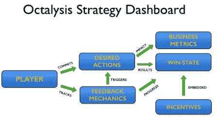

# 第 17 章：使用 Octalysis 从零开始设计项目

### 重新设计 Yukaichou.com

作为本书的压轴，本书将简要展示如何使用 Octalysis 框架从零开始设计项目体验。

如前所述，我为客户做的大多数工作都是保密的，因此通常不实用详细展示我的设计过程。然而，我认为对我自己的网站 YukaiChou.com 的设计过程进行梳理是恰当且合适的，特别是我正在推出的名为“Octalysis Prime”的新高级会员部分。

作为快速背景介绍，在我于 2012 年底在我的博客 YukaiChou.com 上发布 Octalysis 框架后，我的网站开始收到大量流量，这导致了我大部分的客户工作和演讲活动。然后我开始制作我的视频系列《游戏化入门指南》，计划包含九十集，每集十分钟。然而，由于这是一个耗时耗力的爱好项目，用于传教目的，但不一定对业务有用，因此进展非常缓慢。截至本文撰写时，我已在线完成了 25 集，尽管我在视频中做了很多傻事，我经常很尴尬地向人们展示。

我觉得有必要再次重新设计我的网站，部分原因是设计感觉过时，但主要原因是现在我对用户有更复杂的一组期望行为以及要发放的*奖励*。除了专注于客户和演讲活动外，我现在还有一本书要卖（或作为奖励提供），研讨会要推广，外国 Octalysis 许可合作伙伴要吸引，以及高级订阅会员要招募。高级订阅计划称为 Octalysis Prime。

Octalysis Prime 项目的目标是让我在进一步提升对游戏化设计、行为经济学、动机心理学等方面的研究努力的同时，仍能支持我的顾问、程序员、作家和运营团队。现在，即使我觉得自己可能是游戏化领域的领先实践者之一，仍有太多我渴望探索和研究的事情。

例如，我很想更深入地研究游戏技巧的 *Chain Combos* ——哪些游戏技巧组合会促进其他核心驱动，哪些会抑制其他核心驱动。或者研究不同玩家类型对白帽/黑帽以及右脑/左脑核心驱动的反应，是否可以用 Octalysis 创造更好的音乐，以及禀赋效应如何平衡稀缺效应（换句话说，我们更看重自己拥有的东西，还是更渴望自己没有的东西——在什么情境下一种效应比另一种更强大？）。

这些对我来说都是引人入胜的话题，但由于我承担的持续性客户项目，我无法进一步调查。我喜欢与客户合作并看到我的知识结出成果，但在这个过程中我自己并不一定朝着更高水平成长（这意味着从我这里学习的人得不到他们本可以得到的一切）。因此，我希望创造一种方式，让我能够调查这些引人入胜的问题，与世界分享我的发现，同时仍能支持我的团队。

我坚信我的内容也能将人们的生活转变为更有意义、更充实、更有趣、更丰富。我自己就是如此，我希望我的受众成员也能如此。不同之处在于，我的受众成员可以直接获得我工作的结晶化益处，而不必浪费数年时间在没有方向的探索和摸索中。当你是一个先驱时，总是会有巨大的效率损失（但幸运的是会获得地位和影响力的提升）。

在我们深入这一最后部分之前，请记住，分享你为自己的目标市场实施的实际游戏设计技巧总是存在风险。当魔术师分享魔术技巧背后的秘密时，它瞬间变得乏味，双方都会失去——观众不再被娱乐，魔术师也再无生意可做。我以非常真诚的方式分享这一点，因为我真诚地感谢你阅读我的书，并希望你能用这份知识让世界变得更好，即使这意味着因为它而我的在线体验可能不那么成功。

话虽如此，让我们看看我将如何使用 Octalysis 框架来重新设计我自己的网站。

## Octalysis 策略仪表板

在每一次游戏化活动开始时，我首先要定义五项内容：

+   1. 业务指标，这将导向游戏目标
+   2. 用户，这将导向玩家
+   3. 期望行为，这将导向获胜状态
+   4. 反馈机制，这将导向触发器
+   5. 激励，这将导向奖励

这些汇聚在一起形成 *Octalysis 策略仪表板*。如果不了解业务指标、用户和期望行为，就很难看出游戏化设计在多大程度上实现了其目标。

## 定义业务指标

以下是我的新网站的 **业务指标**，按 *重要性* 排序：

- 增加 Octalysis Prime 的注册
- 增加书籍购买
- 工作坊订单
- 通过网站增加咨询线索
- 增加电子邮件订阅
- 增加社交分享
- 增加 TEDx 或《游戏化入门指南》视频的观看量
- 增加 Octalysis 框架页面的浏览量
- 增加我网站的整体浏览量

请注意，这个列表基于可量化指标来衡量一个成功的网站，而较少基于我的社会和个人抱负。此外，排在前面的指标是会使项目成功的最终指标，而排在后面的指标更多是“手段-目的”类型的指标。

许多客户会问我：“那么，在我们能获得购买之前，我们难道不需要网站上有许多观众吗？”这是真的，但一个是为了使另一个成为可能，而不是相反。这意味着被使能的比使能者更重要。

在每个界面上，你都会意识到你可以改善许多不同的业务指标，但由于有限的版面和用户注意力跨度，你只能针对 *一个* 业务指标进行优化。作为经验法则，需要问的问题是，如果我的前三个业务指标表现非常好，而其他业务指标表现一般，这个项目是否仍然成功。由于我的目标是扩展知识传递，而不被客户工作束缚住（创造可持续的收入），我认为我的列表是合适的。

业务指标随后成为游戏目标。如果这些可量化数字上升，那么游戏化活动就成功了。如果这些指标没有上升，那么游戏化活动就是失败的。没有模糊的东西无法进行 A/B 测试或承担责任。

## 定义用户类型

下一步是定义我的目标用户，他们如果游戏化设计有效，最终将成为系统中的玩家：

- 希望使用游戏化或行为设计来改善其组织的公司员工
- 希望利用知识创造社会影响的教育工作者、非营利组织和政府
- 对游戏化、游戏或自我提升充满热情的个人

在 Octalysis III 级，我们会运行单独的 Octalysis 图表来了解哪种核心驱动更能激励每种玩家类型，以及定义单独的期望行为轨道。然而，由于这只是快速的 Octalysis I 级展示，我们将跳过这一点并继续前进。

## 定义期望行为

下一步是定义用户的期望行为，一旦他们承诺采取这些行为，这些行为就成为获胜状态。在这里，我们列出作为玩家旅程一部分，按时间顺序排列的所有我们希望用户采取的小行动和步骤。

**发现阶段期望行为：**

1) 通过会议、社交媒体或朋友推荐了解 Yu-kai 的内容
2) 在 YukaiChou.com 上登陆一个有趣的内容页面
3) 点击 Octalysis 链接

**入职阶段期望行为：**

1) 浏览 Octalysis 文章
2) 与朋友分享 Octalysis 文章
3) 观看 Yu-kai 的 TEDx 演讲
4) 点击 Yu-kai 的关于我页面。
5) 填写电子邮件订阅表单

**脚手架阶段期望行为：**

1) 收到每周关于精彩内容的电子邮件
2) 打开每周电子邮件
3) 每周访问 YukaiChou.com 并阅读文章
4) 与朋友分享文章
5) 参与 Octalysis Explorers Facebook 群组
6) 购买并阅读 Yu-kai 的书籍
7) 观看《游戏化入门指南》的所有免费剧集
7) 注册 Octalysis 工作坊
8) 获得 Octalysis 1 级证书

**终局阶段期望行为：**

1) 注册 Octalysis Prime
2) 观看全部 200 个 OP 视频以及过去的工作坊录像
3) 参加每周办公时间
4) 每周学习一种新的游戏技巧并应用它
5) 参与独家讨论组
6) 查看每周关于网站、游戏或产品的 Octalysis 案例研究。
7) 检查实际会员项目的案例研究和展示
8) 在其所在地区成为 Octalysis 许可方

“游戏化设计。”这些是传达激励行为的 8 个核心驱动的元素。

- 倒计时计时器（核心驱动 6 和 8）
- 可解锁内容页面（核心驱动 3 和 6）
- 虚拟骰子滚动覆盖层（核心驱动 4 和 7）
- 侧边栏上的小推文鸟（核心驱动 5 和 7）
- 发光选择覆盖层（核心驱动 2、7）
- 嵌入式视频（核心驱动 1、5 和 7）
- 通过 Captain Up 或其他游戏化平台的状态点（核心驱动 2、4 和 6）
- Hello Bar 顶部显示（核心驱动 1、2、6 和 7）
- 游戏技巧收集集（核心驱动 2、4、6 和 7）
- 通过 Captain Up 的排行榜（核心驱动 2、5、6 和 8）
- 证书（核心驱动 2、4、5 和 6）
- 博客文章以展示会员并宣布信息（核心驱动 1、2、5、6、7）
- 通过 Captain Up 的成就符号（核心驱动 2、3、4、6 和 7）
- 动画弹出界面（核心驱动 1、2、5、6、8）
- 角色成长图表（核心驱动 2、3、4、5、6、8）
- 可交换的积分，可交易或兑换（核心驱动 2、3、4、5、6、7、8）

如前所述，这个列表绝非 exhaustive，但能让你大致了解我可以用哪些元素插入游戏技巧以及核心驱动来触发用户朝向期望行为。在一个健全的策略仪表板中，这个列表可能会更长。

## 激励和奖励

Octalysis 策略仪表板中要定义的最后一项是奖励，即体验设计师在用户承诺期望行为并到达获胜状态时可以给予用户的东西。下面列表按从丰富到稀有的顺序排列，基于奖励提供者可以发放的内容：

- 状态点
- 成就符号
- 社交社区

- 核心驱动力之间的动态关系
- 案例研究和实际会员项目展示
- 我研究新游戏的直播和录像

我相信如果我能够实现上述全部或部分功能，对用户来说将会极具价值。

## 一级八面镜构想流程

一旦八面镜策略仪表盘完全定义完毕，下一步就是遍历8个核心驱动力，针对期望行动提出能够吸引人们8个核心驱动力的新想法。以下是一个快速的一级八面镜构想示例：

## 核心驱动力1：史诗意义与召唤

- 通过Hello Bar和博客文章传递信息，向用户展示他们可以通过八面镜运动将生活转变为更伟大的东西。之前我们提到，要让核心驱动力1发挥作用，可信度非常重要。我全心全意相信自己的价值主张，因此关键是以可信的方式传达这一点。
- 展示我们为改变世界的事业所做的公益项目，例如我们与非营利组织合作拯救亚马逊雨林的 campaign。你知道吗？按照目前的速度，亚马逊雨林将在四十年内完全消失！
- 通过“优秀游戏化”的概念建立精英感，以区别于市场上现有的低质量实践。
- 这个想法是我在编辑本章时刚刚想到的：对于我们的八面镜Prime会员服务，我们还可以开展“每周拯救世界”活动，每周我们选取一个全球性问题，我来展示如何运用八面镜设计出改进或解决该问题的方案。在我自己的设计流程中，我会继续前进，把这个加入八面镜Prime的会员权益中。

这有点模糊。没关系。只要知道你理想中想放入体验中的内容，通常之后你会找到一个精炼的模型。

- 每周，会员将学习一种新的游戏技巧，并鼓励他们在当周自己的实际项目中使用。他们可以与责任伙伴或社区分享经验并获得反馈。
- 在某个核心驱动力方面的“专家”可以自己主持会议，分享他们在特定主题上的经验和研究。
- 每月举办“八面镜设计挑战赛”，社区竞相解决或改进其他组织的设计——许多非营利组织为了公益事业参与其中。

## 核心驱动力4：所有权与占有感及反馈

- 收藏集：允许用户收集更多游戏技巧，这些技巧将成为日后更高级八面镜魔法的*关键*。
- 获得一级八面镜证书以及其他切实的职场晋升助力物品。
- 使用彩蛋弹窗随机给浏览用户赠送免费书籍，甚至签名版。记住，如果你需要发放奖励，你随时可以回到策略仪表盘的奖励/激励部分，从那里的列表中选择。那是你创造愉悦体验的武器库。
- 向用户展示八面镜知识如何有益于他们的健康、生产力、幸福感和收入。有时人们可能认为我的八面镜工作过于学术化或理论化，因此只适合硬核产品经理或行为设计师。然而，重要的是要传达这些知识能够迅速转化为影响每个人日常生活的东西，从谈判更高的薪水或为组织筹集资金，一直到成为更好的父母。
- 一份个人八面镜报告，揭示更能激励一个人的核心驱动力——并提供关于如何运用这些知识的技巧和建议。
- 可兑换积分。也许可以有某种“游戏内货币”，或许叫“周氏硬币”。好吧，别笑。这只是头脑风暴的名字，好吗？用户可以积累周氏硬币，并且

Prime会员时，他们必须回答一个问题，比如：“用不超过五句话，分享你计划如何运用从会员资格中获得的知识。”当然，显然怀有恶意意图的人也会被拒绝，但这主要是为了给那些想加入对抗无聊之战的人设立一个承诺门槛。

- 悬置诱惑：如果有需要会员解锁或“赚取”的额外内容，展示类似锁定的反馈机制，并告知用户解锁的确切方式。即使人们加入了八面镜Prime，仍然要让它成为一个循序渐进的过程，而不是一次性让用户感到 overwhelmed。
- 当然，核心驱动力6设计的一个重要部分是让事情具有挑战性，以至于在完成时产生真正的成就感——也就是核心驱动力2。重要的是，八面镜证书和其他高端奖励仍然要非常难以获得。这样才能象征有意义的东西。
- 痛苦暂停、锚定并置和转瞬即逝机会的组合：总会有些内容仅供高级会员使用，但我在八面镜Prime中创作的一些新内容会在我的博客上免费发布一至三天，并显示倒计时。三天后，这些内容将被锁定，仅供OP会员使用。然而，一个新的计时器会出现，开始一年倒计时。一年后，该内容将无限期公开。这意味着，如果人们想要一些高级内容但不想付费，他们要么需要有足够的勤奋每天来我的博客完成另一个期望行动，要么有足够的耐心等待整整一年才能看到内容。如前所述，大多数免费游戏通过将人们的时间/耐心与金钱交换来实现变现。
- 如前所述，由于我希望有足够的带宽来制作全部90集《游戏化入门指南》视频，后面的剧集将被锁定，仅供OP会员访问。许多观众也一直在收集一组秘密关键词。我的计划是，那些从免费视频中收集到所有关键词的人将获得月度订阅计划五折优惠。之后收集到所有关键词的人将获得一份*值得铭记的惊人奖励*。

- 创建每日1小时的团体任务，让人们经常回来。这个想法是看看我是否能够实现某种每日活动，如果在某一小时内足够多的人采取某个期望行动，就会有神奇的事情发生。这需要进一步的思考和设计。

## 核心驱动力7：不可预测性与好奇心

- 在《游戏化入门指南》中制作滑稽且不可预测的视频。当前网站现有基础设置的一部分是核心驱动力7策略——每句话都在不断更换背景。这对某些人来说有点晃眼，但许多人评论说，尽管他们注意力持续时间很短，他们总能看完我的视频，因为他们想看看我接下来会出现在哪里。对于更新的高级视频，我计划站着不动来切换场景，这样观众就不会再感到头晕了。
- 彩蛋游戏技巧捕获。当一个人探索八面镜Prime时，会出现随机生物，每个代表一种游戏设计技巧。如果你用在网站上学到的知识击败这个生物，它就会掉落该游戏设计技巧供你收集。
- 当用户完成大型期望行动时设置神秘盒子。每当用户做出一个重要的期望行动，骰子滚动的反馈机制就会出现，并给予某些奖励。奖励的多样性——假设期望行动没有被拖延——可能会增强用户对体验的强烈参与感。

## 核心驱动力8：失去与回避

- FOMO打击。提醒用户，如果每天不运用这些八面镜知识到生活中，他们将失去什么。
- 应对反核心驱动力：如果用户未从服务中获得合理价值，给予他们保证的全额退款。
- 角色成长图表和周氏硬币，如果实施了，会让人们更难退出这个系统。然而，我总体上对设计沉没成本监狱不感兴趣，因为我不希望任何人认为他们不能离开我的网站仅仅因为

他们将失去许多积累的东西。如果我没有为用户提供出色的价值，我就不舒服收取一分钱。

## 重复 Octalysis 流程

一旦你完成了 8 个核心驱动，不要就此停止。再次进行。更精妙的想法往往会涌现出来。作为一个真实的例子，经过上述流程几次循环后，我推导出了一种新型的玩家进度旅程。这种玩家旅程巧妙地涉及多个核心驱动，并且可以在脚手架和终局阶段带来有趣且引人入胜的体验。新的概念如下：

如果可能，每个期望行为都根据用户能从这些行为中学到什么而分配不同的核心驱动。例如，参与社区并帮助他人会提升用户的核心驱动 5 数值，而使用 Octalysis 工具进行游戏并想出创造性解决方案，则会提升他们的核心驱动 3 数值。

每个玩家将从一个基本八边形形状开始。随着相应的核心驱动被“升级”，他们的八边形最终会在该方向或这些方向上扩展。阅读我对丹尼尔·平克《*Drive*》的分章节要点会获得核心驱动 1、2 和 3 的经验值，而在最后一刻利用促销活动则会获得核心驱动 8 分数。

当每个核心驱动提升到一定程度时，特定的增益/道具和奖励将会生效。

以下是关于不同升级的核心驱动可能带来不同益处的一个初步想法：

**Core Drive 1:** 如果用户在“意义”上达到 10 级，他们可以投票决定 Octalysis Prime 收入的 3% 非营利组织捐赠给谁。

**Core Drive 2:** 如果用户在“成就”上达到 10 级，她的个人资料页面将变成一种漂亮的纹理金色，并向你互动的每个人展示。她的个人资料照片在网站上的任何地方都会有漂亮的金色边框，以展示她的地位

**Core Drive 3:** 能够开始研究并为社区主持你自己的会议，使你能够表达大量创造力并获得即时反馈。它还将允许你建立个人品牌。

**Core Drive 4:** 为你的期望行为赚取更多 Chou Coins。也许每个期望行为都可以赚取一定数量的 Chou Coins 来解锁更多内容。然而，如果你的核心驱动 4 被升级，你在每次执行期望行为时都会获得 30% 的奖励。

**Core Drive 5:** 能够调解和领导社区。你将能够指导他人，提供支持，也许能够发放社交宝藏等等。这将提高你在需要时从社区获得帮助的能力。

**Core Drive 6:** 更快地穿透已解锁的内容。作为一个例子，也许需要更少的 Chou Coins 来解锁新内容。

**Core Drive 7:** 解锁额外的幸运骰子投掷以获得 Chou Coins 等奖励。也许每个用户每天或在完成期望行为时都会获得一次幸运骰子投掷。但那些升级了核心驱动 7 的人会获得两次幸运骰子投掷，从而增加他们获胜的机会。

**Core Drive 8:** 如果用户在“回避”上达到 10 级，他的月度会员费将被扣除 40%。这样他们精湛的“回避”支付费用的技巧就会突然生效。

有了这个初步概念，所有用户都有充分的理由执行期望行为，同时在体验中找到自己的升级路径。社交者会获得社交者福利，而成就者会获得成就者地位。每个人都可以以不同的方式玩这个游戏。

如果人们开始掌握更多核心驱动，这甚至允许 *Chain Combos*（游戏技巧 #40），当一个人成功完成时通常感觉很棒。例如，如果一名玩家在核心驱动 4、6 和 7 上取得了精通：他将获得更多骰子投掷以最大化获得 Chou Coins 的机会；每次他获胜时，他获得的 Chou Coins 比其他人更多；并且他需要更少的 Chou Coins 来解锁内容。这三种益处叠加在一起会创造出超强力的游戏玩法，让人们感到自豪。

当然，我还需要为其他核心驱动设计 Chain Combos，这样成为社区的领导者或版主也能促进奖励的获得或解锁新内容。体验设计还在继续。

## 第一层 Octalysis 实践总结

正如你所见，通过思考 8 个核心驱动并设定指导路线图来设计引人入胜的体验，可以产生大量新想法。当然，设计工作远未结束。

在设计时，当大量想法进入头脑风暴漏斗的顶部时是很好的。然而，当大量想法从漏斗流向实施时通常是一个坏兆头，因为它显示出缺乏专注。大多数公司只能及时实施创意想法的子集。

在我的工作流程中，还有其他方法和流程可以将所有功能缩小到可行集合，但这有点超出本书的范围。我主要想解释的是，应用 8 个核心驱动如何让我们创造性地设计引人入胜的体验，而以前我们只知道如何决定功能和特性，或简单地加上徽章。除此之外，还有需要完善的事情，例如奖励计划、活动循环、平衡经济和概念线框图。

归根结底，Octalysis 让你能够为你的体验设计提出正确的问题，但你仍需要在精妙和富有同理心的方式下回答它们。如果你只是把 Octalysis 当作清单来对待，你的设计只会有外壳而没有内在的精髓。只有在整个过程中利用你的创造性直觉以及敏感的同理心技能，你才会想出真正有助于提升所有业务指标的概念，并让用户从发现阶段一直到终局都能享受整个过程。

## 为了最大化本书的收获，请立即选择以下其中一个选项来执行：

**Easy**: 再次回顾本章。本章中有许多复杂想法，假设你对 8 个核心驱动有扎实的了解。如果这是你第一次接触 Octalysis 框架，这可能是一次相当具有挑战性的阅读。别担心，放慢速度，深呼吸。如果你回去再读一遍，我保证它会比第一次读时更有意义。

**Medium**: 在第 15 章中，你被要求为自己的项目设计方案。我为你奠定了创建自己的 Octalysis 策略仪表板的基礎。现在你已经看到了实践应用，开始完善你的 Octalysis 策略仪表板，并确保每个组件都精确。这对于设计任何游戏化活动至关重要，并且当你有一天利用强大但模糊的第四层 Octalysis 时将变得更加关键。

**Hard**: 现在你已经看到我自己走过设计流程，独自在你的项目上走完整个流程。创建适当的 Octalysis 策略仪表板，并反复遍历每个核心驱动，直到你想出一个有趣且动态的体验。在这个过程中是否出现了更多创造性想法——那些吸引我们的核心驱动并激励我们朝着声明的期望行为前进的想法？

在 Twitter 或你偏好的社交网络上分享你得到的成果，并使用标签 #OctalysisBook，看看其他人有什么想法。

## 成为 Octalysis 英雄

正如你所见，我完全热衷于与世界分享我的研究和知识，希望让它变得更美好。话虽如此，我有一个优秀的团队确保我保护自己和我的知识产权，免受那些企图恶意利用 Octalysis 声誉和方法论的人的侵害。我的团队已经帮助设立了一个名为 *Octalysis Hero* 的许可计划，个人和公司可以通过该计划获得适当的培训来代表 Octalysis 并“拯救”他们的地区免受令人沮丧的无聊。

任何人都可以将 Octalysis 用于个人提升、教育目的或非营利事业。然而，对于那些想基于此产生利润的人，他们应该考虑注册成为 Octalysis Hero。无论如何，我们希望确保每个人的工作不会反映“二手寿司制作”并损害 Octalysis 的声誉。

我很高兴通过你在你所在地区的 Octalysis Hero 帮助进一步扩展这项好工作。有关如何成为 Octalysis Hero 的信息，请查看：*octalysisgroup.com/licensing*。

