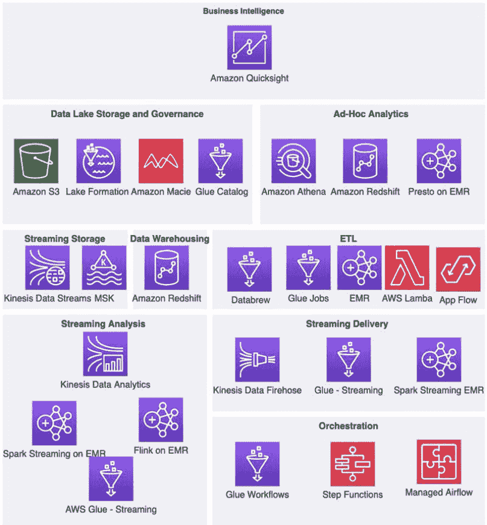
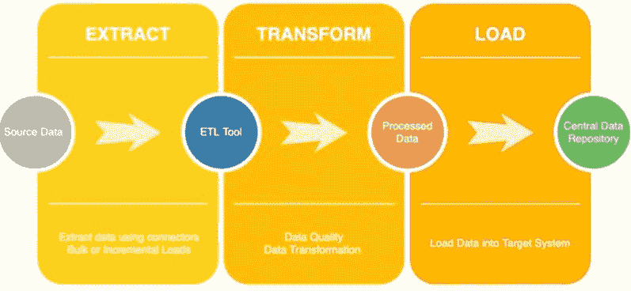
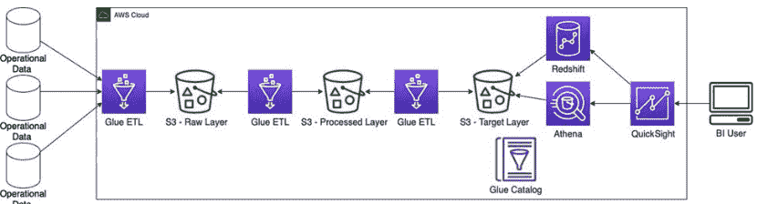
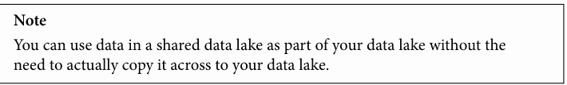
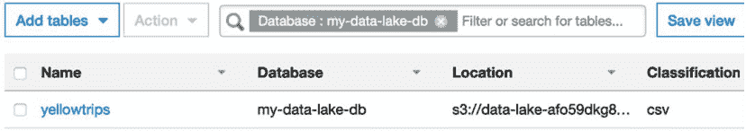

# 1 介绍 AWS 分析生态系统

随着数据在数量和种类上的不断增加，各行各业的组织都在采用云分析服务进行数据分析。AWS 提供了多种分析服务，涵盖数据湖、数据仓库、大数据处理、**提取、转换、加载**（ETL）和数据可视化。在本章中，我们将介绍 AWS 分析生态系统。我们在此讨论的一些服务将在本书后面再次提及。

首先，我们将 AWS 服务映射到各个类别。然后，我们将讨论 Amazon QuickSight 如何融入更广泛的 AWS 分析生态系统。我们将更仔细地研究现代数据架构，并讨论其优势和组件。最后，我们将提供一份逐步指南，介绍如何在 AWS 上设置现代数据架构，并加载和查询演示数据样本。其中一些信息您可能已经熟悉，但让我们回顾一下基础知识。

在本章中，我们将涵盖以下主题：

- 探索 AWS 分析生态系统
- 探索 AWS 上的现代数据架构
- 创建基本的现代数据架构

### 技术要求

要跟随本章进行操作，您需要以下先决条件：

- 具有控制台访问权限的 AWS 账户
- AWS CLI 访问权限

本章的代码示例可以在本书的 GitHub 仓库中访问，地址为 `https://github.com/PacktPublishing/Actionable-Insights-with-Amazon-QuickSight/tree/main/chapter_1`。

### 探索 AWS 分析生态系统

AWS 提供了大量的分析服务。除此之外，AWS 还有许多专注于数据分析并提供在 AWS 基础设施上运行的分析解决方案的合作伙伴。然而，合作伙伴解决方案不在本部分的范围内。本部分专注于 AWS 完全托管的分析服务。为了列出这些服务，我们将首先定义与分析功能相关的特定类别。机器学习和预测分析也不在本章的范围内。对于每个服务类别，我们将列出可用的 AWS 服务，并对每个服务提供高级别描述。_图 1.1_ 描绘了常用的 AWS 分析服务。



图 1.1 – AWS 分析服务

### 商业智能

越来越多的组织渴望成为数据驱动型组织，并利用数据推动战略决策。**商业智能（BI）**工具帮助组织将数据转化为可操作的洞察。使用 BI 工具，用户可以分析数据，然后在报告或仪表板中展示他们的发现。这些报告或仪表板随后可以被希望了解业务状况的业务用户使用。

2015 年，AWS 推出了 **Amazon QuickSight**，一款云原生 BI 工具。从那以后，AWS 为 QuickSight 添加了新功能，用机器学习功能丰富了标准仪表板功能，并提供了嵌入式仪表板功能。Amazon QuickSight 是本书将要涵盖的主要技术。在接下来的几章中，我们将从 Amazon QuickSight 的基本功能开始，然后探索更多高级功能。在可能的情况下，我们将使用可在您自己的开发环境中重复的实际示例，让您获得使用 Amazon QuickSight 的实践经验。

### 数据仓库

数据仓库是数据的存储库，是 BI 流程的重要组成部分。存储在数据仓库中的数据通常是结构化的。传统上，数据从不同的运营数据存储中摄取并集中到数据仓库中。数据仓库经过优化，可在大量数据上运行分析查询。分析查询的结果通常是在对一个或多个表中的多行进行聚合后计算得出的。BI 应用程序使用分析查询来聚合数据并对其进行可视化。使用数据仓库为 BI 应用程序提供数据是一种常见的架构方法。

早在 2012 年，AWS 就推出了 **Amazon Redshift**，一款云原生、完全托管的数据仓库服务。如今，Redshift 是最受欢迎的云数据仓库之一，来自不同行业的数千家组织正在使用它来分析他们的数据。其他流行的云数据仓库包括 Snowflake 和 Google BigQuery。Amazon Redshift 与大多数 BI 工具集成，并且与 Amazon QuickSight 原生集成。我们将在 _第 3 章，使用 Amazon QuickSight 准备数据_ 中更详细地讨论这个话题，届时我们将更仔细地研究 Amazon QuickSight 支持的数据源。

### 数据湖存储和治理

数据湖是一个数据存储库，组织可以轻松地将所有数据集中起来，并将其应用于不同的用例，例如报告、可视化、大数据分析和预测分析。存储在数据湖中的数据可以是结构化或半结构化的。通常，数据以原始格式摄取到数据湖中，然后被转换并存储回数据湖以供进一步处理和分析。云数据湖通常使用云对象存储来存储数据。AWS 于 2006 年 3 月推出了 **Amazon Simple Storage Service (S3)**，为开发人员提供了高度可扩展、可靠且低延迟的数据存储基础设施，成本非常低。Amazon S3 可以存储无限量的数据，这是数据湖特别有用的功能。组织无需再担心一件事，因为他们不需要考虑随着存储数据量的增长而扩展存储。


While scaling data lake storage is something that organizations and CIOs don’t need to worry about much anymore, data lake governance needs to be considered carefully. Data lakes do not enforce data schemas or data formats and, without any governance, data lakes can degrade into unusable data repositories, often referred to as **data swamps**. AWS offers a number of services for data governance.

The **AWS Glue Catalog** is part of the AWS Glue service. It is a fully managed Apache Hive metastore-compatible data catalog. Big data applications (for example, Apache Spark, Apache Hive, Presto, and so on) use the metadata in the catalog to locate and parse data. The AWS Glue Catalog is a technical metadata repository and can catalog data in Amazon S3, and a number of relational or non-relational data stores including Redshift, Aurora, and DynamoDB, among others.

**AWS Lake Formation** runs on top of AWS Glue and Amazon S3 and provides a governance layer and access layer for data lakes on Amazon S3. It also provides a set of reusable ETL jobs, called blueprints, that can be used to perform common ETL tasks (for example, loading data from a relational data store into an S3 data lake). Lake Formation allows users to manage access permissions, using a familiar GRANT REVOKE syntax that you might have seen in **relational database management systems (RDBMSes)**.

**Amazon Macie** is an AWS service for data protection. It provides an inventory of Amazon S3 buckets and it uses machine learning to identify and alert its users about sensitive data, such as **personally identifiable information (PII)**.

Finally, and perhaps most importantly, AWS **Identity and Access Management (IAM)** is a fundamental AWS service that allows users to assign permissions to principals (for example, users, groups, or roles) and explicitly allow or deny access to AWS resources including data lake locations or tables in the data catalog.

### Ad hoc analytics

Ad hoc analytics refers to getting answers from the data on an as-needed basis. Contrary with what happens with scheduled reports, ad hoc querying is initiated by a user when they need to get specific answers from their data. The user typically uses SQL via a workbench type of application or other analytics frameworks (for instance, Apache Spark) using notebook environments or other BI applications. AWS has a number of analytics services that can be used for ad hoc analytics.

Amazon Redshift can be used for ad hoc analysis of data. For ad hoc querying, users will typically connect to Amazon Redshift using a query editor application with the Redshift JDBC/ODBC drivers. Notebook integrations or BI tool integrations are also possible for ad hoc analysis. AWS offers a number of managed notebook environments such as EMR notebooks and SageMaker notebooks. Amazon Redshift also allows its users to query data that is stored outside the data warehouse. Amazon Redshift Spectrum allows Redshift users to query data stored in Amazon S3, eliminating the need to load the data first before querying. Redshift's federated querying capability allows users to query live data in operational data stores such as PostgreSQL and MySQL.

For big data and data lakes, Presto is a popular choice for ad hoc analysis. Presto provides a high-performance parallel SQL query engine. **Amazon Athena** lets users run Presto queries in a scalable serverless environment. Amazon QuickSight natively supports Amazon Athena. We will talk more about this native integration in _Chapter 3, Preparing Data with Amazon QuickSight_. Amazon EMR is a fully managed Hadoop cluster, and it comes with a range of applications from the open source big data ecosystem. Presto has two community projects, PrestoSQL and PrestoDB, both of which are part of the Amazon EMR service. Other options included with EMR are Hive on EMR and Spark on EMR.

### Extract, transform, load

**ETL** is a term used to describe a set of processes to extract, transform, and load data usually for analytical purposes. Organizations gather data from different data sources and centralize them in a central data repository. Data from different sources typically has different schemas and different conventions and standards, and therefore it can be challenging to combine them to get the required answers. For that reason, data needs to be transformed so that it can work together. For example, cleaning the data, applying certain data quality thresholds, and standardizing to a specific standard (for instance, date and time formats used) are all important tasks to ensure the data is useable. A visual representation of the ETL process is shown in the following figure.



Figure 1.2 – The ETL process

AWS Glue is a fully managed ETL service offered by AWS. When it was first introduced in 2017, Glue ETL offered an Apache Spark environment optimized for ETL. Now, Glue ETL offers a wider range of options:

- PySpark – Apache Spark using Python
- Spark with Scala – Apache Spark with Scala
- Python shell – For smaller ETL jobs that don’t need a Spark cluster
- Glue Studio and Glue Databrew – Visual approach to ETL without the need to write code

Amazon EMR transient clusters, with applications such as Spark or Hive, can be leveraged for ETL workloads. ETL workloads can be bulk or streaming: streaming ETL workloads usually need to be up and running constantly, or at least for as long as the source stream is on; batch ETL workloads don’t need to run at all times and they can stop once the data is loaded into the target system. This type of workload fits nicely with the flexibility of the cloud. With the cloud, data architects don’t need to think of Hadoop clusters as big monolithic clusters. Instead, users prefer purpose-built transient clusters, optimized and sized to handle specific workloads and data loads.

Now that we’ve had our overview of the AWS analytics ecosystem, let’s learn about modern data architecture and how they are built.

### Exploring the modern data architecture on AWS

The modern data architecture is a modern data analytics architecture: as the name suggests, it combines the **data lake** and the **data warehouse** into a seamless system. This approach extends the traditional data warehouse approach and opens up new possibilities for data analytics. For this reason, it is important to understand this architecture, which can be used as a data backend for Amazon QuickSight or other BI applications. To understand the architecture better, let’s first start by understanding the differences between a data lake and data warehouse.

### Data lakes versus data warehouses

Data lakes and data warehouses are designed to consume large amounts of data for analytics purposes. Data warehouses are traditional database systems, used by organizations and enterprises for years. Data lakes, on the other side, are relatively young implementations that emerged from the big data and Hadoop ecosystems. Tables stored in data warehouses need to have clearly defined schemas. The schema needs to be defined upfront, before any data is added. This approach is called **schema on write**, and it ensures that data conforms to a specific structure before being ingested into the data warehouse. However, it can be less flexible, and it may introduce complexity when dealing with evolving schemas. Evolving schemas are an increasingly common scenario because organizations need to capture more and more data points from their customer interactions to drive data-driven decisions.

On the other side, data lakes don’t enforce a schema upfront. Instead, applications that have the required permissions can write data to a data lake. Structure and data formats aren’t enforced by the data lake: it is a responsibility of the writing application.

Data stored in a data lake has few to no limitations regarding its format: it can be **structured**, **semi-structured**, or completely **unstructured**. For many datasets, a schema can be inferred, either because the data is semi-structured (CSV, JSON, and others), or they follow patterns that can be identified after applying regular expressions and extracting specific columns. In data lakes, the schema is inferred when the data is read by the querying application. This approach is called **schema on read**, and it gives an organization flexibility regarding the data type stored. However, it also introduces challenges with data complexity and enforcing data quality.

For that reason, it is common that data that lands into the data lake goes through a series of transformations to get to a stage where it is useable. The first stage, often referred to as the **raw** layer, is where the data first lands, and it is stored as is.


数据落地后，将应用第一系列转换，并将数据存储在处理层。由于数据可以是任何格式，可能的转换类型是无限的。仅举几例，数据质量函数可以在此阶段应用，以删除不完整的行，并将数据标准化为特定的日期时间或时区格式。其他数据工程活动也可以在此阶段执行，例如将数据转换为针对分析优化的不同文件数据格式，或使用特定信息（通常是时间信息）将其组织到文件夹中，这些信息稍后可被查询应用用作分区列。

最后，数据可以转换为特定用例并落地到目标层。例如，数据可以以特定机器学习算法可用于处理数据的方式进行转换。另一个用例可能是 BI 应用程序，例如 Amazon QuickSight，其中数据可以预先连接或聚合，因此从大型数据集减少为更小的、更易于可视化的数据集。此阶段还可以应用其他数据工程以优化性能。

Figure 1.3 – 数据湖层

- AWS Glue 是用于存储技术元数据的数据湖目录。

### 介绍 AWS 分析生态系统

> **注意**
> AWS Glue Catalog 表可以存储在 Amazon Redshift 中，在数据仓库和 S3 数据湖之间提供统一的元数据目录。

Amazon Redshift 支持允许其与数据仓库交互的功能。让我们更详细地了解这些功能。

### 从数据仓库查询数据湖的能力

**Redshift Spectrum** 是 Redshift 的一项功能，允许您针对 S3 数据湖中的数据执行 SQL 查询。查询直接从数据仓库触发，因此您不需要连接到不同的环境来提交查询。您需要将 Spectrum 表定义为数据仓库上的外部表。Redshift 集群还需要有权限访问数据湖 S3 位置。Redshift 集群需要分配一个 IAM 角色，该角色需要有权访问所需的 S3 位置。

Redshift Spectrum 的另一个关键特征是，Spectrum 查询在 Redshift 集群之外的 Spectrum 节点上运行。这在需要查询数据湖数据时，有效地为 Redshift 集群扩展了额外的计算能力。

最后，Spectrum 表和 Redshift 表可以组合和连接。如果没有此功能，您将不得不在连接之前移动数据并将其并置。

### 从数据湖加载数据的能力

Redshift 可以高效地从 S3 数据湖加载数据。具体来说，Redshift 的 COPY 命令可以从 Amazon S3 并行加载数据。您（至少）需要定义表名、数据位置（通常是 S3）以及访问源位置中数据的授权。当从 S3 加载多个文件时，Redshift 通过将每个文件分配给一个 Redshift 切片（Redshift 中的处理单元）来并行化加载。

### 将数据卸载到数据湖的能力

Redshift 还具有将数据从数据仓库卸载回数据湖的功能。具体来说，UNLOAD 命令将查询结果卸载到 Amazon S3。您（至少）需要指定 S3 位置和授权。还有更多选项，例如定义文件格式（使用 FORMAT AS 选项）或应用分区（使用 PARTITION BY 选项）等。

在以下图表中，我们看到一个示例数据管道，它同时使用 AWS 上的数据仓库和数据湖。数据从运营数据存储加载到数据湖原始层的 Amazon S3 对象存储中。然后，通过一组 ETL 作业，数据达到可以加载到数据仓库以用于 BI 目的的阶段。为了成本效益，您可能不希望将所有数据加载到仓库中。相反，您可能希望将数据留在数据湖中，但需要时能够查询数据。此架构考虑数据的温度（数据被访问的频率）以确定最佳存储。**热**数据（需要频繁访问）被加载到数据仓库，而**冷**数据保留在数据湖中，这是一种更便宜的长期存储选项。



Figure 1.4 – AWS 上的示例数据管道

现在我们已经对 AWS 上的现代数据架构有了概述，让我们在 AWS 上构建一个基本的现代数据架构。

### 创建基本的现代数据架构

在本节中，我们将通过一个动手示例来创建基本的现代数据架构。本教程将使用 AWS CLI 和 AWS 控制台。到本节结束时，我们将启动一个工作数据湖和数据仓库环境，并加载演示数据。

> **重要说明**
> 本教程的资源可能会向您的 AWS 账户产生费用。完成练习后，请确保清理资源以防止产生进一步费用。

### 创建数据湖存储

在此步骤中，我们将添加数据湖存储。然后我们将上传一个演示数据集并自动发现其架构。

### 步骤 1 – 创建 S3 存储桶

让我们开始：

1. 如果您尚未安装，请按照 AWS 文档安装和配置 AWS CLI。要完成本教程，您需要使用具有访问 S3、Glue、Redshift 和 IAM 服务权限的角色：https://docs.aws.amazon.com/cli/latest/userguide/cli-chap-configure.html。

2. 首先，让我们创建 S3 存储桶作为数据湖存储。您的 S3 存储桶需要有一个全局唯一的名称。出于这个原因，我们应该为其引入一些随机性。让我们选择一组随机的 10 个字符和数字。对于本教程，您应该为这个字符串选择自己的随机字符集；例如，SF482XHS7M。我们将在数据湖名称中使用随机字符串，以确保它是全局唯一的。让我们使用 my-data-lake-<随机字符串> 作为存储桶名称。

3. 要创建存储桶，我们可以在 CLI 中键入以下命令。将以下随机字符串替换为您的随机字符串：

```bash
% aws s3api create-bucket --bucket data-lake-xxxxxxxxxx --region us-east-1
```

响应应该如下所示：

```json
{
"Location": "/data-lake-xxxxxxxxxx"
}
```

### 步骤 2 – 向数据湖添加数据

现在让我们添加一些数据。对于此练习，我们将使用纽约市出租车和豪华轿车委员会（TLC）行程记录数据的一个子集：

1. 让我们先看看数据集：

```bash
% aws s3 ls 's3://nyc-tlc/trip data/' --no-sign-request
```

此命令将返回开放 S3 位置中的所有文件：

```
2016-08-11 15:32:21 85733063 fhv_tripdata_2015-01.csv
2016-08-11 15:33:04 97863482 fhv_tripdata_2015-02.csv
2016-08-11 15:33:40 102220197 fhv_tripdata_2015-03.csv
...
2021-02-26 16:54:00 138989555 yellow_tripdata_2020-11.csv
2021-02-26 16:54:00 134481400 yellow_tripdata_2020-12.csv
```

我们不需要下载所有文件。对于本教程，我们将仅复制 2020 年的文件。

2. 我们可以使用 S3 CLI `exclude` 和 `include` 参数应用模式以匹配所需的文件名。复制命令如下：

```bash
% aws s3 cp "s3://nyc-tlc/trip data/" s3://data-lake-xxxxxxxxxxx/yellowtrips/ --recursive --exclude "*" --include "yellow_tripdata_2020*"
```

3. 完成后，我们可以使用 `aws s3 ls` 命令验证文件是否存在于我们的环境中，该命令列出特定 S3 位置下的文件：

```bash
% aws s3 ls s3://data-lake-xxxxxxxxxxx/yellowtrips/
2021-03-27 16:53:41 593610736 yellow_tripdata_2020-01.csv
2021-03-27 16:53:41 584190585 yellow_tripdata_2020-02.csv
2021-03-27 16:53:42 278288608 yellow_tripdata_2020-03.csv
2021-03-27 16:53:41 21662261 yellow_tripdata_2020-04.csv
2021-03-27 16:53:43 31641590 yellow_tripdata_2020-05.csv
2021-03-27 16:53:42 50277193 yellow_tripdata_2020-06.csv
2021-03-27 16:53:44 73326707 yellow_tripdata_2020-07.csv
2021-03-27 16:53:46 92411545 yellow_tripdata_2020-08.csv
2021-03-27 16:53:50 123394595 yellow_tripdata_2020-09.csv
2021-03-27 16:53:54 154917592 yellow_tripdata_2020-10.csv
2021-03-27 16:53:57 138989555 yellow_tripdata_2020-11.csv
2021-03-27 16:53:58 134481400 yellow_tripdata_2020-12.csv
```


### Step 3 – 识别架构

下一步是识别数据集的架构。为此，我们将使用 AWS Glue 爬虫。AWS Glue 爬虫会爬取数据以检测架构。如果可以确定架构（请记住，不能保证数据具有特定架构），则 Glue 爬虫将在爬取数据后将识别出的架构填充到 Glue 目录中。Glue 表始终属于 Glue 数据库。Glue 中的数据库只是 Glue 目录中表的逻辑存储库：

1. 让我们先使用 `create-database` 命令创建一个数据库：

```
% aws glue create-database --database-input
"{\"Name\":\"my-data-lake-db\"}" --region us-east-1
```

2. 我们可以使用 `get-databases` 命令验证数据库是否创建成功：

```
% aws glue get-databases --region us-east-1
{
 "DatabaseList": [
 {
 "Name": "default",
 "CreateTime": 1553517157.0
 },
 {
 "Name": "my-data-lake-db",
 "CreateTime": 1616865129.0
 }
 ]
}
```



3. 在创建 Glue 爬虫之前，我们需要创建一个 IAM 角色，该角色将分配给爬虫并允许它访问数据湖中的数据。爬虫不需要写入数据湖位置，因此只需要读取访问权限。要向角色授予所需权限，我们需要附加定义权限的策略。让我们定义一个允许读取我们数据湖访问权限的策略文档：

```
% aws iam create-policy --policy-name DataLakeReadAccess --policy-document file:///policy
```

前面的命令创建了策略，我们应该会收到一个确认的 JSON 对象。请注意 **策略 ARN**，因为我们将在后续步骤中使用它。

6. 接下来，让我们创建 Glue 爬虫将承担的 IAM 角色。首先，让我们定义角色策略文档：

```
{
	"Version": "2012-10-17",
	"Statement": [
		{
			"Action": "sts:AssumeRole",
			"Effect": "Allow",
			"Principal": {
				"Service": "glue.amazonaws.com"
			}
		}
	]
}
```

7. 然后创建一个名为 `role-policy` 的文件，并复制前面的 JSON 文档：

```
% vim role-policy
```

此角色策略文档允许 Glue 服务承担我们将创建的角色。

8. 要创建角色，我们将使用 `iam create-role` CLI 命令：

```
% aws iam create-role --role-name GlueCrawlerRole
--assume-role-policy-document file:///role-policy
```

运行命令后，我们应该会收到一条确认的 JSON 消息。

9. 捕获角色 ARN，因为它将在定义爬虫时稍后使用。

10. 然后，让我们将所需策略附加到此角色。对于此角色，我们要分配两个策略：`AWSGlueServiceRole` 策略（由 AWS 管理）和我们之前创建的 `DataLakeReadAccess` 策略。要将策略附加到 IAM 角色，我们将使用 `iam attach-role-policy` 命令。让我们先从 `AWSGlueServiceRole` 策略开始：

```
% aws iam attach-role-policy --role-name GlueCrawlerRole
--policy-arn arn:aws:iam::aws:policy/service-role/
AWSGlueServiceRole
```

11. 然后我们将附加 DataLakeReadAccess 策略。我们需要之前捕获的策略 ARN。策略 ARN 应该如下所示：

```
arn:aws:iam::<accountid>:policy/DataLakeReadAccess
```

命令应该如下所示：

```
% aws iam attach-role-policy --role-name GlueCrawlerRole --policy-arn arn:aws:iam::<ACCOUNT-ID>:policy/DataLakeReadAccess
```

12. 现在，让我们创建 AWS Glue 爬虫。为此，我们将使用 `glue create-crawler` CLI 命令。确保将角色 ARN 和数据湖位置替换为您环境中的值：

```
% aws glue create-crawler --name qs-book-crawler --role arn:aws:iam::xxxxxxxxxxx:role/GlueCrawlerRole --database-name my-data-lake-db --targets "{\"S3Targets\": [{'\"Path\": \"s3://data-lake-xxxxxxxxxx/ yellowtrips\"}]} " --region us-east-1
```

13. 然后，使用 `glue start-crawler` 命令启动爬虫：

```
% aws glue start-crawler --name qs-book-crawler --region us-east-1
```

1-2 分钟后，Glue 爬虫应该会填充数据库。

14. 我们可以通过调用 `glue get-tables` CLI 命令来确认这一点：

```
% aws glue get-tables --database-name my-data-lake-db
```

15. 您可以从 AWS 控制台查看目录。登录 AWS 控制台并导航到 AWS Glue。

16. 然后在左侧菜单中，在“数据目录”下，选择“数据库”，然后找到 my-data-lake-db。然后单击 my-data-lake-db 下的“查看表”。它应该如下截图所示：



图 1.5 – Glue 控制台

### Step 4 – 创建数据仓库

接下来，让我们创建我们的数据仓库。

要创建数据仓库，我们将使用 `redshift create-cluster` CLI 命令，或者您可以使用 AWS 控制台：

```
% aws redshift create-cluster --node-type dc2.large --number-of-nodes 2 --master-username admin --master-user-password R3dshift --cluster-identifier mycluster --region us-east-1
```

此命令应返回包含集群元数据的响应。几分钟后，我们的集群将启动并运行。

### Step 5 – 将数据加载到数据仓库中

首先，让我们创建一个将分配给 Redshift 集群的 IAM 角色。我们将在使用 Redshift Spectrum 功能查询 S3 中的数据时使用此角色。我们希望集群能够写入和读取我们的 S3 位置。我们还希望集群能够读取 Glue 目录：

1. 与我们之前做的类似，我们将创建以下角色策略文档，以允许该角色由 Redshift 服务承担：

```
{
"Version": "2012-10-17",
"Statement": [
{
"Action": "sts:AssumeRole",
"Effect": "Allow",
"Principal": {
"Service": "redshift.amazonaws.com"
}
}
]
}
```

> Tip
> 您可以单击复选框以选择表，然后在“操作”下，您可以选择“预览数据”。这将打开 Amazon Athena 控制台并运行一个 Athena 查询，该查询将从表中返回 10 个值。

> Note
> 此命令将创建一个带有公共 IP 地址的 Redshift 集群。在实际场景中，应避免这种情况。提供的说明经过简化，仅用于本教程的目的，因为本书不专注于 Amazon Redshift。

2. 然后将此 JSON 对象复制到策略文档中：

```
% vim role-policy-redshift
```

3. 现在，让我们使用 `iam create-role` 命令创建角色：

```
% aws iam create-role --role-name RedshiftSpectrumRole
--assume-role-policy-document file:///role-policy-redshift
```

请记下角色 ARN，因为我们将稍后使用它将其附加到集群。

4. 接下来，我们需要通过附加正确的策略来授予所需权限。这次，为简单起见，我们将只附加两个 AWS 托管策略。这些策略过于宽松，通常我们会附加权限范围较窄的策略，就像我们在步骤 3 中为 Glue 爬虫所做的那样。让我们附加 `AWSFullS3Access` 和 `AWSFullGlueAccess`：

```
% aws iam attach-role-policy --role-name RedshiftSpectrumRole --policy-arn arn:aws:iam::aws:policy/AmazonS3FullAccess
% aws iam attach-role-policy --role-name RedshiftSpectrumRole --policy-arn arn:aws:iam::aws:policy/AWSGlueConsoleFullAccess
```

5. 接下来，我们将使用 `redshift modify-cluster-iam-roles` CLI 命令将此角色附加到我们的集群。请注意，您需要使用环境中的值更新角色 ARN：

```
% aws redshift modify-cluster-iam-roles
--cluster-identifier mycluster --add-iam-roles arn:aws:iam::<ACCOUNT-ID>:role/RedshiftSpectrumRole
--region us-east-1
```

6. 集群更改将需要几分钟才能应用。更改应用后，集群将准备好从 S3 数据湖获取数据。要连接到集群，我们将使用 AWS 管理控制台中内置的 **查询编辑器**。要找到编辑器，请导航到 Redshift 控制台，并查看左侧菜单。编辑器需要建立连接。确保选择我们之前创建的集群，并将数据库名称键入为 dev，用户名键入为 admin。

> Note
> 我们之前没有设置数据库名称。Redshift 使用 dev 作为默认值。

7. 在编辑器页面中，我们需要创建一个表来存储数据。让我们将表命名为 yellowtrips_3mo，因为我们将只存储 3 个月的数据：

```
create table yellowtrips_3mo
(vendorid varchar(10),
tpep_pickup_datetime datetime,
tpep_dropoff_datetime datetime,
passenger_count int,
trip_distance float,
ratecodeid varchar(10),
store_and_fwd_flag char(1),
pulocationid varchar(10),
dolocationid varchar(10),
payment_type varchar(10),
fare_amount float,
extra float,
mta_tax float,
tip_amount float,
tolls_amount float,
improvement_surcharge float,
total_amount float,
congestion_surcharge float);
```


8. 然后，让我们将 3 个月的数据复制到数据仓库中。让我们使用 COPY 命令，如下所示：

```
copy yellowtrips_3mo from
's3://data-lake-afo59dkg84/yellowtrips/yellow_
tripdata_2020-10.csv'
iam_role 'arn:aws:iam::xxxxxxxxxxxx:role/
RedshiftSpectrumRole' FORMAT AS CSV dateformat 'auto'
ignoreheader 1;
copy yellowtrips_3mo from
's3://data-lake-afo59dkg84/yellowtrips/yellow_
tripdata_2020-11.csv'
iam_role 'arn:aws:iam::xxxxxxxxxxxx:role/
RedshiftSpectrumRole' FORMAT AS CSV dateformat 'auto'
ignoreheader 1;
copy yellowtrips_3mo from
's3://data-lake-afo59dkg84/yellowtrips/yellow_
tripdata_2020-12.csv'
iam_role 'arn:aws:iam::xxxxxxxxxxxx:role/
RedshiftSpectrumRole' FORMAT AS CSV dateformat 'auto'
ignoreheader 1;
```

9. 此时，我们拥有一个包含 12 个月数据的数据湖，以及一个仅包含最新数据（3 个月）的数据仓库。现代数据架构的一个特点是，它允许用户从数据仓库查询数据湖。请随意查询数据，开始了解数据集。让我们创建外部架构，以便启用 Spectrum 功能。在 Redshift 编辑器中使用以下命令。将角色 ARN 替换为您环境中的值：

```
create external schema spectrum_schema from data catalog
database 'my-data-lake-db'
iam_role 'arn:aws:iam::xxxxxxxxxxxx:role/
RedshiftSpectrumRole'
create external database if not exists;
```

10. 让我们使用简单的 count(*) 查询来比较两个表的大小：

```
select count(*) from public.yellowtrips_3mo;
select count(*) from spectrum_schema.yellowtrips;
```

第一个查询将针对数据仓库中的最近数据运行。第二个查询将使用 Spectrum 节点针对数据湖中的数据运行（即针对第一个查询的结果运行）。如预期，数据湖中的记录数量应远高于数据仓库中的记录数量。具体来说，2020 年的查询结果为 24,648,499 条记录，2020 年最后 3 个月的记录数为 4,652,013 条。

> Note
> Spectrum 查询使用 Spectrum 节点，并与 Redshift 集群分别计费。每个查询都会根据其需要扫描的数据产生额外费用。有关详细信息，请参阅 AWS 定价。

请随意尝试数据并触发一些查询以了解数据集。当您完成 Redshift 集群的使用后，可以 **暂停** 集群，以停止按需计费。集群暂停后，您只需支付集群存储费用。

### Summary

恭喜，您已完成第一章的学习！到现在，您应该对 AWS 分析生态系统及其数据湖和数据仓库选项有了良好的了解。在本章中，我们详细讨论了数据仓库和数据湖之间的主要区别。我们还讨论了 AWS 上的现代数据架构，并更详细地了解了其主要组件。最后，在本章的逐步操作部分中，您有机会从头开始创建数据湖和数据仓库，并加载了一个开放数据集以供以后分析。我们还定义了 Spectrum 表，并直接从数据仓库查询了数据湖。

在下一章中，我们将讨论 Amazon QuickSight 的基本概念，了解其主要优势，并学习如何设置 QuickSight 账户。

### Questions

- 1. 数据湖和数据仓库有什么区别？
- 2. 什么是读时模式（schema on read）和写时模式（schema on write）？
- 3. 如何识别 AWS 数据湖中新数据的架构？
- 4. 哪个 AWS 存储服务适合 AWS 上的数据湖？
- 5. 在现代数据架构中，哪些数据更适合从数据湖提供？
- 6. Redshift Spectrum 表与 Redshift 表有何不同？

### Further reading

- Big Data and Analytics Options on AWS – 2018 – AWS whitepaper: https://d0.awsstatic.com/whitepapers/Big_Data_Analytics_Options_on_AWS.pdf
- Cloud Native Data Virtualization on AWS – 2020 – AWS whitepaper: https://d1.awsstatic.com/whitepapers/cloud-native-data-virtualization-on-aws.pdf?did=wp_card&trk=wp_card
