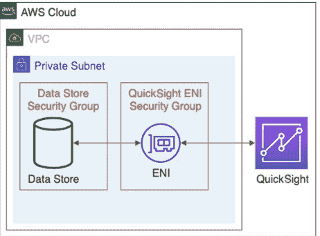
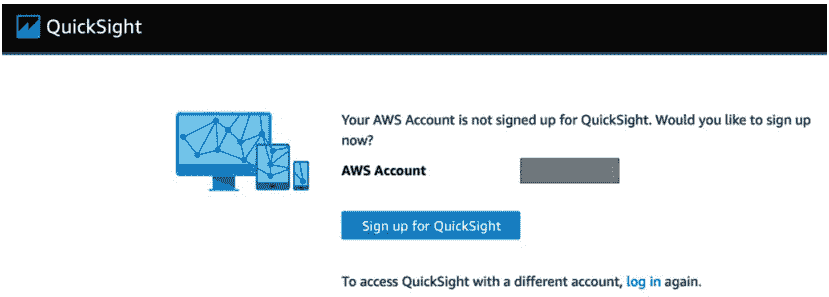

## 2 Introduction to Amazon QuickSight

在本章中，我们将介绍 **Amazon QuickSight** 并定义其主要组件。我们将讨论网络和存储等基本架构主题，并深入了解 Amazon QuickSight 的不同版本以及账户创建期间可用的不同选项。最后，我们将逐步介绍如何设置 QuickSight 账户，并配置 QuickSight 权限以访问数据湖中的数据。

总结一下，在本章中，我们将涵盖以下内容：

- 介绍 Amazon QuickSight
- 介绍 QuickSight 版本和用户授权选项
- 设置 Amazon QuickSight

### Technical requirements

本章您只需要一个 AWS 账户。

## Introducing Amazon QuickSight

Amazon QuickSight 是一项 **business intelligence (BI)** 云原生服务。BI 开发人员使用 QuickSight 开发数据可视化和仪表板，并报告业务状态。作为云原生 **BI** 软件，QuickSight 可以扩展到数千名用户，而无需预配额外的计算容量。事实上，计算容量的概念在 QuickSight 中不存在：当需求增长或缩减时，AWS 负责扩展或缩减 QuickSight，而 BI 开发人员则专注于开发数据可视化。

接下来，我们将定义 QuickSight 的以下核心概念：

- Datasets
- Analysis
- Visuals and insights
- Dashboards

### Datasets

**QuickSight datasets** 是导入 QuickSight 以进行可视化的数据；数据集可以由一个或多个数据源构建。Amazon QuickSight 支持多种数据源。数据集可以缓存在 QuickSight 中（即 SPICE，我们将在本章后面介绍），也可以直接查询数据源。我们将在 _Chapter 3, Preparing Data with Amazon QuickSight_ 中更详细地讨论数据源和数据准备。

> **Note**
> 在 QuickSight 中，数据集和数据源是不同的概念。数据集可以由一个或多个数据源组成。通常，在数据源成为数据集之前，会对其应用一定程度的数据准备。

### Analysis

QuickSight 中的分析是指应用程序的编辑部分，通常由 BI 开发人员用于构建可视化。我们将在 _Chapter 4, Developing Visuals and Dashboards_ 中了解如何创建分析。

> **Note**
> QuickSight 分析可以针对一个或多个数据集开发。

## Visuals and insights

QuickSight 分析由屏幕上的组件/小部件组成，这些组件包含数据可视化。BI 开发人员可以添加两种不同类型的这些组件：

- Visuals
- Insights

**Visuals** 是数据集的图形表示，通常使用图表类型和图形。其他可视化类型包括表格（简单或透视表）、地理空间可视化（如地图）等。我们将在 _Chapter 4, Developing Visuals and Dashboards_ 中详细介绍各种可视化类型。

> **Tip**
> QuickSight 有一种名为 **AutoGraph** 的特殊可视化类型。它带有符号。选中后，QuickSight 会自动识别并为所选数据类型和字段应用最合适的可视化类型。

**Insights** 是特殊组件，使用常见的分析或 ML 功能来提供数据洞察。洞察的结果以自然语言显示。Amazon QuickSight 提供预构建洞察和可自定义洞察。我们将在 _Chapter 6, Working with ML Capabilities and Insights_ 中更多地讨论 QuickSight 洞察。

## Dashboards

一旦分析开发完成并准备好发布，BI 开发人员可以将其导出为 QuickSight 仪表板。仪表板是分析的只读版本。仪表板通常由业务用户访问，并由 BI 开发人员共享用于报告目的。BI 开发人员还可以向仪表板添加自定义控件和交互性。我们将在 _Chapter 4, Developing Visuals and Dashboards_ 中详细介绍 QuickSight 仪表板。

接下来，我们将定义 Amazon QuickSight 中的不同用户角色。

## Introducing Amazon QuickSight user types

QuickSight 支持三种不同的用户类型：

- Admin
- Author
- Reader

## Admin

The QuickSight **admin** role can perform both administrative tasks and BI development tasks. A QuickSight account can have one or more users with the admin role assigned. The admin user role can do the following:

- Manage users
- Manage QuickSight settings and subscriptions
- Manage connections and storage
- Whitelist domains for dashboard embedding
- Configure **single sign-on (SSO)**

> **Note**
> Admins are _not_ superusers in Amazon QuickSight and they don't gain automatic access to analyses or dashboards created by other users.

## Author

In QuickSight, **author** is the role needed for BI developers to build datasets and analyses. The author role can do the following:

- Create datasets
- Create and develop analyses
- Share analyses
- Publish dashboards to users

## Reader

In QuickSight, **reader** is the role for business users to consume dashboards. The reader role can do the following:

- Log in to the QuickSight mobile or web app
- Receive email alerts
- Access and view dashboards
- Use a dashboard's predefined onscreen controls

The following table summarizes the differences between the three different user roles.

| | READER | AUTHOR | ADMIN |
|---|---|---|---|
| ACCESS QUICKSIGHT | √ | √ | √ |
| RECEIVE ALERTS | √ | √ | √ |
| USE DASHBOARDS | √ | √ | √ |
| CREATE DATASETS | | √ | √ |
| CREATE ANALYSIS | | √ | √ |
| SHARE ANALYSIS | | √ | √ |
| MANAGE USERS | | | √ |
| MANAGE QUICKSIGHT | | | √ |
| MANAGE STORAGE | | | √ |

Figure 2.1 – QuickSight user role permissions

## Putting it all together

In the following diagram, we see the end-to-end BI process with Amazon QuickSight. We start from the data sources on the left. Data sources can be relational databases, data warehouses, APIs from SaaS vendors, or data from a data lake and files. From these data sources, an author (BI developer) can configure datasets, which can then be used for creating QuickSight analyses. When an analysis is ready, the BI developer can share it as a dashboard with other business users. The business users can then access the dashboard via their web browsers or their mobile phones, and drive business decisions using data.

Figure 2.2 – QuickSight end-to-end process

Now that we have introduced the main components of QuickSight, we will look more closely into its architectural concepts, such as networking and storage.

### Introducing QuickSight architecture

QuickSight is a fully managed service that runs exclusively on the AWS cloud. QuickSight visualizations can be consumed either via QuickSight for the web, the QuickSight mobile app, or can be embedded into a custom application. Embedded analytics will be covered in more detail in _Chapter 7, Understanding Embedded Analytics_. QuickSight is centrally hosted, which means that AWS is responsible for scaling and managing the underlying infrastructure, allowing users to focus on developing BI applications. QuickSight is licensed on a subscription basis according to the number of users or sessions.

In this section, we will cover a few fundamental topics of the QuickSight architecture. These will cover the basic networking concepts and storage.

### Introducing QuickSight networking concepts

In this section, we will cover fundamental networking topics that will help us understand how to architect with QuickSight. Networking is an important concept when you configure your data sources because QuickSight will need to establish a working connection to either query the data source or load data from the source into the QuickSight service.

AWS **Virtual Private Cloud (VPC)** is a logically isolated virtual network on the AWS cloud. Organizations that need to achieve workload isolation use AWS VPC to create a virtual network to host their workloads. Analytical databases, such as data warehouses, are commonly hosted on a VPC configured to block inbound internet connectivity. BI applications that need to connect to those data sources will need to have a network route to them. In Amazon QuickSight, admins can configure VPC connectivity. Once configured, Amazon QuickSight will automatically set up a QuickSight elastic network interface inside your VPC. An **elastic network interface (ENI)** is the equivalent of a virtual network card.

Only data sources that have been configured to use the VPC connection will use the interface. Using this connection, you can access a data source with a private IP address, without internet access. The following diagram shows the network configuration when connecting QuickSight to a VPC data store.

Figure 2.3 – VPC connectivity with Amazon QuickSight

Now that we have discussed the networking fundamentals, we will talk about SPICE, the QuickSight managed storage technology.

### Introducing SPICE

**Super-fast Parallel In-memory Calculation Engine (SPICE)** is an important concept in Amazon QuickSight that can speed up QuickSight performance while reducing costs. You can import data into SPICE and use it as a caching layer between your data source and QuickSight. BI applications make it possible to trigger many queries at one time, some of which can be expensive. Typically, analytical queries scan and aggregate a large number of rows, and this can be computationally intensive. However, when datasets are imported into SPICE, you avoid direct queries against the data source. Instead, data is served by SPICE, which is optimized to run analytical queries. Data imported into SPICE can be reused by multiple dashboards and users, eliminating the need to scale the underlying database or the data warehouse. If the data source is a pay-per-query type, such as Amazon Athena, then SPICE will introduce direct cost benefits, as it will reduce the number of queries needed to run the BI application. The data sources will only need to serve data imports into SPICE, and not the analytical queries to populate the visuals.

Capacity planning for SPICE storage is the responsibility of the QuickSight admin. Each AWS Region has a separate SPICE capacity. AWS provides a formula to calculate the size of SPICE capacity for a data source. The overall capacity is determined by the following:

- The number of rows
- The number of columns
- The type of columns

### Introducing QuickSight editions and user authorization options

In this section, we will discuss the QuickSight editions and authorization options. These are choices we will need to make first when creating a QuickSight account.

### QuickSight editions

Amazon QuickSight is offered in two editions:

- **Standard edition**: The QuickSight Standard version contains the basic QuickSight functionality. The concepts of an author and a reader user role don't apply in the Standard edition. For every registered user, bundled SPICE capacity is included, and additional SPICE capacity can be purchased.

- **Enterprise edition**: The Enterprise edition offers the full functionality of Amazon QuickSight. The concept of a reader user is only applicable in the Enterprise edition of QuickSight. Every author user is bundled with SPICE storage. For reader users, Amazon QuickSight has pay-per-session pricing capped to a maximum price point per month. ML Insights, forecasting, and embedded dashboards are only available in the Enterprise edition of QuickSight.

> Note
> There are certain features, including forecasting, ML Insights, and dashboard embedding and AD integration, that aren't supported in the Standard edition and are only available with the Enterprise edition.

### Choosing between editions

For some users, the Standard version might suffice to try the basic functions of Amazon QuickSight and get familiar with the user interface and the look and feel. However, the Standard edition does not offer the full functionality of QuickSight. Given that a subscription to the Enterprise version can be stopped at any time, without any commitment, the Enterprise edition might be the best starting point for the majority of use cases. For this book, we will choose the QuickSight Enterprise edition, as we will be using features only found in the Enterprise edition.

Now that we have seen the different options for QuickSight editions, we will discuss the different options for user authorization.

### User authorization with QuickSight

In this section, we will look more closely into user authorization options for Amazon QuickSight. This concept is more relevant to AWS administrators, who are responsible for setting up the QuickSight subscription. During QuickSight setup, the administrator will need to select the method to authenticate QuickSight users.

First, let's examine the required permissions needed to set up an Amazon QuickSight account. The AWS principal who sets up a QuickSight account will need to have permissions to call the QuickSight API. An AWS administrator (assuming that they have the `AdministratorAccess` managed policy) can set up a QuickSight subscription as they inherit full access to the QuickSight API. However, if another user needs to set up a QuickSight subscription, then they will need to be explicitly allowed to call the required QuickSight API actions. For example, the `QuickSight :Subscribe` action is needed to subscribe to QuickSight and `QuickSight :CreateAdmin` to create a QuickSight administrator. The full list of API actions that are allowed will depend on the actions a user needs to be allowed. If you don't explicitly allow an API action for a user, then **deny** is the AWS IAM default behavior.

When you set up Amazon QuickSight Enterprise edition, you will need to specify how your users will connect to the service. QuickSight offers the following two options:

- Use Role Based Federation (SSO)
- Use Active Directory

Once configured, you can invite your users, either via email or via their federated logins, or via Active Directory if you have an Active Directory QuickSight account. When inviting users, you can choose to use AWS IAM user authentication credentials, or create brand-new credentials for QuickSight.

### 设置 Amazon QuickSight

在本书的这一部分中，我们将创建一个 Amazon QuickSight 账户。到本节结束时，您将设置好以下内容：

- 一个 QuickSight Enterprise 账户
- 一个作者用户
- 一个读者用户

本书的这一部分将使用 QuickSight 用户界面和 AWS Management Console 完成：

1. 要访问 QuickSight，首先登录到 **AWS Management Console**。您需要使用具有提升访问权限的主体。由于这是一个非生产账户，您可以使用附加了 `AdministratorAccess` 策略的 IAM 用户。
2. 然后，在 **Analytics** 类别下查找并选择 **Amazon QuickSight**。如果这是一个全新的账户且未设置 Amazon QuickSight，您将收到注册服务的提示。选择 **Sign up for QuickSight**。

图 2.4 – 注册 QuickSight

3. 然后，我们将看到账户创建的主要选项。首先，我们需要在 QuickSight 的 Standard 版本和 Enterprise 版本之间进行选择。对于本书，我们将选择 Enterprise 版本。选定后，我们需要输入主要设置以创建账户。

### 创建您的 QuickSight 账户

Edition Enterprise

使用基于角色的联合身份验证 (SSO)

使用 Active Directory

### QuickSight 区域

US East (N. Virginia)

这是将为您的账户分配免费层级和捆绑 SPICE 容量的区域。

### QuickSight 账户名称

输入唯一的 QuickSight 账户名称

您和其他人需要使用它来登录。

### 通知电子邮件地址

输入账户通知电子邮件地址

用于 QuickSight 发送重要通知。

图 2.5 – 账户创建选项

4. 我们将选择 **Use Role Based Federation (SSO)**（而不是 **Use Active Directory**）。

5. 然后，我们将为这个 QuickSight 账户选择主区域。您可以直接使用默认的 **US East (N. Virginia)**，或者如果您的数据源位于其他区域，可以选择不同的区域。

> Note
> 最好让 QuickSight 和数据源位于同一个 AWS 区域。除了网络成本和延迟原因外，QuickSight 具有 **autodiscovery** 功能，该功能允许 QuickSight 发现同一 AWS 区域内的数据源，在配置数据源时节省时间和精力。

6. 然后，输入 QuickSight 账户名称和一个电子邮件地址，以接收有关此 QuickSight 账户的重要通知。

> Note
> 账户名称需要是全局 **unique** 的。账户名称将由您的用户用于登录 Amazon QuickSight。

然后，向下滚动以查看其余选项。

**Enable invitation by email**

☑ 允许通过电子邮件邀请新用户。注册完成后，此设置无法更改。

> ☑ 启用对您的 Amazon Redshift、Amazon RDS 和 AWS IAM 服务中数据和用户的 autodiscovery。

☑ Amazon Athena  
启用 QuickSight 访问 Amazon Athena 数据库  

请确保为 QuickSight 启用了正确的 Amazon S3 存储桶。

☐ Amazon S3  
启用 QuickSight 自动发现您的 Amazon S3 存储桶  

☐ Amazon S3 Storage Analytics  
启用 QuickSight 可视化您的 S3 Storage Analytics 数据  

☐ AWS IoT Analytics  
启用 QuickSight 可视化您的 IoT Analytics 数据  

Finish

图 2.6 – 账户注册期间的其余选项

7. 保持所有内容不变，并检查以启用 Amazon S3 访问。这将允许 QuickSight 服务访问您账户中的特定 S3 存储桶。

选择 Amazon S3 存储桶

S3 Buckets Linked To QuickSight Account

S3 Buckets You Can Access Across AWS

选择您希望 QuickSight 能够访问的存储桶。

选定的存储桶默认具有只读权限。但是，您必须为 Athena Workgroup 功能授予写入权限。

☐ Select all

S3 Bucket

Write permission for Athena Workgroup

☐

Cancel

Finish

图 2.7 – 启用对 S3 存储桶的访问

8. 此时，屏幕应该看起来与前面的图相似。您应该能够查看您在第一章（Introducing the AWS Analytics Ecosystem）中创建的 S3 存储桶。勾选 S3 Bucket 并单击 Finish。此步骤将自动配置允许 QuickSight 访问您的 S3 存储桶的权限。再次单击 Finish 以创建账户。

恭喜！您的 QuickSight 账户正在创建中，您可以导航到账户的主页。

现在，让我们配置前两个用户。一个用户将被分配作者角色，另一个用户将被分配读者角色。这些用户将在本书后面使用。

9. 要邀请新用户，您需要导航到 QuickSight 设置。单击屏幕右上角的用户名，然后选择 Manage QuickSight。

> Note
> 根据您需要执行的配置，在导航到 QuickSight Management 之前，您可能需要选择特定区域。某些配置仅在 us-east-1 区域可用，而其他配置仅在您的 QuickSight 主区域可用。

10. 选择 Manage QuickSight 后，选择 User Management 选项以邀请用户。单击 Invite Users 按钮。

11. 然后我们将添加您的两个 QuickSight 用户。输入您希望作为第一个用户的用户名，并根据您配置的用户从下拉菜单中选择 READER 或 AUTHOR。您还需要为每个用户输入电子邮件地址。这将用于发送用户邀请电子邮件。以下截图显示了配置两个用户后用户邀请页面的样子。

## 邀请用户到此账户

| Username | Email | Role | IAM user |
|---|---|---|---|
| author | email@example.com | AUTHOR | No |
| reader | email@example.com | READER | No |

图 2.8 – 用户邀请表单

12. 填写用户邀请表单后，单击 **Invite**。您的用户将在邀请电子邮件地址处收到邀请，他们可以在其中验证电子邮件地址并设置新密码以访问 QuickSight。

> Note
> 您也可以使用 IAM 用户凭据。您可以在用户邀请阶段使用 IAM 用户复选框选择此选项。

在您的用户响应邀请后，他们将能够登录 Amazon QuickSight。您现在有一个 Amazon QuickSight 账户，包含一个作者用户和一个读者用户。您还有一个用于注册 QuickSight 账户的管理员用户。

## Summary

恭喜完成本章！在本章中，我们介绍了 Amazon QuickSight 并定义了其主要概念和术语。我们探讨了不同 QuickSight 版本之间的差异，并仔细查看了账户创建期间的选项。我们还查看了网络和存储概念，并讨论了不同的用户角色：admin、author 和 reader。在本章的最后部分，您获得了有关如何创建 QuickSight 账户以及如何邀请第一批用户的逐步指南。我们解决了一些在使用 QuickSight 时理解至关重要的关键主题。我们将在整本书中使用这些知识。

在下一章中，我们将使用我们的 QuickSight 账户及其作者用户来配置数据源和数据集。

## Questions

1. Amazon QuickSight 有哪些不同的版本？
2. QuickSight 中分析和仪表板有什么区别？
3. 什么是 SPICE？
4. 我们如何计算需要多少 SPICE 存储空间？
5. QuickSight 管理员如何邀请用户到 QuickSight 账户？

## Further reading

- • QuickSight User Guide – AWS: https://docs.aws.amazon.com/QuickSight/latest/user/amazon-QuickSight-user.pdf
