# 3 使用 Amazon QuickSight 准备数据

在本章中，我们将重点介绍 QuickSight 数据源和数据集配置。
我们将提供一个逐步指南，使用我们在第一章（Introducing the AWS Analytics Ecosystem）中配置的数据来设置数据集。然后我们将重点介绍在 QuickSight 中使用数据编辑器来编辑数据集。接下来，我们将探索高级数据集操作，例如使用计算字段和联接操作。最后，我们将了解如何设置安全控制。

总结，在本章中我们将学习如何执行以下操作：

- 添加 QuickSight 数据源
- 编辑 QuickSight 数据集
- 使用高级操作
- 配置安全控制


### 技术要求

本章需要以下内容：

- 一个 AWS 账户。
- 一个配置了 Author 用户的 QuickSight 账户。
- 对于本章的某些部分，我们将使用在 _第 1 章，AWS 分析生态系统简介_ 中创建的架构。

### 添加 QuickSight 数据源

在本节中，我们将学习如何使用 Amazon QuickSight 添加和配置数据源。QuickSight 支持多种数据源。我们将首先列出支持的数据源。

### QuickSight 支持的数据源

让我们来看看可以在 Amazon QuickSight 中配置的不同类型的数据源。BI 工具的一个非常常见的场景是从分析数据库或数据仓库驱动可视化。具体来说，QuickSight 支持以下 **数据仓库**：

- 带自动发现的 Redshift
- Redshift 手动连接
- Snowflake
- Teradata

> **注意**
> Redshift 手动连接的一个用例是当 QuickSight 和 Redshift 集群位于不同的 AWS 区域时。

其他支持的 **关系型数据库系统** 包括以下内容：

- RDS
- MySQL
- PostgreSQL
- Oracle
- Amazon Aurora
- MariaDB

QuickSight 还支持以下内容：

- Amazon Timestream
- Amazon Elasticsearch Service

两者都是 **时间序列数据集** 的流行数据存储。

对于某些用例，用户可能需要处理 **单个文件**，例如 Microsoft Excel 文件 (`.xls`)。Amazon QuickSight 支持文件作为数据源，可以通过直接上传或通过指向 S3 上一个或多个文件位置的清单文件来实现。

QuickSight 还支持流行的 **大数据技术**；具体来说，包括以下内容：

- Amazon Athena
- Presto
- Spark

另一类是来自 **API** 和流行 SaaS 应用程序的数据源；具体来说，包括以下内容：

- Salesforce
- GitHub
- Twitter
- Jira
- ServiceNow
- Adobe Analytics

最后，QuickSight 支持 **AWS IoT Analytics** 来可视化 **物联网 (IoT)** 数据，并与 **S3 Analytics** 集成以可视化 S3 存储桶上的访问模式。

现在我们已经了解了数据源选项，在下一节中，我们将使用 **自动发现** 功能配置我们的第一个数据源。

### 配置我们的第一个数据源

在本节中，我们将配置我们的前两个数据源，连接我们在 _第 1 章，AWS 分析生态系统简介_ 中构建的架构。

在 QuickSight 中设置数据源之前，我们需要确保 QuickSight 服务有通往我们 Redshift 集群的网络路由。由于我们使用默认设置，我们的集群默认处于锁定状态。我们可以通过打开其安全组来确认这一点。安全组充当虚拟防火墙，用于控制入站和出站流量。默认安全组不会允许任何入站或出站流量，除非流量来自其自身（一个 **自引用安全组**）。因此，如果不采取任何操作，Amazon QuickSight 将无法访问 Redshift 集群。为了允许 QuickSight 访问我们的 Redshift 集群，我们需要编辑 Redshift 集群的安全组，并允许来自 Amazon QuickSight IP 地址范围的入站流量。

在下一节中，我们将提供启用 QuickSight 访问我们 Redshift 集群的分步指南。

### 启用对 Redshift 集群的访问

让我们开始：

1. 首先，让我们获取我们 Redshift 集群的安全组：

   ```bash
   aws redshift describe-clusters --cluster-identifier mycluster --region us-east-1
   ```

   AWS CLI 响应将包含有关集群的大量信息。安全组 ID 可以在 API 响应的 _VpcSecurityGroups_ 键下找到：

   ```json
   "VpcSecurityGroups": [
       {
           "Status": "active",
           "VpcSecurityGroupId": "sg-xxxxxxx"
       }
   ]
   ```

   或者，我们可以轻松地从 Redshift 控制台找到此信息。导航到 Redshift 控制台，选择您的 Redshift 集群 (**mycluster**) 然后选择 **Properties** 选项卡。安全信息位于 **Network and security settings** 下，因此展开此选项。

### 网络和安全设置

| 虚拟私有云 (VPC) | 可用区 | VPC 安全组 | 公开可访问 |
|---|---|---|---|
| default | us-east-1f | 指定哪些实例和设备可以连接到集群。 | 允许 VPC 外部的实例和设备通过集群端点连接到您的数据库。 |
| default | 增强型 VPC 路由 已禁用 | | 已启用 |
| 端点 URL | | | |

图 3.1 – Redshift 网络和安全设置选项卡

2. 现在我们有了 VPC 安全组 ID，让我们检查其内容以验证它是否不允许对 Amazon QuickSight 的入站访问。单击安全组 ID 以打开 EC2 控制台并观察其规则。在 EC2 控制台中，单击安全组 ID 然后选择入站规则。您应该能够看到一个自引用入站规则，但没有其他规则。Amazon QuickSight 不是此安全组的成员；因此，此阶段无法访问。

3. 现在我们已经验证了入站规则，我们将添加对 Amazon QuickSight 的入站访问。为此，请选择 **Edit inbound rules** 以添加新规则。从下拉菜单中选择 **Redshift** 作为规则类型。对于源，我们需要添加 QuickSight 服务 IP 地址空间。为此，我们需要查阅 AWS 文档 `https://docs.aws.amazon.com/quicksight/latest/user/regions.html` 并找到我们正在使用的区域的 IP 地址空间。在我们的示例中，我们使用的是 **N. Virginia**。该区域的 QuickSight IP 地址范围是 `52.23.63.224/27`。将此 IP 范围添加为源。最好为此规则添加描述，以帮助您记住此配置的目的，例如 `QuickSight Access to Redshift`。

4. 验证值如下：

   - **类型**: `Redshift`
   - **协议**: `TCP`
   - **端口范围**: `5439`
   - **源**: `Custom – 52.23.63.224/27`
   - **描述**: `QuickSight Access to Redshift`

5. 验证这些值后，单击 **Save rules**。

现在我们已经配置了 QuickSight 和 Redshift 之间的网络访问，在下一节中，我们将设置我们的第一个 Redshift 数据源。

### 设置 Redshift 数据源

在本节中，我们将设置我们的 Redshift 数据源。对于此步骤，我们需要使用在 _第 2 章，Amazon QuickSight 简介_ 中创建的 Author 用户访问 Amazon QuickSight：

1. 首先，以 **Author** 用户身份登录 Amazon QuickSight。登录后，导航到左侧菜单中的 **Datasets** 并选择 **New Dataset**。

2. 在下一屏幕中，您将看到支持的 QuickSight 数据源列表。选择 **Redshift (Auto-discovered)**。

   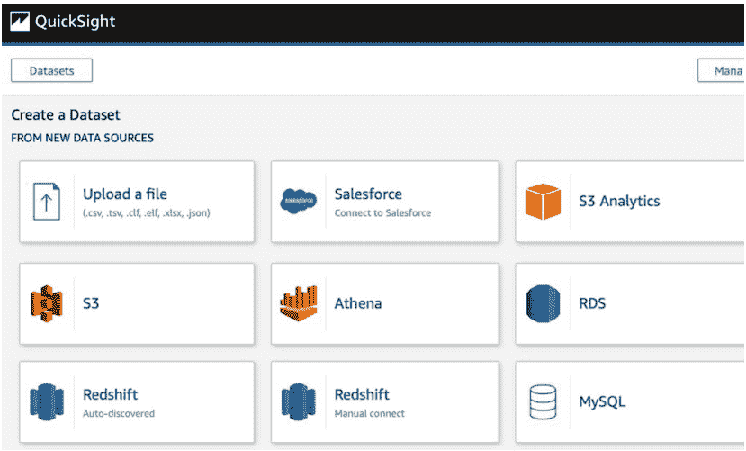

   图 3.2 – QuickSight 数据源

3. 在以下屏幕中，添加 Redshift 数据源所需的信息。您应该能够从 **Instance ID** 下拉菜单中选择您的集群。

### 新建 Redshift 数据源

### 数据源名称
Redshift - Taxi Data

### 实例 ID
选择集群 ID

### 连接类型
公共网络

### 数据库名称
dev

### 用户名
admin

### 密码
********

验证连接    已启用 SSL    创建数据源

图 3.3 – 设置 Redshift 数据源

4. 表单完成后，单击 **Create data source**。

> **注意**
> **自动发现** 选项查找与 QuickSight 位于同一区域的集群。
> 要验证 QuickSight 区域或更改为所需区域，请导航到屏幕右上角，单击用户名旁边的下拉图标以显示区域设置。


## 在下一个屏幕中，我们需要先选择 Redshift 架构。选择架构后，我们将看到所选架构的表列表。

### 选择您的表

Redshift - Taxi Data

### 架构：包含表的集合。

public

### 表：包含您可以可视化的数据。

yellowtrips_3mo

Edit/Preview data Use custom SQL Select

图 3.4 – 架构和表选择

选择 **public** 然后选择 **yellowtrips_3mo** 表并单击 **Select**。

## 接下来，我们将通过选择 **Direct Query your data** 来完成数据源的创建。

### 完成数据集创建

表：yellowtrips_3mo 预计表大小... 496MB 数据源：test 架构：public

Import to SPICE for quicker analytics GB available SPICE Directly query your data

Edit/Preview data Augment with SageMaker Visualize

图 3.5 – 完成数据集创建

最后一步将重定向到分析 Web 界面。我们将在 _第 4 章，开发可视化和仪表板_ 中使用此界面。目前，单击屏幕左上角（QuickSight 标志）返回 QuickSight 主页。您可以通过访问左侧的数据集菜单来验证新创建的数据集。

要配置 Redshift Spectrum 表，请重复上述步骤。在架构和表选择步骤中，选择 **spectrum_schema**（而不是 **public**）以及该架构下的 **yellowtrips** 表。然后重复之前的步骤，为我们之前配置的 Spectrum 表配置第二个 Redshift 数据源。请注意，Redshift Spectrum 表不会加载到数据仓库中；相反，它们位于我们的数据湖中，可以直接从该处访问和查询。

> Note
> 要访问 Spectrum 表中的数据，QuickSight 需要能够访问 Amazon S3 中的底层数据。

### 设置 S3 数据源

QuickSight 的常见数据源是 S3。例如，您可能希望可视化存储在 Amazon S3 中的 CSV 文件。在配置 S3 数据源之前，您需要确保您的 QuickSight 账户拥有访问存储文件的 S3 位置所需的权限。

> Note
> QuickSight 不会自动继承对新创建存储桶的访问权限。即使您启用了 **Access all buckets in my account** 复选框，QuickSight 也只会在该时间点获取对账户中每个存储桶的访问权限，而不会获取从该时间点之后创建的任何存储桶的访问权限。如果您需要为新存储桶添加权限，您需要 AWS 管理员来管理 QuickSight 服务对账户中 AWS 服务的权限。

对于 S3 数据源，QuickSight 需要一个包含设置数据集所需信息的清单文件。清单文件采用 JSON 格式，包含以下对象：

- **fileLocations**：在此处，您只需使用 `URIs` 属性追加文件的完整 S3 URI（作为 JSON 数组）来定义需要导入的文件（或文件）的 S3 位置。如果您想要添加特定 S3 前缀（类似于传统文件系统中的文件夹）下的所有文件，可以填充 `URIPrefixes` 属性。

- `globalUploadSettings`：`globalUploadSettings` 是可选的。您可以使用此属性覆盖 QuickSight 的默认选项。QuickSight 默认使用 **CSV 格式**，使用 "," **(逗号)** 字段分隔符和 **双引号** (") 作为文本限定符。默认情况下，QuickSight 将使用 CSV 文件的第一行作为 **header**，这意味着第一行将确定数据集字段名称，并且不会被视为数据集中的值。

现在我们已经了解了如何配置某些数据集类型，在下一节中，我们将使用 QuickSight 数据集编辑器编辑数据集。

### 编辑数据集

在本节中，我们将更仔细地查看作者用户编辑数据集通常需要执行的任务。在实际应用中，数据集通常需要进行一定程度的处理，以便 QuickSight 可以最佳地使用它们。

这些任务包括以下内容：

- Importing into SPICE
- Renaming fields
- Changing the field types
- Adding calculated fields
- Combining datasets together
- Applying security filters

在下一节中，我们将学习如何使用之前配置的示例数据集完成这些任务。

### 导入到 SPICE

是时候学习如何将数据集导入 SPICE 了。我们将使用数据集编辑器更改查询模式，然后观察导入作业的状态。最后，我们将学习如何为 SPICE 数据集安排自动刷新作业。

### 设置数据集查询模式

在本章前面，我们将 Redshift 数据集配置为 Direct Query。假设我们意识到数据仓库正忙于为许多应用程序提供服务并为组织生成报告，因此我们更愿意将数据导入 SPICE，以便 QuickSight 仪表板使用 SPICE 存储，而不是直接访问数据仓库。将数据导入 SPICE 后，我们的数据仓库将仅用于数据导入，而不用于查询数据以填充仪表板。

现在让我们将数据集添加到 SPICE 并配置其导入持续时间：

1. 首先，您需要以我们之前创建的作者用户身份登录。
2. 然后，在左侧菜单中选择 datasets 以获取所有数据集的列表。
3. 对于此实践示例，我们将 `yellowtrips_3mo` 数据集导入 SPICE。单击 `yellowtrips_3mo`，然后在您在以下屏幕截图中看到的弹出窗口中单击 **Edit dataset**。

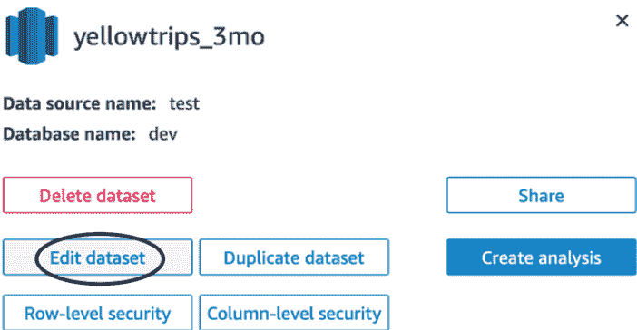

图 3.6 – 数据集弹出屏幕

4. 现在我们应该位于数据集编辑器主页面。在此页面上，我们将在本节后面完成大多数编辑和转换数据集的操作。目前，我们只需将 **Query mode** 设置为 **SPICE**，如以下屏幕截图所示。完成后，单击 **Save**。

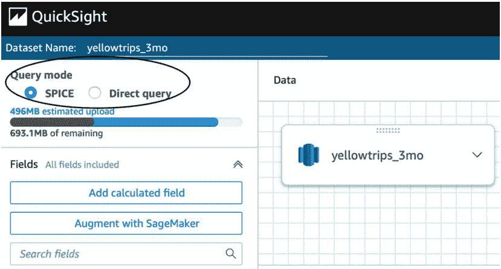

图 3.7 – 将数据集查询模式设置为 SPICE

5. 您会注意到我们的数据集现在被标记为 SPICE 数据集。现在我们首次设置了 SPICE 数据集，QuickSight 将在后台自动运行其第一个导入作业。

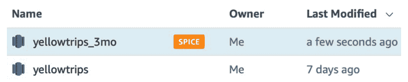

图 3.8 – 查看 SPICE 数据集

## 监控导入作业状态

几分钟后，QuickSight 将完成其首个 SPICE 导入作业。接下来，我们将收集有关导入作业状态的信息：

1. 首先，单击数据集名称以获取有关导入状态的信息，如以下屏幕截图所示：

### yellowtrips_3mo

SPICE Dataset 1.3GB

Import complete:
100% success
4652013 rows were imported to SPICE
0 rows were skipped

Last refreshed: 11 minutes ago

View history

Refresh Now

Schedule refresh

Email owners when a refresh fails

Data source name: test

Database name: dev

图 3.9 – 查看导入状态

从第一页我们可以观察到，460 万行数据已成功导入，使用了 1.3 GB 的 SPICE 容量。

2. 接下来，让我们查看导入历史。我们可以通过单击 **View history** 来完成此操作，我们将看到类似于以下内容的弹出屏幕：

### View refresh history of yellowtrips_3mo

Start time within Last 90 days Job status of All

| Date Started (UTC) | Status | Information | Job Type |
|---|---|---|---|
| | Completed | Ingestion completed in 1 minutes 9 seconds. Rows dropped: 0, Rows ingested: 4652013 | Manual, Edit |
| | Completed | Ingestion completed in 1 minutes 9 seconds. Rows dropped: 0, Rows ingested: 4652013 | Manual, Edit |

图 3.10 – 查看导入历史

3. 从前面的屏幕中，我们可以获取有关数据集导入时间、导入数据集所需时间、导入的行数和跳过的行数的有用信息。

现在我们已经介绍了刷新和导入作业，在下一节中，我们将了解如何自动刷新数据集。

### 安排自动刷新

QuickSight 支持一个简单的刷新功能，用于自动刷新 SPICE 中的数据集。具体来说，用户可以设置每小时、每天、每周或每月的刷新作业。让我们看看如何操作：

> Note
> 您可以为每个数据集配置多个刷新计划，除非您的计划是每小时。每个数据集最多可以有一个每小时刷新计划。

1. 在我们的示例中，首先您需要访问数据集，然后单击 **Schedule refresh**，如以下屏幕截图所示。

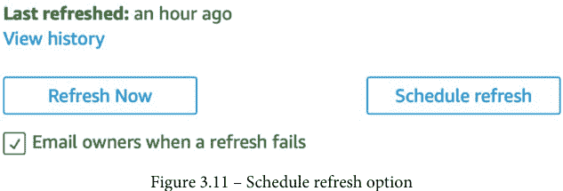

2. 接下来，您将收到一条通知，指出没有计划，并且您有创建新计划的选项。单击 **Create** 按钮以创建新的刷新计划。

3. 接下来，您可以使用 _Figure 3.12_ 中显示的编辑器创建计划。为了本教程的目的，我们不需要创建计划刷新，因为我们的数据集是静态的，但请随时熟悉各种选项。


## 创建计划

时区

Europe/London

重复

每天

开始

每小时

每天

每周

每月

取消

创建

图 3.12 – “创建计划”对话框

现在，我们已经了解了如何配置 SPICE 数据集、安排自动刷新以及监控刷新作业，在下一节中，我们将学习如何通过重命名列和数据类型来编辑数据集。

### 编辑列名和数据类型

BI 开发人员在构建可视化之前编辑数据集是很常见的。例如，列名直接来自数据库时，可能不够用户友好或不够描述性。在设计 BI 应用程序时，我们需要从最终用户的角度出发，并尝试以友好且描述性的方式命名列，使其在 BI 应用程序的上下文中易于理解。同样重要的是，要确保数据集中的每个字段都具有预期的数据类型，以便我们可以执行所需的计算。在本节中，我们将提供一个分步指南，介绍如何使用我们之前配置的 SPICE 数据集来编辑列和数据类型。

### 重命名列

使用数据集编辑器重命名列是一个简单的过程：

1. 首先，我们通过访问数据集并选择 **编辑数据集** 选项来开始，这将带我们进入数据集编辑器页面。

2. 在数据集编辑器中，我们可以看到数据的预览，包括列名，如下图所示。

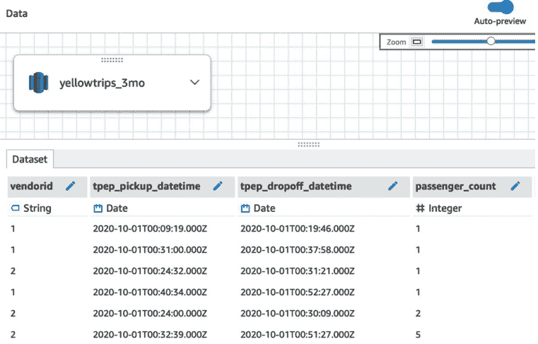

图 3.13 – 数据集预览屏幕

3. 接下来，我们可以通过单击列名旁边的铅笔图标来简单地重命名列名。例如，让我们将 `tpep_pickup_datetime` 列重命名为更用户友好的名称 `Pick up date`，如下图所示。在此阶段，我们还可以为列添加描述，以便向其他可能处理同一数据集的作者描述该列。

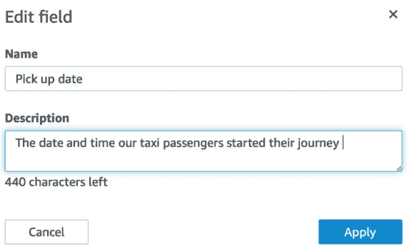

图 3.14 – “编辑字段”对话框

现在我们已经了解了如何编辑列名和描述，在下一节中，我们将了解如何编辑数据类型。

### 更改数据类型

通过为每个列使用正确的数据类型，我们可以确保访问数据集中每个列的正确功能。例如，QuickSight 支持日期列类型的时间聚合。如果日期列被错误地映射为字符串列，则无法使用这些聚合。同样，计算平均值或最小值/最大值等计算仅适用于数值数据类型。如果我们需要执行和可视化这些计算，我们需要确保已应用数值数据类型。

QuickSight 支持以下数据类型：

- 字符串
- 日期
- 十进制
- 整数

还支持以下地理空间类型：

- 县
- 州
- 城市
- 邮政编码
- 纬度
- 经度

现在，让我们看一个快速的动手示例，了解如何在数据集中编辑数据类型。对于此示例，我们将使用 `yellowtrips` 数据集（在 `yellowtrips_3mo` 集中，列数据类型似乎是正确的，因此没有什么可编辑的）。

1. 首先，我们需要访问 `yellowtrips` 数据集并导航到数据集编辑器。
2. 在此数据集中，您可以看到日期列已被识别为字符串。这是我们需要编辑的内容，以便我们可以在后续分析中使用基于时间的聚合。

3. 要更改数据类型，我们需要单击列名下的数据类型（在此示例中为 **字符串**）并选择 **日期**。

4. 接下来，QuickSight 将打开编辑日期格式弹出屏幕，如下图所示。我们需要定义数据集的日期格式。在我们的示例中，这是 `yyyy-MM-dd HH:mm:ss`，其中 `yyyy` 表示使用四位数的年份（例如，2020）；`MM` 表示使用两位数的月份（例如，2 月为 `02`），语法中的其他元素也是类似。一旦我们输入日期格式，QuickSight 将根据所选的日期格式验证我们的数据集，以确保数据符合该格式。

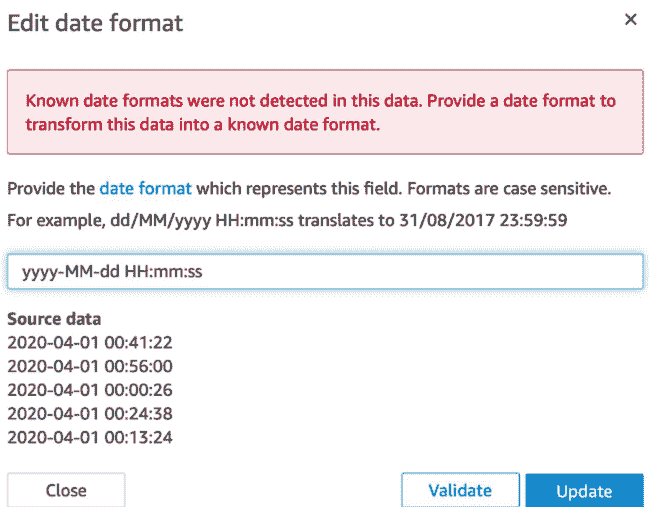

图 3.15 – 编辑日期格式

我们可以对 `tpep_dropoff_datetime` 列重复此过程。现在我们已经了解了如何编辑列，包括更改列名和类型以及添加描述，在下一节中，我们将学习高级数据集操作，包括联接和安全控制。

### 使用高级操作

在本节中，我们将重点介绍高级数据集操作。我们将学习如何向数据集添加计算字段并应用数据集操作，例如筛选和联接。最后，我们将添加安全控制，包括行级和列级筛选器。对于本节，我们将使用本章前面配置的 SPICE 数据集。

### 添加计算字段

QuickSight 允许 BI 开发人员在数据准备阶段向其数据集添加计算字段。然后，可以使用包含计算字段的数据集来开发多个分析。

QuickSight 提供了一系列预构建函数，我们可以在构建计算字段时使用。这些函数包括以下内容：

- **聚合函数** 用于计算多个值上的指标。例如，我们可以使用 `min()` 函数来计算一组值的最小值。
- **条件函数** 允许我们在计算字段中使用条件逻辑，例如，如果传递的参数不为 null，`isNotNull()` 返回 `true`。
- **日期函数** 帮助我们处理日期列类型。例如，我们可以使用 `dateDiff()` 函数来计算两个日期字段之间的差异。
- **数值函数** 和 **字符串函数** 可以分别帮助我们处理数值和字符串值。例如，我们可以使用 `abs()` 函数计算给定表达式的绝对值，或者可以使用 `concat()` 函数连接两个或多个字符串。
- 最后，**表计算** 可用于发现维度如何影响特定度量。例如，`sumOver()` 函数按维度列表分区计算度量的总和。

### 使用 Amazon QuickSight 准备数据

要添加计算字段，我们执行以下操作：

1. 首先，我们需要在数据集编辑器中打开数据集。
2. 然后，我们可以简单地选择 **添加计算字段** 选项来进入计算字段编辑器，如下图所示：

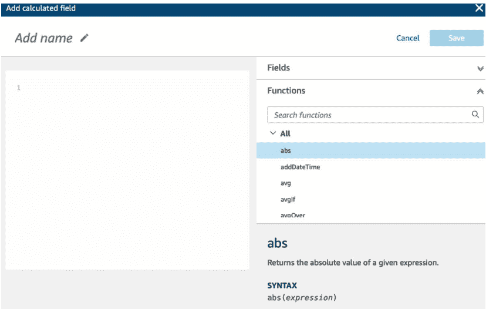

图 3.16 – 计算字段编辑器

3. 接下来，让我们添加第一个计算字段。在我们的数据集中，虽然我们有接车时间和下车时间，但获取这两个时间戳之间以分钟为单位的差异可能很有趣。要计算此差异，我们可以键入以下内容：

```
dateDiff({Pick up Date},{tpep_dropoff_datetime},"MI")
```

4. 最后，让我们给它一个描述性的名称，例如 `Trip duration (mins)`，然后单击 **保存**。

现在我们可以在数据集编辑器中观察新的计算字段。接下来，我们将看到其他数据集操作，包括筛选和联接。

### 筛选和联接数据集

在本节中，我们将讨论如何筛选和联接数据源。

### 筛选数据集

存在您可能需要从数据源中获取表子集的场景。  
QuickSight 支持数据源筛选，以便您可以将数据集所需的子集导入  
到 SPICE。这允许您仅使用真正需要的 SPICE 容量来构建高效的 BI 解决方案。在 QuickSight 中添加筛选器很简单。在以下示例中，我们  
将看到如何从我们之前创建的数据集中筛选出列和行的示例：

1. 首先，您需要访问数据集编辑器。在左侧，您可以找到 **排除的字段** 和 **筛选器** 菜单。
2. 对于此示例，让我们假设我们对 `store_and_fwd_flag` 列中的信息不感兴趣。要从数据集中排除此列，请展开 **排除的字段** 选项，然后选择 `store_and_fwd_flag`。
3. 现在我们已经删除了一个列，让我们应用一个筛选器来删除行。让我们假设对于此分析，如果距离显示为 0.0，我们不想包含行程，并且我们只希望值大于 0 的数据。
4. 展开 **筛选器** 菜单并选择 `trip_distance` 列。从下拉菜单中选择 **大于**，然后输入 `0`。添加这些值后，筛选器应如下图所示：

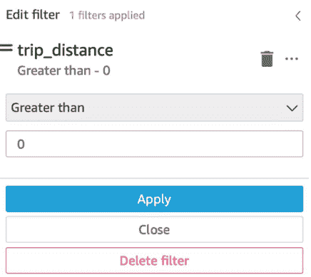

图 3.17 – 添加数据集筛选器

5. 接下来，单击 **应用**。QuickSight 将为数据集触发刷新作业。


现在我们已经学习了如何在数据集上应用筛选器，在下一节中，我们将通过将数据集与参考数据进行连接来丰富我们的数据集。

### 连接数据集

连接数据集可用于将数据集合并在一起，并提供数据的单一视图。拥有相关且高质量的数据是我们 BI 应用程序成功的关键。在本示例中，我们将使用之前使用过的数据集，并使用一个可以从网站提供商处下载的参考数据集进行丰富。或者，我们可以创建一个查找 CSV 文件并将其上传到 QuickSight。让我们开始：

1. 首先，让我们从 https://s3.amazonaws.com/nyc-tlc/misc/taxi+_zone_lookup.csv 下载我们的小型查找表。
2. 接下来，在数据集编辑器中，单击 **Add data** 然后上传文件。
3. 上传查找文件。
4. 接下来，为连接列选择位置 ID，并选择 **Left** 作为连接配置。请参阅以下截图以获取示例。

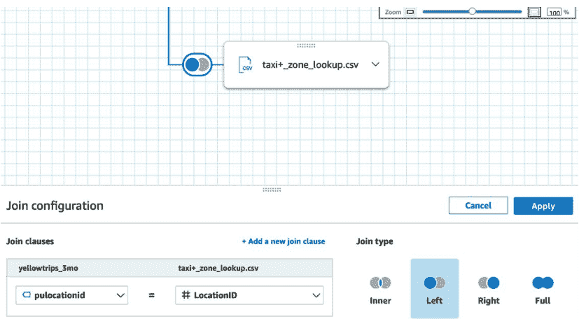

图 3.18 – 连接配置

5. 应用后，您可以在数据集编辑器中确认新列。

现在我们已经学习了如何连接数据集，我们将学习如何为数据集添加安全控制。

### 配置安全控制

QuickSight 支持行级和列级安全控制。在本节中，我们将学习如何为数据集添加安全控制。

### 添加列级安全控制

在某些情况下，BI 开发人员可能希望限制对特定列的访问以保护敏感数据（例如个人身份数据）。一旦 BI 开发人员添加了列级安全性，只有允许的用户才能查看和访问受限列。默认情况下，当您与另一用户共享数据集时，您会授予他们访问该数据集所有列的权限。因此，如果您需要限制某些列，则需要添加列级安全控制。要添加列级安全性，您可以选择 **Column-level security** 选项。

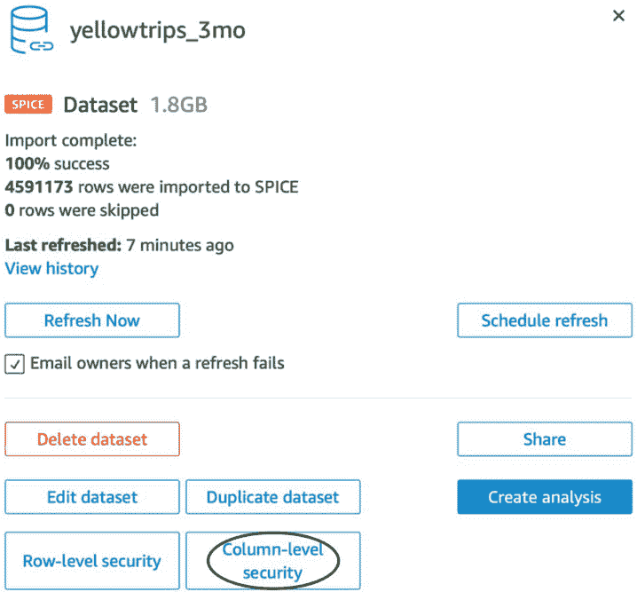

图 3.19 – 列级安全性

然后您将看到数据集中的列列表。您会注意到，默认情况下，有权访问数据集的用户和组可以访问所有列。要限制某个列，您需要选择它，然后添加您要启用访问权限的用户或组。此选择将覆盖“所有人”默认设置，只有您添加的用户或组才能访问。完成后，您会注意到数据集旁边有一个挂锁图标，以确认存在安全限制。

### 添加行级安全性

QuickSight 支持数据集的行级安全性。当您希望某些用户或组根据其用户名或组成员身份对数据子集拥有不同级别的访问权限时，行筛选器特别有用。要应用行级安全性，您需要提供权限文件或在数据库中创建权限表，然后将其添加到 QuickSight。在我们的示例中，`vendorid` 列有两个不同的值，`2` 和 `1`，分别代表不同的供应商。让我们设想一个场景，供应商 `1` 的用户需要访问数据集，但他们只能访问供应商 `1` 的数据，而不能访问供应商 `2` 的数据。同样，供应商 `2` 只能被允许查看其数据。在本示例中，我们可以应用行级安全控制。

### 应用行级筛选器

在我们的示例中，我们可以考虑两个不同的用户，供应商 `1` 的 `user1` 和供应商 `2` 的 `user2`。QuickSight 将访问数据集的用户名与 `UserName` 字段的值进行匹配，然后使用其余列应用筛选器或筛选器。在我们的示例中，它将使用 `yellowtrips_3mo` 数据集中的 `vendorid` 列。

请参阅我们下面的映射表，了解之前描述的场景：

| UserName | vendorid |
|---|---|
| user1 | 1 |
| user2 | 2 |

图 3.20 – 映射表

### 配置安全控制

要应用行级权限，我们需要执行以下操作：

1. 我们将映射表保存为 `.csv` 文件，然后将其导入为新数据集。文件格式如下：

```
UserName,vendorid
user1,"1"
user2,"2"
<your-admin-user>,""
```

2. 编辑新创建的数据集，并确保 `vendorid` 字段的类型为 **String**。

3. 然后，选择 **yellowtrips_3mo** 数据集并选择 **Row-level security**，如下面的截图所示：

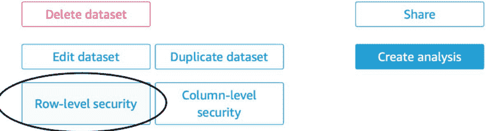

图 3.21 – 添加行级安全性

4. 然后选择您在 _步骤 1_ 中添加的映射表。

5. 然后单击 **Apply to dataset**。现在筛选器已应用，如下面的截图所示：

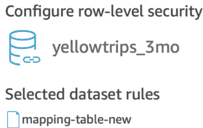

图 3.22 – 数据集规则已应用

下一章不需要这些权限。应用行级筛选器后，您可以通过执行以下操作将其删除：

1. 选择 **yellowtrips_3mo** 数据集，然后选择 **Row-level security**。
2. 在选定映射表的情况下，单击 **Remove dataset**。
3. 再次单击 **Remove dataset** 以确认操作。

## 摘要

恭喜您完成本章。在本章中，我们学习了如何在 Amazon QuickSight 中创建和编辑数据集。我们成功将数据集导入 SPICE 并安排自动刷新作业。我们还编辑了字段并添加了自定义计算，以从数据集及其列中获得更多价值。然后，我们研究了高级数据集操作，包括连接数据集并使用参考数据对其进行丰富。在本章的最后部分，我们学习了如何应用安全控制（无论是列级还是行级），以便您可以保护敏感信息或为用户应用特定筛选器。

在下一章中，我们将学习如何使用 QuickSight 分析和仪表板来可视化数据集。

## 问答

1. 直接查询和 SPICE 数据源有什么区别？
2. 如何在 Amazon QuickSight 中添加列级安全控制？
3. 我们什么时候需要为数据集配置行级安全性？
4. 为什么我们可能需要从数据集中排除某些列？
5. 我们如何使用参考数据丰富数据集？
6. 为数据集中的每个列配置正确的数据类型为什么很重要？

## 延伸阅读

- • QuickSight 用户指南 - 准备数据：https://docs.aws.amazon.com/quicksight/latest/user/preparing-data.html。
