## 4 开发可视化和仪表板

在本章中，我们将介绍 Amazon QuickSight 的主要分析构建功能。我们将首先探索作者用户界面并了解不同的可视化类型。在添加某些可视化类型并解释其功能后，我们将介绍仪表板的概念，并展示如何通过简单的实操示例将仪表板共享给业务用户。最后，我们将探讨如何使用现有或自定义主题来设计仪表板。

在本章中，我们将涵盖以下主题：

- 使用 QuickSight 可视化
- 发布仪表板
- 自定义应用程序的外观和感觉

### 技术要求

在本章中，您需要以下内容：

- 一个 AWS 账户
- 一个配置了作者和读者用户的 QuickSight 账户
- 我们在 _第 3 章，使用 Amazon QuickSight 准备数据_ 中创建的数据集

### 使用 QuickSight 可视化

可视化定义为您可以添加到 QuickSight 分析中的屏幕小部件，用于可视化数据。选择正确的可视化类型对于 BI 应用程序的成功至关重要。在本节中，我们将了解支持的可视化类型以及如何为不同场景选择最合适的可视化类型。

### 创建分析

在查看可用的可视化类型之前，我们需要创建第一个分析。QuickSight 分析是开发 BI 应用程序的主要用户界面。在处理分析时，您将能够添加数据可视化小部件、配置 ML 功能，并配置 BI 应用程序的外观和感觉。

要创建分析，请执行以下步骤：

1. 首先，以作者用户身份登录 QuickSight。
2. 接下来，从左侧菜单中选择 **Analyses**，然后选择 **New analysis**，如下面的截图所示：

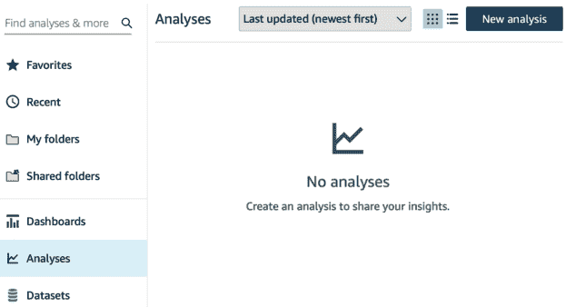

图 4.1 – Analyses 菜单

## 然后，您需要选择一个数据集来开始分析。选择我们之前配置的 yellowtrips_3mo 数据集，并选择 **Create Analysis**。

## 这将带您进入主分析用户界面，如下图所示：

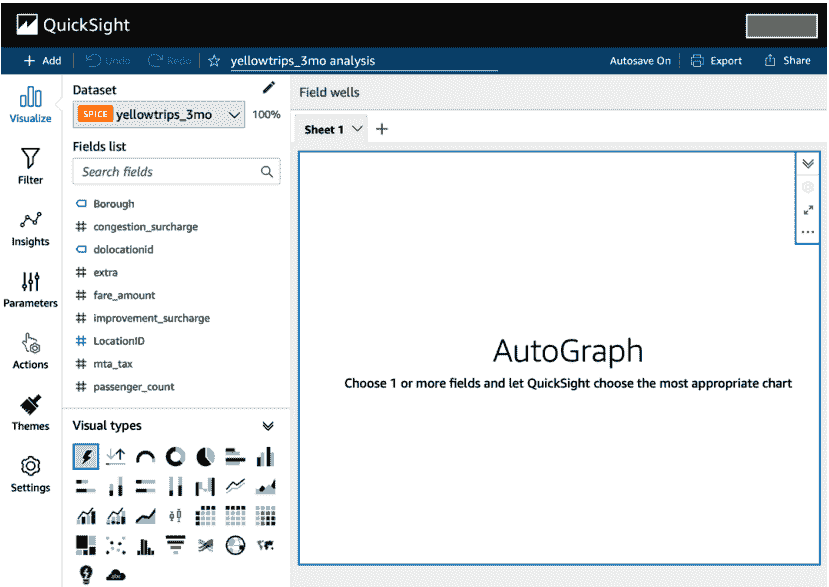

Figure 4.2 – 分析用户界面

这是我们在整本书中将用于开发 BI 应用程序的主用户界面。

> **Note**
> 熟悉分析用户界面，包括主屏幕、顶部菜单、侧边菜单、字段容器、数据集、列列表和可视化类型选择工具，因为我们将在整本书中使用它们。

接下来，我们将通过查看示例数据集的示例，重点介绍不同的可视化类型。

### 支持的可视化类型

QuickSight 支持多种可视化类型，您可以选择这些类型来可视化数据。AWS 正在不断扩展此列表。在接下来的几个部分中，我们将通过关注业务问题以及可视化如何帮助您解决这些问题来探索这些类型。

### 可视化指标或关键绩效指标

在某些场景中，您可能希望可视化 **关键绩效指标** (KPI)。可视化指标相对于目标指标的进度，或将当月销售额与上月销售额进行比较，是组织通常需要监控的 KPI 示例。适用于这些类型可视化的两种可视化类型如下：

- KPI 可视化类型
- 仪表图

让我们使用在 _Chapter 3, Preparing Data with Amazon QuickSight_ 中创建的数据集，更仔细地查看每种可视化类型。

### KPI 可视化类型

KPI **可视化类型**允许您显示指标，包括相对于时间间隔或趋势的比较。要选择 KPI 可视化类型，您只需选择  图标。然后，您可以开始参数化 KPI 可视化，如下图所示：

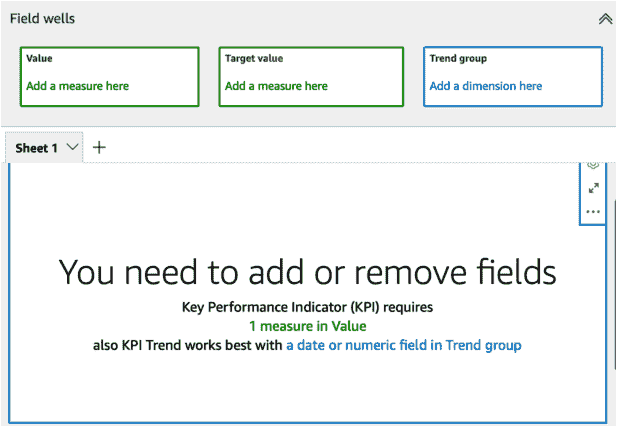

Figure 4.3 – KPI 可视化字段

KPI 可视化允许我们设置三种类型的字段：

- **Value**：此字段表示我们要衡量的值。
- **Target value**：此字段表示我们要将值字段与之比较的目标指标。
- **Trend group**：在某些场景中，您需要可视化指标的趋势；例如，随时间的变化趋势。趋势组字段可用于此目的。

> Note
> 您可以将目标值或趋势组与 KPI 可视化一起使用，但不能同时使用。

要了解 KPI 可视化，我们将查看使用本书前面导入 QuickSight 的纽约出租车数据集的示例。在此示例中，假设我们想要可视化小费相对于总车费的表现情况。小费低于总额 10% 可能表明人们不太慷慨。让我们看看数据告诉我们什么！

对于此 KPI 可视化，我们将使用 `tip_amount` 作为值字段，并使用 `total_amount` 作为目标。要添加这些字段，只需将每个字段拖放到相应的列中，如下所示。添加这些字段后，可视化应如下所示：

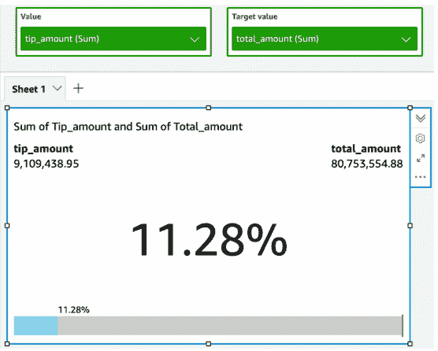

Figure 4.4 – 小费 KPI 可视化

现在我们有了第一个 KPI 可视化，将配置其中的一些参数。字段中的每个字段都可以通过选择相应的下拉菜单来单独配置，如下所示：

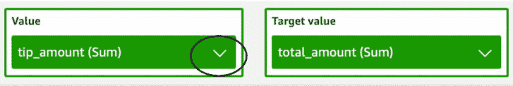

Figure 4.5 – 字段选项

从此菜单中，我们可以选择字段的聚合方式和格式。对于聚合，我们有以下选项：

- Sum (default)。
- Average。
- Count。
- Count distinct。
- Max。
- Median。
- Min。
- Percentile：选择百分位数时，还需要选择百分位数值；例如，95 以计算 P95。
- Standard deviation。
- Standard deviation: Population。
- Variance。
- Variance: Population。

对于我们的示例，我们可以保留默认设置，即 **Sum** 聚合，因为它显示了小费和车费的总金额。接下来，让我们查看格式。可用选项如下：

- **Number**
- **Currency**
- **Percentage**

**Currency** 格式类型更适合我们的字段。选择类型后，您可以通过选择 **More formatting options** 菜单详细编辑格式。最后，我们可以通过选择可视化旁边的齿轮图标来格式化整个可视化。这将打开一个菜单，我们可以在其中编辑比较格式（例如，实际值的百分比）、更改字体大小和更改标题。让我们将标题设置为 **New York Taxi Tips Percentage**，并将副标题设置为 **10% Target**。现在，可视化应如下所示：

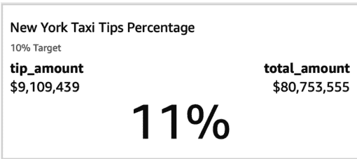

Figure 4.6 – 纽约出租车小费百分比 KPI

现在我们已经了解了如何配置 KPI 可视化类型，我们将学习如何配置仪表图可视化。

### 仪表图

仪表图是将值与目标值进行比较的有用方法。仪表图帮助我们可视化相对于目标的进度。

> **Note**
> 与仪表图类似的可视化可以通过 KPI 可视化上的进度条来实现。

要了解仪表图，我们可以使用纽约出租车数据集。在此示例中，假设我们 3 个月的目标是拥有 650 万名乘客，并且我们希望将实际数字与此目标进行比较。添加此目标值的快速方法是简单地创建一个计算字段并将其赋值为 6,500,000。此值将添加到数据集的每一行，增加所需的 SPICE 空间总量。然后，我们可以使用 `passenger_count (sum)` 作为仪表图的 **Value** 字段，并将新创建的计算字段（聚合为平均值）作为 **Target** 字段。与我们之前看到的 KPI 图表类似，我们将能够访问此可视化的其他设置，例如设置标题、控制显示的值、字体粗细、数据标签和工具提示。请随意熟悉此可视化的设置。使用默认设置（仅增加字体大小），仪表可视化将如下所示：

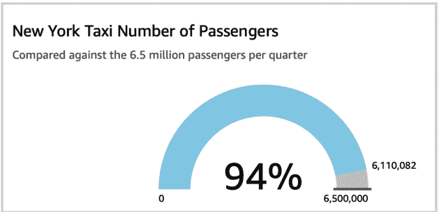

Figure 4.7 – 仪表图

现在我们已经了解了如何可视化 KPI，我们可以专注于其他可视化类型。接下来，我们将查看如何使用可视化类型来帮助我们可视化数据集中所选属性的构成。

### 可视化属性的构成

可视化数据集中一个或多个维度的构成，可能是您希望通过 BI 应用程序回答的常见问题。例如，您可能希望查看每个地区对总销售额的贡献程度。在我们的示例中，我们可以可视化每个出租车区域对收取的总出租车车费的贡献程度。这些类型的问题可以使用以下类型的图表来可视化：

- 饼图
- 环形图

在设置这两种可视化时，您需要指定一个组/颜色字段和值字段。

> Note
> 如果您不指定值字段，QuickSight 将默认使用记录计数。

使用我们的示例数据集，我们将使用环形图来按服务区域可视化记录。同样，我们将使用饼图来按行政区可视化记录计数。为此，我们可以将 service_zone 字段和 Borough 字段分别设置为环形图和饼图的组/颜色。结果，这两种可视化将如下所示：

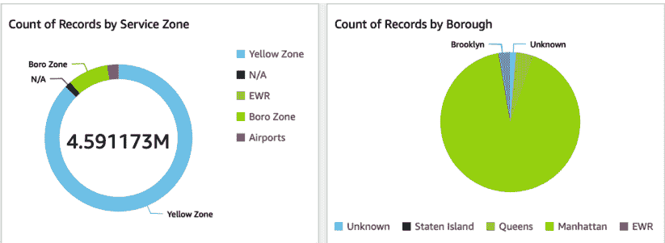

Figure 4.8 – 环形图和饼图

这两种可视化类型都可以帮助您可视化属性的构成，并且在类别数量较少时效果尤其好。当您想要进行并排比较时，这两种可视化类型效果不佳。接下来，我们将查看可以帮助您可视化此类并排比较的可视化类型。

### 可视化并排比较

QuickSight 允许您通过提供多种柱状图选项来可视化并排比较。水平、垂直或堆叠柱状图是此类可视化的一些示例。要了解这些可视化，我们将使用我们的数据集并配置一个柱状图。假设我们想要了解和比较纽约各行政区的小费百分比：

1. 首先，我们需要一个计算字段，并必须将 {tip_amount}/{fare_amount} 值分配给 Tip Percentage。
2. 接下来，我们需要添加可视化。柱状图是比较各行政区小费百分比的理想解决方案。

柱状图（无论是垂直还是水平）都需要配置以下字段：

- **X 轴**
- **值**
- （可选）**分组/颜色**

X 轴是您希望针对其值来理解的主要维度。在我们的示例中，这将是 Borough 字段。对于值字段，您需要设置要理解和比较的值。在我们的示例中，这将是新创建的 Tip Percentage 计算字段，聚合方式为平均值。最后，如果您需要为可视化添加另一个维度，可以添加分组/颜色字段。

> **Note**
> 柱状图至少需要一个 X 轴和一个值字段。分组/颜色字段是可选的。如果您需要在同一可视化中监控多个值，可以设置多个值字段。

应用这些字段后，垂直柱状图将如下所示：

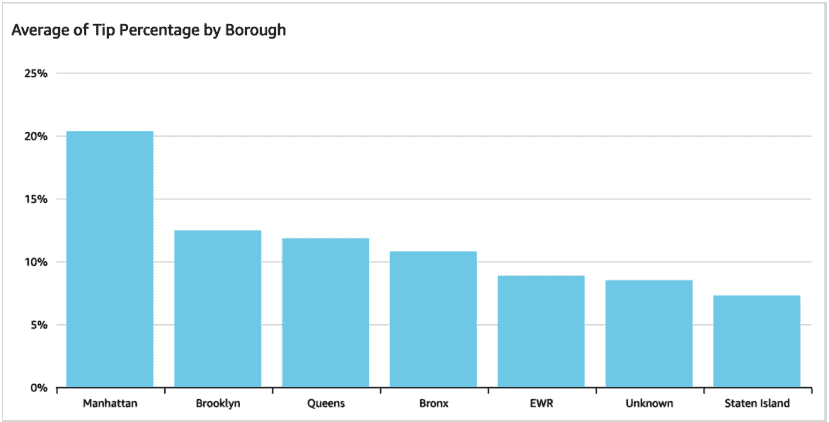

图 4.9 – 垂直柱状图

现在我们已经学习了如何使用简单的柱状图，在下一节中，我们将学习如何可视化时间序列。

### 可视化时间序列

BI 应用程序通常需要可视化指标随时间的变化情况。时间序列数据通常使用折线图来表示。时间序列可视化需要确保时间字段在 QuickSight 中存储为 `Date` 字段类型。这将启用基于时间的聚合；例如，天、周、月、季度或年。

在本节中，我们将使用简单的折线图来创建第一个时间序列可视化。假设我们想要可视化出租车车费随时间的变化总额，以便观察车费金额随时间的分布情况。

折线图要求您定义以下内容：

- **X 轴**：在时间序列中，这将是我们的时间字段。
- **值**：您想要随时间测量的值。
- 可选，**颜色**字段：当您想要可视化多个类别时，可以使用 `Color` 字段。这将导致同一折线图上出现多条线。

在我们的示例中，您需要选择 `tpep_dropoff_datetime` 作为 X 轴，`total_amount (Sum)` 作为值。此数据集仅包含 3 个月的数据；因此，每日聚合可能有足够的数据点来进行有意义的数据可视化。您需要确保选择了每日聚合。为此，请选择 X 轴列并展开下拉菜单，如以下屏幕截图所示：

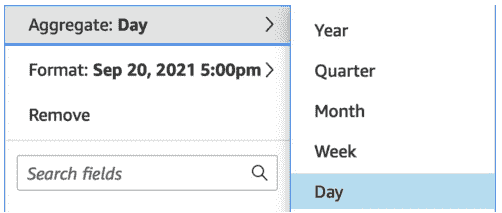

图 4.10 – 基于时间的聚合

以下屏幕截图显示了从 9 月到 12 月期间每日聚合的总车费金额折线图：

### 按时间汇总的总金额

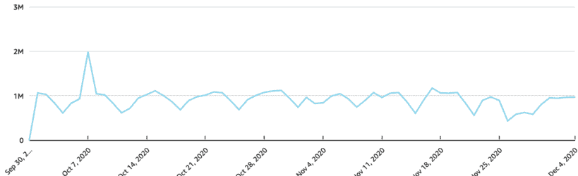

图 4.11 – 折线图

现在我们已经学习了如何设置折线图，我们将学习如何使用表格可视化。

### 使用表格

当我们想要显示特定指标的值，而不使用其他可视化手段时，表格可能很有用。表格可视化可用于显示原始数据，这对于熟悉用于填充 BI 应用程序的数据的用户来说可能很有用。QuickSight 支持以下内容：

- 用于简单表格可视化的表格可视化
- 用于需要在多个维度上汇总数据的表格的透视表可视化

对于简单表格可视化，您需要在字段井中定义值和分组字段。分组字段用于汇总数据，而值字段包含将添加到表格中的指标，并按分组字段进行细分。如果您对多个指标感兴趣，可以添加一个或多个值字段。您可以使用一个或多个分组字段；但是，如果您需要使用多个维度来细分数据，透视表可能更合适。

要了解表格的用法，让我们使用我们的示例数据集。在这个示例中，假设我们想要可视化一个按区划分的总车费金额表格。对于这个可视化，我们将使用 Borough 列作为分组字段，fare_amount (sum) 作为值字段。

您可以使用其他选项自定义表格可视化。首先，您可以控制可视化标题和列名称。在我们的示例中，我们可以将 `fare_amount` 列名称替换为用户友好的名称 `Fare amount`，这更易于阅读。此外，我们可以选择显示值字段的总聚合，并控制总计的显示方式和位置。在我们的示例中，将总计添加到表格中将很有用。

> Note
> 表格可视化中默认不显示总计，因此如果我们需要显示它，则需要启用它。

请随时通过可视化右侧的齿轮图标熟悉其他设置。在以下屏幕截图中，您可以看到使用我们示例数据的表格可视化：

### 按区划分的出租车车费

| Borough | Fare Amount |
|---|---|
| Total | $55,791,387 |
| Bronx | $1,122,186 |
| Brooklyn | $2,172,315 |
| EWR | $2,907 |
| Manhattan | $45,001,178 |
| Queens | $6,022,819 |
| Staten Island | $77,035 |
| Unknown | $1,392,948 |

图 4.12 – 表格可视化

现在，假设我们想要为读者提供一个表格，让他们能够深入了解每个区的数据，并按支付类型进行细分。可以使用透视表可视化代替简单表格。在透视表中，您可以定义以下内容：

- 行
- 列
- 作为行或列的值

在我们的示例中，我们将使用 fare_amount 列作为值字段（作为列）。对于行字段，这次我们将添加两个字段：Borough 和 Payment Type。与表格可视化类似，您可以使用齿轮图标访问其他设置，以更改可视化的标题、字段命名和总计计算。此外，透视表可以为每个类别显示小计，并具有其他样式控制。以下透视表使用了我们示例中的数据集：

### 按区和支付类型划分的车费金额

| Borough   | Payment Type   | fare_amount   |
|-----------|---------------|---------------|
| Bronx     | null          | $969,806.58   |
|           | Cash          | $50,961.67    |
|           | Credit Card   | $100,715.51   |
|           | Dispute       | -$334.70      |
|           | No Charge     | $1,036.51     |
|           | Subtotal      | $1,122,185.57 |
| Brooklyn  |               | $2,172,314.53 |
| EWR       |               | $2,907.37     |
| Manhattan |               | $45,001,178...|
| Queens    |               | $6,022,818.58 |
| Staten Island |           | $77,034.66    |
| Unknown   |               | $1,392,948.05 |

图 4.13 – 透视表可视化

现在我们已经学习了如何使用表格，在下一节中，我们将学习关于可视化地理空间数据的内容。

### 可视化地理空间数据

QuickSight 可以处理地理空间数据。在撰写本文时，QuickSight 支持两种类型的地理空间可视化：

- 地图上的点
- 填充地图

当您需要在地图上突出显示特定点时，地图上的点可视化非常合适。点的大小由 Size 字段决定。当您需要可视化不同类别时，可以添加多种颜色。地图上的点可视化与坐标配合良好，但也可以处理其他地理空间数据类型，例如城市、州和国家。

当您需要可视化覆盖更广地理范围（例如国家）的指标时，**填充地图**可视化可能更合适。创建填充地图可视化时，您需要定义两个字段：位置字段和颜色字段。

在下一节中，我们将学习如何可视化源和目标之间的流动。

### 可视化源和目标之间的流动

存在一些场景，您可能希望在考虑源和目标的同时可视化指标。**Sankey** 可视化类型在我们需要可视化在源和目标之间流动的指标时非常合适。Sankey 图将源到目标的流动描绘为一条线。线的宽度取决于指标的值。例如，在我们的数据集中，我们捕获出租车的上车和下车位置。我们可以使用查找表丰富位置 ID，并获取上车区和下车区。现在，假设我们想要可视化纽约各区之间行驶的总里程。使用 Sankey 可视化类型，我们需要将 **Pick Up Borough** 设置为 **Source** 字段，将 **Drop off Borough** 设置为 **Destination** 字段，并将 **trip_distance** 设置为 **Weigh** 字段。

以下屏幕截图显示了使用我们示例数据集的示例 Sankey 可视化：

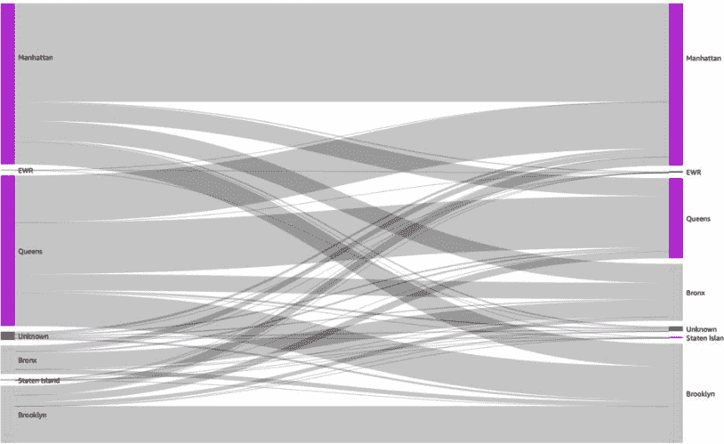

图 4.15 – Sankey 可视化类型

现在我们已经学习了如何处理大多数可用的可视化类型，在下一节中，我们将学习如何发布分析，以便与其他用户共享。

### Publishing dashboards

在本节中，我们将学习如何发布仪表板并与其他读者用户共享。仪表板是分析的只读版本，可供读者用户使用。仪表板不是分析的时间点快照。当用户访问仪表板时，QuickSight 将获取数据以填充仪表板可视化内容。根据您配置数据源的方式，数据将通过直接查询或使用 SPICE 获取。当您使用 SPICE 数据源时，QuickSight 将根据用户数量自动扩展。当您直接查询数据源时，需要确保数据源（例如数据仓库）具有足够的资源来支持工作负载。

共享仪表板非常简单。让我们来看看：

1. 首先，您需要打开要作为仪表板共享的分析。
2. 单击屏幕右上角的 **Share** 按钮。这将打开 **Publish a dashboard** 屏幕，如下图所示：

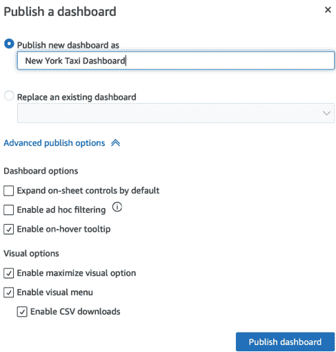

Figure 4.16 – Publish a dashboard screen

3. 输入名称 – 例如，New York Taxi Dashboard – 然后单击 **Publish dashboard**。
4. 几秒钟后，仪表板将生成，并出现 **Share dashboard** 屏幕，如下图所示：

### Share dashboard

Find a person or group to share with.

Enter a username, group, or email address

Share with everyone in this account

| Name | Email | Permission | Role |
|---|---|---|---|
| | | | |

Manage dashboard access Share

Figure 4.17 – Share dashboard screen

5. 添加您想要共享仪表板的任何用户或组，然后单击 **Share**。

6. 恭喜 – 您已创建第一个 QuickSight 仪表板！如下图所示：

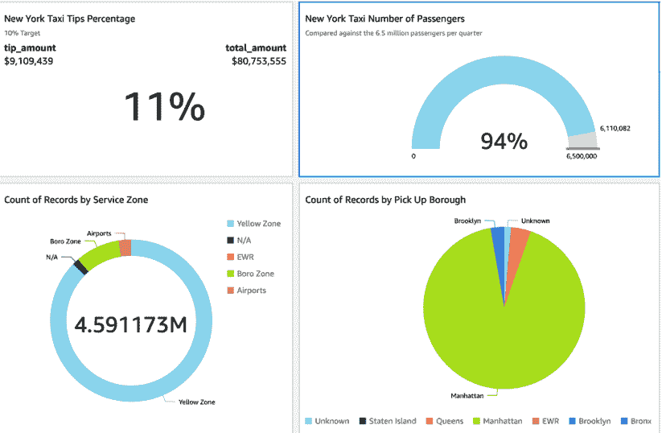

Figure 4.18 – Our first QuickSight dashboard

QuickSight 仪表板主要由希望从组织数据中获取洞察的业务用户使用。对于这些用户，应用程序的外观和感觉可能是一个重要因素。在下一节中，我们将学习一些可用于更改 BI 应用程序外观和感觉的基本控件。

### Customizing the look and feel of the application

在本节中，我们将关注应用程序的外观和感觉。我们可能需要更改应用程序默认外观和感觉的原因有很多。例如，组织可能需要使用与其品牌相匹配的颜色。在本节中，我们将学习如何执行以下操作：

- Apply themes
- Format individual visuals

让我们开始！

### Applying themes

QuickSight 中的主题是一组外观设置，可以应用于多个分析和仪表板。要访问 **Themes** 菜单，我们需要打开一个分析：

1. 首先，以作者用户身份登录并打开一个分析。这里，我们将使用在本章中开发的 New York Taxi 分析。
2. 注意左侧菜单中存在 **Themes** 选项。单击 **Themes** 菜单，如下所示：

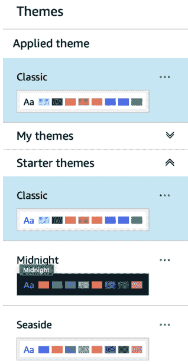

Figure 4.19 – Themes

3. 注意有预构建的主题可供我们开始使用。对于此示例，我们将选择 **Midnight** 主题，并使用之前创建的仪表板观察外观和感觉。
4. 选择 **Midnight** 主题。
5. 现在，我们需要刷新仪表板。单击屏幕右上角的 **Share** 选项，然后单击 **Publish dashboard**。

6. 这次，我们需要替换现有仪表板，而不是创建新仪表板。请参见以下示例：

### Publish a dashboard

Publish new dashboard as
New dashboard 1

Replace an existing dashboard
New York Taxi Dashboard
Rename

Advanced publish options
Publish dashboard

Figure 4.20 – Updating an existing dashboard

7. 观察仪表板的新外观和感觉，如下图所示：

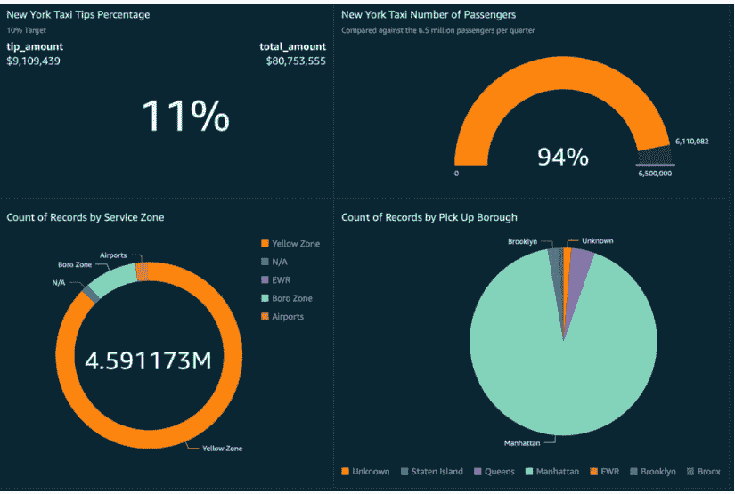

Figure 4.21 – Dashboard with the Midnight theme applied

> Note
> You can create a theme using your colors and a selection of different fonts.
> Consult the AWS documentation to understand how each color group setting
> is used by QuickSight.

虽然主题可以应用于分析的所有可视化内容，但您可能希望更改单个可视化内容的颜色。在下一节中，我们将学习如何更改单个可视化内容的外观和感觉。

### Formatting visuals

您可能希望更改特定可视化内容的颜色，或更改可视化内容中特定数据点的颜色。在其他情况下，您可能希望根据特定条件应用格式设置。在本节中，您将学习如何执行以下操作：

- Edit the colors of a specific visual.
- Apply conditional formatting.

让我们开始！

### Editing the color of a specific visual

要编辑特定可视化内容的颜色，请执行以下步骤：

1. 首先，打开分析并单击可视化内容的彩色区域以打开颜色选项，如下图所示：

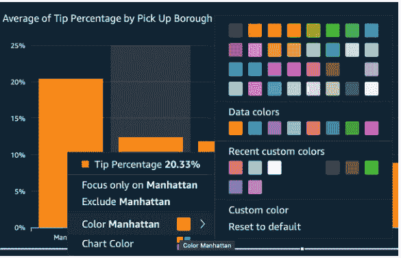

Figure 4.22 – Chart color settings

2. 注意我们的柱状图只有一种颜色。假设我们想要更改图表颜色，并且还希望最高值（Manhattan）以另一种颜色突出显示。

3. 要更改图表颜色，您需要从 **Chart Color** 选项中选择想要的颜色。您可以选择一组预定义的颜色，也可以选择自定义颜色。

4. 最后，要仅更改最高值（在我们的示例中为 _Manhattan_）的颜色，您需要从 **Color Manhattan** 中选择一种颜色。您可以从一组预定义的颜色中选择，也可以选择自定义颜色。

5. 以下图片显示了按照前面步骤描述进行颜色更改后的图表：

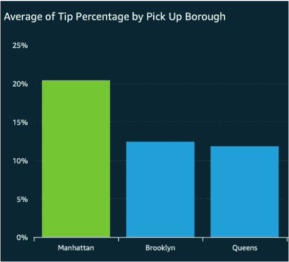

Figure 4.23 – Bar chart after updating its color

现在我们已经学习了如何更改可视化内容的颜色，让我们学习如何应用条件格式。

### Applying conditional formatting

某些可视化类型支持条件格式。当您需要根据条件控制可视化内容的外观和感觉时，可以使用条件格式。在本节中，我们将选择之前开发的一个可视化内容并应用条件格式。

仪表图可视化支持可视化格式。对于此示例，假设我们希望当百分比目标低于 95% 时，文本颜色为红色：

1. 首先，我们需要访问 **Conditional formatting** 设置，如下图所示：

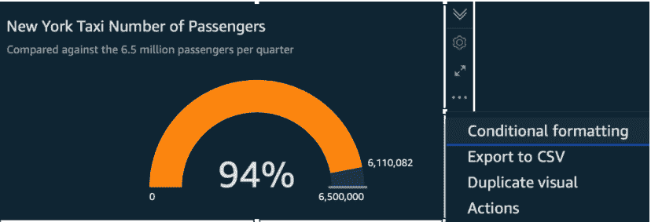

2. 在此示例中，我们有兴趣更改文本颜色，因此需要单击 **Add text color** 选项。

3. 然后，我们必须配置条件，如下所示：
   a) Format field based on: Percent (%)
   b) Condition: Less than
   c) Value (%): 95
   d) Color: Red:

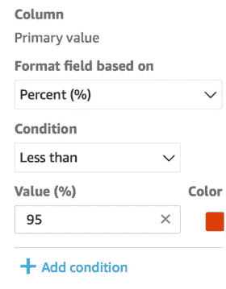

4. 接下来，单击 **Apply**。一旦设置应用，可视化内容将重新加载并显示，如下图所示。请注意，颜色已更改为红色，因为该值低于 95% 的阈值：

**Note** Not all visual types have the option for conditional formatting. The conditional formatting parameters will depend on the visual’s type.

### Summary

恭喜完成本章。在本章中，我们学习了如何创建分析，这是 BI 开发者的主要用户界面。我们添加了最常见的可视化类型，这些类型回答了 BI 应用程序中的最常见问题，例如可视化 KPI、类别和时间序列数据。完成分析后，我们学习了如何将分析导出为仪表板并与业务用户共享。

最后，我们学习了如何通过应用主题或独立更改每个可视化内容的颜色以及应用条件格式来更改仪表板的外观和感觉。有了本章获得的知识，您可以使用 QuickSight 为您的业务构建有意义的可视化内容。

在下一章中，我们将学习如何通过向仪表板添加交互性来构建更丰富的 BI 应用程序。

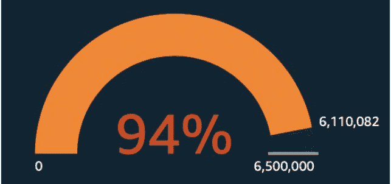

Figure 4.26 – Visual after conditional formatting has been applied

Feel free to try out different visual types and different conditions and settings.

### Q&A

- 1. 什么是 Amazon QuickSight 中的可视化？
- 2. 哪些可视化类型更适合可视化时间序列数据？
- 3. 你能举一些条件格式特别有用的示例吗？
- 4. 如何创建和应用自定义主题？
- 5. 什么是桑基图，何时会使用它？

### 进一步阅读

有关本章所涵盖内容的更多信息，请参阅以下资源：

- QuickSight 用户指南 – AWS: https://docs.aws.amazon.com/quicksight/latest/user/amazon-quicksight-user.pdf
