# 5 构建交互式仪表板

在本章中，我们将学习如何使用 Amazon QuickSight 开发交互式仪表板。你将学习如何向仪表板添加自定义控件，并使用参数为 BI 应用程序添加交互性。我们还将探讨带有点击操作的高级筛选选项，以及 URL 操作。

在本章中，我们将涵盖以下主题：

- 使用筛选器和参数
- 使用 QuickSight 操作

### 技术要求

对于本章，你需要以下内容：

- 一个 AWS 账户
- 一个配置了 Author 和 Reader 用户的 QuickSight 账户
- 我们在 _第 4 章，开发可视化和仪表板_ 中创建的仪表板

### 使用筛选器和参数

用户可以通过单击应用程序的特定区域或将鼠标悬停在可视化上来与仪表板交互，以获取特定数据点的其他信息。作为 BI 开发人员，你可能会遇到需要为仪表板添加额外交互性的场景，允许用户筛选数据集或实现特定操作。在本节中，我们将学习如何利用这些特定的 QuickSight 功能为仪表板添加交互性。我们将提供使用我们在前面第 4 章开发可视化和仪表板中开发的纽约数据集和仪表板的实际操作示例。但首先，我们需要了解如何使用 QuickSight 筛选器。

### 使用筛选器

QuickSight 作者可以筛选数据集。例如，当你需要在可视化之前细化数据集时，可以使用筛选。你可以控制 QuickSight 筛选器的范围，以便它们可以应用到你想要的可视化上。当应用于 QuickSight 分析时，筛选对读者来说是透明的。如果你需要允许读者筛选数据，可以在与读者共享仪表板时应用其他设置。让我们看一个示例来了解如何添加和应用筛选器。对于我们的示例，让我们假设我们已检测到空值，并且希望从某些可视化中删除它们：

1. 首先，我们需要打开我们的纽约出租车分析。
2. 我们将使用之前创建的透视表。当我们打开 Borough 类别时，可以观察到支付类型为空值。空值可能很有用，因为它们可以帮助我们检测数据中的问题。对于此示例，让我们假设我们不想在透视表中可视化空值，同时保持其他可视化不受影响：

| Pick Up Borough | Payment Type | Fare Amount   |
|-----------------|--------------|---------------|
| Bronx           | null         | $969,806.58   |
|                 | Cash         | $50,961.67    |
|                 | Credit Card  | $100,715.51   |
|                 | Dispute      | -$334.70      |
|                 | No Charge    | $1,036.51     |
|                 | Subtotal     | $1,122,185.57 |
| Brooklyn        |              | $2,172,314.53 |

图 5.1 – 带有空值的透视表

3. 通过单击可视化来选择透视表。然后，从左侧菜单中选择筛选器选项卡，如下面的屏幕截图所示：

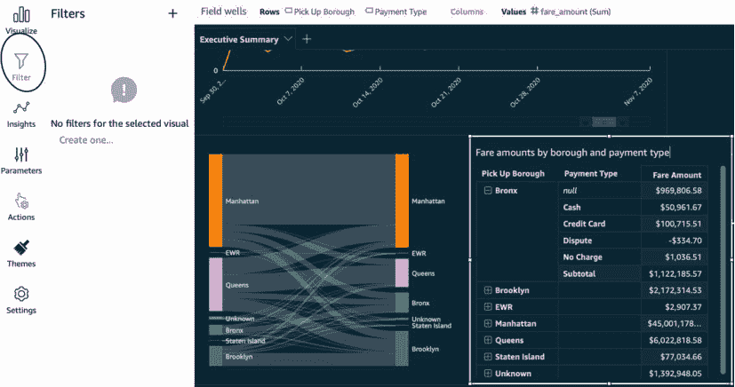

图 5.2 – 选择要筛选的可视化

4. 由于我们没有筛选，将收到创建筛选器的提示。单击 **Create one...** 提示，然后选择需要筛选的筛选器（在此示例中为 Payment Type）。

5. 此操作将创建一个筛选器。单击新创建的筛选器以获取筛选器配置选项。

6. 现在我们已创建筛选器，需要确认其范围。默认情况下，筛选器仅应用于所选可视化。筛选器不会应用于整个分析。如果我们需要将更多可视化添加到其范围，可以更改筛选器的范围。

7. 接下来，我们需要定义筛选条件。对于我们的示例，我们将添加一个条件来 _排除_ NULL 值，如下所示：

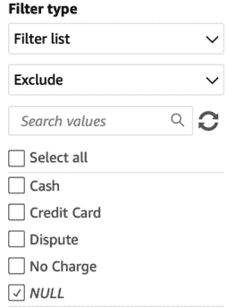

图 5.3 – 定义筛选条件

8. 单击 **Apply** 并观察 NULL 值如何从我们的可视化中排除。请注意，筛选器范围之外的其他可视化保持不变。

默认情况下，筛选器不会显示在读者用户界面上。某些 BI 应用程序可能需要给用户筛选数据的能力。

> **注意**
> 筛选数据集时，QuickSight 将查询数据集，然后应用筛选。如果数据集已配置为直接查询，QuickSight 将在筛选前连接到数据源以获取最新数据。如果数据集配置为 SPICE 数据集，则 QuickSight 将直接从 SPICE 获取数据，而无需查询或从原始数据源导入数据。

要允许读者用户筛选数据，我们需要在仪表板发布屏幕上选中 **Enable ad hoc filtering** 选项。该选项位于 **Advanced publish options** 下，如下所示：

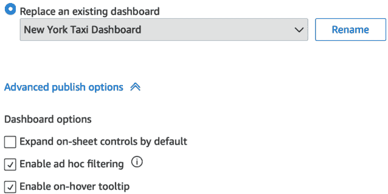

图 5.4 – 启用临时筛选

现在我们已经学习了如何添加筛选器，让我们介绍 QuickSight 参数的概念。

### 使用参数

QuickSight 中的参数是用户可以设置的变量，通常使用屏幕上的控件。参数可以以多种方式使用。例如，我们可以根据参数动态筛选分析数据。为了理解这个概念，我们将使用我们的纽约出租车分析示例。让我们假设我们的业务用户需要根据客户使用的支付类型来了解客户行为的模式和变化。为了实现此用例，我们将创建一个参数来存储用户对 `Payment Type` 字段的选择。

### 创建参数

创建参数很简单，如下所示：

1. 你可以选择左侧菜单上的 **Parameter** 项目，或单击屏幕右上角的 + **Add** 按钮，然后选择 **Add parameter**。选中后，你将看到参数创建屏幕，如下所示：

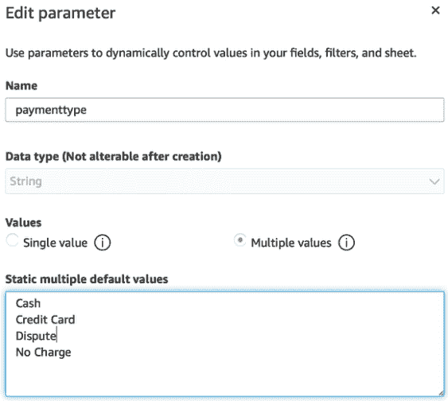

图 5.5 – 添加参数

2. 对于此示例，我们将使用以下值（如上一张屏幕截图所示）：

- **Name**: `paymenttype`
- **Data type**: String
- **Values**: Multiple values
- **Default values**: Cash, Credit Card, Dispute, No Charge

3. 接下来，单击 **Create**。参数现在应已添加到你的分析中。

此时，我们的参数已添加到分析中，但我们尚未使用它。接下来，我们将此参数与之前创建的筛选器关联起来。

### 将参数链接到筛选器

在我们仍处于分析状态并以作者用户身份登录的情况下，要将参数链接到筛选器，我们需要执行以下操作：

1. 首先，找到我们之前创建的筛选器。您可以单击已应用筛选器的可视化对象，然后单击左侧菜单中的“筛选器”项。

2. 现在单击 **Edit**，或直接单击我们之前创建的 **Payment Type** 筛选器。

3. 要将筛选器与参数链接，我们需要从 **Filter Type** 下拉菜单中选择 **Custom filter**。

4. 接下来，勾选 **Use parameters** 复选框。

5. 接下来，会出现一个弹出窗口，询问您是否要更改筛选器的范围。由于我们不需要筛选分析中的其他可视化对象，我们将选择 **No**。

> Note
> 创建参数后，随时可以编辑筛选器的范围。范围更新将立即生效，无需更新参数或控件。

6. 从下拉菜单中，选择我们之前创建的 `paymenttype` 参数。以下屏幕截图显示了将筛选器链接到参数时筛选器配置的外观：

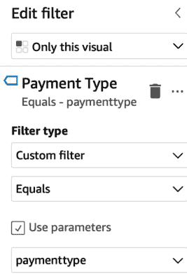

图 5.6 – 将筛选器链接到参数

7. 单击 **Apply**，然后单击 **Close**。

现在，我们的筛选器和参数已连接，筛选器将继承参数的默认值。在我们的示例中，我们使用了多值参数。我们可以确认，透视表仅显示包含参数默认值的记录。现在我们已将参数与可视化对象链接，将学习如何添加屏幕控件，并允许读者更改参数值。

### 添加屏幕控件

QuickSight 允许您添加屏幕控件，以便读者用户可以动态设置参数的值。在我们的示例中，设置 `paymenttype` 参数的值将导致 **Payment Type** 筛选器的值发生变化，该筛选器已应用于透视表可视化对象。要添加屏幕控件，请执行以下步骤：

1. 首先，从左侧菜单中选择 **Parameters** 项。

2. 然后，选择我们之前创建的 `paymenttype` 参数。从下拉菜单中，单击 **Add control**，如下所示：

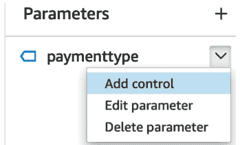

图 5.7 – 添加屏幕控件

3. 从控件的创建设置中，我们需要定义以下参数：

- **Display Name**：屏幕控件的用户友好名称。在我们的示例中，我们使用了 `Payment Type`。

- **Style**：用户用于设置参数的控件类型。控件样式选项也由参数的数据类型决定。例如，如果我们的参数是日期类型，则 **Date Picker** 将是可用选项之一。在我们的示例中，我们将使用 **List – Multiselect** 样式，如以下屏幕截图所示。此类型将允许用户从下拉菜单中选择多个值。

- **Values**：用户可以选择的值。您可以将这些值链接到数据集中的值，这可确保可用值与数据集同步，因此无需单独维护这些值。在我们的示例中，我们链接了 `Payment Type` 字段的值。以下屏幕截图显示了屏幕控件配置示例：

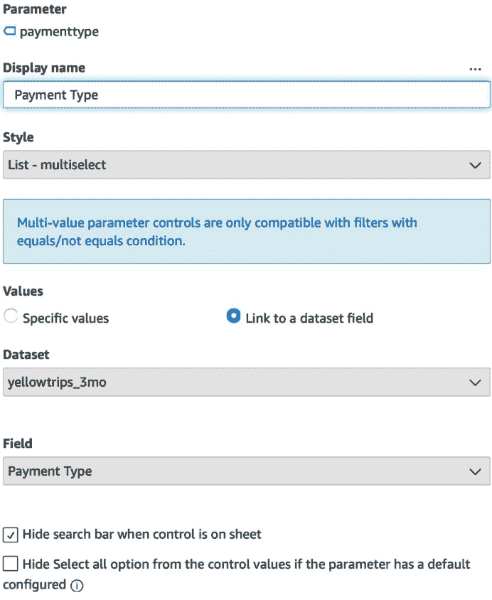

4. 单击 **Apply** 以添加屏幕控件。

现在我们已添加屏幕控件，拥有了发布交互式仪表板所需的所有组件。让我们来看看使仪表板实现交互性的一系列事件：

1. 首先，用户使用屏幕控件选择值。

2. 所选值将传递给参数。

3. 然后，这些参数用作筛选条件。

4. 最后，筛选器范围内的可视化对象在用户选择后更新。

以下图表描述了此处所述的流程：

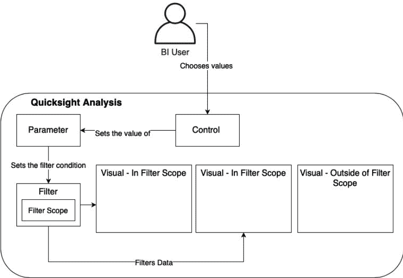

图 5.9 – 交互式筛选组件

现在我们已配置所有必需的组件，让我们来测试屏幕控件：

1. 首先，请注意，在屏幕顶部，我们有一个名为 **Controls** 的新部分，其中包含新创建的 Payment Type 屏幕控件。以下屏幕截图显示了新创建的控件：

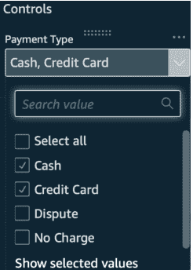

图 5.10 – 多选控件

2. 更改此控件的选择将自动更改 `paymenttype` 参数的值，该参数已配置为与我们的 Payment Type 筛选器协同工作。

3. 您可以从筛选器控件访问其他选项。可用选项之一允许您将控件从屏幕顶部分离并添加到分析表中。这是范围较窄的筛选器的一个好选项。在我们的示例中，我们的筛选器仅覆盖单个可视化对象，因此将控件放在可视化对象旁边可能会提供更好的整体用户体验，同时节省屏幕顶部的空间。以下屏幕截图显示了将屏幕控件放置在透视表旁边：

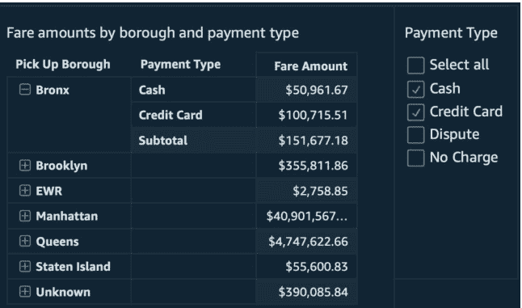

图 5.11 – 放置在分析表上的屏幕控件

现在我们已配置分析并安排了屏幕控件，可以将分析发布为仪表板并与读者用户共享。至此，我们已创建第一个真正交互式的 QuickSight 仪表板。接下来，我们将学习如何使用操作向仪表板添加更多交互式控件。

### 使用操作

QuickSight 操作允许您向仪表板添加交互性。它们可以是以下任意一种：

- **筛选器操作**
- **导航操作**
- **URL 操作**

接下来，我们将更详细地了解每种操作类型。为了理解每种类型，我们将使用纽约出租车示例分析来配置它们。

### 使用筛选器操作

URL 操作允许我们在用户单击仪表板特定区域时立即筛选数据。筛选器操作使读者更容易专注于分析的特定数据点。

在配置筛选器操作时，您需要选择分析中的一个可视化对象，然后提供以下信息：

- **操作名称**：筛选器操作的用户友好且具有描述性的名称。
- **激活方式**：**菜单选项** 或 **选择**：**菜单选项** 会在您单击可视化对象中的数据点时添加一个菜单项。单击该选项时，将激活 URL 操作。另一方面，使用 **选择** 选项时，您的 URL 操作将在单击数据点时直接激活。
- **筛选器范围**：哪些可视化对象将被筛选。

为了理解筛选器操作，我们将使用纽约出租车分析中的一个示例。假设我们希望用户立即关注特定行政区，并更新 KPI 和桑基图可视化对象以仅反映所选行政区。要选择行政区，我们将使用显示每个行政区平均小费的柱状图，我们在 _第 4 章，开发可视化对象和仪表板_ 中配置了该图表：

1. 首先，导航到分析，通过单击选择柱状图可视化对象。

2. 接下来，在选中可视化对象的情况下，从左侧菜单中单击 **操作**。

3. 单击 **添加操作**，然后从 **操作类型** 下拉菜单中选择 **筛选器操作**。

4. 添加以下屏幕截图中显示的值：

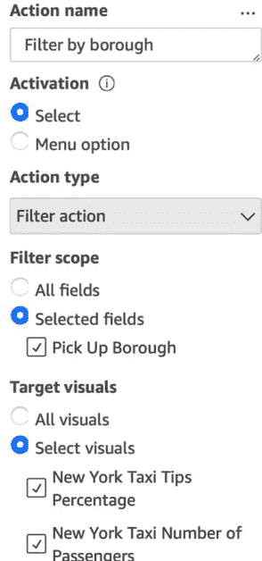

图 5.12 – 筛选器操作

我们将更新以下参数：

- **操作名称**：`Filter by borough`

- **激活方式**：**选择**

- **筛选器范围**：选定字段

- **目标可视化对象**：KPI 和桑基图可视化对象

## 单击 Save。

筛选器操作现已应用。要快速测试新创建的操作，只需单击柱状图中任意 Pickup Borough 数据点，并观察目标可视化对象如何更新。例如，选择 Queens 区时，我们可以看到 Sankey 图的示例，如下所示：

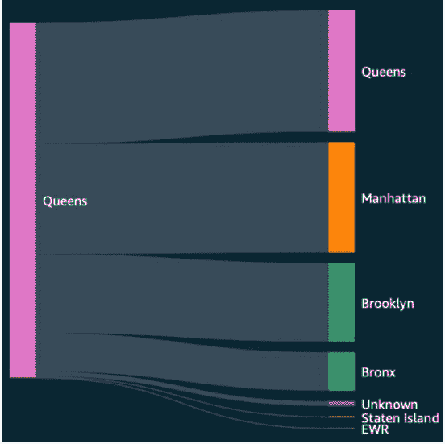

图 5.13 – 应用筛选器操作后的 Sankey 图

请随意尝试在分析中为其他可视化对象添加更多筛选器操作。接下来，我们将学习如何配置导航操作。

### 使用导航操作

在向分析添加可视化对象时，可能会出现单个页面包含过多可视化对象的情况。在这些场景中，您可以将可视化对象组织到工作表中。对于每个工作表，您可以提供用户友好的名称，以帮助 BI 用户导航仪表板。对于每个工作表，您可以提供以下详细信息：

- 标题
- 描述

这两者都可以帮助为用户提供上下文。标题和描述在存在多个工作表的场景中尤其有用。导航操作可以帮助您定义操作，允许用户在同一分析中快速导航到不同的工作表。

配置导航操作时，您需要选择分析中的一个可视化对象，然后提供以下信息：

- **操作名称**：导航操作的名称。
- **激活方式**：**菜单选项**或**选择**：**菜单选项**会在您单击可视化对象中的数据点时添加一个菜单项。单击该选项时，将激活 URL 操作。另一方面，使用**选择**选项时，单击数据点会直接激活 URL 操作。
- **目标工作表**：操作激活后用户重定向到的工作表名称。
- **参数**：这允许用户在导航到目标工作表后设置参数值。

接下来，我们将探讨另一种类型的操作：URL 操作。

### 使用 URL 操作

URL 操作允许我们在用户单击仪表板特定区域时，将用户重定向到另一个网站或另一个仪表板。URL 操作可以帮助 BI 用户轻松获取仪表板的额外上下文。

配置 URL 操作时，您需要选择分析中的一个可视化对象，然后提供以下信息：

- **操作名称**：URL 操作的用户友好且描述性的名称。
- **激活方式**：**菜单选项**或**选择**：**菜单选项**会在您单击可视化对象中的数据点时添加一个菜单项。单击该选项时，将激活 URL 操作。另一方面，使用**选择**选项时，单击数据点会直接激活 URL 操作。
- **URL**：您希望将用户重定向到的 URL。

> **注意**
> 您可以在 URL 字段中添加对字段值参数的引用。
> 这将允许您根据用户选择，将用户重定向到不同的 URL。引用参数的语法是 <<$parameter-name>>，而引用字段的语法是 {{ {field-name} }}。

- **打开方式**：此选项决定浏览器如何从 URL 操作打开链接。选项包括在同一标签页中打开、在不同标签页中打开，或在不同浏览器窗口中打开。

要了解如何设置 URL 操作，我们将使用我们的 New York Taxi 分析。假设我们需要在每个 New York 区上添加一个指向包含额外信息的外部网站的链接。对于此示例，我们将使用在第 4 章“开发可视化对象和仪表板”中配置的柱状图可视化对象。我们将使用 Wikipedia 作为外部网站：

1. 首先，导航到分析并选择柱状图可视化对象。
2. 接下来，在选中可视化对象的情况下，单击左侧菜单中的 Actions。
3. 单击 Add action，然后从 Action Type 下拉菜单中选择 URL action。
4. 添加以下屏幕截图中显示的值：

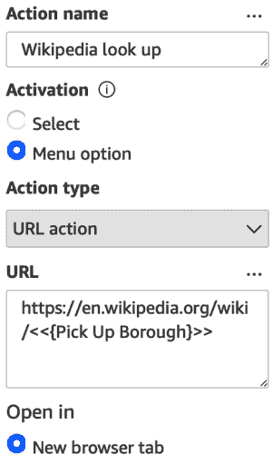

图 5.14 – URL 操作

这些值如下：
• **操作名称**：Wikipedia look up
• **激活方式**：Menu option
• **URL**：`https://en.wikipedia.org/wiki/<<{Pick Up Borough}>>`
• **打开方式**：New browser tab

5. 单击 Save。

URL 操作现已应用于我们的可视化对象。要测试 URL 操作，您需要单击应用了操作的可视化对象上的数据点。在我们的示例中，每个数据点都将重定向到不同的 URL，因为我们将 Pickup Borough 字段作为 URL 的一部分。在现实世界中测试类似内容时，您需要确保每个 URL 都能正确地将用户重定向。以下屏幕截图显示了我们在柱状图中右键单击 Manhattan 柱状图时将看到的内容。请注意，会出现一个 **Wikipedia look up** 菜单选项，单击它将重定向到 Manhattan Wikipedia 页面 (`https://en.wikipedia.org/wiki/Manhattan`)：

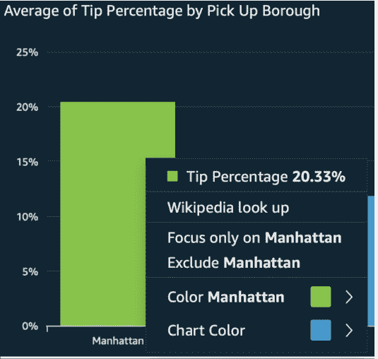

图 5.15 – URL 操作菜单项

因此，我们也了解了如何使用各种类型的操作。

## 摘要

恭喜您完成本章！在本章中，我们学习了如何为仪表板添加交互性。我们学习了如何添加 QuickSight 参数和屏幕控件，以根据用户输入筛选分析的数据。我们还学习了如何配置三种类型的操作：筛选器操作、导航操作和 URL 操作。使用这些功能，您将能够创建具有交互式控件的 BI 应用程序，从而增强 BI 应用程序的用户体验。通过本章学习的操作，您的用户将能够执行单击筛选、轻松在多个工作表之间导航，以及打开提供额外上下文的外部网站。

在下一章中，我们将学习如何在分析中使用洞察并添加机器学习。

## 问答

1. 哪种筛选器类型可以链接到参数？
2. 您如何将参数与 URL 操作一起使用？
3. 我们何时需要使用工作表？
4. 我们如何帮助业务用户在不同工作表之间导航？
5. 筛选器操作和导航操作之间有什么区别？
6. 操作激活方式中 **菜单选项** 和 **选择** 之间有什么区别？

## 进一步阅读

- • QuickSight 用户指南 – AWS: https://docs.aws.amazon.com/quicksight/latest/user/amazon-quicksight-user.pdf
