# 6 使用 ML 功能和洞察

在本章中，我们将探索 **Amazon QuickSight** 中的可视化类型。通过动手示例，我们将向仪表板添加 **机器学习 (ML)** 功能。更具体地说，我们将为时间序列数据添加预测功能和异常检测功能。为了描述数据中的洞察，我们将在仪表板中添加自然语言叙述。

在本章中，我们将涵盖以下主题：

- 使用预测
- 使用洞察
- 使用 ML 洞察

### 技术要求

本章您需要以下内容：

- 一个 **AWS 账户**
- 一个配置了 **Author** 和 **Reader** 用户的 QuickSight 账户
- 在 _第 2 章，Amazon QuickSight 简介_ 中创建的数据集
- 在 _第 3 章，使用 Amazon QuickSight 准备数据_ 中创建的分析

### 使用预测

Amazon QuickSight 允许您在无需开发复杂 ML 模型的情况下，向仪表板添加 **预测**。为了更好地了解如何配置预测，我们将使用在 _第 2 章，Amazon QuickSight 简介_ 中配置的示例数据集。

### 添加预测

对于我们的示例，假设我们需要开发一个包含未来出租车车费总数预测的仪表板。如预期，我们的数据具有一定的季节性。此外，我们可以从在 _第 3 章，使用 Amazon QuickSight 准备数据_ 中开发的折线图可视化对象中看到，在周日，出租车车费总数相比一周中的其他日子有所下降。为我们的数据集确定最合适的季节性并不总是简单直接的。在我们的示例中，根据我们考虑的时间间隔，我们有不同级别的季节性。一个季节可以是 24 小时、一周或一年。在配置预测时，确定正确的季节性很重要，因为它们可以用于更准确地预测未来事件和指标。

现在，让我们在我们的 _New York Taxi_ 分析中添加预测：

1. 首先，选择我们在 _第 3 章，使用 Amazon QuickSight 准备数据_ 中开发的折线图。

> **注意**
> 并非所有可视化类型都支持预测。带有时间维度的折线图非常适合预测，因为它们通常可视化时间序列数据。


## 接下来，单击可视化设置，然后单击 **Add forecast**，如下所示：

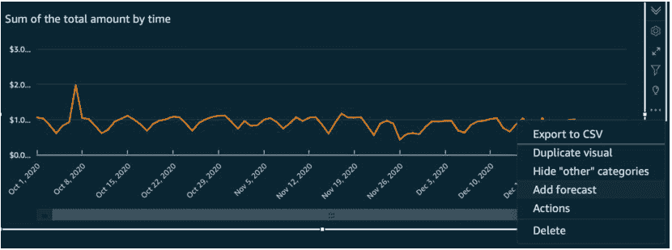

图 6.1 – 添加预测

### 接下来，我们将按如下方式编辑预测参数：

- **Forecast length**：Periods forward/backward 是您希望获取预测的时间间隔数量。

> **Note**
> 配置预测周期时，一个周期与应用预测的可视化的周期相匹配。例如，如果您的数据按日聚合，那么七个 (7) 个间隔的周期等于 1 周。如果您的数据按月聚合，那么一个周期将对应一个月，因此 12 个间隔的周期将是一整年。

- **Prediction interval**：这表示未来值将在预测值范围内的概率。

> **Note**
> 预测区间可以在 5% 到 95% 之间。预测区间越低，预测范围就越窄。

- **Seasonality**：这是您的时间序列具有可预测变化的时间间隔。默认情况下，QuickSight 将自动为您的数据识别最佳季节性模式。您可以选择用手动选择覆盖自动选择。

在我们的示例中，我们将使用以下值：

- **Periods forwards**：30 – 如果我们的数据按日聚合，这将为我们提供 1 个月的预测。
- **Periods backwards**：0 – 在此示例中，我们不关心向后预测。
- **Prediction interval**：75 – 我们可以从 75 作为起点开始，然后进行调整。
- **Seasonality**：`Automatic`。

4. 预测区域显示为一组值范围，并以不同颜色突出显示。我们可以看到带有预测的可视化，如下图所示：

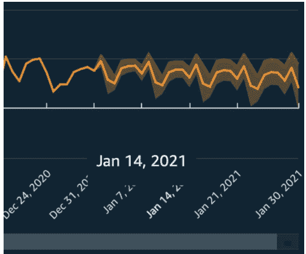

图 6.2 – 带有预测的时间序列数据

现在我们已将预测功能添加到折线图可视化中，在下一节中，我们将学习如何添加可以改变我们预测的不同场景，称为 what-if 场景。

### 使用 what-if 场景

**What-if 场景**允许我们在未来预测特定目标，然后观察这如何影响预测。为了更好地理解 what-if 分析，我们将使用刚刚配置的预测可视化。让我们假设，由于一项新举措，出租车乘车量预计将增加，并且到 2020 年 1 月 15 日，我们将至少有 2.5 倍的增长。我们可以使用此场景来了解这个目标将如何影响我们对未来的预测：

1. 首先，要打开 what-if 分析，我们只需单击预测区域中的一个数据点即可。
2. 接下来，我们需要定义我们的场景。在我们的案例中，选择 2021 年 1 月 15 日，我们只需添加目标值为 $2,500,000，这超出了原始预测的两倍多。
3. 单击 **Apply**，然后观察我们有一条与收入增加场景相对应的第二条预测线。原始预测也可以通过虚线观察到。请参见下图，了解 what-if 场景示例：

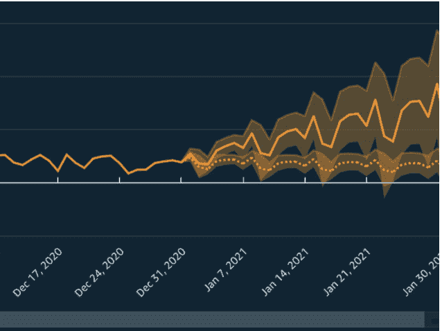

图 6.3 – What-if 场景

恭喜，您只需点击几下即可添加 what-if 分析。接下来，我们将学习如何使用 insights，这是一种特殊的 QuickSight 可视化，允许您使用自然语言描述数据中的见解。

### 使用 insights

QuickSight **insights** 提供了一组功能，允许您使用自然语言表达数据中的见解。QuickSight 可以自动解释图表并建议您可以快速添加到分析中的叙述。除此之外，您可以构建自己的自定义叙述。在本节中，我们将执行以下操作：

- 了解如何使用建议的 insights。
- 创建和编辑自定义 insight。

#### 添加建议的 insights

为了更好地理解 **autonarrative** 功能，我们将使用 _New York Taxi_ 分析示例。让我们从桑基图开始，从数据中发现有趣的见解：

1. 首先，打开分析并通过单击选择任何可视化。
2. 接下来，单击 insights 图标以显示 **Suggested insights** 列表，如下所示：

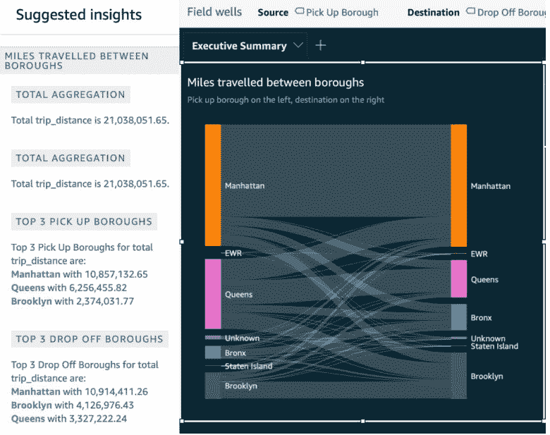

图 6.4 – 选择建议的 insights

接下来，我们将选择一个看起来有趣的 insight 进行显示。例如，我们可以显示我们正在可视化的整个期间内出租车车费最高和最低的天数。

3. 向下滚动以找到 **WORST DAY** insight，然后单击加号图标将 insight 添加到您的分析中。
4. 对 **BEST DAY** insight 重复 _Step 3_。
5. 调整 insight 的大小和格式。

| BEST DAY | WORST DAY |
|---|---|
| Highest day is Oct 7, 2020 with total total_amount of $1,978,758.30 | Lowest day is Dec 25, 2020 with total total_amount of $345,309.32 |

图 6.5 – 添加建议的 insights

有趣的是，圣诞节碰巧是出租车车费最少的一天。请随意探索并熟悉其他叙述建议。在下一节中，我们将学习如何手动创建新叙述，这在您需要与自动建议不同的叙述，并需要通过自定义叙述来控制显示的文本时特别有用。

### 创建和编辑 insight

在本节中，我们将学习如何创建和编辑自定义 insight。为了更好地了解如何设置它，我们将使用 New York 数据集分析。让我们假设我们想要显示 New York 出租车行驶的总里程数，并使用自然语言在屏幕上显示它。例如，考虑以下内容：

```
The total distance traveled in New York over the period between <Start Date> to <End Date> was <number> miles.
```

在下一节中，我们将学习如何开发一个回答上述问题的 insight。

### 添加 insight

在本节中，我们将首先学习如何在 Amazon QuickSight 中添加 insight：

1. 首先，单击 **+ Add** 按钮，然后选择 **Add Insight**。
2. 接下来，我们需要为 insight 选择计算类型，如下图所示：

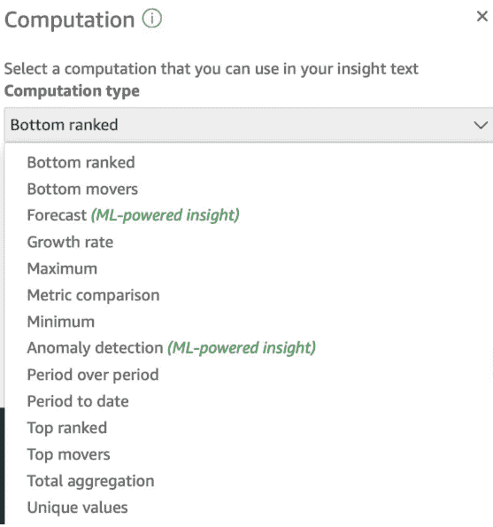

图 6.6 – 选择计算类型

3. 选择 **Total aggregation** 计算类型，因为我们的问题是 `trip_distance` 字段的总聚合，该字段表示行驶的总里程数。
4. 现在，我们需要从数据集中选择字段来填充 insight。选择字段的方式与我们为可视化选择字段类似，即将值拖放到分析顶部屏幕的 **Field Well** 区域中。对于我们的计算，我们需要选择 `trip_distance (Sum)` 作为 **Values** 字段，并保持 **Time** 和 **Categories** 字段为空。

## 现在，insight 应该如下所示：

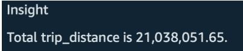

图 6.7 – Total aggregation insight

现在，我们已成功将 insight 添加到分析中。我们现在需要编辑它，使其与我们追求的叙述相匹配。在下一节中，我们将学习如何编辑 insight。

### 编辑 insight

在向叙述中添加元素时，您可以自动添加以下内容：

- **Computations**：预定义的计算
- **Parameters**：您可以在分析中设置的变量
- **Functions**：用于将字段更改为所需格式

为了更好地了解如何使用这些术语，我们将编辑我们的示例叙述：

1. 首先，让我们添加两个新参数，`DateStart` 和 `DateEnd`，就像我们在第 5 章“构建交互式仪表板”中学到的那样。将 `DateStart` 参数的默认值设置为 2020 年 10 月 1 日，将 `DateEnd` 参数的默认值设置为 2020 年 12 月 31 日。
2. 将这些参数连接到筛选器，并使用 **Pick Date** 字段来控制参数值。确保筛选器范围包括 insight 可视化。
3. 现在我们已经设置了两个参数，我们将编辑叙述。


要编辑洞察，我们需要将鼠标悬停在洞察右侧，点击 ... 图标，然后选择 **Customize narrative** 以打开 **narrative expression editor**，如下所示：

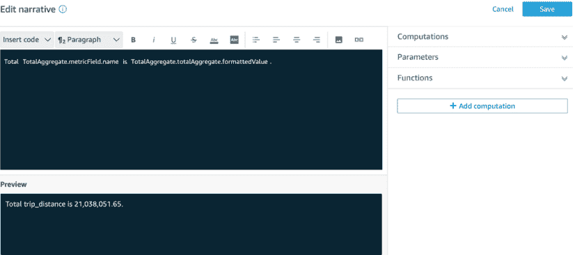

## Figure 6.8 – Editing a narrative

注意，叙述包含 Total TotalAggregate.metricField.name is TotalAggregate.totalAggregate.formattedValue。我们可以修改此文本，以便实现所需的叙述。

对于我们的目标叙述，我们需要看到类似以下的内容：

> "The total distance traveled in New York over the period between 01 Oct 2020 and 31 Dec 2020 is 21,036,854.06 miles."

从上一步中，我们已经拥有总里程数 TotalAggregate.totalAggregate.formattedValue。为了达到目标叙述，我们需要执行以下操作：

- 1. Customize the remaining text.
- 2. Add the two date parameters.
- 3. Convert the date into the desired date format.

从文本开始，我们需要用以下内容替换现有文本：

> "The total distance traveled in New York over the period between <> and <> is TotalAggregate.totalAggregate. formattedValue miles."

接下来，我们将添加两个日期参数。您可以访问屏幕右侧的 **Parameters** 菜单，然后简单地添加这两个参数。

注意，表达式将类似于 `${DateStart}`。观察位于编辑器下方的 **Preview**。您可能会注意到时间以纪元格式显示，这不是最终用户所期望的。出于这个原因，我们需要将日期转换为最终用户可以理解的格式。要更改格式，我们将使用 `formatDate` 函数。您可以通过展开右侧菜单中的 **Functions** 菜单并选择 `formatDate` 来找到该函数。该函数需要两个参数：

- • The date column
- • The format expressed as a string

在我们的示例中，我们将使用 `dd MMM yyyy` 格式，因此，对于开始日期，函数将是 `formatDate(${DateStart},'dd MMM yyyy')`，对于结束日期，函数将是 `formatDate(${DateEnd},'dd MMM yyyy')`。

现在我们已经添加了开始日期和结束日期，文本将如下所示：

The total distance traveled in New York over the period between `formatDate(${DateStart},'dd MMM yyyy')` and `formatDate(${DateEnd},'dd MMM yyyy')` is `TotalAggregate.totalAggregate.formattedValue` miles.

最后，使用编辑器编辑文本格式。例如，我们可以更改里程数的颜色，并将开始日期和结束日期文本设置为粗体以强调。应用这些更改后，单击 **Save**。叙述将如下所示：

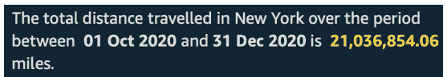

## Figure 6.9 – Insight with a customized narrative

叙述可以非常有用，用于用自然语言描述数据中的重要洞察。通过 QuickSight 编辑器，我们可以完全控制文本如何显示给最终用户。既然我们已经学习了如何处理和自定义洞察，在下一节中，我们将学习如何使用 ML 驱动的洞察。

### Working with ML insights

QuickSight 有一种特殊类型的洞察，其结果来自基于 ML 的计算。QuickSight 支持两种类型的 ML 洞察：

- Forecasting
- Anomaly detection

在下一节中，我们将学习如何配置每种类型的洞察。

### Working with forecasting insights

我们学习了如何在折线图可视化中添加预测。QuickSight 还允许您将预测作为叙述添加，以显示预测值。例如，在特定日期，从曼哈顿到皇后区预计要行驶多少英里？

为了更好地理解如何配置这种类型的可视化，我们将使用我们的 _New York Taxi_ 分析示例来回答这个问题：

- 1. First, let’s create a new insight and select **Forecast ML-Powered Insight** from the drop-down list.
- 2. For this example, let’s assume that we want the user to choose the pick-up borough and the destination borough (drop-off borough). To achieve this, we will create two filter parameters (let’s name them `PickUpBoroughForecast` and `DropOffBoroughForecast`) with on-screen controls that allow the user to select the pick-up and drop-off boroughs, as we learned in _Chapter 4, Developing Visuals and Dashboards_. Make sure the filter applies only to the newly created forecast insight so that it is not affecting the other visuals in our analysis.
- 3. Now, let’s focus on the ML forecast visual. Let’s assume that we need to estimate the total miles driven between Manhattan and Queens on the 10 January, which is 10 days after our latest data point.
- 4. Select the `PickUp Time` value as the **Time** field and the `trip_distance(sum)` value as the **Value** field. Now, the forecasting visual should automatically display text like the following:

```
Total trip_distance is forecasted to be 4,546.560032279868 for Jan 14, 2021
```

- 5. Now, we will need to customize the narrative to ensure it displays the text we need and the forecast time is what we expect.

6. In the narrative editor, we will alter the text and include the two parameters. We can optionally round the miles to the nearest integer. After these changes, the narrative should look like the following:

```
Total distance driven from ${PickUpBoroughForecast} to ${DropOffBoroughForecast} on the ForecastInsight.timeValue.formattedValue is forecasted to be round(ForecastInsight.metricValue.value,0) miles.
```

7. Next, we need to ensure that the forecast parameters are correct. To access the forecast parameters, click the pencil icon next to the **ForecastInsight** computation, as shown here:

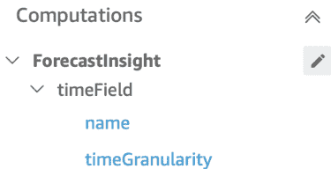

## Figure 6.10 – Accessing the ForecastInsight parameters

8. In the next screen, ensure that the forecast length is set as 10 for the **forward period** and 0 for the **backward period**.

9. Optionally, edit the text styling. After these changes, the forecast insight, including the two onscreen controls, will look like the following:

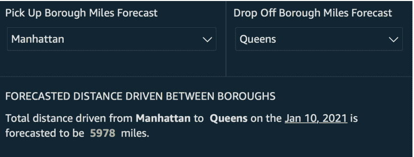

## Figure 6.11 – ML-driven forecast insight

通过此可视化，我们的最终用户可以选择任何上车区和下车区，并轻松访问由 QuickSight 生成的 ML 预测，并以自然语言形式将其显示回来。既然我们已经学习了如何添加预测洞察，在下一节中，我们将学习如何处理另一种类型的 ML 驱动洞察——**异常检测洞察**。

### Working with anomaly detection insights

QuickSight 还允许您添加异常检测洞察并探索异常。例如，是否有任何日期的出租车流量低于正常水平？

### Adding and editing anomaly detection insights

为了更好地理解如何配置这种类型的可视化，我们将使用我们的 _New York Taxi_ 分析：

- 1. First, let’s create a new insight and select **Anomaly Detection (ML-powered Insight)** from the drop-down menu.
- 2. Now, we need to choose the fields for our newly created insight. Set the **Time** field as _Pick Up Time_ and the **Value** field as _trip_distance_ (_sum_).
- 3. Next, we need to configure our anomaly detection. Click on **Get started**, as shown here:

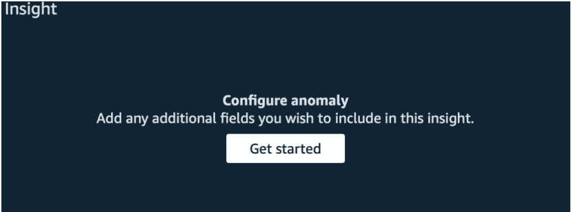

## Figure 6.12 – Get started with anomaly detection

4. Next, on the anomaly detection configuration page, leave everything as is for now. Add Pick Up Borough, Drop Off Borough, Pick Up Zone, and Drop Off Zone as the four contributor fields. Before you click Save, let’s observe the key components of this page, shown as follows:

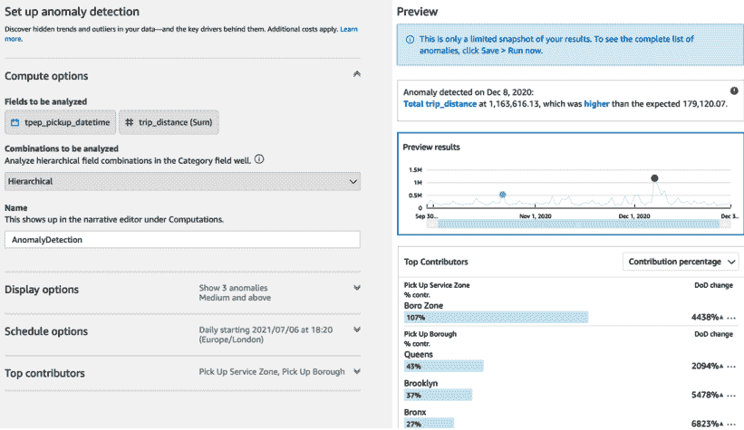

## Figure 6.13 – Set up anomaly detection page

在左侧，我们拥有所有设置，而在右侧，我们拥有预览屏幕。预览屏幕可以帮助我们立即了解我们应用的任何更改的影响。查看设置时，您可以选择分析字段的层次结构（这在我们的示例中不适用，因为我们只使用单个 Time 字段和单个 Value 字段，没有任何维度）。您还可以配置显示选项，并确定需要显示哪些异常。您可以安排 ML 作业，还可以定义被视为异常值贡献者的字段。这些字段将在检测到异常时用于贡献分析。


+   5. 接下来，单击 **Save**，然后运行 ML 分析以生成异常。几分钟后，我们的洞察将填充发现的任何异常。请参阅以下截图作为示例：

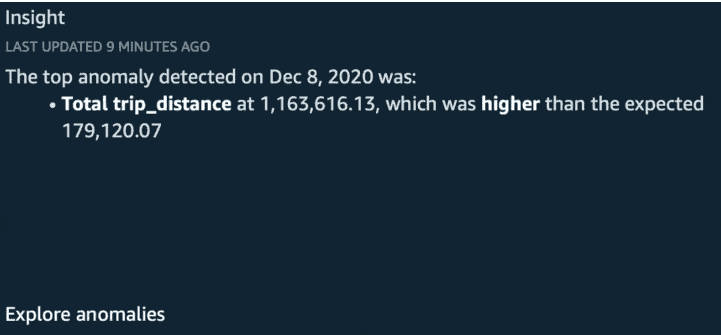

图 6.14 – 异常检测洞察示例

+   6. 与其他叙述类似，我们可以自定义此叙述，以便显示我们希望最终用户看到的文本。目前，我们将保留自动生成的文本。让我们观察识别出的异常——在特定日期（12 月 8 日），行驶里程比预期多出六倍以上。

请注意异常检测洞察底部的 **Explore anomalies** 按钮。在下一节中，我们将学习如何探索异常并执行贡献者分析。

### 探索异常

QuickSight 为用户提供了一种工具，用于探索异常并了解异常值的影响因素。为了更好地理解此功能，我们将使用在上一节中配置的异常检测洞察。单击 ML 驱动洞察底部的 **Explore anomalies** 以访问此用户界面：

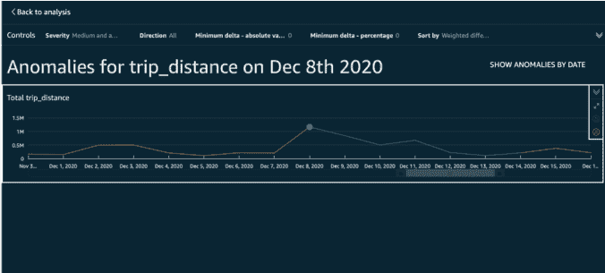

图 6.15 – 探索异常

在屏幕顶部，我们可以选择设置以确定将显示哪些异常。我们可以从以下选项中选择：

+   - **Severity**：这决定了我们的算法在检测异常时的敏感度。
+   - **Direction**：这决定了我们是关注高于预期的值、低于预期的值，还是两者皆关注。
+   - **Minimum delta**（绝对值或百分比）：这允许我们设置特定的值或百分比，以确定异常检测的阈值。

对于此示例，我们不需要更改这些值。我们可以关注屏幕左侧，查看异常的贡献者。我们可以按其对异常的贡献进行排名，并按以下标准对其进行排序：

+   - 偏离预期值
+   - 绝对差值
+   - 贡献百分比
+   - 百分比差异

现在，让我们观察使用示例数据能获得什么样的洞察。当按贡献百分比排序时，我们可以观察到，与正常情况相比，Boro Zone 作为接送区域对总里程的贡献要显著更多。就行政区而言，Queens 作为接送行政区的贡献差异最大，而 Manhattan Beach 和 Crown Heights North 作为送达行政区的贡献差异最大。当我们按偏离预期值对贡献者进行排序时，结果也是一致的。我不确定那天纽约是否发生了任何重大事件，但我们当然可以轻松地看出，那个星期天的出租车数据有些异常。

### ###### 摘要

恭喜您完成本章。在本章中，我们学习了如何将 ML 功能添加到仪表板中。我们学习了如何添加预测，包括使用假设分析构建复杂场景。我们还学习了如何配置叙述，并使用 QuickSight 叙述编辑器对其进行自定义。最后，我们学习了如何创建异常值检测，并为异常检测执行贡献者分析。凭借本章学到的功能，您的用户将能够通过简单的计算或更复杂的 ML 驱动计算，获取丰富的可视化效果和自然语言叙述。

此时，我们已经了解了 QuickSight 分析的大部分功能，并结合您迄今在本书中学到的知识，可以配置为业务用户提供丰富洞察的复杂仪表板。在下一章中，我们将学习如何将这些仪表板嵌入到您自己的自定义应用程序中。

### ###### 问题

+   1. 添加预测时，最合适的可视化类型是什么？
+   2. 什么是 QuickSight 叙述，我们何时应该使用它们？
+   3. 我们何时应该为洞察使用 ML 智能，而不是更简单的计算？
+   4. 在 QuickSight 中配置异常检测时，贡献者是什么？
+   5. 我们如何访问异常值检测应用程序？

### ###### 延伸阅读

+   • *Amazon QuickSight 用户指南：*
+   https://docs.aws.amazon.com/quicksight/latest/user/amazon-quicksight-user.pdf
