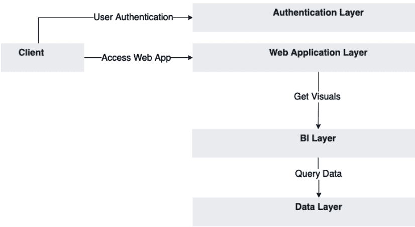
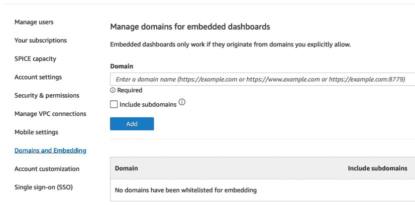
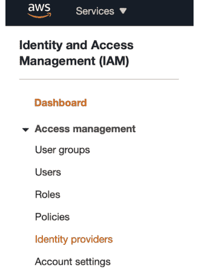
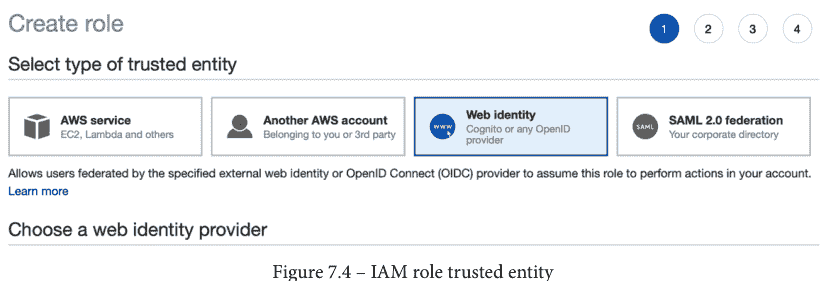
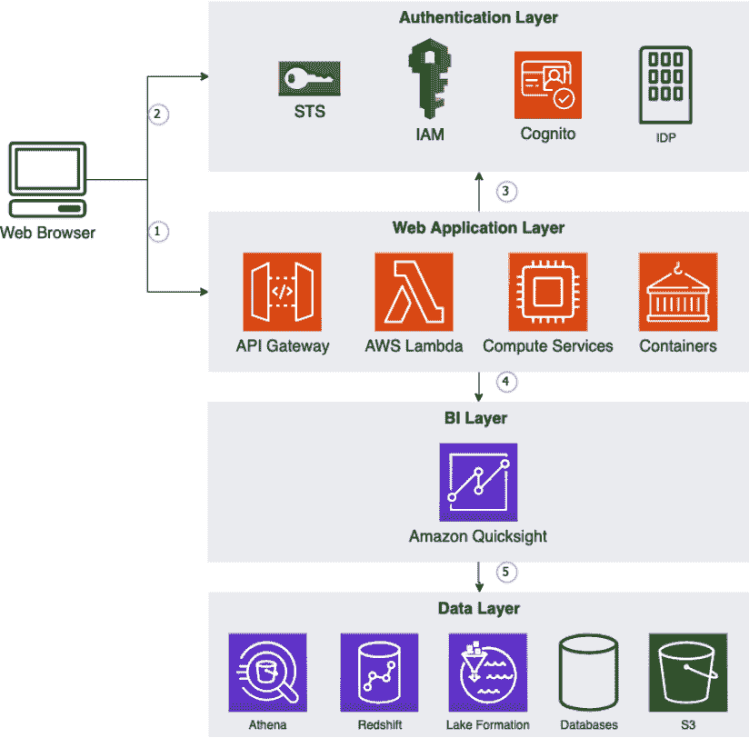
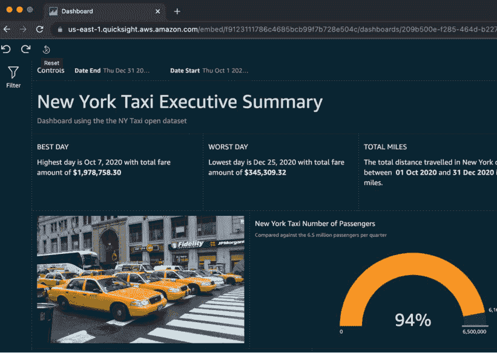

# # 7 了解嵌入式分析

在本章中，我们将了解 Amazon QuickSight 的嵌入式功能。我们将讨论嵌入式分析的业务驱动因素，并深入了解其架构。最后，在本章中，我们将提供动手示例，帮助您了解如何设置嵌入式分析。

在本章中，我们将涵盖以下主题：

+   • QuickSight 嵌入式分析简介
+   • 架构和用户身份验证
+   • 生成嵌入式仪表板 URL

## ## 技术要求

本章，您需要以下内容：

+   - 具有管理员权限的 AWS 账户

+   - 配置了 Author 和 Reader 用户的 QuickSight 账户

+   - 在 _第 4 章，开发可视化和仪表板_ 中创建的仪表板

## ## QuickSight 嵌入式分析简介

到目前为止，在本书中，我们学习了如何在原生 QuickSight Web 应用程序中创建仪表板并处理分析。对于许多用例，这已经足够。另一方面，有些组织需要将数据可视化添加到现有 Web 门户中，而不在原生 QuickSight 应用程序内。

## ## 了解嵌入式的业务驱动因素

在嵌入式之前，组织需要开发自己的自定义 **Business Intelligence (BI) 解决方案**。D3.js (https://d3js.org) 是一个用于 Web 数据可视化的开源 JavaScript 库。D3.js 需要高水平的专业知识。这种人才很难找到，使得许多组织很难采用这项技术。虽然网上有很多关于如何构建 D3.js 可视化效果的示例 (https://observablehq.com/@d3/gallery)，但 JavaScript 对 BI 开发人员来说可能是一门难以学习的语言。同时，Web 开发人员可能对组织的数据缺乏深入了解，这使得他们难以为试图解决的问题选择合适的可视化效果，以及从数据中获得洞察。除此之外，在构建嵌入式 BI 解决方案时，组织还需要考虑其他方面，例如以下几点：**

+   - 我们如何从数据存储中获取数据？

+   - 我们需要多久获取一次新数据？

+   - 有多少用户将访问该应用程序？

QuickSight 可以通过仪表板嵌入直接解决这些挑战。您无需开发自定义可视化组件，而是可以使用 QuickSight API 请求数据可视化，并将其嵌入到 HTML 代码中。QuickSight 是一项完全托管的 AWS 服务，并会根据用户数量自动扩展，使组织和 BI 开发人员能够将精力集中在构建仪表板上，而不是扩展其 BI 解决方案。出于这些原因，当组织需要利用 AWS 云的规模来为其嵌入到 Web 应用程序中的 BI 解决方案时，嵌入式仪表板可以是一种高效且易于使用的解决方案。接下来，我们将区分 QuickSight 支持的两种嵌入式分析类型。

### ###### 了解嵌入式分析类型

Amazon QuickSight 支持两种不同的嵌入式功能：

+   • 只读仪表板嵌入

+   • QuickSight 控制台嵌入

### ###### 了解只读仪表板嵌入

您可以将只读仪表板嵌入到 Web 应用程序中。这种嵌入式可用于向自定义门户应用程序添加只读可视化效果，并将其暴露给内部或外部用户。访问嵌入式仪表板的用户的体验与通过 Web 应用程序访问 QuickSight 仪表板的体验类似，如第 3 章《使用 Amazon QuickSight 准备数据》中所示。虽然用户可以查看可视化效果，以及钻取或选择特定的数据点或类别，但他们无法访问创作界面和数据集创建过程。在这种模式下，可视化创建、数据集设置以及作者用户可以完成的所有其他操作，只能使用 QuickSight Web 应用程序完成。对于只读仪表板嵌入，您的用户可以进行身份验证，或者您可以启用匿名访问，以允许未经过身份验证的用户查看仪表板。后者是一个不错的选择，当您不需要用户进行身份验证即可访问仪表板时，例如当您需要将仪表板嵌入到面向公众的网站时。

> 注意
> 要启用匿名访问，您的 QuickSight 管理员需要启用会话容量规划。使用会话容量规划，您可以根据仪表板预期的流量购买多个会话。每个会话是一个 30 分钟的使用块。


嵌入式仪表板的形式是带有授权代码的 URL。要获取嵌入式仪表板 URL，您需要调用 GetDashboardEmbedUrl API 调用。该 API 调用返回一个带有授权代码的会话 URL，可用于将仪表板嵌入到您的网站中。GetDashboardEmbedUrl API 调用需要由 Web 应用程序服务器发起，而不是从用户的浏览器发起。要将嵌入式仪表板 URL 添加到您的网站，您可以使用 QuickSight Embedding SDK 中的 embeddedDashboard(options) 方法。这样您可以轻松设置参数值，以便仪表板以特定的初始参数启动。其他选项包括嵌入式框架格式、允许/不允许打印、滚动行为和起始工作表。有关更多信息，您可以阅读 QuickSight Embedding SDK 文档：https://github.com/aws labs/amazon-QuickSight-embedding-sdk。

### 了解 QuickSight 控制台嵌入

您可以将完整的 QuickSight 控制台应用程序嵌入到您的 Web 应用程序中。嵌入式控制台功能仅适用于经过身份验证的 QuickSight 用户。如预期，匿名访问不适用于此类嵌入。与 QuickSight Web 应用程序类似，只有经过身份验证的用户才能访问 QuickSight 控制台。控制台嵌入将为您的用户提供完整的 QuickSight 体验。您将能够让读取者和作者用户都使用它。作者将能够配置数据集、执行分析和共享仪表板，而您的读取者将能够访问只读仪表板。控制台会话的形式是带有授权代码的 URL。要获取控制台嵌入 URL，您需要使用 QuickSight GetSessionEmbedUrl API 操作。一旦您有了 URL，您可以使用 QuickSight Embedding SDK 中的 embedSession(options) 将 QuickSight 控制台嵌入到您的 Web 应用程序中。有关更多信息，请访问 https://github.com/aws labs/amazon-QuickSight-embedding-sdk。

现在我们已经讨论了两种嵌入式分析类型，在下一节中，我们将讨论嵌入式分析架构。

### 探索架构和用户身份验证

在本节中，我们将重点介绍嵌入式分析的架构组件。要了解这种端到端架构，我们将其分解为三个层：

- Web 应用程序层
- BI 和数据层
- 身份验证和授权层

这可以通过以下图表更好地表示：



图 7.1 – 嵌入式分析的通用架构

通常，客户端通常使用 Web 浏览器访问 Web 应用程序或 Web 门户。在许多情况下，用户需要向 Web 应用程序进行身份验证。客户端将用户凭据（通常是用户名和密码）提交给 **身份验证层**，后者会返回访问代码/令牌，以便客户端可以与 **Web 应用程序层** 进行通信。在嵌入式分析中，Web 应用程序层将负责从 **BI 层** 获取嵌入式可视化内容，而 BI 层则负责从数据源查询数据并对其进行可视化（**数据层**）。

在下一节中，我们将分析这些架构组件中的每一个，并确定可用于构建它们的 AWS 服务。

### Web 应用程序层概述

在嵌入式仪表板应用程序中，嵌入式仪表板嵌入在此层中。Web 应用程序层与身份验证层和仪表板层进行交互。Web 应用程序通常由用户的 Web 浏览器访问。Web 应用程序层负责将应用程序的内容发送回浏览器用户。确保 Web 应用程序层有足够的资源来支持您的用户是您的责任，您需要确保 Web 服务器有足够的容量来接受传入连接。出于这个原因，您可以考虑 AWS 无服务器服务，例如 **Amazon Lambda**、**Amazon S3**（用于静态内容）和 **Amazon API Gateway**，以构建一个能够根据传入需求自动扩展的无服务器 Web 应用程序。其他选项包括其他计算和容器服务，例如 **Amazon EKS**、**ECS**、**Fargate** 和 **EC2**。您还可以将此层托管在 AWS 之外，这意味着您不需要将应用程序移至 AWS 云即可使用 QuickSight 的嵌入式分析。为了使嵌入式分析正常工作，您需要在 QuickSight 的设置中将 Web 应用程序的域加入白名单。

要在 Amazon QuickSight 中加入域白名单，请执行以下步骤：

1. 以管理员用户身份登录，并从右上角的下拉菜单中选择 **Manage QuickSight**。

2. 接下来，选择 **Domains and Embedding** 以转到以下屏幕截图中显示的菜单：

Edition: Enterprise



图 7.2 – 域和嵌入设置

3. 输入您的 Web 应用程序的域并单击 **Add**。请注意，如果需要，您可以选择包含子域，只需勾选 **Include subdomains** 复选框即可。

现在我们已经讨论了 Web 应用程序层，将继续介绍 BI 层。

### BI 层概述

仪表板层是向 Web 应用程序层提供嵌入式仪表板的组件。Amazon QuickSight 是此层的核心组件。此层也可以嵌入，使用完整的控制台嵌入。BI 层负责以下内容：

- 与数据源集成
- 强制执行对仪表板的访问
- 提供嵌入式仪表板 URL

关于可扩展性，QuickSight 将根据您配置的用户数量自动扩展。如果您有匿名嵌入，则需要启用会话容量规划。此层与数据存储进行交互，消除了将访问数据存储的代码嵌入到应用程序中的需求，从而简化了与数据源的集成。要使用数据集，您必须使用我们在第 3 章《使用 Amazon QuickSight 准备数据》中了解的 QuickSight 功能，而不是开发自定义代码。可视化和洞察是使用 QuickSight 的原生功能开发的。最后，在此层中，我们配置哪些用户可以访问哪些仪表板。获授权的用户会获得带有授权代码的仪表板 URL，而没有访问权限的用户将不会获得仪表板 URL。接下来，我们将讨论 QuickSight 中嵌入式分析解决方案的身份验证层。

### 了解身份验证层

在使用 QuickSight 构建嵌入式 BI 应用程序时，用户授权和身份验证是重要的考虑因素。需要解决的关键问题如下：

- 如何对用户进行身份验证？（身份验证）
- 哪些用户可以访问哪些仪表板？（授权）

在嵌入式分析中，用户通常使用存储在 Amazon QuickSight 之外的身份存储中的凭据进行身份验证。您可以使用 **Amazon Cognito** 用户池作为云原生嵌入式分析架构的身份存储。您可以使用 IAM 配置身份提供程序，以便为经过身份验证的实体担任 IAM 角色。

要使用 IAM 配置身份提供程序，请执行以下步骤：

1. 以 AWS 管理员身份登录并打开 IAM 控制台。
2. 单击 **Identity providers** 选项，如下所示：



图 7.3 – 配置身份提供程序

3. 选择身份提供程序的类型（SAML 或 OIDC），并为您的身份提供程序提供所需的元数据。

设置身份提供程序后，您可以为 IAM 角色配置信任关系。您的 Web 应用程序需要能够担任具有访问所需 QuickSight API 权限的 IAM 角色，以便它可以检索嵌入 URL。

以下是允许调用者对所有资源调用 `GetDashboardEmbedUrl` 和 `GetAuthCode` 函数的示例策略：

```
{
 "Version": "2012-10-17",
 "Statement": [
```


Policies can be assigned to IAM roles, which can be assumed by applications before they call AWS services. A policy will determine the level of access to AWS. The next important step is to establish a trust relationship between the IAM identity provider and the role so that authenticated entities can assume the role and generate the embedding dashboard URL. When you create an IAM role, you will need to select the type of trusted entity. The choice is between an AWS service, such as a role that can be assumed by a service, for example, AWS Lambda, another AWS account, a web identity such as Amazon Cognito or other OpenID identity providers, or SAML 2.0 Federation for corporate users. You will see the following when selecting the type of your entity when creating a role:



Once you create the role, you can attach a policy with the required permissions to call the QuickSight APIs for the dashboard embedding. To get the temporary credentials, your web application layer will need to call the **Amazon STS** service’s `AssumeRole` API or `AssumeRoleWithSAML` or `AssumeRoleWithWebIdentity`, depending on the identity provider. Once you have the required credentials, then your web application will be able to call the QuickSight APIs to retrieve the embed URL, which is then added to your web frontend.

### 把所有内容整合在一起

Now that we have looked at the main architectural components of the architecture, we will enrich _Figure 7.1_ by adding more specific components (including the relevant AWS services) to each of its layers.

For the authentication layer, we can use the following AWS services:

- **IAM** to define your required roles
- A **Cognito** User Pool or another compliant IDP as the identity provider

For the web application layer, we can use the following services:

- AWS **Lambda**, **S3**, and **API Gateway**. There are several examples online of how to use these services to build a serverless web application using these services.
- Other options include hosting our web app using **container** services or using Amazon **EC2** instances. You are not limited to hosting your web application on AWS; you can host your web application anywhere, including on-premises if you need to.

For the BI layer, we can use the following service:

- **Amazon QuickSight**, including its SPICE storage

For the data layer, we can use the following services:

- **Amazon S3** as the central data lake storage.
- **Amazon Athena**, which allows you to perform SQL queries over data stored in S3 or other data stores (using Federated Query: `https://docs.aws.amazon.com/athena/latest/ug/connect-to-a-data-source.html`).
- **Amazon Redshift** as a data warehouse. **Snowflake**, another popular cloud data warehouse, is also natively supported.
- Other databases that are hosted inside or outside AWS.

After adding these components, our architecture diagram will look as follows:



Figure 7.5 – Dashboard embedding with AWS services

The flow for dashboard embedding would be as follows:

1. The user uses their web browser to open the web portal application.
2. The user authenticates with the identity provider and accesses the resource provider via the web application.
3. The web application assumes the embedding IAM role.
4. Using the IAM role, the web server calls QuickSight APIs to get the embed URL and display it to the user.
5. To populate the visuals, QuickSight will fetch the data from the various data sources, abstracting this from the user and the web application.

Now that we have explored the main components of the embedded analytics architecture and the flow between components, in the next section, we will use a few simple commands to generate an embedded dashboard URL.

### 生成嵌入式仪表板 URL

In this section, we will use the QuickSight CLI to generate an embedded dashboard URL that, for this example, we will display on a web browser. Setting up authentication and the web server is outside the scope of this book. In _Chapter 2, Introduction to Amazon QuickSight_, we created a reader user in our QuickSight account. First, let’s verify the details of this user and get their unique resource number:

1. Log in to the AWS console as a QuickSight or AWS admin and open **AWS CloudShell**.
2. To view the details of the `reader` user, use the `describe-user` CLI command:

```bash
$aws quicksight describe-user --user-name reader
--aws-account-id <aws account id> --namespace default
--region us-east-1
```

Verify that the user has been found. The response should look similar to the following:

```json
{
 "Status": 200,
 "User": {
 "Arn": "arn:aws:quicksight:us-east-1:<aws account id>:user/default/reader",
 "UserName": "reader",
 "Email": "your-email@something.com",
 "Role": "READER",
 "IdentityType": "QUICKSIGHT",
 "Active": true,
 "PrincipalId": ""
 },
 "RequestId": "818a21fc-4146-3bf6-b5c3-a1b315cb874b"
}
```

Note the `User Arn` property as we will use it later in _Step 4_.

3. Next, we will need to retrieve our dashboard ID. We will use the `list-dashboards` CLI command to do. Type in the following command. Replace `<aws account id>` with the 12-digit long ID from your AWS account. Ensure your dashboard is shared with the admin user so that the following command returns the expected results:

```bash
$aws quicksight list-dashboards --aws-account-id <aws account id> --region us-east-1
```

So far, we have only created one dashboard, so the response should look as follows:

```json
{
    "DashboardSummaryList": [
        {
            "Arn": "arn:aws:QuickSight:us-east-1:<aws account id>:dashboard/<dashboard id>",
            "DashboardId": "<dashboard id>",
            "Name": "New York Taxi Dashboard",
            "CreatedTime": "2021-06-02T19:19:00.285000+00:00",
            "LastUpdatedTime": "2021-07-06T22:55:04.960000+00:00",
            "PublishedVersionNumber": 14,
            "LastPublishedTime": "2021-06-02T19:19:00.285000+00:00"
        }
    ],
    "Status": 200,
    "RequestId": ""
}
```

Note the dashboard ID as we will use it in the next step.

4. Next, we will use the `get-dashboard-embed-url` CLI command to generate the embedding URL. Type the following command. Replace the AWS account ID with your 12-digit long account ID, along with the dashboard ID we captured in _Step 3_, and the `user arn` property that we captured in _Step 1_:

```bash
%aws quicksight get-dashboard-embed-url --aws-account-id <aws account id> --dashboard-id <dashboard id> --identity-type QUICKSIGHT --user-arn <user arn> --region us-east-1
```

This command will return the following output:

```json
{
  "Status": 200,
  "EmbedUrl": "https://us-east-1.quicksight.aws.amazon.com/embed/xxxxxxxxxx/dashboards/xxxxx-xxxx-xxxx-xxxx-xxxxxxxxxx?code=xxxxxxxxxxxxxxxxxxxxxxxxxxxxxxxxxxxxxxxxxxxxxx&identityprovider=QuickSight&isauthcode=true",
  "RequestId": "xxxxxx-xxxx-xxxxxx-xxxxxx-xxxxxx"
}
```

Note the EmbedUrl value. For this example, just open a browser and paste the embed URL to view the dashboard. This will look as follows:



Figure 7.6 – Opening the embed URL on a web browser

In real-world examples, the embed URL will be generated by your application server, and the embed URL will be embedded within your web server. The domain of your web server will need to be whitelisted.

### 摘要

Congratulations on completing this chapter. In this chapter, we learned about the embedding capabilities of Amazon QuickSight and talked about the different types of embedded analytics. We started by focusing on its main drivers and business benefits. We learned about the main architectural components of dashboard embedding, and then we identified key AWS services that can be used to build these architectural layers. We discussed the end-to-end flow of embedded analytics. Finally, we used simple CLI commands to generate a read-only dashboard URL so that we could see the APIs in action.

In the next chapter, we will focus on managing QuickSight and learn how to automate operations using the QuickSight API.

### 问答

Answer the following questions to test your knowledge of this chapter:

1. What are the main drivers for dashboard embedding?
2. What are the different types of embedded analytics with Amazon QuickSight?
3. What is the role of the STS service in the embedded analytics flow?
4. What is session capacity planning and what type of embedded analytics is relevant to it?
5. What are the different layers in the embedded analytics architecture?

### 延伸阅读

For more information on the topics that were covered in this chapter, take a look at the following resources:

- • QuickSight User Guide – AWS: https://docs.aws.amazon.com/ QuickSight/latest/user/amazon-QuickSight-user.pdf
- • Working with Embedded Analytics – AWS: https://docs.aws.amazon.com/ QuickSight/latest/user/embedded-analytics.html
- • Build Your First Serverless Web Application – AWS: https://aws.amazon.com/ serverless/build-a-web-app/


