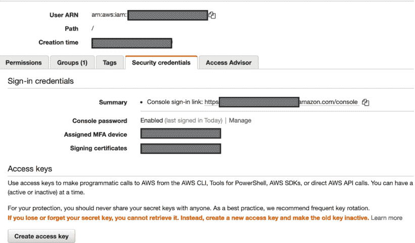
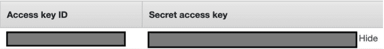
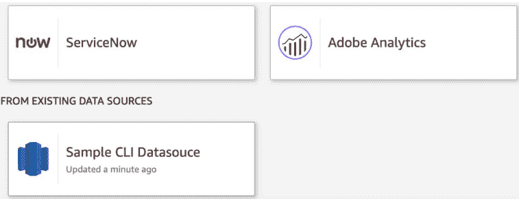
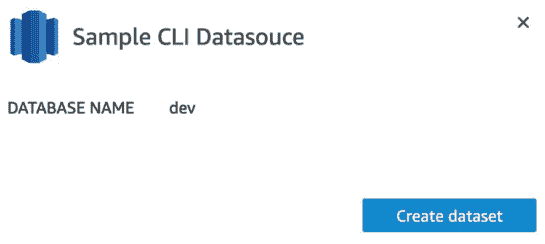
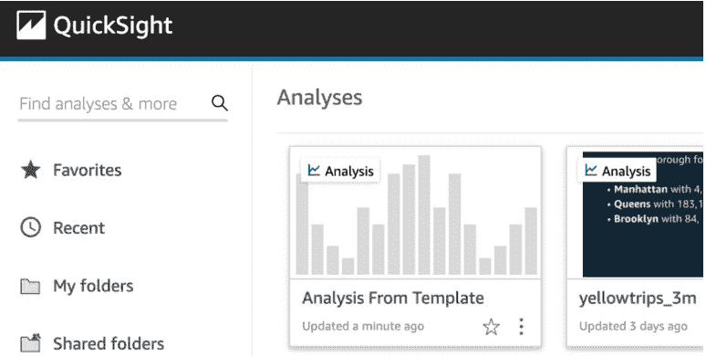
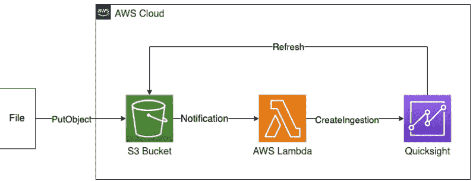
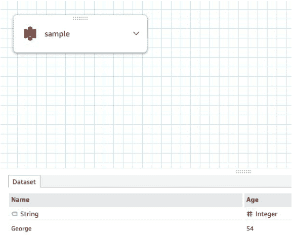
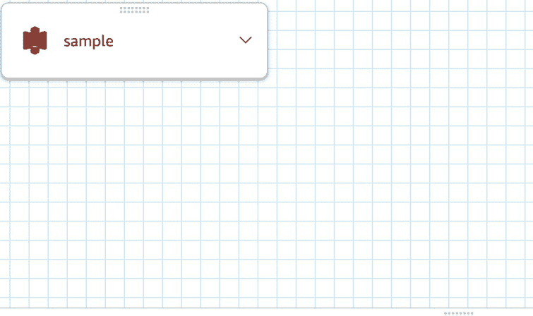

# 第 8 章 了解 QuickSight API

在本章中，我们将学习如何使用 **Amazon QuickSight** API 执行操作。我们还将探索自动化数据集操作的模式，并演示一些允许我们控制账户设置的 API 操作。完成本章后，您将熟悉 QuickSight API 以及如何以编程方式控制其资源，这在构建自动化时至关重要。

本章将涵盖以下主题：

- QuickSight API 简介
- 使用 API 控制资源

### 技术要求

本章，您需要访问以下内容：

- 一个 **AWS 账户** 和一个 **AWS Identity and Access Management (IAM)** 用户，并拥有提升的访问权限
- Python 3
- 已配置 Author 和 Reader 用户的 Amazon QuickSight 账户
- 第 1 章，AWS 分析生态系统简介中创建的环境
- 第 3 章，使用 Amazon QuickSight 准备数据中创建的仪表板

### QuickSight API 简介

在本节中，我们将介绍 Amazon QuickSight API。**应用程序编程接口 (API)** 是一组定义的函数，允许应用程序开发人员访问某个应用程序或库的功能。AWS API 允许开发人员以编程方式访问 AWS 服务。传统上，AWS 提供基础设施服务，允许开发人员在云中以编程方式配置虚拟机。现在，AWS 提供更多服务，其中许多不是基础设施服务。Amazon QuickSight 就是这样一项服务的绝佳示例。QuickSight 是一项运行在 AWS 基础设施上的云端 **商业智能 (BI)** 服务，但开发人员不需要配置基础设施。相反，开发人员可以使用 QuickSight API 访问应用程序中的功能并执行操作，例如创建数据集、执行数据分析或共享仪表板。到目前为止，在本书中，我们学习了如何使用通过 Web 浏览器访问的 **图形用户界面 (GUI)** 在 QuickSight 控制台中完成这些操作。在本章中，我们将学习如何以编程方式完成这些操作，这将使我们在创建 BI 应用程序时能够构建自动化。首先，我们将学习如何访问 QuickSight API。

### 访问 QuickSight API

在本节中，我们将学习可以用来访问 QuickSight API 的方法。访问 AWS API 有两种主要方式：

- 使用 **软件开发工具包 (SDK)**
- 使用 **命令行界面 (CLI)**

接下来，我们将通过实际示例更详细地查看这些选项。

### 使用 AWS CLI 访问 QuickSight API

AWS 提供了一个简单的 CLI，允许开发人员访问 AWS API。在使用 CLI 之前，您需要安装它。按照 AWS 说明为您的操作系统安装 CLI：

https://docs.aws.amazon.com/cli/latest/userguide/cli-chap-install.html

### 验证安装

安装完成后，打开终端并运行以下命令以检查已安装的 CLI 版本：

```
$aws --version
aws-cli/2.1.13 Python/3.7.4 Darwin/20.5.0 exe/x86_64 prompt/off
```

### 配置 AWS CLI

现在我们已安装 CLI，需要对其进行配置。首先，我们需要创建一组将由 CLI 使用的凭据：

1. 使用您的用户凭据登录 AWS 控制台。
2. 打开 **Services** 并选择 **Identity and Access Manager**。
3. 在 **Access Management** 下，选择 **Users**，然后单击需要生成安全凭据的 IAM 用户名。
4. 在下一页，选择 **Security credentials** 选项卡。



图 8.1 – 创建访问密钥

5. 在 Access keys 部分下，选择 Create access key。




### 图 8.2 – 检索访问密钥

6. 记下 Access key ID 和 Secret access key 字段中的值。

7. 接下来，打开终端，运行以下命令，并在提示时添加您的访问密钥 ID 和秘密访问键。按 Return 键保持其他所有内容不变。

```
$aws configure
```

### 使用 CLI 访问 QuickSight API

现在我们已配置 CLI，可以运行一些命令：

1. 要获取所有 QuickSight CLI 命令的列表，请键入以下内容：

```
$aws quicksight help
```

2. 要列出我们的仪表板，请键入以下命令：

```
$ aws quicksight list-dashboards --aws-account-id <numerical account id> --region us-east-1
{
 "Status": 200,
 "DashboardSummaryList": [
 {
 "Arn": "arn.aws:quicksight:us-east-1:xxxxxxx:dashboard/xxxxxxxx",
 "DashboardId": "xxxxxxxx",
 "Name": "New York Taxi Dashboard",
 "CreatedTime": "2021-06-02T20:19:00.285000+01:00",
 "LastUpdatedTime": "2021-07-06T23:55:04.960000+01:00",
 "PublishedVersionNumber": 14,
 "LastPublishedTime": "2021-06-02T20:19:00.285000+01:00"
 }
 ],
 "RequestId": "xxxxxxx"
}
```

注意 CLI 命令的结构：

- aws：用于访问所有 CLI 命令。
- quicksight：用于访问 QuickSight CLI 命令。
- list-dashboards：用于访问返回账户和区域中所有仪表板的 API。
- 选项 (--)：使用此符号为命令添加选项。

现在我们已配置 CLI 并运行了一个简单的命令，请随时在继续下一节之前尝试其他命令。参考 AWS 文档以查看所选 CLI 命令的可用和必需选项：
https://awscli.amazonaws.com/v2/documentation/api/latest/reference/quicksight/index.html

接下来，我们将使用 AWS SDK 访问 QuickSight API。

### 使用 SDK 访问 QuickSight API

AWS 提供支持多种编程语言的各种开发工具包。这意味着开发人员可以将其应用程序与 AWS 服务集成，而无需更改其编程语言。AWS 支持大多数常见编程语言，包括 **Python**、**Java**、**C++**、**Go**、**JavaScript** 和 **Ruby**。有关最新语言支持的更多信息，请参阅 `https://aws.amazon.com/tools/` 中的 AWS 文档。为了更好地理解 AWS SDK，我们将使用一个简单的实际示例。在此示例中，我们将使用 Python SDK 以编程方式检索 QuickSight 仪表板并在屏幕上打印它们的名称。

### 安装 AWS SDK

在此示例中，我们将使用 Python AWS SDK。如果您尚未安装 Python，则需要在环境中安装 Python。

如果您已安装 Python，请在终端中键入以下命令：

```
$pip install boto3
```

接下来，打开您首选的代码编辑器，并输入即将出现的 Python 代码。

> **Note**
> AWS 提供一个名为 **Cloud9** 的云端 **集成开发环境 (IDE)**。

要创建 Cloud9 环境，请登录 AWS 控制台并从服务列表中选择 **Cloud9**。对于本教程，您可以保留所有默认设置。有关设置 Cloud9 的更多信息，请参阅 AWS 文档：

https://docs.aws.amazon.com/cloud9/latest/user-guide/create-environment.html

在运行以下代码之前，请将 `AwsAccountId` 值替换为您环境中的数字账户 ID：

```
import boto3
client = boto3.client('quicksight', region_name='us-east-1')
response = client.list_dashboards(AwsAccountId='xxxxxxxx')
dashboards_list = response['DashboardSummaryList']
print('Number of dashboards: ' + str(len(dashboards_list)) + '\n')
for dashboard in dashboards_list:
    print(dashboard['Name'])
```

保存 Python 脚本并运行它。它应该打印该区域的仪表板总数，然后是每个仪表板的名称。


### 使用 QuickSight API 控制资源

在本节中，我们将学习如何使用 QuickSight API 控制 QuickSight 资源。本节并非旨在成为 QuickSight API 的完整参考指南，也不会涵盖使用 API 可以完成的每一种可能操作。有关 QuickSight API 的完整参考指南，请参阅 QuickSight 文档：
https://docs.aws.amazon.com/quicksight/latest/APIReference/Welcome.html

本节将为您提供使用 API 控制 QuickSight 资源的实际操作示例。这些示例将使您对可以使用 API 完成的活动类型有扎实的了解，进而帮助您管理 QuickSight 环境。
我们的第一个示例将是学习如何使用 QuickSight API 设置数据源。

### 使用 CLI 设置数据集

在第 2 章“Amazon QuickSight 简介”中，我们学习了如何创建数据源和数据集。要创建这些资源，我们通过网络浏览器访问了 QuickSight GUI。虽然 GUI 很用户友好，但我们可以使用 API 以编程方式创建数据集。当我们需要确保特定配置的一致性时，这可能是一个不错的选择，因为手动配置容易出错。让我们从第 1 章“AWS 分析生态系统简介”中创建的数据仓库创建一个数据源。

> Note
> 第 1 章“AWS 分析生态系统简介”中的教程包括创建一个示例 Amazon Redshift 集群，这将产生费用。对于本教程，您不需要集群正在运行。暂停的集群对于此示例来说效果很好，因为我们只需要配置数据集，并且不需要与其建立实时连接。

现在，让我们使用 CLI 创建一个 Redshift 数据源。我们将使用 create-data-source CLI 命令来创建 Redshift 数据源：
https://docs.aws.amazon.com/cli/latest/reference/quicksight/create-data-source.html

以下是我们需要配置的几个参数：

- AwsAccountId：此值表示您的 AWS 数字账户 ID。
- DataSourceId 和 Name：您需要定义一个唯一的账户和区域标识符以及一个用户友好的名称来描述您的数据源。
- Type：这是数据源的类型。对于 Redshift 数据源，这需要设置为 REDSHIFT。
- DataSourceParameters：数据源参数的类型将取决于您配置的数据源类型。对于 Redshift 数据源，您需要定义主机名、端口号、Redshift 数据库名称和集群标识符。
- Credentials：这些是 QuickSight 访问数据存储所需的凭据。对于 Redshift 数据源，您可以使用由用户名和密码组成的凭据对。
- Permissions：在本节中，您需要定义新创建数据集的权限，并确定哪个用户可以访问它以及他们拥有什么级别的访问权限。对于我们的示例，我们希望我们的读者用户能够从新创建的数据源创建数据集，但我们也希望限制该用户删除或更新数据源。

现在，让我们看看如何使用 QuickSight CLI 配置先前描述的 Redshift 连接：

1. 首先，打开文本编辑器并复制以下 JSON 配置。用您环境中的值替换高亮显示的值。对于权限，请注意，我们仅授予 PassDataSource、DescribeDataSource 和 DescribeDataSourcePermissions 操作的权限，这将允许此用户使用此数据源设置新数据集，但不会允许他们更新或删除数据源：

```json
{
  "AwsAccountId": "<account id>",
  "DataSourceId": "RedshiftDatasouceCLI",
  "Name": "CLI Datasouce",
  "Type": "REDSHIFT",
  "DataSourceParameters": {
    "RedshiftParameters": {
      "Host": "hostname",
      "Port": 5439,
      "Database": "dev",
      "ClusterId": "mycluster"
    }
  },
  "Credentials": {
    "CredentialPair": {
      "Username": "admin",
      "Password": "R3dsh1ft"
    }
  },
  "Permissions": [
    {
      "Principal": "arn:aws:quicksight:us-east-1:xxxxxxxxxxxx:user/default/author",
      "Actions": [
        "quicksight:DescribeDataSource",
        "quicksight:DescribeDataSourcePermissions",
        "quicksight:PassDataSource"
      ]
    }
  ]
}
```

2. 将文件另存为 create-data-source.json。
3. 运行 `aws quicksight create-data-source --cli-input-json file://create-data-source.json`。

此命令的结果将如下所示：

```json
{
  "Status": 202,
  "DataSourceId": "SampleRedshiftDatasouce",
  "RequestId": "xxxxxx-xxxxxx-xxxxxx-xxxxxx-xxxxxxxxxx",
  "CreationStatus": "CREATION_IN_PROGRESS",
  "Arn": "arn:aws:quicksight:us-east-1:xxxxxxxxxxxx:datasource/SampleRedshiftDatasouce"
}
```

现在我们已配置新数据源，让我们验证 Author 用户是否能够使用它来设置新数据集：

1. 对于本教程，我们可以通过以 `author` 用户身份登录 QuickSight 来简单验证新创建的数据源。
2. 然后，导航到 **Datasets**，然后单击 **New Datasets**。您应该能够在 **FROM EXISTING DATA SOURCES** 菜单下找到新创建的数据源，如下图所示：



Figure 8.3 – 使用 CLI 创建数据源

3. 单击数据源。请注意，未显示删除或编辑数据源的按钮，因为该用户没有更新或删除此数据源所需的权限：



Figure 8.4 – 示例 CLI 数据源权限

现在我们已学习如何配置数据源，我们将使用 QuickSight CLI 更改环境的 QuickSight 设置。

### 使用 QuickSight API 编辑账户设置

在本节中，我们将使用 QuickSight API 编辑账户上的设置。这允许我们在账户上配置账户自定义设置。对于我们的示例，我们将更改 QuickSight 账户的默认主题。

1. 首先，让我们使用 QuickSight API 检索全局 QuickSight 账户详细信息。使用 CLI 作为 QuickSight 或 AWS 管理员，键入以下命令，将 `aws-account-id` 值替换为您环境中的值：

```bash
$aws quicksight describe-account-settings --aws-account-id <account-id>
```

响应应如下所示：

```json
{
    "Status": 200,
    "AccountSettings": {
        "DefaultNamespace": "default",
        "Edition": "ENTERPRISE",
        "NotificationEmail": "your-email",
        "AccountName": "quicksight-account-name"
    },
    "RequestId": "xxxxxxxxxxxxxxxxxxxxxx"
}
```

2. 接下来，让我们键入以下命令以获取 QuickSight 账户自定义设置。账户自定义设置是指可以为 QuickSight 账户参数化的一组设置。目前，您可以通过账户自定义设置添加自定义默认主题：

```bash
$aws quicksight describe-account-customization --aws-account-id <account-id>
```

由于我们尚未添加任何自定义设置，响应很可能如下所示：

```
An error occurred (ResourceNotFoundException) when calling the DescribeAccountCustomization operation: Account customization does not exist for AwsAccountId <account-id>
```

3. 现在，让我们添加一个账户自定义设置并将 Midnight 设置为默认主题。使用 CLI 键入以下命令，将 aws-account-id 值替换为您的账户 ID 值：

```bash
aws quicksight create-account-customization \
--aws-account-id <account-id> --account-customization \
DefaultTheme=arn:aws:quicksight::aws:theme/MIDNIGHT \
--region=us-east-1
```

4. 现在，让我们通过再次运行步骤 2 中的 describe-account-customization 命令来确认新账户自定义设置的创建。这次，响应应如下所示：

```json
{
 "Status": 200,
 "RequestId": "xxxxxx-xxxx-xxxx-xxxx-xxxxxxxxxxxx",
 "AccountCustomization": {
 "DefaultTheme": "arn:aws:quicksight::aws:theme/MIDNIGHT"
 },
 "Arn": "arn:aws:quicksight:us-east-1:xxxxxxxxxxxx:customization/account/xxxxxxxxxxxx ",
 "AwsAccountId": "xxxxxxxxxxxx"
}
```

> Note
> 账户自定义设置适用于账户和 **AWS 区域** 级别。

要验证自定义设置是否已应用于此账户，您可以在应用账户自定义设置的同一区域的账户上创建示例分析。

现在我们已学习如何使用 CLI 编辑账户设置，在下一节中，我们将学习如何使用模板 API，这在开发跨多个环境的分析和仪表板时很有用。


### 使用模板 API 重用资源

QuickSight 提供模板 API，允许你构建分析蓝图，然后使用这些蓝图为不同用户，甚至不同账户，创建其他分析，以保持一致性。模板在 GUI 上不可见，只能通过 API 访问。接下来，我们将展示使用纽约出租车分析创建模板的简单示例：

1. 首先，让我们列出现有的分析。使用 CLI，键入以下命令，将 `<account-id>` 值替换为你账户中的值：

```
$aws quicksight list-analyses --aws-account-id <account-id> --region us-east-1
```

记下我们纽约出租车分析的 analysis-id 值。

2. 接下来，我们将捕获更多分析详细信息，包括有关我们数据集的详细信息。键入以下命令，将 `<account-id>` 和 analysis-id 值替换为你环境中的值：

```
aws quicksight describe-analysis --aws-account-id <account-id> --analysis-id xxxxxxxx-xxxx-xxxx-xxxx-xxxxxxxxxxxx --region us-east-1
```

响应应如下所示：

```json
{
    "Status": 200,
    "Analysis": {
        "Status": "CREATION_SUCCESSFUL",
        "Name": "yellowtrips_3mo analysis",
        "LastUpdatedTime": 1629144517.0,
        "DataSetArns": [
            "arn:aws:quicksight:us-east-1:xxxxxxxxxxxx:dataset/xxxxxxxx-xxxx-xxxx-xxxx-xxxxxxxxxxxx",
            "arn:aws:quicksight:us-east-1:xxxxxxxxxxxx:dataset/xxxxxxxx-xxxx-xxxx-xxxx-xxxxxxxxxxxx"
        ],
        "CreatedTime": 1621766161.633,
        "Sheets": [
            {
                "SheetId": "xxxxxxxx-xxxx-xxxxxx-xxxxxx-xxxxxxxxxxx",
                "Name": "Executive Summary"
            }
        ],
        "ThemeArn": "arn:aws:quicksight::aws:theme/MIDNIGHT",
        "Arn": "arn:aws:quicksight:us-east-1:xxxxxxxxxxxx:analysis/xxxxxxxx-xxxx-xxxxxx-xxxxxx-xxxxxxxxxxx",
        "AnalysisId": "xxxxxxxx-xxxx-xxxxxx-xxxxxx-xxxxxxxxxxx"
    },
    "RequestId": "xxxxxxxx-xxxx-xxxxxx-xxxxxx-xxxxxxxxxxx"
}
```

捕获数据集的 arn 值（高亮显示），因为我们将在下一步中使用它们。

3. 接下来，打开文本编辑器并粘贴以下 JSON 配置，该配置将用于创建我们的第一个 QuickSight 模板。将 AwsAccountId、源分析 arn 和数据集引用 arn 值替换为你环境中的值。将文件另存为 create-template.json：

```json
{
    "AwsAccountId": "xxxxxxxxxx",
    "TemplateId": "first-template",
    "Name": "My First Template",
    "SourceEntity": {
        "SourceAnalysis": {
            "Arn": "arn:aws:quicksight:us-east-1:xxxxxxxxxx:analysis/xxxxxxxx-xxxx-xxxxxx-xxxxxx-xxxxxxxxxxx",
            "DataSetReferences": [
                {
                    "DataSetPlaceholder": "Main Dataset",
                    "DataSetArn": "arn:aws:quicksight:us-east-1:xxxxxxxxxxxx:dataset/xxxxxxxx-xxxx-xxxxxx-xxxxxx-xxxxxxxxxxx"
                },
                {
                    "DataSetPlaceholder": "Enrich Dataset",
                    "DataSetArn": "arn:aws:quicksight:us-east-1:xxxxxxxxxxxx:dataset/xxxxxxx-xxxx-xxxx-xxxx-xxxxxxxxxxx"
                }
            ]
        }
    },
    "VersionDescription": "1"
}
```

4. 接下来，我们将确认模板的创建。如前所述，模板只能通过 QuickSight API 使用和列出，没有 UI 元素。使用 CLI，我们将键入以下命令：

```
$aws quicksight list-templates --aws-account-id <account-id> --region us-east-1
```

响应应如下所示：

```json
{
    "Status": 200,
    "TemplateSummaryList": [
        {
            "LatestVersionNumber": 1,
            "LastUpdatedTime": 1629320961.782,
            "TemplateId": "first-template",
            "CreatedTime": 1629320961.782,
            "Arn": "arn:aws:quicksight:us-east-1:xxxxxxxxxxxx:template/first-template",
            "Name": "My First Template"
        }
    ],
    "RequestId": "xxxxxxxxxx"
}
```

5. 接下来，我们将使用此模板创建新分析。为此示例，为了避免产生费用，我们将使用现有的 Author 用户，并从模板创建分析。为此部分，我们将使用 create-analysis CLI 命令。打开文本编辑器并粘贴以下内容，然后将其另存为 create-analysis-from-template.json。将高亮显示的值替换为与你环境匹配的值：

```json
{
    "AwsAccountId": "xxxxxxxxxxxx",
    "AnalysisId": "analysis-from-template",
    "Name": "Analysis From Template",
    "Permissions": [
        {
            "Principal": "arn:aws:quicksight:us-east-1:xxxxxxxxxxxx:user/default/author",
            "Actions": [
                "quicksight:RestoreAnalysis",
                "quicksight:UpdateAnalysisPermissions",
                "quicksight:DeleteAnalysis",
                "quicksight:DescribeAnalysisPermissions",
                "quicksight:QueryAnalysis",
                "quicksight:DescribeAnalysis",
                "quicksight:UpdateAnalysis"
            ]
        }
    ],
    "SourceEntity": {
        "SourceTemplate": {
            "DataSetReferences": [
                {
                    "DataSetPlaceholder": "Main Dataset",
                    "DataSetArn": "arn:aws:quicksight:us-east-1:xxxxxxxxxxxx:dataset/xxxxxxx-xxxx-xxxx-xxxx-xxxxxxxxxxxx"
                },
                {
                    "DataSetPlaceholder": "Enrich Dataset",
                    "DataSetArn": "arn:aws:quicksight:us-east-1:xxxxxxxxxxxx:dataset/xxxxxxx-xxxx-xxxx-xxxx-xxxxxxxxxxx"
                }
            ],
            "Arn": "arn:aws:quicksight:us-east-1:xxxxxxxxxxxx:template/first-template"
        }
    }
}
```

6. 接下来，键入以下命令：

```bash
$aws quicksight create-analysis --cli-input-json file://create-analysis-from-template.json --region us-east-1
```

7. 你可以通过使用 list-analyses CLI 命令来确认分析的创建：

```bash
$aws quicksight list-analyses --aws-account-id xxxxxxxxxxxx
```

8. 作为 Author 用户重新登录 QuickSight UI 并查看新创建的分析：



图 8.5 – 从模板生成分析

打开分析后，你会注意到它与我们在前几章中创建的分析相同。主要区别在于，从模板创建的分析是使用几个 CLI 命令以编程方式创建的。使用模板和分析 API，我们可以创建和共享分析蓝图，然后使用此蓝图，我们可以创建新分析并将其与其他用户或账户共享。如果没有模板 API，你将需要手动重新创建分析，这可能涉及许多步骤，并且使得一致地应用更改变得更加困难。

现在我们已经学习了如何以编程方式控制 QuickSight 资源，在下一节中，我们将讨论构建自动化的模式。

### 使用 QuickSight API 构建自动化

到目前为止，我们已经学习了如何使用 QuickSight API 通过 AWS CLI 控制资源。在本节中，我们将讨论一种架构，该架构将允许我们自动调用 QuickSight API。

### 了解 AWS Lambda 的角色

**AWS Lambda** 是一种无服务器计算服务，允许你在不创建服务器的情况下运行代码。计算单位是 _Lambda 函数_。Lambda 函数可以由特定事件触发，或在特定时间点触发。使用 AWS Lambda 和 AWS SDK，我们可以以编程方式控制 QuickSight 资源，以响应特定事件或基础架构的变化。例如，我们可以使用 SDK 在特定事件上设置数据刷新，而不是按间隔安排刷新。

**Amazon EventBridge** 可用于更复杂的集成。Amazon EventBridge 是一种无服务器事件总线，使在 AWS 上构建事件驱动应用程序变得更加容易。使用 EventBridge，你可以传递由你的应用程序、集成 **软件即服务 (SaaS)** 应用程序和 AWS 服务生成的实时事件。AWS Lambda 可以是这些事件的目标，这使你能够针对某些事件设计响应。为了更好地了解如何自动化 QuickSight 操作，在下一节中，我们将使用 AWS Lambda 创建一个从 **Amazon S3** 数据源进行简单的事件驱动摄取。

### 自动化 Amazon S3 数据源的摄取

在本节中，我们将配置一个简单的应用程序，当底层 S3 数据更新时，该应用程序将自动刷新 **Amazon SPICE** 数据源。使用此方法，我们不再等待计划刷新（这会引入延迟），而是在新数据可用时立即触发刷新（这将最大限度地减少延迟）。为此示例，我们将使用一个示例 `.csv` 文件，该文件将配置为 QuickSight 中的 S3 数据源。然后，我们将配置一个由 S3 通知触发的 Lambda 函数。Lambda 函数将调用 QuickSight API 的 `createIngestion` 函数，这将导致 QuickSight 将新数据集导入 SPICE。下图显示了各个组件如何协同工作：



图 8.6 – 事件驱动的数据刷新

现在我们已经讨论了高级架构，为了更好地理解它，让我们探索一个动手示例。

### 创建 S3 数据集

让我们先创建一个示例数据集。我们需要创建一个 `.csv` 文件和一个清单文件：

1. 首先，打开文本编辑器并创建一个 `sample.csv` 文件。将以下内容复制为其内容：

   "Name","Age"
   "George","54"

2. 将文件上传到你在 _第 1 章，AWS 分析生态系统简介_ 中创建的 S3 数据湖。在你的数据湖存储桶下创建一个名为 `samples` 的文件夹，或者简单地使用 `s3 cp` CLI 命令上传你的 `.csv` 文件：

   `$aws s3 cp sample.csv s3://<data-lake-xxxxxxxx>/samples/`


## 接下来，我们将创建一个清单文件，用于定义需要导入到 QuickSight 的文件。我们可以拥有多个文件，但在此示例中为简单起见，我们将导入单个文件。打开文本编辑器并创建 manifest.json 文件。复制以下内容，并将高亮值替换为您环境中的值：

```json
{
"fileLocations": [
{
"URIs": [
"s3://data-lake-xxxxxxxxxx/samples/sample.csv"
]
}
]
}
```

## 接下来，我们将在 QuickSight 中创建一个 S3 数据源。以 Author 用户身份登录 QuickSight，单击 Datasets，然后单击 Create。从可用源列表中选择 S3。接下来，为数据源命名，并上传清单文件。

## 导入后，您应该能够编辑数据集并验证其内容。



图 8.7 – 创建 S3 数据源

现在我们已配置 S3 数据源并将其导入到 SPICE，在下一节中，我们将配置将触发 SPICE 刷新的 Lambda 函数。

### 配置 QuickSight 导入 Lambda 函数

在本节中，我们将学习如何配置 Lambda 函数以触发 SPICE 刷新。该函数将调用 createIngestion QuickSight API 调用来刷新我们在前面步骤中创建的示例数据集。

登录到 AWS 控制台并选择 **AWS Lambda**。在 Lambda 控制台中，选择 **Create function**。添加以下详细信息：

- **Name**: quicksight-refresh
- **Runtime**: Python 3.8
- **Execution Role**: 创建具有基本 Lambda 权限的新角色

将其余选项保留默认值，然后单击 **Create function**。

在继续之前，我们需要确保我们的 Lambda 函数具有调用 QuickSight API 所需的权限。为此函数选择 IAM 角色，并添加允许访问以下 QuickSight API 操作的策略：

- quicksight:CreateIngestion
- quicksight:CancelIngestion
- quicksight:DeleteDataSource
- quicksight:DeleteDataSet

对于本教程，您可以使用以下策略文档。将高亮值替换为您环境中的值：

```json
{
    "Version": "2012-10-17",
    "Statement": [
        {
            "Sid": "VisualEditor0",
            "Effect": "Allow",
            "Action": "quicksight:DeleteDataSet",
            "Resource": "arn:aws:quicksight:*:<aws-account-id>:dataset/*"
        },
        {
            "Sid": "VisualEditor1",
            "Effect": "Allow",
            "Action": [
                "quicksight:CreateIngestion",
                "quicksight:DeleteDataSource",
                "quicksight:CancelIngestion"
            ],
            "Resource": [
                "arn:aws:quicksight:*:<aws-account-id>:datasource/*",
                "arn:aws:quicksight:*:<aws-account-id>:dataset/*/ingestion/*"
            ]
        }
    ]
}
```

现在我们的 Lambda 函数已拥有所需 API 的访问权限，让我们添加 Python 代码。
使用 Lambda 代码编辑器，只需粘贴以下代码。将高亮值替换为您环境中的值：

```python
import boto3
import uuid
client = boto3.client('quicksight')
def lambda_handler(event, context):
    response = client.create_ingestion(
        DataSetId='<dataset-id>',
        IngestionId=uuid.uuid4().hex,
        AwsAccountId='<aws-account-id>'
    )
    return response
```

完成此步骤后，单击 **Deploy**。我们可以测试我们的 Lambda 函数并验证它是否触发刷新。在响应中查找 "`IngestionStatus`": "`INITIALIZED`" 以验证来自 QuickSight API 的响应。

现在我们已配置 Lambda 函数，在下一节中，我们将配置 S3 触发器。

### 配置 S3 触发器

在本节中，我们将配置 S3 触发器。触发器应仅在我们的数据湖的 `samples` 文件夹中有新对象时触发刷新：

1. 打开 Lambda 控制台并选择 **Add trigger**。
2. 从下拉菜单中选择 S3 服务，然后选择您的 S3 数据湖存储桶。接着，配置以下值：
   - **Event type**: All object create events
   - **Prefix**: `samples/`
   - **Suffix**: `.csv`
3. 单击 **Add** 以添加新触发器。

现在我们已配置触发器，在下一节中，我们将测试我们的应用程序。

### 测试应用程序

要测试应用程序，请完成以下步骤：

1. 打开 `sample.csv` 文件并添加一行新行，使其如下所示：

```csv
"Name","Age"
"George","54"
"Anna","56"
```

2. 接下来，我们将在 S3 中更新文件。您可以使用 AWS 控制台或 AWS CLI：

```bash
$aws s3 cp sample.csv s3://<data-lake-xxxxxxxxxx>/samples/
```

3. 这将触发我们的 Lambda 函数，进而调用 API 并触发刷新。要验证，请登录 QuickSight 并选择 **Datasets**。选择示例数据集，然后编辑以访问预览模式：



| Name    | Age    |
|---------|--------|
| String  | Integer |
| George  | 54     |
| Anna    | 56     |

图 8.8 – 预览导入的数据

注意我们数据集中的新值。QuickSight 已完成导入，现在新值已在 SPICE 中，在我们更新文件后不久。我们事件驱动架构的一个关键优势是我们不需要等待计划刷新——相反，一旦有新值，数据就会立即刷新。

### 摘要

恭喜您完成本章。

在本章中，我们学习了访问 QuickSight API 的不同选项，包括 CLI，并了解了使用 Python SDK 的示例。然后，使用 AWS CLI，我们学习了如何以编程方式控制 QuickSight 资源。我们学习了如何以编程方式创建新数据源，还使用 QuickSight API 控制账户设置（例如更改 QuickSight 的默认主题）。最后，使用一个简单的示例，我们学习了如何使用模板 API 创建分析蓝图，然后如何使用模板以编程方式创建分析。

使用本章所学的内容，您将能够以编程方式控制 QuickSight 资源，这将使跨多个环境工作更加容易，并安全且一致地将更改应用到您的 QuickSight 账户。最后，使用一个简单的动手示例，我们学习了如何构建一个调用 QuickSight API 并自动将 S3 数据集导入 SPICE 的事件驱动应用程序。在下一章中，我们将学习如何管理 QuickSight 权限和使用情况。

### 问题

以下是几个问题，用于复习本章所学内容。

1. 什么是 QuickSight 模板？
2. 我们如何访问 QuickSight API？
3. 我们如何从模板创建分析？
4. 您如何使用 QuickSight API 构建自动化？

### 进一步阅读

- _Amazon QuickSight 用户指南：_
- https://docs.aws.amazon.com/quicksight/latest/user/amazon-quicksight-user.pdf
