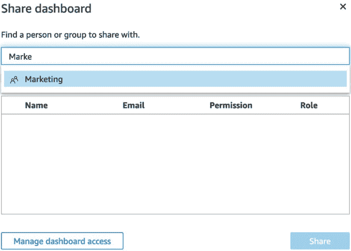
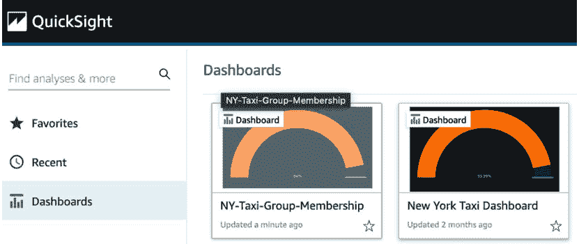
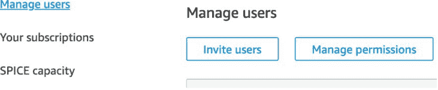
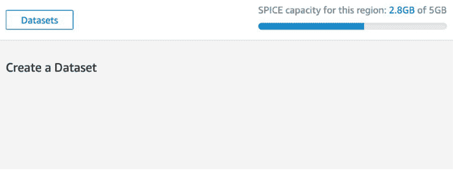
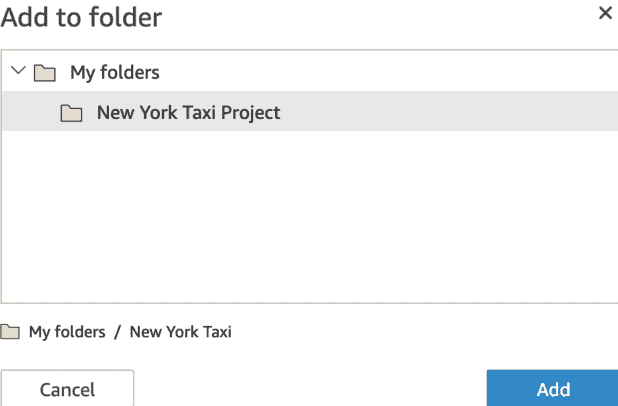
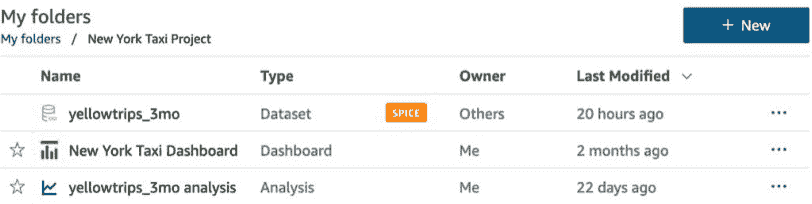
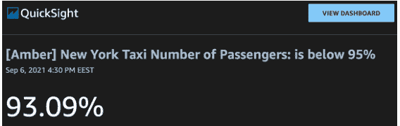
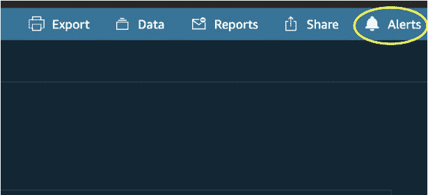
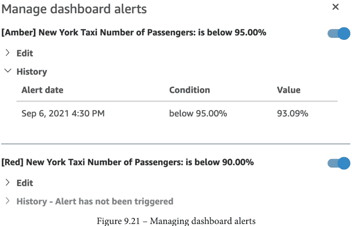

# 9 管理 QuickSight 权限和使用情况

在本章中，我们将学习如何管理 **Amazon QuickSight** 操作和权限。我们将重点介绍 QuickSight 权限模型，并学习如何配置细粒度权限。我们还将学习如何管理和组织 QuickSight 资源到文件夹中，以及如何设置基于阈值的警报和电子邮件报告。

我们将在本章中涵盖以下主题：

- 管理 QuickSight 权限
- 管理 QuickSight 使用情况

## 技术要求

对于本章，您需要访问以下内容：

- 一个 AWS 账户和 AWS Identity and Access Management (IAM) 用户，具有提升的访问权限
- AWS 命令行界面 (CLI)
- 一个配置了 Author 和 Reader 用户的 Amazon QuickSight 账户
- 第 1 章《AWS 分析生态系统简介》中创建的环境
- 第 4 章《开发可视化和仪表板》中创建的仪表板

## 管理 QuickSight 权限

在本节中，我们将学习如何配置针对 QuickSight 资源的用户权限。首先，让我们介绍设置权限时需要了解的基本主题：

- **Principal**: AWS 主体是需要访问 AWS 资源的用户（或用户组）或应用程序。
- **Action**: 操作定义主体允许或拒绝的 API 操作集。例如，在 QuickSight 中，`DeleteDataSet` 操作删除数据集。要查看 QuickSight 操作的完整列表，请参阅 AWS 文档：https://docs.aws.amazon.com/service-authorization/latest/reference/list_amazonquicksight.html#amazonquicksight-actions-as-permissions。
- **Resource**: 对于大多数操作，我们可以将策略范围缩小到特定资源。通常，单个资源具有其自身唯一的 **Amazon Resource Number (arn)**。
- **Condition**: AWS 允许您根据特定条件定义访问。例如，允许来自特定 IP 地址的应用程序访问的条件。

在授予 AWS 权限（包括 QuickSight 权限）时，请确保遵循 **最小权限** 安全最佳实践。根据最小权限原则，您应仅允许用户访问其所需的特定操作和资源。


## 使用用户组

随着用户数量的增加以及其访问模式变得越来越复杂，配置其对资源的权限的复杂性也呈指数级上升。在这种情况下，我们可以使用 **用户组**。用户组允许您将用户分组，然后在组级别而非个人级别应用权限，这为您节省了时间和精力。当用户加入组时，他们会自动继承组权限。同样，当用户离开组时，他们将失去对组资源的访问权限。

为了更好地了解如何在 Amazon QuickSight 中管理组，我们将使用一个简单的动手示例：

1. 首先，让我们为市场部创建一个组。使用配置了 AWS CLI 并具有提升访问权限的终端，键入以下命令，将 `<account-id>` 值替换为您环境中的值：

   ```
   $aws quicksight create-group --group-name "Marketing" 
   --description "Group for the Marketing Department" 
   --aws-account-id <account-id> --namespace default 
   --region us-east-1
   ```

2. 接下来，让我们将我们的 Reader 用户添加到此组。为此，我们将使用 create-group-membership CLI 命令。键入以下内容，将高亮值替换为您环境中的值：

   ```
   $aws quicksight create-group-membership --member-name reader --group-name Marketing --aws-account-id <account-id> --namespace default --region us-east-1
   ```

3. 接下来，我们将使用 QuickSight 控制台将新仪表板共享给市场组，而不是单个用户。以 Author 用户身份登录 QuickSight。打开 New York Taxi 分析并将其发布为全新的仪表板。为您新创建的仪表板命名。

4. 在下一个屏幕上，共享仪表板时，选择 **Marketing** 组并共享您的仪表板，如下面的屏幕截图所示：



图 9.1 – 与组共享仪表板

5. 要验证您的仪表板是否已成功共享，请注销并以 Reader 用户身份重新登录。导航到 **Dashboards**，并注意新创建的仪表板：



图 9.2 – 确认仪表板组访问权限

请注意，我们不需要直接为 Reader 用户授予此仪表板的访问权限。相反，我们将 Reader 用户添加到 **Marketing** 组，然后允许该组的所有用户访问我们发布的仪表板。在未来，如果有更多用户加入 **Marketing** 组，他们将自动获得对与该特定组共享的资源的访问权限，从而无需在单个用户级别定义特定权限。

现在我们已经了解了用户组以及如何使用它们来简化我们的权限，在下一节中，我们将讨论自定义权限。

## 设置自定义权限

在 _第 2 章，Amazon QuickSight 简介_ 中，我们了解了不同的用户群组：Admin、Author 和 Reader。用户群组决定了对 QuickSight 控制台中功能的访问级别。自定义配置文件允许您使用自定义安全配置文件覆盖默认权限，并定义符合您组织要求的权限。

> Note
> 要使自定义权限生效，您需要使用 IAM 联合用户。

为了更好地了解自定义权限，我们将使用一个简单的动手示例。默认情况下，Author 用户可以配置新数据源。对于我们的示例，让我们假设，为了保护我们的 **Amazon SPICE** 空间，我们希望防止作者创建新数据源：

1. 首先，以 QuickSight Admin 用户身份登录 QuickSight 控制台。
2. 展开屏幕右上角的 QuickSight 菜单并选择 **Manage QuickSight**。
3. 在选择 **Manage users** 选项后，单击 **Manage permissions**，如下面的屏幕截图所示：



图 9.3 – 访问自定义权限

4. 在下一个屏幕上，勾选 **Creating or updating all data sources** 复选框，如下面的屏幕截图所示：

### 编辑自定义权限

**名称**

custom-author

**限制访问**

**仪表板和分析**

☐ 添加或运行异常检测

☐ 创建或更新主题

☐ 导出为 CSV

☐ 导出为 Excel

☐ 共享分析

☐ 共享仪表板

☐ 共享数据集

**数据集**

☐ 创建或更新所有数据集

☐ 仅创建或更新 SPICE 数据集

**数据源**

☑ 创建或更新所有数据源

**文件夹**

☐ 创建共享文件夹

☐ 重命名共享文件夹

**报表**

☐ 创建或更新电子邮件报表

☐ 订阅电子邮件报表

**阈值警报**

☐ 创建或更新阈值警报

图 9.4 – 编辑自定义权限

**Note**

使用 QuickSight 控制台定义自定义权限时，您选择要 *限制* 访问的操作。其余操作将根据用户所属的群组进行允许。

5. 在分配权限之前，值得确认我们的 Author 用户将能够创建新数据集。以 Author 用户身份登录 QuickSight 控制台，并确认您可以通过选择 **New dataset** 来创建新数据集。

6. 接下来，我们需要添加一个新的 Author 用户。确保在注册用户时勾选 IAM 复选框以使用该用户的 IAM 凭证。对于此示例，我们可以将用户命名为 `author-iam`。

7. 注册新的 author-iam 用户后，我们将新的自定义权限配置文件分配给他们。使用 AWS CLI 并以 QuickSight Admin 用户身份，键入以下命令，将高亮值替换为您环境中的值：

```
$aws quicksight update-user --user-name author-iam
--role AUTHOR --custom-permissions-name custom-author
--email <your-email> --aws-account-id <account-id>
--namespace default --region us-east-1
```

8. 现在，我们已将自定义权限附加到新创建的 Author 用户。我们可以验证控制台访问是否符合预期。注销并以 author-iam 用户身份重新登录 QuickSight 控制台。

9. 接下来，从左侧菜单选择 **Datasets**，然后选择 **Create a Dataset**。您的屏幕应如下图所示，没有创建新数据集的选项：



图 9.5 – 应用自定义权限

通过应用自定义权限，我们能够覆盖默认的 Author 行为，并防止新注册的 Author 用户创建新数据源。您可以在 QuickSight 帐户中配置多个自定义权限配置文件并将其分配给用户。一个用户不能拥有多个自定义权限配置文件。

10. 作为最后一步，我们将从 QuickSight 注销 author-iam 用户，因为我们不再需要他们。要注销用户，您可以使用 QuickSight Admin 控制台或 AWS CLI，键入以下命令并将高亮值替换为您环境中的值：

```
aws quicksight delete-user --user-name author-iam
--aws-account-id <account-id> --namespace default
--region us-east-1
```

现在我们已经了解了如何配置自定义权限，在下一节中，我们将学习如何将 QuickSight 与 Amazon Lake Formation 集成。

## 与 Amazon Lake Formation 集成

在本节中，我们将了解 QuickSight 与 Amazon Lake Formation 的集成。**Amazon Lake Formation** 在 **AWS Glue Data Catalog** 之上提供了额外的权限层，允许您在 AWS 上的数据湖之上设置细粒度权限。与 Lake Formation 的集成对于 **Amazon Athena** 数据集很有用。结合 QuickSight，Lake Formation 将允许您从单一位置管理数据权限，通过增强现有的 QuickSight 细粒度权限，在数据湖层强制执行权限。为了了解 Lake Formation 带来的价值，我们首先需要了解如何在没有 Lake Formation 的情况下为 Athena 数据集应用权限。

## 在没有 Amazon Lake Formation 的情况下配置 Amazon Athena 数据集权限

为了更好地了解 Lake Formation 的价值，了解如何为 Athena 数据集配置权限很重要。我们将使用在 _第 1 章，AWS 分析生态系统简介_ 中配置的演示数据。具体来说，我们已配置以下 AWS Glue 数据库：

- 数据库：my-data-lake-db
- 表名：yellowtrips
- S3 位置：`s3://data-lake-xxxxxxxx/yellowtrips/`

为了能够创建 Athena 数据集，您需要 QuickSight 执行以下操作：

- 配置对 Amazon Athena 的访问。
- 配置对底层 S3 存储桶的访问。

在 _第 2 章，Amazon QuickSight 简介_ 中，我们了解了如何授予 QuickSight 对 **Amazon S3** 存储桶的访问权限。您可以遵循类似的过程来授予对 Athena 服务的访问权限。

要启用 Athena 访问，我们可以使用以下步骤：

1. 首先，以 QuickSight Admin 用户身份登录 AWS 控制台并选择 **Manage QuickSight**。


## 选择“安全性和权限”。

## 从“QuickSight 访问 AWS 服务”菜单中选择“添加或删除”。

管理用户
您的订阅
SPICE 容量
账户设置
安全性和权限
管理 VPC 连接
移动设置
域和嵌入
账户自定义

### 安全性和权限

QuickSight 可以控制对 AWS 资源的访问权限，适用于 e

### QuickSight 访问 AWS 服务

### 已授予 5 个服务的访问权限

Amazon Redshift Amazon RDS

通过配置对 AWS 服务的访问权限，QuickSight 可通过以下选项进行控制。

添加或删除

图 9.6 – 允许 QuickSight 访问其他 AWS 服务

## 选择 Athena，并确保也选择了 S3 数据湖存储桶。

### Amazon Athena 资源

S3 Lambda

链接到 QuickSight 账户的 S3 存储桶 您可以跨 AWS 访问的 S3 存储桶

选择您希望 QuickSight 能够访问的存储桶。默认情况下，所选存储桶具有只读权限。但是，您必须为 Athena 工作组功能授予写入权限。

全选

S3 存储桶写入权限（用于 Athena 工作组）
data-lake-xxxxxxxxx

图 9.7 – 启用 Amazon Athena 访问权限

+   5. 单击 **Finish**。
+   6. 要验证访问权限，您可以创建一个新的 Athena 数据集（如我们在 _Chapter 2, Introduction to Amazon QuickSight_ 中学习的那样）。

虽然设置起来很简单，但这会让所有用户对 Athena 和 S3 具有相同的访问权限。当涉及到不同用户和组对数据的权限时，组织通常有不同的要求。出于这个原因，QuickSight 提供了定义精细访问控制的功能。此功能可通过 **Security and Permissions** 设置下的 **Resource access for individual users and groups** 菜单访问。这将允许您将特定的 IAM 策略分配给特定的 QuickSight 用户或组，从而为您的 QuickSight 环境定义更详细的权限。

现在我们已经学习了如何在不使用 Lake Formation 的情况下创建 Athena 数据集，在下一节中，我们将了解如何配置由 Lake Formation 管理的数据集。

### 使用 Amazon Lake Formation 配置 Amazon Athena 数据集

Lake Formation 在您的 Athena 数据集之上提供了额外的权限层。您不再使用 IAM 授予权限，而是将 S3 存储注册到 Lake Formation，然后您可以使用 Lake Formation 控制台或 Lake Formation API 授予或撤销数据目录中表的权限。Lake Formation 支持基于列的访问策略、基于行的过滤和基于标签的访问控制，这些功能允许您为数据集定义高级且精细的访问控制。

您不再定义 IAM 策略并将其分配给用户或组，而是可以使用 Lake Formation 集中管理权限。在 Lake Formation 中，您使用授予/撤销语法（这对 **business intelligence**（BI）开发人员来说会很熟悉）来管理权限，而不是为 IAM 定义 JSON 文档。使用 QuickSight 主体时，您需要将 QuickSight 用户或组 `arn` 作为 Lake Formation 主体，如下图所示：

### 授予数据权限

## 主体

IAM 用户和角色 来自此 AWS 账户的用户或角色。

SAML 用户和组 SAML 用户和组或 QuickSight ARN。

外部账户 此账户之外的 AWS 账户或 AWS 组织。

### SAML 和 Amazon QuickSight 用户和组

输入 SAML 用户或组 ARN 或 Amazon QuickSight ARN。按 Enter 键添加更多 ARN。

arn:aws:quicksight:us-east-1: user/default/author

## LF-Tags 或目录资源

由 LF-Tags 匹配的资源（推荐） 通过特定的一组 LF-Tags 间接管理资源或数据的权限。

命名数据目录资源 管理特定数据库或表的权限，此外还支持精细的数据访问。

### 数据库

选择一个或多个数据库。

选择数据库

加载更多

my-data-lake-db × 663817732471

### 表 - 可选

选择一个或多个表。

选择表

加载更多

yellowtrips × 663817732471

图 9.8 – 使用 Amazon Lake Formation 配置 QuickSight 用户

在 Lake Formation 中定义权限允许您定义复杂且精细的权限，而无需编写代码或 IAM 策略。这些数据权限在 AWS 控制台中集中管理，这使您可以轻松更改和验证每个用户对特定数据集的访问级别。

现在我们已经学习了如何配置自定义权限，并简要讨论了 Lake Formation 集成，在下一节中，我们将学习如何使用文件夹组织 QuickSight 资产，并设置警报和电子邮件报告。

## 管理 QuickSight 使用情况

在本节中，我们将重点介绍管理 QuickSight 资产。我们将学习如何使用文件夹组织 QuickSight 资产，以及如何设置警报和报告。

## 管理文件夹

您可以使用文件夹轻松组织、导航和发现 QuickSight 资产。QuickSight _assets_ 包括以下内容：

+   - 数据集
+   - 分析
+   - 仪表板

文件夹可以是以下两种之一：

+   - **个人文件夹**：这些文件夹可用于为您自己组织工作。
+   - **共享文件夹**：这些文件夹可用于简化多个团队和 BI 开发人员之间的 QuickSight 资产共享。

> **Note**
> 只有 QuickSight 管理员用户可以创建共享文件夹。共享文件夹的所有权可以转移给属于 Author 用户组的另一位用户。个人文件夹的所有权始终属于创建它的用户。

要创建文件夹，您可以使用 QuickSight 控制台或 QuickSight API。为了更好地了解如何使用文件夹，我们将使用在 _Chapter 4, Developing Visuals and Dashboards_ 中配置的纽约出租车示例数据集、分析和仪表板进行实际操作示例。

## 使用个人文件夹

在本节中，我们将使用个人文件夹，并使用它们将不同的资产分组在一起。在我们的示例中，假设 Author 用户需要将特定项目的所有资产（数据集、分析和仪表板）组织在一起。这将允许他们在开发不同项目时组织 QuickSight 资产。

要组织这些资产，您可以使用 QuickSight 文件夹：

+   1. 首先，以 Author 用户身份登录 QuickSight 控制台。
+   2. 然后，单击 **My folders**，并在右上角单击 **+ New**。

3. 为您的文件夹选择一个有意义的项目名称，例如，New York Taxi Project。

4. 接下来，我们将添加相关资产。找到每个资产（数据集、分析和仪表板），单击 **Add to folder**，并选择新创建的文件夹，如下图所示：



图 9.9 – 将资产添加到文件夹

5. 添加所有相关资产后，返回 **My folders** 并打开您的 New York Taxi Project 文件夹，如下图所示：



图 9.10 – 将不同资产分组到文件夹中

请注意，现在我们已将与特定项目相关的不同资产分组在一起，这在搜索相关资产时为您节省了时间。当您需要处理大量项目和资产时，使用文件夹管理和组织资产的好处会更大。

现在我们已经学习了如何使用个人文件夹，在下一节中，我们将了解共享文件夹。

### 使用共享文件夹

共享文件夹可用于在用户或组之间共享资产。当有许多 BI 开发人员参与项目时，共享文件夹尤其有用。您可以为用户创建共享文件夹，以便他们可以以一致的方式轻松找到资产。在将新用户加入您的 QuickSight 环境时，您可以与新用户共享文件夹，您的用户将继承对底层资产的访问权限。

> **Note**
> 共享文件夹将使底层资产具有与共享文件夹相同的权限。这将允许您将文件夹中的多个仪表板共享给多个用户或组，而无需为每个资产配置特定规则。

要创建共享文件夹，我们将使用以下步骤：

+   1. 以 QuickSight 管理员用户身份登录 QuickSight 控制台（或使用 CLI），选择 **Shared folders**，然后选择 **+ New**。

+   2. 为您的共享文件夹指定一个有意义的名称，然后选择 **Create**。

+   3. 现在我们将文件夹与我们的 Reader 用户共享。在此步骤之前，为了更好地理解概念，我们将删除该用户对仪表板的访问权限，然后通过共享包含该仪表板的共享文件夹来重新启用访问权限。

+   4. 在 _Chapter 4, Developing Visuals and Dashboards_ 中，我们学习了如何管理 QuickSight 仪表板的用户访问权限。要从仪表板中删除用户访问权限，请以 Author 用户身份登录，打开您的 _New York Taxi_ 仪表板，然后选择 **Share**，再选择 **Manage Access**，然后删除 Reader 用户。

+   5. 要将您的 _New York Taxi_ 仪表板添加到新创建的共享文件夹中，只需选择仪表板并选择 **Add to folder**，如下图所示。选择您的共享文件夹，然后单击 **Add**：


## Dashboards

New York Taxi Dashboard  
Updated 2 months ago

Figure 9.11 – 将仪表板添加到共享文件夹

请注意，您的资产将与共享文件夹具有相同的共享权限的消息：

## 添加到共享文件夹？

此项目将具有所选文件夹相同的共享权限。

Figure 9.12 – 共享权限消息

6. 接下来，我们将文件夹与 Reader 用户共享。要共享文件夹，请选择共享文件夹，然后选择 **Share**（如下图所示），并添加您的 Reader 用户：

| Name | Owner | Last Modifi... |
|---|---|---|
| Team Shared Folder | Me | 19 minutes ... |
| Share | | |
| Rename | | |
| Delete | | |

Figure 9.13 – 与其他用户共享文件夹

## 管理 QuickSight 权限和使用情况

7. 作为最后一步，我们可以验证 Reader 用户是否可以通过共享文件夹打开与其共享的仪表板。要验证，请以 Reader 用户身份登录 QuickSight 控制台，打开共享文件夹，然后打开您的共享仪表板。

有效管理文件夹可以帮助您组织并高效地与用户或用户组共享 QuickSight 资产。通过有效的文件夹管理，您的用户将能够轻松导航并找到需要查看或处理的资产。通过将资产分组到共享文件夹中，然后提供对容器文件夹的访问权限，而不是在单个资产级别提供访问权限，也可以简化访问管理。

> **Note**  
> 您可以将共享文件夹的所有权转移给属于 Author 或 Admin 用户组的其他 QuickSight 用户。Reader 无法拥有共享文件夹，只能查看它们。Reader 用户只能创建个人文件夹。

现在我们已经学习了如何使用共享文件夹，在下一节中，我们将学习如何创建报告和警报。

## 创建报告和警报

在本节中，我们将学习如何配置电子邮件报告和警报。QuickSight 允许您配置电子邮件报告，以便让业务用户了解业务的最新状态。

电子邮件报告是针对 QuickSight 仪表板配置的。为了更好地了解如何设置电子邮件报告，我们将使用在 _Chapter 4, Developing Visuals and Dashboards_ 中创建的仪表板。要设置电子邮件报告，请执行以下步骤：

1. 首先，以 Author 用户身份登录 Amazon QuickSight。

2. 接下来，打开 _New York Taxi_ 仪表板。

3. 单击 **Share** 按钮，然后选择 **Email report**，这将打开报告配置屏幕，如下图所示：

### 编辑电子邮件报告

您可以将仪表板以报告形式发送给个人或群组，可以是一次性的，也可以按计划发送。  
读者（非作者或管理员）用户每份报告计费一次会话。每份报告包含一个免费的仪表板会话。[了解更多](https://help.qlik.com/en-US/sense-developer/Subsystems/Hub/Content/Sense_Hub/Share/email-reporting.htm)

#### 设置报告计划

Schedule  
仅发送一次（不重复）

首次发送报告时间  
2021-08-29 08:45

时区  
Europe/Helsinki

暂停此报告

#### 自定义电子邮件文本和报告偏好设置

报告标题  
New York Taxi Dashboard

（可选）电子邮件主题行  
New York Taxi Dashboard

（可选）电子邮件正文  
_(Optional) E-mail body text_

选择用于报告的工作表  
Executive Summary

包含 PDF 附件

针对以下情况优化报告  
在桌面上查看（保留仪表板布局）  
在移动设备上查看（将可视化内容显示为单列）

Figure 9.14 – 配置电子邮件报告

4. 在下一屏幕中，您可以自定义报告偏好设置：

- **Schedule**：您可以设置报告的重复计划（仅发送一次、每天重复一次、每周重复一次或每月重复一次），并配置首次发送报告的时间。
- **Customize email text and report preferences**：您可以自定义报告文本，包括电子邮件标题、电子邮件正文和报告标题。您还可以选择报告布局是针对移动屏幕还是桌面屏幕进行优化。
- **Recipients**：选择将接收报告的用户（可以是 Author 或 Reader 用户角色）。您还可以选择将报告电子邮件发送给所有有权访问此仪表板的用户。如果您勾选此复选框，那么当您向仪表板添加新用户时，他们将自动接收电子邮件报告。

5. 单击 **Save report** 完成电子邮件报告配置。

现在我们已经以 Author 用户身份配置了电子邮件报告，现在将重点放在 Reader 用户身上，学习如何管理报告订阅：

1. 首先，注销并以 Reader 用户身份重新登录。
2. 从右上角菜单中选择 **Reports**，如下图所示。请注意，仅当为此仪表板配置了电子邮件报告时，此选项才会显示：

Figure 9.15 – 访问报告订阅选项

3. 在下一屏幕中，您可以更改报告订阅偏好设置：

- 选择订阅（或取消订阅）报告。
- 选择桌面/移动优化布局。

这些报告偏好设置可以在下图中看到：

## 更改报告偏好设置

下次报告将于 Aug 29, 2021 10:15 AM (Europe/Helsinki) 发送

### 报告计划

每周重复一次，并从 Aug 29, 2021 10:15 AM (Europe/Helsinki) 开始

### 订阅定期电子邮件报告

- Subscribe
- Unsubscribe

### 针对以下情况优化报告

- Viewing on a desktop (Preserve the dashboard layout)
- Viewing on a mobile device (Display visuals in a single column)

Cancel Update

Figure 9.16 – 管理电子邮件报告偏好设置

现在我们已经学习了如何以 Author 身份设置电子邮件报告，以及如何以 Reader 身份管理订阅，在下一节中，我们将学习如何使用 QuickSight 警报。

## 使用基于阈值的 QuickSight 警报

QuickSight 允许您在数据发生某些更改时设置基于阈值的警报。使用基于阈值的警报，当特定指标高于或低于某个阈值时，您可以接收通知。例如，当 **关键绩效指标 (KPI)** 低于目标时，您会收到通知，以便采取措施使 KPI 重新回到目标。

> **Note**  
> 您可以针对特定 KPI 的不同条件设置多个警报。为同一指标创建不同类型的警报，可以让您实现复杂的 KPI 监控警报系统。

在下一节中，我们将学习如何添加基于阈值的警报。

## 添加基于阈值的警报

为了更好地了解如何配置基于阈值的警报，我们将使用在 Chapter 4, Developing Visuals and Dashboards 中开发的 New York Taxi 仪表板。我们将使用此仪表板的仪表可视化。在撰写本文时，有两种可视化类型可以配置警报：

- KPI visual
- Gauge visual

要配置基于阈值的警报，请完成以下步骤：

1. 首先，以 Author 或 Reader 用户身份登录 QuickSight 控制台，并打开 New York Taxi 仪表板。

> **Note**  
> 基于阈值的警报只能在 QuickSight 仪表板上配置，而不能在 QuickSight 分析上配置。

2. 接下来，找到显示乘客总数与假设目标对比的仪表可视化，然后单击该可视化。注意右侧的警报（铃铛）图标：

Figure 9.17 – 为仪表可视化添加警报

### 单击警报（铃铛）图标以配置您的警报。对于此场景，假设我们希望在 KPI 低于目标的 95% 时添加第一个警报。键入以下值：

- **Alert name**: [Amber] New York Taxi Number of Passengers
- **Alert value**: Percent
- **Condition**: Is below
- **Threshold**: 95
- **Notification preference**: As frequently as possible

SPICE 数据集的警报在每次数据集刷新时都会进行评估。根据 AWS 文档，对于直接查询数据集，警报规则会在存储数据集的 **AWS 区域** 的下午 6:00 到上午 8:00 之间的随机时间进行评估：https://docs.aws.amazon.com/quicksight/latest/user/threshold-alerts.html

Figure 9.18 – 配置警报


4. 单击 **Save**。重复该过程以创建第二个警报。对于第二个警报，使用与第一个警报相同的配置，仅将警报名称中的 `Amber` 替换为 `Red`，并将阈值设置为 90。

5. 下次刷新数据集时，您将在收件箱中看到一个示例警报，如下面的屏幕截图所示：



图 9.19 – 接收 QuickSight 警报

现在我们已配置两个警报，在下一节中，我们将学习如何管理警报。

## 管理基于阈值的警报

在本节中，我们将学习如何管理基于阈值的警报：

- 1. 使用上一节中使用的用户保持登录 QuickSight 控制台。打开上一步中用于设置警报的 `New York Taxi` 仪表板。

- 2. 单击 QuickSight 仪表板右上角的 **Alerts** 图标，如下面的屏幕截图所示：



图 9.20 – 访问仪表板警报管理控制台

3. 此步骤将打开警报管理控制台，如下面的屏幕截图所示。从此屏幕，您可以查看所有仪表板警报以及触发它们的条件。您可以通过切换每个警报旁边的单选按钮来单独启用/禁用每个警报。最后，您可以展开警报历史记录并查看每个警报何时被触发：



4. 使用 **Edit** 下拉菜单，您可以打开每个警报并更改其名称、条件、阈值和通知偏好设置。您也可以使用此选项删除警报。

通过使用电子邮件报告和基于阈值的警报，您可以确保业务用户始终掌握最新的仪表板。业务用户将在有新数据可用或满足特定阈值时收到电子邮件通知。

## 摘要

恭喜您完成本章。

在本章中，我们学习了如何为 Amazon QuickSight 用户和组配置权限。我们还学习了如何定义细粒度权限，并讨论了将 QuickSight 与 Amazon Lake Formation 集成的好处。然后，我们重点介绍了如何最好地使用文件夹来组织 QuickSight 资产（如分析、数据集和仪表板），以及如何使用共享文件夹共享资产。最后，我们学习了如何配置自动电子邮件报告以及如何配置基于阈值的警报。

使用本章所学的内容，您将能够定义权限并确保有效管理它们，尽可能使用组和文件夹。在下一章（也是最后一章）中，我们将学习如何配置和构建多租户 QuickSight 环境。

## 问题

- 1. 将 Amazon Lake Formation 与 QuickSight 集成有哪些好处？
- 2. 哪些 QuickSight 可视化支持基于阈值的警报？
- 3. 如何自动化电子邮件报告？
- 4. Amazon QuickSight 中个人文件夹和共享文件夹有什么区别，何时应该使用它们？

## 进一步阅读

- • _Amazon QuickSight 用户指南：_
- https://docs.aws.amazon.com/quicksight/latest/user/amazon-quicksight-user.pdf
