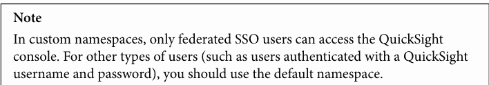
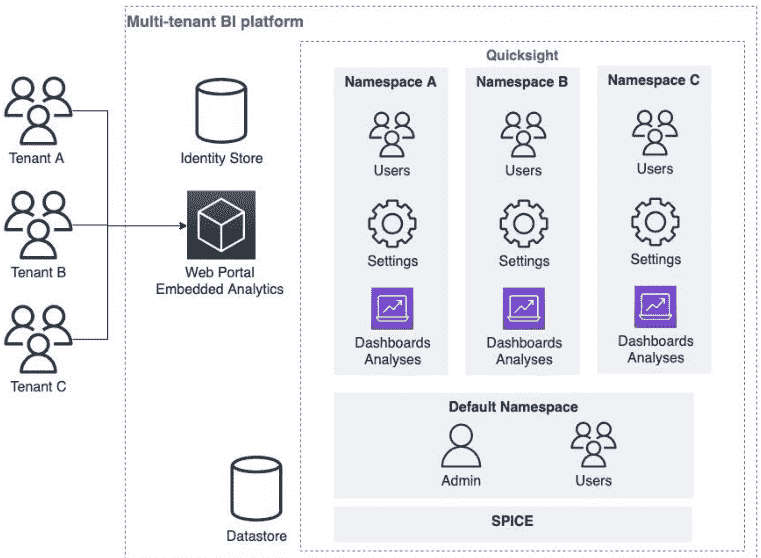
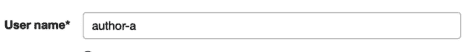
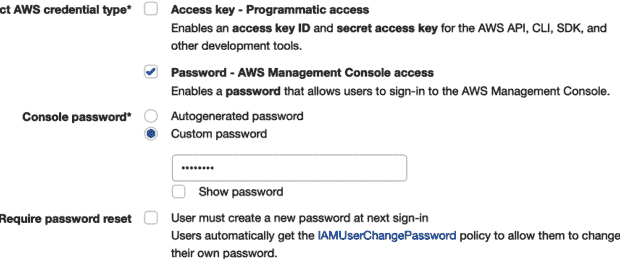
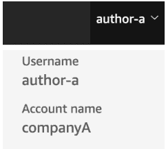
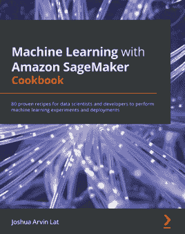
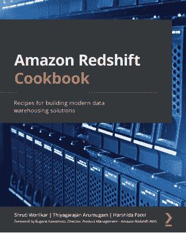

# 10 Amazon QuickSight 中的多租户

在本章中，我们将学习如何在 **Amazon QuickSight** 中设置多租户。具体来说，我们将探讨多租户架构，并了解 QuickSight 命名空间如何帮助我们构建多租户环境。

本章将涵盖以下主题：

- - 使用命名空间介绍多租户
- - 设置多租户

## 技术要求

本章，您需要访问以下内容：

- - 一个 AWS 帐户和 **AWS Identity and Access Management (IAM)** 用户，具有提升的访问权限
- - 一个配置了管理员用户的 Amazon QuickSight（企业版）帐户
- - 在 _第 4 章，开发可视化和仪表板_ 中创建的仪表板

### 使用命名空间介绍多租户

在本节中，我们将介绍 Amazon QuickSight 中多租户的概念。根据我们迄今所学的知识，拥有 QuickSight 资产的用户可以将资源与帐户中的任何其他注册用户共享。但是，存在单个 QuickSight 帐户需要支持多个 **租户** 的用例。

### 了解多租户

QuickSight 提供允许开发人员构建多租户 **商业智能 (BI)** 平台的功能。由于其云原生架构，QuickSight 会根据用户数量自动扩展。此功能结合 QuickSight 的嵌入功能及其可通过编程方式访问的 API 操作，帮助开发人员实现多租户 BI 平台。

多租户平台的一个关键特征是租户之间不相互交互，这有效地防止租户向属于另一个租户的用户授予（或撤销）访问权限。此外，不同租户通常对其用户有不同的权限要求，以及不同的 _外观和感觉_ 要求。多租户平台可以服务于大型企业，其中租户可以是公司的每个子公司或独立部门。

另一个用例是软件供应商向其客户提供 BI 功能。在此示例中，平台的每个租户都将代表软件供应商的一个客户。每个租户都能够管理自己的 BI 资产并与自己的用户共享（但不与其他租户共享）。对于此场景，租户通常通过 Web 门户访问 QuickSight。为了分离和组织来自不同租户的用户，QuickSight 引入了 _命名空间_ 的概念。

在下一节中，我们将介绍 QuickSight 命名空间。

### 介绍 QuickSight 命名空间

为了解决多租户要求，Amazon QuickSight 引入了命名空间 API。命名空间 API 允许组织构建多租户环境，而无需创建多个 QuickSight 帐户。

QuickSight 命名空间是用户和组的逻辑容器，可用于分离不同的部门或组织。同一命名空间内的用户可以相互共享资产，而来自不同命名空间的用户无法相互交互。

命名空间可以是以下之一：

- 默认命名空间

- 自定义命名空间

创建新 QuickSight 帐户时，您的第一个作者和管理员用户将属于 *默认* 命名空间。您创建的任何其他命名空间都是 *自定义* 命名空间。



用户不能属于多个命名空间。无法在命名空间之间移动用户。其他 QuickSight 资产，如分析仪表板和数据集，不专属于命名空间。相反，使用 Access API 管理对 QuickSight 资产的访问，如我们在第 8 章《了解 QuickSight API》中所学。因此，可以通过编程方式将资产与不同命名空间的用户共享。例如，组织可能需要将共享仪表板与所有命名空间的所有用户共享。

下图描绘了多租户 BI 分析的示例架构：



图 10.1 – 多租户架构

该架构的主要组件如下：

- • **自定义命名空间**：用于组织来自不同租户的用户。

- • **默认命名空间**：用于管理员用户。

- • **Amazon SPICE 和数据集**：特定于 QuickSight 帐户。对这些资源的访问是单独使用 QuickSight API 管理的，如我们在 _第 3 章，使用 Amazon QuickSight 准备数据_ 和 _第 9 章，管理 QuickSight 权限和用量_ 中所学。

- • **嵌入式门户和身份存储**：允许用户进入 QuickSight 控制台。对于不需要嵌入式 Web 门户的用例，可以改用 QuickSight Web 应用程序。嵌入式门户可以是任何自定义构建的 Web 应用程序。如何构建 Web 应用程序的实现细节超出了本书的范围。

现在我们已了解在 QuickSight 中使用多租户架构的基础知识，在下一节中，我们将查看一个实际操作示例。


## 设置多租户

在本章中，我们将使用命名空间 API 设置一个简单的多租户环境。此练习将帮助你了解如何以 QuickSight 管理员用户身份设置多租户环境。它还将帮助你了解你的 BI 用户在多租户场景下的体验，以及 QuickSight 如何防止用户与其他租户共享资产。

## 创建命名空间

创建命名空间很简单，可以使用 QuickSight API 完成。在撰写本文时，无法通过 QuickSight **图形用户界面 (GUI)** 创建命名空间：

1. 首先，你需要以 QuickSight 管理员用户身份登录 Amazon QuickSight。
2. 接下来，打开 **AWS 命令行界面 (CLI)**，并键入以下命令，将高亮显示的值替换为你环境中的值。对于此练习，我们将创建一个名为 `companyA` 的自定义命名空间。请注意，我们已经为本书中使用的现有 Admin、Author 和 Reader 用户有一个默认命名空间：

   ```bash
   $aws quicksight create-namespace --aws-account-id <account-id> --namespace companyA --identity-store QUICKSIGHT
   ```

   这将导致新命名空间的异步创建。请注意，在 CLI 响应中，状态为 `CREATING`：

   ```json
   {
    "Status": 202,
    "Name": "companyA",
    "CapacityRegion": "us-east-1",
    "CreationStatus": "CREATING",
    "IdentityStore": "QUICKSIGHT",
    "RequestId": "xxxxxx-xxxxx-xxxxxxxxxxxxxx"
   }
   ```

3. 要确认新命名空间已创建，我们将使用 `list-namespaces` CLI 命令。键入以下命令，将高亮显示的值替换为你环境中的值：

   ```bash
   $aws quicksight list-namespaces --aws-account-id <aws-account-id>
   ```

请注意响应。它应该如下所示：

```json
{
  "Status": 200,
  "Namespaces": [
    {
      "Name": "companyA",
      "Arn": "arn:aws:quicksight:us-east-1:<account-id>:namespace/companyA",
      "CapacityRegion": "us-east-1",
      "CreationStatus": "CREATED",
      "IdentityStore": "QUICKSIGHT"
    },
    {
      "Name": "default",
      "Arn": "arn:aws:quicksight:us-east-1:<account-id>:namespace/default",
      "CapacityRegion": "us-east-1",
      "CreationStatus": "CREATED",
      "IdentityStore": "QUICKSIGHT"
    }
  ],
  "RequestId": "xxxxxxx-xxx-xxx-xxx-xxx"
}
```

两个命名空间现在都已成功创建。

> **Note**
> 命名空间跨越 **AWS 区域**，无论用户使用哪个区域，都会被分配到同一个 QuickSight 命名空间。

现在我们已经创建了新命名空间，在下一节中，我们将把新用户分配到该命名空间。

## 使用 QuickSight 命名空间

在本节中，我们将添加用户，然后了解命名空间不允许用户与其他命名空间共享资产。在本节结束时，我们将学习如何在命名空间之间配置共用资产。

## 添加用户

现在我们有了新命名空间，将使用新命名空间注册新用户。  
对于此练习，我们将在 QuickSight 中注册一个新 IAM 用户：

1. 首先，使用 **AWS 控制台** 创建一个名为 `author-a` 的新 IAM 用户。选择 IAM，然后从左侧菜单中选择用户。

2. 选择 **添加用户**。在下一屏幕上，选择用户名，然后选中 **密码 – AWS 管理控制台访问** 复选框，如下图所示：

## 设置用户详细信息

你可以一次添加多个具有相同访问类型和权限的用户。了解更多



## 选择 AWS 访问类型

选择这些用户主要如何访问 AWS。如果你只选择编程访问，它并 **不会** 防止用户使用假设角色访问控制台。访问密钥和自动生成的密码将在最后一步提供。了解更多



图 10.2 – 创建 IAM 用户

3. 在下一屏幕上，保持权限为空并单击 **创建**。请记下用户 arn 值，我们将在下一步中使用它。

4. 现在我们已经创建了新用户，将在 `companyA` 命名空间下将其注册到 QuickSight。使用 CLI，键入以下命令，将高亮显示的值替换为你环境中的值：

```bash
$aws quicksight register-user --identity-type IAM \
--email <your-email> --user-role AUTHOR --iam-arn arn:aws:iam::<aws-account-id>:user/author-a \
--aws-account-id <aws-account-id> --namespace companyA
```

要确认用户创建，我们将使用 `list-users` CLI 命令。请注意，我们将 `companyA` 指定为命名空间：

```bash
$aws quicksight list-users --aws-account-id <aws-account-id> --namespace companyA
```

响应将如下所示：

```json
{
  "Status": 200,
  "UserList": [
    {
      "Arn": "arn:aws:quicksight:us-east-1:xxxxxxxxxxxx:user/companyA/author-a",
      "UserName": "author-a",
      "Email": "xxx@xxx",
      "Role": "AUTHOR",
      "IdentityType": "IAM",
      "Active": true,
      "PrincipalId": "federated/iam/xxxxx"
    }
  ],
  "RequestId": "xxxx-xxxx-xxxx-xxxx"
}
```

5. 现在我们已成功创建用户，让我们尝试了解命名空间的影响。打开 AWS 控制台，以新创建的用户身份登录 QuickSight。展开右上角菜单。请注意命名空间名称，如下图所示：



图 10.3 – 登录多租户 QuickSight 账户

6. 接下来，我们要确保此用户无法将其仪表板、分析或数据集与其他命名空间的用户共享。检查这一点的最简单方法是快速创建一个新数据集、分析或仪表板，并尝试与其他用户共享。一旦资产创建完成，打开其权限管理器，尝试邀请一个属于不同命名空间的 Author 或 Reader 用户：

### 管理数据集权限

你可以管理访问此数据集的用户、分析和仪表板的设置和权限。


已与 1 个用户共享

| 名称 | 权限 | 操作 |
|---|---|---|
| author-a | Owner | |
| 关闭 | | 邀请用户 |

图 10.4 – 在多租户环境中共享资产

共享资产时，QuickSight 在找到相关用户时会自动补全。你会注意到，当你输入 `author` 时，QuickSight 没有任何建议，且无法共享数据集。原因是 Author 用户属于与 `author-a` 用户不同的命名空间。

现在我们已经了解命名空间如何防止用户与其他用户共享资产，我们将了解如何在不同命名空间的用户之间配置共用资产。

## 共享共用资产

可能存在需要让不同命名空间的用户可见的资产的用例。例如，一家大型公司可能希望将特定仪表板与属于不同部门（配置为命名空间）的用户共享。要完成此操作，我们需要使用 QuickSight API。如前一节所学，通过 QuickSight 控制台无法完成此操作，因为一个命名空间的用户无法发现另一个命名空间的用户。

为了更好地理解此概念，我们将使用第 4 章“开发可视化和仪表板”中配置的纽约出租车仪表板。对于本教程，我们将使用 QuickSight 管理员用户和 AWS CLI：

1. 首先，打开安装了 AWS CLI 的终端。

2. 使用 list-dashboard 操作列出仪表板。键入以下命令，将高亮显示的值替换为你环境中的值：

   ```bash
   $aws quicksight list-dashboards --aws-account-id <aws-account-id>
   ```

   关注 DashboardSummaryList 数组，并捕获 DashboardId 值，我们将在下一步中使用它：

   ```json
   "DashboardSummaryList": [
       {
           "Arn": "arn:aws:quicksight:us-east-1:xxxxxxxxxx:dashboard/xxxx-xxxx-xxxx-xxxx-xxxxxx",
           "DashboardId": "xxxx-xxxx-xxxx-xxxx-xxxx",
           "Name": "New York Taxi Dashboard",
           ...
       }
   ]
   ```

3. 要更新仪表板权限，我们将使用 update-dashboard-permissions CLI 命令。键入以下命令，将高亮显示的值替换为你环境中的值：

   ```bash
   $aws quicksight update-dashboard-permissions --aws-account-id <aws-account-id> --dashboard-id <dashboard-id> --grant-permissions Actions=quicksight:DescribeDashboard,quicksight:ListDashboardVersions,quicksight:UpdateDashboardPermissions,quicksight:QueryDashboard,quicksight:UpdateDashboard,quicksight:DeleteDashboard,quicksight:DescribeDashboardPermissions,quicksight:UpdateDashboardPublishedVersion, Principal=arn:aws:quicksight:us-east-1:<aws-account-id>:user/companyA/author-a
   ```

现在我们已为 author-a 用户提供了访问权限，我们将登录 QuickSight 控制台并查看可用仪表板。

4. 以 author-a 用户身份登录 QuickSight 控制台。然后，导航到仪表板以查看可用仪表板。纽约出租车仪表板现在应可供你查看，如下图所示：


Figure 10-5 – 在多租户环境中查看公共资产

与仪表板类似，其他资产（如数据集或分析）可以使用 QuickSight API 共享。

## 摘要

恭喜你完成本章，这是本书的最后一章。

在本章中，我们了解了 Amazon QuickSight 中的多租户概念。我们还详细探讨了一种示例架构，该架构允许多个租户通过 Web 门户访问 QuickSight 中的嵌入式资产。随后，我们重点介绍了 QuickSight 命名空间，并学习了如何配置它们。最后，我们通过两个动手示例了解命名空间如何防止用户共享资产，以及管理员用户如何为不同命名空间中的用户配置公共资产。

现在，你应该理解 Amazon QuickSight 中多租户的基本概念，并知道如何使用 AWS CLI 创建命名空间并组织不同的租户。

在关闭本书之前，请确保为此书及其练习创建的所有 AWS 资源都已关闭，以防止向你的 AWS 账户产生费用。

感谢你花时间阅读，希望本书符合你的期望。如有任何意见和进一步的问题，可以在 LinkedIn 上找到我。欢迎与我联系，我很乐意听取你的想法和反馈。祝学习愉快！

## 问题

- 1. 多租户平台的主要特征是什么？
- 2. 创建多租户 BI 平台的主要用例是什么？
- 3. 什么是 QuickSight 命名空间，如何配置它们？

## 进一步阅读

- Amazon QuickSight 用户指南：https://docs.aws.amazon.com/quicksight/latest/user/amazon-quicksight-user.pdf
- 使用隔离命名空间支持多租户：https://docs.aws.amazon.com/quicksight/latest/user/namespaces.html

## Packt

Packt.com  
订阅我们的在线数字图书馆，即可完全访问超过 7,000 本书籍和视频，以及行业领先的工具，帮助你规划个人发展并推进职业生涯。如需更多信息，请访问我们的网站。

### 为什么要订阅？

- 使用来自超过 4,000 名行业专业人士的实用电子书和视频，花更少的时间学习，花更多的时间编码
- 使用专为你构建的技能计划，提升你的学习效果
- 每月免费获取一本电子书或视频
- 完全可搜索，方便访问重要信息
- 复制和粘贴、打印和收藏内容

你知道吗？Packt 为每本出版的书籍提供电子书版本，并提供 PDF 和 ePub 文件？你可以在 packt.com 升级到电子书版本，作为印刷书籍客户，你有权享受电子书副本的折扣。如需更多详情，请通过 customercare@packtpub.com 与我们联系。

在 www.packt.com，你还可以阅读一系列免费技术文章，订阅一系列免费通讯，并获得 Packt 图书和电子书的独家折扣和优惠。

## 你可能还喜欢的其他书籍

如果你喜欢这本书，可能对 Packt 的这些其他书籍感兴趣：



### 使用 Amazon SageMaker 进行机器学习实战指南

Joshua Arvin Lat

ISBN: 9781800567030

- 训练和部署 NLP、时间序列预测和计算机视觉模型，以解决不同的业务问题 使用自定义容器镜像在 SageMaker 中推动定制化的极限 使用 SageMaker Autopilot 的 AutoML 功能创建高质量模型 使用有效的数据分析和准备技术 探索调试和管理 ML 实验及部署的解决方案 使用 SageMaker Clarify 处理偏差检测和 ML 可解释性要求 使用各种解决方案自动化中级和复杂的部署和工作流。



## Amazon Redshift 实战指南

Shruti Worlikar, Thiyagarajan Arumugam, Harshida Patel

ISBN: 9781800569683

- 使用 Amazon Redshift 构建规模达到 PB 级且具备可扩展敏捷性的数据仓库 使用 AWS 上专门构建的功能和服务，将数据仓库解决方案与数据湖集成 借助实用的配方，从数据获取到消费构建端到端分析解决方案 利用 Redshift 全面的安全功能，满足最苛刻的业务要求 在使用分析配方时，关注架构洞察和原理 探索处理大数据的最佳实践，以运行完全托管的解决方案。

## Packt 正在寻找像你这样的作者

如果你有兴趣成为 Packt 的作者，请访问 **authors.packtpub.com** 并立即申请。我们与成千上万像你一样的开发人员和技术专业人士合作，帮助他们将洞察力分享给全球技术社区。你可以提交一般申请，申请我们正在招募作者的特定热门主题，或提交你自己的想法。

## 分享你的想法

现在你已经读完了《使用 Amazon QuickSight 获得可操作的洞察》，我们很乐意听取你的想法！如果你从 Amazon 购买了本书，请点击此处直接前往本书的 Amazon 评论页面，分享你的反馈或在你购买的网站上留下评论。

你的评论对我们和技术社区非常重要，将帮助我们确保提供高质量的内容。
