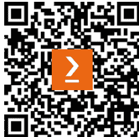

# Windows Server 混合核心基础设施管理 AZ-800 考试指南：设计、实现和管理本地及云端的 Windows Server 核心基础设施


本书是我为全球技术学习社区做出的贡献，我想感谢所有投入宝贵时间学习新技能并承诺阅读本书的读者。

## 贡献者

### 关于作者

**史蒂夫·迈尔斯**，又名 *SMiles* 或 *类比先生*，是微软 Azure 混合 MVP、MCT，以及多云和混合技术作者和技术审稿人，在网络、数据中心基础设施、托管托管和云解决方案方面拥有 20 多年经验。他的经验来自与最终用户和经销商渠道合作，以及在与全球网络和应用安全供应商、全球电信主机、托管托管、托管和数据中心服务提供商以及硬件分销相关的供应商空间和角色中工作。目前，他在英国和都柏林的一家多云**云解决方案提供商**（**CSP**）分销商担任云和混合技术领导职务。

他目前专注于在混合和多云平台环境中保障、保护和管理身份、Windows 客户端和 Windows Server 工作负载。

他最喜欢站在白板前，更喜欢使用插图进行沟通。他擅长用类比和概念将复杂技术分解为日常的真实场景。

他获得的第一个微软认证是 Windows NT，他是面向 Windows Server 和许多其他微软产品的 MCP、MCITP、MCSA 和 MCSE。他还拥有多个微软基础、助理、专家和专业认证，涵盖 Azure 安全、身份、网络和 M365。他还持有多个安全和网络供应商认证。

最后，作为多云领域的一部分，他有 GCP、AWS 的经验，是阿里云 MVP，并获得阿里云认证。

### 关于审稿人

**彼得·德·滕德尔** 拥有 25 多年的微软解决方案架构和部署经验，起步于 1996 年的 Windows NT4/Exchange 5.5。2012 年初，他开始转向云技术，并迅速拥抱 Azure，担任云架构师和培训师。2019 年 9 月，彼得加入了微软享有盛誉的微软技术培训师团队，为全球顶级客户和合作伙伴提供 Azure 准备研讨会。彼得最近迁居至华盛顿州雷德蒙德，并继续担任此角色。鉴于他过去作为 Azure 混合 MVP 的身份以及对社区的热情，彼得仍然积极参与公开演讲、技术写作以及指导和辅导。您可以在 Twitter 上关注彼得 @pdtit。

*谢谢 Steve，信任我对 Azure 的热爱。同时，特别感谢我的妻子支持我实现梦想。*


## 前言

云计算是一种通常被视为平台和机制的技术，用于为组织提供数字化转型的推动器。但是，云计算之旅不必是一个二选一的决定；也不必是一个将所有工作负载都移到云端并下线所有本地资源的全面性决定。

虽然这对某些组织来说可能是合适的、最佳的发展方向，但同样也有组织，出于数据本地性、合规性、控制权、性能等原因，情况并非如此。对于许多组织来说，仍需要保留适量的本地计算、存储网络及其他相关资源，以满足其技术需求。我们的职责不是评判或裁定对组织而言什么是对的或错的，而是提供选项，以满足和支持所有被授权或需要交付给组织的预期成果。

怀着对云计算不断变化面貌的这种展望和心态，我们可以考虑将云计算的能力扩展到我们的数据中心，以增强和丰富从这些设施运营的服务。这可以被视为既关于从云端管理，也关于向云端迁移。

我们承认，毫无疑问，数字化转型有着坚实的理由，对于许多人来说，云原生是首选方法；然而，对于许多人来说，旅程的第一步将是通过混合云计算方法进行数据中心现代化。数据中心还有许多年的使用寿命，而 Windows Server 是一种计算和核心基础设施平台，应该通过云计算能力来丰富和增强。

本书内容旨在全面覆盖考试要求，帮助你准备 AZ-800：管理 Windows Server 混合核心基础设施微软认证考试。

本考试面向那些在混合环境中拥有丰富 Windows Server 操作系统工作经验，并实施和管理核心混合基础设施技术（包括计算、存储、网络、标识和管理）的候选人。

此外，本书的附加价值在于，它旨在超越考试目标，提供额外的知识深度和实践动手技能，这些技能在日常混合 Windows Server 环境工作中将非常有价值。

本书最后附有考试准备测试。

## 本书适用人群

本书适用于那些希望通过 AZ-800：管理 Windows Server 混合核心基础设施考试的技术实施和管理人员。

## 本书内容概览

第 1 章，实施和管理 Active Directory 域服务，包含在混合环境中创建和管理 Active Directory 域服务（AD DS）的内容。

第 2 章，实施和管理 Azure Active Directory 域服务，包含创建和管理 Azure Active Directory 域服务（AAD DS）的内容。

第 3 章，使用组策略管理用户和计算机，包含在 AD DS 和 AAD DS 中实施和管理组策略的内容。

第 4 章，实施和管理混合标识，包含使用 Azure AD Connect 和 Azure AD 云同步实施和管理混合标识的内容。

第 5 章，实施和管理本地网络基础设施，包含在混合环境中实施和管理本地网络基础设施的内容。

第 6 章，实施和管理 Azure 网络基础设施，包含在混合环境中实施和管理 Azure 网络基础设施的内容。

第 7 章，实施 Windows Server 存储服务，包含在混合环境中实施 Windows Server 存储服务的内容。

第 8 章，实施混合文件服务器基础设施，包含在混合环境中实施 Azure 存储服务的内容。

第 9 章，在 Windows Server 上实施和管理 Hyper-V，包含在混合环境中在 Windows Server 上实施和管理 Hyper-V 的内容。

第 10 章，实施和管理 Windows Server 容器，包含在混合环境中实施和管理容器的内容。

第 11 章，管理 Windows Server Azure 虚拟机，包含管理 Azure 虚拟机的内容。

第 12 章，在混合环境中管理 Windows Server，包含在混合环境中管理 Windows Server 的内容。

第 13 章，使用 Azure 服务管理 Windows Server，包含使用 Azure 服务管理 Windows Server 和工作负载的内容。

第 14 章，考试准备模拟测试，为 Exam AZ-800：管理 Windows Server 混合核心基础设施的每个技能部分提供模拟测试。

## 如何充分利用本书

本书需要以下内容：

- 一台带有浏览器（例如 Edge 或 Chrome）的设备，用于访问 Azure 门户：https://portal.azure.com
- Azure AD 租户和 Azure 订阅；你可以使用现有帐户或免费注册：https://azure.microsoft.com/en-us/free
- Azure 订阅的所有者角色

| 本书涵盖的软件/硬件 | |
|---|---|
| Windows Server | Azure AD |
| Hyper-V | Azure 计算服务 |
| Active Directory | Azure 存储服务 |
| iSCSI 存储 | Azure 网络服务 |
| 存储空间和存储空间直通 | Azure 安全服务 |
| 文件存储 | Azure 管理服务 |

## 下载彩色图片

我们还提供一个包含本书中使用的屏幕截图/示意图彩色图片的 PDF 文件。你可以在此处下载：https://packt.link/Mc8to

## 本书使用的约定

本书贯穿使用了一些文本约定。

文本中的代码：表示文本中的代码词、数据库表名、文件夹名、文件名、文件扩展名、路径名、虚拟 URL、用户输入和 Twitter 账号。例如：“主要服务器在辅助服务器的范围属性中设置了延迟配置属性。”

代码块设置如下：

```
Install-WindowsFeature Web-Application-Proxy
-IncludeManagementTools
```

**粗体：** 表示新术语、重要单词或屏幕上显示的单词。例如，菜单或对话框中的单词会以这种方式出现在文本中。例如：“从 **服务器管理器** 的 **工具** 菜单中启动 **DNS 管理器**。”

> 提示或重要说明
> 像这样显示。

## 联系我们

我们始终欢迎读者的反馈。

**一般反馈：** 如果你对本书的任何方面有疑问，请在邮件主题中注明书名，并发送电子邮件至 `customercare@packtpub.com`。

**勘误：** 虽然我们已竭力确保内容的准确性，但错误难免。如果你在本书中发现错误，我们将不胜感激如果你能将其报告给我们。请访问 `www.packtpub.com/support/errata`，选择你的书，单击 **勘误提交表单** 链接，并输入详细信息。

**盗版：** 如果你在互联网上以任何形式发现我们作品的非法副本，我们将不胜感激如果你能提供位置地址或网站名称。请使用材料链接联系 `copyright@packt.com`。

**如果你有兴趣成为作者：** 如果你在某个主题上有专业知识，并且有兴趣撰写或参与编写书籍，请访问 `authors.packtpub.com`。

## 分享你的想法

读完 *管理 Windows Server 混合核心基础设施 AZ-800 考试指南* 后，我们很乐意听听你的想法！请单击此处直接前往本书的 Amazon 评论页面并分享你的反馈。

你的评价对我们和技术社区非常重要，将有助于确保我们提供高质量的内容。


## 下载本书的免费 PDF 副本

感谢您购买本书！

您是否喜欢出行时阅读，但又无法随身携带所有印刷书籍？您购买的电子书是否与您选择的设备不兼容？

别担心，现在每本 Packt 图书均附赠该书的 DRM-free PDF 版本，无需额外费用。

您可以在任何时间、任何地点、任何设备上阅读。直接从您喜爱的技术图书中搜索、复制并粘贴代码到您的应用程序中。

优惠不止于此，您还可以每天通过收件箱获取独家折扣、通讯和精彩免费内容。

按照以下简单步骤获取这些权益：

- 1. 扫描二维码或访问以下链接



```
https://packt.link/free-ebook/9781803239200
```

- 2. 提交您的购买证明

- 3. 就这些！我们会将免费 PDF 和其他权益直接发送到您的电子邮件
