## 实现和管理 Active Directory 域服务

本章涵盖 AZ-800 管理 Windows Server 混合核心基础设施考试的学习目标：在本地和云环境中部署和管理 AD DS。

我们将首先了解 Active Directory 概念及其服务组合，作为本章的起点。我们将重点介绍 Active Directory 域服务（AD DS）。我们将更详细地查看 AD DS 的每个组件，然后继续了解如何在本地环境中创建和管理 AD DS 实例。最后，我们将通过动手练习进一步提升您的技能。

本章将涵盖以下主要主题：

- 什么是 Active Directory？
- 什么是 Active Directory 域服务？
- Active Directory 域服务组件
- 创建 Active Directory 域服务
- 管理 Active Directory 域服务
- 练习 – 在 Windows Server 上安装 AD DS

本章旨在让您的知识超越考试目标，为您从事以现实世界日常混合环境为重点的角色做好准备。

### 什么是 Active Directory？

在深入创建或配置任何服务之前，我们将查看一些定义和概念，为您建立知识基准和基础，供您在此基础上构建。我们将首先定义 **Active Directory (AD)**，它构成了 Windows Server 标识、访问管理和信息保护服务的基础。

AD 是 Microsoft 标识、访问和信息保护解决方案的一部分。它作为 Windows Server 的一部分以安装服务的形式运行，并在 Windows 2000 中引入。

顾名思义，AD 是一个 **目录服务** 和 **标识提供者 (IDP)**，其主要功能是通过 *身份验证* 和 *授权* 来管理对域资源的访问。它用于在网络上控制、集中组织、查找和保护对这些资源的访问。

从简单层面来看，您可以将其视为网络上资源的 *标识存储* 和数字地址簿。它包含目录中标识及其对资源的访问权限列表。

AD 不是单一功能服务或解决方案；它是目录驱动和标识驱动服务组合的集合或总称，包括 **域服务**、**联合服务**、**证书服务** 和 **权限管理服务**。它提供 **单点登录 (SSO)** 等功能。

从技术角度看，它是一个 *X.500 兼容的目录服务*，可以使用 **轻量目录访问协议 (LDAP)** 访问。它基于分层多主分布式数据库模型，包含分区和可扩展架构。

本节介绍了 AD 作为 Microsoft 解决方案，用于本地和混合环境中标识、访问和信息保护的基础。在下一节中，我们将了解并定义 **Active Directory 域服务 (AD DS)**。

### 什么是 Active Directory 域服务？

AD DS 组织为分布式可搜索的分层目录，用于控制对网络资源的访问，并允许通过策略应用设置和配置。

AD DS 是安装在 Windows Server 上的服务器角色，并随 **操作系统 (OS)** 包含；无需下载任何软件。安装了 AD DS 角色的服务器称为 **域控制器 (DC)**。

AD DS 通过 *身份验证* 和 *授权* 域对象资源来提供对资源的访问。

访问域资源基于两阶段概念，包括身份验证然后是授权；简而言之，涉及确定您是谁以及确定您可以做什么：

- **身份验证**，也称为 **AuthN**，是标识组件；它是建立人员（或服务）身份并证明他们是他们自称的人的过程。这可以通过验证访问凭据与存储或已知的标识信息来完成。

- **授权**，也称为 **AuthZ**，是访问组件；它是确定经过身份验证的人员（或服务）对资源的访问级别、可以访问什么以及可以执行什么操作的过程。

身份验证和授权的概念在以下图中显示：

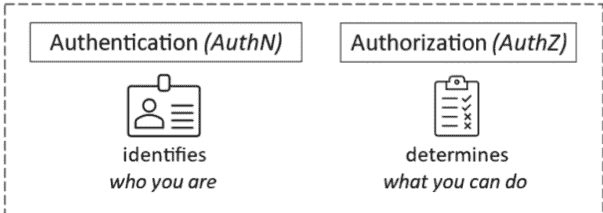

图 1.1 – 了解身份验证和授权

**Active Directory** 和 **域服务**（缩写为 **AD** 和 **DS**）这两个术语通常互换使用，表示相同的含义。当人们提到 AD 时，通常仅指 DS 组件，主要因为它是最常见和基础的标识和访问管理服务组件。

为本书和考试，我们将仅在 DS 组件的上下文中引用 AD；为了简洁，我们将简单地称其为 **AD DS**。有关 AD 中其他服务的其他学习内容，请参阅本章末尾的 **进一步阅读** 部分。

AD DS 包含对象列表，例如用户帐户，以及其属性，例如密码和分配给资源的访问权限。可以查询此列表，以验证域中创建为信息存储数据库中对象的资源的身份和访问权限。这在以下图中显示：

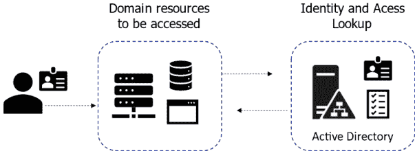

图 1.2 – 域资源访问

AD DS 通过将其信息存储（**数据库**）中存储的所有内容分类为对象来运行。对象可以是用户帐户、计算机帐户、组（安全主体）、打印机、网络设备、应用程序或服务。这些对象是分层的，意味着对象可以包含其他嵌套对象；这些类型的对象称为容器。我们将在本章后面更详细地介绍这些术语。

数据库中存储的每个对象都有一组与对象上下文匹配的属性；这是在 **架构** 中定义的。目录信息数据存储是具有可扩展架构的数据库结构，可以存储适合业务要求的属性。作为目录服务意味着每个对象都可以以集中和策略驱动的方式进行搜索、查询、访问控制、管理和配置。

**标识和访问管理 (IAM)** 的基础是通过 **基于角色的访问控制 (RBAC)** 和最小权限原则和实践来控制对对象的访问。这意味着提供适当的控制范围。仅授予执行所需任务所需的访问权限，而不必不必要地提供提升的访问权限，这些权限可能提供超出所需范围的更广泛范围，并在帐户被攻破时提供特权横向访问。控制机制是组策略，并为标识提供组范围。

AD DS 包含一个逻辑结构，通常映射到组织的 *操作模型*，以及一个 *物理结构*，应映射到 *网络拓扑*。

以下可以视为逻辑组件：

- 域
- 域树
- 林
- OU
- 分区
- 架构
- 容器

以下可以视为物理组件：

- 数据存储
- 全局目录
- 域控制器
- 只读域控制器
- 站点
- 子网

这些组件将在本章后面部分进行更详细的介绍。

本节向我们介绍了 **DS**，它是 AD 的一项服务，为域内资源的身份验证和授权提供了集中式机制。

总之，AD DS 构建在目录服务之上，目录服务是所有域对象的复制式信息存储（数据库）。它主要为访问域对象以及配置和管理访问提供身份验证和授权。

### Active Directory Domain Services 组件

在本节中，我们将更详细地了解 AD DS 的各个组件。

### 对象

**对象**是指 AD DS 目录中的任何元素；对象示例包括打印机、计算机、用户、组、子网等。对象具有描述其属性的属性；每个对象都将有必需属性和可选属性。名称和 **对象标识符 (OID)** 是必需属性的两个示例。

在本节中，我们将了解 AD DS 对象的不同类别。

### 容器对象

这些是 _内置对象_，用于逻辑分组和容纳其他对象；可以将其视为包含属于同一类别或类的对象的分层文件夹结构。

安装 AD DS 时，将创建一组默认对象容器；这些容器将以分层文件夹的形式直观表示。以下截图显示了默认容器；其中一些默认情况下是隐藏的：

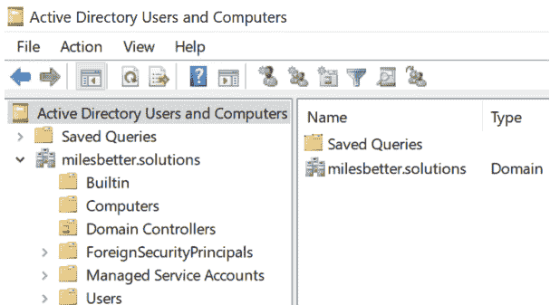

图 1.3 – 对象的容器

这些默认容器继承一组默认权限，这些权限用于允许正常的服务管理和操作。这些容器不能删除，您不应更改分配的权限或委派对这些容器的控制；相反，您应创建容器以满足您的需求。

需要了解的基本容器如下：

- **域容器**充当容器层次结构的根容器。
- **内置容器**提供一个容器，用于容纳安装 AD DS 时创建的几个默认组和默认服务管理员帐户。
- **计算机容器**提供一个容器，用于容纳所有计算机帐户对象；它是所有创建的计算机帐户的默认位置。
- **用户容器**提供一个容器，用于容纳所有用户和组对象；它也是所有创建的用户和组的默认位置，安装 AD DS 时其中一些会自动放置在该容器位置。
- **域控制器 OU 容器**提供一个容器，用于容纳所有域控制器的计算机帐户；它是所有创建的域控制器的默认位置。

安装 AD DS 时，这些默认容器会自动创建。它们不能删除，且不应修改分配的权限和访问控制。不过，可以创建自定义容器以满足您的需求。

您只能将策略应用到 OU 容器；要将策略应用到用户或计算机并委派控制，您应创建自己的 OU 容器并将对象移动到这些容器中，以便应用策略和权限。

域控制器容器是一个 **组织单位 (OU)** 容器，是安装 AD DS 时默认创建的唯一 OU。建议不要将域控制器移出域控制器 OU 容器的默认位置，并且不要将控制权委派给非服务管理员。

### 组织单位

OU 作为容器对象，用于集体组织用户、组和计算机，为针对容器中对象的管理控制和策略提供了框架。

OU 可能有用的示例是，当您需要对属于同一工作负载（例如所有 Azure Virtual Desktop 对象）、环境（例如 dev、test、prod 等）、业务单元或区域的一组资源应用通用管理控制时。

需要注意的是，您只能将 **组策略对象 (GPO)** 链接到 OU 容器，而不能链接到普通容器。

OU 可通过以下方法创建：

- AD 用户和计算机
- AD 管理中心
- 带有 AD 模块的 PowerShell
- Windows 管理中心 (WAC)，它正在迅速成为混合环境中最广泛采用的工具

OU 结构可以是分层的，并可映射到部门、业务组或地理位置等组织结构。这些可以映射到功能、项目或工作站、服务器等资源。

OU 应将所有需要相同管理和策略设置的对象分组，并将其移动到可通过组策略控制的 OU 中。如果 OU 中有一些您不希望应用策略的对象，则可以创建新的 OU，并将对象移出到该 OU 中，以便策略不适用。

支持分层分组；您可以将 OU 嵌套在 OU 中（就像任何分层文件夹结构一样）。但是，应仔细规划对象分组和层次结构，使其不过于复杂。通常，五级或更少是最佳的，10 级是建议的最大值，以减轻管理员负担并降低复杂性。您还可能受域对象资源的限制，该资源仅支持受支持方法/配置的 OU 结构。

### 用户对象

在目录中创建用户帐户（标识）时，它被归类为对象。它是目录中的核心基础对象类之一，与计算机对象并列。因此，我们将在本章后面介绍名为 Active Directory 用户和计算机的 AD DS 管理工具。

为了使用户能够向域资源进行身份验证，必须使用 AD DS 提供的用户帐户。AD DS 在其数据库中存储用户帐户，并附带对象特定的标识信息和属性，例如登录用户名和密码；这些用于用户登录以访问域资源。

此外，其他属性还包括需要存储的任何特定于组织的信息，例如职位、部门、办公室、电子邮件、电话号码等。

关于访问管理，将列出用户所属的组。这些组成员身份用于确定用户对域中资源的访问级别；这就是“你是谁”以及“你拥有什么访问权限”的概念。

建议做法是，不直接将访问权限授予用户对象，而是授予组对象。用户是组的成员，因此他们从组成员身份继承访问权限；这简化了管理，并使排查访问问题变得更容易、更快速。

每个用户帐户对象都有一个关键的主属性，称为 **用户主体名称 (UPN)**。它采用互联网通信标准格式，通常以电子邮件地址格式（name@domain）识别和表示。但是，必须理解它不是电子邮件地址。我们认识到用户的电子邮件地址可能与其 UPN 匹配，反之亦然，但这不是明确规则。

用户的 UPN 由用户的登录名和域名组合而成。@ 符号是这两个名称之间的连接符或分隔符；例如，milesbetter.solutions AD 域中的用户 Steve Miles 可能有一个 UPN smiles@milesbetter.solutions，其中 smiles 是 Steve Miles 用户帐户的用户登录属性。

另外两个术语是 **UPN 前缀** 和 **UPN 后缀**；UPN 前缀是 @ 符号之前的名称部分，而后缀是 @ 符号之后的名称部分。UPN 前缀和后缀组件在以下截图中显示：

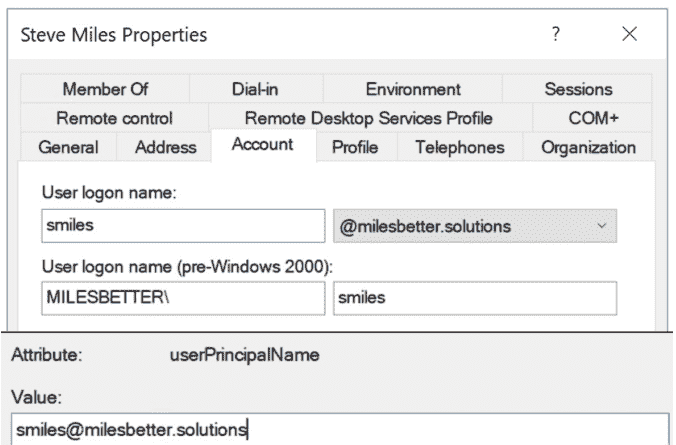

图 1.4 – UPN 格式

与前面的用户帐户示例一样，smiles 登录名属性被称为 UPN 前缀，而 UPN 后缀是 milesbetter.solutions，它指的是名称的域部分。

### 服务对象

**服务帐户**是非用户帐户的帐户对象类，用于在后台运行且无需用户交互的应用程序和服务。但是，它们仍然需要向目录服务进行身份验证。

托管服务帐户 (MSAs) 是 AD DS 对象类，提供此服务帐户功能；它们通过降低服务主体名称 (SPN) 管理和服务帐户密码管理的管理工作量而受益。

MSAs 有两种类型，如下所示：

- 标准托管服务帐户 (sMSAs) 是特定于计算机、服务或应用程序的，无法在网络中的其他资源之间共享。这限制了其效率并增加了管理负担。需要实现多个本地 sMSAs 会增加威胁、安全性和配置漂移的攻击面和风险。

有关 sMSAs 的更多信息，请参阅 https://docs.microsoft.com/en-us/azure/active-directory/fundamentals/service-accounts-standalone-managed。

- 组托管服务帐户 (gMSAs) 具有域范围和功能，可跨多台计算机、服务和应用程序使用；NLB 群集和 IIS 是示例。

gMSAs 要求你在域控制器 (DC) 上创建密钥分发服务 (KDS) 根密钥，以创建 gMSA 帐户。

以下是一些可用于管理 gMSAs 的 AD PowerShell cmdlet：

- Get-ADServiceAccount
- Install-ADServiceAccount
- New-ADServiceAccount
- Remove-ADServiceAccount
- Set-ADServiceAccount
- Test-ADServiceAccount
- Uninstall-ADServiceAccount

有关 gMSAs 的更多信息，请参阅 https://docs.microsoft.com/en-us/azure/active-directory/fundamentals/service-accounts-group-managed。

### 计算机对象

正如用户在目录服务中拥有帐户，以便我们可以搜索和定位这些用户一样，我们也需要相同的机制来搜索和定位域中的计算机。计算机对象为计算机提供一个帐户；它代表网络上的计算机资源，并允许其唯一标识自身并进行身份验证。计算机拥有计算机帐户后，即可作为域资源进行管理，并使用组策略进行配置。

用户帐户对象和计算机帐户对象是 AD DS 中的两个基础构建块对象类。

### 组对象

目录中的组对象类构成访问管理的基础。

通过用户帐户进行身份验证后，你的组对象成员身份定义了你在域中有权访问的内容。分配给组的权限定义了你可以对该网络资源执行哪些操作。

不应在用户帐户级别设置权限；这会增加管理负担，效率低下，容易发生配置漂移，并成为治理和安全态势问题。

所有权限都应分配给组，用户应成为相应组的成员，以便获得所需权限。这样更容易治理和控制诸如加入者、离职者策略，或者人们角色变更并现在需要不同访问级别等策略。与其根据其新角色定义直接更改他们现在可以/不可以执行操作的个别资源权限，不如根据其新角色的权限要求将他们添加到或从相应组中移除。这要高效得多，出错率更低，并提供更好的控制和治理。

将用户帐户添加到组是一种 RBAC 方法。应采用最小权限原则，意味着你只需拥有执行所需任务/活动所需的足够访问权限，而无需提升的权限。这应是保护免受帐户被入侵后横向攻击的基石。

总之，通过采用创建组、向组分配权限，然后将用户帐户作为成员添加到这些组中的做法，我们可以高效管理多个需要相同访问类型的用户对资源的访问。

### 组类型

组分为两种类型：安全组和分发组。让我们详细了解一下：

- 安全组用作启用安全性的逻辑容器，以集合地对用户进行分组，从而向资源分配访问权限。与单独向每个用户分配权限相比，这是向资源分配一组权限的更高效方式。例如，要控制对网络资源的访问，我们可以创建任意数量的组，每个组都有不同级别的访问权限。然后，可以根据用户应拥有的访问级别将他们添加到相应的组中。在将用户分配到组时，我们应确保遵循最小权限方法——也就是说，如果他们只需要读取访问权限，则不要使他们成为具有完全控制权限的组的成员。

安装 AD DS 时，会自动创建两个默认安全组；这些组位于 Builtin 和 Users 容器中。

- **分发组**用作*未启用安全性*的逻辑容器，也就是说，无法向这些组分配权限，用于对用户进行分组以提供某种其他形式的非安全相关管理，并针对用户子集（通常是业务单元、团队或项目重点）进行定位。最常用于电子邮件应用程序，用于向所有组成员发送电子邮件。

### 组范围

组还有一个*范围*。这定义了它们可以存在/生效的位置、可以添加的成员类型以及组支持的功能和权限。

Windows Server 支持四种组范围：*本地组*、*域本地组*、*全局组*和*通用组*。让我们详细了解一下：

- **本地组**仅在其创建所在的本地计算机上有效，不能在域控制器 (DC) 上创建；为明确起见，这些不是域对象，仅存在于本地计算机上。本地组的特征如下：
  - **功能和权限**：只能分配给本地（非域）资源
  - **成员**：林中的任何用户帐户

- **域本地组**仅适用于其创建所在的域，并存在于该域的 AD DS 域控制器上。它们是管理本地域中资源访问权限和职责的主要方式。域本地组的特征如下：
  - **功能和权限**：只能分配给域本地资源
  - **成员**：林中的任何用户帐户

- **全局组**用于集合地对共享类似功能的用户帐户进行分组；这可能基于地理位置或业务单元。全局组的特征如下：
  - **功能和权限**：可以分配给林中的任何资源
  - **成员**：仅限本地域

- **通用组**用于多域环境，并结合了域本地组和全局组的功能。通用组的特征如下：
  - **功能和权限**：可以分配给林中的任何资源
  - **成员**：AD DS 林中的任何用户帐户

在创建时设置组类型和范围，并根据每个组的需求和要求进行选择；这必须进行充分规划。

本节介绍了 AD DS 对象。下一节将介绍 AD DS 域和域树拓扑。

### 域

正如**域服务**名称所暗示的，域是 AD DS 的核心基础组件和构建块。域是目录中用于管理目的的对象逻辑容器。AD DS 目录对象可以是用户帐户、计算机帐户、组、打印机等；该域中的所有对象都受到并共享相同的管理和安全策略。

域是 AD 对象的*管理*和*复制*边界；安全边界仅在林级别实现。我们将在*林*部分中探讨这一点。

域有一个或多个域控制器 (DC)。这是一种 Windows Server 角色，负责对访问域中资源的请求进行身份验证，例如对计算机的登录请求进行身份验证和授权或访问存储文件共享。域控制器持有 AD DS 数据库的可写副本；我们将稍后介绍只读域控制器 (RODC) 的概念及其用例。

域具有层次拓扑，称为域树。它由父/子关系中的域组成，这些域共享父根域；它们还在 DNS 中共享连续命名空间。

以下图中显示了 AD DS 域和域树：

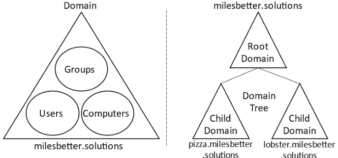

图 1.5 – 域拓扑

AD DS 使用*多主复制模型*，这意味着任何域控制器都可以对存储在 AD 数据库中的目录对象进行更改。在域控制器上对域进行更改（例如添加、删除或更改对象）时，这些更改将复制到域中的所有其他域控制器。在多域情况下，仅对所有域复制一部分更改。

当在 Windows Server 上安装 AD DS 角色时，会提供一个部署选项，用于在现有林中创建新域或在新林中创建新域。新林中的第一个域成为所谓的 *林根域*；这类似于说你是想在现有州中创建一个城市，还是想创建一个新州，并将其设为该州的第一个及父域/创建域/首府城市——也就是说，新林中的第一个域成为首府城市，也称为林根域。

本节介绍了 AD DS 域和域树拓扑。下一节将介绍 AD DS 林拓扑。

### 林

**林** 是顶级逻辑容器定义。它是一个或多个共享 *共同父根域*、*架构* 和 *全局目录* 的域的集合，这些域具有连续的命名空间；它被视为 *安全* 和 *管理* 边界。

要为对象实现安全边界，必须将其置于不同的林中；林中的所有对象共享相同的安全控件。将对象置于不同域可以使它们在域之间隔离，这是一种常见的误解。必须注意的是，情况并非如此；只有将它们置于不同的林中才能提供这种隔离。下图显示了林的可视化表示：

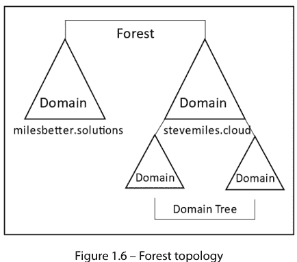

林拓扑（结构或布局）意味着一个林可以包含一个域或跨多个域树的多个域，很像一个国家可以包含许多州，而州是独立自治城市的集合。每个州都会包含一个州首府城市；我们将其称为林根域。

本节详细介绍了各种 AD DS 组件。下一节将介绍 AD DS 信任的功能。

### 信任

当环境中存在多个域和林时，实现信任以访问资源。根据信任类型，这些信任可以是单向或双向。

受信任域对象存储在 AD DS 的系统容器中，并提供已创建的信任类型的信息。

可以实现的最常见的信任类型如下：

- **父域和子域信任**：当将新域添加到现有树时创建。它是传递的双向信任。
- **树根信任**：当将新树添加到现有林时创建。它是传递的双向信任。
- **林信任**：这是林之间的信任，允许两个林共享资源。它是传递的单向或双向信任。
- **快捷信任**：当需要减少林中不同部分的域之间的身份验证时间时手动创建的信任。它是不可传递的单向或双向信任。
- **外部信任**：这是允许从另一个林中的域或 NT 4.0 域访问资源的信任。它是不可传递的单向或双向信任。
- **林域信任**：这是 AD DS 与实现 Kerberos 版本 5 协议林域的非 AD DS 目录服务之间的信任。它是传递或不可传递的单向或双向信任。

下图显示了这些信任关系：

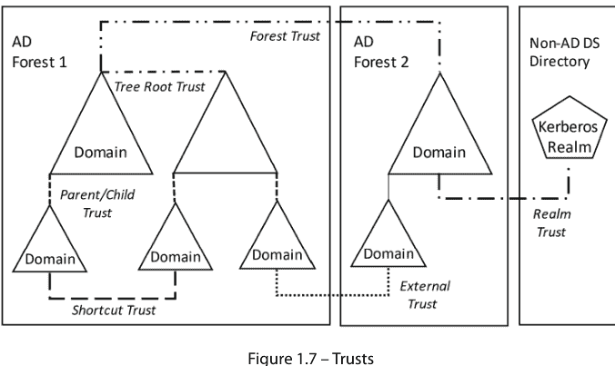

林中自动创建的所有双向信任都是可传递的。如果域 B 被域 A 信任，且域 D 被域 C 信任，那么域 A 信任域 C 和 D。这是说所有域都信任林中所有其他域的一种复杂说法。

然而，相比之下，林之间的信任不是可传递的，这意味着如果林 A 和林 B 之间以及林 B 和林 C 之间存在信任，那么林 C 不会被林 A 隐式信任。

请注意，当在林或域之间设置信任时，默认启用名为 **SID 筛选** 的功能。其目的是在信任域中使用信任来访问资源时，从用户访问令牌中删除所有外部 **安全标识符 (SIDs)**。尽管为允许通过信任访问资源应禁用它，但您可以在信任域的出站信任上禁用此功能。

在涉及 SID 筛选和跨信任的资源访问时，理解信任方向及其与访问方向的关系以及信任关系的设置方向（即出站或入站）非常重要。这可能不清楚；核心概念是信任方向将与访问方向相反。下图显示了这一点：

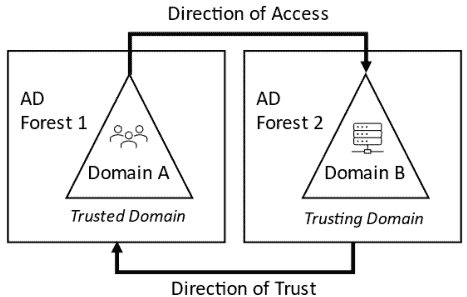

图 1.8 – 信任方向

这意味着如果您想访问另一个林中的资源，必须存在出站信任；反之，入站信任允许出站访问。

最后一个需要注意的是信任身份验证类型。外部信任和林信任提供两种身份验证模式：林范围身份验证和选择性身份验证。

有关信任的详细信息，请参阅 https://docs.microsoft.com/en-us/azure/active-directory-domain-services/concepts-forest-trust。

本节介绍了 AD DS 信任。现在，让我们介绍 AD DS 数据存储。

### 数据存储

目录信息存储保存 AD 数据库，该数据库基于 Jet 数据库引擎使用可扩展存储引擎 (ESE)。

数据库由两个文件组成——数据库文件本身（默认名为 NTDS.DIT，位于 C:\Windows\NTDS 目录）和事务日志文件（默认名为 EDB.LOG，也位于 C:\Windows\NTDS 目录）。这些文件存储在每个域控制器上。组策略对象的组策略文件存储在 SYSVOL 文件夹中。

AD DS 数据库文件 (NTDS.DIT) 包含四个分区（或命名上下文），这些分区包含所有域相关信息。每个分区中存储不同的数据，并且每个分区都在域控制器之间以依赖的复制范围和计划进行复制。

下图显示了这些分区：

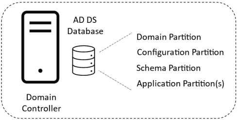

图 1.9 – AD DS 数据库分区

让我们更详细地了解这四个目录分区：

- **架构分区** 是存储 AD DS 架构的位置；这定义了可以存储在 AD 数据库中的内容
- **配置分区** 是存储林和域树配置信息的位置，例如站点和复制信息
- **域分区** 是存储域对象信息的位置——即关于用户和计算机对象的信息
- **应用程序分区** 是应用程序可以在 AD 中存储数据的位置；可能存在多个应用程序分区

本节介绍了包含 AD DS 数据库的 AD DS 数据存储。我们还介绍了 AD 数据库的分区。下一节将介绍 AD DS 架构。

### 架构

**架构** 是 AD 数据库的一个分区；它提供了可以存储在目录中的对象类（类别）和描述对象的属性的定义。对象类和对象属性是架构对象；在其他技术领域中，它们被称为元数据——即描述数据的数据。

架构可以编辑，允许您创建、修改和禁用对象类别和对象属性。架构是林范围的，因此任何更改都会复制到林中的每个域。在对架构提交任何更改之前，请了解其影响。此外，请注意架构不支持删除。

默认内置组架构管理员控制对架构的访问；您必须是该组的成员才能对架构进行更改。

本节介绍了 AD 架构。下一节将介绍 AD DS 域控制器。

### 域控制器

域控制器 (DC) 是安装了 AD DS 角色的服务器；它持有 AD 数据库的可写副本，并通过此信息存储的多主复制模型运行。它还提供 GPO 存储。它确保将配置设置应用于域管理的对象。

域控制器也是 Kerberos **密钥分发中心 (KDC)**。Kerberos 是 AD 中所有身份验证和授权的机制；Kerberos 密钥标识对象（身份验证——即你是谁）并概述对象可以访问哪些资源（授权——即你可以做什么和访问什么）。

域控制器必须高度可用以处理登录请求；它们需要验证对域资源的访问请求，并应用用于管理和配置存储在 AD 数据库中的目录中对象的策略。

所有希望访问 AD DS 域中对象的计算机和用户都必须由域控制器进行身份验证，因此它们的部署、操作和可用性至关重要。

### 只读域控制器

在 Windows Server 2008 中，引入了 **只读域控制器 (RODC)** 概念作为部署选项。RODC 服务器保存 AD 数据库的副本，并支持单向入站复制。不能对目录进行直接更改（例如 LDAP 写入）；唯一可发生的更改是通过复制进行的更改。应在域控制器上进行更改，以便复制将这些更改推送到 RODC。

RODC 角色旨在作为分支机构或其他位置的解决方案，这些位置可能没有足够的安全性来保护免受 Kerberos 系统组件（例如 **密钥分发中心 (KDC)**（密钥数据库）和 **票据授予服务 (TGS)**（用于获取 Kerberos 会话密钥））被攻破的影响。与共享 Kerberos 密钥的域控制器不同，每个 RODC 都有一个唯一密钥，最大限度地降低了暴露可能与受保护和受控的企业网络隔离的远程站点的风险。

RODC 有另外两个用例。第一个是分支机构等位置的复制流量带宽不大。另一个场景是支持最小特权原则，以便本地服务器管理员帐户不需要域管理员访问权限即可运行。

本节介绍了域控制器及其在 AD DS 中的角色。现在，让我们介绍全局目录及其目的。

### 全局目录

**全局目录**（GC）作为服务在域控制器（DC）上运行，并提供一个索引，允许您查找 AD 林中列出的每个对象的信息（例如组成员资格）。

GC 保存目录中每个对象的列表，但不保存这些对象的每个属性；架构定义了对象的哪些属性存储在 GC 中。可以修改架构，以允许您希望出现在 GC 中的对象属性，以便它们可以在 GC 中查找。

用户登录时，必须能够联系到 GC 以查找用户的通用组成员资格；但是，启用通用组缓存后，联系持有 GC 副本的 DC 就不那么关键了。

作为 DC 部署的一部分，林中创建的第一个 DC 默认持有 GC 的副本；这是针对混合环境的。GC 部署应针对每个站点的可用性进行设计，并执行本地站点搜索以优化网络流量。没有 GC 副本的 DC 必须通过 WAN 链路将流量发送到拥有 GC 副本的站点。GC 部署是一项重要的设计决策；我们将在本章后面介绍站点。

在本节中，我们了解了 AD DS 全局目录服务的用途。在下一节中，我们将了解操作主控制器角色的功能。

### 操作主控制器角色

虽然 AD DS 运行在多主模型上，但一些单主操作角色称为**灵活单主操作**（FSMO，读作 *fizmo*）角色，并在域控制器（DC）上运行。

顾名思义，这些是单实例角色。它们不进行复制，因此在某种程度上会引入单点故障。如果持有该角色的 DC 脱机，那么任何依赖于联系该角色的操作都将不可用。在管理任何设计的预期时都应考虑这一点。

五个 FSMO 角色按林和域操作范围分类。如下所示：

- 架构主控制器（林操作范围）
- 域命名主控制器（林操作范围）
- RID 主控制器（域操作范围）
- 基础结构主控制器（域操作范围）
- PDC 模拟器主控制器（域操作范围）

并非所有 FSMO 角色都同等重要——有些应该可用于日常操作，而另一些则不需要随时可用。它们各自执行不同的功能，有些角色可用的重要性高于其他角色——也就是说，架构主控制器角色可以脱机。只有在您想要进行架构更改时，这才会影响您。

在本节中，我们了解了 AD DS 操作主控制器角色的功能。现在，让我们了解 AD DS 站点和子网。

### 站点和子网

站点是 AD 对象，表示通过低延迟连接连接并支持本地远程过程调用（RPC）的 IP 子网集合。您可以将站点视为映射到网络 WAN 拓扑的物理位置。

子网对象表示 DC 所在的每个子网；子网对象将是站点对象的一部分，并且只能作为一对一映射创建——也就是说，一个子网只能是单个站点的一部分。

站点拓扑如下图所示：

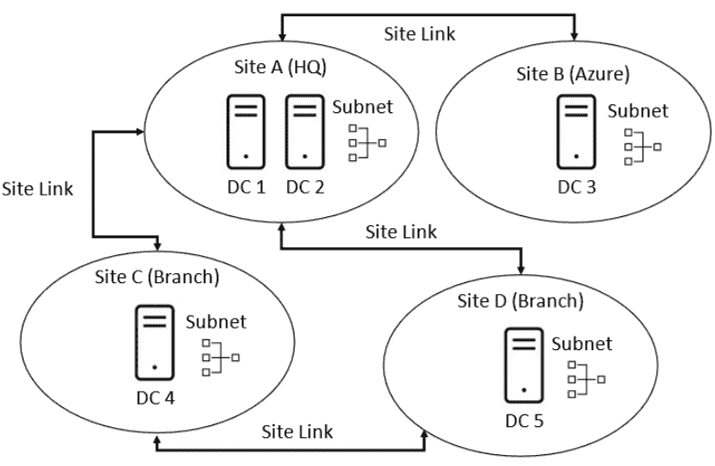

图 1.10 – 站点拓扑

默认情况下，会有一个名为 Default-First-Site-Name（可重命名）的单个默认站点，包含 DC 所在的所有子网。但是，就复制、用户身份验证、目录搜索等网络流量而言，这通常不是站点和站点设计的高效实现。

站点结构应映射到组织的 WAN 拓扑，您应根据需要创建尽可能多的站点来复制此拓扑。这样做是为了优化复制，使身份验证可以停留在站点本地。

DC 通过查看与其所属子网匹配的子网对象来确定其站点。之后，它使用与该子网关联的站点来确定其所属站点。这意味着它将控制 DC 属于哪个站点；您必须确保 DC 位于与该站点关联的子网中，或该站点包含该子网。

### 站点链路

站点链路是站点之间的复制路径；您确定复制流量经过哪些链路。当客户端本地网络中没有 DC 时，站点链路用于将客户端流量定向到拥有 DC 的站点；您应考虑在每个位置没有 DC 以访问域资源的理由。

始终建议将 DC 放置在需要访问 DC 来验证资源、执行目录搜索等操作的客户端附近。不应让流量通过 WAN 链路传输，而应停留在本地网络上。

为此，您应始终为网络拓扑创建站点设计图。在混合环境中，这通常需要您超出单个默认站点设计的默认开箱即用设置；用于连接站点的默认站点链路称为 DEFAULTSITELINK。

本节结束了本章三个技能领域中的第一个——了解 AD DS 的概念和组件。我们了解了 AD 是什么，并查看了每个组件。在下一节中，我们将查看本章的第二个技能领域：创建 AD DS。

### 创建 Active Directory 域服务

本节将介绍部署过程中将创建的组件的一些规划方面和信息。我们还将介绍在本地部署 DCs 以及将 Azure 作为基础设施即服务（IaaS）资源进行部署的其他注意事项。

### 规划可用性和性能

在直接开始部署之前，让我们先介绍一些规划步骤。

AD DS 数据库的可用性由多主复制模型的内置本机功能提供，数据在多个 DC 之间复制；没有主从关系。

部署至少两个 DC 是提供必要服务和 AD 数据库可用性的推荐最佳实践，可通过此本机复制功能实现。

这可能是一把双刃剑，既有优点也有缺点；多个 DC 可用于处理访问域资源的身份验证和授权，特别是在出现许多并发请求时，例如向虚拟桌面基础设施发起的登录风暴，或者业务线（LoB）应用程序或服务。然而，缺点是，在跨网络传输数据时，这种数据复制可能会导致网络拥塞。我们可以通过站点和链路来解决这个问题，它们有助于控制此复制流量。也就是说，为了满足大多数企业的可用性和性能需求，您每个地理区域应至少部署两个 DC。在此，每个地理区域代表一个站点，可提高性能并减少通过 WAN 链路到远程 DC 的复制和身份验证流量；相反，此流量可以停留在区域本地网络上。

### 规划数据保护

在本节中，您将学习如何保护存储数据库的 AD DS 数据存储。我们还将了解如何还原 AD DS。

就数据保护的一般术语而言，行业关注备份数据，这是一个值得讨论的重要任务。但是，重点应始终放在期望的结果而非动作上——也就是说，我们必须关注还原数据，而不是备份它。我们总是听说备份策略，但我鼓励您考虑您的还原策略。

在 AD DS 中，提供了两级数据保护，更重要的是，提供了数据恢复功能；它们是 AD 回收站和能够从数据的传统备份副本还原（这必须包含系统状态）。让我们更详细地了解每种方法。

### 回收站还原

回收站是对象还原的第一级，允许您快速高效地还原可能被意外删除的对象。它只允许您还原目录中任何已删除的对象。它无法通过恢复到较早时间来回滚对对象所做的更改；这只能通过传统数据备份方法实现。

回收站的主要优势是其恢复时间目标（RTO）——即将已删除对象重新投入运行所需的时间。通过不要求服务器停机即可实现这一点，而传统的从备份数据还原方法则需要停机。

为简化和加快数据恢复危机中所需的速度，可以直接从服务器的 UI 中执行此还原。不需要安装备份软件或硬件组件，也不需要配置或支付许可证。但是，必须启用该功能，因此在将任何 DC 投入运行之前执行此操作很重要。

启用后，您将在 AD 管理中心（ADAC）中将其引用为已删除对象容器。对象的默认生存期为 180 天，但可以更改。原始位置或备用位置可以设置为还原位置。

### 备份副本还原

传统的 Windows Server 备份方法是对象还原的下一级；但是，由于使用数据的备份副本进行还原时，传统还原方法具有暂时性脱机的特点，因此其 RTO 要长得多。必须显式包含系统状态，备份作业才能使用传统的 Windows Server 备份方法还原 AD DS。

NTDSUtil、replmon 和 repadmin 命令行工具也可用于数据保护操作，以运行验证、还原、抢占 FSMO 角色等。

Windows Server 为域控制器（DC）提供安全模式启动，称为目录服务还原模式（DSRM），允许您还原目录数据库。可以执行两种类型的还原：权威还原和非权威还原。让我们简要地看看每种。

### 权威还原

这种还原类型使用备份中存储的对象副本替换目录中的对象。

权威还原意味着您希望将还原的对象设置为在目录中持久存在，并通过复制替换对象的所有其他副本。也就是说，所有其他 DC 副本都将更新并与还原的 DC 中存储的数据库副本保持一致。

### 非权威还原

这种还原类型也使用备份中存储的对象副本替换目录中的对象。但是，对象不会被持久化，DC 会从其他 DC 请求拉取复制，以确保它拥有数据库的最新副本，包括备份发生后所做的任何更改；还原的对象不会还原到其他 DC。

在本节中，我们了解了 AD DS 数据保护。现在，让我们学习如何部署 AD DS 域控制器。

### 部署域控制器

在此顶级主题的第一节中，我们将共同探讨在多个场景中部署 AD DS 域控制器，包括部署到本地平台以及使用 IaaS 虚拟机（VM）部署到 Microsoft Azure 公有云平台。但是，请注意，部署 Azure AD DS 的域控制器不会在此处介绍；这将在第 2 章“实现和管理 Azure Active Directory 域服务”中介绍。

### 使用 Server Manager GUI 在 Windows Server 上部署 DC

DC 是安装了 AD DS 角色的服务器。可以通过多种方式安装和配置，例如通过 PowerShell、Server Manager 或 WAC。随着我们继续混合之旅，我们将看到，WAC 在许多情况下通常将成为许多混合场景的首选和最优部署及管理工具。

AD DS 的关键部分是 **DNS**；AD DS 需要 DNS 服务器。DNS 服务器角色通常作为部署配置的一部分安装在 DC 上，并将使用 AD 集成 DNS 以实现无缝体验。

关于可用性，为确保用户仍然可以登录，如果无法连接到 DC，服务器和其他资源可以对 DC 进行身份验证。林中的每个域至少应部署两个。DC 应放置在需要身份验证的资源所在的位置附近，并且理想情况下，放置在需要进行本地身份验证的每个物理位置，以减少必须通过 **广域网（WAN）** 连接发生的身份验证流量。我们在“站点和站点链接”部分中更详细地介绍了这一点。

使用 Server Manager 安装 AD DS 角色时，过程将开始在服务器上安装一些 AD DS 组件和工具。完成后，系统将提示您完成部署后配置，该配置将引导您将此服务器提升为 DC。

配置向导将提示您进行多个部署配置选择；我们将在本节中介绍这些内容，以便您在进行实际操作练习时理解它们。

对于部署配置，您可以选择 **将域控制器添加到现有域**、**将新域添加到现有林** 或 **添加新林**。如果这是新的 AD DS 部署，而不是将域控制器部署到现有 AD DS 实例，则需要使用第三个选项——添加 **新林**。

当您实现 AD DS 并部署一个域，并将服务器提升为不会部署到现有 AD 林中的 DC 时，默认情况下，将创建一个新林作为新 AD DS 实例拓扑或层次结构中的顶级容器。创建的第一个域将作为 *林根域* 创建：

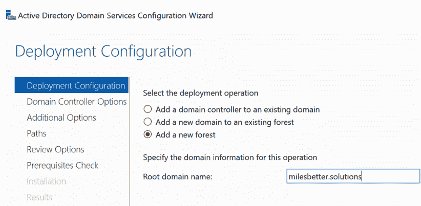

图 1.11 – 部署操作选项

在此，您为根域名指定域名；在林中创建的所有后续子域将共享相同的连续 DNS 命名空间。要在同一林中定义具有新 DNS 命名空间的域，您需要使用“将新域添加到现有林”选项，创建新域树。这在下图中显示：

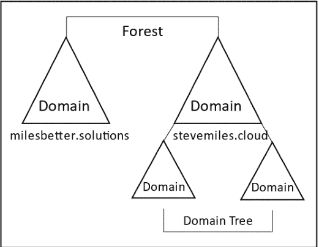

图 1.12 – 域树

部署配置步骤完成后，您将看到域控制器选项屏幕。从此处，您可以设置林的功能级别。请注意，这就是设置 DC 功能的地方。

请注意，此屏幕底部有一个指向“更多关于域控制器选项”的超链接。这将带您前往 Microsoft 文档。如果您尚未这样做，建议您在继续之前点击此链接并研究文档中的信息，以便了解本书中没有空间介绍的所有信息：

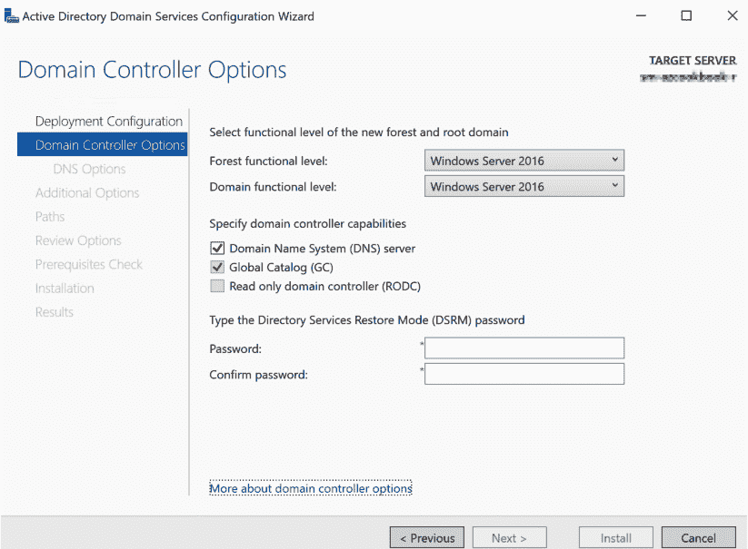

图 1.13 – 域控制器选项

如前面的屏幕截图所示，您可以选择 DC 是否应为 DNS 服务器。请注意，**全局目录（GC）** 选项会自动分配为新域中的第一个 DC，而 **只读域控制器（RODC）** 选项是灰色的；同样，这是因为这是域中的第一个 DC。当您在前面的“部署配置”屏幕上选择“将域控制器添加到现有域”选项时，这些选项可以被选中；我们将稍后介绍安装 RODC。

在接下来的屏幕中，您可以选择创建 **DNS 委派记录**，并在必要时验证并更改生成的 **NetBIOS 名称**。

在配置向导的 **路径** 部分下，您可以为 **AD DS 数据库**、**日志文件** 和 **SYSVOL** 指定不同位置：

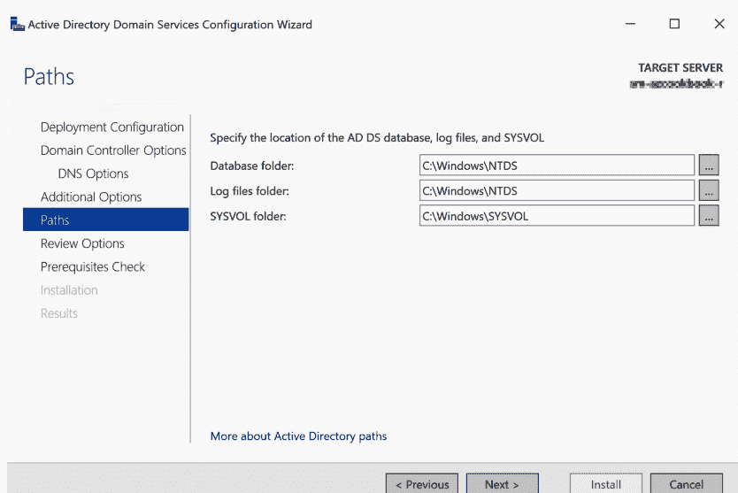

图 1.14 – 安装路径

您应指定满足您需求的位置；组件的路径可能会影响 AD DS 的性能。在 IaaS VM DC 上安装 AD DS 时，由于磁盘缓存，这一点更为关键，我们将在本章后面介绍。

### 在 Windows Server Core 上部署 DC

Windows Server Core 没有 GUI。因此，要安装 AD DS，您需要替代方法，例如带有 AD 模块的 Windows PowerShell；或者，您可以从能够连接到服务器核心机器的远程计算机使用远程服务器管理工具（RSAT）、Windows Admin Center、Server Manager 和 PowerShell 远程处理工具。

### 从介质部署 DC

这仅用于将其他域控制器部署到现有 AD DS 环境。这种部署方法创建 AD DS 的备份，然后将其转移到可移动介质（例如 USB 驱动器）。您首先通过 Server Manager GUI 在将成为 DC 的服务器上部署 AD DS，并选择“从介质安装”选项。这与非权威恢复非常相似——也就是说，AD DS 数据库及其对象仅在备份日期时是最新的。因此，为了获取备份以来目录的最新更改，必须发生拉取复制。这将确保新 DC 与所有其他 DC 保持一致，并拥有相同的目录对象副本。

### 在 Azure 中作为 IaaS 部署 DC

正如我们在本章前面所学，除了将域控制器部署到本地平台，我们还可以将域控制器部署到 Microsoft Azure 公有云平台作为 IaaS VM。但是，请注意，部署 AD DS 不会在此处介绍，这将在第 2 章“实现和管理 Azure Active Directory 域服务”中介绍。

在 Azure 中部署 DC 或在 IaaS VM 中部署 AD DS 角色时，您需要注意一些注意事项：

- **网络**：要将域控制器添加到现有 AD DS 环境，您应考虑网络连接。在此，您必须能够访问那些现有域控制器。这将要求放置有域控制器的网络扩展到 Azure。这通常通过 VPN 实现，或在某些场景中使用 ExpressRoute。
- **站点/子网**：这些应创建以反映 Azure VNet 中定义的地址空间。
- **DNS**：Azure AD DNS 不能用于 AD DS；您应使用 Windows Server 中的 DNS 角色或 Azure 私有 DNS 区域。
- **VM**：由于 B 系列 VM 中具有可突发 CPU 功能，它们非常适合用于域控制器。
- **磁盘**：由于实现 AD DS 将在 VM 上安装数据库；我们应遵循该场景的一些指导——也就是说，我们不应在启用缓存的任何磁盘上安装——尤其是写缓存。为了满足此指导，您不应将 NTDS .DIT 和 SYSVOL 文件放置在配置向导中提供的默认路径中；相反，您应将数据磁盘附加到 VM（默认情况下关闭写缓存），并更改路径以将这些文件存储在数据驱动器中。

### 部署 RODC

要部署 RODC，我们可以使用预设置帐户来执行 AD DS 安装任务。这将确保用户不需要成为域管理员组或企业管理员组的成员。

应创建新站点和子网以控制复制到 RODC 的流量。复制计划可以在默认站点链接上设置。

### 升级现有 DC 的操作系统

DC 的底层操作系统可从 Windows Server 2012 R2 升级到 Windows Server 2022，升级过程仿佛未安装 AD DS 角色。由于其作为 DC 运行，因此没有针对其设置的任何差异、已知问题或限制。

本节结束了本章三个技能领域中的第二个：*创建 AD DS*，我们在其中查看了规划和部署信息。在下一节中，我们将查看本章三个技能领域中的最后一个：*管理 AD DS*。

### 管理 Active Directory 域服务

本节将介绍管理 AD DS 及其使用的工具。我们将查看** Active Directory 管理中心**、**远程服务器管理工具**、**Windows 管理中心**和 **PowerShell**，以及 **AD 模块**和其他附加管理工具。

**Active Directory 管理中心 (ADAC)** 是基于 PowerShell 的 GUI，适用于 Windows Server（不适用于 Windows Server Core）。

可使用此工具执行以下任务：

- 通过单个工具实例管理多个域
- 在目录中搜索对象
- 创建和管理目录对象，如用户、组、计算机和 OU
- 管理动态访问控制
- 创建和管理精细密码策略
- AD 回收站操作

此工具替代了以前通过 **Microsoft 管理控制台 (MMC)** snap-in 工具（称为 **Active Directory 用户和计算机**）提供的功能。

有关 ADAC 的详细信息，请参阅 https://docs.microsoft.com/en-us/windows-server/identity/ad-ds/get-started/adac/active-directory-administrative-center。

现在，让我们看看可用于 Azure AD DS 托管域的管理工具。

### RSAT

RSAT 允许你通过 GUI 远程管理服务器；其中包含一组 AD DS 工具。在引入 WAC 之前，这是主要的工具控制台，我们将在下一节中介绍 WAC。

这些工具的控制台可在 Windows 10/11 和 Windows Server 上使用。在 Windows 10/11 中，这些工具现在包含在操作系统中，而非单独下载，该下载是通过 **可选功能** 设置添加的。

有关 RSAT 的详细信息，请参阅 https://docs.microsoft.com/en-us/troubleshoot/windows-server/system-management-components/remote-server-administration-tools。

### WAC

此基于浏览器的管理工具可以下载并在本地安装于 Windows 10/11 和 Windows Server 上。也可以直接通过 Azure 门户访问，因此无需下载或本地安装，类似于 CloudShell 需要在本地安装 PowerShell。

要在本地安装 WAC，必须确保网络允许所需端口；Windows 10 独立模式的默认端口是 6516。Windows Server 网关模式为 TCP 443。两者均可更改。

有关 WAC 的详细信息，请参阅 https://docs.microsoft.com/en-us/windows-server/manage/windows-admin-center/overview。

### 带 AD 模块的 PowerShell

这是使用 GUI 管理 AD DS 的替代方案。你可以通过提供一组 cmdlet 的 AD 模块使用 PowerShell 命令。

如果希望在客户端/桌面操作系统（如 Windows 10/11）上的本地 PowerShell 安装中使用该模块，则该模块是 RSAT 的一部分，你需要下载并安装它。

有关 AD 模块的详细信息，请参阅 https://docs.microsoft.com/en-us/powershell/module/activedirectory/?view=windowsserver2022-ps。

### MMC snap-in 工具

MMC 是包含称为 snap-in 的工具集合的 GUI 控制台。以下 snap-in 工具可用于管理 AD DS，其中大部分都不言自明：

- **Active Directory 用户和计算机** 允许你执行日常任务来管理用户、组和计算机等对象；已由 ADAC 取代，并提供附加功能
- **Active Directory 站点和服务** 允许你创建和管理站点、子网、复制和相关服务
- **Active Directory 域和信任** 允许你创建和管理域和林信任
- **Active Directory 架构 snap-in** 允许你查看和修改架构

有关 MMC 的详细信息，请参阅 https://docs.microsoft.com/en-us/troubleshoot/windows-server/system-management-components/what-is-microsoft-management-console。

本节介绍了各种 AD DS 管理工具。在下一节中，我们将介绍一些 AD DS 的监视和故障排除工具。

### 监视和故障排除工具

在本节中，我们将介绍一些 AD DS 的监视和故障排除工具。

### 性能监视工具

Windows Server 包含用于监视性能和分析服务操作的以下本机内置工具：

- 性能监视器 – 目录复制代理 (DRA) 计数器
- 资源监视器
- 任务管理器
- 事件查看器

这些工具可以帮助你分析和识别这些系统资源的任何过度使用和耗尽情况。它们将帮助你找到由瓶颈引起的任何系统性能问题的根源和根本原因。系统一次只能受到一个瓶颈的影响；该瓶颈可能存在于 CPU、内存、磁盘或网络中。你应该逐一处理每个瓶颈，然后再处理下一个。

### Repadmin

此工具可帮助你查看服务运行状况并诊断 DC 之间的复制问题。它允许你查看复制拓扑、手动创建复制拓扑并强制执行复制。当服务器上安装了 AD DS 角色时即可使用，它也作为 AD DS 工具的一部分包含在 RSAT 工具中。

有关 Repadmin 的详细信息和语法，请参阅 https://docs.microsoft.com/en-us/previous-versions/windows/it-pro/windows-server-2012-r2-and-2012/cc770963(v=ws.11)。

### dcdiag

此工具将分析 AD DS DC 的运行状况状态。当服务器上安装了 AD DS 角色时即可使用，它也作为 AD DS 工具的一部分包含在 RSAT 工具中。

有关 dcdiag 的详细信息和语法，请参阅 https://docs.microsoft.com/en-us/previous-versions/windows/it-pro/windows-server-2012-r2-and-2012/cc731968(v=ws.11)。

### netdom

此工具允许你管理 AD DS 信任；它还可以将计算机加入域、管理计算机帐户、查询域信息（例如哪些 DC 保持 FSMO 角色）等。当服务器上安装了 AD DS 角色时即可使用，它也作为 AD DS 工具的一部分包含在 RSAT 工具中。

有关 netdom 的详细信息和语法，请参阅 https://docs.microsoft.com/en-us/previous-versions/windows/it-pro/windows-server-2012-r2-and-2012/cc772217(v=ws.11)。

在本节中，我们介绍了一些 AD DS 的监视和故障排除工具。在下一节中，我们将完成一个动手练习，以巩固本章涵盖的一些概念。

### 动手练习

为了通过实用技能支持你的学习，让我们学习如何创建本章中查看的一些服务。你将学习如何在 Windows Server 上安装 AD DS。

### 开始使用

要开始此动手练习，你需要访问运行 Windows Server 2012 Standard/Datacenter 或更高版本的物理或虚拟机。

为此练习，我们可以在 Azure 中使用嵌套虚拟化环境，这意味着不需要本地硬件。但是，为了帮助你学习和演示，我们将在 Azure 环境中使用 IaaS VM 完成此练习，在该环境中我们具有创建所需资源的适当访问权限。

你可以在 https://azure.microsoft.com/free 创建免费 Azure 帐户。此免费 Azure 帐户提供以下内容：

- 12 个月的免费服务
- 200 美元信用额度，可用于探索 Azure 30 天
- 25 多项始终免费的服务

如果将使用 Azure IaaS VM 作为 DC，则建议每个 VM 应该附加一个数据磁盘以存储 AD 数据库、日志文件和 SYSVOL。或者，也可以将它们安装在学习用途提供的默认路径上。但是，生产场景中不应这样做。

让我们继续进行练习。

### 练习 – 在 Windows Server 上安装 AD DS

本节将教你如何在 Windows Server 上安装 AD DS。

以下步骤必须在你拥有管理员权限的机器上的本地操作系统中执行。我们将直接在希望作为第一个域控制器 (DC) 的服务器上安装 AD DS 角色，位于我们的 *新域* 和 *新林* 中；我们将不使用远程管理。

使用服务器管理器 *添加角色* 向导和 *AD DS 配置* 向导来安装和配置 AD DS。

按照以下步骤操作：

**注意**
`dcpromo.exe` AD DS 安装向导已从 Windows Server 2012 开始作为部署方法弃用。

- 1. 登录到你的服务器。然后，在服务器管理器中从 **管理** 点击 **添加角色和功能**：

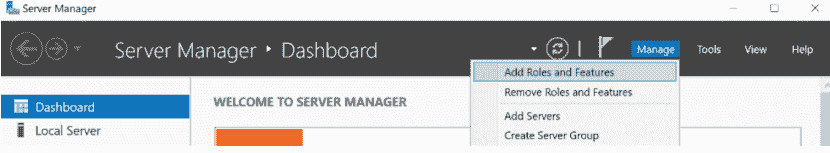

图 1.15 – 服务器管理器

- 2. 在 **开始之前** 页面上，单击 **下一步**。

- 3. 在 **选择安装类型** 页面上，保留 **基于角色或基于功能的安装** 设置，然后单击 **下一步**。

- 4. 在 **选择目标服务器** 页面上，保留 **从服务器池中选择服务器** 设置，并确保已选择要在其中安装 AD DS 的服务器。然后，单击 **下一步**。

- 5. 在 **选择服务器角色** 页面的可用角色列表中，选择 **Active Directory 域服务** 角色的复选框：

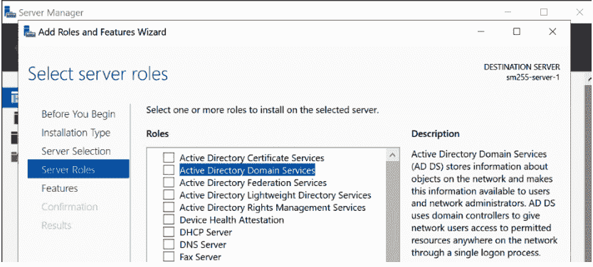

图 1.16 – 选择服务器角色屏幕

- 6. 在 **添加角色和功能向导** 弹出屏幕中，单击 **添加功能**：

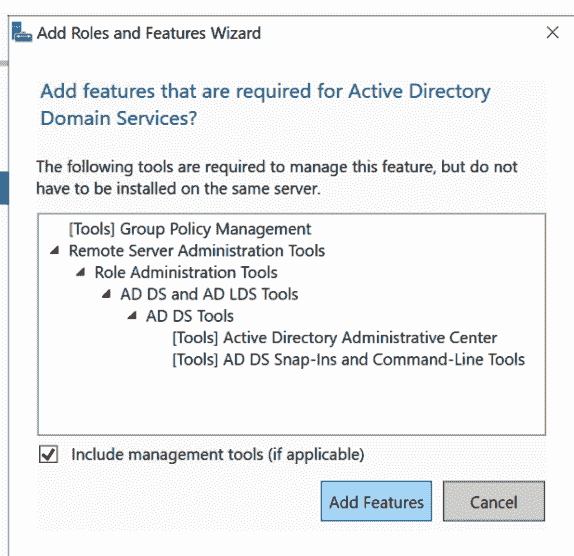

图 1.17 – 添加角色和功能向导弹出屏幕

- 7. 返回到 **选择服务器角色** 页面，单击 **下一步**。

- 8. 在 **功能** 页面上，保留所有默认设置，查看所选功能作为参考，然后单击 **下一步**。

- 9. 在 **AD DS** 页面上，查看信息，然后单击 **下一步**。

- 10. 如果需要，在 **确认** 页面上选择 **自动重启目标服务器**。然后，查看要安装的选项作为参考，并单击 **安装**。

- 11. 在 **结果** 页面上，观察和监控安装进度；当看到显示 **安装在 [YourServerName] 上成功** 的消息时，单击 **关闭**。

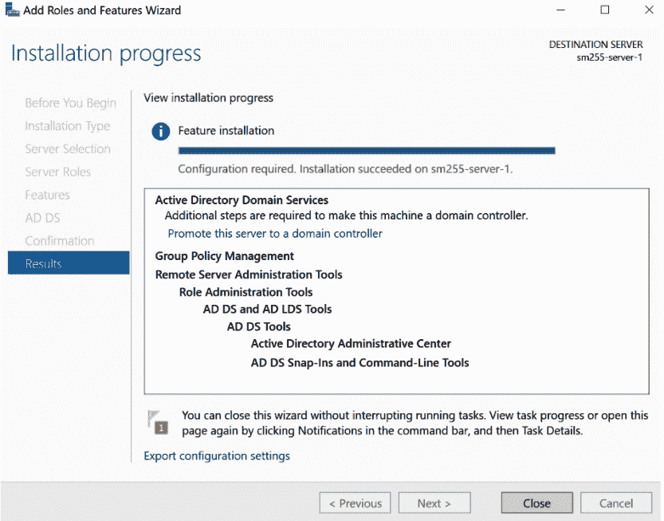

图 1.18 – 安装进度屏幕

- 12. 从服务器管理器中，单击“通知”，然后将此服务器提升为域控制器：

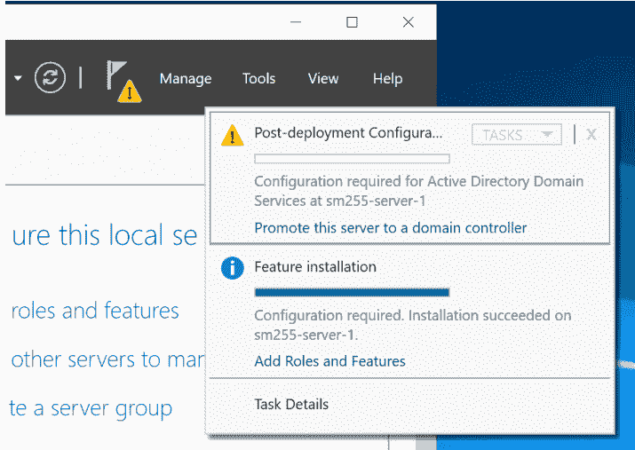

图 1.19 – 将此服务器提升为域控制器通知屏幕

- 13. 在 AD DS 配置向导弹出屏幕上，注意部署配置屏幕上的部署操作选项。为本练习选择添加新林：

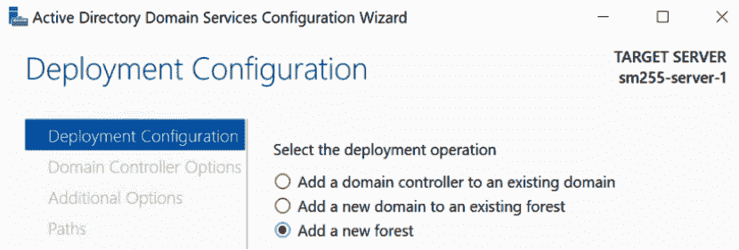

图 1.20 – 部署配置屏幕

- 14. 在根域名下输入域名并单击下一步：有关更多信息，请单击页面底部的有关部署配置的更多信息超链接：

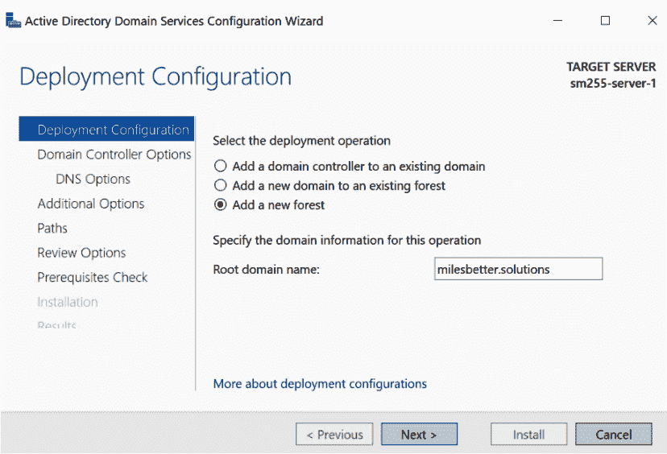

图 1.21 – 部署配置屏幕

- 15. 在域控制器选项页面上，请注意默认情况下会选中 域名系统 (DNS) 服务器 和 全局目录 (GC) 选项，但 只读域控制器 (RODC) 选项不可用；保留所有默认设置，输入 DSRM 密码并确认。然后，单击安装。

有关更多信息，请单击页面底部的有关域控制器选项的更多信息超链接：

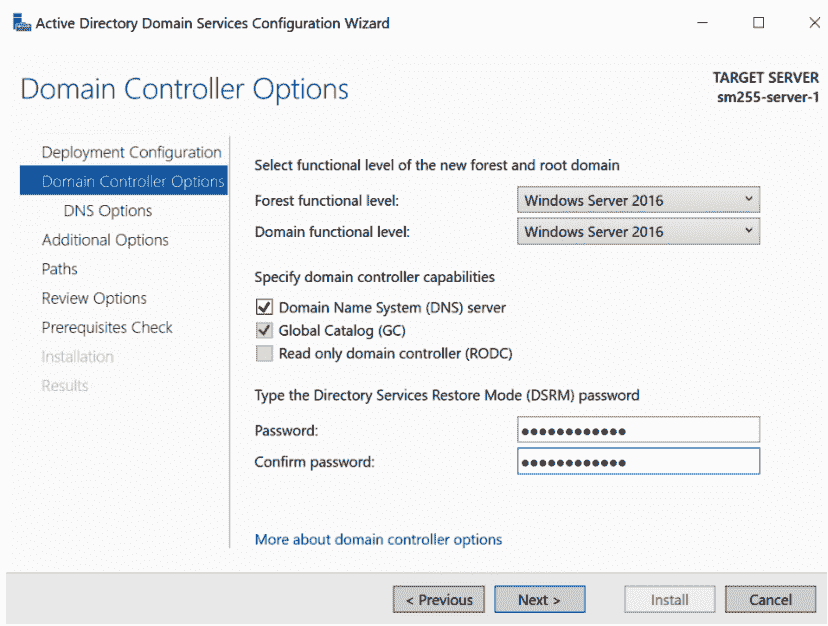

图 1.22 – 域控制器选项屏幕

- 16. 在 **DNS 选项** 页面上，忽略指出无法为此 DNS 服务器创建委托的消息，然后单击 **下一步**。

- 17. 等待其他选项页面上自动填充 NETBIOS 域名。然后，单击 **下一步**：

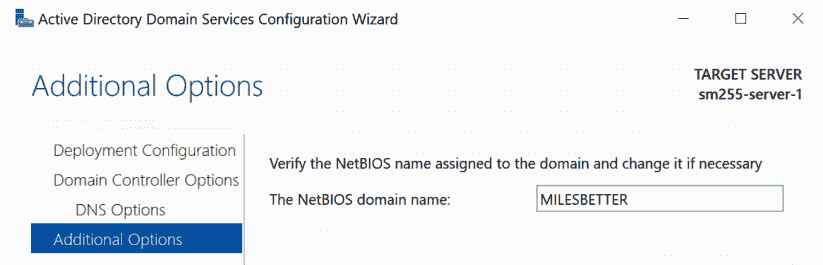

图 1.23 – 其他选项屏幕

- 18. 从 **路径** 页面，指定 AD DS 数据库、日志文件和 SYSVOL 的位置。为本练习，保留所有默认设置。然后，单击 **下一步**。

有关更多信息，请单击页面底部的 **有关 Active Directory 路径的更多信息** 超链接：

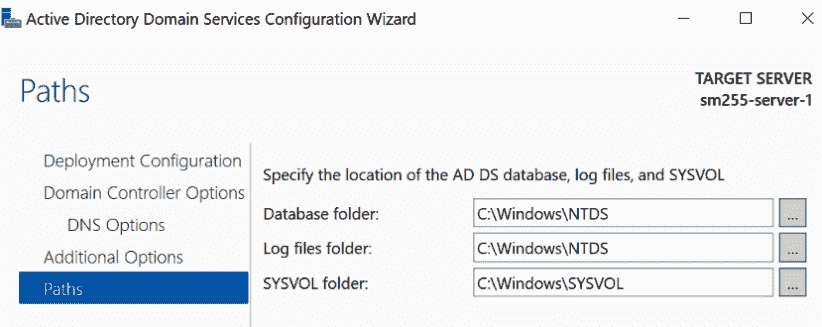

图 1.24 – 路径屏幕

- 19. 从 **查看选项** 页面，查看选择并单击 **下一步**。

- 20. **先决条件检查** 页面确认所有先决条件检查的状态。应出现一个绿色对勾，并显示 **所有先决条件检查均已成功通过** 的消息。单击 **‘安装’** 以开始安装。然后，单击安装：

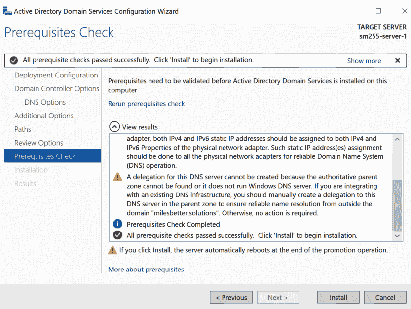

图 1.25 – 先决条件检查屏幕

- 21. 从 **安装** 页面，观察和监控安装进度；你的服务器将自动重启：

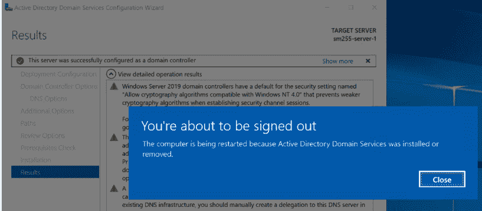

图 1.26 – 安装进度屏幕

- 22. 从服务器的登录屏幕，你需要使用用户的域帐户，而不是本地帐户；这将采用 UPN 格式，即 UserName@domain.name：

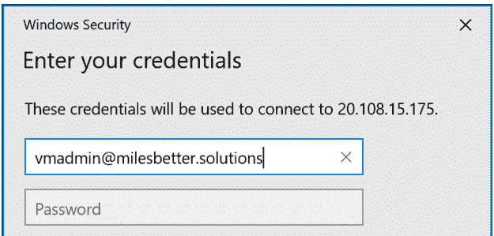

图 1.27 – 服务器登录屏幕

- 23. 从 **服务器管理器**，你将看到已安装 AD DS 角色，以及 DNS：

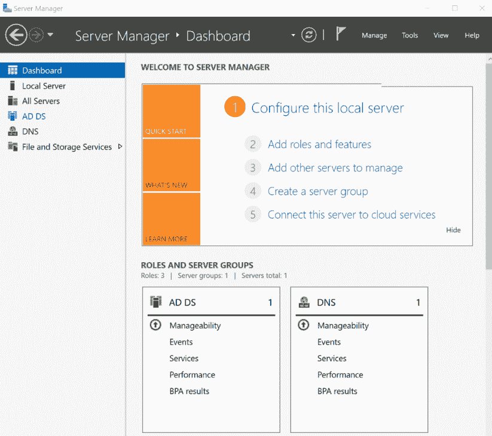

图 1.28 – 服务器管理器

- 24. 从服务器管理器，单击“工具”，然后单击 Active Directory 管理中心：

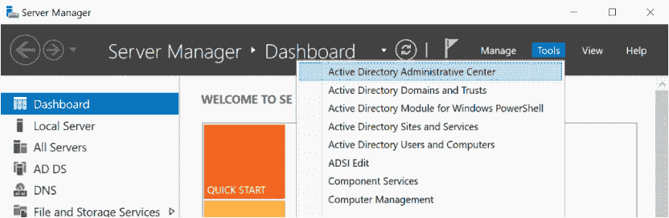

图 1.29 – AD 管理中心

恭喜！你已完成此练习并在 Windows Server 上安装了 AD DS。

在此练习中，你在 Windows Server 上安装了 AD DS，并通过 ADAC 访问了它。这有助于你巩固本章的理论知识，以及一些实践技能。

现在，让我们总结本章。

### 总结

本章涵盖了 AZ-800 管理 Windows Server 混合核心基础结构考试的学习目标：在本地和云环境中部署和管理 AD DS。

我们学习了 AD 概念及其服务，例如 AD DS 及其组件。我们了解了在本地环境中创建和管理 AD DS 实例的方法。随后的实操练习结束了本章，为你提供更多实践技能。

本章旨在让你的知识超越考试目标；我们随所提供的内容新增了技能和学习内容。这将进一步提升你在本地网络基础结构服务方面的知识和技能，并使你能够胜任以现实世界日常混合环境为重点的角色。

在下一章中，你将了解 Azure AD DS 的一些概念和组件，并学习如何创建和管理 Azure AD。

### 进一步阅读

本节提供了有关考试的其他信息和学习参考资料的链接：

- Microsoft Certified: Windows Server 混合管理员助理: https://docs.microsoft.com/en-us/learn/certifications/windows-server-hybrid-administrator/
- 考试 AZ-800：管理 Windows Server 混合核心基础结构: https://docs.microsoft.com/en-us/learn/certifications/exams/az-800
- 考试 AZ-800：技能大纲: https://query.prod.cms.rt.microsoft.com/cms/api/am/binary/RWKI0r
- Microsoft Learn：部署和管理标识基础结构: https://docs.microsoft.com/en-us/learn/paths/deploy-manage-identity-infrastructure/

### 技能检查

挑战一下你在本章中学到的内容：

- 1. 什么是 Active Directory？
- 2. 列出构成 Active Directory 的三项服务。
- 3. 什么是 Active Directory 域服务？
- 4. 解释 AD 与 Azure AD 之间的区别。
- 5. 什么是混合标识？
- 6. 身份验证与授权有什么区别？
- 7. 列出 AD DS 的七个逻辑组件。
- 8. 列出 AD DS 的六个物理组件。
- 9. 什么是 AD DS 对象？
- 10. 什么是 OU？
- 11. 什么是服务对象，它与用户对象有何不同？
- 12. 标准托管服务账户与组托管服务账户有什么区别？
- 13. 什么是 UPN？
- 14. 解释组类型和范围。
- 15. 解释域和林。
- 16. 列出信任类型。
- 17. 解释信任方向。

- 18. 什么是域控制器？
- 19. 五个 FSMO 角色是什么？
- 20. 如何最大限度地减少复制流量？
- 21. 在使用 IaaS VM 在 Azure 中部署 AD DS 时，请列出三个注意事项。
- 22. AD DS 数据保护的两个级别是什么？
- 23. 列出五个 AD DS 管理工具。
- 24. dcdiag 工具用于什么？
- 25. netdom 工具用于什么？
