## 实现和管理 Azure Active Directory 域服务

本章涵盖 AZ-800 管理 Windows Server 混合核心基础设施考试的学习目标：在本地和云环境中部署和管理 AD DS。

在上一章中，我们添加了技能以了解本地环境中 AD DS 的概念、创建和管理。

我们将从一些概念和对 Azure AD 的理解开始本章，然后了解它与 Active Directory 的比较。接着，我们将查看如何创建和管理 Azure AD DS 托管域。最后，我们将通过一个动手练习来进一步提升您的技能。

本章将涵盖以下主题：

- 什么是 Azure AD？
- 什么是 Azure AD DS？
- 创建 Azure AD DS 托管域
- 管理 Azure AD DS 托管域
- 练习 – 安装 Azure AD DS

在深入任何服务创建或管理之前，我们将查看一些定义和概念，以建立知识基线和基础，以便在此基础上构建。我们从定义 Azure AD 开始本章。

### 什么是 Azure AD？

### AD 何时不是 AD？当它是 Azure AD 时！

我们将简要介绍两个目录的故事。

**Azure AD** 经常被笼罩在一种误解中，即它纯粹是传统基于 Windows Server 的 AD 的云等价物；在某些方面，它非常接近。在其他方面，它并非如此，因此必须理解情况并非如此，我们不应将其视为云中的 AD；只希望事情那么简单。

虽然 AD 和 Azure AD 都是**身份提供者 (IDP)**，并且名称中都包含 AD，但它们的功能截然不同。

目前，至少在出版时，Azure AD *不能完全替代* 传统 Windows Server AD 实现的功能和能力。然而，这未必是坏事，您需要的解决方案可能不需要我们所称的 *传统 AD* 的全部功能和能力。

Microsoft 将 Azure AD 作为完全托管的 IDP 平台提供，作为 **软件即服务 (SaaS)**。

AD 可以使用 *Azure AD Connect* 连接到 Azure AD，这是一个免费下载的工具，允许组织建立混合身份。此工具在两个 IDP 之间同步用户身份、属性和对象。

与 AD 不同，Azure AD 不需要安装任何内容，且不需要域控制器，同时仍允许设备、用户和组作为目录中的对象出现。

AD 和 Azure AD 提供的一些最常见服务如下图所示：

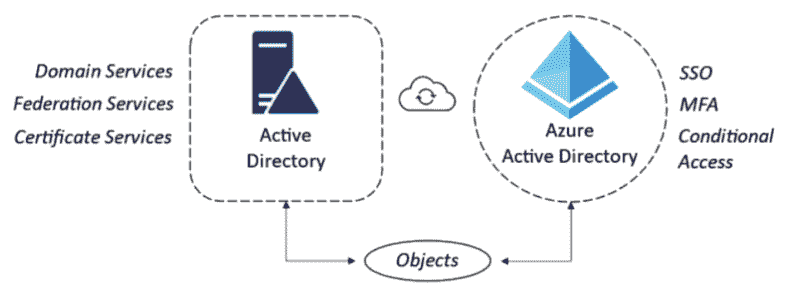

图 2.1 – AD 和 Azure AD

混合身份方法允许用户使用其 AD 身份访问 Azure AD 中的资源；相同的用户名和密码用于访问两个 IDP 环境中访问的资源。如果您希望继续了解混合身份和 Azure AD Connect 的更多信息，可以在以下网址找到进一步阅读材料：https://docs.microsoft.com/azure/active-directory/hybrid/whatis-azure-ad-connect。

### 什么是 Azure AD DS？

Azure AD DS 是作为平台即服务 (PaaS) 提供的托管 Azure 身份服务；简单来说，它将域服务作为服务提供。

当您将 Azure AD DS 作为 Azure AD 租户的一部分实施时，您会创建一个 Microsoft 托管域，这是 AD DS 的托管实现。它提供 Kerberos/NTLM 身份验证、轻量目录访问协议 (LDAP)、域加入和组策略的功能。

Azure AD DS 的用例是：在 Azure 中运行的工作负载依赖于域服务功能，且应用程序或服务无法修改或重写以利用 Azure AD 和现代身份验证（例如 OAuth、SAML 和 REST）。

下图概述了如何在工作负载移至 Azure 后提供与本地相同的域功能，而无需提供您自己管理的 AD DS 实例：

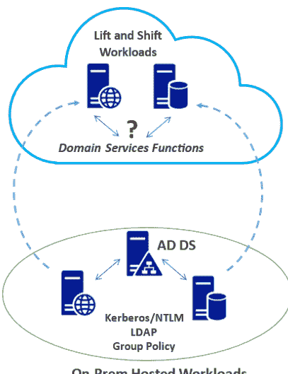

图 2.2 – Azure AD DS 用例场景

Azure AD DS 托管域可能是 **Azure Virtual Desktop** (AVD) 等场景的解决方案，在该场景中，您可能只有云标识，但仍依赖于 Azure AD 尚不支持的域服务。这允许您使用 Azure AD DS 的 PaaS 功能，而不是自管域控制器。结合 Microsoft 365，此方法可以提供紧密集成的解决方案。

将 AD DS 域控制器作为 PaaS 服务提供的优势包括无需考虑物理基础设施或逻辑组件，例如数据存储、架构、信任和分区，以及 AD DS 的可用性和保护。

由 Microsoft 创建的 _托管域_ 实例包含两个域控制器以实现高可用性，如果在该区域可用，则还可跨两个可用性区域实现额外的区域冗余。Microsoft 会自动配置域控制器在各区域中的分布。

托管域的一些特征如下：

- 由 Microsoft 管理，而非自行管理。
- 独立域–无法扩展或将托管域加入现有的 AD DS 林。
- 信任仅为单向出站林信任。
- 无域或企业管理员特权。
- 支持域加入、LDAP 和 Kerberos/NTLM。
- 提供两个用于计算机和用户的内置 OU 容器，以及关联的内置 **组策略对象 (GPO)**。
- 通过扁平结构支持自定义 OU 结构和组策略。
- 无架构扩展。
- 域控制器作为服务提供，并由 Microsoft 管理。
- Azure AD DS 已集成到 Azure AD 租户中，用于云标识场景，并可与 AD DS 结合用于混合身份场景。
- Azure AD DS 可通过 RSAT 工具以类似于 AD DS 的方式进行管理。
- 对象同步为单向，从 Azure AD 到 Azure AD DS；直接对 Azure AD DS 所做的任何更改将在下次同步时被覆盖。这些应被视为只读域控制器，不得直接在域控制器上创建或更改对象。
- 不能在托管域中重置密码；必须在 AD/Azure AD 中重置，并同步到托管域。

您可以查看本章末尾 _进一步阅读_ 部分提供的链接，了解 Azure AD DS 与 AD DS 之间完整差异列表。

在云标识场景中，用户、密码和组在 Azure AD 租户中创建和管理，Azure AD 租户是权威目录服务和 IDP；这些对象会同步到 Azure AD DS 托管域。

托管域中的对象没有直接更改。任何更改都应在权威 IDP（在此场景中为 Azure AD）中进行，然后必须将这些更改同步到托管域才能生效。

如果用户的密码需要重置，则在 Azure AD 中执行此操作。此更改随后同步到托管域域控制器；建议在 AD 租户中启用自助式密码重置 (SSPR)。

下图显示了云标识场景中 Azure AD 与 Azure AD DS 托管域之间的关系：

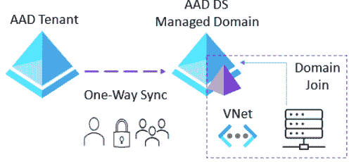

图 2.3 – Azure AD 云标识场景

如果用户的密码需要重置，则在 Azure AD 中重置。此更改随后同步到托管域域控制器；建议在 AD 租户中启用 SSPR。

下图显示了混合身份场景中 AD、Azure AD 和 Azure AD DS 托管域之间的关系：

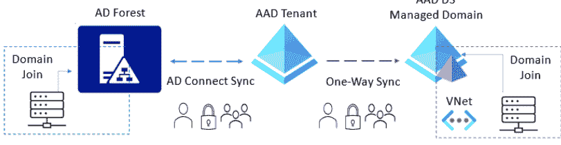

图 2.4 – Azure AD 混合身份场景

在混合身份场景中，用户、密码和组在 AD 林中创建和管理，AD 林是权威目录服务和 IDP。

然后，这些对象使用 **AD Connect** 双向同步到 Azure AD 租户，接着对象单向同步到 Azure AD DS 托管域。在托管域中不能直接更改对象；任何更改都应在权威 IDP（在此情况下为 AD 林）中进行。这些更改随后必须使用 AD Connect 同步到 Azure AD 租户，然后再从 Azure AD 租户同步到托管域才能生效。

总结而言，在之前的云只和混合身份场景中，Azure AD DS 托管域不会进行任何更改。所有对象均从 Azure AD 租户同步，因此唯一的问题是对象最初如何在 Azure AD 中创建。对于云只账户，可以通过直接在 Azure AD 租户中创建对象来实现；或者，允许这些对象从 AD 域控制器通过 AD Connect 同步在 Azure AD 租户中创建。

本节总结了本章三个技能领域的第一个：*什么是 Azure AD DS？* 我们探讨了它如何提供托管域服务。在下一节中，我们将探讨本章三个技能领域的第二个：*创建 Azure AD DS*。

### 创建 Azure AD DS 托管域

本节将介绍创建 Azure AD DS 托管域所需的规划方面和信息，本章将以实践练习部分结束。

Azure AD DS 的安装在 Azure 门户中进行，需要 Azure AD 租户和 Azure 订阅。对象可以是云只对象，也可以为混合身份场景从 AD 同步。

在 Azure AD 租户中创建了两个企业应用程序以支持域的操作；这些应用程序不应被移除或编辑，包括以下内容：

- 域控制器服务
- Azure AD 域控制器服务

托管域实例由 Microsoft 创建，它将自动配置托管域控制器在各区域中的分布。

以下部分将探讨在创建 Azure AD DS 托管域之前所需的规划方面。

### Azure AD 租户和订阅

要创建 Azure 资源，您需要一个 **Azure 订阅**。它将充当所创建和消耗资源的逻辑容器、访问控制和计费机制。您必须将 Azure AD 租户与该订阅关联；该租户可以与 AD 同步用于混合身份场景，或采用云只身份方法。

Azure AD 租户只能有一个 Azure AD DS 托管域。请确保首先做好充分规划，因为一旦创建了托管域，您将无法更改以下任何字段：`tenant`、`subscription`、`region`、`resource group`、`VNet` 或 `subnet`。

### 创建 Azure AD DS 托管域所需的权限

您应确保为希望用于创建 Azure AD DS 托管域的帐户拥有以下权限：

订阅级别具有 **所有者** 或 **参与者** 权限的帐户，或具有 **域服务参与者**、**组管理员** 和 **应用程序管理员** Azure AD 角色的帐户。

### 网络和 DNS

通过 Azure AD DS 部署向导创建的默认 **虚拟网络 (VNet)** 使用名为 `aadds-vnet` 的 **专用 Azure AD DS 子网**。在名为 `aadds-subnet` 的 VNet 中仅创建一个子网。此子网不应用于托管域资源以外的任何内容；请勿将任何工作负载添加到此子网。

您创建的 VM 或资源应位于 `aadds-vnet` 中的自身 **工作负载子网** 中；或者，您可以创建另一个 **工作负载 VNet** 并使用 VNet 对等互连将其连接到 Azure AD DS VNet。

以下图示概述了网络拓扑的两种方法：

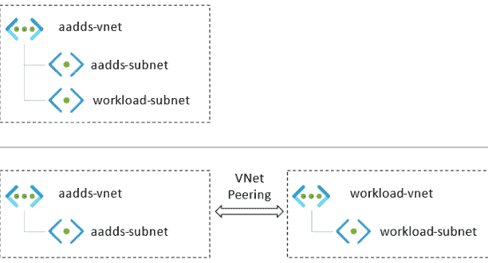

图 2.5 – Azure AD DS 网络拓扑

创建 Azure AD DS 后，您将获得 *两个 IP 地址*，即 Microsoft 管理的域控制器；这些作为托管域的 *DNS 服务器*。

您必须配置对等 VNet 上的 DNS，以允许资源与 Azure AD DS VNet 通信。这可以使用托管域域控制器的 IP 地址或对等 VNet 中配置的现有 DNS 服务器来完成。应配置 DNS 以通过允许条件 DNS 转发将查询定向到托管域。

### 域名

您必须为托管域的域名指定一个 *DNS 名称*。必须确保选择正确的 DNS 域名，因为一旦创建，除非删除托管域并重新创建，否则无法更改它。

> **注意**
> 应规划域名以避免与任何现有 DNS 命名空间或计划命名空间冲突。

托管域的 *前缀* 不能超过 **15 个字符**；这是因为这是 *NetBIOS 主机名* 支持的最大长度。

对于 *后缀*，您不应使用带有 *不可路由后缀* 的域名，例如 `.local`；这可能会导致 DNS 相关问题。相反，您可以使用租户目录的默认内置域名；这将使用 *.onmicrosoft.com* 后缀。这种方法的问题是，*证书颁发机构 (CA)* 不会为您颁发证书，因此您无法保护此域，因为 Microsoft 拥有该域。

为解决此问题，您可以使用您拥有并在 DNS 中注册的 *可路由自定义域*，在那里您有权创建和编辑 DNS 记录，并在需要时生成证书。建议将其与组织中的任何现有域名分开用于自定义域名。它不得与 VNet 中的任何当前命名空间或通过 VPN 或 ExpressRoute 连接到本地的命名空间冲突。

对于现有域名 *milesbetter.solutions*，建议的命名方法是使用 *子域* *aadds.milesbetter.solutions*，以避免与现有 *根命名空间* 冲突。

### 位置

您应在实现的工作负载需要使用托管域的同一区域部署 Azure AD DS 托管域。如果该区域可用，可以选择 Azure 可用性区域以获得额外的冗余。

您应确保部署到正确的区域，因为一旦创建，除非删除并重新创建，否则无法更改。

### SKU

SKU 的用途是选择托管域的性能和备份频率。所有 SKU 都提供相同的无限对象数，尽管会给出建议的对象数作为指导。

发布时的 SKU 如下：

- 标准：
  - 建议身份验证负载（峰值，每小时）：0 到 3,000
  - 建议对象数：0 到 25,000
  - 备份频率：每 5 天
  - 仅用户林
- 企业：
  - 建议身份验证负载（峰值，每小时）：3,000 到 10,000
  - 建议对象数：25,000 到 100,000
  - 备份频率：每 3 天
  - 用户林和资源林
  - 五个资源林信任
- 高级：
  - 建议身份验证负载（峰值，每小时）：10,000 到 70,000
  - 建议对象数：100,000 到 500,000
  - 备份频率：每 5 天
  - 用户林和资源林
  - 十个资源林信任

创建后，您可以在 SKU 之间切换，无需删除和重新创建托管域。

### 林类型

默认创建的林类型是 **用户林**；它将对象从 Azure AD 同步到托管域。这些对象也可以是从 AD DS 林创建和同步的对象。**资源林**仅同步在 Azure AD 中创建的用户和组。

本节总结了本章三个技能领域的第二个：*创建 Azure AD DS*。我们探讨了规划和部署信息。在下一节中，我们将探讨本章三个技能领域的最后一个：*管理 Azure AD DS*。

### 管理 Azure AD DS 托管域

本节将介绍管理 Azure AD DS 托管域实例的信息。

由于这是一项 Microsoft 托管服务，可执行的管理任务有限制。您无法访问托管域中的某些管理功能；我们将在本节中介绍这些领域。本章将以实践练习部分结束。

### 管理工具

用于管理 AD DS 的同一组管理工具也可用于管理 Azure AD DS 实例，例如 **Active Directory 管理中心 (ADAC)**、**Active Directory 用户和计算机管理单元** 和 **AD PowerShell**。AAD DC 管理员组成员可以使用这些工具管理托管域。

由于这些是 Microsoft 管理的域控制器，它们被锁定，并且没有直接访问托管域域控制器的权限，例如通过 **远程桌面协议 (RDP)**。所有管理任务旨在从网络上的已加入域的管理计算机远程运行。

这些远程管理工具可以使用 **远程服务器管理工具 (RSAT)** 功能安装在已加入域的 VM（服务器或客户端）上，作为管理计算机。

### 管理 Azure AD DS 管理特权

托管域将 *不* 提供访问域管理员或企业管理员权限。相反，创建 Azure AD DS 时，会创建一个用于管理托管域的 *管理组*，该组名为 **Azure AD DC 管理员**。

此组成员的用户帐户在已加入域的 VM 上获得 *管理员权限*；此组被添加到 **本地管理员组**。该组还提供 **远程桌面** 权限以连接到已加入域的 VM。

您应从 Azure AD 目录中添加您希望成为此组成员的用户。

以下是在托管域中可以执行的管理任务：

- 在托管域中加入计算机
- 管理容器 AADDC Computers 和 AADDC Users 的内置 GPO
- 创建和管理自定义 OU 和 GPO
- 管理 DNS

以下是无法在托管域上执行的功能：

- 通过远程桌面连接到域控制器 (DC)
- 将域控制器添加到托管域
- 将现有 AD DS 林扩展到 Azure AD DS；托管域是独立的林实例
- 没有域管理员或企业管理员权限
- 扩展架构

应仔细考虑上述要点，以帮助决策 Azure AD 是否是最适合您需求的标识解决方案。

### 配置 VNet 以使用托管域

默认情况下，托管域 VNet 只包含一个子网。该子网仅供托管域服务使用，您不应向其中添加任何其他资源或 VM。如果您希望在托管域 VNet 中创建资源或 VM，应为这些资源创建其他子网。

但是，您可以使用现有 VNet 或创建新 VNet，并使用网络分段将托管域 VNet 隔离开来；此推荐方法将根据您的需求而有所不同。

要允许其他 VNet 中的资源使用托管域，第一步是确保这些 VNet 能够连接到托管域 VNet（通过 VNet 对等互连）。应更新 VNet 的 DNS 服务器设置，以反映能够对托管域 DCs 执行查找的 DNS 服务器。

VM 可能需要重新启动以获取新的 DNS 设置；您可以在 VM 上运行 `ipconfig /all` CLI 命令，以检查重启前后使用的 DNS 设置。

### 管理用户帐户

用户帐户不会直接在托管域中创建；它们是从 Azure AD 同步的。

Azure AD DS 要求密码哈希采用 NTLM 或 Kerberos 所需的格式，而在托管域在租户上启用之前，Azure AD 不提供此格式。现有用户无法立即向托管域进行身份验证；其密码哈希不会以 Azure AD DS 使用的格式同步到 Azure AD DS。因此，我们需要在 Azure AD 中生成可用的密码哈希，以便它们可以同步到 Azure AD DS 托管域。

必须更改用户密码，才能生成新的密码哈希；可以强制用户在下次登录时更改密码，也可以让用户手动更改。此更改会导致密码以正确的格式重新创建，以便支持 Azure AD DS 并实现正确的 Kerberos 和 NTLM 身份验证。

更改此密码后，Azure AD 会存储此新密码哈希，帐户将同步到托管域。用户现在可以使用其 Azure AD 帐户凭据成功登录到托管域。

应注意的是，Azure AD Connect 云同步不支持与 Azure AD DS 一起使用；AD 用户需要使用 Azure AD Connect 进行同步。

此密码哈希重新生成方案不会发生在托管域在租户中创建后创建的帐户；对于这些帐户，Azure AD 将创建 Azure AD DS 所需的正确格式的密码哈希。

必须在 Azure AD 租户中实现自助式密码重置 (SSPR)，以允许用户重置其密码。

托管域中有默认密码策略，其中定义了复杂性、存活期和锁定；可以创建自定义密码策略以替代此策略。

### 管理 OU

为托管域创建了两个内置组织单位 (OU)；如下所示：

- AADDC Users：这是从 Azure AD 租户同步到托管域的所有用户和组对象的默认位置。包括从 Azure AD 租户同步的用户和组。

- AADDC Computers：这是加入到托管域的所有计算机对象的默认位置。

在从 AD DS 同步用户帐户和组的混合标识方案中，OU 对象不会同步，因为托管域仅支持扁平 OU 结构。建议创建自定义 OU 和关联的 GPO 以满足您的需求。

### 管理 VM 域加入

Azure AD DS 提供 *托管域服务*，以便您可以提供 VM 加入功能，而无需自行管理 IaaS VM 域控制器。您可以使用 *Azure AD 凭据* 向此托管域进行身份验证。用户帐户可以是云专用帐户，也可以通过 Azure AD Connect 从 AD 同步到 Azure AD。

这为我们提供了可跨 AD DS、Azure AD 和 Azure AD DS 使用的 *通用标识*。通过从 AD 将用户帐户密码哈希同步到通过 Azure AD 的托管域，这为我们在随后可能实现的内容方面提供了很多选择。

用于将计算机加入域的帐户必须同步到托管域或来自 Azure AD 租户；不能使用 *外部目录帐户*。

如果 VM 无法加入托管域，通常是由三个常见原因造成的：

- **连接问题**：确保您可以连接到托管域 DC 的 IP 地址；如果您的工作负载位于与创建 Azure AD 的 VNet 不同的 VNet 中，您可能需要检查 VNet 是否已对等互连。确保没有网络安全筛选针对托管域的流量。
- **DNS 问题**：确保 VM 已列出正确的 DNS 服务器以查找托管域；检查托管域 DC 的 IP 是否已设置为 VM 尝试进行 *域加入* 的 VNet 所使用的 DNS 服务器。
- **凭据**：确保所用帐户属于 Azure AD 租户或已成功同步到托管域，并且密码哈希采用 Azure AD DS 所需的正确格式。如前所述，正确的密码哈希可能未同步到托管域，密码重置将生成正确的密码哈希格式；您应等待该操作同步到托管域。

建议帐户凭据采用 *UPN 后缀* 格式；例如，对于 *domainjoin* 用户，您将使用 *domainjoin@aadds.milesbetter.onmicrosoft.com* UPN 后缀。或者，可以使用 *SAMAccountName* 格式；例如，对于 *domainjoin* 用户，您将使用 *AADDS\domainjoin SAMAccountName* 格式。

在本节中，我们探讨了管理 Azure AD DS。在下一节中，我们将完成一项实操练习，以加强本章中涵盖的某些概念。

### 实操练习

为了支持您通过实践技能进行学习，我们将学习如何创建 Azure AD DS，我们在本章中已探讨过此内容。

我们将查看以下练习：

- 练习 – 安装 Azure AD DS

### 开始使用

要开始使用本实操练习部分，如果您还没有 Azure 订阅，可以在 https://Azure.microsoft.com/free 创建免费 Azure 帐户。此免费 Azure 帐户提供以下内容：

- 12 个月的免费服务

- 30 天内探索 Azure 的 $200 信用额度

- 25+ 项始终免费的服务

让我们继续本章的练习。

### 练习 – 安装 Azure AD DS

在本节中，我们将学习如何安装 Azure AD DS。练习中的步骤将在 Azure 门户中执行：https://portal.Azure.com/。

按照以下步骤创建 Azure AD DS 实例：

1. 登录 https://portal.Azure.com 的 Azure 门户。或者，您可以使用 Azure 桌面应用：https://portal.Azure.com/App/Download。

2. 在搜索栏中键入 Azure AD 域服务，然后从显示的服务列表中单击 Azure AD 域服务边栏。

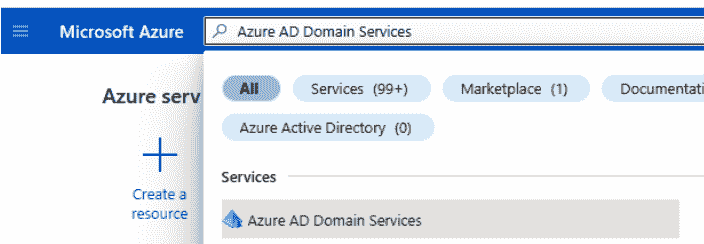

图 2.6 – 在 Azure 门户中搜索服务

- 3. 在 Azure AD Domain Services 边栏上，单击“+ 创建资源”。它应位于边栏的左上角。

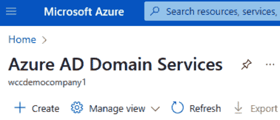

图 2.7 – Azure AD Domain Services 边栏

- 4. 供参考，请查看有关 Azure AD Domain Services 功能的信息以及“项目详细信息”部分中的信息。

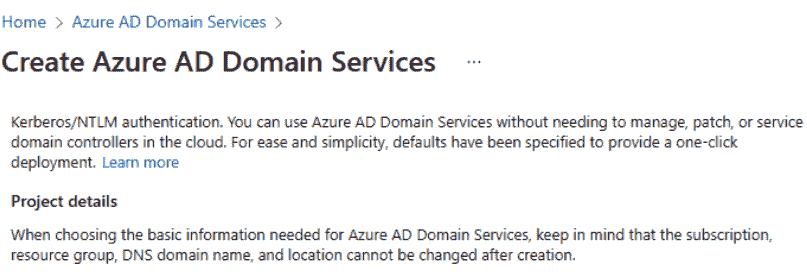

图 2.8 – 查看创建信息

- 5. 查看“帮我选择订阅和资源组”帮助链接中的信息；然后选择“订阅”和“资源组”，或根据需要创建新资源组。

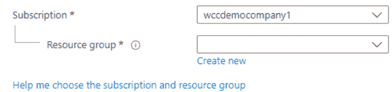

图 2.9 – 选择订阅和资源组

- 6. 查看 **“帮我选择 DNS 名称”** 帮助链接中的信息；然后输入 *域名*。在此练习中，我们将修改默认值以使用子域，以避免与默认命名空间冲突；你应根据自己的场景进行设置。

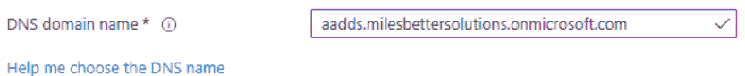

图 2.10 – 选择 DNS 域名

- 7. 设置区域。

图 2.11 – 选择区域

- 8. 查看 **“帮我选择 SKU”** 帮助链接中的信息；然后设置 SKU。

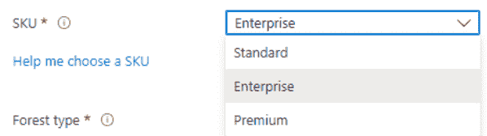

图 2.12 – 选择 SKU

- 9. 查看 **“帮我选择林类型”** 帮助链接中的信息；然后设置林类型。

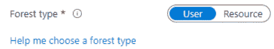

图 2.13 – 设置林类型

- 10. 单击下一步。

- 11. 在 **“网络”** 选项卡上，查看有关使用现有网络的参考信息。

* 基础 **网络** 管理 同步 安全 设置 标记 审查 + 创建

Azure AD Domain Services 在虚拟网络中使用专用子网来托管其所有资源。如果使用现有网络，请确保网络配置不会阻止 Azure AD Domain Services 运行所需的端口。了解更多

图 2.14 – 查看网络信息

- 12. 查看 **“帮我选择虚拟网络和地址”** 帮助链接中的信息；然后根据需要设置 **“虚拟网络”** 或单击 **“创建新”**。

虚拟网络 * (新) aadds-vnet 创建新

帮我选择虚拟网络和地址

图 2.15 – 选择虚拟网络

- 13. 查看 **“帮我选择子网和 NSG”** 帮助链接中的信息；然后设置 **“子网”**。

子网 * (新) aadds-subnet (10.0.0.0/24)

帮我选择子网和 NSG

图 2.16 – 选择子网

- 14. 单击下一步。

- 15. 在 **“管理”** 选项卡上，查看 **“帮我选择 AAD DC 管理员”** 帮助链接中的信息；根据需要完成 **“AAD DC 管理员”** 组成员资格，或跳过并稍后管理。

* 基础 *网络 **管理** 同步 安全 设置 标记 审查 + 创建

使用这些设置指定哪些用户应拥有管理权限并接收有关托管域问题的通知。了解更多

AAD DC 管理员 管理组成员资格

帮我选择 AAD DC 管理员

图 2.17 – 选择管理员组成员资格

- 16. 查看“帮我选择谁接收通知”帮助链接中的信息；根据需要进行设置。

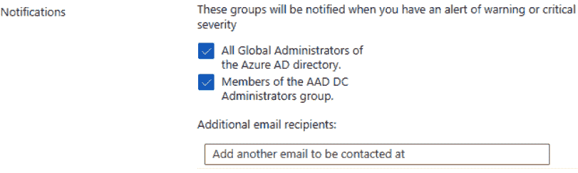

帮我选择谁接收通知

图 2.18 – 选择通知

- 17. 单击下一步。

- 18. 查看 **“同步”** 选项卡中关于同步和范围同步的参考信息。

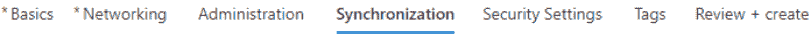

Azure AD Domain Services 提供从 Azure Active Directory 到托管域的单向同步。此外，只有特定属性会同步到托管域，同时还包括组、组成员资格和密码。了解更多

图 2.19 – 查看同步信息

- 19. 查看 **“帮我选择同步类型”** 帮助链接中的信息；根据需要将其设置为 **“全部”** 或 **“范围”**。

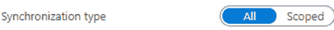

帮我选择同步类型

范围同步可以通过不同的组选择进行修改，或转换为同步所有用户和组。同步设置的更改不会立即生效。请留出时间让更改完成。更多信息

图 2.20 – 选择同步

- 20. 单击下一步。

- 21. 在“安全设置”选项卡上，查看三个帮助链接中的信息，然后保留设置的默认值或根据需要进行更改。

* 基础 * 网络 管理 同步 安全设置 标记 审查 + 创建

Azure AD Domain Services 拥有多个可用于加固域服务的安全设置。在选择启用或禁用安全设置时，首先了解其对使用域服务的工作负载的影响非常重要。了解更多

TLS 1.2 仅模式 禁用 启用

NTLM v1 身份验证 禁用 启用

帮我选择强加密算法

NTLM 密码同步 禁用 启用

从本地同步密码 禁用 启用

帮我选择密码同步设置

Kerberos RC4 加密 禁用 启用

Kerberos 装甲 禁用 启用

帮我选择 Kerberos RC4 加密和装甲

图 2.21 – 选择安全设置

- 22. 单击下一步。

- 23. 在“标记”选项卡上，保留设置的默认值或根据需要进行更改。然后，单击“下一步：审查 + 创建”。

* 基础 * 网络 管理 同步 安全设置 标记 审查 + 创建

标记是名称/值对，可让你通过将相同标记应用于多个资源和资源组来对资源进行分类并查看合并计费。了解更多

| 名称 | 值 | 资源 |
|---|---|---|
| | | Azure AD Domain Services |

审查 + 创建 上一步 下一步

图 2.22 – 添加标记

- 24. 在“审查 + 创建”选项卡上，查看你的设置；你可以返回之前的选项卡并在需要时进行任何编辑。确认设置后，单击“创建”。

### 创建 Azure AD Domain Services ...

* 基础 * 网络 管理 同步 安全设置 标记 审查 + 创建

| 部分 | 键 | 值 |
|---|---|---|
| 基础 | 名称 | aadds.milesbettersolutions.onmicrosoft.com |
| 基础 | 订阅 | wccdemocompany1 |
| 基础 | 资源组 | sm4621 |
| 基础 | 区域 | 美国东部 |
| 基础 | SKU | Enterprise |
| 基础 | 林类型 | 用户 |
| 网络 | 虚拟网络 | (新) aadds-vnet |
| 网络 | 子网 | (新) aadds-subnet |

创建 上一步 下一步 下载用于自动化的模板

图 2.23 – 查看创建选项

- 25. 你将看到一个弹出屏幕，要求你确认自己的选择，因为这些选择在托管域创建后无法更改。查看此信息，单击 **“确定”** 以继续，或返回并根据需要审查更改。

### 你应该知道...

以下选择是最终的，创建后无法更改。

- DNS 名称
- 订阅
- 资源组
- 虚拟网络
- 子网
- 林类型

单击“确定”继续创建 Azure AD Domain Services。

图 2.24 – 审查最终选择

- 26. 你现在将看到 **“部署正在进行中”** 屏幕；这大约需要一小时才能完成。

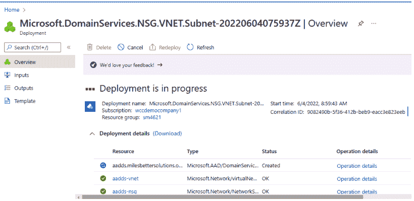

图 2.25 – 部署进度

- 27. 你将看到 **“你的部署已完成”** 消息，并将收到 **“部署成功”** 通知。

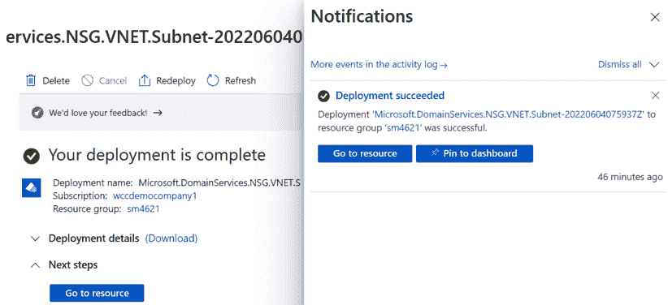

图 2.26 – 部署完成

- 28. 单击“转到资源”或导航到 Azure AD Domain Services 边栏；可以看到创建的 Azure AD Domain Services 实例。

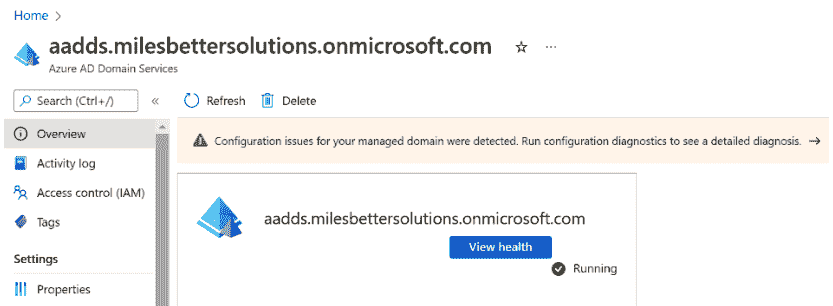

图 2.27 – Azure AD Domain Services 边栏

- 29. 从“概述”页面，查看“必需配置步骤”部分中的信息以完成配置。

### 图 2.28 – 最终配置步骤

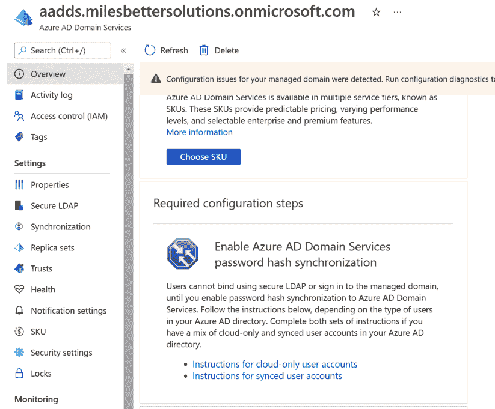

有了这个，我们已完成 AD DS 的创建。

在本练习中，我们学习了如何创建 Azure AD 域服务实例。

### 摘要

本章涵盖了 AZ-800 管理 Windows Server 混合核心基础设施考试的学习目标：在本地和云环境中部署和管理 AD DS。

我们了解了 Azure AD 的概念及其与 AD 的对比。我们学习了如何创建和管理 Azure AD DS 托管域。随后的动手练习完成了本章内容，为你提供额外的实践技能。

本章旨在将你的知识提升至考试目标之外；我们通过提供的内容新增了技能和学习内容。这将进一步提升你在本地网络基础设施服务方面的知识和技能，使你能够胜任专注于现实世界日常混合环境的角色。在下一章中，我们将学习使用组策略管理用户和计算机的基本技能。

### 延伸阅读

本节提供有关考试信息和学习参考的链接：

- Microsoft 认证：Windows Server 混合管理员 Associate: https://docs.microsoft.com/en-us/learn/certifications/windows-server-hybrid-administrator/
- 考试 AZ-800：管理 Windows Server 混合核心基础设施: https://docs.microsoft.com/en-us/learn/certifications/exams/az-800
- 考试 AZ-800：技能大纲: https://query.prod.cms.rt.microsoft.com/cms/api/am/binary/RWKI0r
- Microsoft Learn：部署和管理标识基础设施: https://docs.microsoft.com/en-us/learn/paths/deploy-manage-identity-infrastructure/
- 什么是 Azure Active Directory 域服务: https://docs.microsoft.com/en-gb/Azure/active-directory-domain-services/overview
- 比较自管理的 Active Directory 域服务、Azure Active Directory 和托管的 Azure Active Directory 域服务: https://docs.microsoft.com/en-gb/Azure/active-directory-domain-services/compare-identity-solutions
- 教程：为 Azure Active Directory 域服务托管域配置虚拟网络: https://docs.microsoft.com/en-us/Azure/active-directory-domain-services/tutorial-configure-networking
- 教程：创建和配置 Azure Active Directory 域服务托管域: https://docs.microsoft.com/en-us/Azure/active-directory-domain-services/tutorial-create-instance

### 技能检查

通过回答以下问题，挑战你对本章所学内容的掌握情况：

- 1. 什么是 Azure AD DS？
- 2. 说明 Azure AD DS 与 AD DS 之间的区别。
- 3. Azure AD DS 的使用场景有哪些？
- 4. 在仅云标识场景中，Azure AD 与 Azure AD DS 之间是什么关系？
- 5. 在混合标识场景中，AD、Azure AD 与 Azure AD DS 之间是什么关系？
- 6. 列出 Azure AD DS 的五个关键特性。
- 7. 创建托管域时，在 Azure AD 租户中创建了哪两个企业应用程序，它们的用途是什么？
- 8. 在 Azure AD 租户中创建 Azure AD DS 实例需要哪些权限？
- 9. 用于 Azure AD DS 以及将需要使用 Azure AD DS 的工作负载的 VNet 有哪两种方法？
- 10. 为 Azure AD DS 选择域名时需要考虑哪些关键因素？
- 11. Azure AD DS 有哪些 SKU，它们之间有什么区别？
- 12. 为什么为 Azure AD DS 选择正确的名称、位置和 SKU 至关重要？
- 13. Azure AD DS 的默认林类型是什么？
- 14. 可以与 Azure AD DS 一起使用哪些管理工具？
- 15. 列出托管域管理方面的一些限制。
