## 使用组策略管理用户和计算机

本章涵盖了 AZ-800 管理 Windows Server 混合核心基础设施考试的学习目标：使用基于域的组策略管理 Windows Server。

在上一章中，我们增加了技能，以了解在 Microsoft Azure 托管环境中 Azure AD DS 的概念、创建和管理。

本章将首先介绍一些概念和组策略的基础知识。随后我们将探讨组策略组件、其功能和操作、管理以及故障排除。最后，我们将通过一个动手练习来进一步提升你的技能。本章将涵盖以下主题：

- 什么是组策略？
- 什么是 GPO？
- GPO 组件
- GPO 管理模板
- GPO 范围
- Azure AD DS 中的 GPO
- GPO 管理和故障排除工具
- 练习 – 安装组策略管理工具
- 练习 – 实施组策略

在深入策略创建或管理之前，我们将先了解一些定义和概念，以建立知识基准和基础。本章首先定义组策略和组策略对象 (GPO)。

### 什么是组策略？

组策略是 Microsoft 的一项治理功能，也是构建在 Windows 操作系统中的配置管理框架；它提供了一种方法，用于集中配置和管理用户和计算机的操作系统及应用程序。

它用于对 AD 域中用户和计算机对象强制应用标准化配置设置的基线。这是一项功能强大的管理功能，可以管理几乎所有可配置的设置。

组策略可以与 Azure AD DS 配合使用，以管理用户和计算机对象设置，其方式与 AD DS 大致相同，但存在一些限制。我们将在“Azure AD DS 中的 GPO”部分更详细地介绍此内容。

存在两个配置设置节点，如下所示：

- **用户配置**：这些设置适用于用户。这些设置可以限制用户访问操作系统的某些功能，例如从**“开始”菜单**和**任务栏**中移除项目。这些设置将应用于用户，无论其访问的是哪个域计算机。
- **计算机配置**：这些设置适用于计算机。这些设置可用于配置，例如**远程桌面会话**设置。这些设置适用于登录到此计算机的所有用户。

以下屏幕截图显示了这两个节点：

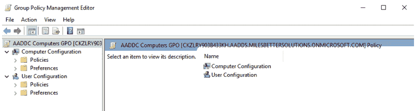

图 3.1 – GPO 配置节点

策略存在于域的域控制器上。管理工作的一部分是确保最新策略的副本通过复制过程传递。对于 Azure AD DS，Microsoft 作为托管域的优势之一，会为你处理此事。

组策略使用内置管理工具来创建和管理策略设置。以下屏幕截图显示了组策略管理控制台 (GPMC) 工具：

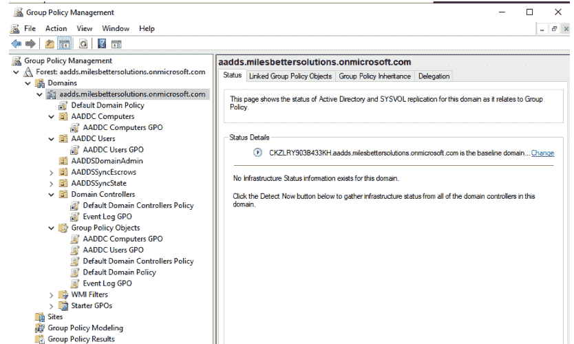

图 3.2 – GPMC 工具

在进入下一节之前，回顾一下第一章中有关 OU 的内容会很有帮助。组织单位 (OU) 充当容器对象。它用于共同组织用户、组和计算机，为对容器中的对象进行管理控制和策略应用提供框架。

在本节中，我们介绍了组策略概念并回顾了 OU。在下一节中，我们将探讨 GPO，它们构成了组策略的基础和构建块。

### 什么是 GPO？

GPO 可以被视为存储可应用于用户和计算机域对象的单独策略设置集合的库。这些对象很像一份清单文档，其中保存并定义了应应用于对象的单独策略设置，以实现自动化、受控和规范的管理和配置。

GPO 可以是以下两种类型之一：

- **本地 GPO**：Windows OS 计算机具有策略，其设置仅应用于 *本地计算机* 且不能链接到任何其他对象；它们适用于 *未加入 AD* 的计算机。
- **域 GPO**：这些是在 AD 域控制器上创建和存储的。随后可以将这些 GPO 链接到 *站点*、*域* 和 *OU 容器* 对象（不包括组），并为希望应用于域中用户和计算机对象的配置设置提供集中管理。

在 Windows Server 上安装 AD DS 时会创建两个默认策略，具体如下：

- **默认域策略**：该策略链接到 *域容器* 并影响所有计算机。安全筛选设置可以应用于特定安全组；默认安全筛选将应用于 *已验证的用户* 组。
- **默认域控制器策略**：该策略链接到 *域控制器 OU* 容器，专门用于应用特定于域控制器的设置。

如果需要这些 GPO 中不可用的其他设置，则应创建其他 GPO，并根据需要将其链接到站点、域或 OU 容器对象。

在本节中，我们定义了 GPO。在下一节中，我们将了解 GPO 组件。

### GPO 组件

AD 域 GPO 由以下两个组件组成：

- **GPO 容器**：这是一个 AD 对象，是 GPO 的元数据存储。**目录复制代理 (DRA)** 在域控制器之间提供复制。
- **GPO 模板**：这是 GPO 的一组文件存储。**分布式文件系统复制 (DFSR)** 在域控制器之间提供复制。

为了让 GPO 应用于用户或计算机，它必须链接到包含受策略影响的计算机或用户对象的站点、域或 OU 容器；GPO 不能直接应用于组。GPO 提供两组配置设置，一组用于计算机，一组用于用户；组没有配置设置。任何策略中的配置设置节点如下：

- **计算机配置**：本节中定义的策略将仅影响计算机对象。这些设置在计算机启动时进行评估和应用。
- **用户配置**：本节中定义的策略将仅影响用户对象的登录会话。这些设置在用户登录时进行评估和应用，且仅在会话期间有效。

以下截图显示了这些配置节点部分：

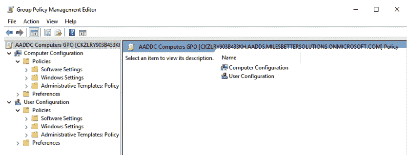

图 3.3 – GPO 配置节点

您应规划策略设置应在计算机设置还是用户设置中应用：

- 计算机设置将影响访问该计算机的所有用户
- 用户设置将无论用户访问哪台计算机都会影响该用户

GPO 的用户或计算机配置部分也可以独立禁用。如果您在这些部分之一中没有配置任何设置，这很有用，因为启用后每个部分需要进行处理；禁用没有设置的部分可以加快策略处理时间。

单个策略设置是最细粒度的级别，也是 GPO 层次结构中最基本的构建块；用于影响计算机和用户对象的特定设置将在此处定义。此设置可以防止用户关闭计算机、配置远程桌面会话设置或设置注册表项。

以下截图显示了单个组策略设置：

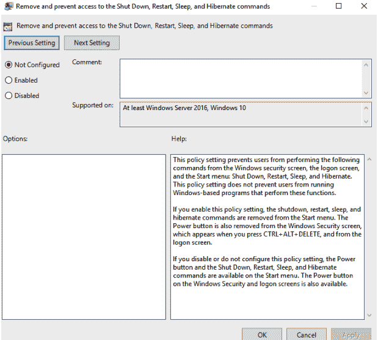

图 3.4 – 组策略设置

借助组策略的可扩展框架，几乎任何可配置设置都可以使用 GPO 进行应用。

在本节中，我们了解了 GPO 组件。在下一节中，我们将了解管理模板及其用途。

### GPO 管理模板

这些为基于注册表的策略提供了基础。顾名思义，您配置的设置用于对注册表进行更改；以这种方式部署配置、应用和软件通常是集中部署最高效的方法。

模板具有以下可配置的设置：

- 计算机相关：此处定义的设置将编辑 HKEY_LOCAL_MACHINE 注册表配置单元
- 用户相关：此处定义的设置将编辑 HKEY_CURRENT_USER 注册表配置单元

如果设置发生冲突，计算机设置的注册表更改优先级更高。

模板位于 GPO 的 **计算机配置** 和 **用户配置** 节点下的 **管理模板** 节点下，如以下截图所示：

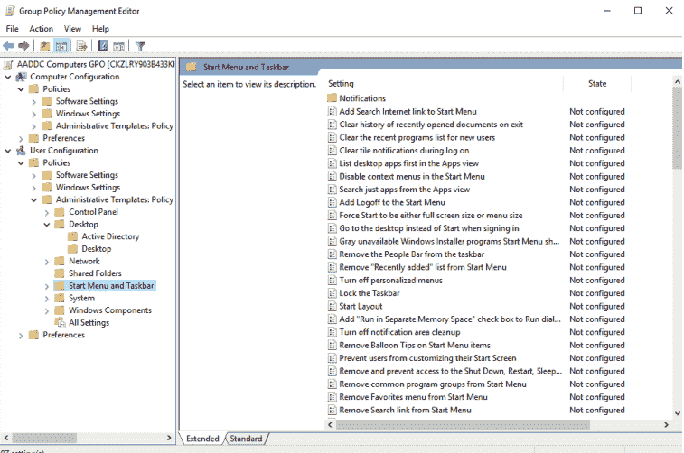

图 3.5 – 管理模板

管理模板由两种文件类型组成，具体如下：

- **.admx 文件**：这指定了组策略设置，并且是 *语言中立* 的。这些应复制到 `%SYSTEMROOT%\PolicyDefinitions` 文件夹或中心位置（例如 SYSVOL）；对于 Azure AD DS，您将无法访问 SYSVOL。
- **.adml 文件**：这指定了与 .admx 文件一起使用的语言。这些通常称为 *语言文件*。这些应复制到 `%SYSTEMROOT%\PolicyDefinitions\[Language-Country Region]` 文件夹。每种语言都有其自己的 `\PolicyDefinitions` 子文件夹；也就是说，en-US 文件夹应用于存储英文文件，以此类推。计算机上存在的默认 .adml 语言文件是已安装操作系统的语言。

以下截图显示了这些文件的位置：

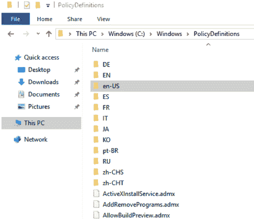

图 3.6 – 管理模板位置

本节介绍了如何使用管理模板集中配置注册表设置。在下一节中，我们将了解 GPO 范围。

### GPO 范围

GPO 包含您指定的可能应用于计算机和用户对象的配置设置，但您必须定义希望受策略影响的域对象。这就是范围，或者说，是策略设置将应用的影响范围/影响区域。

GPO 可以具有以下三个域对象级别的范围：

- **站点范围**：站点内的所有用户和计算机都将受到范围在此级别设置的链接 GPO 的影响
- **域范围**：域内的所有用户和计算机都将受到范围在此级别设置的链接 GPO 的影响
- **OU 范围**：仅 OU 内的用户和计算机将受到范围在此级别设置的链接 GPO 的影响

默认情况下，所有用户和计算机都将受到其所属容器链接的策略的影响；GPO 可以链接到多个站点、域或 OU 容器对象。

> **注意**
> GPO 只能应用于/影响用户和计算机，不能直接应用于组。

但是，我们可以使用安全组筛选来确保正确的用户获得策略应用；默认情况下，安全筛选设置为 **已验证的用户** 组。

您应考虑将 GPO 链接到多个域林中多个站点的影响，因为这可能会影响性能；要处理 GPO，可能需要通过可能是慢速 WAN 链接来访问它们。

GPO 还可以 *取消链接*，因此其策略设置不再影响其链接到的用户或计算机对象；GPO 还可以 *禁用* 或 *删除*。

本节介绍了 GPO 的范围。以下部分将介绍 GPO 处理顺序和继承。

### GPO 处理顺序

如前一节所学，GPO 可以链接到 AD 站点、域或 OU，并将应用于该容器中的任何用户或计算机对象。

每个 GPO 将按以下继承顺序进行处理：

1. 本地策略
2. 站点级链接的 GPO
3. 域级链接的 GPO
4. OU 级链接的 GPO

以下插图旨在概述链接 GPO 处理顺序：

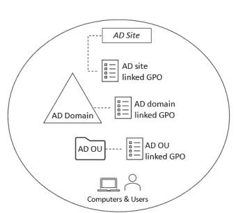

图 3.7 – 域 GPO 处理顺序

应用于用户和计算机对象的设置将是每个级别链接的策略的综合效果，创建**结果策略集（RSoP）**。每个容器级别可以链接多个 GPO。

当一个 GPO 与另一个链接 GPO 具有相同的策略设置但值不同时，会出现冲突；例如，*防止关闭*可能在站点 GPO 中处于*启用*状态，但在链接到较低容器（例如 OU GPO）的 GPO 中，相同设置可能具有*禁用*值。默认情况下，较低级别容器会覆盖在较高级别设置的 GPO；在这种情况下，计算机可以关闭，因为防止关闭的策略设置已通过优先级顺序被禁用。

必须考虑，你希望由某个级别的 GPO 应用的设置不会被随后处理的另一个 GPO *覆盖*。

不过，默认行为可以更改，以便你可以在域或 OU 容器上设置**阻止继承**的策略设置。顾名思义，此阻止操作可防止层次结构中较高级别链接的 GPO 的策略设置被应用。

除阻止继承之外，最后一种控制是能够*强制应用*链接的 GPO。此 GPO 的设置将优先于任何冲突的设置（可能来自链接到较高级别的 GPO）。强制应用会覆盖阻止，这意味着即使设置为阻止继承，这些设置也将被强制应用。

组策略框架的挑战在于，它可能会变成一项治理问题。可以创建许多 GPO 并将其链接到不同的容器。在使用继承、阻止和强制应用时，要了解将应用于用户或计算机的生成或有效设置可能会非常复杂；应限制使用继承阻止。

在考虑阻止和强制应用时，这种生成的优先级可能很难跟踪；**组策略继承**选项卡可以简化此过程，显示考虑所有因素的 GPO 生成优先级，因此你无需自行推断。如下屏幕截图所示：

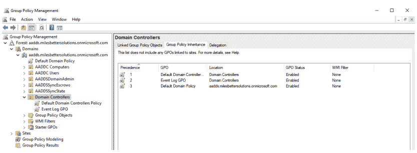

图 3.8 – 组策略继承优先级评估

本节介绍了 GPO 处理顺序和继承。下一节将介绍特定于 Azure AD DS 的 GPO。

### Azure AD DS 中的 GPO

Azure AD DS 管理组策略的方式与 AD 非常相似，用于管理用户和计算机对象的设置，但对托管域中可以访问和配置的设置有限制。

在 Azure AD 租户中实现 Azure AD DS 时，会创建两个内置 GPO 用于管理用户和计算机的配置。这些 GPO 如下：

- AADDC Users GPO
- AADDC Computers GPO

如下屏幕截图所示：

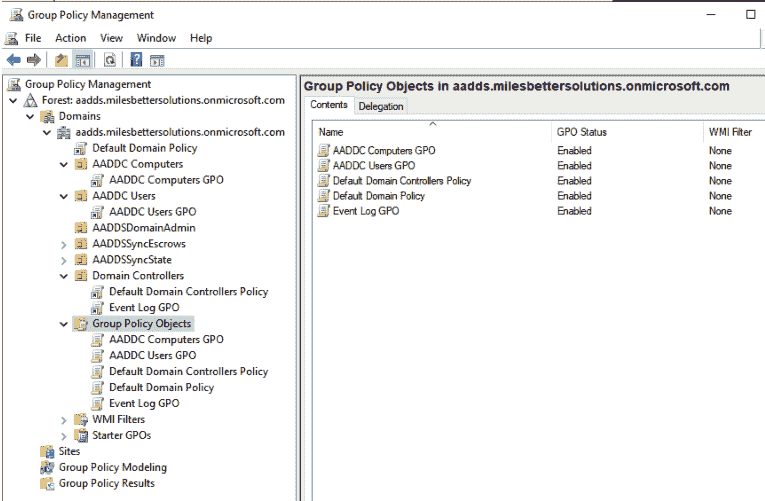

图 3.9 – 默认 Azure AD DS GPO

如果需要这些 GPO 中不提供的其他设置，可以创建自定义 GPO。这些 GPO 只能链接到 OU，并且可以根据需要创建其他自定义 OU 以满足你的需求。要在托管域中获得组策略管理权限，你需要是 AAD DC 管理员组的成员。

在同时使用 AD DS 和 Azure AD DS 的混合标识环境中，AD DS 域控制器的组策略不会同步到 Azure AD DS 托管域。你必须在 Azure AD DS 中手动创建这些设置以绕过此问题。应注意，Azure AD DS 仅支持扁平 GPO 结构，因此如果你现有的 GPO 设计无法直接转换为 Azure AD DS 上组策略中可实现的内容，则可能需要重新考虑如何提供相同的用户和计算机配置。

本节介绍了 Azure AD DS 中的 GPO。下一节将介绍用于创建和管理 GPO 的工具。

### GPO 管理和故障排除工具

GPO 主要通过 GUI 进行管理。GPMC 是 Windows OS 中内置的组策略管理工具。该工具具有内置编辑器功能 **组策略管理编辑器**。可以使用 `gpedit.msc` 命令启动 GPMC。

此工具允许你创建、链接、编辑和删除 GPO，提供报告，并建模它们将如何影响用户以及应用策略的计算机。

以下命令行工具也可用于管理和故障排除 GPO：

- GPMC
- GPRESULT
- GPUPDATE
- LDIFDE
- PowerShell

创建新 GPO 或编辑 GPO 时，GPO 文件将每 *90 分钟* 复制到每个成员服务器（DC 服务器每 5 分钟复制一次）。无需让用户注销或重新启动即可应用策略。如果不想等待，也可以使用 `gpupdate /force` 命令强制应用。

下屏幕截图中的 **组策略管理编辑器** 窗格显示了 GPO 设置层次结构中 **计算机配置** 和 **用户配置** 的配置设置节点及其可视化表示：

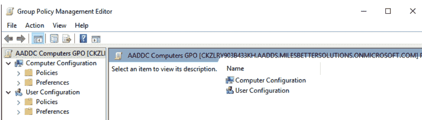

图 3.10 – GPO 配置节点

然后，GPO 设置层次结构中的计算机配置和用户配置节点将细分为带有策略和首选项文件夹的部分，其下方还有更多配置区域。**组策略管理编辑器** 窗格显示了策略和首选项文件夹及子配置组文件夹的可视化表示，如下屏幕截图所示：

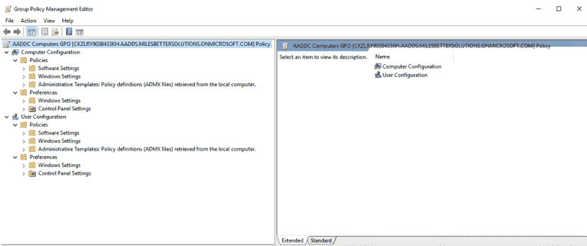

图 3.11 – GPO 配置设置

链接到对象容器的 GPO 将具有管理 GPO 时需要注意的以下属性，包括：

- 链接顺序
- GPO 名称
- GPO 是否强制应用
- 链接是否启用
- GPO 是否启用
- 是否存在 WMI 筛选器

下屏幕截图显示了链接到域对象容器的 GPO 及其属性：

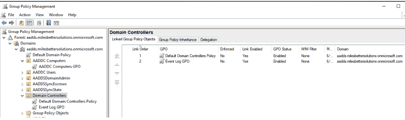

图 3.12 – 链接的 GPO

组策略框架强大的配置功能意味着它可以管理几乎所有可配置的设置。组策略框架中最细粒度的级别是单个策略设置。策略可以是以下三种状态之一：

- 未配置
- 已启用
- 已禁用

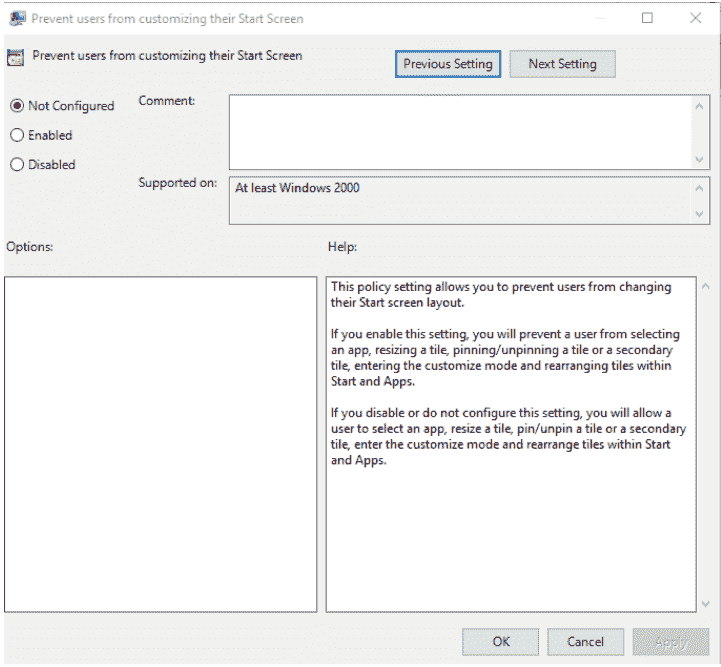

图 3.13 – 组策略设置状态

创建新策略时，默认情况下所有设置均设置为 **未配置**。当策略状态在 **已启用** 和 **已禁用** 之间更改时，更改将应用于 GPO 影响的计算机和用户对象。

本节介绍了用于创建和管理 GPO 的工具。在下一节中，我们将完成一个动手实践部分，以加强本章中涵盖的某些概念。

### 动手实践

为了帮助你掌握一些实用技能，我们将利用本章前面各节获得的概念和理解，并将其付诸实践。

我们将学习以下练习：

- 练习 – 安装组策略管理工具
- 练习 – 实现组策略

### 开始使用

要开始本节，如果你还没有 Azure 订阅，可以在 https://Azure.microsoft.com/free 创建免费 Azure 帐户。此免费 Azure 帐户提供以下内容：

- 12 个月的免费服务
- 200 美元信用额度，可用于在 30 天内探索 Azure
- 25 多项始终免费的服务

让我们进入本章的第一个练习。

### 练习 – 安装组策略管理工具

本节将介绍在管理服务器 VM 上安装组策略管理工具。这将允许你在托管域中创建和配置 GPO 以及自定义 OU。

对于此练习，我们将使用在上一章的 Azure AD 租户练习中创建的 Azure AD DS 托管域。如果需要，请先完成该练习，然后返回。或者，请使用你自己的环境，以便可以跟随本练习。

要完成此练习，需要满足以下其他要求：

- 对于此 Azure AD DS 托管域，一个是 Azure AD 租户中 **Azure AD DC 管理员** 组成员的用户帐户
- 已加入 Azure AD DS 托管域的 Windows Server 管理 VM；如果需要，请完成以下 Microsoft 文章中的步骤，然后返回：https://docs.microsoft.com/en-us/azure/active-directory-domain-services/join-windows-vm

按照以下步骤安装工具：

- 1. 使用域帐户登录到服务器，并在 **服务器管理器** 的 **管理** 中单击 **添加角色和功能**。

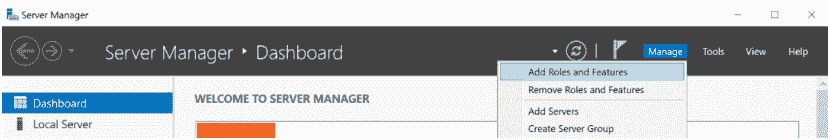

图 3.14 – 服务器管理器

- 2. 在 **开始之前** 页面上，单击下一步。

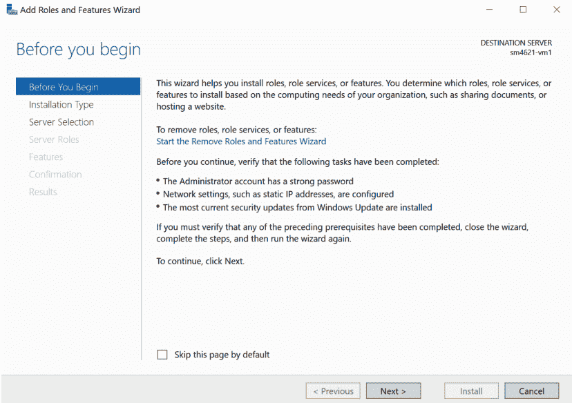

图 3.15 – 开始之前

- 3. 在 **选择安装类型** 页面上，保留设置为基于角色或基于功能的安装，然后单击下一步。

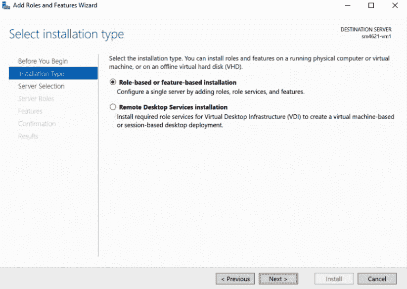

图 3.16 – 选择安装类型

- 4. 在 **选择目标服务器** 页面上，保留设置为从服务器池中选择服务器，并确保选中要在其上安装组策略管理工具的服务器；然后单击下一步。

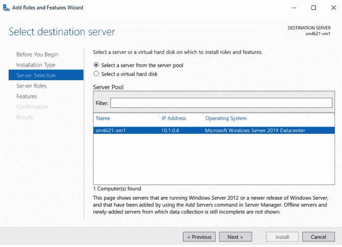

图 3.17 – 选择目标服务器

- 5. 在 **选择服务器角色** 页面上，单击下一步。

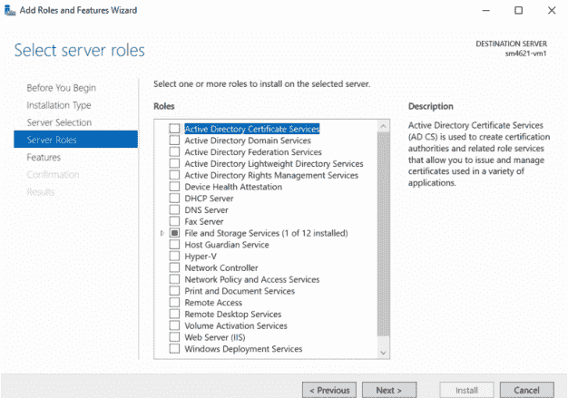

图 3.18 – 选择服务器角色

- 6. 在 **选择功能** 页面上，选择 **组策略管理** 功能。

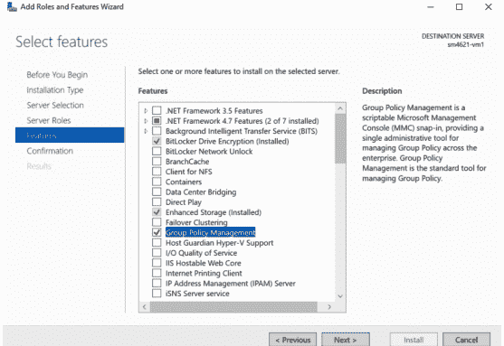

图 3.19 – 选择功能

- 7. 在 **确认安装** 页面上，单击 **安装**。您将看到 **安装进度** 页面；可以单击 **关闭**。

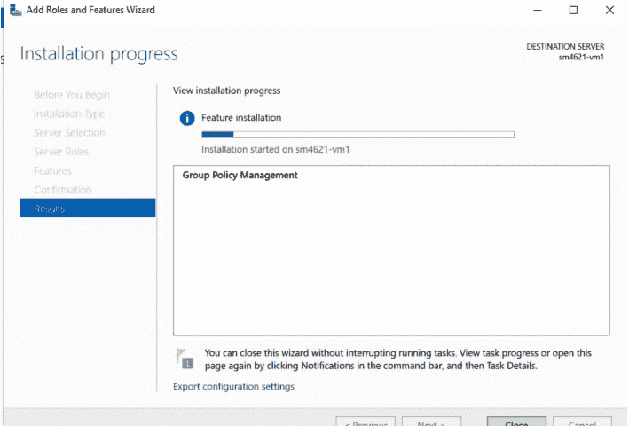

图 3.20 – 安装进度

- 8. 您将看到一条通知，指示安装已成功。

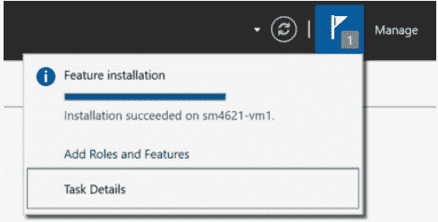

图 3.21 – 安装成功

- 9. 从服务器管理器，单击工具和组策略管理以启动 GPMC。

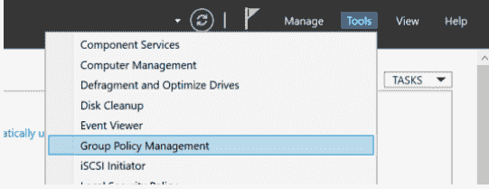

图 3.22 – 启动组策略管理

- 10. 现已启动 GPMC。

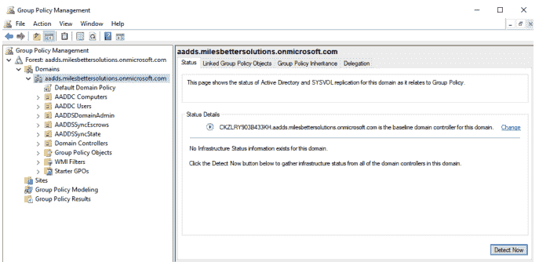

图 3.23 – GPMC

至此，我们已安装组策略管理工具，可使用 GPMC 在 Azure AD DS 托管域中创建和配置 GPO 和自定义 OU。

本练习讲解了安装组策略管理工具所需的技能。下一节将讲解实现组策略所需的技能。

### 练习 – 实现组策略

本部分将介绍如何实现组策略。

本练习将继续使用在上一章的 _Azure AD 租户_ 练习中创建的 Azure AD DS 托管域。如有需要，请先完成该练习，然后返回。

完成本练习需要满足以下前提条件：

- 一台已加入 Azure AD DS 托管域并安装了组策略管理工具的 Windows Server 管理 VM。如有需要，请先完成本章中的上一个练习，然后返回。或者，请使用您自己的环境，以便可以跟进本练习。

为便于理解，我们已将练习分解为各个任务。

### 任务 1 – 创建 GPO 以限制对控制面板的访问

此任务侧重于通过限制对计算机控制面板的访问来进行安全操作。您可以采用相同方法限制对服务器管理器、命令提示符、PowerShell 等的访问。

该策略将配置为 _用户配置_ 设置，并适用于用户访问的所有该策略应用到的计算机；默认情况下，GPO 适用于 _身份验证的用户_ 组。您可以通过应用安全筛选来调整此行为。

我们将在域级别链接创建的 GPO。这意味着它将通过继承应用于域中的所有用户和计算机以及所有子 OU。为简单起见，我们不会演示替代、阻止或强制：

- 1. 从服务器，安装组策略管理工具后，从 **服务器管理器** 的 **工具** 中启动 **组策略管理**。

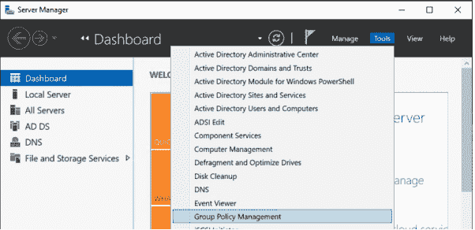

图 3.24 – 启动 GPMC

- 2. 从 GPMC，右键单击域，单击在本域中创建 GPO，并在此处链接...

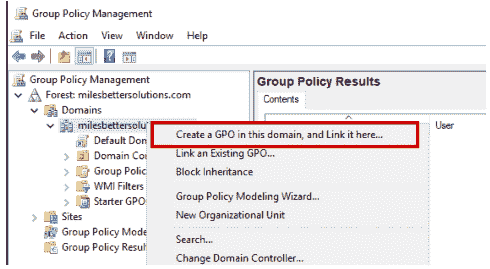

图 3.25 – 创建 GPO

- 3. 为 GPO 提供名称，然后单击确定。

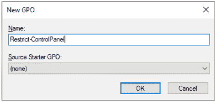

图 3.26 – 为 GPO 命名

- 4. 右键单击刚刚创建的 GPO，然后单击编辑...

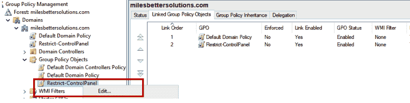

图 3.27 – 编辑 GPO

- 5. 从组策略管理编辑器，导航到 用户配置 | 策略 | 管理模板：从中央存储检索的策略定义 (ADMX 文件) | 控制面板。

然后，双击禁止访问控制面板和电脑设置。

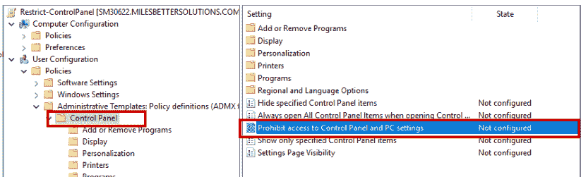

图 3.28 – 控制面板管理模板

- 6. 在策略设置中选择已启用，然后单击确定。

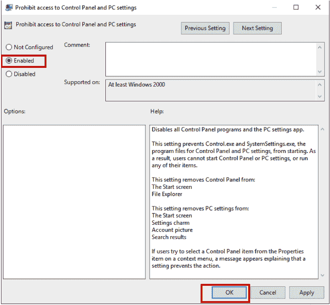

图 3.29 – 策略设置

### 任务 2 – 强制更新并验证策略是否应用

在此任务中，我们将强制应用策略并对其进行验证：

- 1. 从命令提示符，运行 `gpupdate /force` 命令：

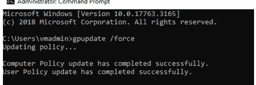

图 3.30 – 强制策略更新

确认命令已成功完成。

- 2. 从命令提示符，运行 gpresult /R 命令：

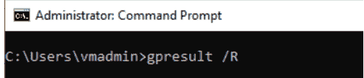

图 3.31 – 运行策略报告

- 3. 从报告中，验证创建的 GPO 是否列在 用户设置 | 已应用的组策略对象 下：

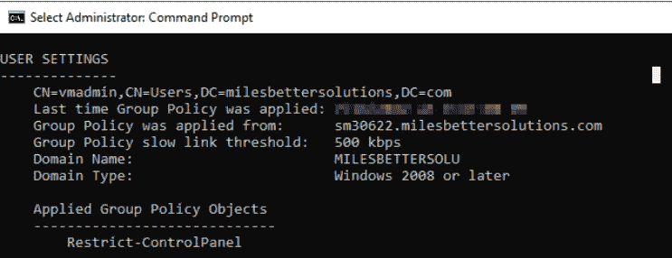

图 3.32 – 已验证策略应用

### 任务 3 – 测试策略是否有效

在此任务中，我们将确认策略设置有效，并且限制了对计算机控制面板的访问。

尝试访问计算机的控制面板，并确保收到阻止访问的限制消息：

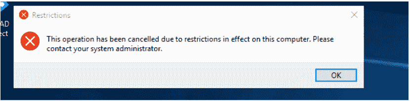

图 3.33 – 控制面板访问受限

至此，我们已实施组策略，从而限制了对计算机控制面板的访问。

本练习讲解了实施组策略所需的技能。

现在，让我们总结本章。

### 总结

本章涵盖了 AZ-800 管理 Windows Server 混合核心基础架构考试的学习目标：_使用基于域的组策略管理 Windows Server_。

我们学习了组策略及其组件的概念，以及如何配置、管理和故障排除。随后的两个动手练习完成了本章，为您提供更多实用技能。

本章旨在使您的知识超越考试目标；我们通过所提供的内容新增了技能和学习。这将进一步提升您在本地网络基础架构服务方面的知识和技能，并使您能够胜任现实世界中以日常混合环境为重点的角色。在下一章中，我们将学习混合标识。

### 延伸阅读

本节提供有关考试信息和学习参考的链接：

- Microsoft Certified: Windows Server 混合管理员专家: https://docs.microsoft.com/en-us/learn/certifications/windows-server-hybrid-administrator/
- 考试 AZ-800：管理 Windows Server 混合核心基础架构: https://docs.microsoft.com/en-us/learn/certifications/exams/az-800
- 考试 AZ-800：技能大纲: https://query.prod.cms.rt.microsoft.com/cms/api/am/binary/RWKI0r
- Microsoft Learn: https://docs.microsoft.com/en-us/learn/modules/implement-group-policy-objects/

### 技能检查

挑战一下您在本章所学的内容：

- 1. 解释什么是组策略。
- 2. 解释什么是 GPO。
- 3. 本地 GPO 和域 GPO 之间有什么区别？
- 4. Azure AD DS 中的组策略与 AD DS 中的组策略有何不同？
- 5. 两个内置 GPO 是什么？
- 6. 是否可以在 Azure AD DS 中创建自定义 GPO 和 OU？
- 7. 进行 GPO 管理，Azure AD DS 托管域中需要什么权限？
- 8. 在混合标识环境中，关于 AD DS 和 Azure AD DS 的 GPO，什么至关重要？
- 9. GPO 的两个组件是什么？
- 10. GPO 可以链接到哪些 AD 对象？
- 11. GPO 不能链接到哪些 AD 对象？
- 12. 两个顶级配置节部分称为什么？
- 13. 什么是 GPO 管理模板？
- 14. .admx 文件和 .adml 文件有什么区别？
- 15. 什么是 GPO 范围？

- 16. GPO 处理的顺序是什么？
- 17. 解释继承、阻止和强制。
- 18. 主要的 GUI 管理工具是什么？
- 19. 列出可以使用的 CLI 工具。
- 20. GPO 有哪些属性？
