## 实施和管理混合标识

本章涵盖 AZ-800 管理 Windows Server 混合核心基础设施考试学习目标：_实施和管理混合标识_。

在上一章中，我们增加了了解组策略概念、创建和管理的技能。

本章将从一些概念和对混合标识的理解开始。然后，我们将介绍启用混合标识的 AD Connect 目录同步工具以及可用的混合标识身份验证方法。最后，我们将通过一个动手练习来进一步提升您的技能。本章将涵盖以下主题：

- 混合标识是什么？
- Azure AD Connect
- 混合标识身份验证方法
- 练习 – 实施 Azure AD Connect

除了本章列出的主题外，本章的目标是让您的知识超越考试目标，为现实世界中日常混合环境相关的角色做好准备。

### 混合标识是什么？

在本章的第一部分，我们将回顾一些定义和概念，以建立知识的基准和基础，以便在此基础上构建。

微软提供两种 **身份提供者 (IDP)** 和 **目录服务 (DS)** 解决方案：**Active Directory (AD)** 和 **Azure Active Directory (Azure AD)**。

简而言之，**AD** 是 **IDP** *专用*于 *单个组织* 的。它作为 Windows Server 的一部分以已安装服务的形式运行。

简而言之，Azure AD 是微软的多租户、基于云且完全托管的 IDP 和 DS。Azure AD 可以被视为微软的 **身份即服务 (IDaaS)**。

**混合标识** 为用户提供 *通用标识*。这只是一种无论资源和服务是基于云还是本地，都为用户提供访问权限的方式。这种方法意味着用户更少混淆，并且有一个可独立于位置或 IDP 使用的标识。这可以在以下插图中可视化：

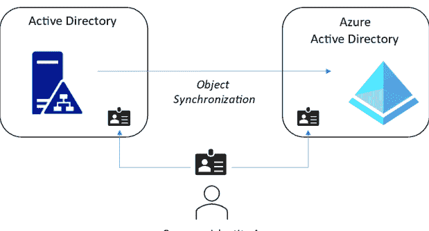

图 4.1 – AD 和 Azure AD 集成

在本节中，我们回顾了微软的 IDP、AD 和 Azure AD（在前两章中介绍过），并定义了什么是混合标识。下一节将介绍 Azure AD Connect 工具，即启用混合标识身份验证方法的基础。

### Azure AD Connect

**Azure AD Connect** 是一个免费下载的工具，可启用 *混合标识* 并无缝连接和集成 AD 与 Azure AD。

Azure AD Connect 通过将服务部署到 Windows Server（通常部署到专用服务器）来实现。但是，根据您的需求，也可以在域控制器上运行。

在所选 Windows 服务器上安装 AD Connect 时，以下是 AD Connect 的操作：

- 为目录同步配置的 AD 中存在或添加的用户、组和联系人对象将通过使用 Azure AD Connect 的同步过程复制到 Azure AD。请注意，用户没有自动许可证分配，例如 M365。

- AD 中对象属性的任何更改都将更新到 Azure AD 中的同步对象。Azure AD Connect 的 *同步服务管理器*（`miiscclient.exe` 进程）允许您选择性同步哪些属性，因此如果不需要，并非所有属性都会被复制。

- 从 AD 删除的任何用户、组和联系人也将从 Azure AD 中删除。

- 对象的单一权威来源来自作为 *权威 IDP* 的 AD，而不是 Azure AD。这意味着，对 Azure 同步对象所需的任何更改必须在 AD 中进行其属性和更改，并允许通过同步过程将这些更改更新到 Azure AD 对象中。

- 前一点意味着 Azure AD 对象是 *只读的*，除非为 Azure AD 中的密码重置实现了回写解决方案，否则无法直接在 Azure AD 中更改它们。**自助式密码重置 (SSPR) 回写** 是一个可选功能，允许对 Azure AD 进行密码更改，导致相同标识在不同 IDP 之间具有不同密码。这可以通过密码回写来解决，以便在 Azure AD 中所做的密码更改可以发送回 AD 以更新对象属性，从而在 AD 和 Azure AD 目录中保持相同密码。

### Azure AD Connect 云同步

Azure AD Connect 的类似功能也可在 **Azure AD Connect 云同步** 服务中使用。

这是基于 *预配代理* 方法，而不是完全可安装的应用程序。配置和编排从 Azure AD 处理，而不是从 AD 本身处理。所有信息均存储在 Azure AD 中，而不是本地（AD Connect 工具安装并运行的位置）。该工具用于并购场景，其中许多多个断开连接和隔离的林需要与 Azure AD 集成。可以部署多个预配代理以提供目录同步的高可用性。

### Azure AD Connect 规划

在使用 AD Connect 工具之前，必须考虑以下规划活动。规划是实施混合标识的关键：

- 识别加入域的服务器以下载和安装 Azure AD Connect 工具和服务组件；根据需求，该工具可以直接安装在要同步的域中的 DC 服务器上，也可以安装在专用服务器上。支持的 Windows Server OS 版本如下：

- Windows Server 2016 或更高版本；标准版或数据中心版。

- Windows Server Essentials 2019。

- 将安装 AD Connect 的服务器必须运行完整 GUI；不支持 Windows Server Core。

- 识别架构扩展和自定义属性。

- 识别域功能级别。

- 识别 AD 与 AD 对象属性和用户主名称 (UPN) 的准备情况。如果您有一个不可路由的域（例如本地域）用于用户 UPN，则应使用可以通过 Azure AD 验证的域，例如有效的 Internet 域（如 .com 或 .net）。

然后，您需要为用户设置 UPN 后缀以使用此 Azure AD 已验证域。如果您希望同步到 Azure AD，可以更改 Azure AD DS 域的主域，但更好的方法是向您希望添加到 Azure AD 的已验证域添加 UPN 后缀。此更改在 **Active Directory Domains and Trusts** 管理控制台的 **UPN Suffixes Properties** 选项卡中进行。以下插图显示了此配置的位置：

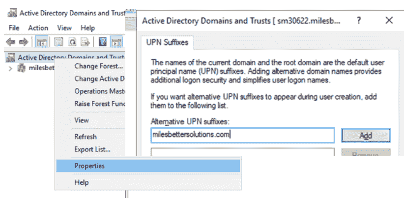

图 4.2 – 添加 UPN 后缀

本主题将在本章的动手练习部分介绍。

如果这满足您的需求，您可以添加多个 UPN 后缀并在 Azure AD 中添加和验证它们：

- 1. 验证您拥有要添加到 Azure AD 以进行目录同步的选定域（域），并确保您有权访问 DNS 记录以进行更改。这是为了在将域添加到 Azure AD 时能够验证这些域。

- 2. 一旦同步的任何不可路由域已得到处理和准备，您就可以继续添加和验证用户的 AD DS UPN 后缀域（域）到 Azure AD，以用于目录同步和单点登录 (SSO)。然后在此域在 Azure AD 中设置为租户的主域，即您不应使用租户的默认 .onmicrosoft.com 域。

### 暂存模式

AD Connect 还可以在暂存模式下使用，允许在服务器激活前对配置进行更改和预览。它还允许通过在暂存模式下运行完整导入和同步来验证所有更改将按预期在生产环境中进行，从而进行预生产测试。暂存模式可用于高可用性、测试、部署配置的新更改以及停用或替换服务器等场景。

在安装 AD Connect 时可以选择暂存模式，但不会运行任何导出。暂存模式不运行密码同步或回写。当禁用暂存模式时，将运行导出，并启用密码同步和回写。

### 快速安装和自定义安装

快速安装方法旨在支持大多数客户大多数时间都有效的配置，新安装大约 90% 的时间使用此方法。

快速安装假设以下条件：

- 单个 Windows Server AD 林
- 可用于安装的企业管理员帐户
- Windows Server AD 林中少于 10,000 个对象

快速安装提供以下配置结果：

- 从 Windows Server AD 到 Azure AD 的密码哈希同步
- 所有域和 OU 中所有合格对象的同步

当您的场景与前面的假设和配置结果不匹配时，使用自定义安装方法。

自定义安装假设以下条件：

- 无法访问企业管理员帐户
- 要同步的多个 Windows Server AD 林
- 连接服务器无法访问的林域


- 计划为用户登录使用联合身份验证或直通身份验证
- Windows Server AD 林中超过 100,000 个对象需要使用完整的 SQL Server
- 计划使用基于组的筛选，而不仅仅是域或 OU 的筛选

### AD 运行状况检查工具

在通过 Azure AD Connect 实现目录同步之前，拥有一个运行状况良好的 AD 实例至关重要。将被标记并可修复的典型问题将与 UPN 和代理地址相关。IdFix 工具将检查错误，并在识别后允许进行任何修复。

在本节中，我们介绍了 Azure AD Connect 工具。我们还查看了 AD 运行状况检查工具。在下一节中，我们将查看混合身份验证方法。

### 混合身份验证方法

混合身份验证需要一种支持 AD 与 Azure AD 集成的身份验证方法。使用 AD Connect，可以为用户配置以下登录方法，以在组织中启用混合身份验证：

- Azure AD 密码哈希同步 (PHS)
- Azure AD 直通身份验证 (PTA)
- AD 联合身份验证服务

以下屏幕截图显示了可用的登录方法和选项：

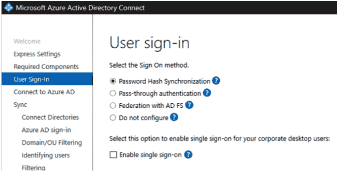

图 4.3 – 云登录方法

所选身份验证方法将取决于场景的需求。

这些混合身份验证方法分为 *云身份验证* 和 *联合身份验证*。

在以下各节中，我们将讨论每种身份验证方法。

### 云身份验证

在云身份验证模型下，用户的登录凭据由 *Azure AD* 作为 IDP 进行处理。

混合身份验证云身份验证提供两种登录方法：PHS 和 PTA。

### PHS

在 PHS 混合身份验证模型中，用户 AD 密码哈希的哈希值会同步到 Azure AD 作为基于云的 IDP。这意味着每个 IDP 都有一份密码副本，但密码从未以明文形式存储。AD 存储密码的哈希值，而 Azure AD 作为基于云的 IDP，存储 *哈希的哈希值*。

现在，基于云的 IDP（即 Azure AD）中存储了用户密码的副本后，用户可以使用 *相同的密码* 登录 Azure AD 验证的服务（例如 Microsoft 365 和 Dynamics 365），以登录经过 AD 验证的服务。这为用户提供了 *通用身份*，这意味着不再需要记住许多用户名和密码，只需记住一个。这为资源和服务（无论是基于云还是本地）提供了一种简单的身份验证方法。

PHS 是实现 Azure AD Connect 时实施的默认云身份验证方法。

以下关系图可视化了此 PHS 云身份验证模型：

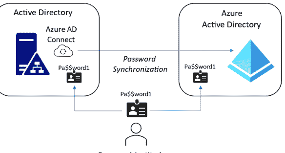

图 4.4 – PHS 身份验证登录

关于将用户密码存储在基于云的 IDP 中的顾虑（即使密码哈希被进一步哈希），可以通过我们将在以下各节中介绍的 *PTA* 和 *联合身份验证* 模型来缓解。PHS 可以作为联合身份验证的备份登录方法，但需要在 Azure AD 中存储密码。您的需求和要求将决定您的场景应采用的适当方法。

### PTA

用户也可以在 *PTA* 混合身份验证模型中使用 *通用身份*。这允许使用单个用户名和密码登录使用 Azure AD 进行身份验证的基于云的资源和服务，以及登录经过 AD 身份验证的资源和服务。与 *PHS* 一样，*PTA* 显著提高了用户生产力、安全性和身份治理。

此身份验证方法与 PHS 的区别在于，密码 *从不* 存储在 Azure AD 中。所有密码验证都会 *始终* 直接传递到您的 AD 域控制器以执行身份验证，并且不会由 Azure AD 进行验证。这确实意味着您的域控制器始终需要可用且可由 Azure AD 访问。

但是，将基于云的身份验证完全依赖于访问本地域控制器以验证凭据并不是一种好的策略——如果由于洪水、火灾、连接丢失甚至全球大流行病而丢失了需要进行身份验证的本地位置，则您无法故障转移到云或访问基于云的资源和服务。

实现资源访问可用性以及在面临失去与本地位置连接时的业务连续性的一种方法是，在 Azure 中作为 IaaS VM 创建 *副本域控制器*。如果发生本地连接故障，可以使用 Azure 托管的域控制器来验证凭据，确保业务连续性并继续访问基于云的资源和服务。此方法需要跨本地混合网络，例如站点到站点 VPN 或 ExpressRoute；ADDS 无法直接通过公共 Internet 终结点进行复制。

另一种解决方案是将其与 *PHS 目录同步* 结合使用。当无法再联系本地域控制器时，这为用户身份验证提供了备份解决方案。但是，这确实需要将密码哈希存储在 Azure AD 中，这对某些人来说可能不可能。那么，在确定哪种方法最适合您的场景时，将存在权衡。联合身份验证也存在相同的本地访问依赖场景，我们将在下一节中再次对此进行说明。

以下关系图可视化了 PTA 云身份验证模型：

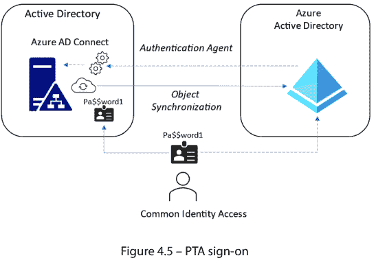

此身份验证模型的一项好处是，您的 AD 中的密码策略和安全策略可以得到强制执行。从网络安全角度来看，只有从 AD 到 Azure AD 的 *出站流量连接*；不会对您的 AD 域控制器建立 *入站连接*。所有通信都是 *基于证书* 的，由 Azure AD 作为完全托管的服务颁发和管理。

本节介绍了云身份验证登录方法。在下一节中，我们将介绍联合身份验证方法。

### 联合身份验证

联合身份验证简单来说就是 *不同 IDP 之间为访问资源和服务而共享的信任*。

Azure AD 是此场景中用于验证和对用户登录请求进行身份验证的 *受信任 IDP*。我们将在下一节中介绍联合身份验证。

### AD FS

**Active Directory 联合身份验证服务 (AD FS)** 是 Microsoft 提供用于此联合身份验证的登录方法的服务。

在联合身份验证混合身份验证模型中，用户的登录凭据会传递给除 Azure AD 以外的 IDP 以验证和对用户凭据进行身份验证。用于信任 Azure AD 的其他 IDP 是 *Windows Server AD*，可以托管在本地服务器上或作为 Azure IaaS VM。还需要实现 AD FS 服务器基础设施，该基础设施需要在边缘网络中配置两台 ADFS 代理服务器、两台联合身份验证服务器，并根据场景需要可选配置两台 SQL Server 服务器。此外，您还需要考虑网络、防火墙端口和证书；这绝非易事，且最复杂的情况也是如此。

这与 PTA 方法的工作原理类似；但是，PTA 比联合身份验证更简单、更不复杂，并且不需要像 AD FS 那样配置任何额外的基础设施服务器。您应该考虑在用例允许时评估 PTA 而非 AD FS；我们认识到在仅存在 AD FS 功能的所有场景中，这并非都可能。

以下关系图可视化此 *联合身份验证模型*：

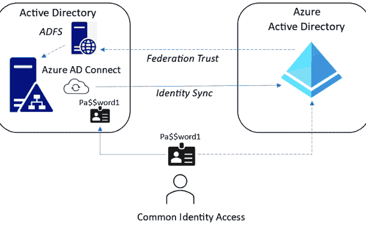

图 4.6 – 联合身份验证登录

如前一节关于 PTA 云身份验证模型中所了解的，这种方法确实意味着您的域控制器始终需要可用且可由 Azure AD 访问。与 PTA 身份验证模型所见相同的是，*PHS 目录同步* 可以在 AD FS 基础设施发生故障时用作备份登录方法，以提供业务连续性策略。

在本节中，我们介绍了混合身份验证方法。在下一节中，我们将根据我们的需求查看一些用例场景。

### 选择合适的混合身份验证方法

由于身份是安全性的控制平面，因此确保每种身份验证方法都得到理解并根据需求选择至关重要。

云身份验证和联合身份验证方法各有局限性；并非所有身份验证模型都支持所有用例场景。

当您想要使用以下混合场景时，只能使用 PTA 和 AD FS 方法：

- 防止密码哈希存储在云中 (Azure AD)


当您要使用以下混合场景时，只能使用 AD FS 方法：

- 实施本地多重身份验证 (MFA)
- 提供智能卡身份验证

在下图中，我们将查看决策树，以帮助您选择最合适的身份验证方法来满足您的需求：

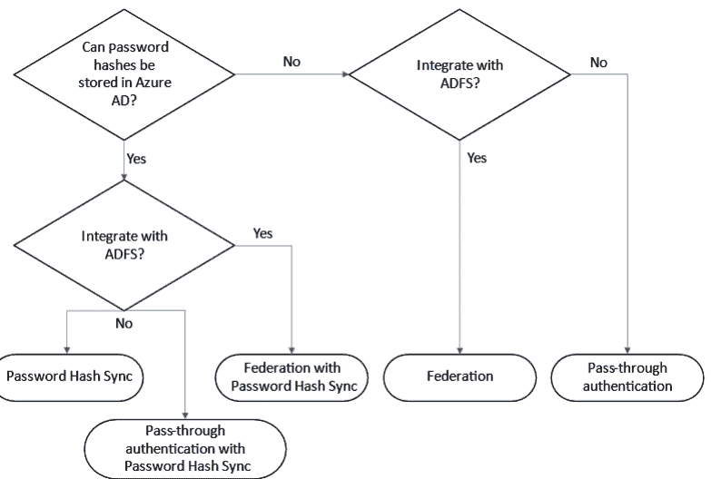

图 4.7 – 混合标识身份验证方法

为清晰起见并降低复杂性，该图不打算表示所有场景的所有决策点。为简化起见，仅显示核心场景。

本节探讨了如何选择最合适的混合标识方法来满足您的需求。在下一节中，我们将查看 SSO。

### SSO

混合标识也可以提供 SSO 功能选项。这允许已使用其 AD 凭据登录到设备的用户自动登录到云资源和服务。

SSO 与联合身份验证（例如 AD FS）和云身份验证（例如 PTA）配合工作。这确保了对 Azure AD 经过身份验证的资源的任何访问请求都由 AD 作为 IDP 而非 Azure AD 进行验证。在网络操作中，它更安全，因为它不需要入站访问；所有流量均从同步代理发出的出站流量，并通过 Microsoft 托管的证书进行保护。

PTA 为 SSO 提供了与 AD FS 类似的功能，但其实现和操作的复杂性较低，因为它不需要 AD FS 基础结构。

术语 SSO 不应与“相同登录”（same sign-on）混淆，后者也可能令人困惑地被称为 SSO。

通过 PHS 云身份验证方法提供的目录同步允许用户使用相同的凭据访问云资源，但在已登录 AD 的情况下访问 Azure AD 经过身份验证的资源时，他们仍需重新输入凭据。

本节探讨了 SSO 的实现。在下一节中，我们将完成一个动手练习部分，以巩固本章中涵盖的一些概念。

### 动手练习

为了帮助您掌握一些实用技能，我们将利用本章前面各节获得的概念和理解，并将其实际应用。

我们将查看以下练习：

- 练习 – 实现 Azure AD Connect

### 开始使用

要开始本节，如果您还没有 Azure 订阅，可以在 https://Azure.microsoft.com/free 创建免费 Azure 帐户。此免费 Azure 帐户提供以下内容：

- 12 个月的免费服务
- 30 天内用于探索 Azure 的 200 美元信用额度
- 超过 25 项始终免费的服务

让我们继续本章的练习。

### 练习 – 实现 Azure AD Connect

本节将探讨实现 Azure AD Connect。这将允许您将 AD 对象与 Azure AD 同步，并为用户提供通用标识。这意味着可以使用相同的 AD 用户名和密码来访问 Azure AD 经过身份验证的资源和服务。

要开始此练习，我们需要一个 AD DS 域和一个当前未实现 Azure AD Connect 目录同步的 Azure AD 租户。要继续，您的 Azure AD 租户应如下图所示，显示未安装：

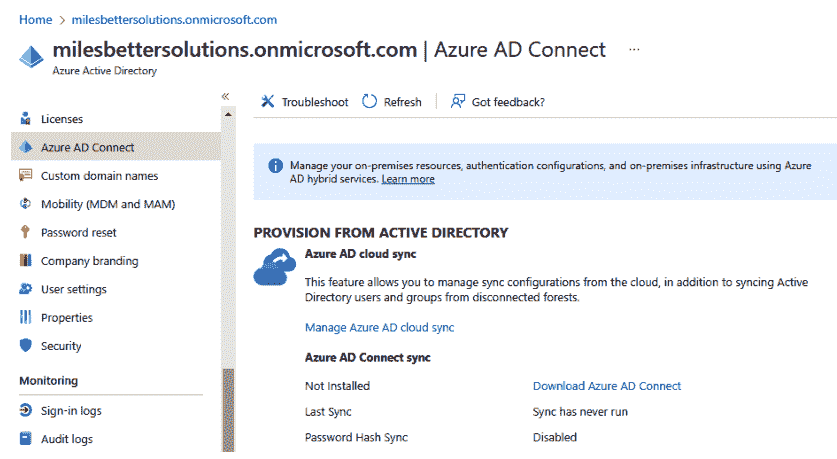

图 4.8 – Azure 门户中的 Azure AD Connect

为此练习，必须将自定义域名添加到 Azure AD 并进行验证。此域名应是将同步到 Azure AD 的 AD DS 域中的用户 UPN 后缀。这必须是您拥有且可以更新其 DNS 记录的域。

下图显示了在 Azure 门户中的此表示形式，我们将在随后的任务说明中介绍更多内容：

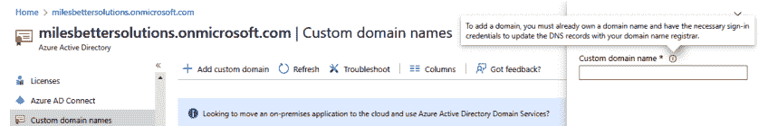

图 4.9 – 在 Azure AD 中添加自定义域名

为此练习，您可以使用我们在第 1 章的 *在 Windows Server 上安装 AD DS* 练习中创建的 AD 实例。您应根据将使用的环境调整步骤。

要完成此练习，您需要以下帐户和权限：

- 具有 *企业管理员* 权限和已安装 Azure AD Connect 工具的服务器上的 *本地管理员* 权限的 AD 帐户
- 具有 *全局管理员* 权限的 Azure AD 帐户
- 您拥有且可以管理其 DNS 记录的公共域

为了便于理解，我们将练习分解为单个任务：

### 任务 1 – 为 AD Connect 目录同步准备不可路由域

> **注意**
> 此任务仅适用于拥有不可路由域的读者。如果此任务与您的场景无关，则可以跳过此任务。

在此任务中，我们将通过添加可以添加到 Azure AD 并用于 Azure AD Connect 验证的 UPN 后缀，为目录同步准备不可路由的 AD DS 域（例如 *.local* 命名空间）。然后，我们将用户的 UPN 后缀更改为此域：

- 1. 登录到 *AD DS 域控制器*，并从 **服务器管理器** 中选择 **工具 | Active Directory 域和信任**：

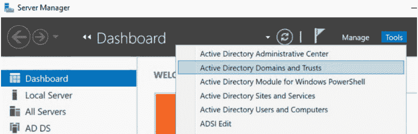

图 4.10 – 服务器管理器工具

- 2. 在 **Active Directory 域和信任** 控制台中右键单击根级树，并选择 **属性**：

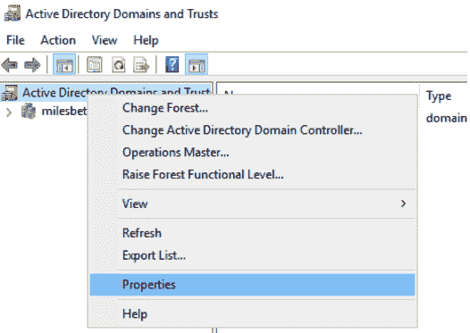

图 4.11 – Active Directory 域和信任 控制台

- 3. 从 **UPN 后缀** 选项卡中，将 UPN 后缀输入到 **备用 UPN 后缀** 字段，然后单击 **添加**。随后，关闭 **Active Directory 域和信任** 控制台：

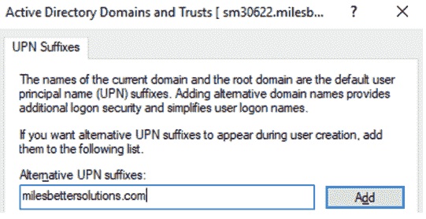

图 4.12 – 添加 UPN 后缀

- 4. 从服务器管理器中，选择 工具 | Active Directory 用户和计算机：

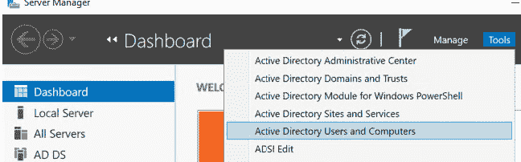

图 4.13 – 服务器管理器工具

- 5. 请导航到要更改其 UPN 后缀的用户。右键单击并选择 属性：

- 6. 选择 账户 选项卡，并从 UPN 后缀字段下拉列表中，选择要使用的 UPN 后缀。在此示例中，我们将选择在之前步骤中使用 Active Directory 域和信任 控制台添加的域后缀 @milesbettersolutions.com，以将不可路由域 @milesbettersolutions.local 替换为用户的新 UPN 及其登录地址：

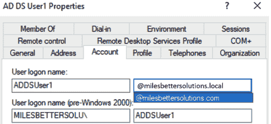

图 4.14 – UPN 后缀选择

- 7. 对每个用户重复此操作（使用多选），关闭 Active Directory 用户和计算机 控制台，并为下一任务做准备。

### 任务 2 – 将自定义域名添加到 Azure AD

在此任务中，我们将向 Azure AD 添加自定义域并对其进行验证，以便用于 Azure AD 目录同步。为此练习，您需要一个您拥有且可以管理其 DNS 记录的公共域：

- 1. 使用具有租户全局管理员角色的帐户登录 Azure 门户：

- 2. 导航到 Azure Active Directory 并选择 自定义域名：

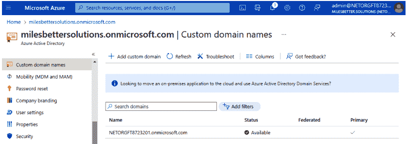

图 4.15 – Azure 中的自定义域名

- 3. 单击 添加自定义域，输入所需名称，然后单击 添加域：

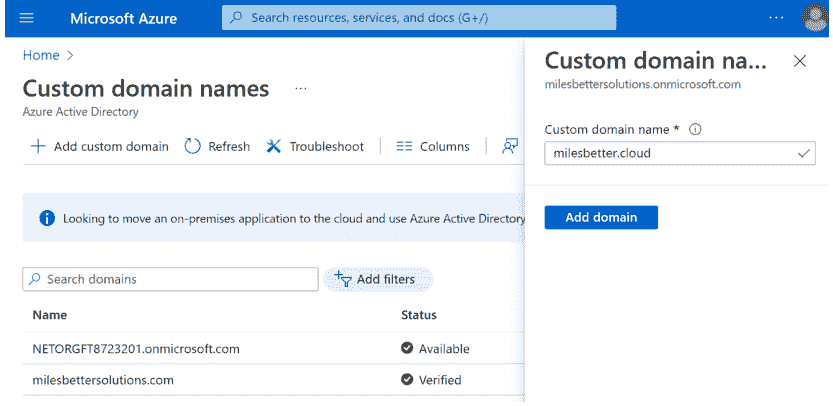

图 4.16 – 在 Azure 中添加自定义域名

- 4. 现在需要 *验证* 您的域。如信息框所示，您现在应在域名注册处创建 DNS 记录：

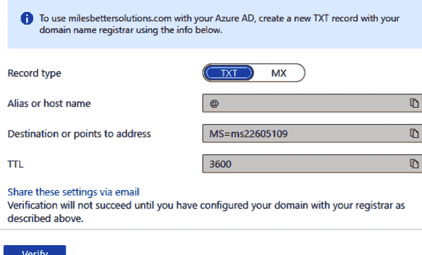

图 4.17 – 域验证

- 5. 为此练习，我的域名和 DNS 是通过 GoDaddy 作为注册商管理的。您应遵循域名注册商的各自流程，然后返回下一步：

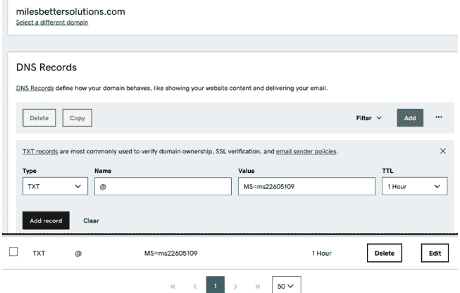

图 4.18 – 使用注册商添加验证 DNS 记录


6. 在使用你的域名注册商设置好所需的 DNS 记录后，你可能需要等待 DNS 记录更新。然后，你可以在 Azure 门户中单击 **验证**：

通过电子邮件共享这些设置
在你按照上述说明在域名注册商处配置好域之前，验证将不会成功。
[验证]

### 图 4.19 – Azure 门户中的域验证

7. 你将收到一则通知，指示域验证成功：

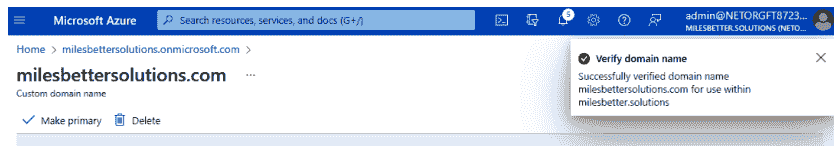

### 图 4.20 – 域名验证成功

8. 成功验证域后，你应通过单击 **设为主域** 将其设为 Azure 租户的主域：

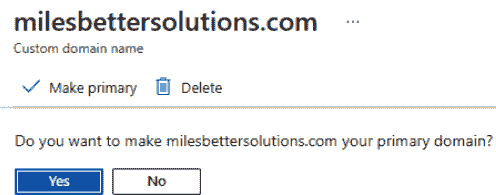

### 图 4.21 – 为租户设置主域

- 9. 你将收到一则通知，指示该域已成为租户的 *主域*：

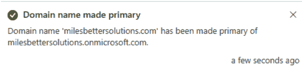

### 图 4.22 – 租户主域名称更改成功

- 10. 在 **自定义域名** 边栏中，你现在可以看到该域显示为 *主域*：

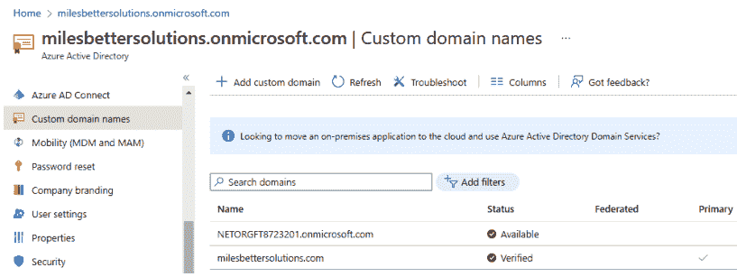

### 图 4.23 – Azure 门户中已更新的主域

- 11. 现在可以关闭 **自定义域名** 边栏，准备执行下一个任务。

### 任务 3 – 下载并安装 Azure AD Connect

在此任务中，我们将下载并配置 Azure AD Connect 工具。在此练习中，我们将遵循 PHS 目录同步的一个简单用例：

- 1. 从用于下载和安装该工具的服务器上，使用为租户分配 **全局管理员** 角色的账户登录到 *Azure 门户*。

- 2. 导航到 Azure Active Directory 并选择 Azure AD Connect。然后，单击下载 Azure AD Connect：

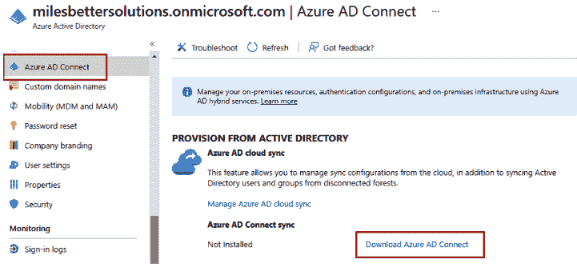

### 图 4.24 – 预配 Azure AD Connect

- 3. 查看“详细信息 | 系统要求 | 安装说明”下的信息，然后单击下载：

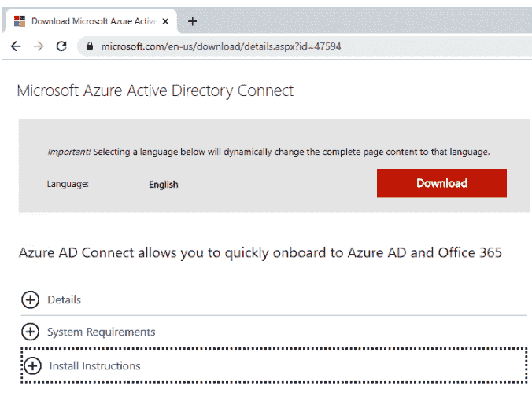

### 图 4.25 – 下载 Azure AD Connect

4. 导航到下载位置，单击 AzureADConnect 安装程序以开始安装：

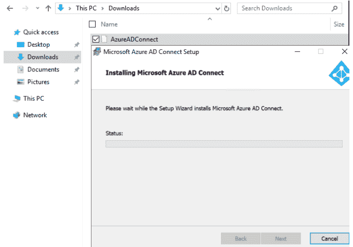

### 图 4.26 – AzureADConnect 安装程序

5. 查看“欢迎使用 Azure AD Connect”页面信息，确认选中“我同意许可条款和隐私声明”复选框，然后单击“继续”：

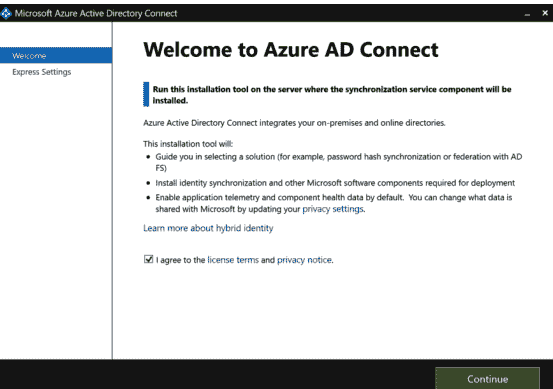

### 图 4.27 – Azure AD Connect 欢迎屏幕

6. 为此练习，在“快速设置”屏幕上单击“使用快速设置”：

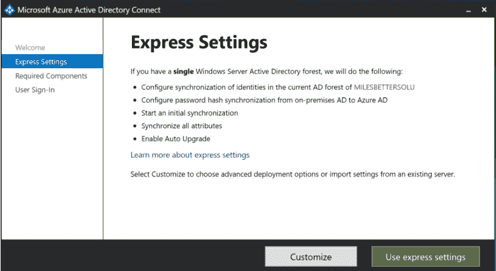

### 图 4.28 – Azure AD Connect 快速设置

7. 查看“连接到 Azure AD”屏幕上的帮助信息并输入用户名和密码。然后，单击“下一步”：

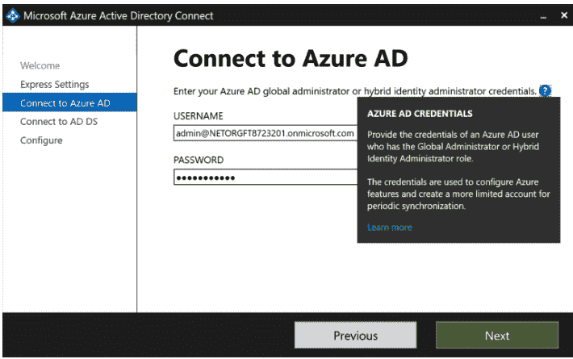

### 图 4.29 – 连接到 Azure AD

- 8. 查看“连接到 AD DS”屏幕上的帮助信息并输入用户名和密码。然后，单击“下一步”：

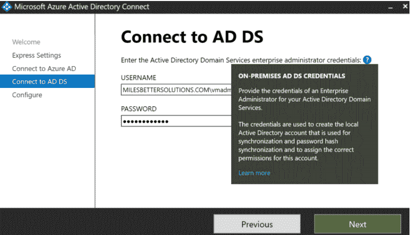

### 图 4.30 – 连接到 AD DS

- 9. 查看“准备配置”屏幕上的信息，然后单击“安装”。配置将开始并显示进度：

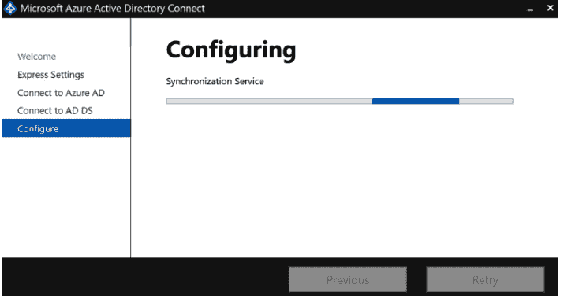

### 图 4.31 – 配置进行中

10. 查看“配置完成”屏幕上的信息，然后单击“退出”：

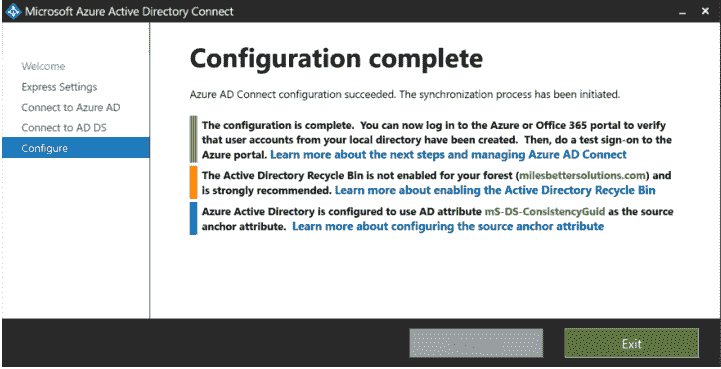

### 图 4.32 – Azure AD Connect 配置完成

11. 登录 Azure 门户，导航到 Azure Active Directory，并选择 Azure AD Connect。你将看到“同步状态”和“密码哈希同步”选项现在显示为“已启用”，并提供了上次同步的时间。在 Azure AD 门户中同步 AD 对象最多可能需要 15 分钟才能显示：

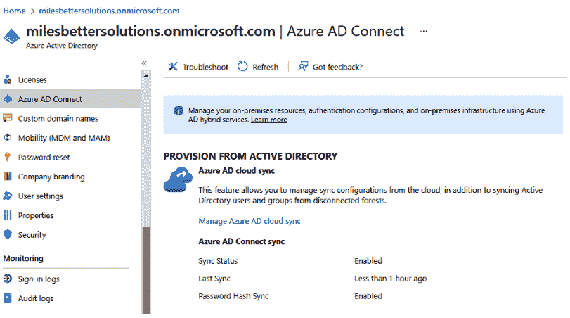

### 图 4.33 – Azure AD Connect 的预配状态

在下一个任务中，我们将查看如何验证同步。

### 任务 4 – 验证同步

此任务介绍如何使用同步服务管理器验证目录同步：

- 1. 从安装了 AD Connect 的服务器上，单击“开始”菜单，并从 Azure AD Connect 菜单项中选择同步服务管理器。

- 2. 在同步服务管理器中，从“操作”选项卡，查看连接器操作和同步统计信息的任务。如下图所示：

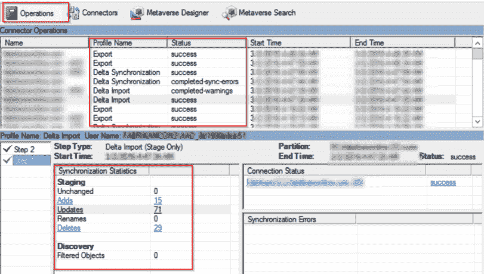

### 图 4.34 – 同步服务管理器操作

- 3. 单击“连接器”选项卡，查看两种连接器类型以及可以采取的操作。一个连接器用于 AD DS 重点，另一个用于 Azure AD 重点。如下图所示：

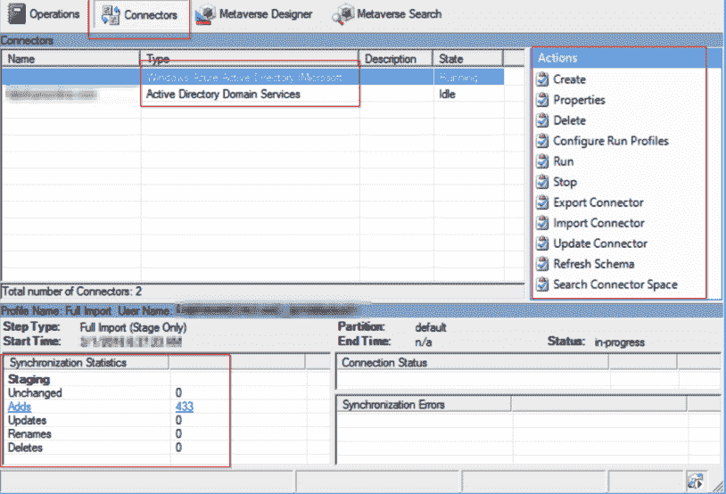

### 图 4.35 – 同步服务管理器连接器

- 4. 现在可以关闭 **同步服务管理器**。

- 5. 你还可以使用以下 PowerShell cmdlet 命令同步更改：

```
Start-ADSyncSyncCycle
```

在下一个任务中，我们将查看用于管理已目录同步的 Azure AD 用户的任务。

用户 | 所有用户 ... milesbettersolutions.onmicrosoft.com > Azure Active Directory

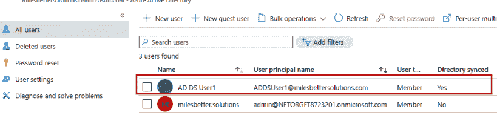

### 图 4.36 – 已目录同步的用户

7. 单击用户帐户，并注意该用户的 UPN 对本地保持不变，从而提供具有相同 SSO 功能的通用标识，以使用相同的 UPN 访问 AD 经过身份验证的资源和服务或 Azure AD 经过身份验证的资源和服务：

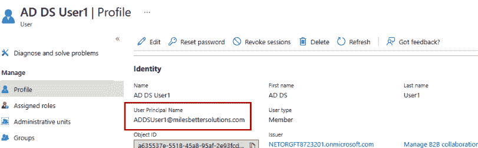

### 图 4.37 – 用户帐户 UPN

8. 请注意，你无法编辑此已目录同步用户的任何属性。所有更改都必须在 AD 中的对象上进行，并允许同步更新 Azure AD 中的属性：

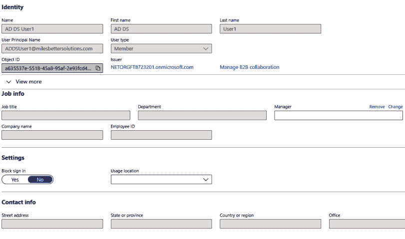

### 图 4.38 – 编辑用户属性

9. 请注意，要使用 **重置密码** 选项，必须已启用 SSPR 写回：

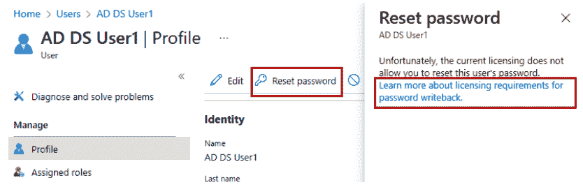

### 图 4.39 – 重置密码

10. 一旦用户帐户同步到 Azure AD，你可以根据需要 *分配许可证*：

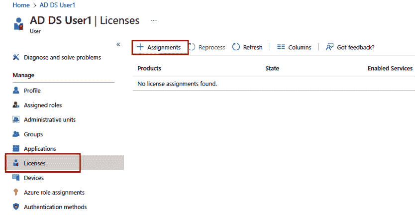

### 图 4.40 – 分配用户许可证

借此，我们已安装 Azure AD Connect 并将 AD 对象与 Azure AD 同步。此练习教授了实现 AD Connect 所需的技能。现在，让我们总结本章。

### 摘要

本章涵盖了考试 AZ-800 管理 Windows Server 混合核心基础设施：实现和管理混合标识。

从本章中需要记住的关键课程是理解混合标识的概念，如何实现和管理 Azure AD Connect，云同步之间的差异，不同的混合标识身份验证方法，以及根据需求何时在它们之间进行选择。

然后，我们通过一个模拟真实场景的实践练习结束了本章，以进一步发展我们的技能。

你将通过所提供的信息获得新技能，本章的目标是让你超越考试目标，为真实世界中以日常混合环境为重点的角色做好准备。

下一章将教授有关实现和管理本地网络基础设施的内容。

### 延伸阅读

本部分提供有关考试和学习参考的其他链接：

- 微软认证：Windows Server 混合管理员专家: https://docs.microsoft.com/en-us/learn/certifications/windows-server-hybrid-administrator/
- 考试 AZ-800：管理 Windows Server 混合核心基础设施: https://docs.microsoft.com/en-us/learn/certifications/exams/az-800
- 考试 AZ-800：学习指南: https://query.prod.cms.rt.microsoft.com/cms/api/am/binary/RWKI0r
- Microsoft Learn: https://docs.microsoft.com/en-gb/learn/modules/implement-hybrid-identity-windows-server/

### 技能检查

用本章所学内容挑战自己：

- 1. 两个 Microsoft IDP 是什么？
- 2. 什么是混合标识？
- 3. 什么是 Azure AD Connect？
- 4. 什么是 Azure AD Connect 云同步？
- 5. 安装 Azure AD Connect 时有哪些操作？


- 6. 混合身份中的权威 IDP 是谁？
- 7. 可以实施什么解决方案来防止身份在目录之间拥有不同步的密码？
- 8. 在实施 Azure AD Connect 工具之前应开展哪些规划活动？
- 9. 准备 AD 对象属性（如 UPN）的意义是什么？
- 10. 实施 Azure AD Connect 所需的帐户权限是什么？
- 11. 可使用哪两种工具来识别和修复 AD 中的问题？
- 12. 混合身份验证方法的两种分类及其关键区别是什么？
- 13. 在什么场景下只能使用 AD FS 方法？
- 14. 在什么目录场景下无法实施 PTA？
- 15. 单点登录与相同登录有何区别？
