## 实施和管理本地网络基础设施

本章涵盖 AZ-800 管理 Windows Server 混合核心基础设施考试的学习目标：实施和管理本地网络基础设施。

在上一章中，我们添加了了解混合身份的技能。

本章将首先介绍 Windows Server 的域名系统 (DNS)，涵盖其实施和管理。接着我们将了解动态主机配置协议 (DHCP) 和 IP 地址管理 (IPAM) 网络服务，最后介绍实施和管理远程访问服务。最后，我们将通过一个动手实践来进一步提升您的技能。本章包含以下主题：

- 实施和管理 Windows Server DNS
- 实施和管理 DHCP
- 实施和管理 IPAM
- 实施和管理远程访问
- 动手实践

除这些主题外，本章旨在使您的知识超越考试目标，为现实世界中以日常混合环境为重点的角色做好准备。

### 实施和管理 Windows Server DNS

本部分将介绍实施本地和混合名称解析。

本部分将首先探讨的技能领域是什么是 DNS？

### 什么是 DNS，它如何工作？

**名称解析**是将*名称*转换或解析为*IP 地址*的过程。IP 地址也可以通过反向查找解析为名称。

DNS 是行业标准的名称解析服务，也是 Windows 使用的主要名称解析方法。其他方法包括**主机文件**、**LMHOSTS 文件**和**Windows Internet 名称服务 (WINS)**，后者是**网络基本输入输出系统 (NetBIOS)** 名称解析服务。

DNS 使用**资源记录**来保存域的名称和信息（如 IP 地址和任意文本信息）。与电话联系人一样，人们更容易记住名称而非数字，尤其是同一名称下有多个号码（家庭、工作、移动等）的情况。

DNS 资源记录可以手动创建，或者客户端可以自动向 DNS 服务器注册记录。这些记录随后存储在*区域*中，而区域存储在*区域文件*中。

DNS 服务可以作为服务器角色安装在 Windows Server 上。DNS 客户端随后将联系服务器，查找要解析为 IP 的名称或在文本字段记录中查找任意文本。

DNS 名称解析的典型场景是客户端希望将 **完全限定域名 (FQDN)**（如 `https://server1.milesbetter.solutions`）解析为 IP 地址。

在这种情况下，DNS 服务器会在其本地数据库中查找是否存储了此记录。如果有，DNS 服务器会将 IP 地址 `10.5.1.4` 返回给客户端。

如果 DNS 服务器数据库中没有此名称的信息可返回给客户端，它将通过**根提示**或*转发*向另一台 DNS 服务器发出请求，以提供所请求的信息。

DNS 服务器还会缓存此请求和查找信息，因此下次收到相同请求时，它已拥有此信息的副本，可在被请求时进行响应；在此期间，缓存内容始终有效。需要解析 DNS 记录的客户端是*DNS 解析程序*，它会使用*DNS 解析程序缓存*来保留 DNS 服务器的响应请求，直至其生命周期结束。

以下图表展示了名称解析过程：

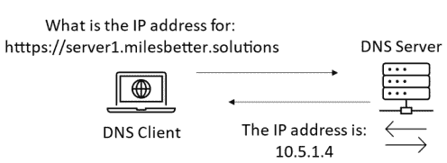

图 5.1 – 名称解析

DNS 使用分层结构，DNS 命名空间用于命名结构。*根域*启动层次结构，下一级为子域，子域又可以有任意数量的子域。以下图表展示了此 DNS 域命名方案：

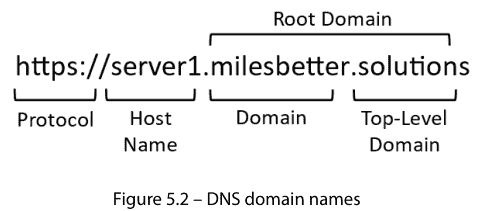

命名空间可以是*私有*或*公有*。公有命名空间是指您拥有的域在互联网上注册以供公共使用，例如 *milesbetter.solutions* 或 *stevemiles.cloud*。

子域常用于细分命名空间，以表示**Active Directory 域服务** (AD DS) 域（例如 *adds.milesbetter.solutions*）或地理依据（例如 *eu.milesbetter.solutions* 或 *us.milesbetter.solutions*）。

所有这些方法都允许为这些公共互联网域颁发和使用数字证书等内容。

然而，在面向非互联网或私有组织网络（如实验室、测试环境或高度安全环境）中，可能适合使用不在互联网上发布、可访问或注册的私有命名空间。私有命名空间的示例包括 *milesbetter.local* 或 *milesbetter.lab*。

命名空间层次结构的特定部分由 DNS 服务器上的*区域*表示——例如，将在负责响应请求此域查找的客户端的 DNS 服务器上创建 *milesbetter.solutions* 区域。持有区域副本的这些服务器被称为域的**权威**名称服务器。

区域保存 DNS 服务器用于响应客户端针对此命名空间的查找请求的信息。DNS 服务器保存并用于发送响应的信息存储在区域的 DNS 资源记录中。

存在*正向查找区域*和*反向查找区域*；以下列表提供了正向查找区域中*资源记录*的示例：

- 主机 (A) 记录：将名称解析为 IPv4 地址
- 主机 (AAAA) 记录：将名称解析为 IPv6 地址
- 别名 (CNAME) 记录：将名称解析为另一个名称
- **服务位置 (SRV) 记录**：标识托管服务的服务器，例如标识域控制器的位置
- **邮件交换 (MX) 记录**：标识电子邮件服务器
- **文本 (TXT) 记录**：存储任意字符串信息

正向查找区域在以下屏幕截图中表示：

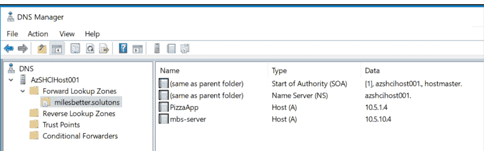

图 5.3 – 正向查找区域

反向查找区域包含用于将 IP 解析为名称的**指针 (PTR)** 记录。反向查找区域的特定格式为 `[IP-Range].in-addr.arpa`。10.5.1.0/24 的反向查找区域示例区域名称为 1.5.10.in-addr.arpa。这在以下屏幕截图中表示：

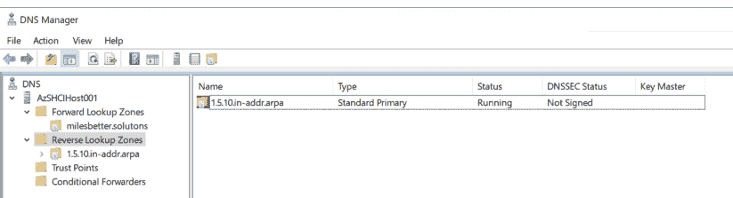

图 5.4 – 反向查找区域

所有正向和反向查找 DNS 区域都包含**起始授权 (SOA)** 和**名称服务器 (NS)** 记录。SOA 记录包含区域配置信息，每个区域一个 SOA 记录。NS 记录显示域的 DNS 服务器，每个持有区域副本的 DNS 服务器对应一个 NS 记录。


您可以在以下网址了解有关反向查找的更多信息：

https://en.wikipedia.org/wiki/Reverse_DNS_lookup

### 实现 DNS

DNS 服务作为角色安装在 Windows Server 上，可使用 Server Manager、Windows Admin Center 或使用以下 PowerShell 命令进行安装：

```
Install-WindowsFeature -Name DNS -IncludeManagementTools
```

通过 Windows Server Server Manager 进行的安装在以下屏幕截图中显示：

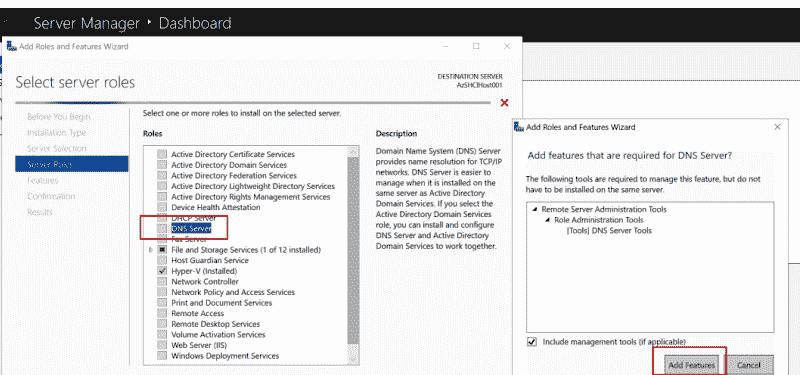

图 5.5 – 添加 DNS 角色

安装 DNS 服务器角色后，可以从 Windows Admin Center 或 DNS 管理器控制台进行管理。DNS 管理器控制台在以下屏幕截图中显示：

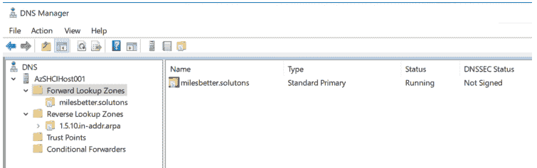

图 5.6 – DNS 管理器控制台

DNS 角色通常安装在 AD DS 域控制器上，并且可以使用 AD 集成 DNS 而非区域文件将 DNS 信息存储在 AD 数据库中。这意味着 DNS 信息通过原生 AD 复制和可用性机制进行复制，因此具有安全性和高可用性。

以下各节将介绍区域、记录、转发器和安全性等主题。

### 区域

创建区域文件时，必须将其设置为主区域或辅助区域。主区域用于创建、编辑和删除记录。主区域记录可以存储在区域文件中，或配置为 AD 集成，这意味着使用 AD DS 数据库来存储区域信息。辅助区域是主区域的只读副本，且始终存储在区域文件中。PowerShell 也可用于管理 DNS 区域。

可以通过区域传输在主区域和辅助区域之间传输区域记录。请求区域传输的辅助区域服务器可以通过设置以下选项来控制：

- 到任何服务器
- 仅到“名称服务器”选项卡上列出的服务器
- 仅到以下服务器

这些区域传输选项在以下屏幕截图中显示：

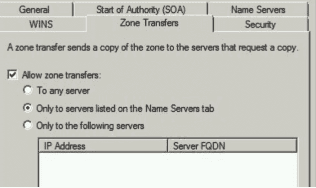

图 5.7 – DNS 区域传输选项

增量区域传输在从主区域完成初始辅助区域同步后发生。

### 记录

可以使用 DNS 管理器控制台、Windows Admin Center 或 PowerShell cmdlet 手动管理记录。

区域文件在以下屏幕截图中显示：

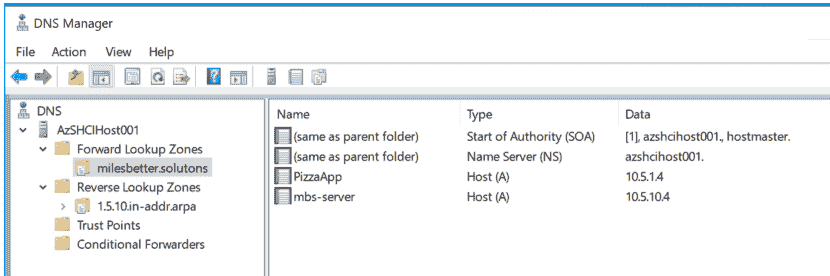

图 5.8 – DNS 区域文件

所有记录都配置了 **生存时间 (TTL)** 值。这定义了记录中信息的有效期，以及客户端和服务器允许缓存该信息的时间。如果 TTL 设置为 36000 秒（1 小时），则 DNS 查询的响应只能缓存该时间段。

在此期间，客户端将仅使用缓存中的信息而不会发出新请求。当 TTL 过期时，客户端将向 DNS 服务器发出新请求，并可能收到自请求和缓存该记录以来所做的任何更新。故障排除时应始终清除缓存。

启用动态 DNS 后，还可以动态创建主机和 PTR 记录，从而更轻松地管理 DNS。设备的 IP 地址更改后，其当前 IP 地址会自动注册。

### 转发器

DNS 服务器可以配置 *转发器*，通常用于互联网名称解析。

当 DNS 服务器被请求解析它不具备权限的名称时——即，它不持有该域的主区域或辅助区域——它必须向另一台 DNS 服务器请求此信息。默认情况下，每个服务器都会配置 *根提示* 以查找互联网上的权威服务器；但是，只有当 DNS 服务器可以访问互联网且所请求的记录在互联网上发布时，这才有可能。

由于网络分段和安全性，DNS 服务器并不总是直接连接到互联网。如果记录未本地缓存，则它们必须通过转发器代理请求。

转发器是连接到互联网的 DNS 服务器，通常位于边缘网络段或 **外部服务提供商 (ESP)** DNS 服务器上。这些 DNS 服务器可以解析本地网络外这些请求的互联网名称。

**条件转发** 是另一个选项，旨在仅转发针对 *单个特定 DNS 域* 的任何请求查找，而不是转发所有无法在本地解析的请求。

### 安全性

DNS 通过 **域名系统安全扩展 (DNSSEC)** 扩展套件验证来自 DNS 服务器的所有响应来保障安全。这旨在通过提供经过身份验证的 **拒绝服务 (DoS)**、数据完整性和来源权威性，使 DNS 协议不易受到 *DNS 欺骗* 等攻击。

当权威 DNS 服务器支持时，DNS 区域使用 **区域签名** 过程进行保护；这不会更改 DNS 查询和响应机制，但会添加一个验证步骤。DNS 响应中使用数字证书进行验证。该过程在区域签名期间生成包含数字证书的新 DNSSEC 资源记录。

当 DNSSEC 感知的转发或递归 DNS 服务器收到针对 *DNSSEC 签名区域* 的查询时，它会请求权威 DNS 服务器同时响应 DNSSEC 记录。然后，它将使用 DNSSEC 记录中包含的数字证书来验证响应。如果区域具有 **DNSKEY** 记录（信任锚），则 DNS 服务器会识别支持 DNSSEC 的区域。

### DNS 故障排除

本节将介绍一些可用于 DNS 故障排除的命令。

*有一句格言说，90% 的时间是 DNS 问题，另外 10% 也是。*

以下是一些故障排除命令示例：

- NSLOOKUP: 查询 DNS 信息并查找资源记录和 DNS 服务器状态
- DNSCMD: 管理 DNS 服务器角色
- DNSlint: 诊断常见 DNS 问题
- IPConfig: 列出 DNS 客户端使用的 IP 配置详细信息

本节结束了使用 DNS 网络服务进行名称解析的主题。我们探讨了 DNS、其工作原理，以及如何实现、管理和保护它。在下一节中，我们将探讨 DHCP 及其用于向客户端租赁 IP 地址的用途。

### 实现和管理 DHCP

本节将介绍使用 DHCP 网络服务管理本地 IP 地址。

本节将首先探讨什么是 DHCP？

### 什么是 DHCP？

DHCP 可以被视为 DNS-DHCP-IPAM (DDI) 解决方案的网络服务组件；本章还将介绍 DNS 和 IPAM。

简而言之，DHCP 是一种网络管理协议，用于通过自动分配 IP 地址和网络信息来简化 IP 地址管理。

DHCP 是引导协议 (BOOTP) 的扩展版本。两者的区别在于，BOOTP 提供 IP 地址的静态配置，而 DHCP 提供 IP 地址的自动配置。

如果没有 DHCP，则需要在网络接口上手动配置所需的网络设置的网络 IP 地址，并手动分配 IP 地址；这效率极低且容易出错。

关于 DHCP 版本 6，它在 IPv6 网络中提供 IPAM。支持有状态和无状态配置。

在有状态配置中，DHCP 服务器分配 IPv6 地址和网络设置。在无状态配置中，路由器分配 IP 地址，DHCP 服务器仅分配网络设置。

### DHCP 如何工作？

DHCP 基于传统的客户端/服务器关系模型工作。Windows 计算机运行 DHCP 客户端服务，当设置为“自动获取 IP 地址”时，它们将与 DHCP 服务器通信以接收网络信息。此设置位于“Internet 协议版本 4 (TCP/IPv4) 属性”对话框中，如以下屏幕截图所示：


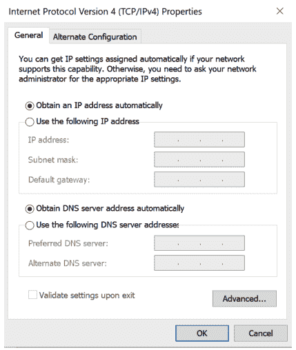

### Figure 5.9 – IP properties

DHCP 服务器已配置地址池和配置选项。DHCP 服务器将与 DHCP 客户端通信，分配 IP 地址，并将配置选项传递给请求的客户端。

The DHCP communication flow is given the acronym DORA; the four steps are set out here:

DHCP 通信流程的缩写为 DORA；四个步骤如下：

- Discover—DHCPDISCOVER
- Offer—DHCPOFFER
- Request—DHCPREQUEST
- Acknowledge—DHCPACK

This communication flow is also shown in the following diagram:

此通信流程也在下图中显示：

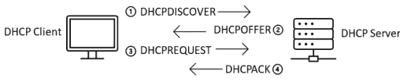

### Figure 5.10 – DHCP communication flow

The DHCP address assigned to a client has an amount of time it can be used for before it expires; this period is known as a **lease**, and when 50% of the lease time has been reached, the client automatically attempts the lease renewal.

分配给客户端的 DHCP 地址在过期前可使用一段时间；此期间称为 **租期**，当达到 50% 的租期时间时，客户端会自动尝试续租。

If the lease length is set to *10 days*, a renewal is attempted on *day 5*.

如果租期长度设置为 *10 天*，则会在第 *5 天* 尝试续租。

The request for a renewal goes to the original server that leased the address, which is sent as a unicast DHCPREQUEST command. If this server cannot be contacted, the client waits for 87.5% of the lease time to be reached and then sends a broadcast (rather than a unicast) DHCPREQUEST command for renewal. This goes to all servers, rather than just the lease originating server; renewals are also attempted during startup. The lease period *resets* when renewals are successful.

续租请求会发送到最初分配该地址的服务器，以单播 DHCPREQUEST 命令形式发送。如果无法联系到该服务器，客户端会等待直到达到 87.5% 的租期时间，然后发送广播（而非单播）DHCPREQUEST 命令进行续租。该请求会发送到所有服务器，而不仅仅是租约来源服务器；启动期间也会尝试续租。当续租成功时，租期会 *重置*。

### DHCP scopes

### DHCP 范围

The DHCP server contains *scopes*, which define an IP address range for clients. Clients will be leased an address assignment from this range; each client will be assigned a unique IP from this range—that is, two clients cannot be assigned the same address from an IP address range.

DHCP 服务器包含 *范围*，用于定义客户端的 IP 地址范围。客户端将从此范围租用地址分配；每个客户端将从此范围分配到一个唯一 IP 地址——即，两个客户端不能从 IP 地址范围中分配到相同的地址。

The following PowerShell cmdlets can also be used to manage the configured scopes:

还可以使用以下 PowerShell cmdlet 来管理配置的范围：

- Add-DhcpServerv4Scope
- Get-DhcpServerv4Scope
- Get-DhcpServerv4ScopeStatistics
- Remove-DhcpServerv4Scope
- Set-DhcpServerv4Scope

The scopes can also be added from the DHCP console. Creating scopes using the New Scope Wizard dialog is represented in the following screenshot:

范围也可以从 DHCP 控制台添加。使用“新建范围向导”对话框创建范围的过程如下图所示：

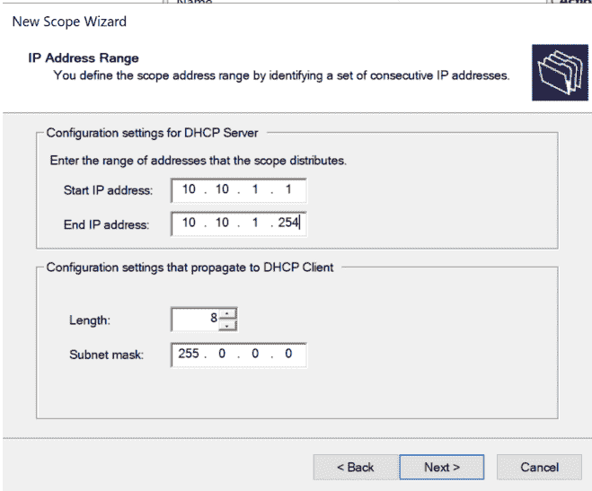

### Figure 5.11 – DHCP scope creation

### 图 5.11 – DHCP 范围创建

### DHCP reservations

### DHCP 保留

You can specify that a client can be permanently assigned a specific address from a range set in the scope; this feature is known as a reservation.

可以指定客户端可以从范围中永久分配特定地址；此功能称为保留。

Reservations are helpful for clients that are static on the network and are always required to have the same IP; examples of this could be domain controllers, printers, network/firewall appliances, and so on.

保留对网络上静态且始终需要相同 IP 地址的客户端很有帮助；示例包括域控制器、打印机、网络/防火墙设备等。

The Reservations capability is set in the DHCP console, as represented in the following screenshot:

保留功能在 DHCP 控制台中设置，如下图所示：

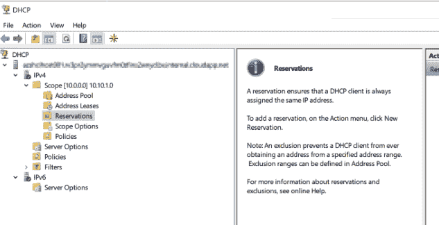

### Figure 5.12 – DHCP reservations

### 图 5.12 – DHCP 保留

The following information will be required when creating a reservation:

创建保留时需要以下信息：

- Reservation name
- IP address
- MAC address
- Description

- 保留名称
- IP 地址
- MAC 地址
- 描述

These required settings to create an IP address reservation are represented in the following screenshot:

创建 IP 地址保留所需的这些设置如下图所示：

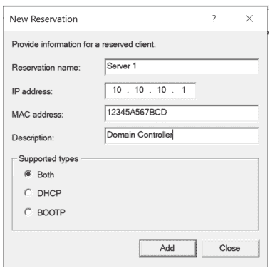

### Figure 5.13 – DHCP new reservation

### 图 5.13 – DHCP 新建保留

The client with the assigned Media Access Control [MAC] address will now always receive the set reserved IP. The client will not automatically receive this IP address. The client will receive the reserved IP address in the following scenarios:

拥有分配的介质访问控制 [MAC] 地址的客户端现在将始终接收设置的保留 IP。客户端不会自动接收此 IP 地址。客户端将在以下场景接收保留 IP 地址：

- Renewal of current lease for the client
- A reboot of the client
- Running the ipconfig command on the client, like so: ipconfig /release and then ipconfig /renew

- 客户端当前租约的续租
- 客户端重启
- 在客户端上运行 ipconfig 命令，例如：ipconfig /release 然后 ipconfig /renew

Reserved IP addresses for a client can be changed; the device is just assigned a new reservation, and the current one is removed so that IP can be used again for other clients.

客户端的保留 IP 地址可以更改；设备只需分配一个新保留，并移除当前保留，以便该 IP 地址可再次用于其他客户端。

### DHCP options

### DHCP 选项

Through a capability known as Options, DHCP can provide additional network resource information required to be set on a machine’s network interface to communicate on the network. These settings are managed via the DHCP console.

通过称为“选项”的功能，DHCP 可提供机器网络接口上用于在网络中通信所需的额外网络资源信息。这些设置通过 DHCP 控制台管理。

The following screenshot represents this:

如下图所示：

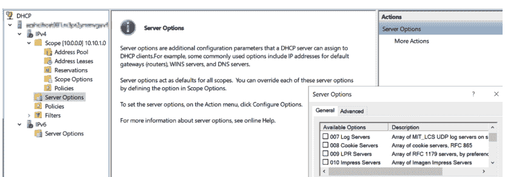

### Figure 5.14 – DHCP options

### 图 5.14 – DHCP 选项

These network settings typically apply to the scope level, which is the subnet for clients; they can also be configured to apply at the server or class level to meet your needs. The scope- and server-level options are both overridden by the class option.

这些网络设置通常应用于范围级别（即客户端的子网）；也可以配置为在服务器或类级别应用以满足您的需求。范围级别和服务器级别的选项均会被类选项覆盖。

The following are common DHCP options that could be set at the scope level, to be set as network settings on the clients:

以下是可在范围级别设置的常见 DHCP 选项，用于作为客户端上的网络设置：

- DHCP option 1: subnet mask
- DHCP option 3: router (default gateway)
- DHCP option 6: DNS
- DHCP option 51: lease time

- DHCP 选项 1：子网掩码
- DHCP 选项 3：路由器（默认网关）
- DHCP 选项 6：DNS
- DHCP 选项 51：租期

More information on all the available DHCP options can be found here:

有关所有可用 DHCP 选项的更多信息，请参阅：

https://www.efficientip.com/glossary/dhcp-option

In this section, we looked at what DHCP is. In the next section, we look at how to implement DHCP.

在本节中，我们了解了 DHCP 是什么。在下一节中，我们将了解如何实现 DHCP。

### Implementing DHCP

### 实现 DHCP

DHCP is implemented by adding the DHCP service as a server role to Windows Server, which then functions as the DHCP server. You can implement this as a dedicated server for this role or install it on an existing server; the server for the DHCP role must use a static IP, and local admin rights on the server will be required to add the server role.

通过将 DHCP 服务作为服务器角色添加到 Windows Server 来实现 DHCP，从而充当 DHCP 服务器。可以将其实现为该角色的专用服务器，或安装在现有服务器上；DHCP 角色的服务器必须使用静态 IP，并且需要服务器上的本地管理员权限才能添加服务器角色。

### DHCP authorization

### DHCP 授权

Before a DHCP server can support DHCP clients, it must be authorized; this is done to protect the network, as DHCP is based on broadcasts. This is done post-installation and can be authorized in an AD domain by using the DHCP console or the following PowerShell cmdlet:

在 DHCP 服务器支持 DHCP 客户端之前，必须对其进行授权；这是为了保护网络，因为 DHCP 基于广播。安装后完成此操作，可以在 AD 域中使用 DHCP 控制台或以下 PowerShell cmdlet 进行授权：

```
Add-DHCPServerinDC <hostname or IP address of DHCP server>
```

For a single-domain environment, a Domain Administrator account is used to authorize a DHCP server; for a DHCP server that assigns IP addresses for subnets for multiple domains, an Enterprise Administrator AD account must be used.

对于单域环境，使用域管理员帐户来授权 DHCP 服务器；对于为多个域的子网分配 IP 地址的 DHCP 服务器，必须使用企业管理员 AD 帐户。

A standalone DHCP server is not a member of an AD domain. Its behavior is that if it detects an authorized DHCP server, it shuts down so as not to lease addresses and cause a conflict on the network.

独立 DHCP 服务器不是 AD 域的成员。其行为是：如果检测到已授权的 DHCP 服务器，它将关闭，以避免租用地址并导致网络冲突。

Any unauthorized DHCP servers detected by clients by running the ipconfig /all command should be shut down to prevent clients from getting the wrong networking information.

客户端通过运行 ipconfig /all 命令检测到的任何未授权 DHCP 服务器都应关闭，以防止客户端获取错误的网络信息。

The DHCP server role can be installed using the GUI or PowerShell.

可以使用 GUI 或 PowerShell 安装 DHCP 服务器角色。

For the GUI deployment of the role, you can use Windows Admin Center or Server Manager.

对于角色的 GUI 部署，可以使用 Windows Admin Center 或 Server Manager。

The user account installing the DHCP servers requires local admin rights to the server to add the DHCP Server role. The server where the role will be added must have a static IP address assigned.

安装 DHCP 服务器的用户帐户需要服务器上的本地管理员权限才能添加 DHCP 服务器角色。添加角色的服务器必须分配有静态 IP 地址。

Adding the DHCP Server role via the Server Manager method is represented in the following screenshot:

通过 Server Manager 方法添加 DHCP 服务器角色的过程如下图所示：

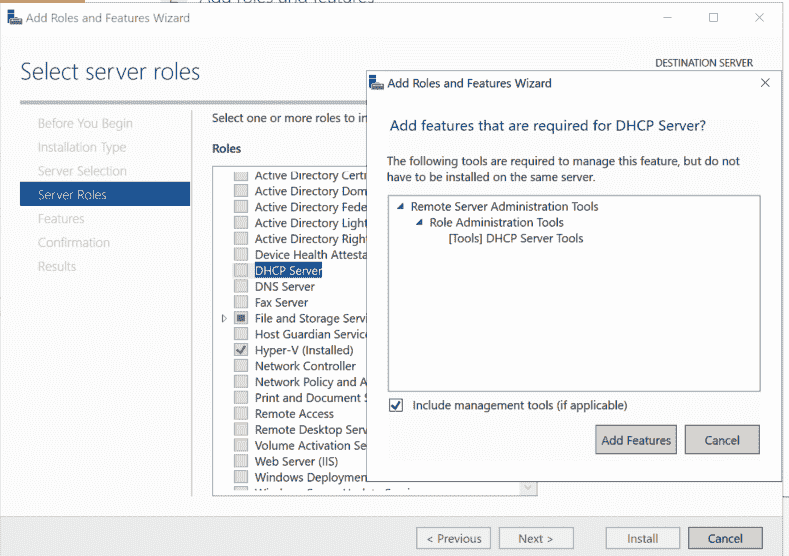

### Figure 5.15 – Adding the DHCP role to a server

### 图 5.15 – 将 DHCP 角色添加到服务器

From PowerShell, the following cmdlets can also be used to install the DHCP Server role:

还可以从 PowerShell 使用以下 cmdlet 安装 DHCP 服务器角色：

```
Add-WindowsFeature DHCP -IncludeManagementTools
```

The -IncludeManagementTools parameter is optional.

-IncludeManagementTools 参数是可选的。

### DHCP availability

### DHCP 可用性

A clustering deployment is a high availability (HA) method in Windows Server 2012 and later OSes for the DHCP service and allows two or more DHCP servers to share information about service availability. This is the preferred HA solution; we will look at DHCP split scopes next.

群集部署是 Windows Server 2012 及更高版本操作系统中 DHCP 服务的一种高可用性 (HA) 方法，允许两个或多个 DHCP 服务器共享服务可用性信息。这是首选的 HA 解决方案；我们将在下一节介绍 DHCP 拆分范围。

When configured for DHCP failover, the DHCP scope and IP address leases are made available between two servers using shared storage. The following diagram represents this:

配置 DHCP 故障转移后，DHCP 范围和 IP 地址租约将通过共享存储在两个服务器之间提供。下图表示此过程：

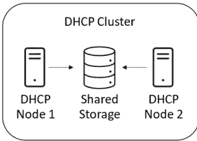

### Figure 5.16 – DHCP failover cluster

### 图 5.16 – DHCP 故障转移群集

This allows lease information and IP addresses to be made available if one DHCP server is unavailable; only *two* DHCP servers can be configured in a failover cluster, and the scopes can only be *IPv4*.

这样，如果某个 DHCP 服务器不可用，租约信息和 IP 地址仍可用；故障转移群集中只能配置 *两个* DHCP 服务器，且范围只能是 *IPv4*。

In DHCP failover, the failover relationship between the two DHCP servers is configured in the DHCP console through the **Configure Failover Wizard** dialog. The DHCP failover methods that can be configured are as follows:

在 DHCP 故障转移中，两个 DHCP 服务器之间的故障转移关系通过 DHCP 控制台中的 **配置故障转移向导** 对话框进行配置。可配置的 DHCP 故障转移方法如下：

- Load balance
- Hot standby

- 负载平衡
- 热备用

Configuring DHCP failover via the DHCP console is represented in the following screenshot:

通过 DHCP 控制台配置 DHCP 故障转移的过程如下图所示：

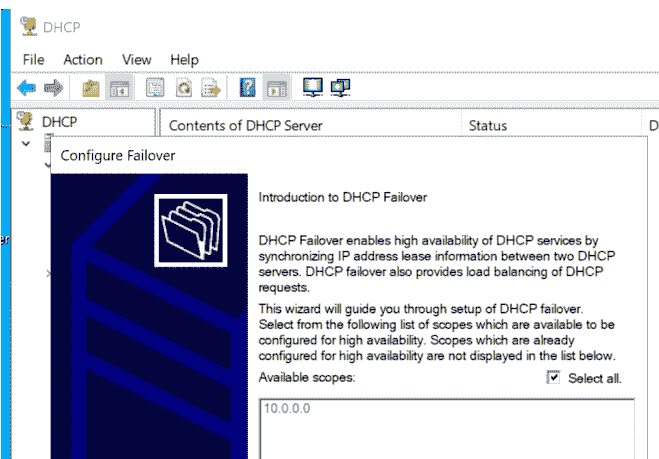

### Figure 5.17 – DHCP failover

### 图 5.17 – DHCP 故障转移


与使用 **DHCP 拆分作用域** 的高可用性解决方案不同，该解决方案在网络上使用两台活动的 DHCP 服务器。作用域在两台服务器上 *水平拆分*，因此每台服务器都控制同一作用域的一部分。以下图表示此情况：

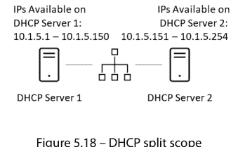

主服务器在辅助服务器的 **作用域** 属性中设置了 `Delay` 配置属性；你控制主服务器和辅助服务器。在此 *拆分作用域* 场景中，主 DHCP 服务器响应客户端请求，如果主服务器不可用，则辅助服务器响应客户端请求。

在本节中，我们介绍了实现 DHCP、DHCP 服务器授权以及向客户端分配 IP 地址信息的高可用性。在下一节中，我们将介绍如何管理 DHCP。

### 管理 DHCP

通过 DHCP 控制台和 DHCP PowerShell cmdlet 管理 DHCP。使用 Server Manager 安装 DHCP 服务器角色时，会安装这些工具，或者你可以使用 **远程服务器管理工具 (RSAT)**。

以下屏幕截图显示了 DHCP 控制台：

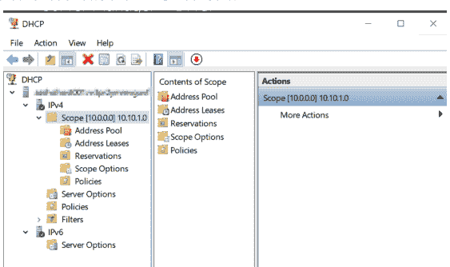

图 5.19 – DHCP 控制台

若要使用 Windows Admin Center 管理 DHCP，必须在 DHCP 服务器上安装 DHCP PowerShell cmdlet。如果未安装，将显示一条消息，并提供一个按钮来执行远程安装。

以下 PowerShell cmdlet 用于在安装 DHCP 服务器角色时包含管理工具：

```
Add-WindowsFeature DHCP -IncludeManagementTools
```

### DHCP 组

每台 DHCP 服务器都包含用于 *委派管理* DHCP 的组；这些组如下所示：

- DHCP Administrators 本地组：此组用于本地 DHCP 服务器管理
- DHCP Users 本地组：此组用于浏览配置并提供本地 DHCP 服务器的状态信息

使用 Server Manager 安装方法时，这些组作为安装的一部分创建。使用 PowerShell cmdlet 或 Windows Admin Center 安装 DHCP 角色时，则必须作为额外步骤使用以下 PowerShell *手动添加* 这些组：

```
Add-DhcpServerSecurityGroup -Computer DhcpServerName
```

本节介绍了使用 DHCP 网络服务分配 IP 地址的主题。我们介绍了 DHCP 及其工作原理、如何实现它以及如何管理它。在下一节中，我们将介绍 IPAM 及其用于管理本地 IP 寻址的用途。

### 实现和管理 IPAM

本节将介绍使用 IPAM 功能管理本地 IP 寻址。

在本节中，我们将首先介绍 *什么是 IPAM？*

### 什么是 IPAM，它如何工作？

IPAM 是一个框架，用于为 IPv4 和 IPv6 地址空间提供可见性和控制、规划、分配和管理，以及对组织的 DHCP 和 DNS 服务器进行集中控制和管理。

IPAM 在 AD DS 上下文中工作，是一种感知域服务的功能，因为 IPAM 服务器必须加入域，而不是独立的 *工作组* 服务器。

IPAM 作为 Windows Server 内置的一组工具提供，可以通过客户端/服务器模型实现，如下所示：

- IPAM 服务器：提供托管服务器数据收集。它使用 **Windows 内部数据库 (WID)** 或 SQL Server 数据库，并通过 **基于角色的访问控制 (RBAC)** 提供访问控制。

- IPAM 客户端：为 IPAM 服务器提供前端客户端界面。使用 Windows PowerShell cmdlet，它与托管服务器交互。它可以安装在 *客户端* 或 *服务器* 操作系统上。

当在带有 *桌面体验* 的 Windows Server 上安装 IPAM 角色时，IPAM 客户端会自动在同一服务器上本地安装。如果使用 *服务器核心版*，则另一台服务器或客户端必须从 IPAM 服务器远程安装客户端。RSAT: IPAM 客户端功能用于在服务器或客户端操作系统上安装客户端。

IPAM 包含四个模块；如下所示：

- IPAM 发现模块：用于发现，将所有已定位的安装了 DNS 或 DHCP 角色的服务器（包括域控制器）添加到数据库中；服务器也可以手动添加。

- IP 地址空间管理模块：用于检查、管理和监控 IP 地址空间。IP 地址可以动态或手动分配给客户端。可以跟踪地址空间利用率，并检测重叠的 DHCP 作用域。

- DHCP 和 DNS 多服务器管理和监控模块：用于监控和管理跨多个已部署 DHCP 和 DNS 服务器的任务，并提供 DNS 运行状况。

- 操作审计和 IP 地址跟踪模块：用于管理和监控配置更改。从托管的 DHCP 服务器收集租约信息，并从 AD DS 域控制器和 **网络策略服务器 (NPS)** 服务器收集登录信息和数据。

这四个模块允许从 *单窗格视图* (SPOG) 控制台执行全面的 DHCP 服务器、DNS 区域和 IP 地址管理任务，以实现更高的效率和控制。

在本节中，我们介绍了什么是 IPAM 以及它如何工作。在下一节中，我们将介绍如何实现 IPAM。

### 实现 IPAM

数据收集有两种拓扑选择：*集中* 拓扑或 *分散* 拓扑。

### 集中拓扑

在此拓扑中，在所有位置部署单个 IPAM 服务器。当存在双向林信任时，这使用单个控制台视图在林和多个林之间提供 IP 地址空间的可见性、控制和管理任务。

集中拓扑在以下图中表示：

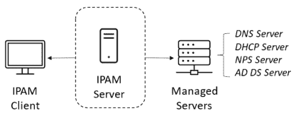

图 5.20 – IPAM 集中拓扑

IPAM 可以通过带有 RSAT: IPAM 客户端功能的另一台计算机的客户端或 Server Manager 进行管理；这可以是 Windows Server 操作系统或客户端操作系统。

### 分散拓扑

在此拓扑中，在每个位置部署 IPAM 服务器。在处理大规模地址空间管理且需要扩展并交接给分布式本地服务器时，这很典型。当希望向业务单位 (BU) 或单个位置授予自治权时，也可以使用此拓扑。

分布式拓扑在以下图中表示：

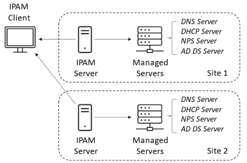

图 5.21 – IPAM 集中拓扑

此外，可以实现 *混合拓扑*。在此拓扑中，IPAM 服务器在每个站点作为本地 IPAM 服务器部署以监控本地服务器，集中 IPAM 服务器可以远程监控托管服务器。应考虑，在此拓扑中，IPAM 服务器不会将本地服务器的数据收集信息复制到中央服务器；每台服务器都是独立的数据点，即一个 *孤岛*。

部署时应考虑以下要求：

- IPAM 角色应是服务器上的唯一角色，且不执行其他功能
- IPAM 服务器必须 *加入域*，并且必须使用 *域帐户* 登录才能安装该角色
- 不支持在 *AD DS 域控制器* 上安装 IPAM 角色
- 如果 IPAM 服务器角色安装在 DHCP 服务器上，则无法发现其他 DHCP 服务器
- IPAM 服务器需要 WID 或 SQL Server 实例；不能在同一服务器上运行另一个 **结构化查询语言 (SQL)** 实例
- 单个 IPAM 服务器可支持 500 个 DNS 服务器、150 个 DNS 区域、150 个 DHCP 服务器和 6,000 个 DHCP 作用域
- 应规划所需存储空间；存储 10,000 个客户端的利用率数据大约需要 1 GB 空间
- 不检查路由器和交换机的 IP 地址一致性

在满足先前要求后，IPAM 服务器的高级别实现步骤概述如下：

- 根据所选拓扑和域加入创建用于 IPAM 的服务器。
- 从 Server Manager、Windows Admin Center 或 PowerShell 安装 IPAM 服务器功能，使用以下命令：
  `Install-WindowsFeature IPAM -IncludeManagementTools`
- 使用以下 PowerShell 命令配置 IPAM 服务器和所需 **组策略对象 (GPO)**：
  `Invoke-IpamGpoProvisioning`
- 配置并运行 DNS 和 DHCP 服务器发现。
- 选择并管理发现的服务器。

关于 IPAM 客户端，可以使用 RSAT 的 IPAM 客户端功能在 Windows Server 或客户端操作系统上安装它。


本节介绍了实施 IPAM，包括不同的部署拓扑。在下一节中，我们将介绍如何管理 IPAM。

### 管理 IPAM

在前面的章节中，我们了解到 IPAM 提供了 DHCP 服务器、DNS 区域和 IP 地址管理这三个核心网络服务领域在 IT 环境中的统一视图。

可以在这三个领域中执行的某些任务如下：

- 管理 DNS 服务器任务：
  - 检查 DNS 服务器和区域
  - 创建 DNS 区域和记录
  - 管理条件转发器
  - 访问任何 IPAM 托管服务器的 DNS 控制台
- 管理 DHCP 服务器任务：
  - 配置 DHCP 服务器
  - 检查、创建和编辑作用域
  - 发现特定 IP 地址的分配
  - 创建预留
  - 编辑服务器属性和选项
  - 导入和复制
  - 配置故障转移
  - 访问任何 IPAM 托管服务器的 DHCP 控制台
- 管理 IP 寻址任务：
  - 发现 DHCP 服务器地址空间和利用率数据
  - 检测 DHCP 服务器之间的重叠 IP 地址空间
  - 从 CSV 文件导入 IP 地址信息
  - 监视 DHCP 和 DHCP 服务器
  - 从 NPS 服务器和 AD DS 域控制器收集数据，例如登录信息

RBAC 用于对谁可以执行任务提供精细的访问控制。您定义 **角色、访问范围** 和 **访问策略** 来管理这些操作任务。有几个内置的 _基于角色的安全组_。本章不再详细介绍这些内容；不过，我们在本章末尾的 _进一步阅读_ 部分提供了参考信息的链接。

本节以使用 IPAM 管理本地 IP 地址为主题结束。我们介绍了什么是 IPAM、它的工作原理、如何实施它以及如何管理它。在下一节中，我们将介绍使用 Windows Server 为本地环境提供远程访问。

## 实施和管理远程访问

本节将介绍使用 Windows Server 中可用选项实施本地网络连接。

本节将首先探讨的技能领域是 _Windows Server 中有哪些远程访问选项？_

### Windows Server 中有哪些远程访问选项？

虽然有许多第三方供应商提供的远程访问解决方案，但本节将介绍 Windows Server 的一些内置远程访问功能。

### 什么是 DirectAccess？

Microsoft 的 **DirectAccess** 是可用于安全远程网络访问的技术选项之一，尽管现在可能应将其视为旧版技术。这种远程网络访问技术旨在作为传统 _虚拟专用网络_ (VPN) 方法的替代方案，用于安全远程访问组织私有网络上的资源。它首次随 Windows Server 2008 R2 和 Windows 7 推出。

### 什么是远程访问服务？

还可以使用 Windows Server **远程访问服务 (RAS)** 服务器角色，它实现了以下远程网络访问技术服务：

- 路由
- VPN
- Web 应用程序代理 (WAP)

RAS 角色通过 Server Manager 或 PowerShell 在 Windows Server 上安装。RAS 角色使用 **远程访问管理** 控制台、**路由和远程访问 (RRAS)** 控制台或 **PowerShell** 进行管理。

### 什么是路由？

这包括路由协议和路由表，用于通过最有效的路由将流量（网络数据包）引导至网络中的所需目标。以下图示对此进行了展示：

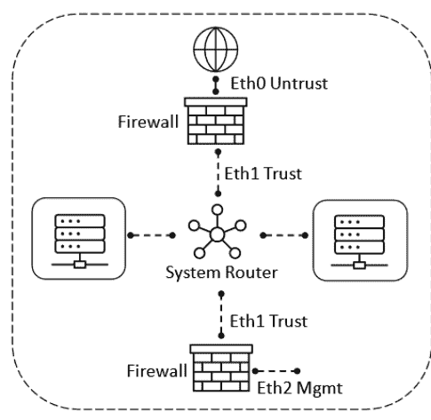

图 5.22 – 路由

打个比方，我们可以将此视为网络数据包的卫星导航；它需要知道数据包的来源和目的地，并计算并确定最合适、最高效的路径。此功能较少由服务器执行，通常由供应商的专用硬件设备执行。

本节介绍了网络路由的概念。在下一节中，我们将介绍在 Windows Server 中使用 VPN。

### 什么是 VPN？

这几乎可以被视为为用户提供安全访问组织内部私有网络上资源和服务的事实上的标准方式，前提是用户未直接连接。组织站点与用户位于组织私有网络之外的远程位置之间会建立加密隧道。以下图示旨在说明这一点：

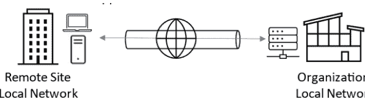

图 5.23 – VPN

在将 VPN 作为 Windows Server 中的远程访问解决方案时，需要选择隧道协议和身份验证选项。

隧道协议选项如下：

- 安全套接字隧道协议 (SSTP)
- 互联网密钥交换版本 2 (IKEv2)
- 第二层隧道协议与 Internet 协议安全 (L2TP/IPsec)
- 点对点隧道协议 (PPTP)

由于 PPTP 存在安全漏洞，应使用 IKEv2，相较于 L2TP 具有优势。

身份验证协议选项如下：

- 密码身份验证协议 (PAP)：安全性最低，因为密码为明文。
- 质询握手身份验证协议 (CHAP)：使用质询-响应和基于行业标准的消息摘要 5 (MD5) 哈希对响应进行加密。由于需要可逆加密密码，应考虑 Microsoft-CHAPv2 (MS-CHAPv2)。
- MS-CHAPv2：使用 CHAP，但采用单向加密密码。改进了 CHAP。
- 可扩展身份验证协议 (EAP)：更多是身份验证框架而非协议。该框架中的常见身份验证方法之一是 EAP-传输层安全 (EAP-TLS)。这是一种基于证书的相互身份验证方法。

本节介绍了 Windows Server 中的 VPN 远程访问选项。在下一节中，我们将介绍使用 NPS。

### 什么是 NPS？

NPS 是可安装在 Windows Server 上的角色，是 Microsoft 的 **远程拨入用户身份验证服务 (RADIUS)** 实现。RADIUS 用于在远程访问解决方案的组件之间提供身份验证交换，是一种行业标准身份验证协议。

NPS 用于实施网络访问的身份验证、授权和计费，并基于策略强制实施。NPS 提供 *连接请求策略* 和 *网络策略*。这些策略包含以下四个类别：*概述*、*条件*、*约束* 和 *设置*。

可用身份验证方法如下：

- PAP
- **Shiva 密码身份验证协议 (SPAP)**
- CHAP
- MS-CHAP
- MS-CHAP v2
- EAP

由于 PAP、CHAP 和 MS-CHAP 身份验证协议存在安全问题，这些协议不应考虑用于生产环境。

对于计费，用户身份验证请求、访问消息、计费请求、响应和状态更新可以存储在 Microsoft SQL Server 数据库中。

NPS 不能安装在 Windows Server Core 版本上。

本节介绍了 Windows Server 中的 NPS。在下一节中，我们将介绍在 Windows Server 中使用 **公钥基础结构 (PKI)**。

### 什么是 PKI？

PKI 是涵盖实施、颁发和管理数字证书的统称。这些证书由 **证书颁发机构 (CA)** 颁发，用于确认身份。

两种 CA 类型可以提供证书：**私有 CA** 和 **公共 CA**。每种 CA 类型都有优点和缺点，如下：

- **私有 CA** 相比公共 CA 提供了更大的控制力和更低的成本，并提供自定义模板和自动注册功能。缺点是私有 CA 颁发的证书不受外部客户端信任，且管理负担更重。
- **公共 CA** 的优点是大多数外部客户端都会信任它，且所需的管理工作较少。缺点是成本更高，证书采购速度较慢。


自签名证书也可以使用以下 PowerShell cmdlet 创建：

```
New-SelfSignedCertificate
```

本节介绍了 Windows Server 中的 PKI。在下一节中，我们将了解在 Windows Server 中使用 WAP。

### 什么是 WAP？

这提供了一种方式，允许远程用户通过互联网安全地访问内部 Web 应用程序。它通过反向代理功能实现这一点。用户由应用程序使用直通预身份验证或 AD 联合身份验证服务 (ADFS) 预身份验证进行身份验证。

以下图表旨在表示此过程：

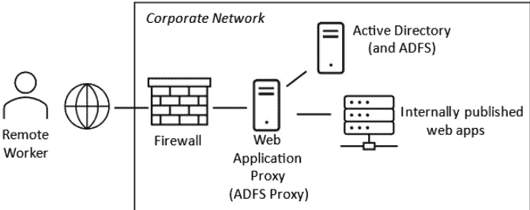

图 5.24 – WAP

WAP 通过 Windows Server 上的服务器管理器安装，或使用以下 PowerShell cmdlet：

```
Install-WindowsFeature Web-Application-Proxy
-IncludeManagementTools
```

从远程访问管理控制台配置角色后，您的内部 Web 应用程序即可使用 Web 应用程序代理控制台或以下 PowerShell cmdlet 发布：

- Add-WebApplicationProxyApplication
- Get-WebApplicationProxyApplication
- Set-WebApplicationProxyApplication

必须提供以下信息才能通过直通预身份验证方法发布 Web 应用程序：

- 预身份验证类型应设置为直通
- 要发布的 Web 应用程序的友好名称
- 用于访问应用程序的外部 URL，例如 https://pizza.milesbetter.solutions
- 具有 URL 主题名称的外部证书，例如 https://pizza.milesbetter.solutions
- 后端服务器的 URL 将自动输入，或者您可以对其进行编辑，例如 https://mbs-server1.milesbetter.solutions

替代方法是使用 _ADFS 预身份验证_ 发布 Web 应用程序。此方法的优势是 **单点登录 (SSO)** 和 **多因素身份验证 (MFA)**。

本节介绍了 Windows Server 中的 WAP。在下一节中，我们将了解如何使用 Azure AD 应用程序代理。

### 什么是 Azure AD 应用程序代理？

Azure AD 应用程序代理的功能与 WAP 可比拟，可从远程客户端使企业网络外部可用本地 Web 应用程序。但主要区别在于，应用程序代理功能（反向代理）现在作为 Microsoft 托管的服务提供，并使用 Azure AD 身份验证服务替代 AD。这取代了对 VPN 或仅限本地的 WAP 解决方案中反向代理的需求。

应用程序代理适用于 Web 应用程序、Web API 以及可从 **远程桌面 (RD) 网关**访问的应用程序。

Azure AD 应用程序代理包含以下组件：作为 Microsoft 托管的云服务运行的 _应用程序代理服务_，以及在本地服务器上运行的 _应用程序代理连接器_。Azure AD 的用户登录令牌由这两个组件协同工作，安全地传递到本地 Web 应用程序。以下图表旨在表示此过程：

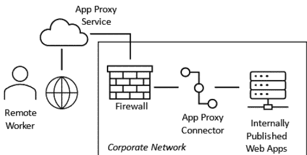

图 5.25 – Azure AD 应用程序代理

### 应用程序代理的工作原理

以下步骤概述了远程客户端用户访问内部 Web 应用的过程。用户通过终结点、URL 或门户界面访问应用程序，并被引导至 Azure AD 进行登录：

- Azure AD 将令牌发送到用户的设备。
- 客户端将令牌发送到应用程序代理服务。令牌的用户主体名称 (UPN) 和安全主体名称 (SPN) 将被检索并发送到应用程序代理连接器。
- 然后将请求发送到本地应用程序。
- 响应通过代理连接器和代理服务返回给用户。

> 注意
> 防火墙上无需打开入站连接。

Azure AD 应用程序代理并非面向企业网络上的用户，而是面向希望连接到内部应用（例如在家办公人员）的远程用户。

本节介绍了 Azure AD 应用程序代理，并以 Windows Server 中的远程访问选项话题结束。在下一节中，我们将完成一个动手练习部分，以巩固本章中涵盖的一些概念。

### 动手练习

为了支持您掌握一些实用技能，我们将利用本章前面各部分获得的概念和理解，并将其应用于实际操作。

我们将学习以下练习：

- 练习—实施 DNS
- 练习—实施 DHCP

### 开始使用

开始使用本节之前，如果您还没有 Azure 订阅，可以在 https://Azure.microsoft.com/free 创建免费的 Azure 帐户。此免费 Azure 帐户提供以下内容：

- 12 个月免费服务
- 30 天内探索 Azure 的 200 美元额度
- 25 多项始终免费的服务

让我们继续本章的练习。

### 练习 – 实施 DNS

本节将介绍如何使用 Windows Server 实施 DNS 网络服务。

此练习需要访问一台 Windows Server 操作系统计算机。

### 任务 – 安装 DNS 角色

在此任务中，我们将在 Windows Server 上安装 DNS 角色。请按以下步骤操作：

1. 使用管理员帐户登录到服务器，在 **服务器管理器** 的 **管理** 中单击 **添加角色和功能**，然后在 **开始之前** 画面上单击 **下一步**。
2. 在 **安装类型** 画面中，单击 **基于角色或基于功能的安装**，然后单击 **下一步**。
3. 从 **服务器选择** 画面，接受 **当前服务器** 的默认选择，然后单击 **下一步**。
4. 在 **服务器角色** 画面的 **角色** 列表中选择 **DNS 服务器**，并在弹出画面中单击 **添加功能**。然后，单击 **下一步**。
5. 在 **功能** 画面中，接受默认选择，然后单击 **下一步**。
6. 在 **DNS 服务器** 画面中，查看信息，然后单击 **下一步**。
7. 在 **确认** 画面中，单击 **安装**；查看安装进度，直到收到显示 **安装成功** 的消息，然后在 **添加角色和功能向导** 上单击 **关闭**。
8. 您现在已安装 **DNS 服务器角色**；您现在将在 **服务器管理器** 的 **工具** 菜单以及 **仪表板** 左侧导航菜单中找到 **DNS 管理器**，如下图所示：

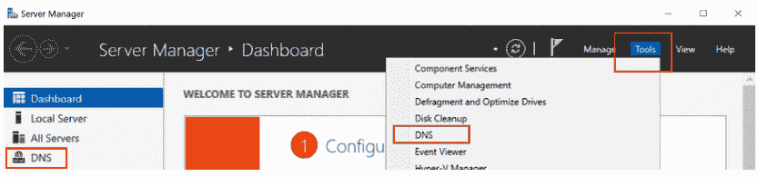

图 5.26 – 已安装 DNS 服务器角色

在此任务中，您安装了 DNS 角色。在下一个任务中，您将创建 DNS 区域。

### 任务 – 创建 DNS 区域

此任务将为 milesbetter.solutions 域创建 DNS 区域；您应使用满足您要求的区域名称。请按以下步骤操作：

1. 从服务器管理器的工具菜单启动 DNS 管理器。
2. 在 DNS 管理器顶部的操作菜单中，单击新建区域...，如下图所示：

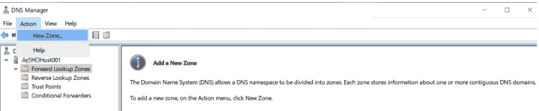

图 5.27 – 创建 DNS 区域

3. 在新建区域向导画面中，单击下一步。
4. 在区域类型画面中，保留默认值主区域，然后单击下一步。
5. 在正向或反向查找区域画面中，保留默认值正向查找区域，然后单击下一步。
6. 查看区域名称画面上的信息，输入区域名称值，然后单击下一步。对于此练习，我们将使用示例区域名称 milesbetter.solutions；您应使用满足您要求的区域名称。您可以在下图中看到示例：

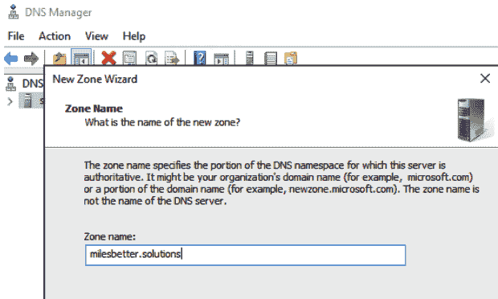

图 5.28 – DNS 区域名称

7. 接受 **区域文件** 画面上的默认文件名，然后单击 **下一步**。此练习示例将自动填充为 milesbetter.solutions.dns，如下图所示：

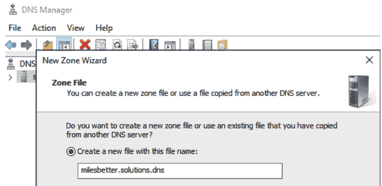

图 5.29 – DNS 区域文件

8. 查看 **动态更新** 画面上的信息，将其设置为默认值 **不允许动态更新**，然后单击 **下一步**。

9. 在 **完成新建区域向导** 画面中，查看信息并单击 **完成**。

10. 您的 *新建区域* 将出现在 **DNS 管理器** 的 **正向查找区域** 下，如下图所示：

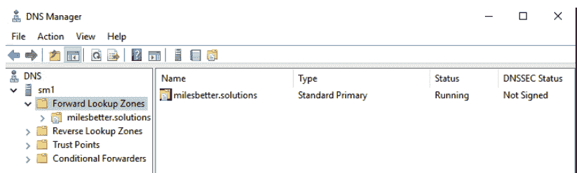

图 5.30 – 已创建 DNS 区域


11. 单击创建的列出的区域以查看区域文件的内容。如下面的屏幕截图所示，您将看到为该区域自动创建的两个默认 SOA 和 NS 记录。请注意，当前该区域的 NS 仅为您在其上安装 DNS 服务并添加区域的当前主机：

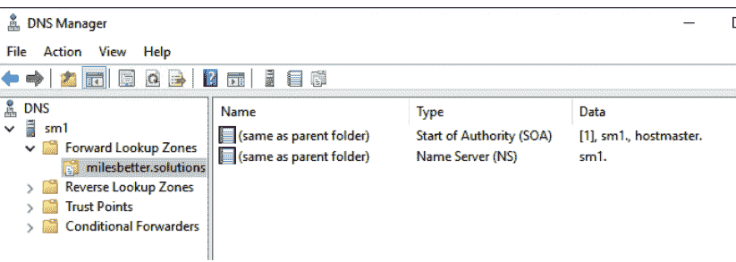

图 5.31 – DNS 区域信息

在此任务中，您创建了一个 DNS 区域。在下一个任务中，您将创建一个 DNS 记录。

### 任务 – 创建 DNS 记录

此任务将为 milesbetter.solutions 区域创建一个 DNS 记录；您应使用在上一个任务中创建的区域来创建记录。请执行以下步骤：

- 1. 从“服务器管理器”的“工具”菜单启动 DNS 管理器。
- 2. 从 DNS 管理器顶部的“操作”菜单中，单击“新建主机 (A 或 AAAA)...”，如下面的屏幕截图所示：

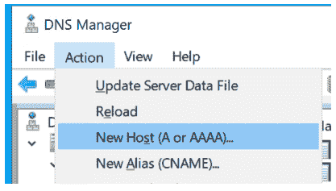

图 5.32 – 新建主机记录

- 3. 在**新建主机**屏幕上，输入**名称**和**IP 地址**值。为此练习，我们将使用示例记录名称 `PizzaApp` 和 IP `10.1.0.4`；*您应使用满足您要求的记录名称和 IP 地址*。以下屏幕截图说明了此阶段：

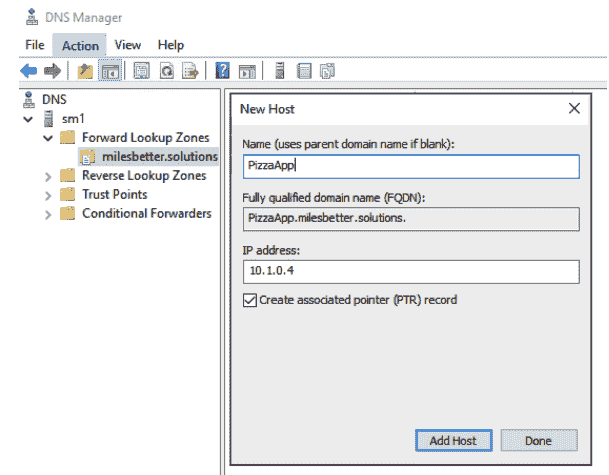

图 5.33 – 添加主机记录

- 4. 选中**创建关联 (PTR) 记录**复选框，然后单击**添加主机**。

- 5. 在成功创建主机记录的**DNS**弹出对话框中，在**新建主机**屏幕上单击**确定**和**完成**。

- 6. 从**DNS 管理器**导航到创建的区域，您将看到新创建的 `PizzaApp` 主机记录，该记录显示记录类型为**主机 (A)**，数据记录为 IP 地址 `10.1.0.4`，如下面的屏幕截图所示：

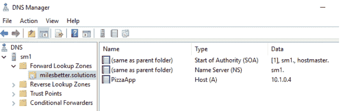

图 5.34 – 新建 DNS 区域和 DNS 主机记录

在此任务中，您创建了一个 DNS 记录。

至此，我们已完成练习。本节介绍了在 Windows Server 中实现 DNS 服务以及创建 DNS 区域和 DNS 记录所需的技能。下一个练习将探讨实现 DHCP 网络服务。

### 练习 – 实现 DHCP

本节将探讨使用 Windows Server 实现 DHCP 网络服务。

为此练习，您需要一台运行 Windows Server 的计算机。

### 任务 – 安装 DHCP 角色

在此任务中，我们将在 Windows Server 中安装 DHCP 角色。请执行以下步骤：

- 1. 使用管理员帐户登录到您的服务器，在**服务器管理器**的**管理**中单击**添加角色和功能**，然后在**开始之前**屏幕上单击**下一步**。
- 2. 从**安装类型**屏幕中单击**基于角色或基于功能的安装**，然后单击**下一步**。
- 3. 从**服务器选择**屏幕中，接受当前服务器的默认选择，然后单击**下一步**。
- 4. 从**服务器角色**屏幕的**角色**列表中选择 **DHCP 服务器**，在弹出屏幕上单击**添加功能**，然后单击**下一步**。
- 5. 在**功能**屏幕上，接受*默认选择*，然后单击**下一步**。
- 6. 在**DHCP 服务器**屏幕上，查看信息，然后单击**下一步**。
- 7. 在**确认**屏幕上，单击**安装**；查看安装进度，直到收到**安装成功**消息，然后在**添加角色和功能向导**上单击**关闭**。
- 8. 您现在已安装 **DHCP 服务器** 角色；您现在将在服务器管理器中看到一条通知，指出您必须为 DHCP 服务器**完成 DHCP 配置**。单击**完成 DHCP 配置**，如下面的屏幕截图所示：

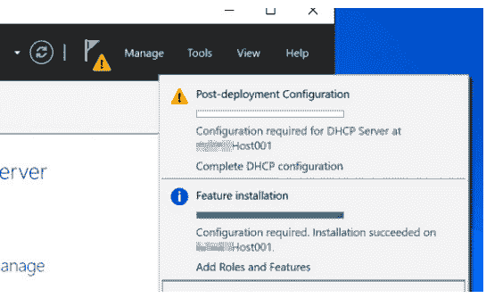

图 5.35 – 已安装 DHCP 服务器角色

- 9. 从 **DHCP 安装后** 配置向导中，在**说明**屏幕上单击**提交**，并在**摘要**屏幕上单击**关闭**。

在此任务中，您创建并安装了 DHCP 服务。在下一个任务中，您将创建 DHCP 作用域。

### 任务 – 创建作用域

此任务将创建一个作用域。请按以下步骤操作：

- 1. 从“服务器管理器”的“工具”菜单启动 **DHCP 控制台**。

- 2. 从 **DHCP** 控制台顶部的 **操作** 菜单中，单击 **新建作用域...**，如下面的屏幕截图所示：

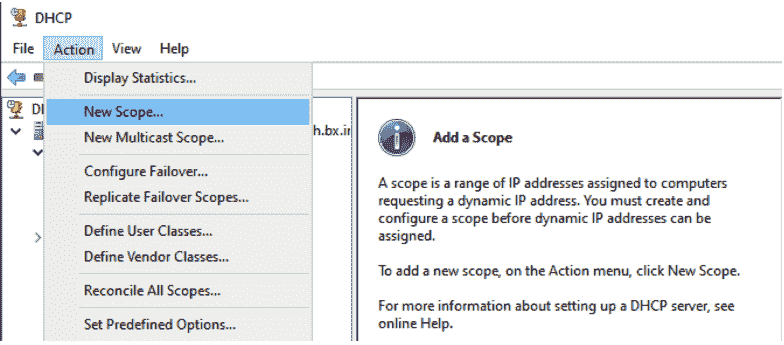

图 5.36 – 创建作用域

- 3. 在 **新建作用域向导** 屏幕上，单击 **下一步**。
- 4. 在 **作用域名称** 屏幕上，输入 **名称** 值，以及可选的 **描述** 值。为此练习，我们将使用示例作用域名称；*您应使用满足您要求的作用域名称*。
- 5. 在 **IP 地址范围** 屏幕上，输入 **起始 IP 地址** 值、**结束 IP 地址** 值以及 **子网掩码** 和 **长度** 值。为此练习，我们将使用示例范围；*您应使用满足您要求的范围*。
- 6. 在 **添加排除项和延迟** 屏幕上，单击 **下一步**。
- 7. 在 **租用持续时间** 屏幕上，输入长度，然后单击 **下一步**。
- 8. 在 **配置 DHCP 选项** 屏幕上，选择 **是，我现在要配置这些选项**，然后单击 **下一步**。
- 9. 在 **路由器 (默认网关)** 屏幕上输入 IP 地址值，然后单击 **下一步**。
- 10. 在 **域名和 DNS 服务器** 屏幕上，输入 **父域**、**服务器名称** 和 **IP 地址** 值，然后单击 **下一步**。
- 11. 在 **WINS 服务器** 屏幕上，单击 **下一步**。
- 12. 在 **激活作用域** 屏幕上，保留 **是，我现在要激活此作用域** 的默认设置，然后单击 **下一步**。
- 13. 单击 **完成** 以完成 **新建作用域向导**。
- 14. 在 DHCP 控制台中，作用域将如下所示：

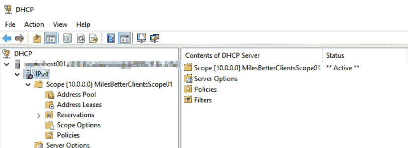

图 5.37 – 已创建的作用域

在此任务中，您创建了一个作用域。

### 任务 – 使用命令管理 DHCP

此任务将介绍运行命令来管理 DHCP 和检索信息。请按以下步骤操作：

- 1. 运行以下命令从 DHCP 服务器释放 IP 地址：`ipconfig /release`。
- 2. 运行以下命令从 DHCP 服务器续租 IP 地址：`ipconfig /renew`。
- 3. 我们可以使用 netsh 命令行环境获取 DHCP 服务器信息。从命令提示符中，输入以下命令：
  - `netsh dhcp show server`
  - `netsh dhcp server show all`
  - `netsh dhcp show version`
  - `netsh dhcp server show all`
  - `netsh dhcp show scope`
  - `netsh dhcp show dnsconfig`
  - `netsh dhcp show optionvalue`

至此，我们已完成此练习。此练习介绍了在 Windows Server 中实现 DHCP 服务和创建作用域所需的技能。现在，让我们总结本章。

### 摘要

本章涵盖了 AZ-800 管理 Windows Server 混合核心基础架构：实现和管理本地网络基础设施考试。

本章内容进一步发展了您在本地网络基础设施服务方面的知识和技能。

您了解了 Windows 服务器中的一些核心网络基础设施服务，例如 DHCP、DNS、IPAM 和远程访问。然后我们通过一个动手练习结束了本章，以进一步发展您的技能。

您通过所提供的信息添加了新技能，本章的目标是将您的知识提升到考试目标之外，以便您为现实世界中面向日常混合环境的角色做好准备。

下一章将教您如何实现和管理 Azure 网络基础设施。

### 进一步阅读

本节提供了有关考试的其他信息和学习参考链接：

- Microsoft Certified: Windows Server 混合管理员助理: https://docs.microsoft.com/en-us/learn/certifications/windows-server-hybrid-administrator/
- Exam AZ-800: 管理 Windows Server 混合核心基础架构: https://docs.microsoft.com/en-us/learn/certifications/exams/az-800
- Exam AZ-800: 技能大纲: https://query.prod.cms.rt.microsoft.com/cms/api/am/binary/RWKI0r
- Microsoft Learn: https://docs.microsoft.com/en-us/learn/paths/implement-operate-premises-hybrid/