### 技能检查

通过尝试回答以下问题，挑战一下您在本章中学到的内容：

- 1. 什么是名称解析？
- 2. Windows Server 中的主要名称解析方法是什么？
- 3. 什么是 DNS 解析器缓存？
- 4. 什么是命名空间？
- 5. 什么是区域？
- 6. 正向查找区域和反向查找区域之间有什么区别？
- 7. 什么是记录？
- 8. 列出六种不同的记录及其用途。
- 9. 什么是转发器？
- 10. TTL 是什么意思？


## 实现和管理 Azure 网络基础设施

本章涵盖 AZ-800 管理 Windows Server 混合核心基础设施：实现和管理 Azure 网络基础设施。

在上一章中，我们学习了理解本地网络基础设施和服务概念的技能。本章将从了解 Azure 中的网络服务概念开始，然后更详细地探讨每种网络服务，最后通过动手实践练习进一步提升您的技能。

本章包含以下主题：

- Azure 网络服务简介
- 在 Azure 中实现虚拟网络 (VNet)
- 在 Azure 中实现网络连接
- 在 Azure 中实现网络保护
- 在 Azure 中实现名称解析
- 动手实践练习

除了本章列出的主题外，本章的目标是让您的知识超越考试目标，为您从事以现实世界日常混合环境为重点的角色做好准备。

### Azure 网络服务简介

本节介绍 Azure 中可用网络服务的功能、每项服务所需的原因以及使用方法。本章将更详细地介绍每种网络服务功能。

以下列表概述了可用的网络服务功能：

- **Azure 资源之间的通信**：VNet 为 Azure 资源（如虚拟机 (VM)、负载均衡器、防火墙等）之间的网络流量提供通信路径。同一区域或跨区域之间 VNet 的通信通过使用 Microsoft 骨干网的 VNet 对等互连来处理。服务终结点和私有终结点可用于将平台即服务 (PaaS) 资源（例如数据库和存储服务）连接到 VNet。
- **与本地资源的通信**：虚拟专用网络 (VPN) 以及 Azure 中继、Azure 网络适配器、Azure 虚拟 WAN 和 ExpressRoute 可提供混合连接场景，例如将本地网络扩展到 Azure。
- **与 Internet 的通信**：VM 可以针对入站和出站流量在 Internet 上进行通信，并且可以获得网络和应用程序保护服务以及网络地址转换 (NAT) 和路由。
- **地址空间分段**：可以像本地网络一样使用子网对 VNet 进行分段，以优化 VNet 中定义的地址空间。流量筛选和路由也可以在子网级别应用。地址空间通常为 RFC 1918 私有范围，并且还支持公共 IP 前缀。出于安全原因，VM 资源应从私有 IP 地址空间分配 IP，并将公共 IP 与负载均衡器、防火墙等关联。在特定场景中，Azure 扩展网络提供子网扩展，这意味着可以将本地子网延伸到 Azure。Azure 资源还可以与同一本地网络上的资源通信。
- **网络流量路由**：VNet 使用默认系统路由来确定流量路径。用户定义路由 (UDR) 类似于本地网络中的静态路由；这些路由允许使用更首选且更具体的下一跳流量路径来替代默认系统路由。此下一跳可能是网络虚拟设备 (NVA)（例如防火墙）。
- **网络流量筛选**：默认情况下，VNet 中没有流量筛选。网络安全组 (NSG) 是用于网络保护的内置 Azure 数据包筛选服务。可以通过一组允许和拒绝规则来控制 VNet 的入站和出站网络流量。流量筛选可以基于源、目标、端口、协议等因素应用。此外，Azure 防火墙服务可提供第 4 层和第 7 层保护服务。
- **网络流量加密**：Azure VPN 网关可以加密 Azure 与远程网络（例如本地位置）之间的通信。
- **网络流量速度**：由于 Internet 的固有特性，如果 Azure 与本地位置之间需要低延迟连接，则可以使用 Azure ExpressRoute。这提供了一种托管的专用网络连接，可为流量绕过 Internet。
- **名称解析**：Azure 中的名称解析可以由在 VM 上运行的传统 Windows Server DNS 提供，也可以由 Azure DNS 提供，Azure DNS 是一项托管服务，与 VNet 完全集成，可提供公共区域和私有区域。

在本节中，我们介绍了一些 Azure 网络服务。在本章的以下部分中，我们将介绍这些领域中的每一个。下一节将首先介绍 VNet。

### 在 Azure 中实现 VNet

本节将介绍实现和管理 Azure VNet。我们将介绍 VNet 对等互连、VNet 路由、实现 IP 寻址以及 Azure 扩展网络。

本节将首先介绍 Azure 中的 VNet 及其工作原理。

### Azure VNet

Azure VNet 是一种软件定义的本地网 (LAN) 表示形式，类似于本地环境中的 LAN。

VNet 通过网络接口为资源之间提供通信路径。当本地位置的资源与 Azure 中的资源通信时，这可以称为混合连接或跨本地连接。

VNet 为您的资源提供了一个专用且隔离的单租户网络，用于在其中进行通信。您可以定义专用 IP 地址空间，并像本地环境一样将其分段为子网。

VNet 上的每个连接设备都将通过 Azure 动态主机配置协议 (DHCP) 服务分配一个唯一 IP。建议为 VM 分配专用 IP。

也可以向资源分配公共 IP，但出于安全考虑，建议将其与防火墙、负载均衡器等关联。

VNet 允许创建属于子网的网络接口，作为与 VNet 关联的 IP 地址空间分段的一部分。这些网络接口由 Microsoft DHCP 服务从该子网范围内分配 IP 地址；您不能自带 DHCP 服务器。

为了使 VM 能够在网络上通信，它必须关联一个或多个网络接口。您将根据要发送或接收流量的子网分配网络接口。VM 可以从一个或多个子网分配网络接口，最大数量由 VM 类型支持的网络接口数量决定。网络接口始终分配给 VM，即使处于关闭状态也是如此。但是，删除 VM 时，网络接口仍作为独立资源保留，但可以根据需要将其删除。

Azure 中的 VNet 存在于 Azure 区域的边界内，是该区域内网络流量的通信边界。

VNet 可以跨越数据中心区域，但不能跨越区域。您可以连接不同区域中的 VNet，并允许流量就像在一个网络中一样跨越。

默认流量行为是，VNet 允许该 VNet 内的所有资源相互通信，但不允许与另一个 VNet 中的资源通信，除非执行其他配置步骤。

VNet 可以通过 VPN 网关连接到本地位置以实现混合连接。每个 VNet 只能创建一个 VPN 网关，可将其创建为 VPN 类型或 ExpressRoute 类型。如果地址空间中有足够的 IP 寻址可供分配，则两种类型可以同时存在于同一网关上；建议至少创建一个 /27 的 VPN 子网。

### VNet 对等互连

一个或多个 VNet 中的 VM 可以通过 VNet 对等互连相互通信。

与必须通过 Internet 路由通信流量的 VPN 网关不同，VNet 对等互连允许通信流量就像在同一逻辑网络中一样流动，流量通过 Microsoft 骨干网传输并绕过 Internet。这在速度、可靠性和安全性方面非常重要。VNet 对等互连分为区域 VNet 对等互连（用于连接同一区域中的 VNet）和全球 VNet 对等互连（用于连接不同区域中的 VNet）。

以下图表对此进行了表示：

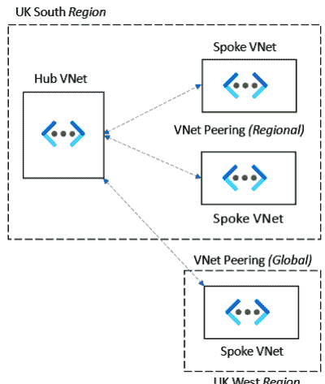

图 6.1 – VNet 对等互连

在本节中，我们了解了 Azure VNet 是什么。在下一节中，我们将介绍 VM 的 IP 寻址。


### 如何实现 IP 寻址

创建 VNet 时，需定义一个或多个 IP 地址空间。随后可以将其进一步细分为子网，以满足您的需求。每个资源都可以从子网中分配一个 IP 地址，以便其他资源可以在网络上与其通信。

这在下图中表示：

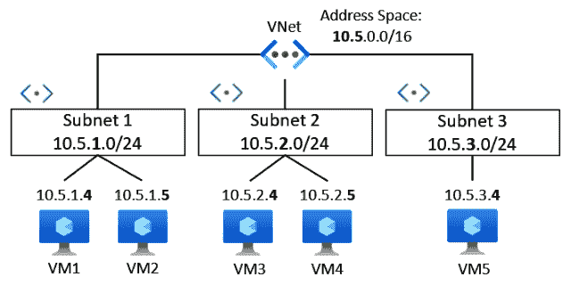

图 6-2 – IP 地址子网划分

前面的图表示一个 VNet，其地址空间使用无类域间路由 (CIDR) 格式 10.5.0.0/16 定义。已使用子网划分进一步将其细分为使用 /24 表示法的较小子网，每个资源都从此范围分配一个 IP。这种方法允许我们从定义的 /16 地址空间优化 IP 地址分配。VNet 可以分配多个 IP 地址空间，它可以是公共 IP 地址前缀，但更常见的是私有 IP 地址范围。

以下是推荐的私有不可路由 (RFC 1918) 地址范围：

- 192.168.0.0 到 192.168.255.255 (192.168/16 前缀)
- 172.16.0.0 到 172.31.255.255 (172.16/12 前缀)
- 10.0.0.0 到 10.255.255.255 (10/8 前缀)

私有 IP 地址会静态或动态分配给网络接口，并且可以随时在两者之间更改。通常，将使用静态 IP 地址，特别是对于将执行域控制器、DNS 服务器或网络虚拟设备 (NVA) 等角色的 VM，在这种情况下，IP 保持分配且不更改至关重要。私有 IP（静态和动态）也可以分配给负载均衡器和存储服务的网络接口等资源，例如使用私有终结点的资源。

在 Azure 中规划 IP 寻址时，必须注意的是 Azure 会在每个子网范围内保留五个 IP 地址供其自身使用，这些地址不能分配给任何资源。这五个保留的 IP 地址是范围内的前四个 IP 地址和最后一个 IP 地址，IP 地址范围从 0 开始，而不是 1。

保留的五个 IP 地址用途如下：

- x.x.x.0：第一个 IP 地址用于网络地址
- x.x.x.1：第二个 IP 地址用于默认网关
- x.x.x.2：第三个地址用于 Azure DNS
- x.x.x.3：第四个 IP 地址用于 Azure DNS
- x.x.x.255：第五个 IP 地址用于广播地址

您会注意到，前面列表中子网内创建的 VM 分配的第一个 IP 将是 .4 地址。

可以将公共 IP 寻址前缀添加到 Azure VNet，并可将其分配给网络接口、VPN 网关、NVA 和面向 Internet 的负载均衡器等资源。有基本型和标准型存储单位 (SKU)。

IPv6 还可以与 IPv4 在同一 VNet 中以及针对同一资源一起使用。当资源（例如 VM）需要 IPv6 和 IPv4 通信路径时，这称为双栈。

### Azure 扩展网络

Azure 的扩展网络功能提供子网扩展，这意味着本地子网可以扩展到 Azure 以满足特定方案的要求，反之亦然。Azure 资源可以成为本地网络的一部分，类似于在不同位置提供相同的 IP 广播域。应注意的是，这不一定是良好做法，但可能出于特定方案的要求而需要。

这是通过使用 Virtual Extensible LAN (VXLAN) 解决方案将本地第 2 层网络与第 3 层覆盖网络扩展来实现的。优势在于，当 VM 移动到 Azure 时，它们可以保留现有 IP。通常，这是不可能的，因为本地网络和 Azure 之间不能存在重叠的 IP 地址空间。

这在下图中表示：

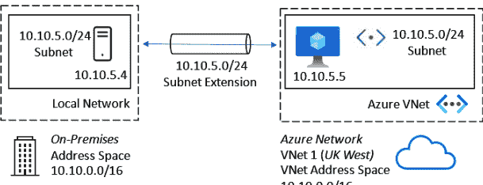

图 6.3 – Azure 扩展网络子网扩展

本节介绍了如何在 Azure VNet 中实现 IP 寻址。在下一节中，我们将介绍如何实现 VNet 路由。

### 如何实现 VNet 路由

如前所述，Azure VNet 是本地网络的软件定义表示。创建 VNet 时，可以配置 RFC 1918 私有地址空间，并为分段网络设计创建子网。在前一个示例中，我们看到一个包含 /24 子网的 /16 地址空间，用于为可连接到 VM 的网络接口分配 IP，以便它们在 VNet 内进行通信。

Azure 有一组默认系统路由，可自动提供 Azure 内置路由功能；这允许同一 VNet 中的 VM 在无需特定网络配置的情况下相互通信。默认网关地址在任何子网中都预定义为 .1，系统路由确定下一跳路径。这些路由无法编辑或删除，但您可以提供自定义路由，允许您使用优先级高于系统路由的更具体路由来替代系统路由。这些自定义路由称为 UDR。UDR 通过路由表资源应用。这为任何离开子网且不希望使用默认 .1 网关下一跳的数据包提供了特定的网络数据包控制，以确定下一跳应位于何处。

下一跳类型可以是以下之一：

- 虚拟设备
- VNet 网关
- VNet
- Internet

在子网中实施 UDR 尤其有利，当我们希望离开子网的流量的下一跳由 NVA（例如 *防火墙*）过滤和检查时。这使我们可以控制东西向流量，并提供针对 **横向攻击** 的网络保护。

此概念在下图中表示：

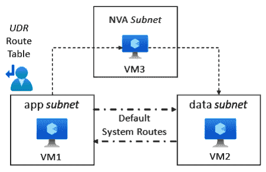

图 6.4 – Azure 中的网络路由

在前面的图中，我们看到默认系统路由显示 **VM1** 和 **VM2** VM 之间可以直接通信。这允许 **VM2** 使用默认系统路由与 **VM1** 通信。

由于 UDR 路由表与应用子网关联，离开应用子网的所有数据包将使用 UDR 路由表提供的自定义路由。

在此示例中，路由表有一个条目，指定对于目标为数据子网的所有流量，其下一跳必须是 **VM3**。

这意味着 **VM1** 不能直接与 **VM2** 通信，但 **VM1** 只能通过 **VM3**（防火墙设备 VM）与 **VM2** 通信；如果 **VM1** 受到攻击，这种方法将保护 **VM2** 免受横向移动攻击。

我们还应该在本节中讨论 **出站路由** 的话题。这是我们可以根据成本、质量和性能指标确定离开 Azure VNet 的流量路径的地方。

出站路由的两个可用选项如下：

- **冷土豆路由**：使用此路由方法，流量将在 Microsoft 全球主干网上尽可能长时间地保留。一旦 Microsoft 主干网将流量交给下游 ISP 边缘 **接入点 (POP)** 来执行此 *最后一英里* 流量交付，最终目的地将获得流量。
- 热土豆路由：使用此路由方法，流量将在尽早离开 Microsoft 全球网络，并通过互联网上的多个跳转到达目的地，因此术语 *热土豆*，因为流量不会被长时间保留，然后才交给数据包的 *下一跳* 或 *交接*。

此概念在下图中表示：

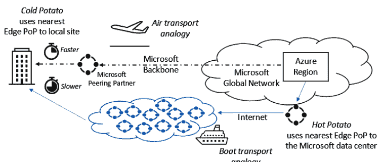

图 6.5 – Azure 中的出站路由

前面的图可视化了冷土豆与热土豆出站路由方法；其优点和缺点如下：

- 冷土豆路由是最昂贵的出站路由形式，但具有最低延迟、最佳质量和最快性能的优点。将此视为 *快递服务* 与 *常规邮件投递服务* 相比。
- 热土豆路由是最便宜的选择，但缺点是其交付速度最慢且最不可靠。将此视为 *常规邮件投递服务* 与 *快递服务* 相比。

我们还可以将此流量交付方法与 *航空运输* 与 *地面/船舶运输* 联系起来。

在本节中，我们介绍了 VNet 路由。下一节将介绍如何在 Azure 中实现混合网络连接。

### 在 Azure 中实现网络连接

本节将介绍 Azure 中 VNet 之间以及 Azure 中可用的 *跨本地/混合* 选项的网络连接。

虽然有许多第三方供应商解决方案，但我们将只介绍 Azure 中以及针对考试技能目标提供的 Microsoft 自身服务。


本节将首先介绍 VPN（虚拟私有网络）技能领域。

### VPNs

Microsoft VPN 网关是一种网络连接服务，它通过跨互联网的私有且安全的隧道提供流量加密。这些隧道可以将本地网络连接到 Azure VNet，或将同一区域或不同区域的 VNet 互连。

实现 VPN 网关时，可以创建为两种类型：

- VPN 连接类型
- ExpressRoute 连接

每个 VNet 只能创建一个 VNet 网关，并带有高可用性 (HA) 选项；VNet 之间不能共享网关。

要更改网关类型，必须删除网关，然后使用正确的类型重新创建。

VPN 连接类型网关可创建为两种 VPN 类型：

- 策略基础（静态路由）VPN 网关
- 路由基础（动态路由）VPN 网关

VPN 网关可创建点到站点 VPN 和站点到站点 VPN。

可使用 Internet Protocol Security (IPsec) 协议和 Internet Key Exchange (IKE) 版本 1 和 2；预共享密钥用于身份验证。

以下连接类型需要路由基础 VPN 网关：

- 点到站点 VPN
- VNet 互连连接
- 多站点连接
- ExpressRoute 共存

本节介绍了 Azure 中的 VPN 网关服务。以下各节将介绍点到站点和站点到站点 VPN 类型。

### 点到站点 VPN

点到站点 VPN 类型通过跨互联网创建安全隧道进行通信，从单个设备到 Azure 资源提供加密连接。

此 VPN 类型使用的协议如下：

- OpenVPN
- **安全套接字隧道协议 (SSTP)**
- IKEv2

以下图示展示了此点到站点 VPN 类型：

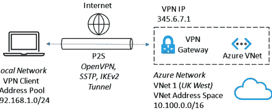

图 6.6 – 点到站点 VPN

点到站点 VPN 的使用场景是：远程工作者（如在家办公或出差人员）需要访问通过 VNet 可访问的 Azure 资源，且无法使用站点到站点 VPN 时。

### 站点到站点 VPN

站点到站点 VPN 类型通过跨互联网创建安全隧道进行通信，从本地位置到 Azure 资源提供加密连接，以支持混合连接/跨本地场景。

Azure VPN 网关支持策略基础和路由基础 VPN 以及 IPsec v1/v2 协议；预共享密钥用于身份验证。

以下图示展示了此站点到站点 VPN 类型：

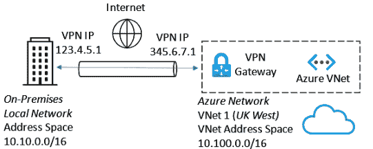

图 6.7 – 站点到站点 VPN

在上图中，本地位置必须配备带有公共 IP 地址的 VPN 设备。请注意，如果未部署 Azure 扩展网络，本地和 Azure VNet 地址空间不能重叠；需要通过公共互联网进行第 3 层路由。

VPN 网关还可以使用单个 VNet 网关建立到多个本地位置的 VPN 隧道。

以下图示展示了此多站点 VPN 连接类型：

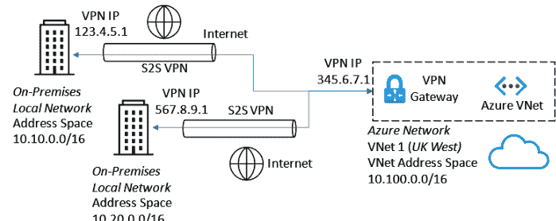

图 6.8 – 多站点 VPN 连接

要在单个 VNet 网关上支持多个 VPN 连接隧道共存，必须使用路由基础 VPN。

### VNet 到 VNet VPN

VPN 还可以连接两个 Azure VNet，以允许加密通信。

以下图示展示了此 VNet 到 VNet VPN 类型：

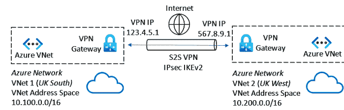

图 6.9 – VNet 到 VNet VPN 连接

要互连 Azure VNet，我们还可以使用 VNet 对等互连这一替代方法；但是，这不会加密流量，会绕过互联网，并在 Microsoft 骨干网上运行。

### 实现 Azure VNet 网关

如前所述，VNet 网关是一种 Azure 资源，用于通过互联网将本地网络连接到 Azure VNet。通过安全且私密的隧道发送加密流量。这样，云和本地位置中的资源可以像在同一本地网络上一样进行通信。

实现 VNet 网关需要以下资源：

- **VNet**：VNet 网关资源只能与一个 VNet 关联；一个 VNet 不能拥有多个 VPN 网关。Azure VNet 与本地网络之间的 IP 地址空间范围不得重叠——也就是说，Azure 网络应使用唯一的 CIDR IP 地址空间范围创建。
- **网关子网**：需要在 VNet 中创建一个专用子网资源，且必须命名为 GatewaySubnet。所使用的 VNet 地址空间必须有足够的可用 IP 可供分配。建议使用 /27、/26 或更大的掩码，以确保有足够的 IP 地址可用，特别是如果你希望 ExpressRoute 在同一 VNet 网关上共存。
- **公共 IP 地址**：远程 VPN 设备使用此资源连接到 VNet 网关。
- **本地网络网关**：此资源表示远程网络位置；请注意 *local* 术语：它是指从 VNet 网关另一端的隧道处的网络。这标识用于与 Azure VPN 网关连接的本地 VPN 设备。你指定允许连接的源网络范围。
- **连接**：此资源表示 VPN 与本地网络网关之间的逻辑连接。

以下图示展示了上述资源及其关系：

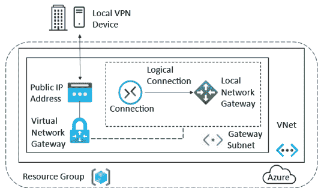

图 6.10 – VPN 网关资源

在实现 ExpressRoute 时也会用到 VNet 网关，我们将在下一节中介绍。

### ExpressRoute

ExpressRoute 电路是将本地网络扩展到 Azure 的一种方式，无需 VPN 或遍历互联网。它使用可靠、低延迟、快速的私有网络提供跨本地/混合连接，流量直接路由到 Microsoft 数据中心，绕过互联网。此私有网络由网络运营商提供商提供支持，其充当连接提供商。

以下图示对此进行展示：

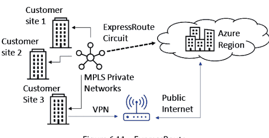

与网络运营商合作，ExpressRoute 可以使 Azure 数据中心在多协议标签交换 (MPLS) 网络上显示为一个站点。这提供了将本地位置扩展到 Azure 数据中心的全球覆盖和容量扩展。

由于 ExpressRoute 是一种企业级网络解决方案，因此使用边界网关协议 (BGP) 和动态路由构建了冗余。

应注意，ExpressRoute 不会加密或过滤流量；如果这很重要，应将其纳入设计中。通常，通过在解决方案中实装网络虚拟设备 (NVA) 来实现。

要实现 ExpressRoute 电路，以下步骤概述了所需操作：

1. 创建 ExpressRoute 网关。
2. 通过与连接提供商合作创建电路。
3. 创建对等互连。
4. 将 ExpressRoute 电路连接到 VPN。

Microsoft 提供两种对等互连类型，如下所示：

- 私有对等互连：此类型提供到 Azure VNet 的连接
- Microsoft 对等互连：此类型提供到 Microsoft 公共服务（例如 Microsoft Office 365 (M365) 和 Dynamics 365 (D365)）的连接

你可以在同一 VNet 网关上同时拥有站点到站点 VPN 和 ExpressRoute，但必须使用路由基础 VPN 来支持此配置。建议分配 /27 子网，以确保可以分配足够的 IP。

本节介绍了 ExpressRoute。下一节将介绍 Azure 网络适配器。

### Azure 网络适配器

Windows Server 2019 引入了 Azure 网络适配器作为一种新的混合连接解决方案。要连接到在 Azure 中运行的网络和 VM，可以使用 VPN 和 ExpressRoute，但这会为通常很简单的需求（即将本地资源连接到 Azure 资源）增加显著复杂性。

借助 Azure 网络适配器并通过 Windows 管理中心，你可以提供一键式解决方案，使用点到站点 VPN 将 Azure VNet 连接到本地网络。

### Azure 中继

Azure 中继是以前称为服务总线中继的服务。

Azure 中继是一种混合解决方案，可将内部应用程序资源公开到公共云环境。它基于*侦听器*工作，无需打开入站防火墙端口，也无需对本地环境进行侵入性网络基础设施更改。这与 VPN 是不同的解决方案，VPN 在网络集成级别工作。这类似于应用程序 VPN，我们可以将连接访问范围限定为单个本地计算机上的应用程序，而不是范围很广（覆盖网络范围）的 VPN，它更多的是关于连接应用程序而非连接网络。

### Azure 虚拟 WAN

Azure 虚拟 WAN 提供**全球网络转发架构**解决方案。

它是传统上在本地部署的**广域网 (WAN)** 的虚拟化表示，例如 MPLS 解决方案。在 Virtual WAN 的情况下，Microsoft 现在成为你的连接提供商。

从本质上讲，该解决方案是一种可扩展的任意点到任意点连接类型 VNet 网关解决方案。它可以处理多种连接类型，例如 **P2S**、**S2S**、**ExpressRoute** 和 **软件定义广域网 (SD-WAN)**。


虚拟 WAN 使端点能够跨中心转发连接。这些端点组成可遍布全球的分布式辐射点。

以下图表对此进行了表示：

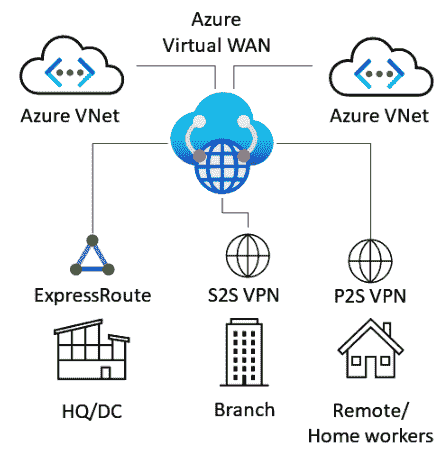

图 6.12 – Azure Virtual WAN

Azure Virtual WAN 支持以下功能：

- 点对点 (P2S) VPN 连接
- 站点到站点 (S2S) VPN 连接
- ExpressRoute 连接
- VPN 和 ExpressRoute 互连
- SD-WAN 连接
- 云内互连
- VNet 内互连
- 加密
- 路由和流量控制
- Azure 防火墙

这可以被视为一种任意到任意类型的连接解决方案。

要实现 Azure 虚拟 WAN，高级别步骤如下：

- 1. 创建 Virtual WAN 资源。
- 2. 创建 Virtual WAN 中心。
- 3. 创建 Virtual WAN 站点。
- 4. 将辐射端点连接到中心。
- 5. 下载配置文件。
- 6. 通过中心和辐射端点验证连接。

在本节中，我们介绍了 Azure Virtual WAN 并结束了 Azure 中网络连接主题的讨论。下一节将介绍在 Azure 中实现网络防护。

### 在 Azure 中实现网络防护

本节将介绍 Azure 中可用的网络防护选项。将涵盖 NSG、**应用程序安全组 (ASG)** 和 Azure 防火墙；我们将介绍用例、工作原理及其功能。

本节将首先介绍 NSG 作为第一个技能领域。

### NSG

NSG 是一种*数据包过滤*方法，用于控制流入和流出 VM 等资源的流量。

一组**入站**和**出站**规则过滤网络流量，除非*显式允许*，否则拒绝所有流量。

NSG 基于五个数据点（五元组方法）来评估访问是*允许*还是*拒绝*；这些数据点如下：

- 源
- 源端口
- 目标
- 目标端口
- 协议

以下图表表示 NSG：

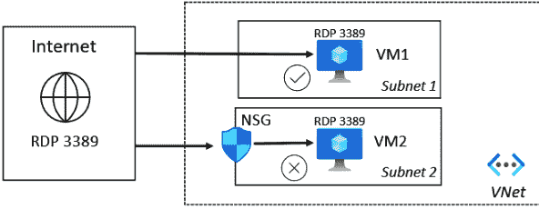

图 6.13 – NSG

NSG 可与**网络接口**或**子网**关联，但不能与 VNet 关联。子网或网络接口只能分配一个 NSG；一个 NSG 可与多个子网或网络接口关联。

**NSG 关联**在以下图表中表示：

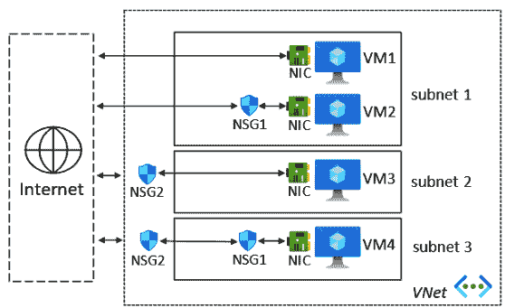

图 6.14 – NSG 关联

每条 NSG 规则都有编号；编号最低的规则将首先被评估，并根据数据点确定到目标的连接是**允许**还是**拒绝**。

每个 NSG 都有一组**默认规则**，这些规则无法修改或删除；你应添加编号更低的**自定义规则**，以便这些覆盖规则在默认规则之前被评估。最终将强制执行的默认规则是一条**拒绝全部**规则。

NSG 只能用于保护与 NSG 处于**同一订阅**和**区域**中的资源；如果需要在高度分布的 VNet 和多个区域之间执行集中式网络防护，可以使用 Azure 防火墙。

本节介绍了 NSG。在下一节中，我们将介绍 ASG。

### ASG

ASG 提供了一组可与 NSG 关联的应用程序/工作负载特定规则。简而言之，我们将 ASG 流量筛选规则基于业务逻辑层名称，而不是 IP 地址或范围。这旨在通过在业务逻辑层确定访问权限来简化网络防护规则。

ASG 提供了简化的网络安全微分段。我们可以将单个 NSG 应用于 NSG 上的所有子网，以通过流日志进行完整的流量分析。然后我们应用 ASG，每个 VM 根据其角色或网络分段成为相应 ASG 的成员；这允许对东西向和南北向流量进行精细的 VM 网络接口层控制。

该方法是通过基于业务逻辑和应用程序拓扑（而非网络地址空间拓扑）的流量筛选规则实现的。它采用声明式/基于意图的方法。与其在规则中定义要包含的特定网络 IP，不如定义你打算筛选其流量的业务逻辑名称层组，并让 Microsoft 处理所需 IP 规则的复杂性。以下图表对此进行了表示：

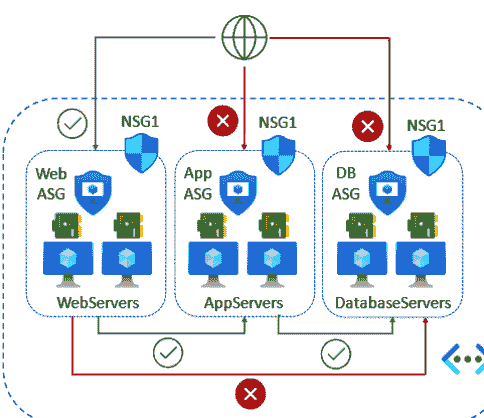

| 操作 | 源 | 目标 |
| :--- | :--- | :--- |
| 允许 | 互联网 | 10.1.1.0/24 |
| 允许 | 10.1.1.0/24 | 10.1.2.0/24 |
| 允许 | 10.1.2.0/24 | 10.1.3.0/24 |
| 拒绝 | 任意 | 任意 |

| 操作 | 源 | 目标 |
| :--- | :--- | :--- |
| 允许 | 互联网 | WebServers |
| 允许 | WebServers | AppServers |
| 允许 | AppServers | DatabaseServers |
| 拒绝 | 任意 | 任意 |

图 6.15 – ASG 关联

我们可以将此方法与 DNS 概念关联，DNS 使用名称而不是 IP 地址。在 DNS 中，我们可能不知道服务器的 IP 地址，且其 IP 地址可能会更改，因此我们关注业务逻辑，即无论资源名称是什么（它是常量），都返回 IP 地址（它可以是变量）。因此，我们可以在 ASG 中采用相同的方法，为一组 VM 资源分配别名或昵称（称为 moniker），并基于 moniker 而非网络地址设置流量筛选规则。

本节介绍了 ASG。在下一节中，我们将介绍 Azure 防火墙。

### Azure 防火墙

Azure 防火墙是一种基于云的 Microsoft 托管防火墙即服务 (FWaaS) 解决方案。它提供集中的第 3 层/第 7 层保护和控制策略。与 NSG 不同，它可跨订阅和区域工作。

流量控制通过 UDR 实现，并可为流量控制提供网络分段。

典型 Azure 防火墙网络拓扑在以下图表中表示：

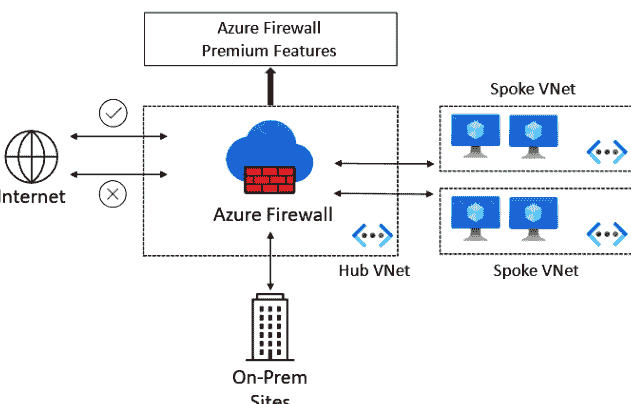

图 6.16 – Azure 防火墙

这里概述了 Azure 防火墙的一些功能：

- 目标 NAT (DNAT)
- 源 NAT (SNAT)
- 入侵防御系统 (IPS)
- 传输层安全 (TLS) 检查
- 统一资源定位符 (URL) 筛选

防火墙管理器是另一项可使用的服务。它为跨不同 Azure 区域和订阅部署的多个 Azure 防火墙提供集中式策略配置和管理。

在本节中，我们介绍了 Azure 防火墙并结束了 Azure 中网络防护主题的讨论。下一节将介绍在 Azure 中实现名称解析。

### 在 Azure 中实现名称解析

本节将介绍 Azure 中可用的名称解析选项；我们还将介绍跨本地/混合名称解析主题。

Azure DNS 是本节将介绍的第一个技能领域。

### Azure DNS

Azure DNS 是一种由 Microsoft 托管的 DNS 即服务解决方案，用于 Azure 资源的名称解析。你无需为名称解析提供自己的 DNS 服务器。

Azure DNS 服务为公共 DNS 区域和专用 DNS 区域均提供托管，Azure 可以对其具有权威性，详情如下：

- 公共 DNS：托管你的 DNS 域，并为面向互联网的 DNS 域提供名称解析
- 专用 DNS：允许在 VNet 内部及 VNet 之间进行主机名解析

将 DNS 区域迁移到 Azure DNS 后，Microsoft 的 DNS 名称服务器将响应这些区域中资源的查询。DNS 服务使用任播 DNS，这意味着查询将由地理位置距离查询最近的 DNS 服务器响应。

可以使用 Azure 门户、Azure PowerShell 或 Azure CLI 来创建和管理 Azure 公共和专用区域。

实现公共区域的高级别步骤如下：

- 1. 创建公共区域。
- 2. 向区域添加记录。
- 3. 验证区域的名称解析。


实现专用区的高级步骤如下：

- 1. 创建专用区。
- 2. 使用 Azure DNS 服务将区域链接（发布）到 VNet，以便进行名称解析。
- 3. 向区域添加记录；如有需要，启用自动注册。
- 4. 验证区域的名称解析。

对于 Azure DNS 专用区域，提供以下功能：

- 来自链接到 VM 的 VNet 的专用区域的自动注册
- 跨专用区域链接的 VNet 的 DNS 解析转发
- 在 VNet 范围内进行反向 DNS 查找

Azure DNS 的一些限制如下：

- 不支持**条件转发**；如果需要此功能，应使用自己的 DNS 服务器替代
- 不支持域名系统安全扩展（**DNSSEC**）；如果需要此功能，应使用自己的 DNS 服务器替代
- 不支持区域传输；如果需要此功能，应使用自己的 DNS 服务器替代
- 反向 DNS 仅可在链接到 VNet 的专用地址空间中进行
- 只能将一个 VNet 链接到专用区域
- 每个订阅的区域和记录数量有限制

接下来，我们将介绍 Azure VM 上的 Windows Server DNS 及其与 Azure DNS 的集成。

### Azure VM 上的 Windows Server DNS

可以使用服务器管理器在运行 Windows Server 操作系统的 Azure VM 上以与本地安装相同的方式安装 DNS 服务器角色。

可以指定 VNet 使用自己的 Windows DNS 服务器，而不是 Azure DNS；这些 DNS 服务器可以是 Azure VM DNS 服务器，也可以是连接到 Azure VNet 的本地 DNS 服务器。

在以下情况下，您可能决定在 Azure VM 上实现 Windows Server DNS 以替换或补充 Azure DNS：

- 需要在 VNet 之间进行名称解析
- 需要从本地解析 Azure 名称
- 需要条件转发器
- 需要区域传输

可以在 Azure VNet DNS 服务器 | 自定义设置中设置您自己的 Windows DNS 服务器，如下图所示：

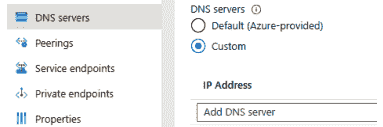

图 6.17 – 自定义 DNS 服务器设置

下图表示使用 Windows Server DNS 和 Azure DNS 进行混合名称解析：

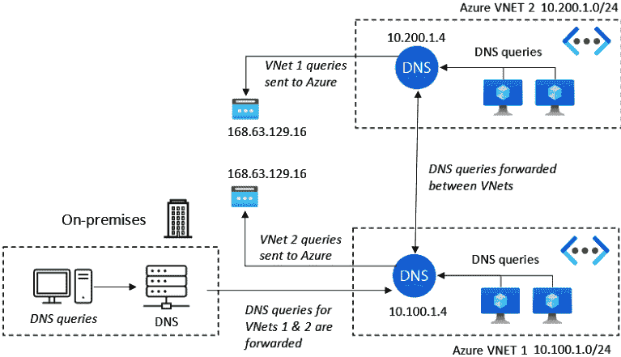

图 6.18 – 混合名称解析

在前面的图中，附加到 VNet 的 Windows Server DNS 服务器可以响应其本地域（如其自身权威区域）的查询，并使用 Azure 中的递归解析器来处理需要解析其无记录的 Azure 主机名的转发查询。

Azure DNS 递归 DNS 解析器使用的地址是 168.63.129.16。

接下来，我们将介绍 Azure 中的分区 DNS。

### Azure 中的分区 DNS

分区 DNS 使用相同的名称来解析内部和外部资源的名称。它也称为分脑 DNS。

这通过为同一域创建两个区域来实现；一个用于内部资源查询，另一个用于外部资源查询。

在 Azure DNS 中，这是通过创建两个同名区域来实现的，例如 milesbetter.solutions。

应按如下方式创建和配置 milesbetter.solutions 区域：

- 专用区域记录：

| 主机 | 记录类型 | IP 地址 |
|---|---|---|
| pizzapp | CNAME | mbs1.milesbetter.solutions |
| mbs1 | A | 10.5.1.4 |

- 公共区域记录：

| 主机 | 记录类型 | IP 地址（公共） |
|---|---|---|
| pizzapp | A | 123.456.789 |

此配置会根据客户端位于内部网络还是外部网络，返回正确的查找和信息。

在本节中，我们介绍了 Azure VM 上的 Windows Server DNS，并结束了 Azure 中实现名称解析的主题。在下一节中，我们将完成动手练习部分，以巩固本章中介绍的一些概念。

### 动手练习

为了帮助您获得一些实用技能，我们将利用本章前面部分获得的概念和理解，并将其付诸实际应用。

我们将介绍以下练习：

- 练习—实现 Azure VNet
- 练习—实现 NSG
- 练习—实现 Azure DNS
- 练习—实现 Azure VPN 网关
- 练习—实现 VNet 对等互连

### 开始使用

要开始本节，如果您还没有 Azure 订阅，可以在 https://azure.microsoft.com/free 创建免费 Azure 帐户。此免费 Azure 帐户提供以下内容：

- 12 个月的免费服务
- 200 美元的信用额度，用于 30 天内探索 Azure
- 25 多项始终免费的服务

让我们进入本章的练习。

### 练习 – 实现 Azure VNet

在本练习中，我们将创建 Azure VNet。

按照以下步骤创建 VNet：

- 1. 登录 Azure 门户：https://portal.azure.com。您也可以使用 Azure 桌面应用：https://portal.azure.com/App/Download。
- 2. 在搜索栏中输入 virtual networks；从显示的服务列表中单击“虚拟网络”：

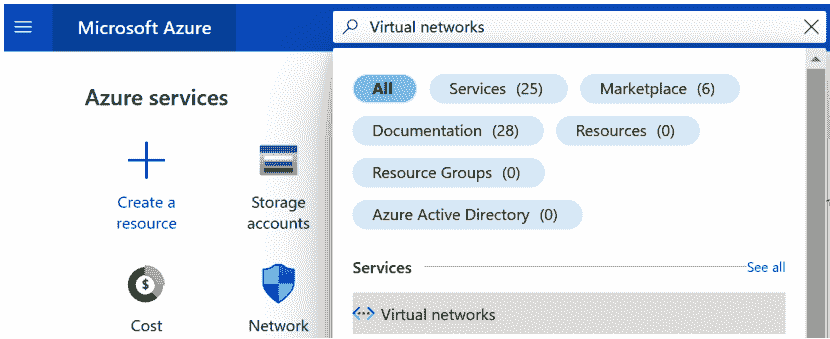

图 6.19 – 搜索虚拟网络资源

- 3. 从 **虚拟网络** 边 blade 中，单击边 blade 菜单中的 + **创建** 选项，或使用边 blade 底部的 **创建虚拟网络** 按钮。可选：单击 **了解更多** 超链接以获取更多信息和学习内容：

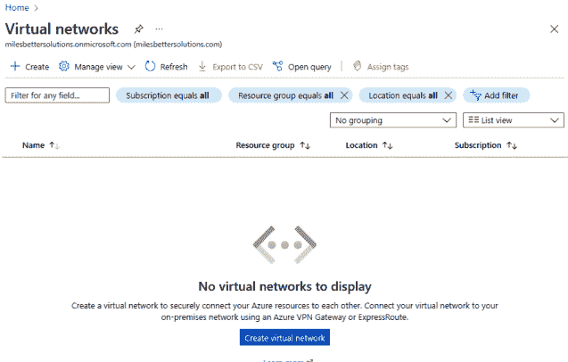

图 6.20 – 创建 VNet

- 4. 在 **基础** 选项卡上按需完成 **项目详细信息** 和 **实例详细信息** 设置：

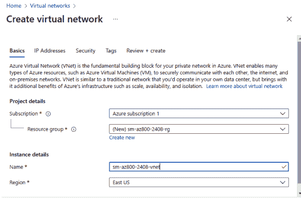

图 6.21 – VNet 基础选项卡

- 5. 单击“下一步: IP 地址”。

- 6. 创建 IPv4 地址空间和子网；对于本练习，使用现有默认值：

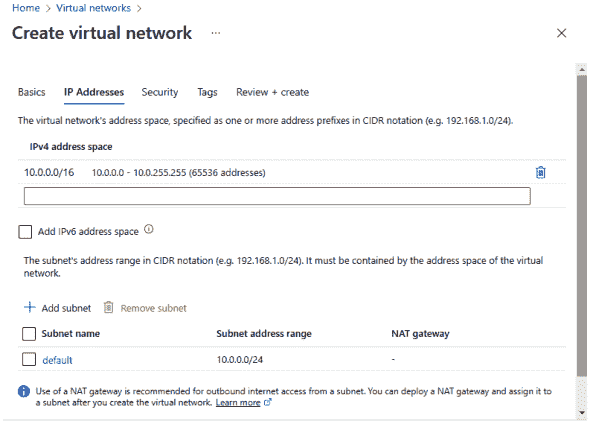

图 6.22 – VNet IP 地址选项卡

- 7. 单击“下一步: 安全”。

- 8. 保留 BastionHost、DDoS 防护标准和防火墙的默认禁用设置：

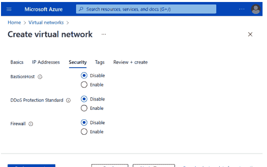

图 6.23 – VNet 安全选项卡

- 9. 单击“下一步: **标记**”并跳过本练习的任何信息输入。然后，单击“下一步: **查看 + 创建**”：

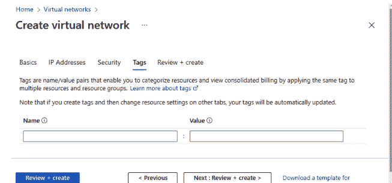

图 6.24 – VNet 标记选项卡

- 10. 在 **查看 + 创建** 选项卡上，查看您的设置；如有需要，可以返回之前的选项卡进行任何编辑。确认设置符合要求后，可以单击 **创建**：

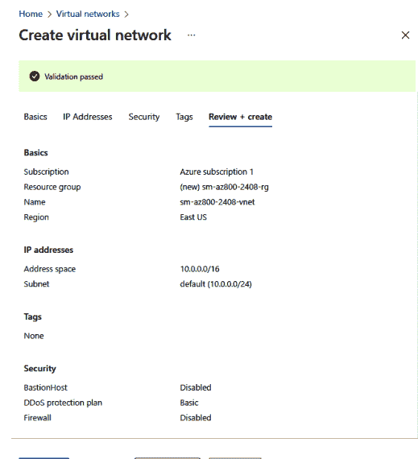

图 6.25 – VNet 查看 + 创建选项卡

- 11. 您将收到“部署成功”通知。单击“转到资源”或导航到“虚拟网络”边 blade：

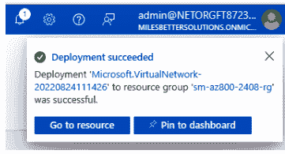

图 6.26 – VNet 部署成功

- 12. 在“虚拟网络”边 blade 中，可以查看已创建的 VNet：

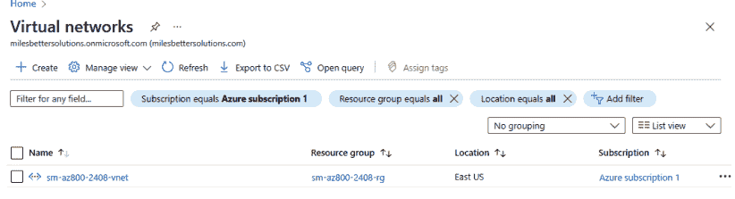

图 6.27 – 已创建的 VNet

至此，我们已完成本练习。它教授了实现 Azure VNet 所需的技能。下一个练习将介绍实现 NSG。

### 练习 – 实现 NSG

在本练习中，我们将创建 VM 并在子网级别关联 NSG。然后，我们将添加规则以允许远程桌面协议 (RDP) 访问并拒绝出站 Internet 访问。

在以下子部分中，您可以看到完成练习的步骤，已按任务划分，以便更好地理解。

### 任务 1 – 访问 Azure 门户

- 1. 登录 Azure 门户：https://portal.azure.com。您也可以使用 Azure 桌面应用：https://portal.azure.com/App/Download。


### 任务 2 – 创建虚拟机

- 在搜索栏中输入 virtual machines；从服务列表中单击 Virtual machines：

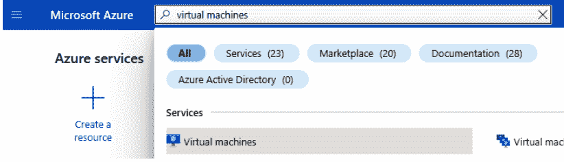

图 6.28 – 搜索 VM 资源

- 从虚拟机边栏，单击边栏顶部菜单中的 + 创建，然后单击虚拟机。可选：单击了解更多超链接以获取更多信息和学习：

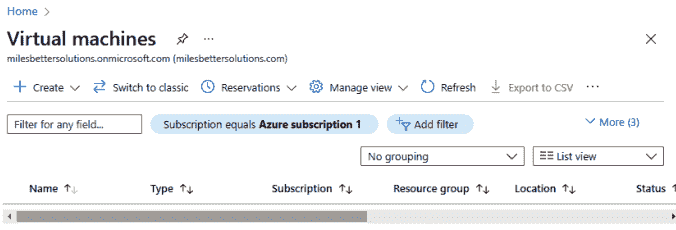

图 6.29 – 创建 VM

- 按要求设置项目详细信息的订阅和资源组值。

- 设置实例详细信息值，如下：

  - 虚拟机名称：输入名称

  - 区域：选择区域

  - 可用性选项：保留默认选定

  - 安全类型：保留默认选定

  - 映像：选择 Windows Server 映像

  - 大小：保留默认选定或按要求选择：

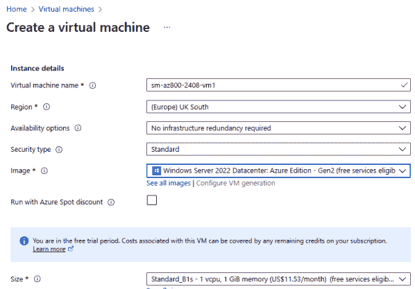

图 6.30 – 创建 VM：设置

- 按要求设置管理员帐户用户名和密码：

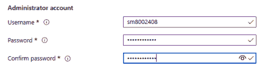

图 6.31 – 创建 VM：设置（续）

- 将公共入站端口规则设置为无：

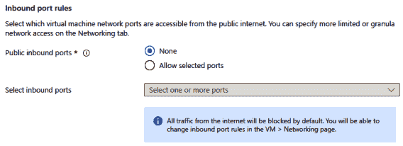

图 6.32 – 创建 VM：设置（续）

- 对于此练习，将许可设置为未选中的默认值；即，不使用现有的 Windows Server 许可证。

- 单击下一步：磁盘。

- 对于此练习，保留磁盘选项卡的默认设置：

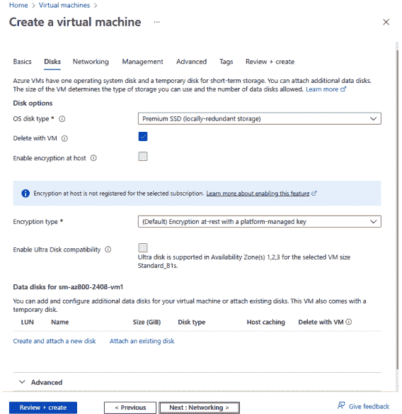

图 6.33 – 创建 VM：设置（续）

- 单击下一步：网络。

- 从网络接口，设置以下内容：

  - **虚拟网络**：使用提供的默认值

  - **子网**：使用提供的默认值

  - **公共 IP**：单击创建新，输入名称，然后单击确定

  - **NIC 网络安全组**：选择无

  - **删除 VM 时删除公共 IP 和 NIC**：选中以启用/允许

  - 将所有其他设置保留为默认值：

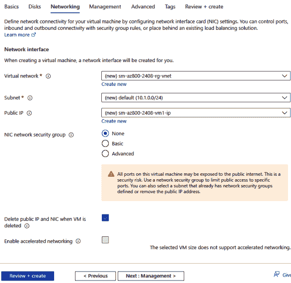

图 6.34 – 创建 VM：设置（续）

- 单击下一步：管理。

- 保留默认设置。

- 单击下一步：高级。

- 保留默认设置。

- 单击下一步：标记，对于此练习跳过输入任何信息。然后，单击下一步：查看 + 创建。

- 在 **查看 + 创建** 选项卡上，_查看你的设置_；你可以返回之前的选项卡并在需要时进行任何编辑。确认设置符合要求后，可以单击 **创建**：

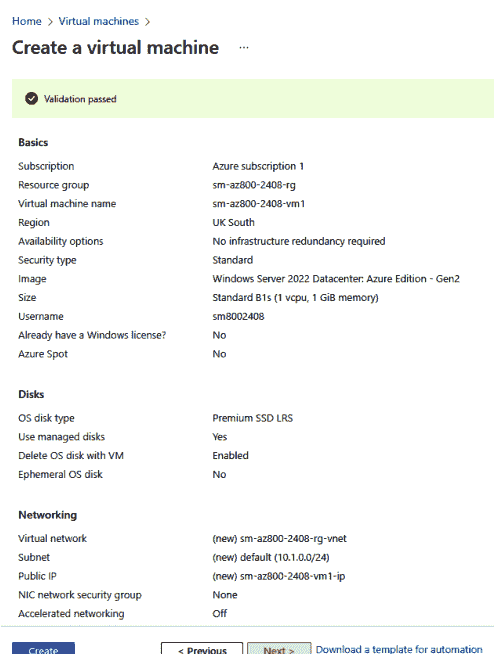

图 6.35 – 创建 VM：查看 + 创建选项卡

- 你将收到资源部署成功的通知：

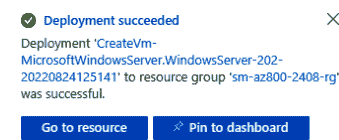

图 6.36 – VM 部署成功

### 任务 3 – 创建 NSG

- 在搜索栏中输入 `network security groups`；从服务列表中单击 **网络安全组** (_不_ 是 **网络安全组（经典）**)：

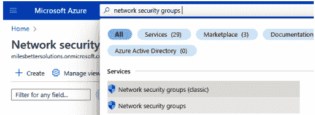

图 6.37 – 搜索 NSG 资源

- 从 **虚拟机** 边栏，单击边栏顶部菜单中的 + **创建**。可选，单击 **了解更多** 超链接以获取更多信息和学习：

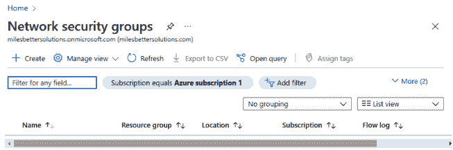

图 6.38 – 创建 NSG

- 按要求完成 **项目详细信息** 和 **实例详细信息** 设置。将 **区域** 设置为与创建 VM 相同的位置：

主页 > 网络安全组 >

创建网络安全组...

**基础** 标记 查看 + 创建

**项目详细信息**

| 字段 | 值 |
| --- | --- |
| 订阅 * | Azure 订阅 1 |
| 资源组 * | sm-az800-2408-rg 创建新 |

**实例详细信息**

| 字段 | 值 |
| --- | --- |
| 名称 * | sm-az800-2408-nsg |
| 区域 * | 美国东部 |

[查看 + 创建] [< 上一步] [下一步：标记 >] 下载用于自动化的模板

图 6.39 – 创建 NSG：设置

- 单击 **下一步：标记** 并按要求添加任何标记，然后单击 **下一步：查看 + 创建**。

- 在 **查看 + 创建** 选项卡上，_查看你的设置_；你可以返回之前的选项卡并在需要时进行任何编辑。确认设置符合要求后，可以单击 **创建**。

- 你将收到资源 _已成功创建_ 的通知。

- 从 **部署** 边栏单击 **前往资源**；或者，导航到 **Azure NSG** 实例。

### 任务 4 – 将 NSG 与子网关联

- 从创建的网络安全组实例边栏，在设置下单击子网：

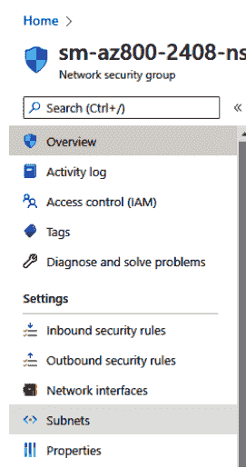

图 6.40 – 已创建 NSG

- 从顶部工具栏单击 + 关联：

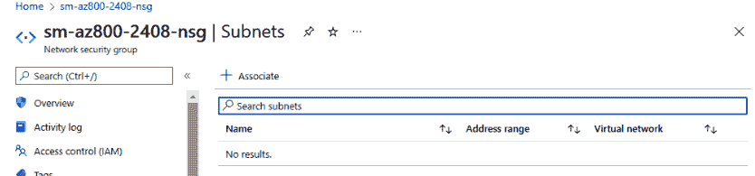

图 6.41 – 关联 NSG

- 从 **关联子网** 边栏，选择在上一个练习中创建的 VM 的 **虚拟网络** 和 **子网** 配置：

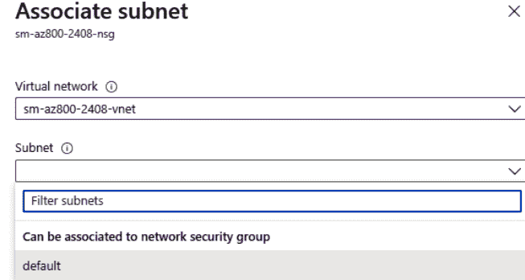

图 6.42 – 关联 NSG（续）

- 单击确定。

- 你将收到更改 _已成功保存_ 的通知。

### 任务 5 – 添加入站规则以允许 RDP 访问

- 导航到在本练习中创建的 NSG。请注意，除非源是 **VirtualNetwork** 或 **Azure LoadBalancer**，否则所有 _入站连接_ 都是 **拒绝** 的。我们将在下一个任务中处理此问题。

- 从 **网络安全组** 边栏，在 **设置** 下单击 **入站安全规则**：

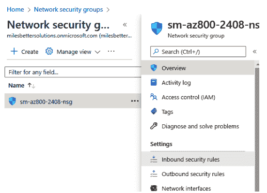

图 6.43 – 已创建 NSG

- 从 **入站安全规则** 边栏，单击 + 添加：

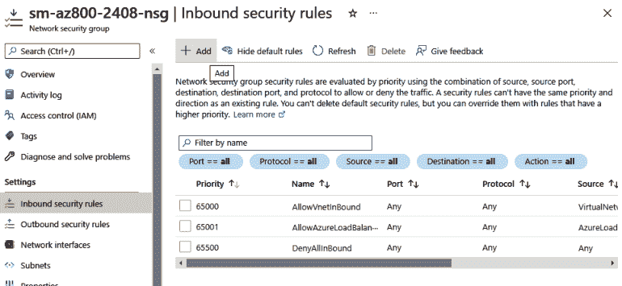

图 6.44 – 添加 NSG

- 打开浏览器，在 Google 中输入 what's my IP，并记下你的 IP 以供下一步使用。

- 从 **添加入站安全规则** 边栏，设置以下内容：

  - **源：** 选择 IP 地址

  - **源 IP 地址/CIDR 范围：** 将此设置为任务第 4 步中 Google 结果的你的 IP

  - 源端口范围：保留默认值 *（星号符号）

  - 目标：保留默认值 任何

  - 服务：选择 RDP

  - 操作：确保设置为 允许

  - 优先级：保留默认值 100

  - 名称：提供名称，例如 AllowInbound_RDP_KnownIP

  - 说明：按要求输入说明

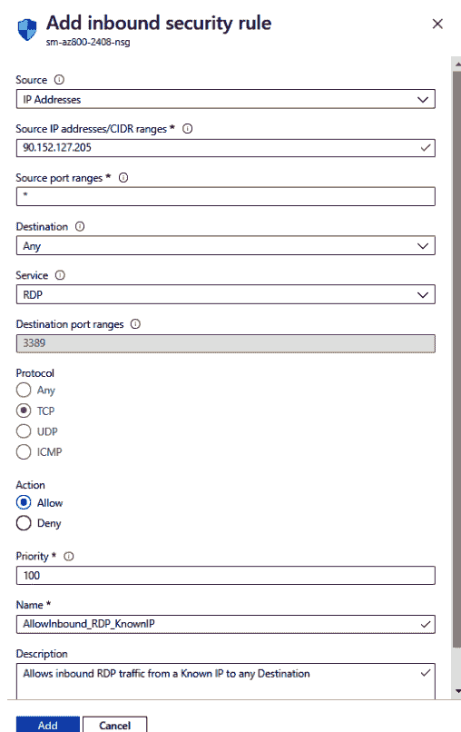

图 6.45 – 添加 NSG（续）

- 单击添加。

- 你将收到规则已成功创建的通知：

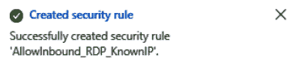

图 6.46 – 已创建 NSG

### 任务 6 – 通过 RDP 连接访问 VM

- 导航到虚拟机边栏，并在概述边栏上单击连接，然后单击 RDP：

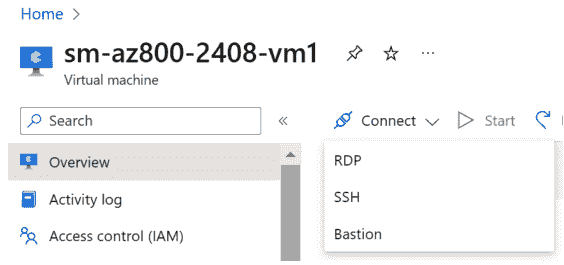

图 6.47 – VM 连接

- 在连接边栏上，单击下载 RDP 文件按钮：

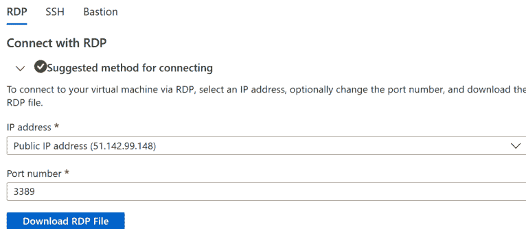

图 6.48 – VM 连接（续）

- 从保存位置打开 RDP 文件。

- 单击 **连接** 以启动本任务规则集允许的 RDP 会话：

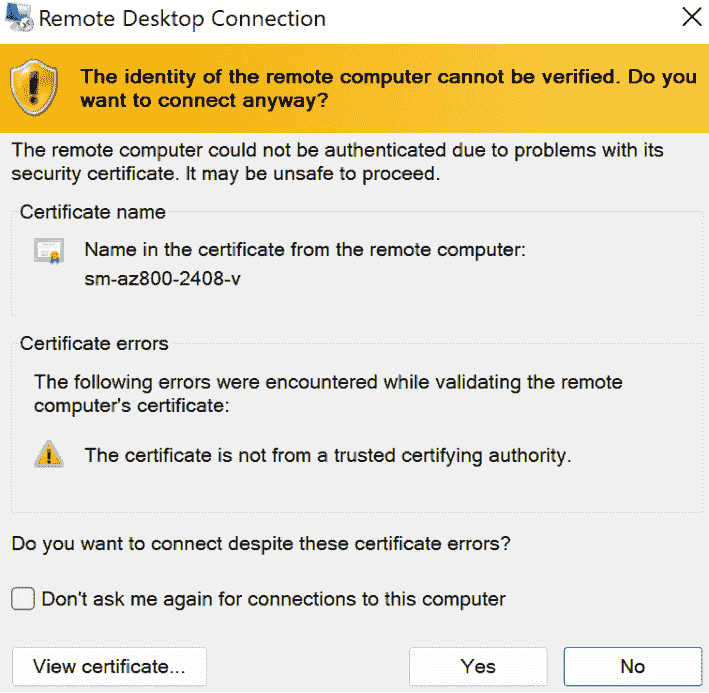

图 6.49 – 远程桌面连接

### 任务 7 – 从 VM 访问 Internet

- 登录到 VM 后，打开浏览器，并通过访问 `https://docs.microsoft.com` 等网站确认已连接 Internet。你可能需要调整浏览器安全设置。我们将在下一个练习中限制对 Internet 的访问：

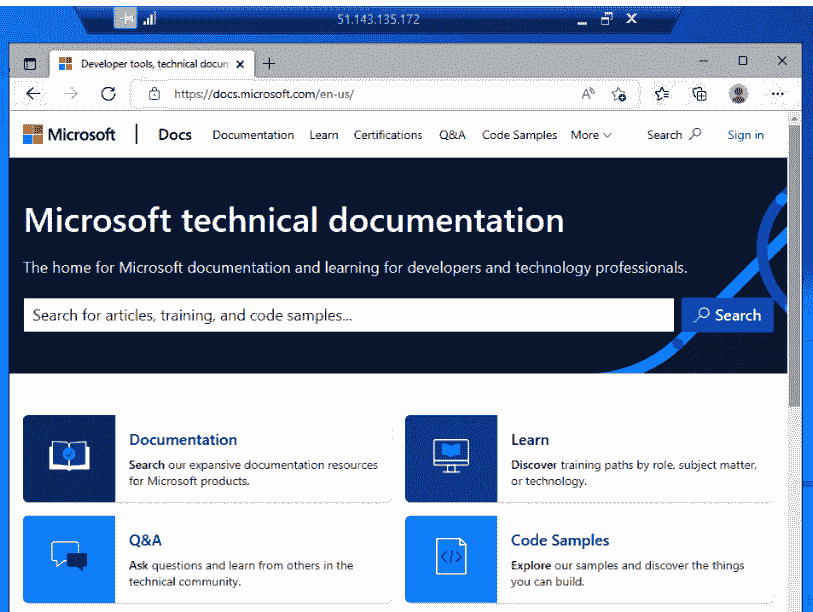

图 6.50 – 访问 Internet

### 任务 8 – 添加出站规则以拒绝 Internet 访问

- 在虚拟机边栏上，在设置下单击网络；你将从出站端口规则选项卡中看到，所有出站连接都允许访问 Internet。

- 在出站端口规则选项卡上，单击添加出站端口规则。

- 在添加出站安全规则边栏上，除以下内容外，保留所有其他选项的默认值：

  - 目标：选择服务标记

  - 目标服务标记：选择 Internet


- 目标端口范围：输入 * 符号（星号符号）
- 操作：确保设置为 Deny
- 优先级：保留默认值 100
- 名称：提供一个名称，例如 DenyOutbound_Internet
- 描述：按要求输入：

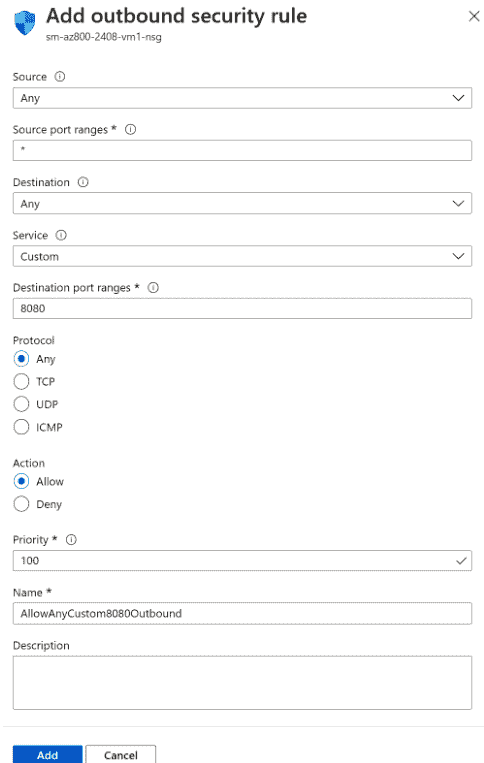

图 6.51 – 添加 NSG 规则

- 4. 单击添加。
- 5. 将收到一条通知，指示规则已成功创建。

- 6. 新规则将显示在列表中：


图 6.52 – 已添加新的 NSG 规则

- 7. 在 VM 中，再次打开浏览器，并通过访问 https://docs.microsoft.com 等网站确认已无法连接到互联网。

- 8. 这一次，您将看到来自浏览器的消息，例如“Hmmm... 无法访问此页面”：


图 6.53 – 已拒绝互联网访问

至此，我们已完成本练习。本练习教会了我们实现和配置 NSG 所需的技能。下一个练习将介绍实现 Azure DNS。

### 练习 – 实现 Azure DNS

本练习将介绍在 Azure DNS 中创建和配置公共区域和专用区域。

在以下小节中，您可以看到完成练习的步骤，按任务划分以便更好地理解。

### 任务 1 – 访问 Azure 门户

- 1. 登录 Azure 门户：https://portal.azure.com。或者，您也可使用 Azure 桌面应用：https://portal.azure.com/App/Download。

### 任务 2 – 创建公共区域

- 1. 在搜索栏中输入 dns zone；从服务列表中单击 DNS zones：


图 6.54 – 搜索 Azure DNS 区域资源

- 2. 在 DNS 区域边栏上，单击边栏顶部菜单中的 + 创建。可选：单击了解更多超链接以获取更多信息并进行学习：


图 6.55 – 创建 DNS 区域

- 3. 按需完成 **项目详细信息** 和 **实例详细信息** 设置。
- 4. 单击 **下一步：查看 + 创建**。
- 5. 在 **查看 + 创建** 选项卡上，查看您的设置；如有需要，您可以返回之前的选项卡并进行任何编辑。确认设置符合要求后，即可单击 **创建**。
- 6. 您将收到一条通知，指示资源已 **成功创建**。
- 7. 从 **部署** 边栏单击 **转到资源**；或者，导航到 **DNS 区域** 边栏。

### 任务 3 – 添加记录

- 1. 在 **所有资源** 中搜索创建的区域，或导航到 **DNS 区域** 边栏并打开您创建的区域。
- 2. 从 **DNS 区域** 边栏，单击边栏顶部菜单中的 **+ 记录集**。
- 3. 从 **添加记录集** 边栏，输入所需信息，然后单击 **确定**。
- 4. 从 **DNS 区域** 边栏，查看您添加的记录：

| 名称 | 类型 | TTL | 值 |
|---|---|---|---|
| @ | NS | 172800 | ns1-09.azure-dns.com, ns2-09.azure-dns.net, ns3-09.azure-dns.org, ns4-09.azure-dns.info. |
| @ | SOA | 3600 | 电子邮件: azure-dns-hostmaster.microsoft.com, 主机: ns1-09.azure-dns.com, 刷新: 3600, 重试: 300, 过期: 2419200, 最小 TTL: 300, 序列号: 1 |
| az800 | A | 3600 | 10.0.0.4 |

图 6.56 – 添加 DNS 记录

对于本练习，我们使用了示例名称和记录；您应使用满足您要求的示例。

- 5. 要测试名称解析，请打开命令提示符并运行以下命令：

```
nslookup az800.milesbetter.com ns1-01.azure-dns.com
```

使用与您环境相关的完全限定域名 (FQDN) 和名称服务器的信息进行替代。

- 6. 您应看到如下响应：

```
:Users\SteveMiles>nslookup az800.milesbetter.com ns1-01.azure-dns.com
Server: UnKnown
Address: 40.90.4.1
Name: az800.milesbetter.com
Address: 10.0.0.4
```

图 6.57 – nslookup 命令输出

### 任务 4 – 创建专用区域

- 1. 在搜索栏中输入 **专用 DNS 区域**；从服务列表中单击 **专用 DNS 区域**。
- 2. 在 **专用 DNS 区域** 边栏上，单击边栏顶部菜单中的 + **创建**。可选：单击 **了解更多** 超链接以获取更多信息并进行学习。
- 3. 按需完成 **项目详细信息** 和 **实例详细信息** 设置。
- 4. 单击 **下一步：查看 + 创建**。
- 5. 在 **查看 + 创建** 选项卡上，**查看您的设置**；如有需要，您可以返回之前的选项卡并进行任何编辑。确认设置符合要求后，即可单击 **创建**。
- 6. 您将收到一条通知，指示资源已 **成功创建**。
- 7. 从 **部署** 边栏单击 **转到资源**；或者，导航到 **专用 DNS 区域** 边栏。

### 任务 5 – 链接 VNet

- 1. 在 **所有资源** 中搜索创建的区域，或导航到 **专用 DNS 区域** 边栏并打开您创建的区域。
- 2. 从 **专用 DNS 区域** 边栏，在 **设置** 下选择 **虚拟网络链接**。
- 3. 从 **虚拟网络链接** 边栏，单击边栏顶部菜单中的 + **添加**。
- 4. 输入 **链接名称** 值。
- 5. 选择 **订阅** 类型。
- 6. 选择要将区域链接到的 **虚拟网络** 配置。
- 7. 可选：选择是否启用自动注册。
- 8. 选择 **确定**。
- 9. 您将收到一条通知，指示资源已 **成功创建**。
- 10. 从 **部署** 边栏单击 **转到资源**；或者，导航到 **专用 DNS 区域** 边栏。
- 11. 添加和测试记录的过程与我们在 **创建公共区域** 任务中完成的步骤相同。

至此，我们已完成本练习。本练习教会了我们实现 Azure DNS 所需的技能。下一个练习将介绍创建 Azure VPN 网关。

### 练习 – 实现 Azure VPN 网关

在本练习中，我们将创建 Azure VPN 网关，用于与本地资源进行混合连接。

对于本练习，您需要准备好以下内容：

- • 一个 Azure VNet；您可以使用现有 VNet 或本章 VNet 创建练习中的 VNet

在以下小节中，您可以看到完成练习的步骤，按任务划分以便更好地理解。

按照以下任务中的步骤创建 VPN 网关（VNet 网关）。

### 任务 1 – 访问 Azure 门户

- 1. 登录 Azure 门户：https://portal.azure.com。或者，您也可使用 Azure 桌面应用：https://portal.azure.com/App/Download。

### 任务 2 – 创建 VNet 网关

- 1. 在搜索栏中输入虚拟网络网关；从显示的服务列表中单击虚拟网络网关：


图 6.58 – 搜索 VNet 网关资源

- 2. 从 **虚拟网络网关** 边栏，单击边栏顶部菜单中的 + **创建** 选项，或使用边栏底部的 **创建虚拟网络网关** 按钮。可选：单击 **了解有关虚拟网络网关的详细信息** 超链接以获取更多信息并进行学习。


图 6.59 – 创建 VNet

- 3. 在 **创建虚拟网络网关** 边栏上，选择要用于本练习资源的订阅，然后选择您的 VNet；这将自动填充 **资源组** 字段：

主页 > 虚拟网络网关 >

创建虚拟网络网关 ...

项目详细信息

选择要管理已部署资源和成本的订阅。使用资源组（如文件夹）来组织和管理所有资源。

订阅 * Visual Studio Enterprise

资源组 (i) sm-149-az800-RG (源自虚拟网络的资源组)

实例详细信息

名称 * 区域 * 美国东部 网关类型 * VPN ExpressRoute VPN 类型 * Route-based Policy-based SKU * VpnGw2AZ 代 * 第2代

虚拟网络 * (i) (新建) sm-149-az800-VNetA 创建虚拟网络

仅列出当前所选订阅和区域中的虚拟网络。

图 6.60 – 创建 VNet（续）

- 4. 完成以下设置，并将所有其他条目保留为默认值：

- **名称：** 输入您选择的名称
- **区域：** 此处必须保留为所使用 VNet 的区域
- **SKU：** VpnGw1
- **公共 IP 地址名称：** 输入您选择的名称：


图 6.61 创建 VNet（续）

- 5. 单击“下一步: 查看 + 创建”。

- 6. 在“查看 + 创建”选项卡上，查看您的设置；您可以返回到之前的选项卡，如有需要进行任何编辑。确认设置符合要求后，可以单击“创建”：


图 6.62 审查设置

- 7. 创建过程可能需要长达 1 小时。

- 8. 您将收到通知，表明资源已成功创建。

- 9. 从部署边栏单击“转到资源”；或者，导航到“虚拟网络网关”边栏以审查所创建的资源。

至此，我们已完成此练习。本练习教会了我们实现 Azure VPN 网关所需的技能。在下一个练习中，我们将学习实现 VNet 对等互连。

### 练习 – 实现 VNet 对等互连

在本练习中，我们将学习在两个 VNet 之间添加对等互连关系，以便资源可以通过 Microsoft 骨干网进行通信，而无需经过公共 Internet。

本练习需要您具备以下条件：

- • 两个 Azure VNet；您可以使用现有 VNet，或使用本章 VNet 创建练习中的 VNet 并创建另一个进行对等互连

按以下步骤添加 VNet 对等互连。

### 任务 – 添加 VNet 对等互连

- 1. 登录 Azure 门户: https://portal.azure.com。或者，您也可以使用 Azure 桌面应用: https://portal.azure.com/App/Download。

- 2. 导航到**虚拟网络**边栏，单击要设置对等互连的第一个 VNet（从 VNet 列表中选择）。然后，在“设置”部分下单击**对等互连**：


图 6.63 选择要对等互连的第一个 VNet

- 3. 从**虚拟网络对等互连**边栏，单击 **+ 添加** 选项。

- 4. 从**添加对等互连**边栏，设置以下项；其余均保持默认值：

- • **此虚拟网络 - 对等互连链接名称**: 输入您选择的名称

- • **远程虚拟网络 – 对等互连链接名称**: 输入您选择的名称

- • **虚拟网络**: 选择您希望与之建立对等互连的 VNet，即远程 VNet

- 5. 您将收到通知，表明对等互连已成功添加：


图 6.64 对等互连已成功添加

- 6. 从“对等互连”边栏，您将看到已添加对等互连，对等互连状态为“已连接”，并显示远程 VNet 对等互连：


图 6.65 VNet 对等互连

至此，我们已完成本练习。本练习教会了我们实现 Azure VNet 对等互连所需的技能。现在，让我们总结本章。

### 摘要

本章旨在将您的知识提升至考试目标之外；我们通过提供的内容增加了新技能和学习。这将进一步提升您的知识和技能，用于本地网络基础设施服务，并使您能够胜任以现实世界日常混合环境为重点的角色。

本章内容涵盖了 AZ-800 管理 Windows Server 混合核心基础设施考试中“实现和管理 Azure 网络基础设施”技能大纲部分的信息。

我们学习了 Azure 中的一些核心网络服务组件，例如实现 VNet 和 DNS，以及查看连接选项和网络保护方面。随后的动手练习完成了本章，以进一步发展您的技能。

下一章将讲授实现和管理 Azure 网络基础设施。

## 进一步阅读

本节提供额外学习参考和考试信息的链接：

- Microsoft Certified: Windows Server 混合管理员专家: https://docs.microsoft.com/en-us/learn/certifications/windows-server-hybrid-administrator/
- 考试 AZ-800: 管理 Windows Server 混合核心基础设施: https://docs.microsoft.com/en-us/learn/certifications/exams/az-800
- 考试 AZ-800: 技能大纲: https://query.prod.cms.rt.microsoft.com/cms/api/am/binary/RWKi0r
- Microsoft Learn: https://docs.microsoft.com/en-us/learn/paths/implement-operate-premises-hybrid/

## 技能检查

用本章所学知识挑战自己：

- 1. 什么是 Azure VNet？
- 2. 支持创建哪些 IP 类型？
- 3. VNet 子网中有多少个 IP 地址被保留，它们的用途是什么？
- 4. VM 如何与 Azure 中的其他资源通信？
- 5. 什么是 VNet 对等互连？
- 6. 支持哪些 VPN 类型来连接到 Azure？
- 7. 什么是 VPN 网关，可以创建哪些类型？
- 8. 什么是 ExpressRoute，它的优势是什么？
- 9. 什么是 Azure Virtual WAN？
- 10. 什么是 Azure 扩展网络，使用场景是什么？
- 11. 解释 Azure 中的 VNet 路由以及 NVA 的用途。
- 12. 什么是 NSG 和 ASG？
- 13. 什么是 Azure 防火墙？
- 14. 什么是 Azure DNS？
- 15. Azure DNS 的限制是什么，何时可能仍需要 Windows Server DNS？
