## 实现 Windows Server 存储服务

在上一章中，我们增加了理解 Azure 网络基础设施和服务概念的技能。

本章涵盖了 _AZ-800 管理 Windows Server 混合核心基础设施：管理存储和文件服务。_ 的内容。

我们将从理解 Windows Server 文件系统和协议的基础知识开始本章；然后，我们将学习如何实现和管理基于 Windows Server 的存储服务和解决方案。我们将以一个动手练习结束，以进一步提升您的技能。

本章包含以下主题：

- 管理 Windows Server 文件服务器
- 实现 Windows Server iSCSI
- 实现存储空间和存储空间直通
- 实现 Windows Server 数据删除重复
- 实现 Windows Server 存储复制
- 实现分布式文件系统
- 动手练习

除了本章列出的主题外，本章的目标是将您的知识提升至考试目标之外，为您胜任以现实世界日常混合环境为重点的角色做好准备。

### 管理 Windows Server 文件服务器

本节将探讨 Windows Server 中的基于文件的存储解决方案。我们将从定义和概念开始本章，以帮助建立您可以在此基础上构建的知识基线和基础。

### 什么是 Windows Server 文件系统？

当磁盘呈现给计算机时，为了将其用于存储数据，必须为其创建卷，然后使用文件系统对其进行格式化。在本节中，我们将探讨什么是文件系统。

文件系统是一种机制或结构，允许您以层次结构组织文件及其访问。它包含在卷上创建的目录和文件夹。它允许您控制可存储的命名约定和格式。它还通过访问控制提供安全性和保护。

以下文件系统类型可用于 Windows Server 存储系统：

- 文件分配表 (FAT)、FAT32、扩展文件分配表 (exFAT)
- 新技术文件系统 (NTFS)
- 弹性文件系统 (ReFS)

在以下部分中，我们将研究这些文件系统以及 Windows Server 上可用的其他文件系统技术。

### 什么是 FAT、FAT32 和 exFAT 文件系统？

FAT 是 Windows 使用的最简单但最不安全的文件系统。它使用卷级表来存储文件系统对象；根目录和表固定在格式化的磁盘上。为了容错，会保留两份表的副本。

FAT 的最大卷大小为 4 GB；FAT32 和 exFAT 支持最大 64 GB 的分区。

FAT 或 FAT32 没有安全机制，因此您不应在任何 Windows Server OS 计算机上使用这些卷类型。USB 闪存驱动器等外部媒体是 FAT、FAT32 和 exFAT 文件系统的预期用例。

### 什么是 NTFS 文件系统？

NTFS 是标准的 Windows Server OS 文件系统。

与 FAT、FAT32 和 exFAT 不同，NTFS 的安全性是内置的，并提供文件和文件夹访问控制列表 (ACL) 以提供对文件和文件夹结构的精细访问和控制。NTFS 还提供加密和压缩；文件或文件夹只能加密或压缩，不能同时进行。


NTFS 的预期用例是用于 Windows Server 操作系统的启动卷和数据卷。

诸如 Active Directory 域服务 (AD DS)、卷阴影服务 (VSS) 和分布式文件系统 (DFS) 等 Windows Server 角色将需要将 NTFS 作为文件系统。

### ReFS 是什么？

弹性文件系统 (ReFS) 是随 Windows Server 2012 操作系统引入的。正如其名称所示，相对于 NTFS 的主要增强在于其数据损坏增强功能。ReFS 支持最大 35 PB（拍字节）。

与 NTFS 类似，安全性是内置的，并提供文件和文件夹 ACL 以对文件和文件夹结构提供精细访问和控制。但是与 NTFS 不同，它不提供加密或压缩。

ReFS 的预期用例是数据卷，而非启动卷或可移动介质。

### 什么是 FSRM？

文件服务器资源管理器 (FSRM) 是包含在 Windows Server 文件和存储服务器角色中的一项功能。

它用于管理和分类存储在文件服务器上的数据。可以对文件夹设置配额，可创建报告以监控存储使用情况，并且文件可以根据执行的任务自动分类。FSRM 管理控制台可见于以下屏幕截图中：

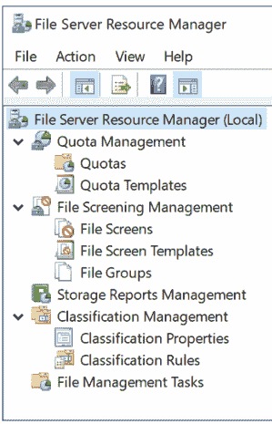

图 7.1 – FSRM 控制台

FSRM 的功能如下：

- 配额管理
- 文件筛选管理
- 存储报告管理
- 文件分类基础架构
- 访问被拒绝协助

FSRM 使用文件服务器资源管理器应用或 PowerShell 进行配置和管理。FSRM 仅支持 NTFS 格式的文件系统，不支持 ReFS。

可以创建配额来限制卷或文件夹大小；自动生成的配额也可以应用于现有卷或文件夹的子文件夹以及将来创建的任何子文件夹。还可以为卷和文件夹创建配额模板以强制执行公司范围的治理。对于达到或超过的配额限制，可以发送电子邮件通知。

文件筛选管理功能允许控制用户可以保存的文件类型，例如不允许音乐文件或可执行文件。可以对新卷和文件应用文件筛选模板，以便强制执行公司范围的治理；可以创建文件筛选例外。当用户尝试保存未经授权的文件时，可以生成通知。

### 什么是 SMB？

服务器消息块 (SMB) 是用于基于 TCP/IP 网络的文件共享协议。应用程序使用该协议来访问远程服务器上的文件。

SMB 3.0 是在 Windows Server 2012 中引入的，并包含以下功能：

- SMB 多通道
- SMB Direct
- SMB 透明故障转移
- SMB 横向扩展
- SMB 加密
- PowerShell 管理命令

SMB 3.1.1 是在 Windows Server 2016 中引入的，并提供了改进的加密、预身份验证完整性以提供中间人攻击防护，以及移除 RequireSecureNegotiate 设置并具备在需要时禁用安全协商的能力。

### 什么是 VSS？

Windows Server 使用 VSS 执行备份。对于要备份的数据，VSS 协调活动以确保数据的一致副本。这些数据副本称为 **阴影副本**，也称为 **快照** 或 **时间点** 副本。VSS 解决方案包含以下组件：

- **VSS 服务**：这是协调和编排操作的 OS 组件。
- **VSS 请求者**：请求者通常是请求 VSS 服务的备份软件（例如 Windows Server 备份）。它请求阴影副本操作，如 *创建*、*导入* 和 *删除*。
- **VSS 写入器**：此组件为备份操作提供保证一致的数据集。写入器通常是被备份工作负载应用程序的一部分，例如 Microsoft SQL Server。Windows 操作系统为各种组件提供 VSS 写入器。
- **VSS 提供程序**：此组件创建阴影副本并对其进行维护。它们充当 VSS 服务的代理。

以下图表中可以看到这些 VSS 组件：

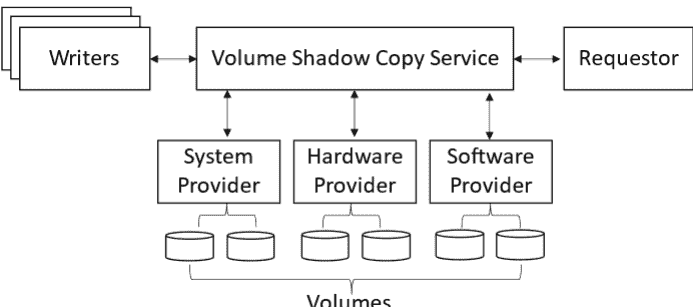

图 7.2 – VSS 组件

VSS 支持最大 64 TB 的卷。如果需要 SMB 文件共享与 VSS 配合使用，则必须使用 SMB 3.0。

### VSS 如何工作？

**VSS 请求者** (*你的备份软件*) 将查询工作负载以进行备份（快照副本）以确定已安装的 **VSS 写入器**。

指示 **VSS 写入器** 执行 **数据静止** 任务。然后由 **VSS 提供程序** 请求创建快照副本。

备份完成后，VSS 写入器会执行所需的任何其他备份后任务，然后将工作负载恢复正常操作。

在本节中，我们介绍了 Windows Server 文件系统及其相关技术的主题。在下一节中，我们将了解如何实现 Windows Server iSCSI。

### 实现 Windows Server iSCSI

在本节中，我们将了解 **Internet 小型计算机系统接口 (iSCSI)**，其发音为 *scuzzy*（SKUZ-ee），类似于 *fuzzy*。

### 什么是 iSCSI？

为设定场景，**小型计算机系统接口 (SCSI)** 被定义为一组标准，用于连接计算机与外围连接设备（例如磁盘）之间并传输数据。

iSCSI 是一种 **存储区域网络 (SAN)** 技术协议，其与存储系统的通信通过使用 TCP/IP 的以太网络进行。它模拟本地总线 SCSI 磁盘驱动器互连，使远程存储系统对存储客户端来说显示为本地总线存储系统。

iSCSI 是 **光纤通道 (FC)** 和 **以太网光纤通道 (FCoE)** 协议存储系统的替代方案。iSCSI 实现成本更低且复杂度更低，但由于通信使用 TCP/IP 发送，因此可靠性和性能较低。

现在，让我们了解其组件。

### iSCSI 组件有哪些？

iSCSI 使用以下物理和逻辑组件：

- **物理组件：**
  - **以太网络**：这是将 iSCSI 客户端（计算机）连接到 iSCSI 存储系统的物理传输介质。使用标准网络交换机和 RJ45 铜缆以太网线缆；不需要专用 FC SAN 交换机或布线。
  - **iSCSI 发起程序**：这是客户端（计算机）接口组件。它负责将要发送到存储系统的 SCSI 命令进行封装，并通过以太网络以 TCP/IP 数据包形式发送。此组件包含在 Windows Server 操作系统中。要实现它，需要启动并配置该服务。
  - iSCSI 目标：这是存储系统接口组件。iSCSI 目标表示将处理 SCSI 命令的存储系统；目标将在发起方服务器上显示为本地存储。发起程序可扩展到 256 个 iSCSI 目标，每个服务器支持 512 个虚拟磁盘，为虚拟磁盘提供 VHD 或 VHDX 文件，并提供身份验证。在 Windows Server 操作系统中，它作为文件和存储服务下的服务器角色实现。该角色使用 Server Manager、Windows Admin Center 或 PowerShell 进行安装和管理。
- **逻辑组件：**
  - iSCSI 限定名 (IQN)：这是逻辑名称组件。它为识别 iSCSI 节点提供全球唯一标识符。它使用 IQN，而不使用 IP 地址进行网络上的标识和通信。节点可以是发起程序或目标。iSCSI 发起程序必须配置 IQN，然后使用 IQN 与 iSCSI 目标联系和通信。
  - Internet 存储名称服务 (iSNS)：这是逻辑名称组件。它是 iSCSI 发起程序用于通过发现（例如 iSCSI 的 DNS）定位存储资源的协议，并允许配置和管理 iSCSI 设备。

以下图表中显示了这些组件：

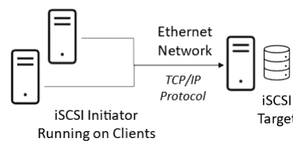

图 7.3 – iSCSI 组件

发起程序和目标组件均包含在 Windows Server 操作系统中。iSCSI 发起程序包含在所有受支持的 Windows 操作系统版本中。

在本节中，我们了解了 iSCSI 解决方案的组件。在下一节中，我们将了解其工作原理。


### iSCSI 如何工作？

作为存储协议，iSCSI 在开放系统互连 (OSI) 网络协议栈模型中运行。

在服务器与存储系统之间发送的 iSCSI 命令被封装在 TCP/IP 数据包中，并像普通网络数据包一样通过以太网发送；负载可以是 SCSI 命令。然后数据包通过网络协议栈向上传递，SCSI 命令被剥离，并由存储系统解释为本地设备 SCSI 命令。存储系统与客户端计算机之间传输的数据遵循相同的 TCP/IP 封装。

此概念在下图中显示：

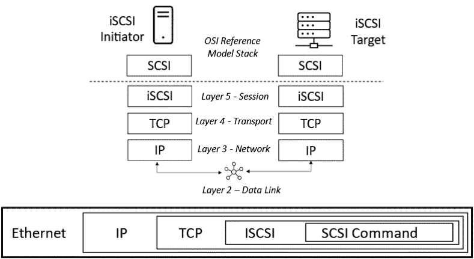

图 7.4 – iSCSI 封装

这与 FC 和 FCoE SAN 协议形成对比，它们是传输块数据的替代方法。

要识别发起方和目标，FC 使用全球唯一名称。对于 iSCSI 寻址，使用 RFC-3271 定义的 IQN iSCSI 限定名称。

IQN 的长度限制为 255 个字符，格式如下：

- iqn.yyyy-mm.naming-authority:unique name
- iqn.2004-07.com.example:MBS_Target_1_SN_WC786556

### iSCSI 如何实现？

iSCSI 通过以太网基础设施在 IP 数据包中传输信息。这可以专用于存储流量，也可以共享数据网络，但通过使用虚拟局域网 (VLAN) 和服务质量 (QoS) 进行隔离以保证性能。

为提高性能，可以使用 iSCSI 主机总线适配器 (HBA) 或 TCP 卸载引擎 (TOE) 卡，将 IP 数据包处理从服务器处理器卸载。

实施 iSCSI 时应考虑以下事项：

- 工作负载
- 网络拓扑
- 性能
- 安全性
- 高可用性
- 员工技能集和跨职能团队协作

我们将在后续章节中探讨其中的一些注意事项。

### 工作负载

应考虑环境中需要存储系统的用例和工作负载类型，例如块级、文件级和对象级。

iSCSI 目标服务器可以提供对 SQL Server、Exchange 等应用程序所需的块级存储系统的访问。

数据在块级别访问，指的是数据块和 SCSI 命令；这些命令和数据被封装在数据包中，通过以太网发送到 iSCSI 发起方以供客户端访问。

iSCSI 连接的存储系统可以是异构的；iSCSI 发起方不依赖于 Windows 操作系统，这意味着支持多平台存储客户端。

还支持使用差异磁盘来节省存储空间的无盘和网络启动场景。

### 网络拓扑

应考虑是实施共享存储和数据网络拓扑，还是专用于存储的网络。这在规划阶段非常重要，因为这可能会影响网络性能并涉及安全考虑。对于共享数据和存储网络，应为网络配置 QoS。

最小网络速度应为 1 Gbps；可以使用 10 Gbps、40 Gbps 或 100 Gbps 基础设施。

下图是共享存储和数据网络拓扑的参考架构：

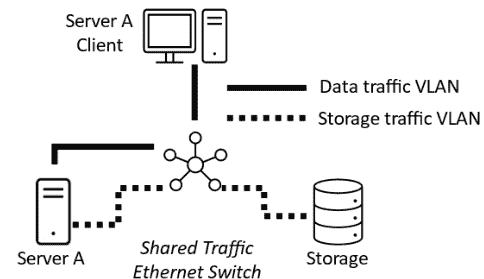

图 7.5 – iSCSI 以太网网络拓扑

在上述拓扑中，以太网基础设施在存储和数据流量之间共享，但通过为数据流量和存储流量分别设置 VLAN 进行逻辑隔离。

下图是专用存储网络拓扑的参考架构：

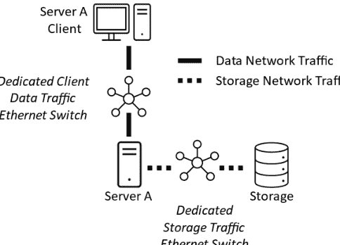

图 7.6 – iSCSI 以太网网络拓扑

在上述拓扑中，以太网基础设施专用于存储流量。存储流量通过专用存储交换机进行物理隔离。

### 安全性

应考虑使用隔离的专用网络。iSCSI 不支持分区，因此发起方和目标配置为基于密码的身份验证，以防止欺骗攻击。为验证发起方连接，使用挑战握手认证协议 (CHAP)；反向 CHAP 用于验证 iSCSI 目标。

逻辑单元号 (LUN) 掩码与 FC 相同，但使用 IQN 而不是 WWPN 进行客户端标识。为增强安全性，IPSec 可提供端到端加密。

### 高可用性

应考虑如何提供冗余。可以使用 Microsoft 多路径输入/输出 (MPIO) 或每会话多连接 (MCS)，如下所示：

- MPIO：这种多路径软件可以为同一目标的多个会话提供冗余网络路径。多路径软件负责选择要采用的路径。
- MCS：这为同一 iSCSI 会话的发起方提供到目标的多个 TCP/IP 连接。

本节介绍了 iSCSI 的实现方式，并结束了关于实现 Windows Server iSCSI 的主题。下一节将介绍实现存储空间和存储空间直通。

### 实现存储空间和存储空间直通

本节将介绍使用 Microsoft 存储空间和存储空间直通进行存储虚拟化。本节首先介绍的技术是存储空间；我们将在下一节将其与存储空间直通进行比较，并了解区别。

### 什么是存储空间？

存储空间是一种 Microsoft 存储虚拟化技术，允许将计算机的本地磁盘聚合成可用于创建虚拟磁盘的磁盘阵列。它也是通过防止驱动器故障来提供存储系统冗余的一种方法。这可以作为独立磁盘冗余阵列 (RAID) 解决方案的传统驱动器故障保护方法的替代方案。

在为给定场景选择存储技术时，存储空间提供了一种廉价的存储解决方案，该方案易于实施和管理，同时具有可扩展性和可靠性。

### 存储空间如何工作？

存储空间在概念上与传统的 SAN 存储模型相似。在此模型中，存储机箱中的物理磁盘被分组/聚合以提供 RAID 池。由此，我们创建 LUN，通过初始化它们、分配驱动器号并使用 NTFS 等文件系统格式化它们，将其作为一个或多个卷呈现给服务器。如下图所示：

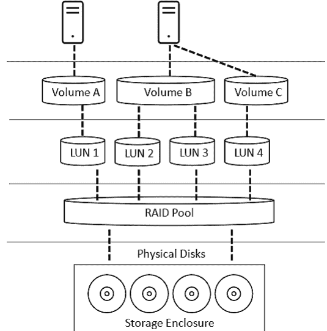

图 7.7 – 传统 SAN 概念

在存储空间模型中，物理磁盘从磁盘资源池中分组，在此物理磁盘的存储池中创建虚拟磁盘；虚拟磁盘相当于 LUN。这些虚拟磁盘可以呈现给计算机，然后初始化并联机，以便格式化并分配驱动器号。存储空间虚拟磁盘可以使用 FAT32、NTFS 和 ReFS 格式化。

存储空间具有以下组件：

- **存储池**：这些是组合在一起的物理磁盘，用于创建磁盘资源池，从中可以创建虚拟磁盘。池中的磁盘可以是不同类型和大小；池对底层物理磁盘进行抽象，类似于计算虚拟化，硬件层被抽象。物理磁盘只能属于一个池。
- **存储空间**：这些相当于 RAID 集（池），在此术语中是虚拟磁盘。它们是在存储池的可用空间上的物理磁盘上创建的。卷是虚拟磁盘分区，可以分配驱动器号；卷相当于 SAN 上的 LUN。

这些组件之间的关系如下图所示：

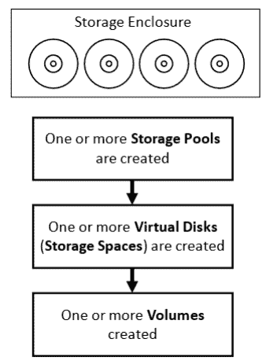

图 7.8 – 存储空间组件

存储空间可提供以下功能：

- **存储层**：池中可以使用不同类型和速度的磁盘，例如 **硬盘驱动器 (HDD)** 和 **固态驱动器 (SSD)**；甚至可以使用 USB 驱动器创建存储池。存储空间使用分层技术来实现容量和性能平衡。它会自动将访问频率较高的数据移动到速度较快的磁盘，将访问频率较低的数据移动到速度较慢的磁盘。数据每天在凌晨 01:00 移动一次。您可以根据需要配置文件和固定项使用哪种存储。
- **预配模型**：存储空间为虚拟磁盘提供两种预配模型，如下所示：

  - **厚（固定）预配**：在创建时创建固定大小。
  - **精简预配**：在创建时不预分配大小，而是利用按需和即时创建。修剪过程可以回收未使用的已分配空间。

存储池可以同时拥有 *精简* 和 *固定* 预配的虚拟磁盘。


- 弹性级别：Storage Spaces 提供三种复原模型，如下所示：
  - 简单：维护数据的一份副本。此级别适用于不需要通过存储空间实现复原的工作负载。
  - 奇偶校验：在单奇偶校验下维护数据的两个副本，在双奇偶校验下维护三个副本。此级别适用于模式工作负载中的顺序大型读/写操作。
  - 镜像：在双向镜像中维护数据的两个副本，在三向镜像中维护三个副本。此级别适用于所有工作负载。

- 回写缓存：这允许你将数据写入磁盘以便进行优化，并且默认启用。这与分层存储配合工作，在检测到磁盘写入高峰时自动写入更快的磁盘。

- 管理：可以使用文件和存储服务角色、Windows 管理中心、PowerShell 和 API 在服务器管理器中管理 Storage Spaces。

Storage Spaces 也存在一些限制，如下所示：

- 不支持启动卷或系统卷
- 不支持将物理磁盘从存储层抽象化的情况，例如 VM 直通磁盘，以及引入单独 RAID 层的情况
- 不支持 FC、FCoE 或 iSCSI
- 已格式化或已分区的磁盘不能添加到存储池
- 存储池中的所有磁盘必须使用相同的扇区大小
- 仅可将串行连接 SCSI (SAS) 存储用于故障转换群集

在本节中，我们了解了 Storage Spaces 的工作原理。在下一节中，我们将介绍 Storage Spaces Direct，它名称相似，但你应该注意它是一种不同的解决方案。我们将了解它与 Storage Spaces 的对比情况。

### 什么是 Storage Spaces Direct？

Storage Spaces Direct 是一种软件定义存储解决方案；它使汇总或超汇总技术堆栈中的多个计算群集节点能够将其本地磁盘呈现并汇总到单个可扩展且复原的共享存储系统中。它可以类比为虚拟 SAN。它首次作为 Windows Server 2012 中的 Windows Server 存储技术引入。

Storage Spaces Direct 是 Azure Stack HCI 的核心技术之一，Azure Stack HCI 是一项 Azure 服务，也是 Microsoft 的数据中心现代化和私有云操作系统平台。Storage Spaces Direct 还作为基础设施即服务 (IaaS) 存储解决方案受支持，可在 Azure 公有云中实现。

回顾前几节，相比之下，Storage Spaces 是一种更简单的解决方案，用于汇总单台计算机上的本地磁盘，并利用这些本地资源创建虚拟磁盘，在虚拟磁盘上可以创建卷。Storage Spaces 不是冗余的，并且仍然是 Storage Spaces Direct 的直接组件，我们将在下一节中了解该组件。

Storage Spaces Direct 提供多种功能和优势，其中包括：

- 每个群集可扩展到 4 PB。
- USB 闪存驱动器见证。
- ReFS 卷压缩和数据删除重复。文件的前 4 TB 会进行数据删除重复，每个卷支持最多 64 TB。
- 镜像加速奇偶校验。

在本节中，我们介绍了 Storage Spaces Direct。在下一节中，我们将了解其工作原理。

### Storage Spaces Direct 如何工作？

Storage Spaces Direct 软件定义解决方案通过在以太网上连接带有本地存储驱动器的多个服务器（节点）来创建群集；无需存储结构、特殊电缆或适配器。

Storage Spaces Direct 使用以下组件：

- 故障转换群集角色
- 群集共享卷 (CSV) 文件系统
- 存储空间
- 软件存储总线
- SMB 3

CSVs 是 Storage Spaces 的核心组件，它允许所有节点的 NTFS 和 ReFS 卷同时进行读取和写入。没有锁定、掩盖、更改驱动器所有权，也没有卸载和装载卷；这允许更快速的故障转换，并从计算到存储提供请求的负载均衡分布。

要实现 Storage Spaces Direct，你需要在先前创建的故障转换群集上启用 Storage Spaces Direct 作为先决条件步骤。下一阶段是汇总群集中每台服务器的存储驱动器，并创建虚拟共享存储的软件定义池。卷将作为驱动器呈现给 VM，用于存储数据（例如虚拟硬盘 (VHD) 文件），这些文件随后将在存储池中创建。卷使用 CSV 文件系统，因此每台服务器都会将卷视为本地装载，并可以同时访问和执行操作。

在本节中，我们了解了 Storage Spaces Direct 的工作原理。在下一节中，我们将了解其部署选项。

### 什么是 Storage Spaces Direct 的部署选项？

Storage Spaces Direct 提供支持汇总和超汇总基础设施系统的部署选项。超汇总部署是 Azure Stack HCI 支持的唯一选项。

### 汇总部署

汇总部署为存储和计算使用独立的群集，也称为分离式部署。计算群集和存储群集可以独立扩展以满足你的需求。以下极简图显示了此部署模型：

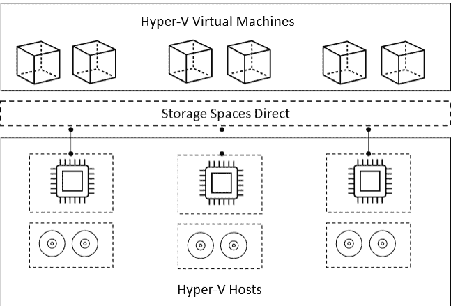

图 7.9 – 汇总部署模型

此模型在 Storage Spaces Direct 上方提供横向扩展文件服务器 (SoFS) 层以提供 SMB 3 网络共享。这可能是虚拟桌面基础设施 (VDI) 场景的一个用例。

### 超汇总部署

超汇总部署使用单个群集同时用于计算和存储。以下极简图显示了此部署模型：

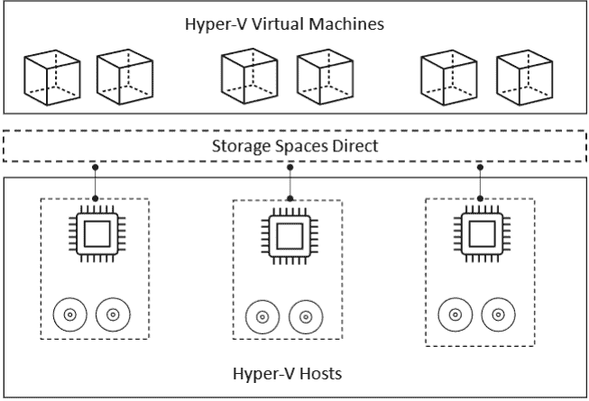

图 7.10 – 超汇总部署模型

Storage Spaces Direct 可以作为 Windows Server 群集或 Azure Stack HCI 群集的一部分进行部署。

由于该解决方案具有软件定义特性，Storage Spaces Direct 的实现并非像传统 SAN 那样复杂。可以使用服务器管理器、Windows 管理中心和 PowerShell。

在本节中，我们了解了 Storage Spaces Direct 的部署选项，这已结束实现 Storage Spaces 和 Storage Spaces Direct 的主题。在下一节中，我们将了解 Windows Server 数据删除重复。

### 实现 Windows Server 数据删除重复

本节在 Windows Server 包含的技术组件上下文中介绍 **数据删除重复**。

### 什么是 Windows Server 数据删除重复？

Windows Server 包含 **数据删除重复**，作为可安装和可配置的服务器角色。数据删除重复作为一种技术的前提是在保持系统完整性的同时，通过删除重复数据来使用更少的存储空间。

Windows Server 数据删除重复的组件如下所示：

- 数据删除重复服务：
  - 数据删除重复和压缩
  - 垃圾回收
  - 清理
- 筛选器驱动程序
- 取消优化

数据删除重复使用多线程后处理来最大限度地减少性能影响，并利用可变大小块存储，通过可选压缩最大化空间利用率。

### Windows Server 数据删除重复如何工作？

Windows Server 中数据删除重复的实现基于两个原则：

- 优化不应影响 *磁盘写入*。使用后处理模型；所有数据首先写入磁盘，然后再进行优化。
- 优化不应影响 *用户访问*。用户访问优化卷上的数据删除重复文件时，必须对用户透明。

数据删除重复过程包含以下五个步骤：

- 1. 扫描文件系统以查找与优化策略匹配的文件
- 2. 将文件分解为可变大小块
- 3. 识别唯一块
- 4. 将块移动到块存储，并可选择对其进行压缩
- 5. 将原始文件数据替换为块存储重解析点

在实施数据删除重复之前，你应该评估环境，以确定是否有足够的重复信息来使该任务值得执行。以下是由于经常存储重复数据而推荐作为数据删除重复良好候选项的工作负载：

- 通用文件服务器；例如用户主文件夹、工作文件夹和软件存储库共享等共享
- VDI
- 虚拟化备份应用程序，例如 **Microsoft Data Protection Manager (DPM)**


以下场景从重复数据删除中获益有限：

- 通用 Hyper-V 主机
- SQL 服务器
- 业务线 (LOB) 服务器

重复数据删除无法处理卷上的以下数据：

- 系统状态文件
- 加密文件
- 扩展属性文件
- 大小为 32 KB 或更小的文件
- 已明确从重复数据删除范围中排除的文件
- 不符合配置的重复数据删除策略的文件

重复数据删除支持 NTFS。对于 ReFS 卷，支持的最大卷大小为 64 TB，文件最大大小为 4 TB。

### 预期可以节省多少磁盘空间？

以下是重复数据删除场景中典型的磁盘空间节省情况：

- 用户文档：节省 30% 至 50%
- CAB 文件、软件二进制文件、映像和更新：节省 70% 至 80%
- 虚拟硬盘文件：节省 80% 至 95%
- 前述数据类型的通用文件共享混合：节省 50% 至 60%

可实现的磁盘空间节省量将取决于数据类型和混合因素。

### 如何实现 Windows Server 重复数据删除？

重复数据删除可通过使用 Server Manager、Windows Admin Center 或 PowerShell 安装为服务器角色来实现。

可以使用以下 PowerShell cmdlet：

```
Add-WindowsFeature -Name FS-Data-Deduplication
```

添加服务器角色后，需要启用重复数据删除；可以使用 Server Manager、Windows Admin Center 或 PowerShell 完成此操作。

可以使用以下 PowerShell cmdlet：

```
Enable-DedupVolume -Volume *VolumeLetter* -UsageType *StorageType*
```

-UsageType 参数值应为以下三种类型之一：

- **Hyper-V**：此类型用于托管 Hyper-V 存储的卷
- **Backup**：此类型用于托管虚拟化备份服务器的卷
- **Default**：此类型用于通用卷

如果默认设置不足，可以按以下方式更改以满足你的场景：

- 更早处理文件优化
- 更改垃圾回收和擦除计划
- 卷目录或文件类型无需重复数据删除

要编辑默认设置，可以使用以下 PowerShell cmdlet：

```
Set-DedupVolume
```

可以按需运行重复数据删除作业，也可以通过配置计划来运行；我们将在以下部分中介绍此内容。

### 如何按需运行作业

可以运行以下按需作业类型：

- **优化**：Start-DedupJob -Volume *VolumeLetter* -Type Optimization
- **数据擦除**：Start-DedupJob -Volume *VolumeLetter* -Type Scrubbing
- **垃圾回收**：Start-DedupJob -Volume *VolumeLetter* -Type GarbageCollection
- **取消优化**：Start-DedupJob -Volume *VolumeLetter* -Type Unoptimization

由于垃圾回收作业处理密集，此作业应仅在非正常运营时间运行，并且仅在达到删除负载阈值时运行。

### 如何计划作业

为卷启用重复数据删除时，默认会设置三个计划，如下所示：

- **优化**：该作业计划每小时运行一次
- **垃圾回收**：该作业计划每周运行一次
- **擦除**：该作业计划每周运行一次

所有作业在所有卷上运行；要让作业在特定卷上运行，必须创建新作业。

可以使用以下 PowerShell cmdlet 管理作业计划：

- `Get-DedupSchedule`
- `New-DedupSchedule`
- `Set-DedupSchedule`
- `Remove-DedupSchedule`

`Get-DedupSchedule` cmdlet 不可用于 Windows 任务计划程序自定义作业计划。

本节介绍了实现 Windows Server 重复数据删除的主题。在下一节中，我们将介绍 Windows Server 存储副本。

### 实现 Windows Server 存储副本

本节在 Windows Server 包含的技术组件背景下介绍存储副本。

### 什么是 Windows Server 存储副本？

**存储副本**是可安装的 Windows Server 功能，用于与文件服务器角色配合使用，为物理或虚拟机器的卷提供高可用性和灾难恢复。它可用于独立服务器或群集，以及物理站点之间的延伸故障转移群集。

NTFS 和 ReFS 卷支持重复数据删除；*Windows Server OS 卷*不能使用 Windows Server 存储副本进行复制。

### Windows Server 存储副本如何工作？

它在块级别使用 SMB 3 和精简预配，并提供带自动故障转移的单向复制。

Kerberos AES 256 用于身份验证，并支持委派管理。可以配置指定的网络适配器来控制复制流量。

每个源和目标都需要两个 NTFS 或 ReFS 卷。一对用于在源数据卷（主卷）和目标或目标卷（辅卷）之间复制数据；另一对用于复制日志。

提供以下复制方法：

- **同步复制**：当卷在网络上彼此靠近且复制节点之间需要低延迟时，使用此方法。它提供卷的崩溃一致性复制，从而实现零文件系统级数据丢失。

- **异步复制**：此方法用于延伸群集场景，卷之间距离较大，网络延迟将大于 5 **毫秒 (ms)**。此复制方法可能会导致数据丢失，丢失量取决于主副本卷和辅副本卷的滞后时间。

当必须避免数据丢失时，应使用同步复制。

应在用于重复数据删除的源服务器数据卷上启用此功能。这将自动在主卷和辅卷之间复制卷的重复数据删除内容。

### 如何实现 Windows Server 存储副本？

可以使用 Server Manager、Windows Admin Center 或 PowerShell，使用文件服务器角色和存储副本功能实现存储副本。

在使用上述任一方法实现存储副本之前，需要满足一些先决条件，如下所示：

- 要复制的卷必须位于 AD DS 林成员服务器上；不允许使用工作组服务器。
- 每台服务器至少需要 2 个 CPU 内核和 2 GB 的 RAM。
- 操作系统必须是以下之一：
  - Windows Server 2016 Datacenter 版
  - Windows Server 2019 Datacenter 版
  - Windows Server 2022 Datacenter 版
  - Windows Server 2019 Standard 版；但是，这仅支持最多 2 TB 的单个卷进行复制
- **远程直接内存访问 (RDMA)** 更适合用于每台服务器的同步复制；但是，至少需要一个 1 千兆以太网适配器。
- 每个源和目标服务器都必须有一个数据卷和一个日志卷；具体标准如下：
  - GUID 分区表 (GPT) - 已初始化的磁盘；不是 **主引导记录 (MBR)**
  - 已格式化为 ReFS 或 NTFS 的卷
  - 数据卷和日志卷的卷大小和扇区大小匹配
  - 日志卷应使用比数据卷更高性能的存储
  - 不应有其他工作负载访问日志卷
  - 托管复制卷的服务器必须允许以下双向通信：
    - ICMP
    - SMB (端口 445) 和 SMB Direct (端口 4445)
    - WS-MAN (端口 5985)
  - 同步复制要求复制节点之间的网络延迟小于 5 毫秒

Test-SRTopology PowerShell cmdlet 可以验证源卷和目标卷是否满足上述先决条件；可以使用 TestSrTopologyReport.html 访问生成的报告。

本节介绍了实现存储复制的先决条件，从而结束了实现 Windows Server 存储复制的主题。在下一节中，我们将介绍在 Windows Server 中实现 DFS 角色。

### 实现 DFS

Windows Server 中的 **分布式文件系统 (DFS)** 包含两个可按以下方式安装的服务器角色：

- **DFS 命名空间 (DFSN 或 DFS-N)**：此 DFS 角色允许你将文件服务器集合中的共享文件夹分组到逻辑命名空间中。这允许用户浏览跨多个文件服务器（可能跨多个站点）存在的共享文件夹。通过提供集中式文件夹命名空间（类似于全局 UNC 路径），它简化了用户查找文档和文件的过程。它通过文件服务器抽象层提供此功能，而无需知道哪个服务器持有哪个共享文件夹、文件等等。
- **DFS 复制 (DFSR 或 DFS-R)**：此 DFS 角色允许你在多个服务器和多个站点之间高效地复制文件夹。它只复制更改的块，而不复制整个文件；它使用 **远程差异压缩 (RDC)** 算法来实现此目的。


DFS可以使用服务器管理器（通过 _添加角色和功能_ 和 _文件和存储服务_ 角色）或 PowerShell 实现。

以下 PowerShell cmdlet 将安装 _DFSN_、_DFSR_ 和 DFS 管理工具：

```
Install-WindowsFeature FS-DFS-Namespace, FS-DFS-Replication,
RSAT-DFS-Mgmt-Con
```

支持与 Azure 虚拟机的互操作性。以下 URL 涵盖了要求和限制：https://learn.microsoft.com/en-us/previous-versions/windows/it-pro/windows-server-2012-R2-and-2012/jj127250(v=ws.11)#interoperability-with-azure-virtual-machines.

在本节中，我们了解了在 Windows Server 中实现 DFS 角色的方法。在下一节中，我们将完成一项动手练习，以巩固本章中涵盖的一些概念。

### 动手练习

为了在学习中获得一些实用技能，我们将利用从本章获得的概念和理解，并将其付诸实践。

我们将学习一项涵盖实现数据重复数据删除的练习。

### 开始之前

要开始本节，您需要访问 Windows Server；可以是物理服务器、虚拟机或 Azure IaaS VM。此练习适用于以下 Windows Server OS 类型：Windows Server 2016、Windows Server 2019、Windows Server 2022 和 Azure Stack HCI 20H2 及 21H2 版本。

建议您确保使用 Windows Server 2016 安装了修补程序 KB4025334。

让我们进入本章的练习。

### 练习 – 实现数据重复数据删除

在本练习中，我们将学习如何在 Windows Server 中启用数据重复数据删除。

为了便于理解，我们将此练习分解为单独的任务。

### 任务 1 – 安装重复数据删除角色

在本任务中，我们在 Windows Server 中安装重复数据删除角色：

- 1. 使用管理员帐户登录到服务器，从 **服务器管理器** 的 **管理** 区域单击 **添加角色和功能**，并在 **开始之前** 屏幕上单击 **下一步**。
- 2. 从 **安装类型** 屏幕中选择 **基于角色或基于功能的安装**，并单击 **下一步**。
- 3. 从 **服务器选择** 屏幕中，接受当前服务器的默认选择并单击 **下一步**。
- 4. 从 **服务器角色** 屏幕的 **角色** 列表中，在 **文件和存储服务** 下选择 **数据重复数据删除**。
- 5. 在弹出屏幕上单击 **添加功能**。然后，单击 **下一步**：

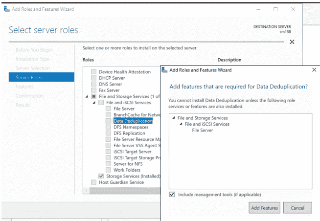

图 7.11 – 安装数据重复数据删除服务器角色

- 6. 在 **功能** 屏幕上，接受默认选择并单击 **下一步**。
- 7. 在 **确认** 屏幕上，查看信息，单击 **安装**，查看安装进度指示，直到收到安装成功消息，然后在 **添加角色和功能向导** 弹出窗口上单击 **关闭**。
- 8. 至此，您已安装 **数据重复数据删除服务器角色**。

在下一任务中，我们将配置重复数据删除。

### 任务 2 – 配置重复数据删除

在本任务中，我们将启用并配置重复数据删除：

- 1. 使用管理员帐户登录到服务器并打开 **服务器管理器**。
- 2. 从 **服务器管理器**，单击 **文件和存储服务**。
- 3. 在 **文件和存储服务** 下单击 **卷**。
- 4. 选择一个 **卷**，然后右键单击并选择 **配置数据重复数据删除...**

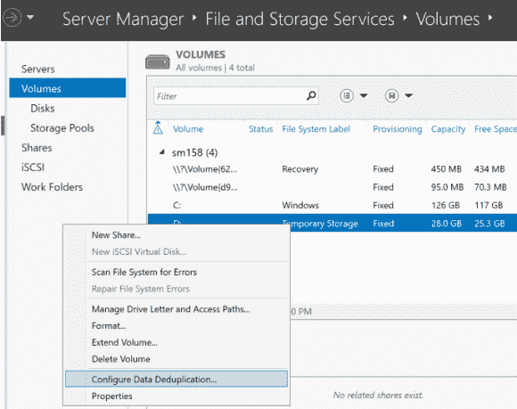

图 7.12 – 配置数据重复数据删除...

- 5. 从 **重复数据删除设置** 屏幕中选择所需的数据重复数据删除类型，然后单击 **确定**：

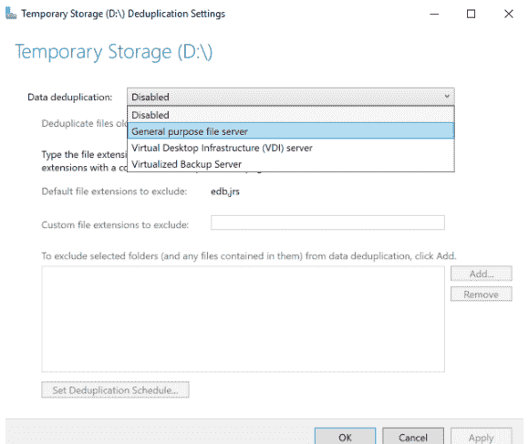

图 7.13 – 选择重复数据删除类型

- 6. 按需要配置其他设置，然后单击 **确定** 关闭 **重复数据删除设置** 屏幕。

至此，我们已完成此练习。此练习教授了实现数据重复数据删除所需的技能。现在，让我们总结本章。

### 摘要

本章涵盖了 AZ-800 管理 Windows Server 混合核心基础结构：*管理存储和文件服务*。

首先，我们了解了 Windows Server 文件系统和协议的基础知识；然后，我们查看了存储空间和存储空间直通等存储解决方案，并了解了它们之间的区别。之后，我们查看了通过 Windows Server 中的数据重复数据删除和存储副本进行的存储优化，存储副本是 Windows Server 的高可用性和灾难恢复解决方案。

我们通过动手练习完成了本章，为您提供更多实用技能。

本章旨在使您的知识超越考试目标；我们通过提供的内容添加了新技能和学习。这进一步发展了您的本地网络基础结构服务知识和技能，并使您能够为现实世界中侧重于日常混合环境的角色做好准备。

在下一章中，您将学习如何实现 Azure 存储服务。

### 进一步阅读

本节提供了其他学习参考和考试信息的链接：

- - Microsoft 已认证：Windows Server 混合管理员助理：https://docs.microsoft.com/en-us/learn/certifications/windows-server-hybrid-administrator/
- - 考试 AZ-800：管理 Windows Server 混合核心基础结构：https://docs.microsoft.com/en-us/learn/certifications/exams/az-800
- - 考试 AZ-800：学习指南：https://query.prod.cms.rt.microsoft.com/cms/api/am/binary/RWKlOr
- - Microsoft Learn：https://docs.microsoft.com/en-us/learn/paths/configure-storage-file-services/

### 技能检查

通过回答以下问题，检查您在本章中学到的内容：

- 1. Windows Server 可以使用哪些文件系统类型？
- 2. 解释 NTFS 和 ReFS 之间的相似之处和区别。
- 3. 什么是 FSRM？
- 4. 解释 SMB 协议的某些功能。
- 5. 什么是 VSS？
- 6. 什么是 iSCSI，它与 SCSI、FC 和 FCoE 有何不同？
- 7. iSCSI 有哪些不同的组件？描述它们的功能。
- 8. 解释 iSCSI 的工作原理。
- 9. iSCSI 支持哪些网络拓扑？
- 10. iSCSI 如何保护安全？
- 11. 什么是存储空间？
- 12. 解释存储空间直通与存储空间有何不同。
- 13. 存储空间直通的组件有哪些？
- 14. 解释存储空间直通的两种部署模型。
- 15. 什么是 Windows Server 数据重复数据删除？
- 16. 哪些文件类型不能进行数据重复数据删除处理？
- 17. 数据重复数据删除的最佳用例场景是什么？
- 18. 什么是 Windows Server 存储副本？
- 19. 支持哪两种复制方法？
- 20. 列出实现 Windows Server 存储副本的先决条件。
