## 实现混合文件服务器基础结构

在上一章中，我们了解了 Windows Server 存储和文件系统的概念。

本章涵盖了 *AZ-800 管理 Windows Server 混合核心基础结构：实现混合文件服务器基础结构* 的内容。

我们将了解 Azure 中可用的存储服务，并了解如何在将工作负载部署到 Azure 时实现这些服务以满足用例要求。我们将以一些动手练习结束，以帮助您进一步发展技能。

本章包含以下主题：

- - Azure 存储服务简介
- - 实现 Azure 文件
- - Azure 文件同步简介
- - 将 DFS-R 部署迁移到 Azure 文件同步
- - 动手练习

除了本章列出的主题之外，本章的目标是使您的知识超越考试目标，为现实世界中侧重于日常混合环境的角色做好准备。

### Azure 存储服务简介

本节介绍了 Azure 中可用的存储服务。我们将先查看各种定义和概念，以帮助建立基础知识，为后续学习打下基础。

### 存储类型

Azure 提供以下存储类型：

- **文件**：这提供 **服务器消息块 (SMB)** 协议，可提供完全托管、高度可用的无服务器网络文件共享。这些传统映射驱动器可使用端口 445 和 *SMB 3.x* 协议进行通信。
- **二进制大型对象 (Blob)**：这提供经济高效的大规模横向扩展非结构化数据存储。可使用以下三种 Blob 类型：
  - **页 Blob**：用于存储随机访问数据对象，例如 VM 磁盘
  - **块 Blob**：用于存储有序数据对象，例如备份
  - **追加 Blob**：用于存储连续添加的数据对象，例如日志文件
- **表**：这提供用于 *非关系型* (NoSQL) *结构化* 和 *半结构化* 数据的数据存储。
- **队列**：这提供用于大量异步消息的数据存储。

选择与工作负载类型相匹配的正确数据存储是提供最佳成本、性能和运营解决方案的关键设计决策。由于没有任何 Azure 存储服务能满足您的所有需求，您可能需要在单个解决方案中实现不同的存储类型。

### 存储帐户

这些 Azure 资源是用于存储所有数据对象的存储库和边界。除了充当数据平面外，还可将其视为管理平面控制台。存储帐户可定义可应用于存储帐户中数据的设置和配置，例如分层、冗余、安全性、访问控制、保护、监视等。

每个存储服务的存储帐户均会自动加密。可使用 Azure 存储分析和 Azure Monitor 对其进行监视。

可使用 Azure 门户创建第一个存储帐户，如下屏幕截图所示：

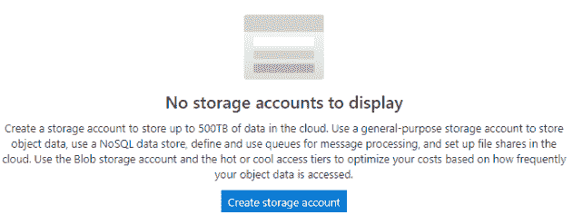

Figure 8.1 – 在 Azure 中创建存储帐户

还可以使用 PowerShell、Azure CLI 或基础结构即代码 (IaC) 部署语言（例如 Terraform、Bicep 或 Azure 资源管理器 (ARM)）。

创建后，可通过全局唯一命名空间使用 HTTP/HTTPS 访问存储帐户。这些称为终结点，可以是公共终结点或私有终结点。有关这些信息以及快速入门模板，可在 https://docs.microsoft.com/en-us/azure/templates/microsoft.storage/storageaccounts?pivots=deployment-language-bicep 中找到。

本章的动手练习部分将介绍如何通过 Azure 门户方法创建存储帐户。

可创建以下类型的存储帐户：

- 标准：常规用途 v2
- 高级块 Blob
- 高级页 Blob
- 高级文件共享

存储帐户类型在下屏幕截图中表示：

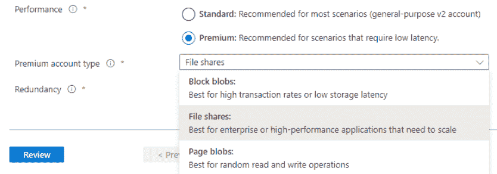

Figure 8.2 – 存储帐户类型

创建存储帐户后，无法更改性能类型设置。下屏幕截图对此进行了说明：

标准存储帐户由磁盘驱动器支持，并提供每 GB 最低成本。它们最适合需要大容量存储或不频繁访问数据的应用程序。高级存储帐户由固态驱动器支持，可提供一致的低延迟性能。它们只能用于 Azure 虚拟机磁盘，最适合 I/O 密集型应用程序（例如数据库）。若要了解有关存储帐户性能的详细信息，请参阅相关文档。

| 性能 | 标准 | 高级 |
|-------------|----------|---------|
| 创建存储帐户后无法更改此设置。 | | |

Figure 8.3 – 存储帐户类型设置

必须创建所需性能类型的新存储帐户，然后将数据移动到创建的存储帐户。

本部分介绍了存储类型、帐户、冗余和访问。在下一部分中，我们将介绍如何实现 Azure 文件。

### 实现 Azure 文件

Azure 文件最常见的用例是以提升并迁移的方式将本地文件服务器替换为 Azure 方案。这要求您通过 **服务器消息块 (SMB)**、**网络文件系统 (NFS)** 和 **HTTP(S)** 协议提供对网络文件共享的访问。在实现适当的连接和访问权限后，*Windows*、*Linux* 和 *macOS* 设备可以建立客户端连接。

Azure 文件还可用于文件服务器本地位置的备份和灾难恢复方案。Azure 文件同步可用于从本地文件服务器复制文件共享，提供云分层功能。

Azure 文件基于无服务器部署，这意味着没有文件服务器需要管理；此层已被抽象，以便您可以专注于创建共享并管理其访问权限。

Azure 文件使用标准 SMB 3.x 协议，并在使用域服务提供访问权限时支持 NTFS 来提供精细文件权限。数据冗余、性能分层、加密、版本控制、备份、通过 Microsoft Defender for Storage 进行的恶意软件防护、公共和私有终结点访问以及监视均可作为服务的一部分进行配置。

Azure 文件支持最大文件大小 4 TB 和最大文件共享大小 100 TB（编写本文时）。

可从任何位置访问，但需注意以下事项：

- **端口和协议**：尽管 SMB 3.x 协议被认为安全可靠，但许多提供商和组织会阻止端口 445，这意味着您的文件共享将无法访问。
  应允许端口 445，或者需要实现 ExpressRoute 或 VPN 等连接解决方案来绕过此问题。可在此处进一步了解详细信息：https://docs.microsoft.com/en-gb/azure/storage/files/storage-files-networking-overview#azure-networking。

- **权限**：访问是文件共享的另一项潜在障碍。不支持匿名访问。
  支持的身份验证方法为 **访问密钥**、**共享访问签名 (SAS)**
  和 **基于标识**。基于标识的方法使用 **Kerberos**，需要与混合标识结合使用以提供 **NTFS** 权限。

- **性能**：在消除端口、协议和权限方面的障碍后，可能会发现吞吐量和延迟未达到提供可行或最佳解决方案所需的级别。最佳性能解决方案是 Azure 资源访问与 Azure 文件存储帐户位于同一区域内的共享驱动器。

使用 Azure 文件获取文件共享的完全管理控制权和所有权时，需要存储帐户密钥；此过程及其操作应受到严格控制和管理。

### 存储层

Azure 文件提供以下存储层，以便您获得与需求相匹配的最佳价格和性能：

- **高级**：这些文件共享使用 **固态驱动器 (SSD)**，可提供低延迟和快速、一致的性能。

- **事务优化**：这些文件共享使用 **硬盘驱动器 (HDD)**，不需要低延迟。顾名思义，此层适用于执行事务密集型操作的工作负载。此层最初作为 **标准** 层引入，随后重命名为 _事务优化_。

- **热**：这些文件共享使用 HDD，适用于常规用途工作负载。

- **冷**：这些文件共享使用 HDD，成本效益最高，并针对在线存档进行了优化。

所选层需要与数据访问频率以及数据在层之间移动的速率相匹配；如果选择了错误的层，访问频率和检索（重新充水）过程可能会对成本产生负面影响。

### 存储冗余

Microsoft 为您的数据提供多种复制选项。以下选项可用于 Azure 文件：

- **本地冗余存储 (LRS)**：文件的三个副本存储在区域内单个物理位置的存储群集中。此选项的可用性和持久性级别最低。
- **区域冗余存储 (ZRS)**：每个 LRS 存储文件的三个副本，并将其同步复制到不同可用性区域中的三个存储群集。每个区域是同一区域内的物理位置，包含一个或多个提供网络、冷却和电源等独立服务的数据中心。数据必须写入所有三个群集，写入才能被接受。这是区域内可用性和持久性最高的选项，成本也最高。
- **异地冗余存储 (GRS)**：每个 LRS 存储文件的三个副本，然后将其异步复制到不同区域中单个位置的存储群集。这些副本将以 LRS 方式在辅助区域的群集中同步复制。
- **异地区域冗余存储 (GZRS)**：副本将按照 ZRS 进行复制，然后异步复制到不同区域中单个位置的存储群集。这些副本将按照 GRS 方式在辅助区域的群集中以 LRS 方式同步复制。

下屏幕截图显示了这些选项：

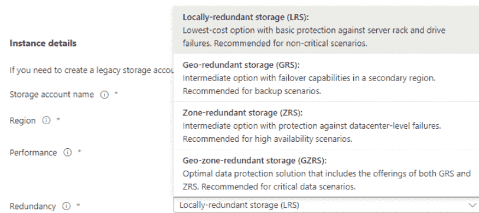

Figure 8.4 – 存储冗余选项

请注意，高级文件共享存储帐户仅支持 LRS 和 ZRS 冗余选项。辅助区域没有异地冗余选项。

此外，读取访问异地冗余存储 (RA-GRS) 和读取访问异地区域冗余存储 (RA-GZRS) 是另外两种可用的存储类型，它们支持对次要区域中数据的读取访问；这可以支持一种用例，即在主要区域正常运行时，在更靠近用户的区域提供数据副本。请注意，并非所有存储类型在所有区域都可用。

### 存储加密

所有 Azure 存储服务都提供存储帐户中静态数据加密，并且默认启用。写入数据时，它会自动加密，并在访问时透明解密。默认使用 Microsoft 托管密钥 (MMK)。这可以在以下屏幕截图中看到：

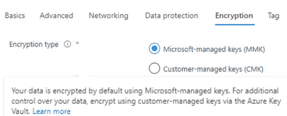

图 8.5 – 存储加密类型

作为替代方案，可以使用客户托管密钥 (CMK) 加密数据；它们可以存储在 Azure Key Vault 作为密钥存储。所有存储帐户默认都启用传输中加密，如图所示：

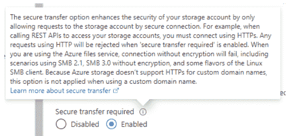

图 8.6 – 传输中加密设置

在“要求安全传输”默认配置为启用的情况下，不允许 HTTP 连接并将被拒绝。如果禁用加密，连接将失败，即使是 SMB 3.0 也是如此。

### 存储保护

创建存储帐户时，以下设置默认启用：

- Blob 软删除：保留 7 天
- 容器软删除：保留 7 天
- 文件共享软删除：保留 7 天

这些选项可以在以下屏幕截图中看到：

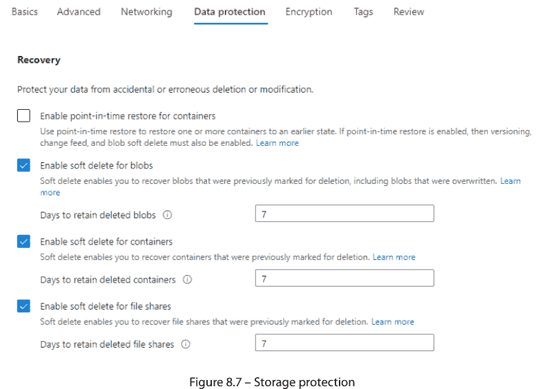

此外，可以对文件共享进行快照以执行常规备份操作。快照是增量的，一个共享最多可包含 200 个快照。

### 存储网络访问

创建存储帐户时，默认网络配置允许来自所有网络的公共访问。您可以将其更改为以下之一：

- 从选定的虚拟网络和 IP 地址启用公共访问
- 禁用公共访问并使用专用访问

这些选项显示在以下屏幕截图中：

### 网络连接

您可以通过公共 IP 地址或服务终结点公共连接到存储帐户，也可以使用专用终结点进行专用连接。

- 网络访问 *
  - 从所有网络启用公共访问
  - 从选定的虚拟网络和 IP 地址启用公共访问
  - 禁用公共访问并使用专用访问

从所有网络启用公共访问可能会使此资源公开可用。除非需要公共访问，否则我们建议使用更受限制的访问类型。了解更多

图 8.8 – 存储网络访问选项

选择 **禁用公共访问并使用专用访问** 选项后，将出现添加专用终结点的选项。专用终结点从 VNet 向存储帐户分配一个专用 IP。这可以在以下屏幕截图中看到：

禁用公共访问并使用专用访问

### 专用终结点

创建专用终结点以允许与此资源的专用连接。可以在存储帐户或专用链接中心内创建其他专用终结点连接。

- 添加专用终结点

| 名称 | 订阅 | 资源组... | 区域 | 目标子... | 子网 | 专用 DNS... | 专用 |
| :--- | :--- | :--- | :--- | :--- | :--- | :--- | :--- |

单击“添加”以创建专用终结点

图 8.9 – 专用终结点

添加专用终结点后，存储帐户的终结点仅可从 VNet 访问。

### 存储身份验证

必须对 Azure 文件的访问进行身份验证；不支持匿名访问。Azure 文件支持的身份验证方法有 **基于身份**、**访问密钥** 和 **共享访问签名 (SAS)**。

### 基于身份

此访问方法使用来自 Active Directory、Azure AD 域服务和 Azure AD Kerberos 的身份提供 Kerberos 身份验证。可以在以下屏幕截图中看到这些选项：

选择包含将访问此存储帐户中共享的用户帐户的 Active Directory 源。可以为位于以下三个域服务之一的用户帐户设置基于身份的访问控制。

- 您在 Windows Server 上托管的 Active Directory 域控制器（通常称为“本地 AD”，即使您可能在 Azure 中托管这些服务器）
- Azure Active Directory 域服务 (Azure AD DS)，一种平台即服务，在 Azure 中托管的目录服务和域控制器
- Azure AD Kerberos 允许从加入 Azure AD 的客户端使用 Kerberos 身份验证。要使用 Azure AD Kerberos，用户帐户必须是混合身份。

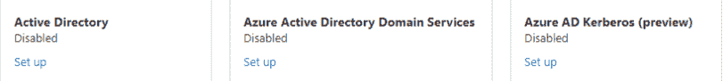

图 8.10 – 基于身份的访问

编写本文时，不支持仅限云的身份（即仅存在于 Azure AD 中的身份）。用户帐户必须是混合身份。Azure AD 仅是目录服务；它不提供直接域控制器功能。

### 访问密钥

此静态身份验证方法使用密钥，而不是密码。它为所有者提供对文件共享的完全访问权限并绕过所有访问控制。这可以在以下屏幕截图中看到：

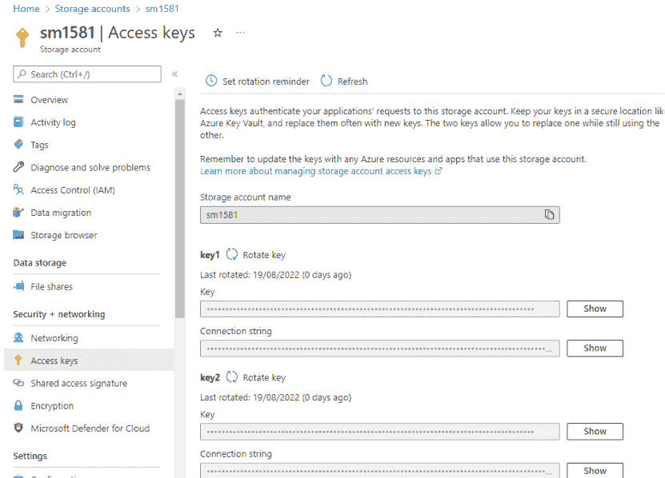

图 8.11 – 访问密钥

应控制和管理此访问。不应由用户使用，仅应由服务所有者和管理员使用。

### 共享访问签名 (SAS)

SAS 提供动态生成的统一资源标识符 (URI)。它基于存储密钥提供访问权限，并可以根据 IP 地址、允许的协议、权限和设置的过期时间限制访问。可以在以下屏幕截图中看到这些选项：

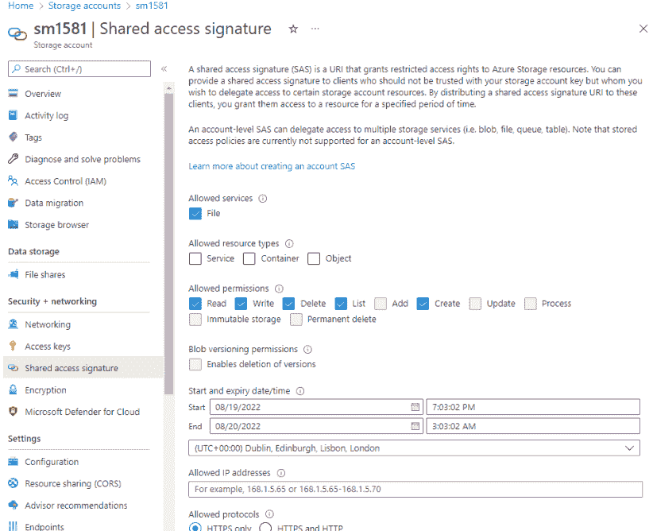

图 8.12 – SAS

SAS 方法的用例是 API 访问。

### 文件共享权限

配置基于身份的身份验证时，基于角色的访问控制 (RBAC) 可以管理文件共享权限。以下是可以分配给用户的 Azure 文件共享特定内置角色：

- **存储文件数据 SMB 共享参与者**：此角色允许用户对文件共享进行读取、写入和删除访问
- **存储文件数据 SMB 共享提升参与者**：此角色允许用户对文件共享进行读取、写入、删除和修改 NTFS 权限访问
- **存储文件数据 SMB 共享读取者**：此角色仅授予用户对文件共享的读取访问权限

这些角色可以在以下屏幕截图中看到：

| 名称 | 描述 |
|---|---|
| 存储文件数据 SMB 共享参与者 | 通过 SMB 在 Azure 存储文件共享中允许读取、写入和删除访问 |
| 存储文件数据 SMB 共享提升参与... | 通过 SMB 在 Azure 存储文件共享中允许读取、写入、删除和修改 NTFS 权限访问 |
| 存储文件数据 SMB 共享读取者 | 通过 SMB 对 Azure 文件共享允许读取访问 |

图 8.13 – 文件共享角色

用户获得文件共享访问权限后，NTFS 权限将控制对文件夹和文件的下一级访问，这与任何本地 SMB 文件共享相同。

在本节中，我们结束了实现 Azure 文件的主题。在下一节中，我们将探讨实现 Azure 文件同步。

### Azure 文件同步简介

Azure 文件同步使用 Azure 文件将文件共享集中保留在 Azure，但保留本地文件服务器以维护现有操作、兼容性和性能。Azure 文件共享也可以本地缓存到本地文件服务器，以便它们位于所需位置的最近处。文件共享数据仍可通过 SMB、NFS 和文件传输协议 (FTP) 在本地访问。

Azure 文件同步由以下组件组成：

- **存储同步服务**：这是在 Azure 中运行的服务资源
- **同步组**：同步组包含需要相互保持同步的终结点
- **已注册服务器**：这是存储同步服务与要同步到 Azure 的服务器之间的信任关系对象
- **Azure 文件同步代理**：这是一个可下载包，用于提供到 Azure 的同步过程
- **服务器终结点**：这表示要在 Windows Server 上同步的文件夹或卷，即同步源
- **云终结点**：这表示 Azure 文件共享，它是同步组的一部分。它是同步目标

Azure 文件同步针对本地文件服务器的用例和功能如下：

- **多站点同步**：使用多主复制在多个站点之间同步文件共享。

- 云分层：可以为服务器终结点配置卷空闲空间策略，以定义要本地保留和存储的可用空间量；此值定义为始终可用空间的百分比。您还可以定义日期策略，并对其进行配置，以便仅在本地缓存已在指定天数内访问过的文件。如果在该期间内未通过读取或写入操作访问文件，则该文件将自动分层到 Azure 文件共享。

- 云备份：可以为 Azure 文件共享安排每日备份，或最多安排四次按需每日备份。快照用于创建 Azure 文件共享的备份。

- 灾难恢复：可以将整个命名空间拉到运行同步代理的服务器终结点。这样可使文件夹结构文件立即在服务器上可用。

可以使用 Azure 门户、PowerShell 或 Windows Admin Center 实现 Azure 文件同步。可以按照以下步骤使用 Azure 门户实现 Azure 文件同步：

- 1. 完成 Azure 文件同步的先决条件。
- 2. 准备 Windows Server，使其能够使用 Azure 文件同步。
- 3. 部署存储同步服务。
- 4. 安装 Azure 文件同步代理。
- 5. 将 Windows Server 注册到存储同步服务。
- 6. 创建同步组和云终结点。
- 7. 创建服务器终结点。
- 8. 可选：配置网络设置以保护网络访问。

我们将在 *动手实验* 部分详细介绍这些步骤。

### 将 DFS-R 部署迁移到 Azure 文件同步

**DFS-N** 和 **DFS-R** 与 Azure 文件同步兼容，可以协同工作。要并发使用它们，应在具有 DFS-R 复制文件夹的卷上禁用文件同步云分层，且服务器终结点不应作为 DFSR 只读复制文件夹创建。

可以使用 Azure 文件同步从 DFS-R 部署进行迁移。步骤如下：

- 1. 为正在从中迁移的 DFS-R 拓扑创建同步组。
- 2. 在包含完整 DFS-R 数据集的服务器上安装 Azure 文件同步。
- 3. 注册服务器并在共享上创建服务器终结点。
- 4. 允许同步完成到云终结点（Azure 文件共享）的完整上传。
- 5. 在同步组中的每个服务器上安装 Azure 文件同步代理。
- 6. 在这些服务器上创建新文件共享。

- 7. 在新文件共享上创建服务器终结点。可选，设置云分层策略。
- 8. 允许 Azure 文件同步代理在不包含数据的情况下执行完整命名空间快速还原。完成完整命名空间同步后，将根据云分层策略填充服务器终结点的本地磁盘上的数据。
- 9. 确保同步完成，然后按需测试结果。
- 10. 现在可以将用户和应用程序指向新共享。

同步组中的 DFS-R 服务器需要具有用于 Azure 文件同步的 Internet 连接；在这些情况下，不希望迁移这些服务器的共享。相反，应将 DFS-R 与 Azure 文件同步结合使用。

在本部分中，我们介绍了 Azure 文件同步并学习了如何实现它。在下一部分中，我们将完成一些动手实验，以巩固本章所涵盖的部分概念。

### 动手实验

为了通过一些实用技能支持您的学习，我们将利用本章获得的概念和理解，并将其付诸实践。

我们将查看以下练习：

- 练习 – 创建存储帐户
- 练习 – 创建标准性能 Azure 文件共享
- 练习 – 创建高级性能 Azure 文件共享

### 开始使用

要开始使用本部分，需要拥有具有 Azure 订阅所有者或参与者访问权限的帐户来访问 Azure 门户。

让我们继续进行本章的练习。

### 练习 – 创建存储帐户

在本练习中，我们将创建一个存储帐户。

按照以下步骤开始：

- 1. 登录 https://portal.azure.com 上的 Azure 门户。或者，可以使用 Azure 桌面应用：https://portal.azure.com/App/Download。
- 2. 在搜索栏中输入“存储帐户”；单击显示的“服务”列表中的“存储帐户”：

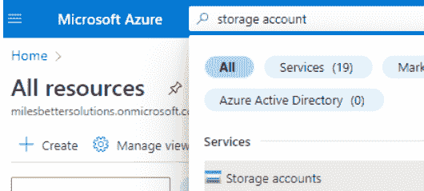

图 8.14 – 搜索存储帐户

- 3. 从“存储帐户”边栏选项卡中单击“+ 创建”或“创建存储帐户”：

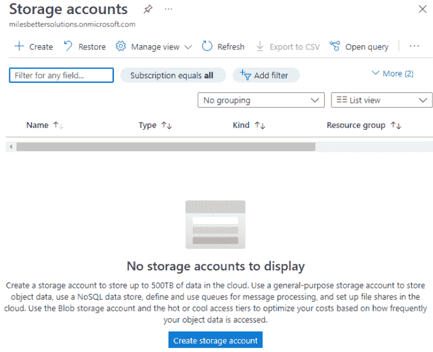

图 8.15 – 存储帐户屏幕

- 4. 按需设置项目详细信息设置：

### 项目详细信息

选择要在其中创建新存储帐户的订阅。选择新建或现有资源组，以便与其他资源一起组织和管理存储帐户。

| 订阅 * | Microsoft Azure Sponsorship (8de2e9e8-de94-4feb-8a95-35b48b593bb1) |
| --- | --- |
| 资源组 * | (新建) sm-az800-sa01-rg |
| | 创建新 |

图 8.16 – 项目详细信息

- 5. 输入全局唯一的存储帐户名称；将鼠标悬停在信息符号上，以获取选择受支持格式名称的上下文相关帮助：

> 实例详细信息
> 名称在 Azure 中所有现有存储帐户名称范围内必须唯一。长度必须为 3 到 24 个字符，并且只能包含小写字母和数字。

存储帐户名称 * smaz800sa01

图 8.17 – 存储帐户屏幕

- 6. 选择一个区域。
- 7. 对于性能，选择标准：

| 性能 * |
| --- |
| ( ) 标准：适用于大多数场景（常规用途 v2 帐户） |
| ( ) 高级：适用于需要低延迟的场景。 |

图 8.18 – 选择性能类型

> 注意
> 对于高级存储帐户，应选择“高级”，然后为您的场景选择所需的高级帐户类型。

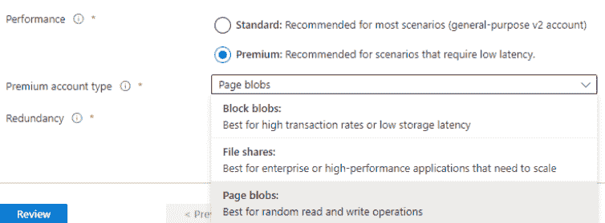

图 8.19 – 高级性能类型

- 8. 查看 **冗余** 下提供的选项并选择 LRS：

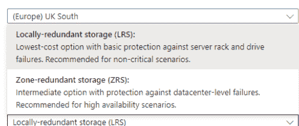

图 8.20 – 冗余选项

- 9. 单击“下一步：高级” > 并查看“高级”选项卡上的选项。
- 10. 单击“下一步：网络” > 并查看“网络”选项卡上的选项。
- 11. 单击“下一步：数据保护” > 并查看“数据保护”选项卡上的选项。
- 12. 单击“下一步：加密” > 并查看“加密”选项卡上的选项。
- 13. 单击“下一步：标记” > 并（可选）在“标记”选项卡上添加 _标记_。
- 14. 单击“下一步：查看” >。在“查看”选项卡上，查看您的设置；如果需要，可以返回到之前的选项卡并进行任何编辑。确认设置已按需配置后，可以单击“创建”。
- 15. 您将收到资源部署成功的通知：

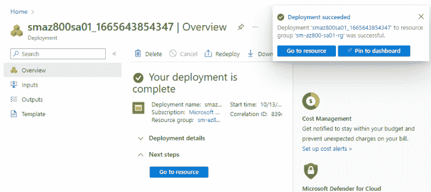

图 8.21 – 已完成的部署

- 16. 单击“转到资源”或导航到“存储帐户”边栏选项卡。
- 17. 从创建的“存储帐户”边栏选项卡，查看“概览”边栏选项卡中的信息以及左侧菜单中所有可用部分：

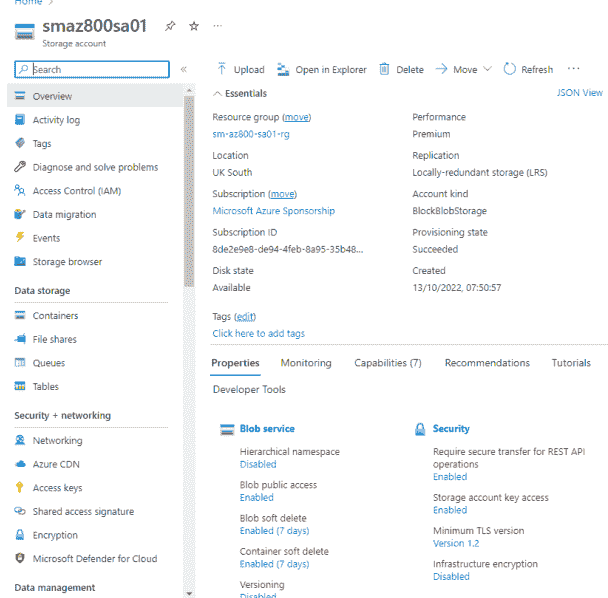

图 8.22 – 存储帐户边栏选项卡

至此，我们已完成本练习。本练习教会了我们创建存储帐户所需的技能；我们介绍了实现标准和性能层的选项。在下一练习中，我们将实现 Azure 文件共享。

### 练习 – 创建标准性能 Azure 文件共享

在本练习中，我们将使用标准存储帐户实现 Azure 文件共享。

按照以下步骤开始：

- 1. 登录 `https://portal.azure.com` 上的 Azure 门户。或者，可以使用 Azure 桌面应用：`https://portal.azure.com/App/Download`。
- 2. 在搜索栏中输入 `storage account`；单击显示的 `Services` 列表中的 `Storage accounts`。
- 3. 从 `Storage account` 边栏选项卡，为本练习创建一个新存储帐户以创建文件共享，或使用上一练习中的现有存储帐户。本练习中，存储帐户的 `Performance` 类型必须为 `Standard`。
- 4. 在 `Data storage` 部分中，从标准存储帐户单击 `File shares`：

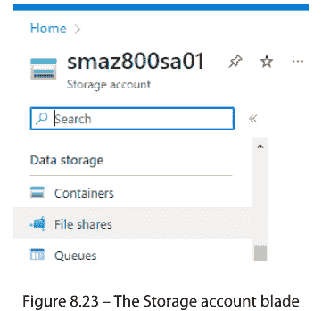

- 5. 通过顶部导航菜单单击 `+ File share`：

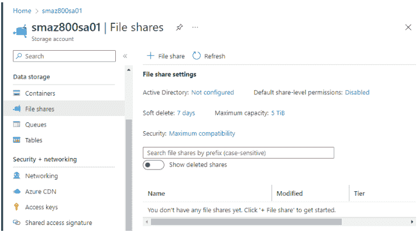

图 8.24 – 文件共享边栏

- 6. 在“新建文件共享”边栏中，为文件共享输入名称。
- 7. 对于层级，将鼠标悬停在信息符号上以获取选择层级的上下文相关帮助。保持层级设置为“事务优化”，并查看该层级显示的信息：

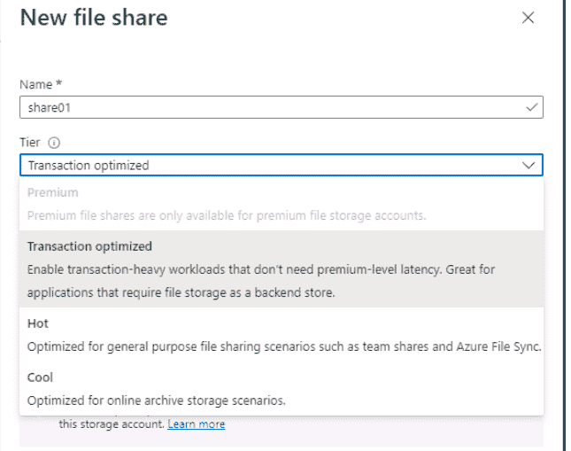

图 8.25 – 新建文件共享边栏

- 8. 单击 **创建**。
- 9. 将收到一条消息，指出文件共享已成功创建。
- 10. 现在可以在 **“文件共享”** 边栏中看到文件共享：

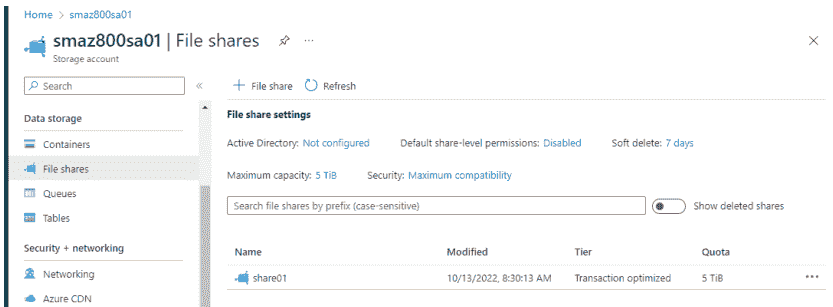

图 8.26 – 文件共享边栏

- 11. 单击 *已创建的文件共享*，查看打开的页面上的信息和设置：

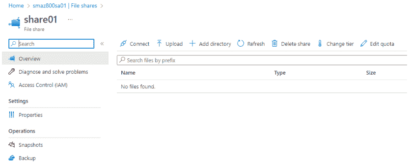

图 8.27 – 文件共享边栏

- 12. 单击 **连接** 以查看连接信息：

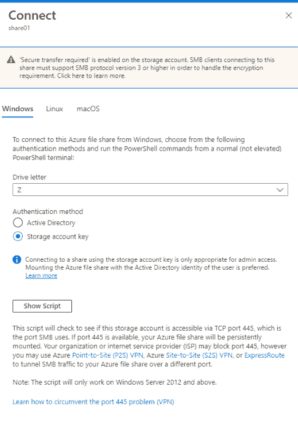

图 8.28 – 连接边栏

- 13. 单击 **“访问控制 (IAM)”** 以查看有关 **基于身份的身份验证** 的信息；单击 **“了解详细信息”** 超链接以获取更多信息：

主页 > smaz800sa01 | 文件共享 > share01

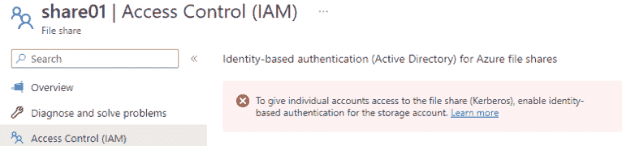

图 8.29 – “访问控制 (IAM)”边栏

至此，我们已完成此练习。此练习教会了我们使用标准存储创建 Azure 文件共享的技能。在下一个练习中，我们将使用高级存储帐户实现 Azure 文件共享。

### 练习 – 创建高级性能 Azure 文件共享

在此练习中，我们将使用高级存储帐户实现 Azure 文件共享。

按照以下步骤开始：

- 1. 登录 https://portal.azure.com 中的 Azure 门户。或者，可以使用 Azure 桌面应用：https://portal.azure.com/App/Download。
- 2. 在搜索栏中输入存储帐户；从显示的服务列表中单击“存储帐户”。
- 3. 从“存储帐户”边栏中，为此练习创建新存储帐户。存储帐户的性能类型必须为高级，且高级帐户类型必须为文件共享，才能用于此练习。
- 4. 在高级存储帐户的“数据存储”部分下，单击“文件共享”：

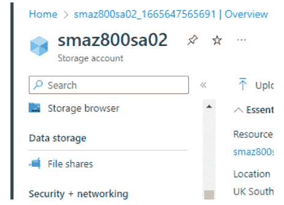

图 8.30 – 存储帐户屏幕

- 5. 在“文件共享”边栏的顶部导航栏中单击 + 文件共享 以创建新文件共享。
- 6. 为文件共享输入名称。
- 7. 输入预配容量。
- 8. 查看显示的性能信息。

- 9. 根据需要选择 SMB 或 NFS 协议：

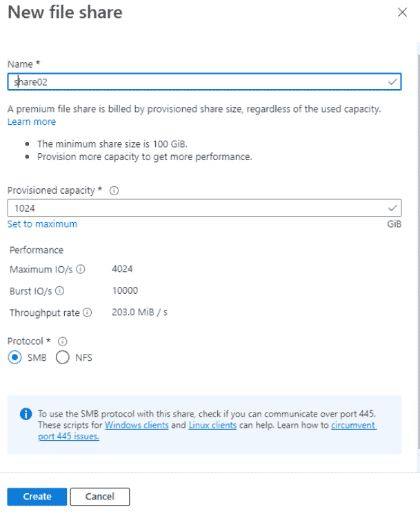

图 8.31 – 新建文件共享边栏

- 10. 查看通过端口 445 的通信信息。
- 11. 单击 **创建**。
- 12. 将收到一条消息，指出文件共享已成功创建。
- 13. 现在可以在 **“文件共享”** 边栏中看到文件共享：

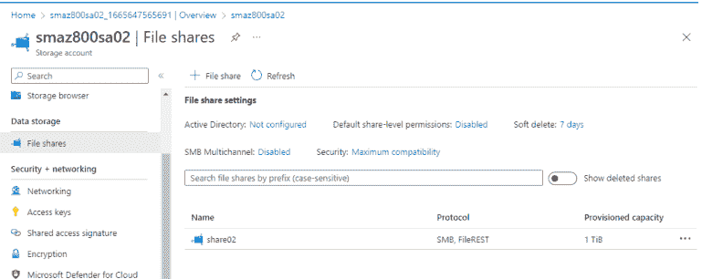

图 8.32 – 文件共享边栏

- 14. 单击 *已创建的文件共享*，查看打开的页面上的信息和设置。
- 15. 单击 **连接** 以查看连接信息和端口 445 通信问题：

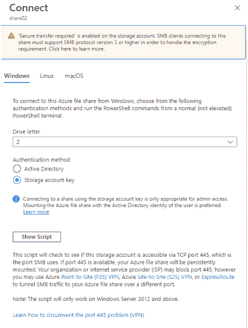

图 8.33 – 连接边栏

- 16. 单击访问控制 (IAM) 以查看有关基于身份的身份验证的信息；单击了解详细信息超链接以获取更多信息：

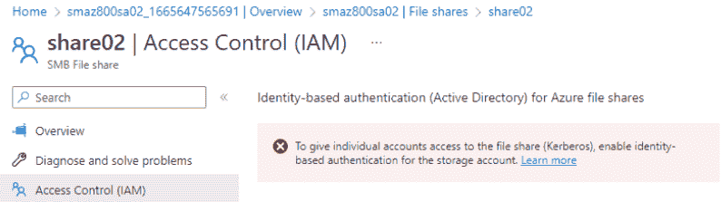

图 8.34 – “访问控制 (IAM)”边栏

至此，我们已完成此练习。此练习教会了我们使用高级存储帐户实现 Azure 文件共享的技能。现在，让我们总结本章。

### 摘要

本章首先介绍了 Azure 中可用的存储服务、其用例以及在实际场景中可能选择每种服务的位置。然后，我们探讨了如何实现 Azure 文件服务和 Azure 文件同步，以及如何将服务从 DFS-R 迁移。我们通过一些实操练习结束本章，为您提供宝贵的实用技能。

我们确保涵盖了 AZ-800 Administering Windows Server Hybrid Core Infrastructure：管理存储和文件服务。

本章旨在使您的知识超越考试目标；我们随所提供的内容新增了技能和学习内容。这将帮助您发展本地网络基础设施服务的知识和技能，并使您能够胜任现实世界中以日常混合环境为重点的角色。

在下一章中，您将学习如何在 Windows Server 上实现 Hyper-V。

### 进一步阅读

本节提供其他学习参考和考试信息的链接：

- [Microsoft Certified: Windows Server 混合管理员助理](https://docs.microsoft.com/en-us/learn/certifications/windows-server-hybrid-administrator/)
- *考试 AZ-800：管理混合核心基础设施的 Windows Server：https://docs.microsoft.com/en-us/learn/certifications/exams/az-800*
- *考试 AZ-800：学习指南：https://query.prod.cms.rt.microsoft.com/cms/api/am/binary/RWKI0r*
- *Microsoft Learn：https://docs.microsoft.com/en-us/learn/modules/implement-hybrid-file-server-infrastructure/*

### 技能检查

通过回答以下问题，检查您在本章中学到的内容：

- 1. Azure 中有哪四种存储类型？
- 2. 什么是存储帐户？
- 3. 可以创建哪些存储帐户类型？
- 4. 可以更改存储帐户的性能类型吗？
- 5. 什么是 Azure 文件？
- 6. Azure 文件有哪些用例？
- 7. 实现 Azure 文件时需要考虑哪些因素？
- 8. 存储层级有哪些？
- 9. Azure 文件有哪些存储冗余选项？
- 10. Azure 文件有哪些加密可用？
- 11. 存储如何受到保护？
- 12. 有哪些存储网络/访问选项？
- 13. 有哪些存储身份验证选项？
- 14. 可以分配给用户的文件共享权限有哪些？
- 15. 什么是 Azure 文件同步，其用例有哪些？
