## 在 Windows Server 上实现和管理 Hyper-V

上一章介绍了 Azure 中可用的存储服务。

本章涵盖了 AZ-800 Administering Windows Server Hybrid Core Infrastructure：管理 Hyper-V 和来宾虚拟机的内容。

首先，我们将介绍虚拟化概念，并涵盖实现、管理和保护 Microsoft 的 Hyper-V 管理程序。我们将以一些实操练习结束，帮助您进一步提升技能。

本章包含以下主题：

- 虚拟化和 Hyper-V 简介
- 实现和管理 Hyper-V
- 创建和管理 Hyper-V 虚拟机
- 使用受保护结构保护 Hyper-V 工作负载
- 实操练习

除本章列出的主题之外，本章的目标是使您的知识超越考试目标，为您胜任现实世界中以日常混合环境为重点的角色做好准备。

### 虚拟化和 Hyper-V 简介

在本节中，我们将介绍 **虚拟化** 的概念，具体针对计算（即 CPU 和内存）的上下文，而非存储或网络虚拟化。

无论是虚拟还是物理的计算机（机器）都是本地解决方案和 Azure IaaS 解决方案的核心构建块。


我们用来指代这些虚拟化物理机的术语是 **虚拟机 (VM)**。VM 是计算机物理内存和处理器资源的虚拟化；物理计算机在软件中被模拟。这允许将物理机的资源进行细分，并将一部分分配给每个虚拟机。每个 VM 运行自己的隔离操作系统，与物理服务器相同。OS 访问虚拟计算资源，例如 **虚拟处理器 (虚拟 CPU 或 vCPU)** 和虚拟内存。

下一节将探讨物理计算机与 VM 之间的关系。

### 比较虚拟机和物理机

要了解相对于物理模型的虚拟化模型，我们将简要探讨物理硬件操作模型。

从历史上看，组织通常采用一种模型，即应用程序和专用 OS 实例与物理硬件一对一映射。在成本或运营方面这效率不高，也缺乏可扩展性，因为业务请求的每个应用程序或新工作负载都需要一台新的物理服务器。这导致了规模外扩的服务器蔓延，增加了机架空间和相关成本。

下图概述了这种传统的物理方法模型：

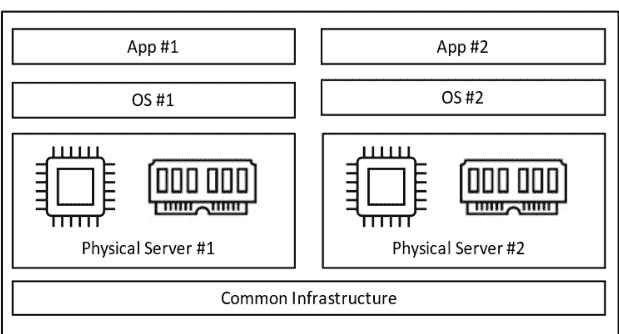

图 9.1 – 物理服务器应用部署模型

这种一对一关系的传统应用交付方法可以从虚拟化模型中受益。虚拟化解决了传统物理硬件模型的以下关键挑战：

- 利用率
- 规模
- 成本

虚拟化的概念基于 *硬件抽象*，对于计算虚拟化，*虚拟化监控程序* 是实现这种硬件抽象的技术层。

*抽象*涉及移除依赖项，并忽略或过滤掉一些不再相关的方面，以便重要的内容仍可保持关注。在这种硬件抽象上下文中，当我们对 VM 进行抽象时（即，当我们从方程中移除硬件时），VM 不再依赖于其运行所在的硬件层；我们不再需要该层，也不需要关心它。

这意味着虚拟化的价值在于，我们可以通过以更高效的成本和规模经济利用资源，以更少的资源做更多事情。

我们可以通过在一台物理服务器上运行多个 VM 来实现这些效率和优化。这也意味着更少的机架空间、更少需要冷却、供电和维护的物理资产，以及可能更少的人力资本。技术可以被视为更具触感的价值创造中心，而非成本中心。

简而言之，当我们查看上一张图（*图 9.1*）时，我们可以通过虚拟化用更少的物理服务器交付更多应用程序，这意味着为企业交付和运营这些应用程序的成本更低。

每个 VM 共享其所在的底层物理服务器（*称为主机*）的硬件资源。这些可以称为主机资源。主机资源的细分意味着我们可以创建许多可分配给主机 VM 的虚拟处理器和内存资源。下图说明了这种虚拟化方法：

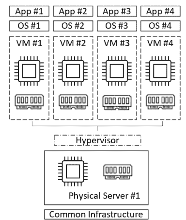

图 9.2 – 虚拟化应用部署模型

*图 9.1* 中显示的图说明，我们部署了两台物理服务器来运行两个应用程序并使用虚拟化。在 *图 9.2* 中显示的示例中，我们可以部署一台物理服务器来运行四个应用程序；这就是虚拟化的益处和价值。底层物理服务器主机资源将决定可以运行多少 VM……*结果可能因情况而异*。

在本节中，我们比较了物理计算机和 VM，并了解了虚拟化的价值和益处。在下一节中，我们将介绍 Hyper-V。

### 什么是 Hyper-V？

现在我们已了解虚拟化的价值和益处，将介绍 Hyper-V 作为实现者。

*Hyper-V 是 Microsoft 的虚拟化监控程序，是一种虚拟化软件，也是实现这种硬件抽象的技术层。*

Hyper-V 的示例用例如下：

- 物理计算机基础设施整合
- 远程桌面虚拟化/虚拟桌面基础设施 (VDI) 实现
- 测试和开发环境
- 私有云和混合云基础设施环境，包括 **Azure Stack Hub** 和 **Azure Stack 超融合基础设施 (HCI)** 实现

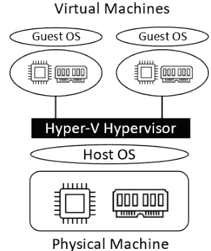

图 9.3 – Hyper-V 系统架构

上一张图显示，与物理机层的交互是通过虚拟化监控程序软件进行的。物理机 OS 称为主机 OS，虚拟机 OS 称为来宾 OS。

在本节中，我们介绍了 Hyper-V 作为允许我们创建和运行 VM 的虚拟化软件层。在下一节中，我们将学习如何实现和管理 Hyper-V。

### 实现和管理 Hyper-V

**Hyper-V 可以作为服务器角色安装** 在 Windows Server 中使用服务器管理器、PowerShell 或 Windows Admin Center (WAC)。

可以使用 PowerShell `Install-WindowsFeature` cmdlet 在本地或远程主机上安装该角色。然后可以运行 PowerShell `Get-WindowsFeature` cmdlet 来验证 Hyper-V 的安装。我们将在动手练习部分查看安装步骤。

安装 Hyper-V 角色时，它应该是主机服务器上安装的唯一服务器角色；不应安装域服务或文件服务器等角色。

与完整 GUI OS 安装选项相比，Hyper-V 的 Server Core 安装具有以下优势：

- 最大限度减少硬件资源并更好地利用 OS 和来宾 VM
- 最大限度减少运行的 OS 资源并更好地利用 OS 和来宾 VM
- 更少的软件更新
- 更小的攻击/漏洞表面；运行的服务更少
- 简化部署和远程管理

实现 Hyper-V 的系统硬件要求如下：

- 64 位处理器
- **二级地址转换 (SLAT)**
- VM 监控程序模式扩展
- **Intel 虚拟化技术 (Intel VT) 或 AMD 虚拟化 (AMD-V)**
- 硬件强制执行 **数据执行防护 (DEP)**
- Intel XD 位和 AMD NX 位

Hyper-V 主机应拥有足够的处理器和内存资源，以支持每个主机上所需运行的 VM 数量。还应规划足够快且容量充足的存储、网络速度和容量。

在 VM 上运行的 OS 称为来宾 OS。Hyper-V 支持以下来宾 OS 类型：

- 所有受支持的 Windows 版本
- CentOS、Red Hat Enterprise Linux、Debian、Oracle Linux、SUSE、Ubuntu 和 FreeBSD

尽可能为来宾使用第 2 代 VM；这提供安全启动、屏蔽 VM 和热添加/移除虚拟网络适配器等功能。

### Hyper-V 网络

对于网络通信，两个主要组件如下：

- 虚拟网络适配器
- 虚拟网络交换机

VM 配置了一个连接到虚拟网络交换机端口的虚拟网络适配器。

支持两种虚拟网络适配器类型：

- 旧版网络适配器：这些仅存在于第 1 代 VM 中，可用于使用网络启动进行安装任务。
- 网络适配器：也称为合成适配器，可与第 1 代和第 2 代 VM 配合使用。它不支持第 1 代 VM 的网络启动。

支持三种虚拟网络交换机类型：

- 私有：仅在同一 Hyper-V 主机上的 VM 之间提供通信；VM 与 Hyper-V 主机之间没有通信。
- 内部：在同一 Hyper-V 主机上的 VM 之间以及 VM 与 Hyper-V 主机之间提供通信。
- 外部：在主机服务器之外提供通信，例如到 Internet 或另一个网络。

虚拟局域网 (VLAN) 可以在逻辑上分离网络并划分流量。

可以使用 Hyper-V 管理器、Windows Admin Center 或 PowerShell 创建和管理虚拟交换机。此操作的 PowerShell cmdlet 是 New-VMSwitch。

### 嵌套虚拟化

嵌套虚拟化允许在 VM 上安装 Hyper-V 实例，然后运行在此第二层虚拟化中创建的 VM；主机 VM 充当虚拟化的 Hyper-V 主机。下图可视化了此概念：


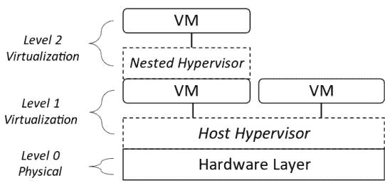

图 9.4 – 嵌套虚拟化

前面的图显示，_第 0 级_ 是一个物理层，包含 _虚拟化主机_ 硬件，其上安装了虚拟化监控程序；这种主机级虚拟化监控程序创建了 _第 1 级虚拟化_ 平台。

在 VM 内部运行而非直接在硬件上运行的虚拟化层，我们称之为 _第 2 级虚拟化_；这意味着它正在运行一个 _嵌套虚拟化层_。

嵌套虚拟化的要求如下：

- Windows Server 2016 或更高版本
- 足够的内存资源
- 来宾 VM 版本 8.0 或更高版本
- 物理主机服务器上带有 **虚拟机扩展 (VT-x)** 和 **扩展页表 (EPTs)** 的 Intel 处理器
- 已启用 MAC 地址欺骗

要启用嵌套虚拟化，请从物理主机服务器使用以下 PowerShell cmdlet：

```powershell
Set-VMProcessor -VMName <VMName>
-ExposeVirtualizationExtensions $true
```

来宾 VM 必须处于关闭状态。

在来宾 VM 上安装 Hyper-V 角色的过程与在物理主机服务器上安装 Hyper-V 角色的过程相同。

### 管理 Hyper-V

Hyper-V 管理器是一个组件，提供用于管理 _本地_ 和 _远程_ Hyper-V 主机的 GUI。Hyper-V 管理器如下图所示：

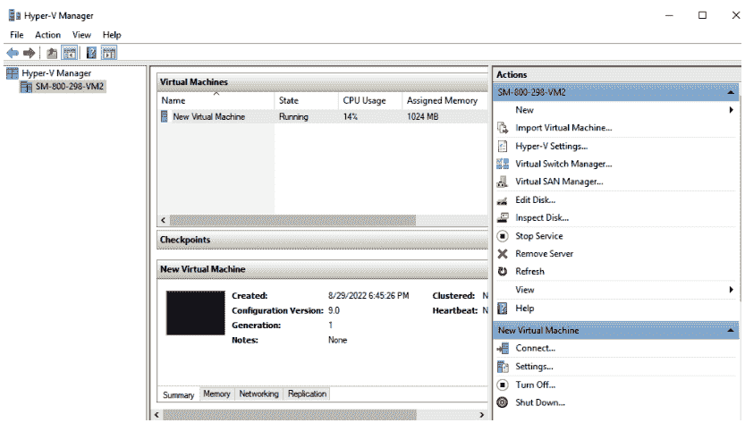

图 9.5 - Hyper-V 管理器

Hyper-V 管理器中提供以下功能：

- 连接并管理本地和远程 Hyper-V 主机服务器
- 配置 Hyper-V 设置
- 管理 Hyper-V 集成服务
- 管理 Hyper-V 来宾 VM
- 管理虚拟硬盘
- 管理虚拟交换机 – 虚拟交换机管理器
- 管理虚拟 SAN – 虚拟 SAN 管理器
- 管理 Hyper-V 复制
- 管理检查点
- 支持 WS-Management 协议
- 支持早期版本的 Hyper-V 主机

除了 Hyper-V 管理器，还可以使用 PowerShell 和 WAC 来管理 Hyper-V 主机。

在本节中，我们学习了如何创建和管理 Hyper-V 主机计算机。在下一节中，我们将学习如何创建和管理将在 Hyper-V 主机上运行的 VM。

### 创建和管理 Hyper-V 虚拟机

我们可以在 **Hyper-V 管理器** 控制台的 **新建虚拟机向导** 区域中，或通过 PowerShell 使用 New-VM cmdlet 来创建和管理 Hyper-V。

实现 VM 的过程包括以下步骤：

1. 通过 Hyper-V 管理器或 PowerShell 创建 VM。
2. 使用 Hyper-V 管理器在 VM 上安装来宾 OS。
3. 使用 Hyper-V 管理器安装或升级集成服务。

我们将在本章的 *实践练习* 部分更详细地学习如何创建和管理 VM。

### VM 生成版本

VM 生成决定了 VM 可用的硬件功能和性能，例如支持的 OS 类型、启动卷大小、启动方法等。

Hyper-V 支持 **第 1 代** 和 **第 2 代** VM。

### 第 1 代 VM 支持以下功能：

- 32 位和 64 位来宾 OS
- 最大 2 TB 启动卷，包含四个分区
- 旧版 BIOS
- VHD 和 VHDX 格式磁盘

### 第 2 代 VM 支持以下功能：

- 仅 64 位来宾 OS
- 最大 64 TB 启动卷
- UEFI
- 安全启动
- 屏蔽 VM
- 仅 VHDX 格式磁盘

VM 生成在创建 VM 时选择，之后 *不能* 更改。以下屏幕截图显示了 VM 创建向导屏幕：

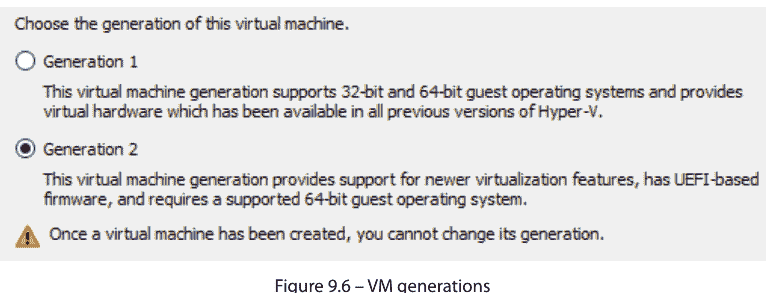

第 1 代和第 2 代 VM 之间的性能差异可忽略不计，这不应作为主要决定因素。主要区别是第 2 代仅支持 64 位 OS 和 UEFI。

### VM 配置版本

VM 配置版本提供有关 VM 组件兼容性的信息。Hyper-V 版本确定 VM 在创建时将接收的 VM 配置。

对于每个 VM，其配置版本标识以下信息：

- **配置**：提供有关附加到 VM 的处理器、内存和存储的信息
- **检查点**：这些是表示运行时状态和配置文件的文件，用于创建检查点

VM 的配置版本可以在摘要选项卡中找到。在这里，你可以从 Hyper-V 管理器中选择配置版本值。

以下 PowerShell cmdlet 也可以获取 VM 版本：

```
Get-VM * | Format-Table Name, Version
```

可以使用以下 PowerShell cmdlet 查找 Hyper-V 主机支持的 VM 配置版本：

```
Get-VMHostSupportedVersion
```

可以使用以下 PowerShell cmdlet 查找将在 Hyper-V 主机上创建的所有 VM 使用的默认版本：

```
Get-VMHostSupportedVersion -Default
```

可以使用以下 PowerShell cmdlet 更新 VM 配置版本：

```
Update-VMVersion <vmname>
```

要更新版本，VM 必须关闭。升级后，无法降级 VM 配置版本。

每个 Hyper-V 主机 Windows 版本支持以下 VM 配置版本：

- Windows Server 2012 R2、2016、2019 和 2022
- Windows 10 20H2、Enterprise 2016 LTSC 和 2019 LTSC
- Windows 11

作为其他参考，以下是某些 Hyper-V 要求兼容性的最低配置版本示例：

- 休眠支持：版本 9.0
- 内存热添加/热移除：版本 6.2
- 大内存 VM：版本 8.0
- 嵌套虚拟化：版本 8.0
- PowerShell Direct：版本 6.2
- Linux VM 的安全启动：版本 6.2
- 虚拟处理器数量：版本 8.0
- 虚拟受信平台模块 (vTPM)：版本 7.0

了解配置版本很重要，因为在较早的 Hyper-V 主机上创建的 VM 可能无法在运行较新 OS 版本的较新 Hyper-V 主机上工作。你可能需要在 Hyper-V 主机之间移动 VM，并且需要知道主机是否支持 VM 的配置。不支持 VM 配置版本的主机将不允许该 VM 启动。

### VM 设置

VM 的配置和属性设置分为硬件和管理两类；每种生成类型均按如下图所示表示：

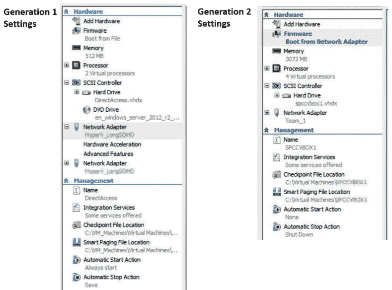

图 9.7 – VM 生成设置

可用的模拟硬件组件（用于介入访问真实硬件组件）取决于 VM 的生成版本。

### 第 1 代 VM 可访问以下硬件：

- BIOS
- 内存
- 处理器
- 非统一内存访问 (NUMA)
- IDE 控制器
- SCSI 控制器
- 网络
- COM 端口
- 软盘驱动器

### 第 2 代 VM 可访问以下硬件：

- 固件
- 内存
- 处理器
- SCSI 控制器
- 网络适配器
- 光纤通道适配器

管理设置提供有关 VM 特征的配置信息；如下所示：

- **名称**：用于 VM 的显示名称；不更改 VM 的主机名
- **集成服务**：用于配置为 VM 启用哪些集成设置
- **检查点**：用于*启用*、*禁用*、指定检查点的*类型*以及指定存储位置：
  - VM 可以处于以下状态之一：**关闭**、**启动中**、**运行中**、**已暂停**或**已保存**
  - 有两种检查点是 VM 的时间点快照：**生产**检查点和**标准**检查点
  - VM 最多可有 50 个 *检查点*
- **智能分页文件位置**：用于配置存储智能分页文件的位置
- **自动启动操作**：用于定义在打开 Hyper-V 主机时 VM 的响应方式
- **自动停止操作**：用于定义在正常关闭 Hyper-V 主机时 VM 的响应方式

硬件和管理信息存储在配置文件中。使用以下两种文件格式：

- **.vmcx 文件**：此格式用于 VM *配置*
- **.vmrs 文件**：此格式用于 *运行时数据*

这些是无法手动编辑的二进制文件；需要使用 Hyper-V 管理器或 PowerShell 来读取这些文件并对其进行更改。


### VM 虚拟硬盘格式

虚拟硬盘（VHD）是物理硬盘的软件表示，就像 VM 的处理器和内存是物理计算机处理器和内存的软件表示一样。您可以创建分区、文件和文件夹，就像可以为物理磁盘创建一样。您将 VM 的操作系统以及任何应用程序和服务安装在这些 VHD 上。可以将多个 VHD（类似于物理计算机）附加到满足存储需求用例。

可使用以下工具创建和管理 VHD：

- Hyper-V 管理器
- Windows 磁盘管理
- PowerShell，使用 New-VHD cmdlet
- 磁盘管理控制台
- 命令行，使用 Diskpart 工具

为 VM 创建新 VHD 时，提供两种 VHD 格式，如下所示：

- VHD：这是旧版 Hyper-V 创建的格式，可创建最大大小为 2,040 GB 的磁盘。
- VHDX：这是较新的格式，可创建最大 64 TB 的磁盘。它支持大块大小以获得更好的性能。

可以使用 Hyper-V 管理器的“编辑虚拟硬盘向导”区域或 PowerShell 中的 Convert-VHD cmdlet 在格式之间转换磁盘。这将创建一个新磁盘并将现有磁盘的内容复制到其中。

### VM 磁盘类型

Hyper-V 提供不同的磁盘类型以满足不同需求：

- 固定大小 VHD：立即分配所有磁盘空间。
- 动态大小 VHD：创建时定义最大大小，并仅根据需要分配空间以进行增长。
- 差异 VHD：这与具有基础配置的父 VHD 链接。更改仅对差异磁盘进行，保留父级上的配置。这可能是基于同一父配置镜像的多个子磁盘配置镜像的用例。
- 传递物理磁盘：这允许您通过主机计算机直接连接到物理硬盘。

可以使用 Hyper-V 管理器的“编辑虚拟硬盘向导”区域在类型之间转换磁盘；应使用相同的磁盘格式。

在本节中，我们研究了实现和管理 Hyper-V VM；我们涵盖了代际版本、配置版本、VM 设置、磁盘格式和类型。现在，让我们来看看 VM 内存。

### VM 内存

可按需从 Hyper-V 管理器的 VM 设置的“硬件”部分配置 VM 的内存，如以下屏幕截图所示：

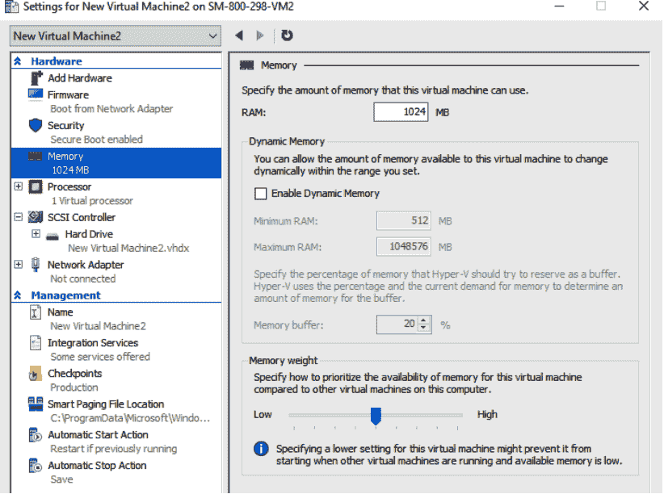

图 9.8 – VM 内存设置

可以启用 VM 使用动态内存。正如其名称所示，这允许您根据需求动态调整大小并分配可用内存给 VM。其好处是 VM 不需要关机，而在没有动态内存的情况下则需要。

启用动态内存时，配置动态内存有四个方面，如下所示：

- **启动 RAM**：这是 VM 启动时拥有的内存量，无论是否启用动态内存。
- **最小 RAM**：这是根据负载将动态分配的最小级别。
- **最大 RAM**：这是根据负载将动态分配的最大级别。
- **内存缓冲区**：这确定将按内存块增长并增加到最大 RAM 的内存分配大小。它表示为配置的 RAM 的百分比。默认值为 20%，这意味着如果总内存为 1,024 MB，则将以 204 MB 的块大小增加内存。

配置 VM 内存的设置如以下屏幕截图所示：

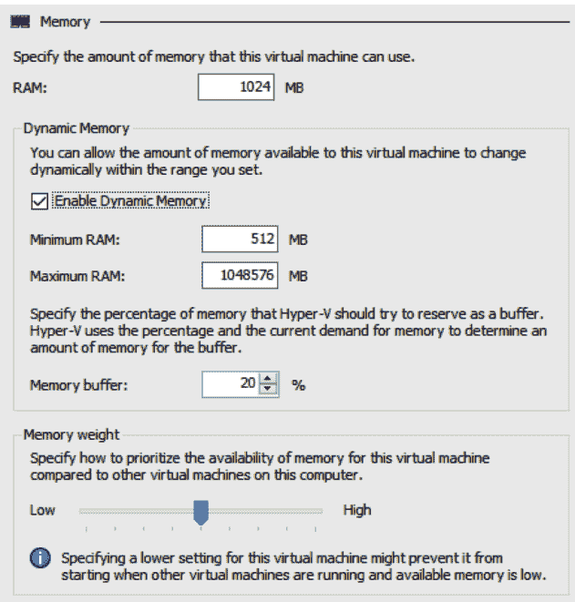

图 9.9 – 配置 VM 的内存

动态内存不能与 NUMA 一起使用。必须更新集成服务，因为动态内存需要这些服务来控制此功能。

### Hyper-V 集成服务

Hyper-V 集成服务为 VM 提供操作功能，也称为集成组件。这些服务（组件）允许 VM 与 Hyper-V 主机通信以进行其操作。保持这些服务（组件）更新对于确保 VM 功能和能力的平稳运行非常重要。

您需要在早于 Windows Server 2016 和 Windows 10 的 Hyper-V 主机上安装集成服务。要安装它，请从 Hyper-V 管理器连接到 VM，然后从操作菜单中选择“插入集成服务设置磁盘”。Windows Server 2016 和 Windows 10 或更新的 Hyper-V 主机不需要此操作。

提供以下集成服务：

- Hyper-V 心跳服务：报告 VM 是否正常运行
- Hyper-V 来宾关机服务：允许主机触发 VM 关机
- Hyper-V 时间同步服务：将 VM 时钟与主机同步
- Hyper-V 数据交换服务 (KVP)：在 VM 和主机之间提供元数据交换
- Hyper-V 卷阴影复制请求者：在不关闭 VM 的情况下提供 VM 的 VSS 备份
- Hyper-V 来宾服务接口：提供从主机向 VM 或从 VM 向主机复制文件的接口
- Hyper-V PowerShell 直连服务：在没有网络连接的情况下提供对 VM 的 PowerShell 访问

可以使用 Hyper-V 管理器或 PowerShell 打开和关闭集成服务。

要使用 Hyper-V 管理器，请右键单击 VM 以访问其设置，然后在“管理”部分下选择“集成服务”。

对于 PowerShell，可以使用以下 cmdlet：

```
Enable-VMIntegrationService
Disable-VMIntegrationService
```

要获取 VM 上启用的集成服务列表，请使用以下 PowerShell cmdlet：

```
Get-VMIntegrationService -VMName "VM1"
```

### 离散设备分配

离散设备分配 (DDA) 允许 VM 在可用且受支持时直接访问主机上的物理 PCIe 硬件。支持两个设备类：

- 图形适配器
- NVMe 存储设备

第 1 代和第 2 代 VM 支持 DDA。当设备附加时，以下 VM 功能受到限制且 VM 不可用：

- 动态内存
- VM 保存/还原
- 实时迁移
- 高可用性群集成员

配置 DDA 应执行以下步骤：

- 1. 使用以下 PowerShell cmdlet 关闭自动停止操作：

```
Set-VM -Name VMName -AutomaticStopAction TurnOff
```

- 2. 使用设备管理器或以下 PowerShell cmdlet 禁用设备：

```
Get-PnpDevice
Disable-PnpDevice
```

- 3. 使用以下 PowerShell cmdlet 从主机分区卸载设备：

```
Dismount-VMHostAssignableDevice -LocationPath $locationPath
```

- 4. 使用以下 PowerShell cmdlet 将设备分配给 VM：

```
Add-VMAssignableDevice -LocationPath $locationPath
-VMName VMName
```

如果要将设备从 VM 移除并返回到主机，可以从 PowerShell ISE 运行以下命令：

```
#Remove the device from the VM
Remove-VMAssignableDevice -LocationPath $locationPath -VMName
VMName
```

```
#Mount the device back in the host
Mount-VMHostAssignableDevice -LocationPath $locationPath
```

然后可以在主机上重新启用设备。使用设备管理器或以下 PowerShell cmdlet 执行此操作：

```
Get-PnpDevice
Enable-PnpDevice
```

### 增强会话模式

增强会话模式允许将 *打印机、剪贴板、本地驱动器、USB 驱动器，* 等本地计算机资源重定向供来宾 VM 使用。这是通过 **虚拟机连接 (VMConnect)** 启用的。

在 VM 中使用本地资源的要求如下：

- Hyper-V 主机上必须同时启用增强会话模式策略和增强会话模式
- 运行 VMConnect 的计算机必须使用 Windows 8.1/10 和 Windows Server 2012 R2/2016
- VM 必须使用 Windows 8.1/10、Windows Server 2012 R2/2016，并启用远程桌面服务

如果在运行 *VMConnect* 的计算机上可用，则可以重定向以下本地资源：

- 驱动器
- USB 设备
- 支持的即插即用设备
- 智能卡
- 打印机
- 音频
- 显示设置
- 剪贴板


默认情况下，Windows 10 OS Hyper-V 主机具有增强会话模式；Windows 2012 R2 和 Windows Server 2016 现已被视为不受支持。以下步骤涵盖增强会话模式：

1. 可从 Hyper-V 设置中打开此功能；在服务器设置下选择增强会话模式策略，如以下屏幕截图所示：

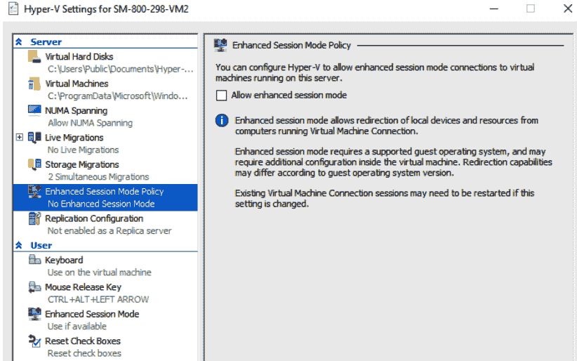

图 9.10 – 启用增强会话模式策略设置

2. 接下来，在用户设置下选择增强会话模式，如以下屏幕截图所示：

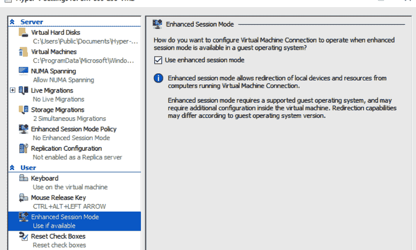

图 9.11 – 启用增强会话模式设置

打开 VMConnect 时，您将看到可以访问和使用的 VM 本地设备资源：

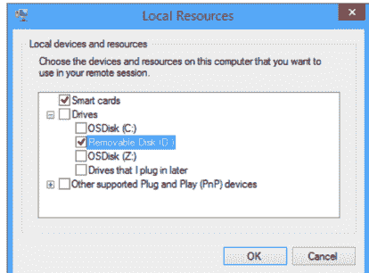

图 9.12 – 通过 VMConnect 访问本地资源

可以使用命令提示符或 PowerShell 通过以下命令更改 VMConnect 的设置：

```
VMConnect.exe <ServerName> <VMName> /edit
```

### VM 资源组

您可以使用 VM 资源组将 VM 分组，并在组级别而非单个 VM 上大规模执行编排操作。

以下是该功能的 PowerShell cmdlet：

- Add-VMGroupMember
- Get-VMGroup
- New-VMGroup
- Remove-VMGroup
- Remove-VMGroupMember
- Rename-VMGroup

此功能只能通过 PowerShell 实现，因为 Hyper-V 管理器中没有相应选项。

### CPU 组

VM CPU 组允许您轻松地在来宾 VM 之间管理和分配主机 CPU 资源。使用 CPU 组，您可以执行以下操作：

- 创建具有不同分配的 VM 组，这些分配在组内共享主机 CPU 资源。可为不同的 VM 类型创建不同的服务类别。
- 设置特定组以拥有 CPU 资源限制；这将限制组可消耗的主机 CPU 资源量。这可以强制执行该组所需的服务类别。
- 设置组的约束，使其仅在主机特定 CPU 集上运行。这可以在不同 CPU 组成员之间提供 VM 隔离。

Hyper-V 主机计算服务 (HCS) 管理 CPU 组。在此，可以使用 cpugroups.exe 命令行实用工具。

CPU 组可能非常复杂，其内容超出了本节详细说明的范围；请参阅以下有关此功能的 Microsoft 文档：[Microsoft 文档](https://docs.microsoft.com/en-us/windows-server/virtualization/hyper-v/manage/manage-hyper-v-cpugroups)

### Hypervisor 调度程序

Windows Server 2016 引入了新的 *虚拟处理器调度逻辑模式*。Hyper-V 主机如何管理和分配来宾虚拟处理器的工作，由这些 *模式* 或 *调度逻辑类型* 定义。

调度程序类型如下：

- 经典调度程序
- 核心调度程序
- 根调度程序

有关每种调度程序类型的更多详细信息，请参阅以下 Microsoft 文章：[Microsoft 文章](https://docs.microsoft.com/en-gb/windows-server/virtualization/hyper-v/manage/about-hyper-v-scheduler-type-selection)

从 Windows Server 2019 开始，*核心调度程序* 是最大安全态势的默认设置，以确保默认安全性。出于这些安全原因，Microsoft 建议将 Windows Server 2016 中的默认 *经典调度程序* 更改为启用 *核心调度程序*，以防范潜在的恶意 VM。

配置 *核心调度程序* 后，来宾 VM 可以选择使用 **同步多线程** (SMT)，它允许独立的执行线程共享相同的处理器资源。

可以使用以下 PowerShell 命令在来宾 VM 上启用 SMT：

```
Set-VMProcessor -VMName <VMName> -HwThreadCountPerCore <n>
```

调度程序通过 *hypervisorschedulertype* BCD 中的条目在主机上配置。您可以使用管理员权限从命令提示符使用以下命令更改调度程序类型：

```
bcdedit /set hypervisorschedulertype "type"
```

此处，"type" 可以是命令中输入的 *classic*、*core* 或 *root* 调度程序之一。

> **注意**
> 撰写本文时，Hyper-V 不支持 *根调度程序*，且不应为 *虚拟化场景* 配置它。

### VM 检查点

Hyper-V 中的每个来宾 VM 可以配置以下检查点之一：

- **生产检查点**：这是可恢复的 VM 时间点映像。它使用 VM 内的备份功能来创建检查点，而不是使用保存状态功能。
- **标准检查点**：这是运行中 VM 的状态、数据和硬件配置捕获。它用于测试和开发用例。

每个 VM 的检查点可以启用或禁用。请按照以下步骤启用检查点：

1. 在 **Hyper-V 管理器** 中，右键单击 VM 并单击 **设置**。
2. 在 **管理** 部分下选择 **检查点**。
3. 选择 **启用检查点**；要*禁用*它，请清除复选框。
4. 单击 **应用** 保存更改，然后单击 **确定** 完成。

要更改检查点类型，请按照以下步骤操作：

1. 在 **Hyper-V 管理器** 中，右键单击 VM 并单击 **设置**。
2. 在 **管理** 部分下选择 **检查点**。
3. 选择 **生产** 或 **标准** 检查点。
4. 可选，您可以选择在不同位置存储检查点；使用 **检查点文件位置** 部分并将其设置为 *必需*。
5. 单击 **应用** 保存更改，然后单击 **确定** 完成。

新计算机的默认值为 *生产*。

### NIC 联机

网络接口卡 (NIC) 联机是第三方硬件供应商提供的一种技术，它使用多个网络适配器来聚合带宽。如果网络适配器失败，将提供流量故障转移，以避免连接和流量流失。

但是，Microsoft 不为该硬件供应商的技术提供支持渠道，也未为实施此技术的各个硬件供应商提供配置信息；您的硬件供应商应为您的场景提供配置协助。

请参阅以下有关 Hyper-V 中 NIC 联机的官方 Microsoft 支持策略：[官方 Microsoft 支持策略](https://docs.microsoft.com/en-us/troubleshoot/windows-server/virtualization/support-policy-nic-teaming)

### Hyper-V 副本

Hyper-V 副本是 Hyper-V 角色中的内置功能。它允许您在 Hyper-V 主机之间复制 VM 以支持高可用性目标；它会创建复制到脱机 VM 的 VM 活动副本。数据可以配置为每 30 秒、5 分钟或 30 分钟同步一次，以满足您的恢复点目标 (RPO) 要求。

主机和辅助主机服务器可以位于同一物理位置，也可以通过 WAN 链路进行复制。Hyper-V 副本支持独立和群集 Hyper-V 主机。Hyper-V 主机不依赖 Active Directory。

按照以下步骤配置 Hyper-V 副本：

1. 配置 Hyper-V 主机：
   - 至少需要两个主机，每个主机上有一个或多个 VM。
   - 在主机的 *Hyper-V 设置* 中，在 **复制配置** 部分选择 **将此计算机启用为副本服务器**。
   - 为 HTTP 选择 **使用 Kerberos** 或为 HTTPS 使用 **基于证书的身份验证**。
   - 要允许副本服务器允许来自任何已验证主服务器的 VM 复制流量，请选择 **允许来自任何已验证服务器的复制**。要仅接受来自特定选定主服务器的 VM 复制流量，请选择 **允许来自指定服务器的复制**。
   - 单击“确定”完成。

2. 配置防火墙。必须允许 VM 复制流量跨网络传输；您应配置 Windows 防火墙和任何第三方防火墙。

3. 启用 VM 复制。对于要复制的每个 VM，请执行以下操作：
   - 在 **Hyper-V 管理器** 中，右键单击 VM，并通过单击 **启用复制** 打开 **启用复制向导** 区域。按需完成向导的步骤。详细步骤可在以下 Microsoft 文档中找到：[Microsoft 文档](https://docs.microsoft.com/en-gb/windows-server/virtualization/hyper-v/manage/set-up-hyper-v-replica)。

4. 执行故障转移。您可以运行 *测试故障转移*、*计划内故障转移* 或 *非计划内故障转移*。

Hyper-V 副本的默认配置仅保留来自主服务器的最新复制的单个恢复点。可以存储最多 *24 个每小时恢复点* 的其他恢复点。可以创建 *崩溃一致* 和 *应用一致* 恢复点。


### 远程管理 VM

以下工具均可用于远程连接运行在 Hyper-V 主机上的 VM；这对于自动化配置和操作，以及在丢失控制台访问时的故障排除和支持任务可能很有用：

- **PowerShell 远程处理**：此方法允许本地用户的 PowerShell 会话向运行在 Hyper-V 主机上的远程 VM 发送命令，以便在本地执行。可以使用 PowerShell `Enable-PSRemoting` cmdlet 启用此功能。

- **PowerShell Direct**：此方法允许您在不需要网络连接的情况下，直接连接到运行在 Hyper-V 主机上的 VM 内部。这使用 *Hyper-V VMBus* 连接到 VM。您可以使用 PowerShell `PSession` 或 `Invoke-Command` cmdlet。

- **HVC.exe**：此方法允许直接使用 **安全外壳协议 (SSH)** 连接到 Hyper-V 主机上的 Linux VM。

在本节中，我们学习了如何创建和管理 Hyper-V 来宾 VM。在下一节中，我们将探讨如何保护运行在 Hyper-V 主机上的工作负载。

### 使用受保护的结构保护 Hyper-V 工作负载

本节将首先从概览层面介绍受保护的结构安全解决方案，然后在接下来的小节中探讨每个组件。

### 受保护的结构

**受保护的结构** 是一组组件服务和功能集合，可让安全解决方案保护 VM 免受检查、窃取和篡改，以及来自受损 VM 或主机的恶意行为者、人类或恶意软件的侵害。

受保护的结构的核心由以下组件组成：

- **屏蔽 VM**：您指定 VM 必须使用的模板和映像，以使其成为屏蔽 VM。

- **受保护主机**：您指定哪些主机可安全地运行屏蔽 VM。

- **主机守护者服务 (HGS)**：这确保只有授权且安全的受保护结构主机可以运行屏蔽 VM。它为受保护主机提供密钥服务。

受保护的结构安全解决方案如下图所示：

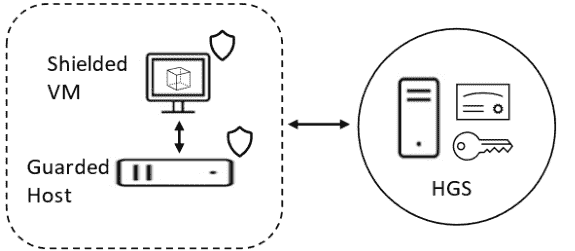

图 9.13 – 受保护的结构组件

以下 VM 类型可以在受保护的结构中以不同安全级别运行：

- 屏蔽 VM：提供最高安全措施的最大保护
- 加密标准 VM：保护程度不如屏蔽 VM
- 标准 VM：无保护，提供最少的安全措施

在本节中，我们介绍了受保护的结构安全解决方案。以下小节将探讨主机守护者服务的组件和操作。

### 主机守护者服务

主机守护者服务 (HGS) 包含两个核心组件：

- HGS 证明服务：只有授权且受保护的主机才能通过证明运行屏蔽 VM。有两种证明模式可用，以确保受保护主机只运行已批准的代码；这些模式如下：
  - TPM 信任证明：在此模式下，受保护主机的批准基于三种类型的信息：可信平台模块身份、测量启动序列和代码完整性策略。
  - 主机密钥证明：在此模型中，受保护主机的批准基于密钥持有情况。
- 密钥保护服务 (KPS)：这允许受保护主机通过提供的密钥打开屏蔽 VM 的电源。屏蔽 VM 也可以使用这些安全密钥迁移到另一个受保护主机。

管理员信任证明模式包含在 Windows Server 2016 中，但在 Windows Server 2019 中已弃用。

以下步骤可用于在受保护的结构中启动屏蔽 VM：

1. 用户请求启动屏蔽 VM。
2. 在屏蔽 VM 启动之前，受保护主机向 HGS 请求证明。
3. HGS 证明服务验证受保护主机的凭据。
4. HGS 证明服务向受保护主机发送证书。
5. 受保护主机将证明证书提交给 KPS。使用加密密钥请求一个密钥来解锁屏蔽 VM。
6. KPS 从受保护主机确定证书的有效性，通过解密密钥检索解锁屏蔽 VM 的密钥。
7. 受保护主机从 KPS 接收密钥。
8. 使用密钥解锁屏蔽 VM 后，将其启动。

可以使用服务器管理器中的 **添加角色和功能向导** 区域或以下 PowerShell cmdlet 实现 HGS 角色：

```
Install-WindowsFeature HostGuardianServiceRole
-IncludeManagementTools -Restart
```

在本节中，我们探讨了保护 Hyper-V 工作负载。在下一节中，我们将完成一些实操练习，以巩固本章涵盖的一些概念。

### 实操练习

为了通过一些实用技能支持您的学习，我们将利用从本章获得的概念和理解，并将其付诸实践。

我们将查看以下练习：

- 练习 – 使用服务器管理器实现 Hyper-V 角色
- 练习 – 使用 PowerShell 实现 Hyper-V 角色
- 练习 – 创建来宾 VM

### 入门

要开始本节，您需要访问一台 Windows 服务器；可以是物理服务器、虚拟机或 Azure IaaS VM。您必须确保物理计算机或 VM 符合 Hyper-V 的安装要求，如以下文章所示：https://docs.microsoft.com/en-us/windows-server/virtualization/hyper-v/system-requirements-for-hyper-v-on-windows。

让我们继续本章的练习。

### 练习 – 使用服务器管理器实现 Hyper-V 角色

在本练习中，我们将使用服务器管理器实现 Hyper-V 角色。对于本练习，我们将使用 Windows Server 2019 Gen2 VM。

执行以下步骤以开始：

1. 使用管理员帐户登录到本练习的 Windows Server，从 **服务器管理器** 的 **管理** 屏幕单击 **添加角色和功能**，并在 **开始之前** 屏幕上单击 **下一步**。
2. 在 **安装类型** 屏幕上选择 **基于角色或基于功能的安装**，然后单击 **下一步**。
3. 从 **服务器选择** 屏幕接受当前服务器的默认选择，然后单击 **下一步**。
4. 在 **服务器角色** 屏幕的 **角色** 列表中选择 **Hyper-V**。
5. 在弹出屏幕上单击 **添加功能**。然后，单击 **下一步**：

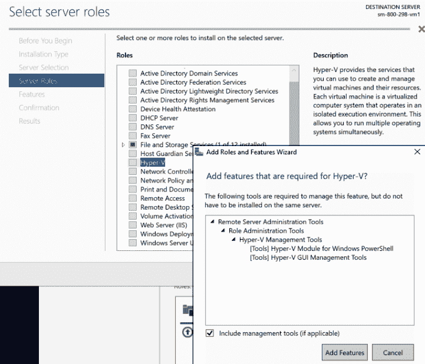

图 9.14 – 添加 Hyper-V 服务器角色

6. 在 **服务器角色** 屏幕上，单击下一步。

7. 在 **功能** 屏幕上，单击下一步。

8. 在 **Hyper-V** 屏幕上，单击下一步：

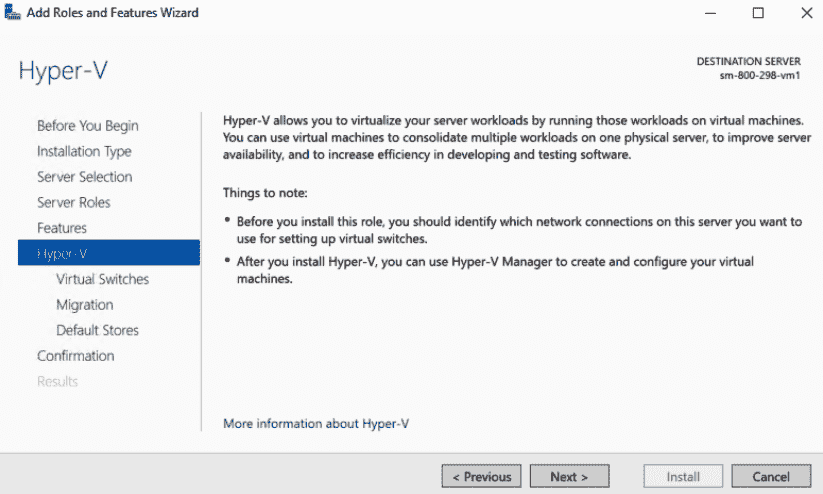

图 9.15 – 添加 Hyper-V 服务器角色

9. 在 **创建虚拟交换机** 屏幕上，选择网络适配器并单击下一步：

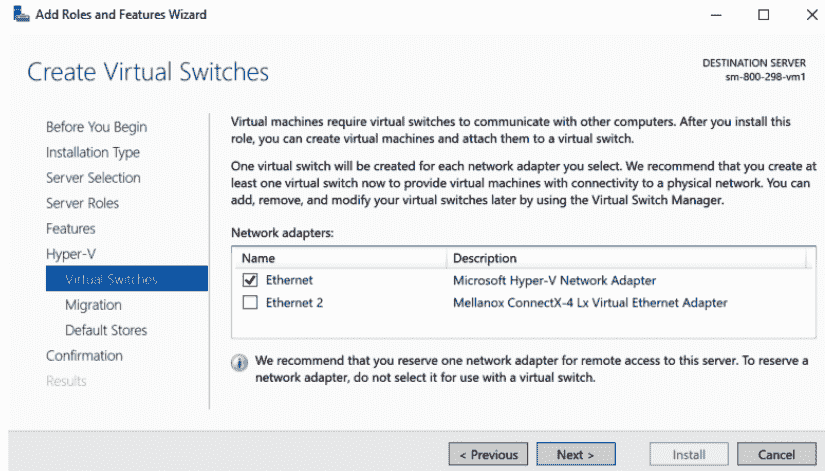

图 9.16 – 创建虚拟交换机屏幕

10. 在虚拟机迁移屏幕上，接受默认值并单击下一步：

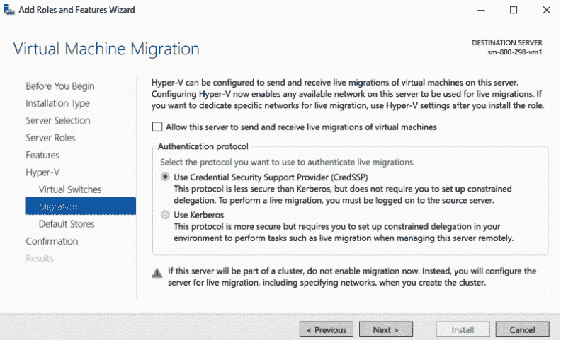

图 9.17 – 启用迁移

11. 在 **默认存储** 屏幕上，接受默认值并单击 **下一步**：

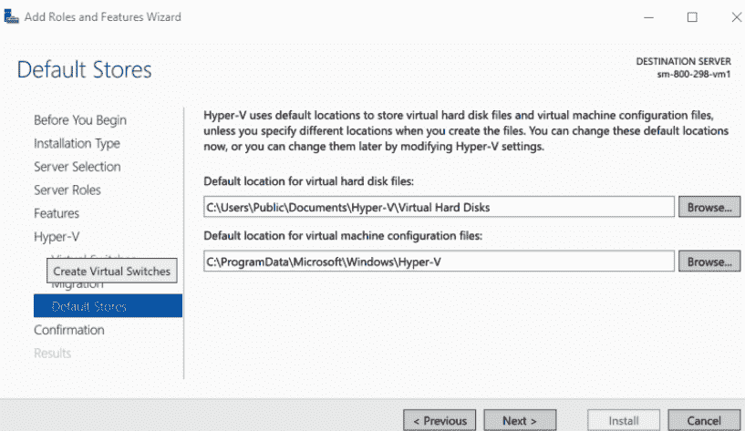

图 9.18 – 设置默认存储

12. 在 **确认安装选择** 屏幕上，选择 **如果需要，自动重新启动目标服务器**，在出现的服务器重新启动弹出窗口中单击是，然后单击 **安装**：

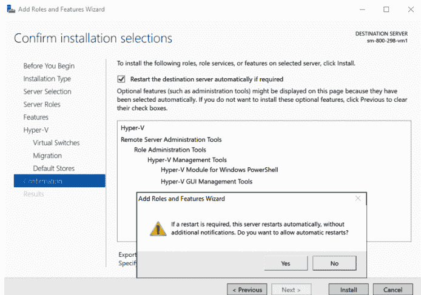

图 9.19 – 确认安装选择屏幕

13. 安装将开始：

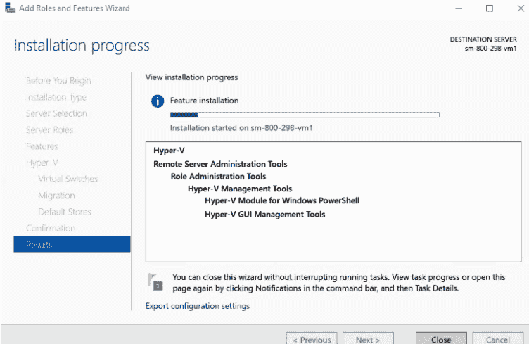

图 9.20 – 安装进度屏幕

14. 安装成功后，单击 **关闭** 以完成向导安装。**Hyper-V** 角色将出现在 **服务器管理器** > **仪表板** 下：


图 9.21 – 已安装 Hyper-V 服务器角色

至此，我们完成了本练习。本练习教会了我们如何使用 **服务器管理器** 在 **Windows Server** 上实现 **Hyper-V** 角色。在下一练习中，我们将使用 **PowerShell** 在 **Windows Server** 上实现 **Hyper-V** 角色。


### 练习 – 使用 PowerShell 实现 Hyper-V 角色

在本练习中，我们将使用 PowerShell 实现 Hyper-V 角色。本练习将使用 Windows Server 2019 第 2 代虚拟机，并在服务器上本地安装它。

按以下步骤开始：

- 1. 使用管理员帐户登录本练习的 Windows Server，并启动以管理员身份运行的 PowerShell 会话。

- 2. 运行以下命令在本地将 Hyper-V 安装到此服务器：

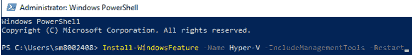

图 9.22 – PowerShell 安装

- 3. 安装将开始：

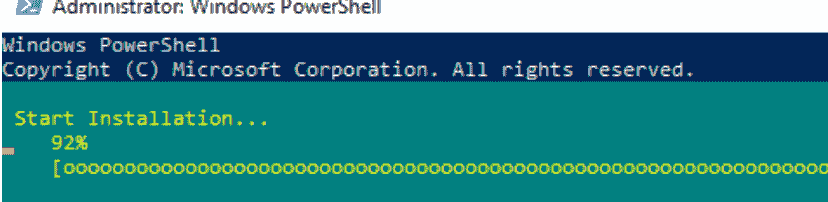

图 9.23 – 正在进行安装

- 4. 服务器将重启；Hyper-V 角色现在将出现在“服务器管理器” > “仪表板”下：

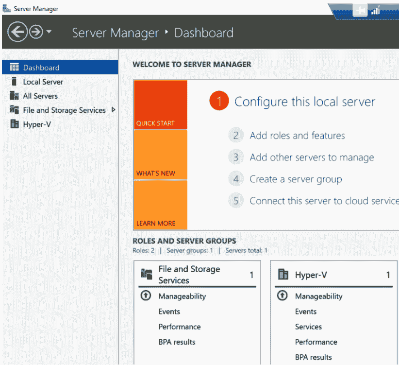

图 9.24 – 已安装 Hyper-V 服务器角色

至此，我们已完成本练习。本练习教会了我们如何在 Windows Server 上使用 PowerShell 实现 Hyper-V 角色。在下一个练习中，我们将了解如何创建来宾虚拟机。

### 练习 – 创建来宾虚拟机

在本练习中，我们将创建来宾虚拟机。按以下步骤开始：

- 1. 使用管理员帐户登录本练习的 Windows Server 并打开 Hyper-V 管理器。
- 2. 单击“操作”窗格中的“新建”，然后单击“虚拟机...”：

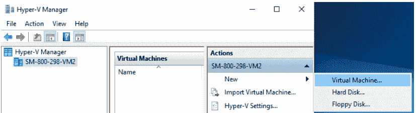

图 9.25 – 创建 VM

- 3. 在“新建虚拟机向导”区域，单击“下一步”：

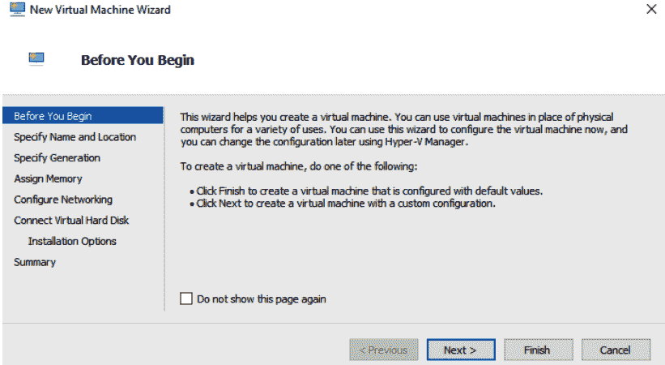

图 9.26 – 新建虚拟机向导 – 开始之前

- 4. 本练习中，我已选择所有默认选项。您可以根据需要选择每个选项。您可以阅读以下 Microsoft 文档来查看每个选项及其默认值：https://docs.microsoft.com/en-us/windows-server/virtualization/hyper-v/get-started/create-a-virtual-machine-in-hyper-v#options-in-hyper-v-manager-new-virtual-machine-wizard.

- 5. 在“**摘要**”屏幕上，确认选择后单击“**完成**”：

### 新建虚拟机向导

### 完成新建虚拟机向导

您已成功完成新建虚拟机向导。您即将创建以下虚拟机。

说明：

- 开始之前
- 指定名称和位置
- 指定代
- 分配内存
- 配置网络
- 连接虚拟硬盘
- 安装选项
- 摘要

| 名称 | 新建虚拟机 |
|---|---|
| 代 | 第 1 代 |
| 内存 | 1024 MB |
| 网络 | 未连接 |
| 硬盘 | C:\Users\Public\Documents\Hyper-V\Virtual Hard Disks\New Virtual Machine.vhdx |
| 操作系统 | 将在稍后安装 |

要创建虚拟机并关闭向导，请单击“完成”。

图 9.27 – 新建虚拟机向导 – 摘要

- 6. 在“**虚拟机连接**”窗口中，选择“**操作**” | “**启动**”：

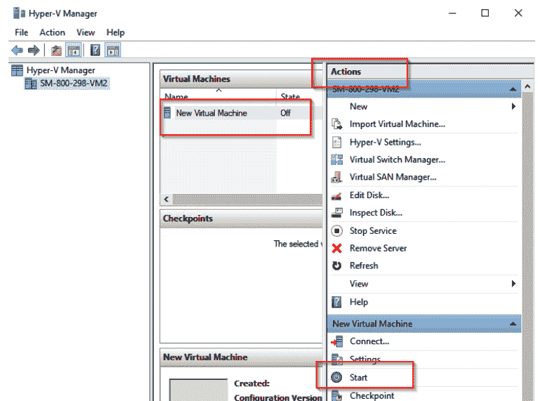

图 9.28 – 启动 VM

- 7. 在“虚拟机连接”窗口中，选择“操作” | “连接...”：

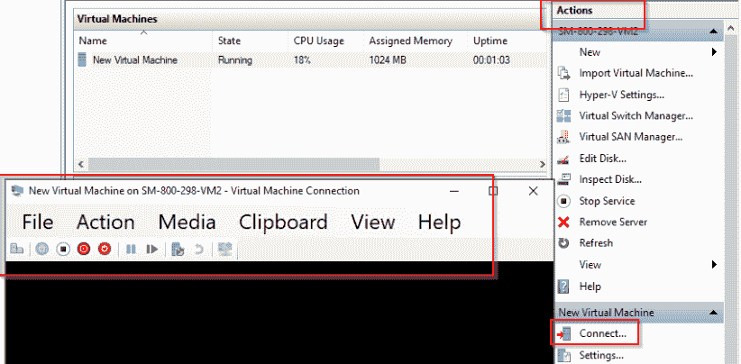

图 9.29 – 连接到 VM

至此，我们已完成本练习。本练习教会了我们如何创建来宾虚拟机。现在，让我们总结本章。

### 摘要

本章内容有助于您发展有关使用 Hyper-V 进行虚拟化的知识和技能，并涵盖了 AZ-800 管理 Windows Server 混合核心基础结构：管理 Hyper-V 和来宾虚拟机。

首先，您了解了虚拟化以及如何实现和管理 Hyper-V，并使用受保护结构安全解决方案保护工作负载。我们以动手练习结束，帮助您进一步发展技能。

您通过所提供的信息获得了新技能，并将知识超出考试目标，为面向现实世界日常混合环境的角色做好准备。

在下一章中，您将了解如何实现和管理 Windows Server 容器。

### 进一步阅读

本节提供其他学习参考和其他考试信息的链接：

- Microsoft Certified: Windows Server Hybrid Administrator Associate: https://docs.microsoft.com/en-us/learn/certifications/windows-server-hybrid-administrator/
- Exam AZ-800: Administering Windows Server Hybrid Core Infrastructure: https://docs.microsoft.com/en-us/learn/certifications/exams/az-800
- Exam AZ-800: Study Guide: https://query.prod.cms.rt.microsoft.com/cms/api/am/binary/RWKI0r
- Microsoft Learn: https://docs.microsoft.com/en-us/learn/paths/manage-virtualization-containers-hybrid-environment/

### 技能检查

通过回答以下问题，检查您在本章学到的内容：

- 1. 与传统的物理计算模型相比，虚拟化计算模型有哪些优势和价值？
- 2. 什么是 Hyper-V？
- 3. 实现 Hyper-V 的一些硬件要求是什么？
- 4. 在 Server Core 上实现 Hyper-V 而非完整 GUI 操作系统安装有哪些好处？
- 5. 支持哪些来宾操作系统类型？
- 6. 两个主要网络组件是什么？
- 7. 三种虚拟网络交换机类型是什么，它们在功能上有何不同？
- 8. 什么是嵌套虚拟化？
- 9. 嵌套虚拟化的一些要求是什么？
- 10. 列出 Hyper-V 管理器中可用的至少六个功能。
- 11. 我们可以通过哪些方式管理 Hyper-V 主机和来宾虚拟机？
- 12. 什么是 VM 代版本？
- 13. 什么是 VM 配置版本？
- 14. 第 1 代和第 2 代 VM 设置有什么区别？
- 15. 支持哪些 VHD 磁盘格式，它们有何不同？
- 16. 有哪些不同的 VHD 磁盘类型，这些不同类型的使用场景是什么？
- 17. 什么是动态内存，如何配置？
- 18. 什么是 Hyper-V 集成服务？
- 19. 什么是离散设备分配？
- 20. 增强会话模式提供哪些功能？
- 21. VM 资源组和 CPU 组有什么好处？
- 22. 三种调度器类型是什么？
- 23. 解释两种 VM 检查点类型。
- 24. 如何提供高可用性？
- 25. 解释受保护结构的组件和操作。
