## 10 实现和管理 Windows Server 容器

在上一章中，我们添加了在 Windows Server 上实现和管理 Hyper-V 的技能。

本章涵盖 AZ-800 管理 Windows Server 混合核心基础结构：创建和管理容器的内容。

本章内容并非旨在涵盖容器及其创建、操作和编排的所有方面；内容范围仅限于考试技能大纲。

在本章中，我们将了解容器化的概念，介绍 Docker，并了解 Windows Server 容器。我们将以一些动手练习结束，帮助您进一步发展技能。

本章包含以下主题：

- 容器简介
- Docker 简介
- 保护 Windows Server 容器
- Windows Server 容器网络
- 创建 Windows Server 容器映像
- 管理 Windows Server 容器映像
- 动手练习

除本章列出的主题外，本章的目标是将您的知识超出考试目标，为面向现实世界日常混合环境的角色做好准备。

### 容器简介

在本节中，我们将介绍**容器**的概念，并了解它们与**虚拟机 (VM)**的关系。

作为一种概念，容器能够实现标准化且隔离的可部署计算资源单元，这些单元轻巧且可移植。

容器围绕封装构建，涉及将应用程序的代码及其依赖项打包，以便可以无缝部署到开发或生产环境中，并获得可重复、可预测且一致的结果。

容器的好处和价值在于，它们是*自包含的计算单元*，轻巧且可移植。

在下一节中，我们将了解容器与 VM 之间的关系。

### 比较容器和 VM

要了解容器模型，我们将简要将其与虚拟化 (VM) 放在一起看待。

与 VM 类似，容器是计算资源单元；它们的目标相同，即托管和执行代码。但是，VM 带有大量开销；它们非标准、体积大、资源密集、整体式、脆弱、难以移动且不敏捷。相比之下，容器可被视为*反 VM*；其特性正好相反，即它们是标准、轻巧、体积小、资源占用少、可移植、更加敏捷、响应迅速且启动时间更短。它们非常适合数字化转型场景和现代化数据中心工作负载。

使用容器交付代码执行的方法几乎被认为更接近应用程序交付模型，而不是虚拟化模型。

这引出了下一个思考领域，即容器通过虚拟化软件资源（即操作系统）来交付代码执行。这与虚拟化形成鲜明对比，在虚拟化中，VM 虚拟化硬件资源。

在以下图表中，我们可以将容器视为与 VM 成比例的计算单元，并将物理服务器视为计算单元：


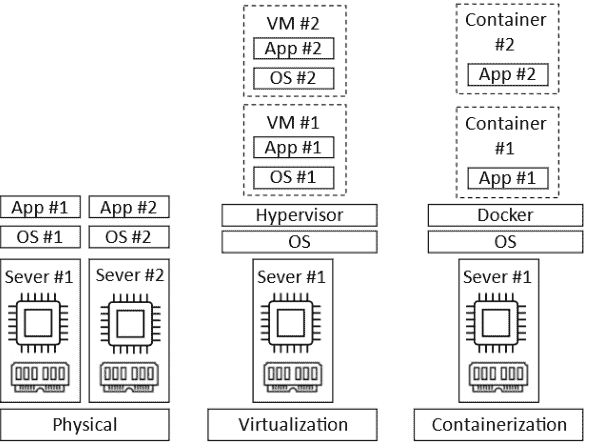

图 10.1 – 物理机与虚拟机与容器

前面的图示表明，简而言之，提供相同数量的应用所需的物理服务器更少。

仔细观察，我们可以看到，传统的每台服务器运行单个应用的方式意味着我们需要两台物理服务器来提供两个应用。该图示表明，借助虚拟化，相同的两个应用现在只需要一台物理服务器。不过，我们仍需为每个虚拟机购买、维护、保护和支持操作系统，这可能会带来相当大的成本和运维负担。然而，使用容器时，我们提供相同数量的应用，并且仍然使用与虚拟化相同数量的物理服务器，但只需要一份操作系统副本。

总而言之，使用容器时，我们对软件进行虚拟化；这允许多个计算实例（容器）共享单个主机操作系统的底层主机软件资源。通过这样做，我们能够实现更高的效率、规模和敏捷性。

本节介绍了容器，并将其与虚拟机和传统物理服务器模型进行了比较，以帮助你了解在容器中托管和执行应用程序代码的价值和优势。在下一节中，我们将介绍 Docker。

### Docker 简介

Docker（https://www.docker.com）是一个开源的容器化平台，它将应用程序的代码打包成我们在本章前面几节中介绍的标准化计算单元。由于 Docker 是开放标准，它可以在所有主要操作系统类型、任何基础设施和任何云平台上运行。

Docker 平台的两个核心组件如下：

- Docker 引擎：这是一个轻量级、安全的运行时环境，可运行在基于 Windows 的操作系统、Linux 和 macOS 上
- Docker 客户端：这是引擎的命令行界面 (CLI)，并在主机计算机上运行

Docker 可以使用包管理在 Windows Server 上安装。PowerShell PackageManagement 模块在 Windows Server 2019 及更高版本中可用。

Docker 还可以使用 PowerShell DockerMicrosoftProvider 模块进行安装。

我们将在本章的实操练习部分学习如何安装 Docker。

在本节中，我们介绍了 Docker。在下一节中，我们将介绍保护 Windows Server 容器。

### 保护 Windows Server 容器

本节在隔离模式的背景下探讨安全性。

Windows Server 容器提供两种隔离模式：进程隔离和 Hyper-V 隔离。每个容器与主机操作系统之间创建的隔离程度区分了这些隔离模式。让我们逐一介绍每种模式：

- 进程隔离（这是传统的隔离模式）：
  - 容器与主机之间共享相同的内核
  - 每个容器都有用户模式
  - 启动 Docker 容器时，使用 --isolation=process 命令开关
- Hyper-V 隔离：
  - 使用这种隔离模式，每个容器都有自己的内核
  - 每个容器在虚拟机内运行
  - 每个容器与主机之间提供硬件级别的隔离
  - 启动 Docker 容器时，使用 --isolation=hyperv 命令开关

以下图示展示了这两种隔离模式：

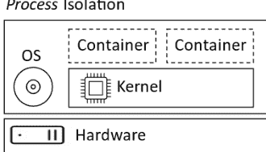

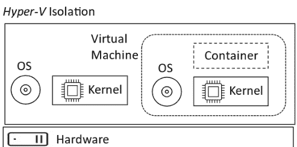

图 10.2 – 隔离模式

进程隔离是 Windows Server 主机上 Windows 容器的默认模式。在 Windows 10 主机上运行的 Windows 容器使用 Hyper-V 隔离。

在本节中，我们在 Windows 容器的隔离背景下探讨了安全性。在下一节中，我们将介绍 Windows 容器中的网络。

### Windows Server 容器的网络

使用 Windows Server 容器进行网络的概念在功能上与虚拟机类似。一个虚拟网络适配器 (vNIC) 连接到容器，该容器连接到 Hyper-V 虚拟交换机 (vSwitch)。可以通过 Docker 创建五个网络驱动程序或模式来支持 Windows，它们如下：

- L2bridge 网络驱动程序
- L2tunnel 网络驱动程序
- NAT 网络驱动程序
- Overlay 网络驱动程序
- Transparent 网络驱动程序

有关每个驱动程序的更多详细信息，请参阅以下 Microsoft 文档文章：https://docs.microsoft.com/en-gb/virtualization/windowscontainers/container-networking/network-drivers-topologies。

根据物理网络和主机网络要求，应选择最适合您需求的驱动程序。

您可以运行 `docker network ls` 命令来列出可用网络。

NAT 是 Docker 引擎首次运行时创建的默认网络类型。它使用 **WinNAT** Windows 组件和内部 vSwitch。

有两个 vSwitch 可用，它们如下：

- **内部 vSwitch**：这不直接连接到容器主机上的网络适配器
- **外部 vSwitch**：这直接连接到容器主机上的网络适配器

在本节中，我们介绍了 Windows Server 容器中的网络。在下一节中，我们将介绍创建 Windows Server 容器映像的过程。

### 创建 Windows Server 容器映像

基础映像为容器提供操作系统的基础层；所有容器都将基于该映像。基础映像包含用户模式操作系统文件、运行时文件、必需的应用程序依赖项以及任何必需的杂项配置文件。

Microsoft 为 Windows Server 容器提供以下基础映像：

- **Windows**：这包括完整的 Windows API 和系统服务，但不包含服务器角色。它在 Windows Server 2022 上不可用。这是最大的映像 (3.4 GB)。
- **Windows Server**：这包括完整的 Windows API，比 Windows 映像具有更多的服务器功能，支持 GPU，并且没有 IIS 限制。它需要 Windows Server 2022，并且比 Windows 映像略小 (3.1 GB)。
- **Server Core**：这与 Nano Server 是最常用的映像。它包括 Windows API 的子集，包括 **.NET Framework** 和大多数服务器角色，以及中等大小的映像。它最适合 **直接迁移** 场景。
- **Nano Server**：这包括 **.NET Core** API 和一些服务器角色；它是一个超轻量映像。关键的映像差异是 API 表面显著更小；PowerShell、WMI 和 Windows 服务堆栈不包括在内。

以下信息总结了针对给定场景应使用的适当基础映像：

- *应用程序是否需要完整的 .NET Framework？* 您应该使用 **Windows Server Core** 基础映像。
- *该应用是否基于 .NET Core？* 您应该使用 Nano Server 基础映像。
- *您的应用是否需要 Windows Server Core 中缺少的依赖项？* 您应该使用 Windows 基础映像。
- *是否需要 GPU 加速支持？* 您应该使用 Windows Server 基础映像。

这些基础映像可以在 Docker Hub 上找到：https://hub.docker.com/_/microsoft-windows-base-os-images。

可以通过运行以下 PowerShell 命令找到可用的所有 Microsoft 容器基础映像列表：

```
docker search Microsoft
```

这些映像可以从 **Microsoft 容器注册表 (MCR)** 下载。

要下载基础映像，可以使用 `docker pull` 命令。以下是示例：

```
docker pull mcr.microsoft.com/windows/servercore:ltsc2022
```

下载映像后，可以运行以下命令来验证现在本地可用的哪些映像并显示元数据：

```
docker image ls
```

在本节中，我们介绍了使用 Docker 进行基于 Microsoft 的容器创建。在下一节中，我们将介绍管理 Windows Server 容器映像。

### 管理 Windows Server 容器映像

Windows 容器通过 Docker 创建、运行和管理。**Docker 引擎** 提供有助于自动化创建过程的工具。实现此功能的 Docker 组件如下：

- **Docker 文本文件**，Dockerfile：此文件包括创建容器映像的说明。这包括识别将要使用的基础映像、创建映像时将要运行的命令，以及识别新实例的映像部署时间。
- **Docker 命令**，`docker build`：此命令调用 Dockerfile，随后触发映像创建过程。

除了自动化之外，Docker 命令还可以手动运行。以下是一些常用命令供参考：

- `docker images`：此命令列出容器主机上安装的映像
- `docker run`：此命令使用容器映像创建容器


- `docker commit`: 此命令将对容器所做的更改提交到新的容器映像
- `docker stop`: 此命令停止正在运行的容器
- `docker rm`: 此命令删除现有的容器

Docker 方法允许您将映像作为代码存储，使用开发生命周期执行持续集成，并为升级和维护目的重新创建快速且可重复的映像，从而获得一致的结果。

容器还可以通过基于浏览器的 GUI 进行管理，该 GUI 称为 **Windows 管理中心 (WAC)**。必须安装 **容器扩展**，以便在 WAC 中查看容器管理。如以下屏幕截图所示：

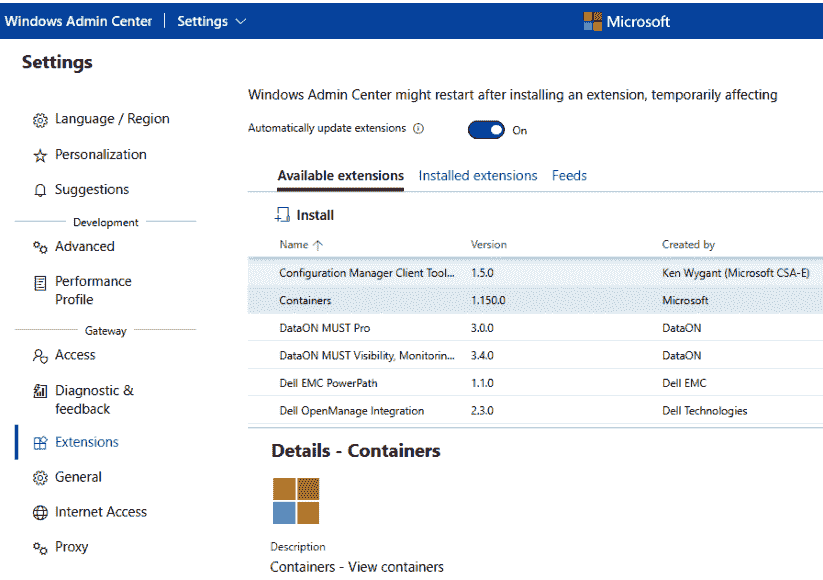

图 10.3 – 为 WAC 安装容器扩展

安装扩展后，如果主机上不存在 Docker，系统将提示您安装 Docker，如以下屏幕截图所示：

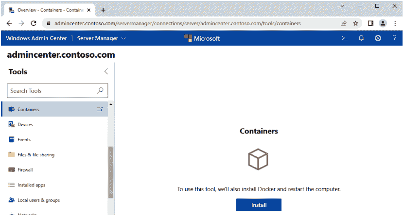

图 10.4 – 通过 WAC 安装 Docker

以下屏幕截图显示了 WAC 容器管理体验：

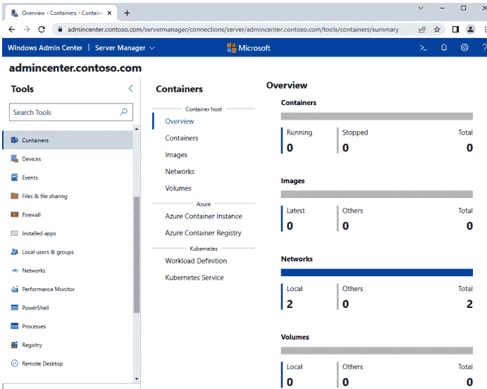

图 10.5 – 使用 WAC 进行容器管理

现在，您可以指定要从 MCR 运行的映像。

### 维护容器映像

应定期更新容器映像，以确保它们接收通过代码和修补程序所做的更改。

基础 OS 层包含主机 OS 不共享的 OS 元素。它由两个映像组成：基础层和更新层。基础层是较大的层，但更改最少，所需维护最少；更新层较小。以下图表表示这些层：

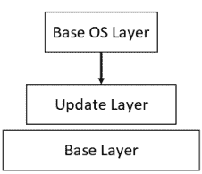

图 10.6 – 容器映像更新层

在更新层中，每个代码更改都会创建一个新映像。基础 OS 层从更新层获取其更新。

在本节中，我们探讨了管理 Windows 容器。在下一节中，我们将完成一个动手练习，以巩固本章中涵盖的一些概念。

### 动手练习

为了在获得一些实用技能的同时支持您的学习，我们将利用从本章获得的概念和理解，并将其付诸实践。

我们将查看以下练习：

- 练习 – 在 Windows Server 上使用 PowerShell 安装 Docker
- 练习 – 在 Windows Server 上使用 WAC 安装 Docker

### 开始使用

要开始本节，您需要访问 Windows 服务器；它可以是物理机、虚拟机或 Azure IaaS VM。您需要访问提升的 PowerShell 会话，并以管理员访问权限安装 WAC。

让我们进入本章的练习。

### 练习 – 在 Windows Server 上使用 PowerShell 安装 Docker

在此练习中，我们将使用 PowerShell 在 Windows Server 上安装 Docker。为此，我们将使用 Windows Server 2019 Gen2 VM。

按照以下步骤开始：

1. 使用管理员帐户登录到用于此练习的 Windows Server 并打开提升的 PowerShell 会话。

2. 运行以下命令，从 Windows PowerShell 库安装 Docker-Microsoft PackageManagement 提供程序：

```
Install-Module -Name DockerMsftProvider -Repository PSGallery -Force
```

3. 使用 PackageManagement Windows PowerShell 模块安装最新版本的 Docker：

```
Install-Package -Name docker -ProviderName DockerMsftProvider
```

以下是命令的输出：

| 名称 | 版本 | 源 | 摘要 |
| --- | --- | --- | --- |
| Docker | 20.10.9 | DockerDefault | 包含用于 Windows Server 的 Docker EE。 |

图 10.7 – 安装 Docker

4. Docker 安装完成后，使用以下命令重新启动主机：

```
Restart-Computer
```

5. 重新登录服务器并再次打开提升的 PowerShell 会话。

6. 运行以下命令以确保 Docker 服务在主机上运行：

```
Start-Service docker
```

7. 运行以下命令以检查已安装的 Docker 版本：

```
docker version
```

```
Windows PowerShell
Copyright (C) Microsoft Corporation. All rights reserved.

PS C:\Users\vmadmin> Start-Service docker
PS C:\Users\vmadmin> docker version
Client: Mirantis Container Runtime
 Version:           20.10.9
 API version:       1.41
 Go version:        go1.16.12m2
 Git commit:        591094d
 Built:             12/21/2021 21:34:30
 OS/Arch:           windows/amd64
 Context:           default
 Experimental:      true

Server: Mirantis Container Runtime
Engine:
 Version:          20.10.9
 API version:      1.41 (minimum version 1.24)
 Go version:       go1.16.12m2
 Git commit:       9b96ce992b
 Built:            12/21/2021 21:33:06
 OS/Arch:          windows/amd64
 Experimental:     false

PS C:\Users\vmadmin> _
```

图 10.8 – 检查 Docker 版本

至此，我们已完成此练习。此练习教会了我们如何在 Windows Server 上使用 PowerShell 安装 Docker。

### 练习 – 在 Windows Server 上使用 WAC 安装 Docker

在此练习中，我们将使用 Windows 管理中心 (WAC) 在 Windows Server 上安装 Docker。为此，我们将使用 Windows Server 2019 Gen2 VM。

按照以下步骤开始：

1. 登录到已安装 WAC 的 Windows Server，并使用管理员帐户启动 WAC。
2. 登录到 WAC 后，单击右上角工具栏中的齿轮图标以访问设置屏幕，然后单击 扩展：

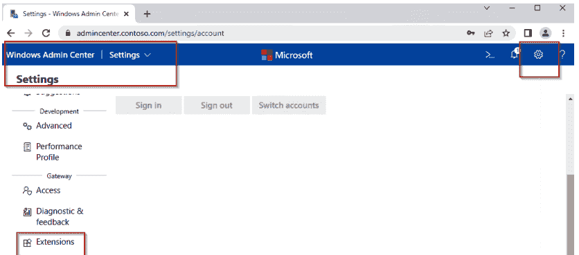

图 10.9 – WAC 设置屏幕

3. 从扩展屏幕，搜索 容器扩展：

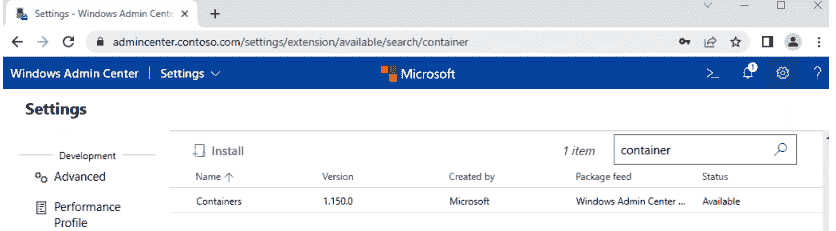

图 10.10 – WAC 容器扩展

4. 单击 容器扩展，然后单击 安装：

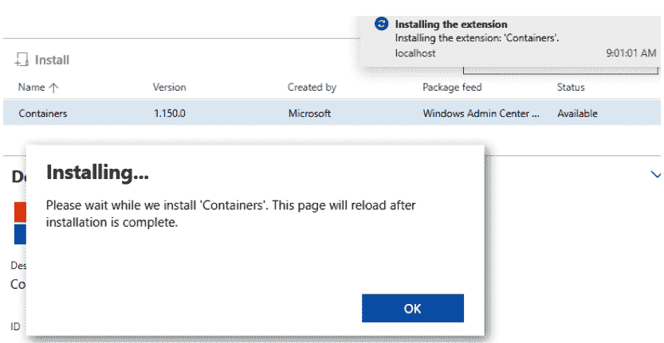

图 10.11 – WAC 正在安装扩展

5. 已安装的 容器扩展可以在 已安装的扩展 选项卡中查看：

### 扩展

安装扩展后，Windows 管理中心 可能会重新启动，暂时影响使用此 Windows 管理中心 实例的任何人。

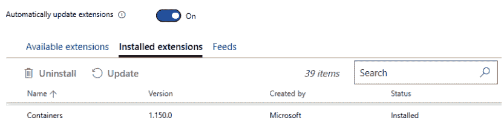

图 10.12 – WAC 扩展已安装

6. 从左上角菜单导航中，选择 **所有连接**。然后，选择 **网关** 条目以建立连接：

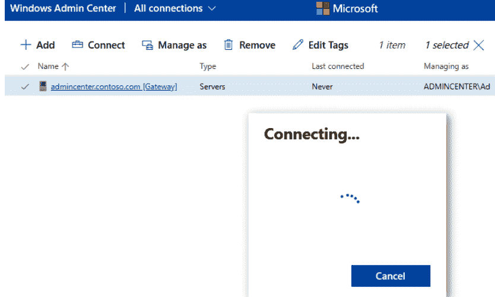

图 10.13 – WAC 正在建立连接

7. 从左侧工具菜单，单击 容器：

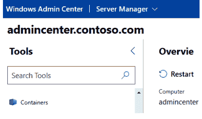

图 10.14 – 打开容器屏幕

8. 页面加载后，单击 安装：

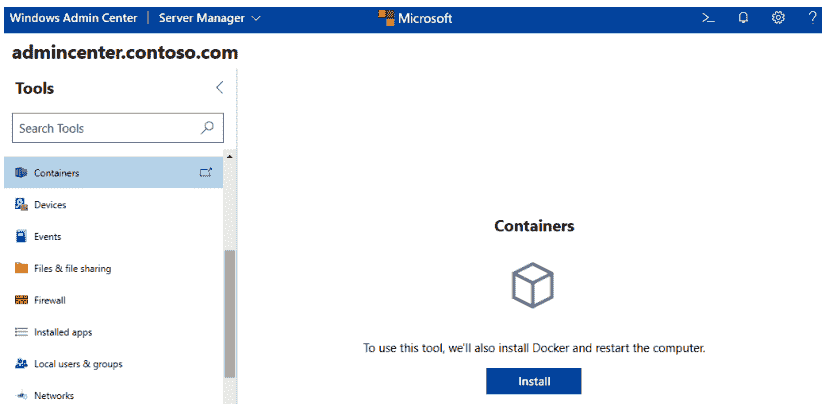

图 10.15 – WAC 正在安装 Docker

9. 等待片刻，正在安装 Docker。安装完成后，您的计算机将重新启动：

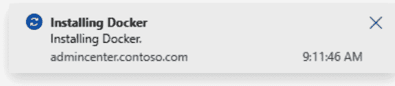


图 10.16 – Docker 已安装

10. 计算机重新启动后，启动 WAC。您将看到 Docker 已安装，并且您已准备好创建和管理容器：

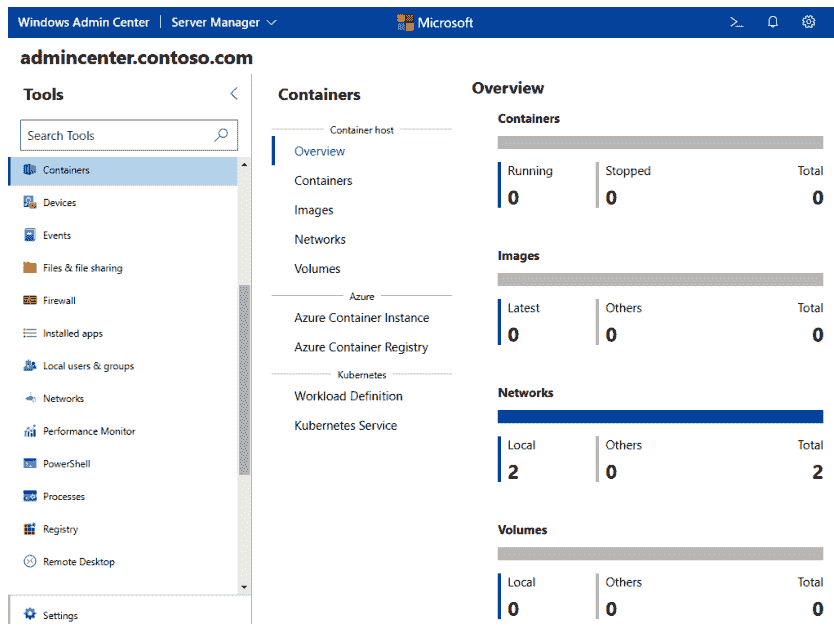

图 10.17 – 从 WAC 访问 Docker

至此，我们已完成此练习。此练习教会了我们如何在 Windows Server 上使用 WAC 安装 Docker。现在，让我们总结本章。

### 摘要

本章通过涵盖 AZ-800 管理 Windows Server 混合核心基础架构：创建和管理容器，帮助您进一步了解容器技术的知识和技能。

首先，您了解了容器并将其与虚拟机进行了比较。然后，您学习了如何创建和管理 Windows Server 容器映像并执行容器网络。

这些新技能将使您的知识超越考试目标，为您从事以现实世界日常混合环境为重点的角色做好准备。

在下一章中，您将学习如何管理 Windows Server 虚拟机。


### 进一步阅读

本节提供额外的学习参考和考试信息链接：

- *Microsoft Certified: Windows Server Hybrid Administrator Associate*: https://docs.microsoft.com/en-us/learn/certifications/windows-server-hybrid-administrator/
- *Exam AZ-800: Administering Windows Server Hybrid Core Infrastructure*: https://docs.microsoft.com/en-us/learn/certifications/exams/az-800
- *Exam AZ-800: Study Guide*: https://query.prod.cms.rt.microsoft.com/cms/api/am/binary/RWKI0r
- *Microsoft Learn*: https://docs.microsoft.com/en-us/learn/modules/run-containers-windows-server/

### 技能检查

通过回答以下问题来检查您在本章学到的内容：

- 1. 什么是容器，它们与虚拟机有何不同？
- 2. 什么是 Docker？
- 3. Docker 平台的两个核心组件是什么？
- 4. 隔离模式有哪些，它们有何不同？
- 5. 什么是容器镜像？
- 6. 四个基本的 Windows Server 容器镜像是什么？
- 7. 这四个基本的 Windows Server 容器镜像有何不同？
- 8. 容器基础镜像可以从哪里下载？
- 9. 容器可以通过哪些方式进行管理？
- 10. 说明 Windows Server 容器的网络。
