## 管理 Windows Server Azure 虚拟机

在上一章中，我们了解了容器化的概念，并学习了如何实现和管理 Windows Server 容器。

本章涵盖 AZ-800 管理 Windows Server 混合核心基础架构：运行 Windows Server 的 Azure 虚拟机的内容。

本内容并非旨在涵盖 Windows Server Azure 虚拟机 (VM) 管理的所有方面；内容范围仅限于考试技能大纲。考试目标中的一些内容已在其他章节中介绍过，且不会重复。

除了涵盖以下主题外，本章的目标是将您的知识提升到考试目标之上，为您在现实世界中日常的、以混合环境为重点的角色做好准备。

本章涵盖以下主题：

- 管理 Azure VM 数据磁盘
- 调整 Azure VM 大小
- 为 Azure VM 配置持续交付
- 配置到 VM 的连接

我们将通过一个实践练习来结束，以进一步提升您的技能。

### 管理 Azure VM 数据磁盘

创建 VM 时，必须使用存储操作系统的系统磁盘；这将是 C:\\ 驱动器。此外，对于某些 VM 类型，您可以指定在 VM 创建时自动预配的临时磁盘；这将显示为 D:\\ 驱动器。

我们不会关注或介绍系统磁盘类型的内容，因为此考试目标部分讨论的是数据磁盘类型。

**数据磁盘**可以附加到 VM，除系统磁盘和临时磁盘之外，在需要额外磁盘存储或布局时使用。这可能是为了安装 SQL Server 等软件，我们希望为数据、日志等使用不同的磁盘布局，或者您可能出于性能原因选择数据磁盘，因为磁盘缓存会对 OS 磁盘产生影响。

对于性能敏感的应用程序和操作，您应确保使用数据磁盘进行安装路径和数据存储，而不是 OS 磁盘。这样做的原因是，默认情况下，OS 磁盘启用了 *读/写缓存*，这可能会影响某些应用程序（例如数据库）的性能；这包括域控制器的数据库。

Microsoft 建议域控制器 IaaS VM 使用缓存已禁用的数据磁盘（默认情况下为读取缓存），并 *不要* 使用 OS 磁盘，以防止操作出现写入缓存问题。建议是 AD DS 数据库 (*ntds.dit*)、日志和 **系统卷** (**SYSVOL**) 使用禁用缓存的数据磁盘上的卷。磁盘缓存可以通过 Azure 门户或 PowerShell 进行设置。我们可以使用以下 PowerShell cmdlet：

```
AzVMDataDisk
```

有关缓存性能和配置的更多信息，请参阅以下 Microsoft Learn 模块：

- https://docs.microsoft.com/en-us/learn/modules/caching-and-performance-azure-storage-and-disks/
- https://docs.microsoft.com/en-us/learn/modules/caching-and-performance-azure-storage-and-disks/6-exercise-manage-cache-settings-with-powershell

更改缓存时，数据磁盘会被分离并重新附加，但 VM 不需要重新启动，因此此操作没有停机时间；但是，更改系统磁盘缓存会导致 VM 重新启动。

**添加**新磁盘和**分离**磁盘不会导致 VM 停机；无需重新启动 VM。如果未分离磁盘且您希望调整磁盘大小，则附加了该磁盘的 VM 需要释放分配；这将导致停机。一项名为 **LiveResize** 的功能允许在无需停机的情况下扩展驱动器；有关信息可在以下 Microsoft 文档中找到：https://docs.microsoft.com/en-us/azure/virtual-machines/windows/expand-os-disk#expand-without-downtime。

以下 PowerShell cmdlet 可用于管理数据磁盘：

- **New-AzDiskConfig**：此 cmdlet 创建可配置的磁盘对象
- Add-AzVMDataDisk：此 cmdlet 将数据磁盘附加到 VM
- $myVM.StorageProfile.DataDisks：此项提供数据磁盘的信息，例如名称、磁盘大小、缓存、逻辑单元号 (LUN ID) 等

可以附加到 Azure IaaS VM 的不同磁盘类型如下：

- Standard HDD：提供最低成本存储、最低性能和最低持久性
- Standard SSD：提供一致性能和低延迟
- Premium SSD：提供高性能和低延迟
- Ultra Disk：提供亚毫秒级延迟

可为数据磁盘选择的磁盘存储单元 (SKU) 在以下屏幕截图中显示：

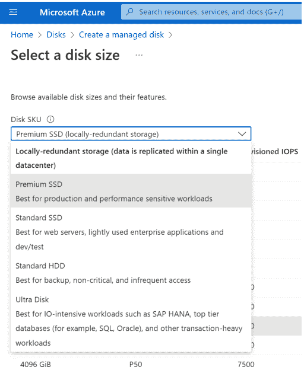

图 11.1 – Azure VM 磁盘 SKU

使用 **Ultra Disk** SKU 存在多种限制，这些限制在以下 Microsoft 文档中概述：https://docs.microsoft.com/en-us/azure/virtual-machines/disks-types#ultra-disk-limitations。

若要将 **Premium** 磁盘 SKU 用作数据磁盘并附加到 VM，VM 类型必须支持 Premium 磁盘；这在 Azure 门户中可以看到，如下图所示：

选择 VM 大小 ...

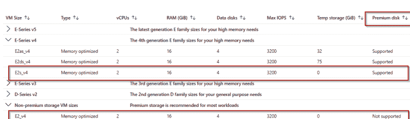

图 11.2 – Azure VM Premium 磁盘支持

前面的屏幕截图显示，**E2s_v4** VM 大小显示为 **受支持** 以附加 Premium 磁盘，但 **E2_v4** VM 大小显示为 **不受支持**。VM 名称中的 "s" 表示这些 VM 大小可以支持 Premium 磁盘 SKU。

为简化选择满足您要求的 VM 大小（例如，数据磁盘需要 Premium 磁盘 SKU），您可以为支持 Premium 磁盘的 VM 添加筛选器。如下图所示：

主页 > 虚拟机 > 创建虚拟机 >

选择 VM 大小 ...

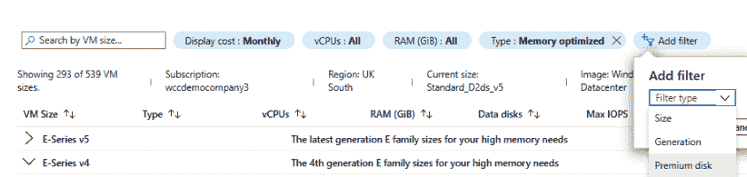

图 11.3 – Azure VM 大小 Premium 磁盘筛选器

在本节中，我们了解了管理 IaaS VM 数据磁盘。在下一节中，我们将了解如何调整 VM 大小。

### 调整 Azure VM 大小

VM 可以缩小或放大到该区域中任何其他可用的 VM 大小，以满足您的要求。这可能是为了满足在峰值容量下运行的 VM 的性能需求，或者当 VM 规格过大且资源利用率不足，可以缩小规模以优化成本时需要。

当您希望调整 VM 大小时，选项将取决于 VM 是运行中还是已停止/已释放分配状态。

当 VM 运行时，并非所有 VM 大小都可用，因为底层 VM 硬件群集必须支持您需要的大小。

还值得注意的是，并非所有区域都提供所有 VM 大小供选择。您可以尝试在所有区域中标准化可用的 VM 大小。

在某些情况下，您可能需要确保 VM 处于已停止/已释放分配状态，这将为您提供该区域中 VM 可用的所有大小的最广泛选择。

如下图所示：

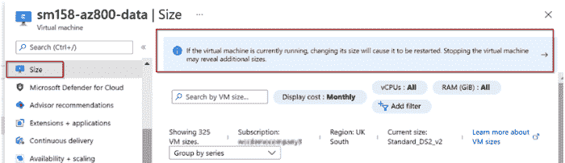

图 11.4 – Azure VM 调整大小

还可能影响调整大小的下一个方面是区域中是否没有足够的容量来支持您的需求。这种情况不常见；但是，例如全球大流行病等场景导致需求激增，这意味着某些地区在一段时间内没有可用容量。这可以通过购买保留的保证容量来解决，但需要考虑成本影响。

纵向扩展大小的另一个影响是订阅对核心数或 VM 类型有配额限制，这意味着您无法调整 VM 大小。下图显示已达到核心配额限制。


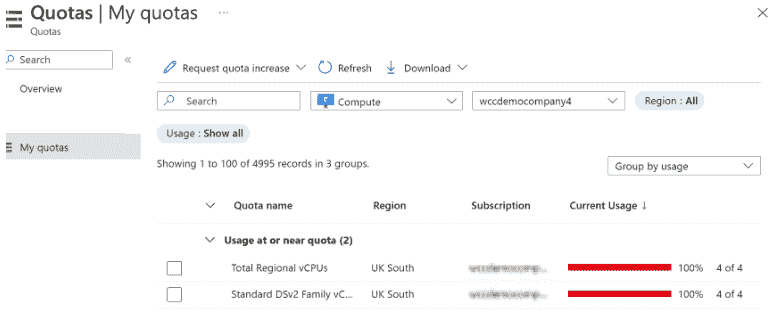

### 图 11.5 – Azure 核心配额限制达到 100%

以下显示了当新 VM 超出配额时显示的消息：

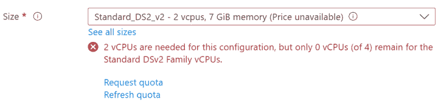

### 图 11.6 – Azure 核心配额超出消息

但是，可以通过向 Microsoft 提交服务请求来解决此问题，Microsoft 可以提高配额，但前提是您的购买计划类型必须支持配额增加；沙盒环境不允许增加核心配额。请求增加配额在以下图中所示：

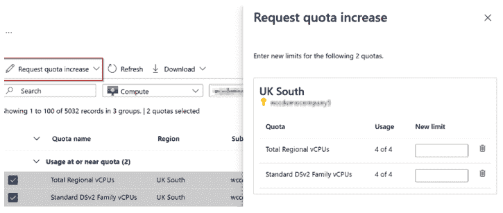

### 图 11.7 – 配额限制增加请求

您还必须确保调整大小到相同的 VM 类型；例如，如果您的 VM 大小为 Dds4，这意味着您拥有一个具有四个 vCPU 的 D 系列，提供本地临时磁盘并支持 SSD 磁盘。您希望确保调整大小以保留这些 VM 特性。也就是说，从 Dds4 调整为 Dds8，而不是 D8；D8 不会支持您的 SSD 磁盘或提供本地临时磁盘。

更改 VM 大小会导致其重新启动（撰写时）。如果您使用动态 IP 地址分配，则应考虑这一点，因为这在 VM 重新启动时会丢失；您应配置静态 IP 分配来解决此问题。

本章将在 *实践练习* 部分介绍更改 VM 大小。

在本节中，我们介绍了调整 VM 大小的操作。在下一节中，我们将介绍配置 Azure IaaS VM 的持续交付。

### 配置 Azure VM 的持续交付

在 Azure 针对 Azure IaaS VM 的第一方解决方案的上下文中，**持续交付**与 Azure Pipelines 相关。

**Azure Pipelines** 更广为人知的是一种软件开发工具，但可用于实施**基础设施即代码 (IaC)** 方法，以自动将*制品*部署到 Azure 中的 IaaS VM 作为计算目标。以下图表可视化了持续交付在更大的 DevOps 方法论中的位置。

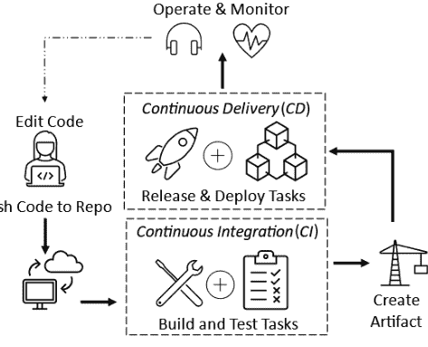

### 图 11.8 – DevOps 方法论中的 CD

持续交付方法如何具体与部署的 IaC 方法相关，在以下图中有所说明，该图概述了流和组件的简化视图；为清晰起见，未显示所有流组件：

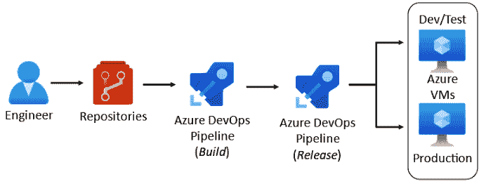

### 图 11.9 – 使用 Azure DevOps 的持续交付

VM 的 Azure 门户持续交付解决方案基于 Azure Pipelines；如以下屏幕截图所示：

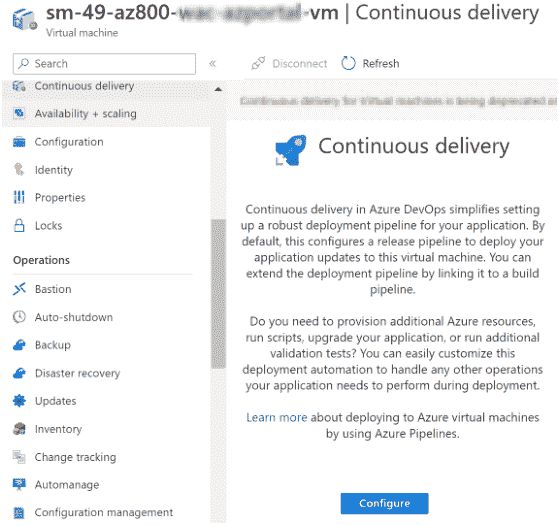

### 图 11.10 – Azure VM 持续交付

要使用部署管道配置持续交付，您需要拥有一个可选择的 **Azure DevOps 组织**；如果您没有可选择的 Azure DevOps 组织，系统将提示您创建一个。如以下图所示：

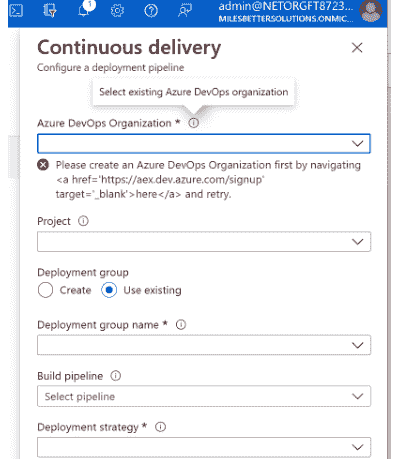

### 图 11.11 – 配置部署管道

有关如何使用 Azure DevOps 为 Azure VM 配置部署管道的完整详细信息，请参阅以下 Microsoft 文档：https://docs.microsoft.com/en-us/azure/virtual-machines/linux/tutorial-devops-azure-pipelines-classic。

本节介绍了如何配置 Azure VM 的持续交付。在下一节中，我们将介绍配置到 VM 的连接。

### 配置到 VM 的连接

创建 Azure VM 后，必须考虑如何允许管理访问。在以下部分中，我们将介绍 **Windows 远程管理 (WinRM)** 和 **远程桌面服务协议 (RDP)** 的访问方法。

### WinRM 访问

我们可以通过 PowerShell 远程处理在远程计算机（如 Azure IaaS VM）上运行 PowerShell 命令；这使用 WinRM 协议，并允许我们与计算机建立远程连接。

要启用 PowerShell 远程处理，我们需要使用以下 PowerShell cmdlet：Enable-PSRemoting。WinRM 服务将启动，以便可以在远程计算机上操作命令。使用的端口为 HTTP: 5985 和 HTTPS: 5986；无论使用何种协议（HTTP 或 HTTPS），所有 PowerShell 远程通信始终由 WinRM 加密。

设置 Azure VM WinRM 访问的流程概述如下：

- 1. 创建 Azure 密钥保管库。
- 2. 创建自签名证书。
- 3. 将自签名证书存储在 Azure Key Vault 中。
- 4. 检索存储在 Azure Key Vault 中的自签名证书的 URL。
- 5. 创建 VM 时，引用自签名证书的 URL 以进行访问。
- 6. 确保 VM 已启用 WinRM，方法是使用以下 PowerShell cmdlet 启用 PSRemoting：
  ```
  Enable-PSRemoting -Force
  ```
- 7. 然后可以使用以下内容建立连接：
  ```
  Enter-PSSession -ConnectionUri https://<public-ip-dns-of-the-vm>:5986 -Credential $cred -SessionOption (New-PSSessionOption -SkipCACheck -SkipCNCheck -SkipRevocationCheck) -Authentication Negotiate
  ```

有关设置的更多信息，请参阅以下 Microsoft 文档：https://docs.microsoft.com/en-gb/azure/virtual-machines/windows/connect-winrm.

### RDP 访问

作为替代远程连接方法，我们可以使用 RDP 连接到 Azure VM 以进行完整的交互式桌面会话，适用于 Windows VM，以及使用 Secure Socket Shell (SSH) 连接到 Linux 服务器。就考试目标范围而言，我们将介绍使用 RDP 的 Windows Server 访问。

连接到 Windows Server Azure VM 默认需要使用 TCP 端口 3389。如果您使用防火墙或网络安全组 (NSG)，则需要允许对此端口和协议的入站访问；出于安全目的，您应限制接受连接的 IP 地址范围。有关配置 RDP 访问 NSG 的更多详细信息，请参阅以下 Microsoft 文档：https://docs.microsoft.com/en-us/troubleshoot/azure/virtual-machines/troubleshoot-rdp-nsg-problem.

如果您不使用 VPN 或 ExpressRoute 连接到 Azure 环境中的资源，则还必须为 VM 关联公共 IP。有关配置此内容的更多详细信息，请参阅以下 Microsoft 文档：https://docs.microsoft.com/en-gb/azure/virtual-network/ip-services/associate-public-ip-address-vm.

第 6 包含了一个使用 RDP 远程访问 Azure VM 并配置 NSG 以允许入站 RDP 流量的实践练习。

在本节中，我们介绍了配置到 VM 的连接。在下一节中，我们将完成一个实践练习部分，以巩固本章涵盖的一些概念。

### 实践练习

为了在学习中获得一些实用技能，我们将利用本章前几节中获得的概念和理解，并将其付诸实际应用。

我们将介绍以下练习：

- 练习 – 使用 Azure 门户管理数据磁盘
- 练习 – 调整 Azure VM 大小

### 开始使用

要开始本节，如果您还没有 Azure 订阅，可以在 https://Azure.microsoft.com/free 创建一个免费 Azure 帐户。此免费 Azure 帐户提供以下内容：

- 12 个月的免费服务
- 30 天内探索 Azure 的 200 美元信用额度
- 25 多个始终免费的服务

让我们继续本章的练习。

### 练习 – 使用 Azure 门户管理数据磁盘

此练习将介绍使用 Azure 门户管理数据磁盘。

为此练习，您需要有一个已创建的 Azure VM 来附加和调整数据磁盘大小；创建 VM 后，返回此处完成练习，或者如果您有现有 VM 可用，请继续。

在以下子部分中，您可以看到完成练习的步骤，已划分为任务以便更好地理解。


### Task 1 – accessing the Azure portal

Log in to the Azure portal: https://portal.azure.com. You can alternatively use the desktop Azure portal app: https://portal.azure.com/App/Download.

### Task 2 – attaching a data disk to a VM

- 1. In the search bar, type in `virtual machines`; click **Virtual machines** from the list of services.

- 2. Locate your VM for this exercise from the **Virtual machines** blade and click on the name to open the **Virtual machines** blade.

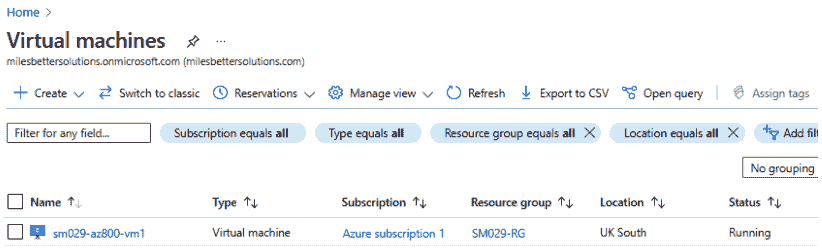

Figure 11.12 – VM for the exercise

- 3. From the **Virtual machines** blade, click **Disks** under **Settings**.

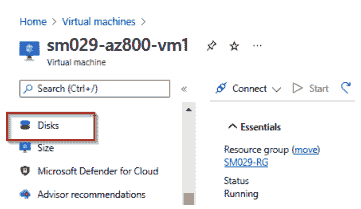

Figure 11.13 – VM disk settings

- 4. From the **Disks** blade for the VM, click **+ Create and attach a new disk**.

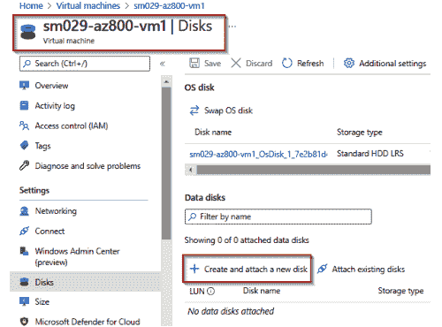

Figure 11.14 – Data disks

- 5. For the LUN number, leave it at the default of 0, set Disk name as Data, set Storage type as Standard HDD, and leave Size as the default, then click Save from the top menu bar.

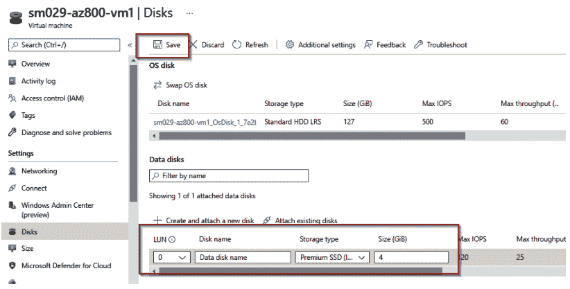

Figure 11.15 – Adding a data disk

- 6. You will receive a message to say that the disk was created successfully and will be displayed in the **Disks** blade for the VM.

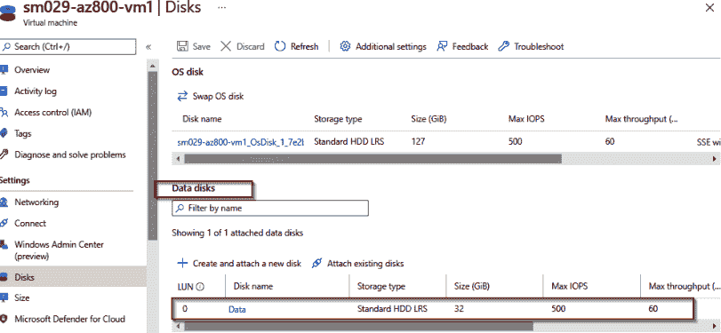

Figure 11.16 – Data disks

- 7. Repeat the process to add another data disk; this time, call the disk **Logs** and create a Premium SSD; we will now see this second disk in the **Disk** blade.

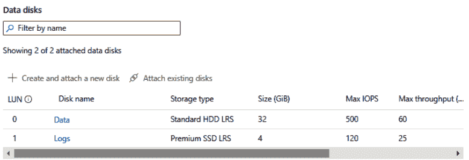

Figure 11.17 – Adding a data disk

- 8. Navigate to the **Disks** blade, and you will see both the data disks and the OS disk for the VM.

| Name | Storage account type | Size (GiB) | Owner |
|---|---|---|---|
| data | Standard HDD LRS | 32 | sm029-az800-vm1 |
| logs | Premium SSD LRS | 4 | sm029-az800-vm1 |
| sm029-az800-vm1_OsDisk_1_7e2b81d46abc4ef5a598715b56d8b1c2 | Standard HDD LRS | 127 | sm029-az800-vm1 |

Figure 11.18 – Data disks

In this task, we attached two data disks to a VM. In the next tasks, we will resize the created data disks.

### Task 3 – resizing a data disk for a VM

We will resize a disk for this exercise by deallocating the VM instead of detaching and reattaching:

- 1. Stop/deallocate your VM by clicking the **Stop** option.

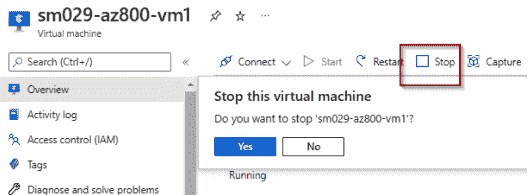

Figure 11.19 – Stopping the VM

- 2. Once the VM has been stopped, click on **Disks** under **Settings** to open the **Disks** blade for the VM.

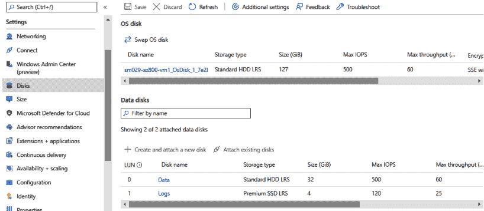

Figure 11.20 – Disks blade

- 3. Click the data disk named **Data** (LUN 0), open the blade for that disk, and click **Size + performance**.

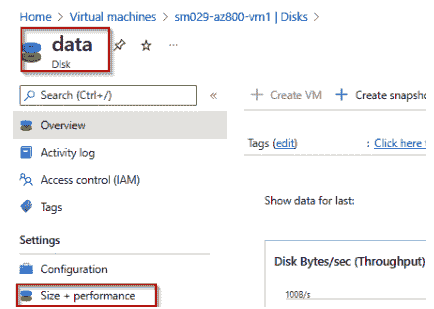

Figure 11.21 – Disk size

- 4. From the **Size + performance** blade for the disk, select a new size of **64 GiB** and click **Resize**.

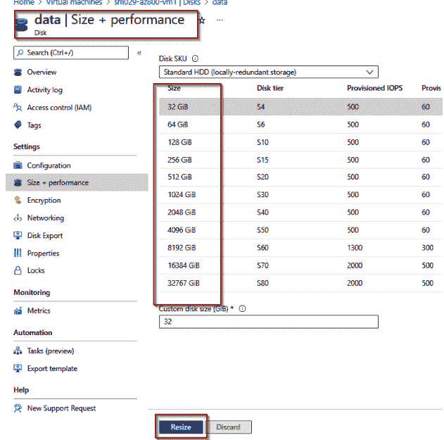

Figure 11.22 – Select disk size

- 5. You will see a notification that the disk was updated successfully.

- 6. Return to the **Disks** blade, and the new disk size will be shown as **64 GiB**; you may need to click **Refresh** on the blade.

| LUN | Disk name | Storage type | Size (GiB) |
|---|---|---|---|
| 0 | Data | Standard HDD LRS | 64 |
| 1 | Logs | Premium SSD LRS | 4 |

Figure 11.23 – Disk size changed

- 7. You should now start the VM to return it to operation.

With this, we have completed this exercise. This exercise taught us the skills needed to add and resize data disks. In the next exercise, we look at resizing a VM.

### Exercise – resizing an Azure VM

In this exercise, we will resize a VM; you will need to create a VM or use an existing VM for this exercise.

Follow these steps to get started:

- 1. In the search bar, type in `virtual machines`; click Virtual machines from the list of services.
- 2. Locate your VM for this exercise from the Virtual machines blade and click on the name to open the Virtual machines blade.
- 3. From the Virtual machines blade, click Size under Settings.

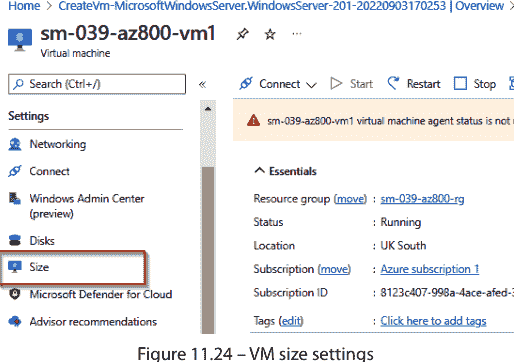

- 4. The Size blade will show the VM’s current size, that is, Standard_D2ds_v5, in the example in the figure.

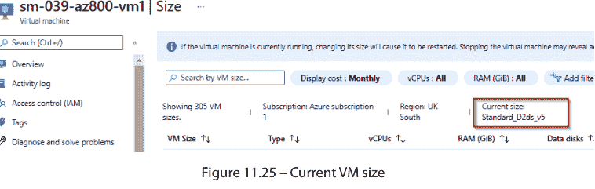

- 5. Select the **D4ds_v5** VM size, which keeps the same VM type and characteristics of local temp disk and Premium disk support, and then click **Resize**. Note that this will cause the VM to be restarted.

> If the virtual machine is currently running, changing its size will cause it to be restarted. Stopping the virtual machine may reveal additional sizes. →

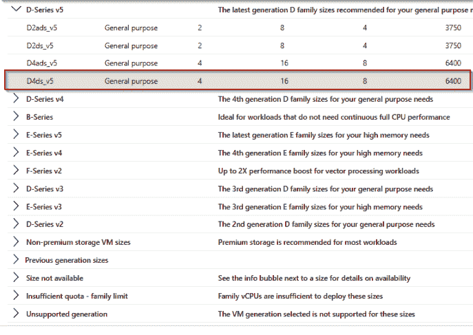

Figure 11.26 – Selecting the new VM size

- 6. You will receive a notification that the machine has been resized.

- 7. Return to the **Virtual machines** blade's **Overview** pane, and the new size will be shown as **Standard D4ds v5 (4 vcpus, 16 GiB memory)**.

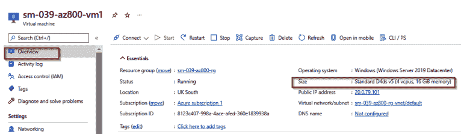

Figure 11.27 – Changed VM size

With this, we have completed this exercise. This exercise taught us the skills needed to resize an Azure VM. Now, let’s summarize this chapter.

### Summary

This chapter has provided coverage for *AZ-800 Administering Windows Server Hybrid Core Infrastructure: Manage Azure Virtual Machines that run Windows Server*.

We covered content that gave you the skills to manage Windows Server VMs on the Azure platform. We looked at aspects such as managing disks, resizing VMs, and configuring connections to VMs.

A hands-on exercise then finished the chapter to provide you with additional practical skills.

You gained new skills through the information provided; this chapter’s goal was to take your knowledge beyond the exam objectives to prepare you for a real-world, day-to-day, hybrid-environment-focused role.

The next chapter will teach you about managing Windows Server in a hybrid environment.

### Further reading

This section provides links to additional study references and additional exam information:

- *Microsoft Certified: Windows Server Hybrid Administrator Associate:* https://docs.microsoft.com/en-us/learn/certifications/windows-server-hybrid-administrator/
- *Exam AZ-800: Administering Windows Server Hybrid Core Infrastructure:* https://docs.microsoft.com/en-us/learn/certifications/exams/az-800
- *Exam AZ-800: skills outline:* https://query.prod.cms.rt.microsoft.com/cms/api/am/binary/RWKI0r
- *Microsoft Learn:* https://docs.microsoft.com/en-us/learn/paths/manage-virtualization-containers-hybrid-environment/

### Skills check

Challenge yourself with what you have learned in this chapter:

- 1. When is a data disk used?
- 2. What is the effect of caching on VM disks?
- 3. What are the different disk SKUs that can be attached to a VM?
- 4. What are the limitations of an Ultra Disk SKU?
- 5. What VM type must be used to support Premium disks?
- 6. Will changing the size of a disk or attaching a new disk require downtime for the VM?
- 7. Name some scenarios where not all VM sizes are available when needing to resize a VM.
- 8. Will changing a VM's size require downtime?
- 9. What is continuous delivery in the context of Azure VMs?
- 10. What are the different ways we can configure a remote connection to a VM?
