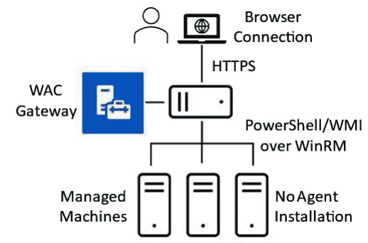
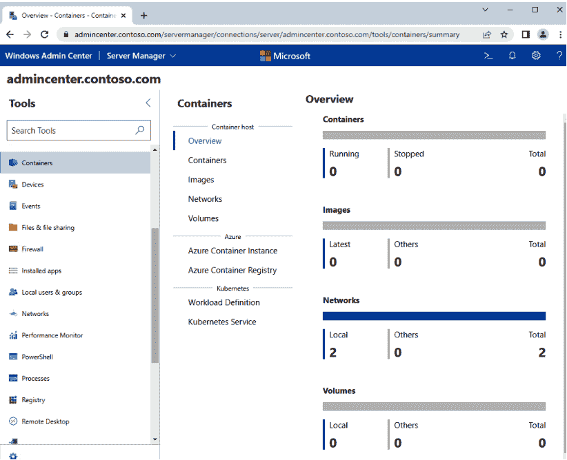
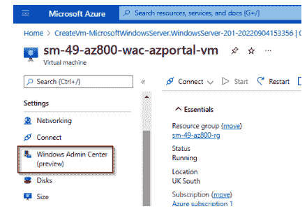
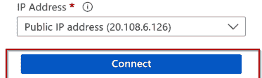
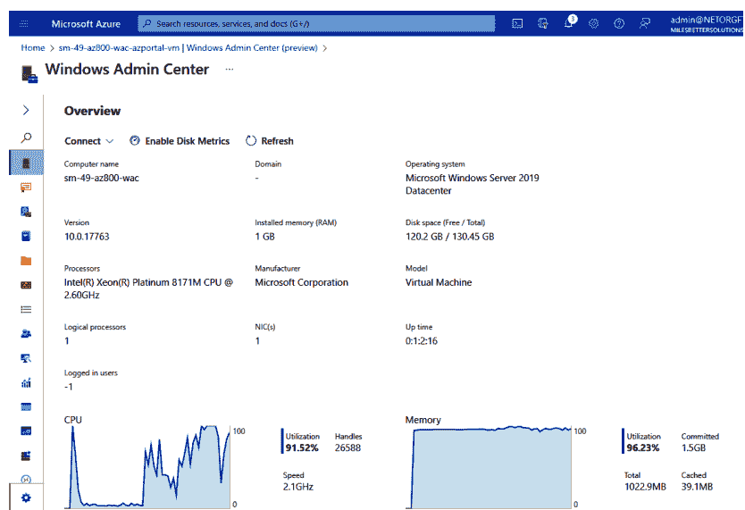

## Managing Windows Server in a Hybrid Environment

In the previous chapter, we added skills for managing Windows Server virtual machines (VMs) in Azure.

This chapter covers content from AZ-800 Administering Windows Server Hybrid Core Infrastructure: Manage Windows Servers and workloads in a hybrid environment.

We will cover implementing Windows Admin Center (WAC) to simplify remote server management, covering the different deployment methods of the gateway and Azure portal approaches. We will also cover PowerShell remoting and how we can enhance security through the use of the Just Enough Administration (JEA) capability that can be used in conjunction. We will then conclude with a hands-on exercise to develop your skills further.

This chapter does not aim to cover all aspects; the content is limited in scope to only the exam objectives and will cover the following topics:

- Deploying a WAC gateway server
- Deploying WAC within the Azure portal
- PowerShell remoting
- Hands-on exercise

In addition to the topics listed in this chapter, this chapter's goal is to take your knowledge beyond the exam objectives to prepare you for a real-world, day-to-day, hybrid environment-focused role.

### Deploying a WAC gateway server

This section will look at managing multiple Azure VMs by manually deploying WAC to an Azure VM. Before we jump into the configuration, we should introduce how WAC works.


WAC使用带有Web服务器的已安装网关组件，通过PowerShell远程处理和基于Windows远程管理(WinRM)的Windows管理规范(WMI)来管理服务器。这些组件在以下图中概述：



图 12.1 – WAC组件

### 脚本部署

可以使用脚本或通过Azure门户手动将WAC网关部署到新的或现有的Azure VM。

若要使用Azure门户将WAC网关部署到Azure VM，首先需要下载Deploy-WACAzVM.ps1脚本(https://aka.ms/deploy-wacazvm)，该脚本运行Microsoft安装程序(MSI)以创建环境所需的所有资源，例如资源组、VM和虚拟网络(VNet)。或者，也可以部署到现有VM并使用已下载的本地MSI，并在脚本中引用文件路径。

在这两种情况下，都需要证书；证书应在Azure Key Vault中创建和存储，也可以使用MSI生成的自签名证书。

该脚本从Azure Cloud Shell运行；以下是示例脚本。

首先，设置变量：

```
$ResourceGroupName = "az800-wac-rg"
$VirtualNetworkName = "az800-wac-vnet"
$SecurityGroupName = "az800-wac-nsg"
$SubnetName = "az800-wac-subnet"
$VaultName = "az800-wac-keyvault"
$CertName = "az800-wac-cert"
$Location = "uksouth"
$PublicIpAddressName = "az800-wac-publiccip"
$Size = "Standard_B2ms_v3"
$Image = "Win2019Datacenter"
$Credential = Get-Credential
```

以下脚本将WAC部署到前面变量中设置的新VM、资源组和VNet；它使用aka.ms/WACDownload中的MSI和MSI生成的自签名证书：

```
$scriptParams = @{
    ResourceGroupName = $ResourceGroupName
    Name = "az800-wac-vm1"
    Credential = $Credential
    VirtualNetworkName = $VirtualNetworkName
    SubnetName = $SubnetName
    GenerateSslCert = $true
}
./Deploy-WACAzVM.ps1 @scriptParams
```

有关此部署方法的更多详细信息，请参阅以下Microsoft文档文章：https://docs.microsoft.com/en-gb/windows-server/manage/windows-admin-center/azure/deploy-wac-in-azure#deploy-using-script.

### 手动部署

若要手动将WAC网关部署到Azure VM，首先需要创建用作WAC网关的Azure VM。然后，需要将MSI安装程序直接下载到VM或本地计算机，并将安装程序复制到VM；安装程序可从https://www.microsoft.com/en-gb/evalcenter/download-windows-admin-center下载。

在WAC网关VM上启动MSI安装程序并按照向导说明操作。你需要提供一个证书，或让MSI生成自签名证书。

对于通信，安装程序默认使用端口443 (HTTPS)；你应允许此通信通过任何网络筛选器（例如网络安全组(NSG)或防火墙）。

### 访问WAC

WAC通过浏览器使用网关VM的DNS名称进行访问；即，`https://<DNS name of your VM>`。

如果设置了非默认的443端口，则需要使用以下URL进行访问：

```
`https://<DNS name of your VM>:<custom port>`
```

浏览器将提示输入凭据以对WAC安装所在的本地VM上的会话进行身份验证。这些凭据应属于VM本地用户组或administrators组的成员的帐户。

以下屏幕截图显示了WAC基于浏览器的界面：



图 12.2 – WAC浏览器界面

在本节中，我们探讨了部署WAC网关VM，并介绍了手动安装，以及使用脚本对WAC进行自动安装。在下一节中，我们将探讨在VM上安装WAC，以便可以通过Azure门户中的WAC对其进行管理。

### 在Azure门户中部署WAC

可以使用WAC及其与Azure服务和Azure门户的集成来管理Azure和混合资源。以下是目前可以使用Azure门户通过WAC对其进行管理的三种资源：

- Azure基础设施即服务(IaaS) VM
- Azure Stack HCI
- Azure Arc支持的服务器

针对考试目标，本节内容将重点介绍如何针对Azure IaaS VM进行管理。

### WAC的要求

要在Azure门户中使用WAC功能，需要在每个要由其管理的Azure VM上安装WAC。在Azure门户中由WAC管理的Azure VM必须满足以下要求：

- Windows Server 2016、Windows Server 2019、Windows Server 2022。
- 至少3 GB内存。
- 必须位于Azure公有云区域；不支持Azure China、Azure Government和其他非公有云。
- 允许向WindowsAdminCenter和AzureActiveDirectory服务标记发送HTTPS流量的出站Internet访问。
- 允许HTTPS流量的入站访问。
- 入站访问必须指向VM的IP地址；不能从其他服务（例如防火墙）重定向。

除了VM要求之外，用于连接到Azure门户的管理计算机还有要求，如下所示：

- 例如**Microsoft Edge**或**Google Chrome**之类的Web浏览器

建议通过**虚拟私有网络 (VPN)**或ExpressRoute连接到已安装WAC且需要使用WAC进行管理的VM所在的同一VNet。与将VM暴露在公有IP地址下相比，这种访问方式更安全。如果通过公有IP地址访问，则应创建访问规则，仅允许来自已知IP地址的访问，并允许端口443 HTTPS和6516 TCP的入站规则。

满足所有要求后，可以在每个要管理的Azure VM上安装WAC。

我们将在本章的*动手实践*部分继续以动手安装任务的形式探讨此主题。

在本节中，我们探讨了使用WAC及其与Azure服务和Azure门户的集成来管理Azure和混合资源。我们逐步讲解了在Azure门户中实现WAC以及从Azure门户中的WAC访问Azure VM以对其进行管理。

至此，关于部署WAC的部分结束。在下一节中，我们将探讨PowerShell远程处理。

### PowerShell远程处理

PowerShell远程处理允许在数百台计算机或仅一台远程计算机上运行单个命令。PowerShell远程处理使用**WS-Management (WS-Man)**协议。

Windows Server 2012/R2和2016中默认启用了PowerShell远程处理。

使用以下提升的命令启用PowerShell远程处理：

```
Enable-PSRemoting
```

PowerShell远程处理的要求如下：

- 在运行命令的本地计算机和远程计算机上均已安装PowerShell
- 必须启用PowerShell远程处理
- 每台连接并运行命令的计算机上均已启用WinRM

我们将查看一些可针对远程计算机运行的示例cmdlet。

### PowerShell远程处理示例

以下cmdlet与单个远程计算机启动交互会话：

```
Enter-PSSession Computer-1
```

命令提示符将显示远程计算机的显示名称；输入的所有命令将在本地计算机上显示，但在远程计算机上执行。

可以使用以下cmdlet结束交互会话：

```
Exit-PSSession
```

可以使用Invoke-Command cmdlet在一台或多台远程计算机上运行脚本；示例如下：

```
Invoke-Command -ComputerName Computer-1, Computer-2 -FilePath C:\az800demo\az800script.ps1
```

脚本位于本地计算机的路径上，并在远程计算机上执行；结果将在本地屏幕上显示。

可以使用New-PSSession cmdlet用于持久会话；示例如下：

```
$s = New-PSSession -ComputerName Computer-1,Computer-2
```

### 第二跳PowerShell远程处理

当将第一台远程计算机作为第一跳建立会话，但该计算机需要访问第二台计算机上的资源时，会出现挑战。

访问第二台服务器是第二跳，将被拒绝访问。这是因为会话是与第一台服务器建立的；会话凭据不会从第一台服务器传递到存放资源的第二台服务器。

支持和解决此方案的配置方法如下：

- 在Invoke-Command脚本块中传递凭据：提供最简单的配置，但安全性较低
- 配置基于资源的Kerberos受限委派：提供更高的安全性和更简单的配置
- Kerberos受限委派：提供最高级别的安全性，但需要域管理员
- JEA：提供最佳安全性，但具有详细的配置
- 使用RunAs的PSSessionConfiguration：提供更简单的配置，但凭据管理更复杂
- 配置凭据安全支持提供程序(CredSSP)：在安全性和配置便捷性之间取得最佳平衡
- Kerberos不受限制的委派：不推荐

CredSSP默认处于禁用状态，且应仅在最受信任的环境中使用。CredSSP会在第一跳远程服务器上缓存凭据，并使用这些凭据传递到正在直接打开会话的第二跳服务器。如果远程服务器被攻破，这会使我们面临凭据窃取攻击的风险。


### JEA

JEA 通过基于角色的访问控制（**基于角色的访问控制 (RBAC)**）提供委派管理，并构建在 PowerShell 远程处理基础之上。

JEA 限制用户可以执行的操作和可以运行的 cmdlet 的数量和权限范围，并提供审计功能，以便更好地了解会话期间是谁做了什么。它是防御通过 _已妥协的特权帐户_ 进行横向移动攻击的关键，并基于 _最小特权_ 访问和权限运作。

JEA 包含在 **PowerShell 5.0** 及更高版本中。要检查安装了哪个版本的 PowerShell，可以运行以下 PowerShell cmdlet：

```
$PSVersionTable.PSVersion
```

要开始使用 JEA，希望看到如下所示的结果，其中 **主要版本** 为 5 或更高：

| 主要版本 | 次要版本 | 生成版本 | 修订版本 |
|-------|-------|-------|----------|
| 5 | 1 | 14393 | 1000 |

始终建议为计算机提供最新版本的 PowerShell。

以下列表详细说明了通过操作系统类型提供的 JEA 可用性：

- 预安装：Windows Server 2016+、Windows 10 1607+
- 功能受限的预安装：Windows 10 1603、1511
- 使用 **Windows Management Framework (WMF)** 5.1 的完整功能：Windows Server 2012/R2、Windows 8、8.1
- 使用 WMF 5.1 的功能受限版本：Windows Server 2008/R2、Windows 7
- 不可用：Windows 10 1507

PowerShell 远程处理是 JEA 所需的基础，在使用 JEA 之前必须启用它。PowerShell 远程处理在 Windows Server 2012/R2、2016 中默认启用；使用 `Enable-PSRemoting` 命令启用它。

JEA 创建用户连接的配置终结点；与配置的终结点关联的文件如下：

- 功能角色文件
- 会话配置文件

功能角色文件可通过 .prsc 文件扩展名标识。会话配置文件可通过 .pssc 文件扩展名标识。

正如其名称所示，功能角色文件描述了基于 RBAC 在会话中可以执行的操作；其中列出了 cmdlet、提供程序、函数和外部程序。

谁可以使用终结点以及他们有权访问哪些功能角色，在会话配置文件中定义。

可以使用以下命令创建空白配置文件的模板：

```
New-PSSessionConfigurationFile -SessionType
RestrictedRemoteServer -Path .\MyJEAEndpoint.pssc
```

创建功能角色文件和会话配置文件后，最后一步是注册终结点；为此使用以下 PowerShell 命令：

```
Register-PSSessionConfiguration -Path .\AZ800JEAConfig.pssc
-Name 'JEAServeDEsk' -Force
```

有关配置的详细信息，可在以下 Microsoft 文档文章中找到：https://docs.microsoft.com/en-gb/powershell/scripting/learn/remoting/jea/session-configurations.

本节介绍了配置 PowerShell 远程处理以及一些挑战和风险。在下一节中，我们将完成一个实操练习部分，以加强本章涵盖的一些概念。

### 实操练习

为支持您的学习并掌握一些实用技能，我们将利用本章前面各节获得的概念和理解，并将其应用于实际操作中。

我们将学习以下练习：

- 练习 – 在 Azure 门户中实现 WAC

### 开始使用

要开始本节，如果您还没有 Azure 订阅，可以在 https://Azure.microsoft.com/free 创建免费 Azure 帐户。此免费 Azure 帐户提供以下内容：

- 12 个月免费服务
- 30 天内探索 Azure 的 200 美元信用额度
- 25 多种始终免费的服务

让我们继续本章的练习。

### 练习 – 在 Azure 门户中实现 WAC

本练习将介绍如何在 Azure 门户中实现 WAC 以管理 Azure VM。

本练习需要具备以下条件：

- 用作管理目标的 Azure VM。
- 使用本地管理员帐户访问 VM。
- 从用于连接到 Azure 门户的管理计算机访问与 VM 相同的 VNet；这可以通过 VPN、公共 IP 地址或同一 VNet 上用作跳转主机的另一个 Azure VM 实现。如果通过公共 IP 地址连接，应为 HTTP 443 和 TCP 6516 创建入站端口规则。

按照以下步骤开始：

1. 在要管理的 VM 的 **设置** 部分中，单击 **Windows 管理中心 (预览版)**：



图 12.3 – 要管理的 Azure VM

2. 从 Windows 管理中心 (预览版) 边栏选项卡，单击 Install：

### Windows 管理中心

Windows 管理中心 提供一组一流的免费工具，可直接从 Azure 中管理此虚拟机上的 Windows 和 Windows Server。
了解 Windows 管理中心 概述
Windows 管理中心 扩展的隐私条款

无缝服务器管理
在 Azure 中无缝管理 Windows Server。

现代服务器工具
访问先进的 Windows Server 管理工具。

增强的控制
获得对 Azure 中托管的服务器所有方面的完全控制。

入站端口 *
6516
为我打开此端口（仅建议用于测试）
为 Windows 管理中心 安装打开出站端口
安装
Windows 管理中心 扩展的许可条款

图 12.4 – 将 WAC 扩展安装到 VM

3. 您将在门户中收到通知，表明 WAC 扩展已成功安装在 VM 上：

已成功安装 Windows Admin Center 扩展
已为 sm-49-az800-wac-azportal-vm 成功安装 Windows Admin Center 扩展

图 12.5 – WAC 扩展已成功安装在 VM 上

4. 现在 WAC 扩展已安装在 VM 上，我们可以使用 Azure 门户中的 WAC 管理 VM，而无需 RDP 或 PowerShell。

5. 要连接到 VM，请在 Azure 门户中导航到 VM，选择用于连接到 VM 的 IP 地址（公共或专用），然后选择 Connect：


**Windows 管理中心**
Windows 管理中心 提供一组一流的免费工具，可直接从 Azure 中管理此虚拟机上的 Windows 和 Windows Server。



图 12.6 – 将 WAC 连接到 VM

6. 系统将提示您登录；对于本练习，应使用 VM 的本地管理员帐户（此实验室示例中使用了创建 VM 时设置的管理员帐户）。

7. 您现在可以访问在 Azure 门户中集成运行的 WAC：



图 12.7 – Azure 门户中的 WAC

至此，我们已完成此练习。本练习教授了在 Azure VM 上安装 WAC 并使用 Azure 门户中的 WAC 连接到它所需的技能。现在，让我们总结本章。

### 总结

本章涵盖了 AZ-800 管理 Windows Server 混合核心基础架构：在混合环境中管理 Windows 服务器和工作负载考试。

本章内容进一步提升了您在混合管理服务方面的知识和技能。

您了解了如何部署 WAC 网关以管理多个 VM，以及如何安装 WAC，以便可以从 Azure 门户中使用 WAC 管理 VM；随后，我们介绍了 PowerShell 远程处理。然后，我们通过一个实操练习结束了本章，以进一步提升您的技能。

通过所提供的信息，您新增了技能，本章的目标是让您的知识超越考试目标，从而为现实世界、日常运营且专注于混合环境的角色做好准备。

下一章将教授如何实施和管理 Azure 网络基础设施。


### 进一步阅读

本节提供用于进一步学习参考和考试信息的链接：

- [微软认证：Windows Server 混合管理员助理](https://docs.microsoft.com/en-us/learn/certifications/windows-server-hybrid-administrator/)
- [考试 AZ-800：管理 Windows Server 混合核心基础结构](https://docs.microsoft.com/en-us/learn/certifications/exams/az-800)
- [考试 AZ-800：技能大纲](https://query.prod.cms.rt.microsoft.com/cms/api/am/binary/RWKI0r)
- [Microsoft Learn](https://docs.microsoft.com/en-us/learn/paths/manage-windows-servers-workloads-hybrid-environment/)

### 技能检查

挑战一下你在本章中学到的内容：

- 1. 什么是 WAC 网关服务器？
- 2. WAC 的工作原理是什么？
- 3. WAC 部署需要允许哪些端口？
- 4. 如何访问 WAC？
- 5. 列出在 Azure 门户中实现 WAC 的要求。
- 6. 什么是 PowerShell 远程处理？
- 7. 如何启用 PowerShell 远程处理？
- 8. 什么是第二跃点 PowerShell 远程处理？
- 9. 什么是 JEA？
- 10. JEA 的要求是什么？
