## 13 使用 Azure 服务管理 Windows 服务器

在上一章中，我们学习了在混合环境中管理 Windows 服务器的技能。

本章涵盖 AZ-800 管理 Windows Server 混合核心基础结构：在混合环境中管理 Windows 服务器和工作负载的内容。

我们将介绍管理 Azure 托管的 Windows Server 虚拟机 (VM) 的访问权限、使用 Azure Arc 管理本地 Windows 服务器，并介绍 Azure Automation 的功能。随后，我们将探讨使用 Microsoft Defender for Cloud、Azure Policy 和 Azure Sentinel 进行安全和治理。

最后，我们将通过一个实践练习来进一步提升您的技能。

此内容不旨在涵盖所有方面；内容范围仅限于考试目标，将涵盖以下主题：

- 管理 Azure 中 Windows Server VM 的访问权限
- 为混合 Windows 服务器实现 Azure Arc
- 为混合 Windows 服务器实现 Azure Automation
- 为混合 Windows 服务器实现 Microsoft Defender for Cloud
- 实践练习

除了本章列出的主题之外，本章的目标是让您的知识超越考试目标，为从事现实世界中日常混合环境相关的角色做好准备。

### 管理 Azure 中 Windows Server VM 的访问权限

本节探讨 Windows Server Azure 基础设施即服务 (IaaS) VM 的用户访问控制和网络访问方法。

### 用户访问

出于管理目的，对 Azure IaaS VM 的用户访问通过 Azure 基于角色的访问控制 (Azure RBAC) 进行控制。

以下是内置的默认计算类别角色：

- **虚拟机管理员登录**：这只能让您管理 VM。您无法访问 VM、虚拟网络以及它们连接的任何存储帐户
- **虚拟机参与者**：这允许您在门户中查看 VM 并以普通用户身份登录。
- **虚拟机用户登录**：这允许您在门户中查看 VM 并以管理员身份登录。

这些角色通过 VM 资源的访问控制 (IAM) 边栏选项卡进行管理；以下截图显示了 Azure 门户中显示的计算类别角色：

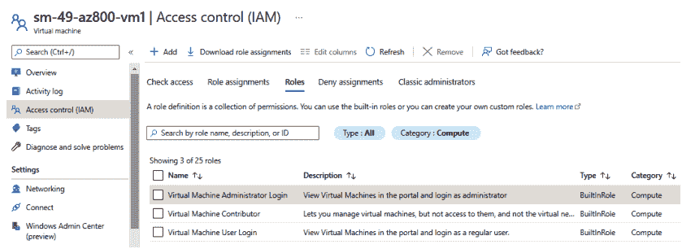

图 13.1 - 访问控制边栏选项卡

可以使用 PowerShell Get-AzRoleDefinition cmdlet 列出所有角色：

```
Get-AzRoleDefinition | FT Name, Description | sort
```

以下截图示例显示角色分配列表，以表格形式显示名称和描述列，并按字母顺序列出：

| 角色 | 描述 |
| --- | --- |
| 虚拟机管理员登录 | 在门户中查看虚拟机并以管理员身份登录 |
| 虚拟机参与者 | 允许您管理虚拟机，但不能访问它们，也不能访问 |
| 虚拟机本地用户登录 | 在门户中查看虚拟机并以本地用户身份登录 configu |
| 虚拟机用户登录 | 在门户中查看虚拟机并以普通用户身份登录。 |
| VM 扫描操作员 | 提供对磁盘快照的访问权限以进行安全分析的角色。 |
| Web 计划参与者 | 允许您管理网站的 Web 计划，但不能访问它们。 |
| Web PubSub 服务所有者(预览) | 对 Azure Web PubSub Service REST API 的完全访问权限 |
| Web PubSub 服务读取者(预览) | 对 Azure Web PubSub Service REST API 的只读访问权限 |
| 网站参与者 | 允许您管理网站(不包括 Web 计划)，但不能访问它们。 |
| Windows 管理中心管理员登录 | 允许您通过 Windows 管理中心管理资源的操作系统 as |
| 工作簿参与者 | 可以保存共享工作簿。 |
| 工作簿读取者 | 可以读取工作簿。 |
| WorkloadBuilder 迁移代理角色 | WorkloadBuilder 迁移代理角色。 |

图 13-2 – 角色定义

还可以使用以下 Azure CLI 命令作为 PowerShell 的替代方案：

```
az role definition create --role-definition
```

可以使用 PowerShell Get-AzRoleDefinition <role_name> 命令列出特定角色的详细信息：

```
Get-AzRoleDefinition "Virtual Machine Administrator Login"
```

以下是截图示例：

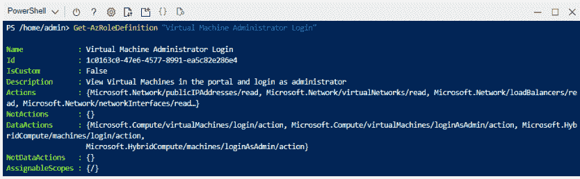

图 13-3 – 角色信息

如果我们返回 Azure 门户视图并单击其中一个角色，将看到授予该角色的权限详细信息，如以下截图所示：

| 类型 | 权限 | 描述 |
| :--- | :--- | :--- |
| Microsoft.Compute | | |
| 读取 | 获取虚拟机 | 获取虚拟机的属性 |
| 读取 | 汇总最新的修补程序评估操作结果 | 检索最新修补程序评估操作的摘要 |
| 读取 | 列出修补程序评估操作中评估的所有修补程序 | 检索上次修补程序评估操作中评估的修补程序列表 |
| 读取 | 汇总最新的修补程序安装操作结果 | 检索最新修补程序安装操作的摘要 |
| 读取 | 列出修补程序安装操作中考虑的所有修补程序 | 检索上次修补程序安装操作中尝试安装的修补程序列表 |
| 读取 | 获取虚拟机日志定义 | 获取虚拟机的可用日志。 |
| 读取 | 读取诊断设置 | 获取虚拟机的诊断设置。 |
| 读取 | 查看虚拟机扩展 | 获取虚拟机扩展的属性 |
| 读取 | 获取虚拟机实例视图 | 获取虚拟机及其资源的详细运行时状态 |
| 读取 | 获取虚拟机度量定义 | 读取虚拟机度量定义 |
| 读取 | 获取虚拟机运行命令 | 获取虚拟机运行命令的属性 |
| 读取 | 列出可用的虚拟机大小 | 列出虚拟机可更新到的可用大小 |
| Microsoft.Network | | |
| 读取 | 获取负载均衡器 | 获取负载均衡器定义 |

图 13.4 – 角色权限

可以使用以下 cmdlet 列出角色定义的权限，如以下截图示例所示：

```
(Get-AzRoleDefinition "Virtual Machine Contributor").Actions
```

输出如以下截图示例所示：

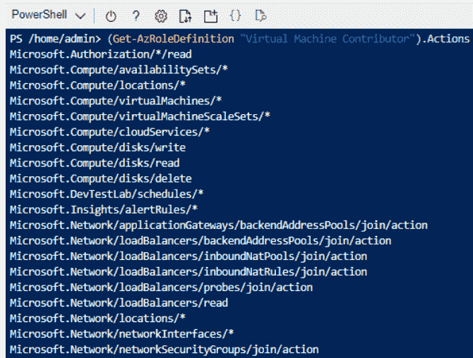

图 13.5 – 角色权限（续）

返回 Azure 门户视图，我们还可以看到角色的**分配**详细信息，如以下截图所示：

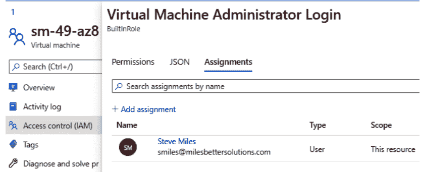

图 13.6 – 角色分配

可以使用 Cloud Shell 中的 PowerShell 通过 Get-AzRoleAssignment cmdlet 列出角色分配。

以下是列出用户角色分配的示例：

```
Get-AzRoleAssignment -SignInName smiles@milesbettersolutions.com
```

前面的代码在以下图中表示：

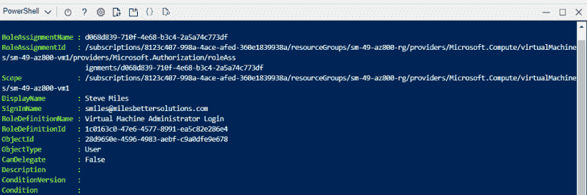

图 13.7 – 用户角色分配

还可以通过使用 -Scope 参数在资源级别列出用户分配；以下是一个示例：

```
Get-AzRoleAssignment -Scope /subscriptions/8123c407-998a-4ace-afed-360e1839938a/resourceGroups/sm-49-az800-rg/providers/Microsoft.Compute/virtualMachines/sm-49-az800-vm1
```

以下是输出：

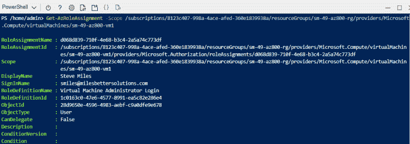

图 13.8 – 资源角色分配


在规划和配置角色分配时，应始终遵循最小特权访问原则，确保用户分配的角色不会超过其任务所需的访问权限。

### 网络访问

以下是可用于管理访问 Windows Server Azure 虚拟机的 Azure 原生界面和工具：

- Azure Bastion: 提供托管跳板主机服务，可用于连接到 VM；VM 上无需公共 IP，且无需开放 RDP 端口。它使用 HTTPS (443)。
- Azure Serial Console: 提供与 Azure VM 的直接连接，无需通过 IP 网络连接。
- Cloud Shell: 提供通过基于浏览器的会话访问 PowerShell。
- RDP: 使用传统 RDP 会话建立连接；允许 RDP (3389) 的入站规则，如果通过公共 IP 连接，则限制为已知 IP 地址。
- Remote PowerShell: 使您可以从本地 PowerShell 会话在远程计算机上运行命令。
- Just-Enough-Administration (JEA) 和 Just-in-Time (JIT) VM 访问：用于管控访问的安全控制。

本节介绍了在 Azure 中管理用户对 Windows Server IaaS VM 的访问以及用于管理访问的工具和界面。下一节将介绍将混合 Windows 服务器连接到 Azure Arc。

### 为混合 Windows 服务器实施 Azure Arc

Azure Arc 是一种支持物理和虚拟 Windows 服务器的混合管理和治理工具。这些混合服务器可以位于本地、提供商边缘位置，或托管在其他云提供商的平台上。如下图所示：

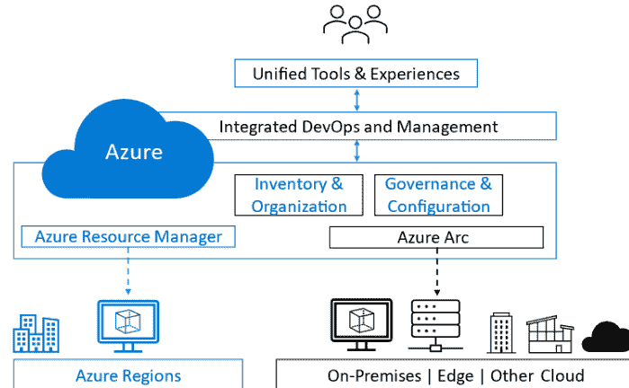

图 13.9 – 服务器的 Azure Arc

以这种方式连接后，混合服务器将成为一个 Azure 资源，可以像 Azure 原生 VM 一样进行控制、保护和管理。

每台混合计算机都会分配一个 Azure 资源 ID，使计算机可以添加到资源组并由 Azure 资源管理器 (ARM) 管理；我们将这些由 Azure Arc 管理的服务器称为已启用 Arc 的服务器。

要将 Windows 服务器连接到 Azure Arc，需要在服务器上部署和配置 Azure Connected Machine 代理。需要注意的是，这并不替代 Windows 服务器的 Azure Monitor Agent (AMA)；已启用 Arc 的服务器需要同时安装两个代理。

当混合服务器已启用 Azure Arc 时，可以执行以下混合功能和云操作：

- **配置：** 可使用 Azure Automation 加速日常管理任务。更改跟踪和清单功能用于配置更改、软件安装、服务和注册表更新。
- **治理：** 可以分配 Azure Policy 来宾配置来执行计算机设置审计。
- **监控：** VM Insights 用于监控操作系统、组件、进程、服务和软件应用程序。日志数据收集和分析通过 Log Analytics 进行。
- **保护：** Microsoft Defender for Cloud 通过 Microsoft Defender for Endpoint 提供终结点保护。Microsoft Sentinel 可以提供安全信息和事件管理 (SIEM) 以及编排和自动化响应。

Azure Arc 可以在服务器上手动启用，也可以通过 **Windows Admin Center** (WAC) 进行自动化。这可以用于在同一位置部署 **Connected Machine 代理** 并执行 *Azure 注册*。

### 部署先决条件

应满足以下要求：

- 混合计算机必须为 **Connected Machine 代理** 具有受支持的操作系统；这些系统如下：*Windows Server 2008 R2 SP1、2012 R2、2016、2019 和 2022*；桌面和服务器核心体验。*Azure Stack HCI 支持 Windows Server Azure 版本。*
- 混合计算机必须直接或通过代理访问 Azure 资源。
- 必须在本地计算机上拥有管理员帐户，以安装和配置 **Azure Connected Machine 代理**。
- 需要 **Azure Connected Machine Onboarding** Azure 内置角色。
- 需要 **Azure Connected Machine Resource Administrator** Azure 内置角色才能 *读取、修改和删除 VM*。

有关先决条件的更多信息，请参阅以下 Microsoft 文档文章：https://docs.microsoft.com/en-gb/azure/azure-arc/servers/prerequisites。

### 网络连接

Azure Arc 使用 HTTPS (TCP/443) 提供到 *公共终结点* 的安全出站连接。如果场景需要，可以将代理配置为为此通信使用代理。

还可以使用 **Azure Private Link** 确保连接是私有的，因此无需开放任何公共网络访问，并使用 **虚拟专用网络 (VPN)** 或 ExpressRoute 进行私有网络访问。

如果出站流量被过滤，则需要允许 **Connected Machine 代理** 所需的 URL；这些 URL 可在以下 Microsoft 文档文章中找到：https://docs.microsoft.com/en-gb/azure/azure-arc/servers/network-requirements?tabs=azure-cloud#urls。

### Azure Policy 来宾配置

**Azure Policy** 是一种 *治理工具*，可帮助确定合规性并识别环境的不合规情况。使用 **来宾配置策略**，我们可以审计已启用 Azure Arc 的服务器的状态，并在计算机内应用设置。

对于分配的任何提供的策略，如果评估时发现条件为 `true`，则资源会被标记为不符合策略。

在本章的 **动手练习** 部分，我们将逐步讲解如何创建策略分配。我们将查看 **应在 Windows Azure Arc 计算机上安装 Log Analytics 扩展** 策略。如果未安装 Log Analytics 扩展，此策略将审计 Windows Azure Arc 计算机；如果结果为 `false`——即未安装扩展——则计算机会被标记为不符合策略。

所有 Azure Policy 定义的列表可在以下 Microsoft 文档文章中找到：`https://docs.microsoft.com/en-gb/azure/governance/policy/samples/built-in-policies`。

### 混合 Windows 服务器的 Log Analytics 代理

**Log Analytics 代理** 用于将数据发送到 **Log Analytics 工作区**。它受 Windows 和 Linux 服务器支持，这些服务器可以是 Azure VM 或非 Azure VM；它也称为 **Microsoft Monitoring Agent (MMA)**。

应当注意，Log Analytics 代理已弃用，将于 2024 年 8 月 31 日后停止支持；应迁移到 AMA。

部署 Log Analytics 代理的主要场景是当您需要执行以下任何操作时：

- 从任何 Azure 或非 Azure 计算机（物理或虚拟）收集日志和性能数据
- 将数据发送到 Log Analytics 工作区；用于 Azure Monitor 中的日志查询等功能
- 使用 VM Insights 监控计算机
- 使用 Microsoft Defender for Cloud 或 Microsoft Sentinel 管理计算机的保护
- 使用 Azure Automation 功能：**更新管理**、**状态配置** 或 **更改跟踪和清单**

Log Analytics 代理有以下限制：

- 无法将数据发送到 Azure Monitor 指标、Azure 存储或 Azure 事件中心
- 不可能为单个代理提供唯一的监控定义
- 由于每台计算机都有唯一配置，因此存在规模限制

支持的操作系统列表可在以下 Microsoft 文档文章中找到：`https://docs.microsoft.com/en-gb/azure/azure-monitor/agents/agents-overview#supported-operating-systems`。

将 Log Analytics 代理部署到混合 Windows 服务器有多种部署选项；如下所示：

- 为服务器使用 Azure Arc，它会将 VM 扩展部署到已启用 Azure Arc 的服务器
- 手动安装代理
- 将 System Center Operations Manager (SCOM) 与 Azure Monitor 集成

可以使用适用于 Windows 服务器的 Log Analytics 代理收集以下类型的数据：

- Windows 事件日志
- 性能
- Internet Information Services (IIS) 日志
- 自定义日志

Log Analytics 代理的使用范围不仅限于收集数据以供 Azure Monitor 用于 Log Analytics 工作区摄取。它也是 Microsoft Defender for Cloud 和 Microsoft Sentinel 中的核心组件，这些服务也会将其与连接的 Log Analytics 工作区配合使用。

Windows Server 代理需要通过 TCP 443 进行出站通信，且需要允许以下 URL：

- *.ods.opinsights.azure.com
- *.oms.opinsights.azure.com
- *.blob.core.windows.net
- *.azure-automation.net

如果不允许直接 Internet 连接，则需要设置 Log Analytics 网关，它将充当代理和工作区的代理。

Windows 代理使用 SHA-2 签名。为确保传输到 Azure 的数据安全，建议代理应使用传输层安全性 (TLS) 1.2。

在本节中，我们介绍了混合服务器的 Azure Arc。在下一节中，我们将介绍为混合 Windows 服务器实施 Azure Automation 的内容。


### 为混合 Windows 服务器实施 Azure 自动化

**进程自动化** 是对频繁管理任务的自动化，这些任务可能容易出错、存在配置漂移风险，并消耗与任务交付价值不成比例的时间。在下一节中，我们将介绍此主题。

### 简介

自动化可以通过 **Azure 自动化** 服务提供，并可用于混合工作负载。

要以此方式为非 Azure 混合工作负载实施 Azure 自动化，需要一个 **Azure 自动化帐户**。Azure 自动化 是一项 Azure 云服务，负责自动化 Azure 和非 Azure 平台的配置和管理。

Azure 自动化的基础是 **运行手册**，一组在目标计算机上执行的任务；这些运行手册作为作业执行。名为 **工作线程** 的进程负责在执行运行手册时运行作业。

Azure 自动化依赖于 **混合运行手册工作线程** 功能，该功能允许直接在 Azure Arc 启用的服务器上执行运行手册。混合运行手册工作线程可以采用两种方法部署，如下：

- **基于代理 (v1)**：这会部署 **适用于 Windows 的 AMA/Log Analytics 代理**，并使用 **Log Analytics** 工作区进行报告。
- **基于扩展 (v2)**：这部署为 Azure VM 扩展：**混合运行手册工作线程 VM 扩展**。它不依赖适用于 Windows 服务器的 AMA，也不使用 **Log Analytics** 工作区进行报告。

基于扩展的 _混合运行手册工作线程_ 是获得集成和无缝体验的推荐方法。

有两种运行手册工作线程类型：**系统** 和 **用户**；仅支持 **系统** 类型用于基于扩展的 _混合运行手册工作线程_。

### Azure 自动化更新管理

Azure 自动化 包含 **更新管理**，它提供对 Azure 和非 Azure 计算机（可为虚拟或物理、位于本地、边缘位置或其他云平台）的 OS 更新管理。

**更新管理** 使用自动化帐户，并通过与 Azure Monitor 集成，将更新评估和部署结果数据存储在 Log Analytics 工作区中。必须为每个将使用 **更新管理** 的计算机部署和配置 Log Analytics 代理。注册了 **更新管理** 的计算机不能向 *多个* Log Analytics 工作区报告。可以使用连接到工作区的管理组中 SCOM 代理的系统信息更新来收集信息。

Windows 计算机必须使用 Microsoft Update 向 **Windows Server Update Services (WSUS)** 报告。

启用 **更新管理** 后，会自动向自动化帐户添加一个 *混合运行手册工作线程组*。所有直接连接到 Log Analytics 工作区的计算机都已配置 *系统混合运行手册工作线程*，以支持 **更新管理** 运行手册。

以下是 **更新管理** 支持的 Windows 操作系统：

- Windows Server 2008 R2 (*RTM 和 SP1 标准版*)
- Windows Server 2012
- Windows Server 2012 R2 (标准版/数据中心版)
- Windows Server 2016 (标准版/数据中心版，*不包括 Server Core*)
- Windows Server 2019 (标准版/数据中心版，*包括 Server Core*)

在发布时，*Windows 客户端操作系统* (Windows 7/10/11) 不支持 **更新管理**。Microsoft Endpoint Configuration Manager 是 **Azure 虚拟桌面 (AVD)** 的推荐补丁管理解决方案。

本节介绍了适用于混合服务器的 Azure 自动化，并涵盖了 Azure **更新管理** 功能。下一节将介绍适用于混合 Windows 服务器的 Microsoft Defender for Cloud。

### 为混合 Windows 服务器实施 Microsoft Defender for Cloud

Microsoft Defender for Cloud 是 Microsoft 的 **云安全态势管理 (CSPM)** 和 **云工作负载保护平台 (CWPP)** 解决方案。我们可以使用它来监控和管理本地环境中混合 Windows 服务器的安全态势。

此外，我们可以实施 Microsoft Sentinel，它为加入的混合 Windows 服务器提供云原生 SIEM 和 **安全编排、自动化和响应 (SOAR)** 解决方案。

启用 Defender for Cloud 时，需要将 Log Analytics 代理部署到计算机；代理随后将数据发送到连接的 Log Analytics 工作区。Defender for Cloud 随后可以确定计算机、应用程序、数据和网络的安全态势，并提供安全分数。

对于 Azure VM，Log Analytics 代理由 Defender for Cloud 自动配置。对于本地混合计算机，代理可以手动安装，或通过 Microsoft Endpoint Protection Manager 等解决方案自动安装。

以下是 Defender for Cloud 特定角色：

- **安全读取者**：此角色具有只读权限；可以查看建议、警报、安全策略和安全状态。

- **安全管理员**：此角色具有与 **安全读取者** 角色相同的权限，此外还可以更新安全策略并驳回警报和建议。

Microsoft Sentinel 的职责是从多个不同来源接收安全操作数据，以允许关联和响应。

加入 Microsoft Sentinel 从启用并连接安全数据源开始，有许多内置数据连接器允许数据接收。

Microsoft Sentinel 需要访问 Log Analytics 工作区，并且应该是一个独立且专用的实例，不应与 Defender for Cloud 工作区共享；这称为 *Sentinel 启用的 Log Analytics 工作区*。Sentinel 启用的 Log Analytics 工作区的数据保留期已更改为 90 天。

要启用 Microsoft Sentinel，需要以下访问权限：

- 创建 Sentinel 工作区所在的 Azure 订阅的 **参与者** 访问权限
- 与创建 Sentinel 工作区所在的同一资源组的 **参与者或读取者** 访问权限，应从订阅 **参与者角色** 访问权限继承

本节介绍了实施 Defender for Cloud 和 Microsoft Sentinel。

接下来，我们将完成动手实践部分，以巩固本章中涵盖的一些概念。

### 动手实践

为了支持您的学习并掌握一些实用技能，我们将利用本章前面部分获得的概念和理解，并将其付诸实际应用。

我们将研究以下实践：

- 实践—为 Azure VM 分配访问权限
- 实践—创建 Azure 策略分配
- 实践—设置 Microsoft Defender for Cloud
- 实践—设置 Microsoft Sentinel

### 开始使用

要开始本节，如果您还没有 Azure 订阅，可以在 https://azure.microsoft.com/free 创建免费 Azure 帐户。此免费 Azure 帐户提供以下内容：

- 12 个月免费服务
- USD $200 信用额度，用于 30 天内探索 Azure
- 25 多项始终免费的服务

让我们继续本章的实践。

### 实践 – 为 Azure VM 分配访问权限

本实践将研究如何使用 Azure 门户为 Azure VM 分配访问权限。

要进行此实践，您需要具备以下条件：

- 具有 **所有者** 或 **参与者** 订阅角色的 Azure 门户访问权限
- 用于分配访问权限的 Azure VM 资源

按以下步骤开始：

1. 登录到 Azure 门户：https://portal.azure.com。您也可以使用 Azure 桌面应用：https://portal.azure.com/App/Download。

2. 在搜索栏中键入 虚拟机；从服务列表中单击 **虚拟机**：

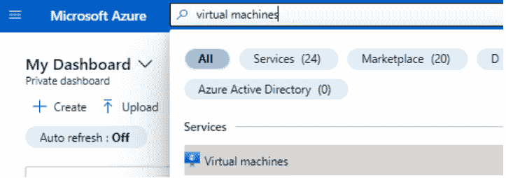

图 13.10 – 搜索虚拟机服务

3. 从 **虚拟机** 边栏中找到本实践的 VM，并单击 VM _名称_ 以打开 **虚拟机** 边栏：


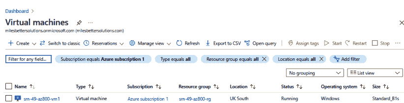

Figure 13.11 – 选择你的 VM

- 4. 从“虚拟机”边栏，单击“访问控制(IAM)”：

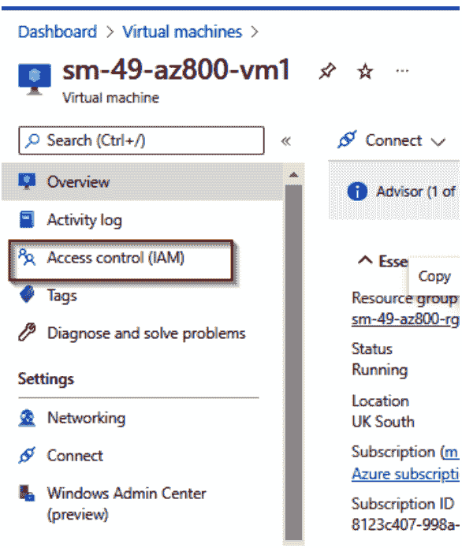

Figure 13.12 – 为 VM 进入访问控制

- 5. 从 **访问控制(IAM)** 边栏，从边栏顶部的选项中，单击 + **添加** 然后 **添加角色分配**：

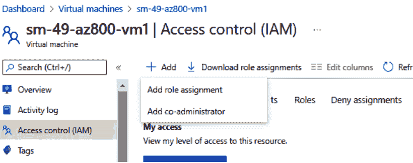

Figure 13.13 – 添加角色分配

- 6. 从 **添加角色分配** 边栏，在 **类别** 筛选器中，选择 **计算**：

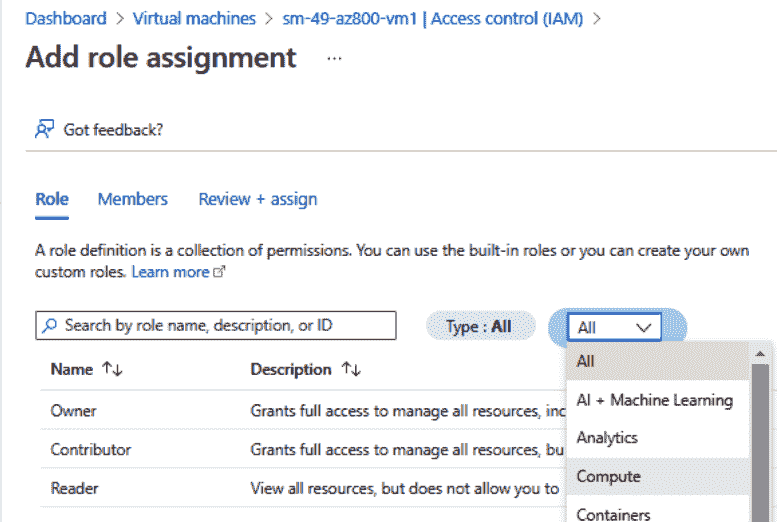

Figure 13.14 – 选择分配类别

- 7. 从 **角色** 选项卡，选择要分配的 *角色名称* 并单击 **下一步**；本练习将使用 **虚拟机管理员登录** 角色：

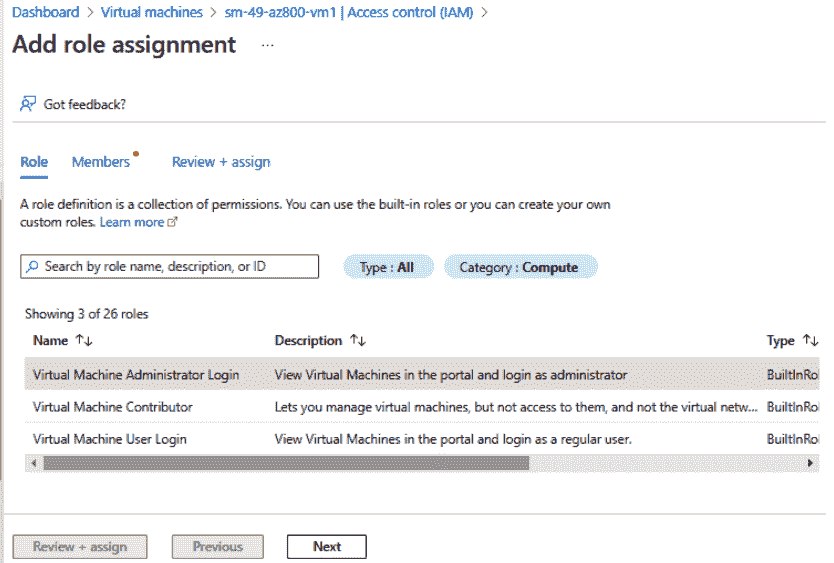

Figure 13.15 – 选择要分配的成员

- 8. 从 **成员** 选项卡，在 **成员** 部分下单击 **+ 选择成员**。从 **选择成员** 边栏，搜索要 **分配** 的用户，单击该用户，然后单击 **选择**：

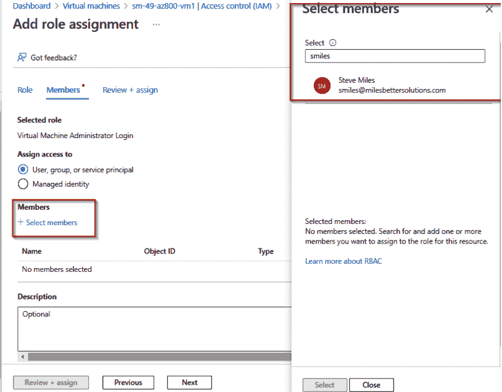

Figure 13.16 – 选择要分配的成员（续）

- 9. 从 **查看 + 分配** 边栏，单击 **查看 + 分配**：


Figure 13.17 – 创建分配

- 10. 你将收到角色分配已添加的通知：

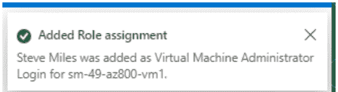

Figure 13.18 – 分配通知

- 11. 你现在将在资源的“访问控制(IAM)”边栏的“角色分配”选项卡中看到此新角色分配：

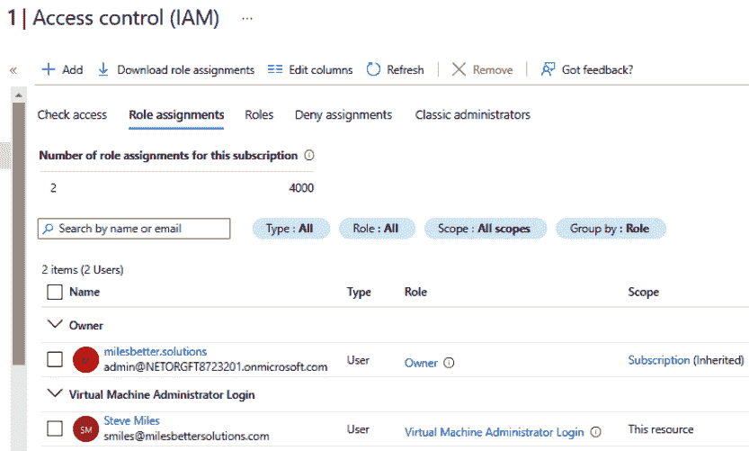

Figure 13.19 – 分配已创建

- 12. 如果你希望验证分配的访问级别，可以从 **检查访问** 选项卡单击 **查看我的访问权限**；如果你希望检查另一标识的访问权限，可以单击 **检查访问**。

- 13. 从 **检查访问** 中，单击 **检查访问** 按钮，并从 **当前角色分配** 选项卡中，单击 **虚拟机管理员登录** 角色条目：

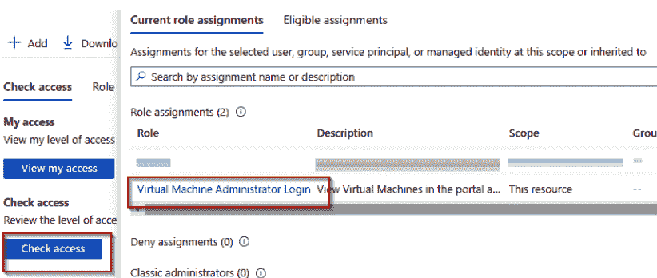

Figure 13.20 – 检查访问

- 14. 你现在将看到此角色的 *已分配权限* 以及每个角色的 *描述*。

- 15. 你现在应 *从步骤 4 开始重复练习步骤*，但这次，对于 *步骤 7*，你应选择 **虚拟机用户登录** 作为角色。

- 16. 你现在应 *重复步骤 12 至 14* 以查看与此角色相对于 **虚拟机管理员登录** 角色的 *已分配权限差异*。

至此，我们已完成本练习。本练习教会了分配 VM 访问权限所需的技能。在下一个练习中，我们将探讨创建 Azure Policy 分配。

### 练习 – 创建 Azure Policy 分配

本练习将探讨创建 Azure Policy 分配，以审核混合环境中 Azure Arc 启用的 Windows 服务器所需的 Azure Log Analytics 代理是否存在。

本练习需要以下前提条件：

- * 具有 **所有者** 或 **参与者** 订阅角色的 Azure 门户访问权限

按以下步骤开始：

- 1. 登录 Azure 门户：`https://portal.azure.com`。你也可以使用 Azure 桌面应用：`https://portal.azure.com/App/Download`。

- 2. 在搜索栏中输入 *策略*；从服务列表中单击 **策略**：

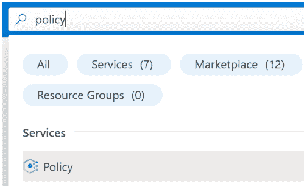

Figure 13.21 – 搜索策略

- 3. 从 **策略** 边栏，在 **创作** 部分下单击 **分配**：

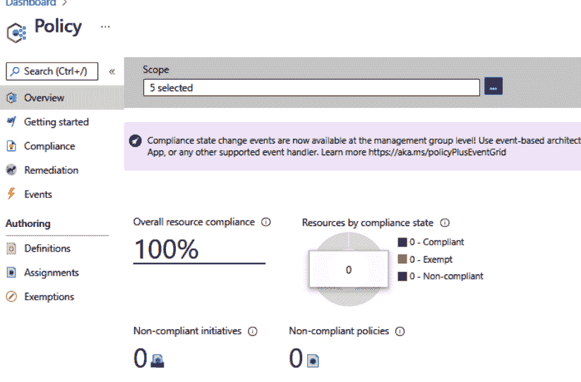

Figure 13.22 – 策略分配

- 4. 在 **分配** 边栏的顶部选项中选择 **分配策略**：

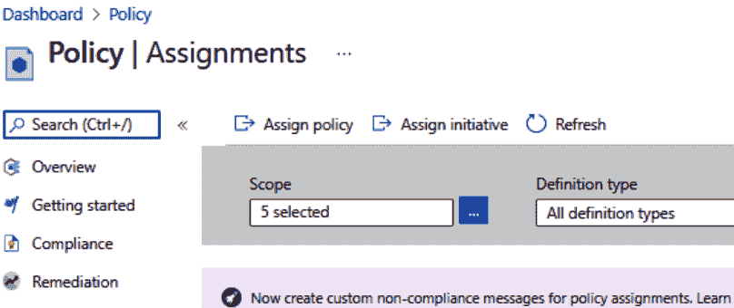

Figure 13.23 – 分配策略选项

- 5. 从 **分配策略** 边栏，在 **基础** 选项卡中，为订阅设置 **范围** 类型并选择所需的订阅：

Dashboard > 策略 | 分配 >

### 分配策略

基础 参数 补救 不合规消息 查看 + 创建

### 范围

范围 了解有关设置范围的详细信息 * Azure 订阅 1

### 排除项

可选择要从策略分配中排除的资源。

### 基础

策略定义 *

分配名称 *

说明

策略强制 启用 禁用

由 steve miles 分配

查看 + 创建 取消 上一步 下一步

- 6. 在 **基础** 部分下的 **策略定义** 设置中，搜索以下策略定义并单击选择：
**[预览]: 应在 Windows Azure Arc 计算机上安装 Log Analytics 扩展：**

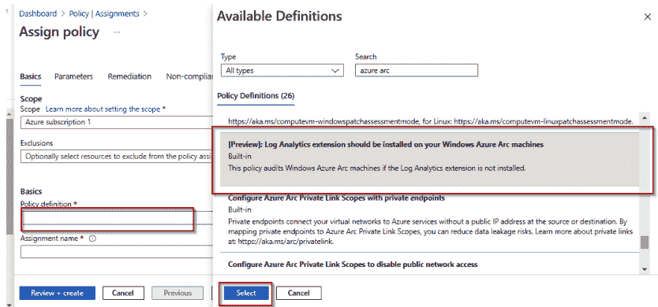

Figure 13.25 – 选择策略定义

- 7. 分配名称将自动预填：

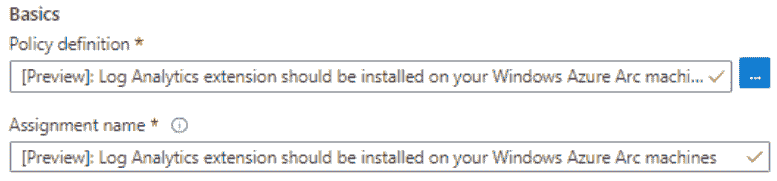

Figure 13.26 – 分配名称设置

- 8. 本练习中其他选项卡无需完成其他设置；单击 **查看 + 创建**，然后单击 **创建**：

Dashboard > 策略 | 分配 >

### 分配策略

- 基础
- 参数
- 补救
- 不合规消息
- 查看 + 创建

### 基础

| 属性 | 值 |
|---|---|
| 范围 | Azure 订阅 1 |
| 排除项 | -- |
| 策略定义 | [预览]: 应在 Windows Azure Arc 计算机上安装 Log Analytics 扩展 ... |
| 分配名称 | [预览]: 应在 Windows Azure Arc 计算机上安装 Log Analytics 扩展 ... |
| 说明 | -- |
| 策略强制 | 启用 |
| 由 ... 分配 | steve miles |

### 参数

- 未检测到参数更改。

### 补救

- 此分配未关联托管标识。

### 不合规消息

- 此分配无关联的不合规消息。

- 创建
- 取消
- 上一步
- 下一步

Figure 13.27 – 创建策略分配

- 9. 单击左侧菜单中的“合规性”，然后找到并单击创建的策略分配：

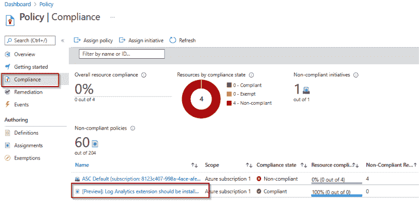

Figure 13.28 – 策略合规性仪表板

- 10. 你将看到受策略影响的所有资源的状态，以及其合规状态是“合规”还是“不合规”：

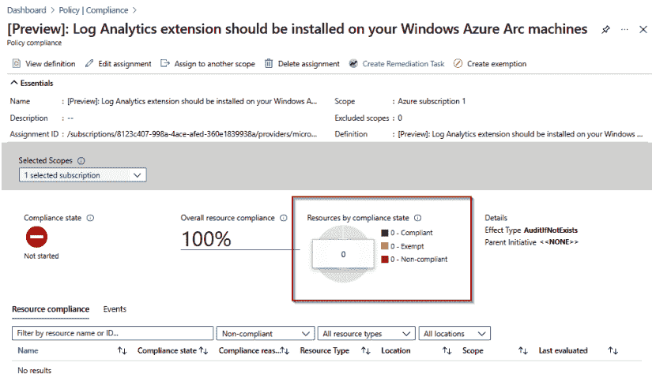

Figure 13.29 – 策略仪表板

至此，我们已完成本练习。本练习教会了创建 Azure Policy 分配所需的技能。下一个练习将探讨设置 Microsoft Defender for Cloud。

### 练习 – 设置 Microsoft Defender for Cloud

本练习将探讨设置 Microsoft Defender for Cloud。

本练习需要以下前提条件：

- 具有所有者或参与者订阅角色的 Azure 门户访问权限
- 用于分配访问权限的 Azure VM 资源

在以下子部分中，你可以看到按任务划分的完成练习的步骤，以便更好地理解。

### 任务 1 – 访问 Azure 门户

- 1. 登录 Azure 门户：https://portal.azure.com。你也可以使用 Azure 桌面应用：https://portal.azure.com/App/Download。

### 任务 2 – 为 Defender for Cloud 创建 Log Analytics 工作区

- 2. 在搜索栏中输入 log analytics workspaces；从服务列表中单击“Log Analytics 工作区”：

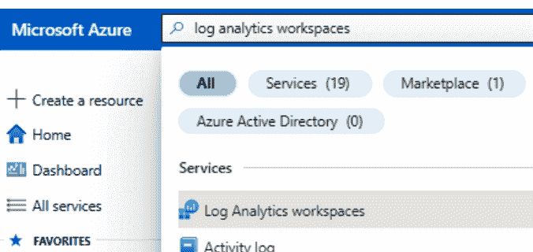

Figure 13.30 – 搜索 Log Analytics 工作区

- 3. 从“Log Analytics 工作区”边栏，单击“创建”：

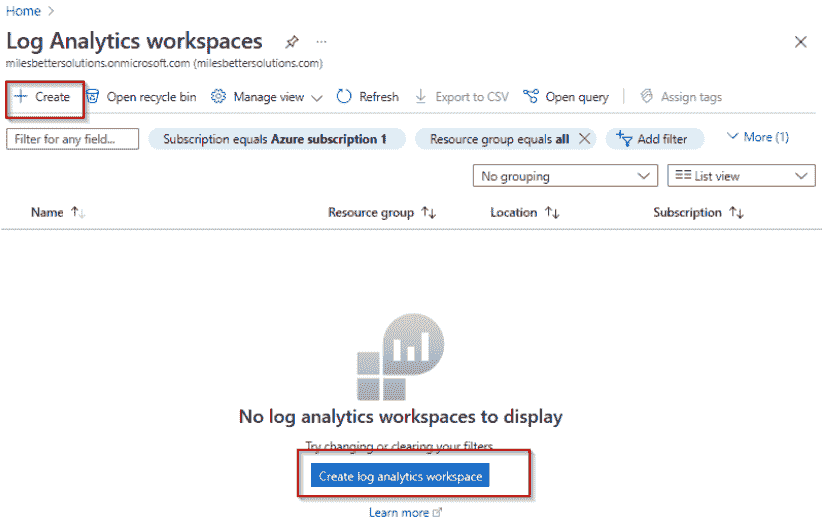

Figure 13.31 – 创建 Log Analytics 工作区

- 4. 根据要求填写 **项目详细信息** 和 **实例详细信息** 设置，然后单击 **查看 + 创建**：

主页 > Log Analytics 工作区 >

## 创建 Log Analytics 工作区

> > Log Analytics 工作区是 Azure Monitor 日志的基本管理单元。创建新 Log Analytics 工作区时应注意特定事项。了解详细信息

使用 Azure Monitor 日志，你可以轻松存储、保留和查询从 Azure 和其他环境中的监控资源收集的数据，以获得有价值的见解。Log Analytics 工作区是收集和存储日志数据的逻辑存储单元。

## 项目详细信息

选择用于管理已部署资源和成本的订阅。使用资源组（如文件夹）来组织和管理所有资源。

- 订阅 *：Azure 订阅 1
- 资源组 *：(新建) sm-079-law-dfc-RG 创建新资源组

## 实例详细信息

- 名称 *：sm-079-law-dfc
- 区域 *：英国南部

[查看 + 创建] [« 上一步] [下一步：标签 >]

Figure 13.32 – 创建 Log Analytics 工作区向导


- 5. 查看设置，然后单击 **创建**：

主页 > Log Analytics 工作区 >

## 创建 Log Analytics 工作区

验证通过

- 基础
- 标记
- 查看 + 创建

## Log Analytics 工作区

由 Microsoft 提供

### 基础

| Subscription | Azure subscription 1 |
| Resource group | sm-079-law-dfc-RG |
| Name | sm-079-law-dfc |
| Region | 英国南部 |

### 定价

| 定价层 | 按用量付费 (Per GB 2018) |

工作区的成本取决于摄入的数据量和数据保留时间。有关区域定价详细信息，请参阅 Azure Monitor 定价页面。工作区创建后，可以更改为其他定价层。了解有关 Log Analytics 定价模型的详细信息。

### 标记

(无)

- 创建
- « 上一步
- 下载用于自动化的模板

图 13.33 – 创建 Log Analytics 工作区

- 6. 您将收到部署已完成的信息：

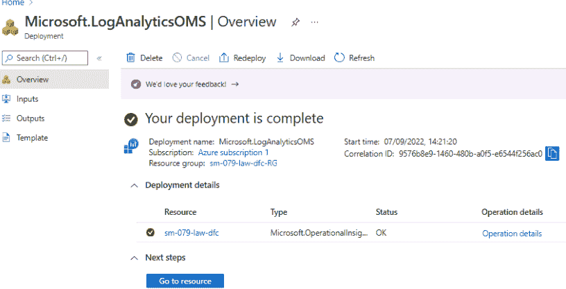

图 13.34 – Log Analytics 工作区部署完成

## 任务 3 – 启用高级功能并升级 Defender for Cloud

我们将在订阅中启用高级功能并升级 Defender for Cloud。执行以下步骤：

- 7. 在搜索栏中键入 defender for cloud；从服务列表中单击 Microsoft Defender for Cloud：

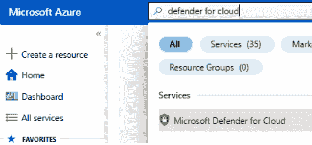

图 13.35 – 搜索 Defender for Cloud

- 8. 从“入门”边栏中，确保已选定您的订阅和创建的工作区，然后单击升级：

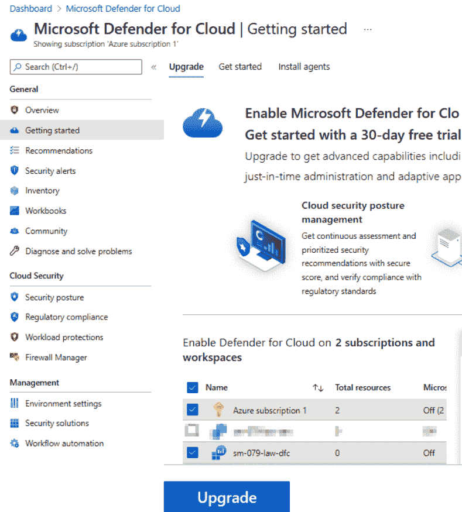

图 13.36 – 升级 Defender for Cloud

- 9. 您将看到 **安装代理** 边栏。单击 **安装代理**：

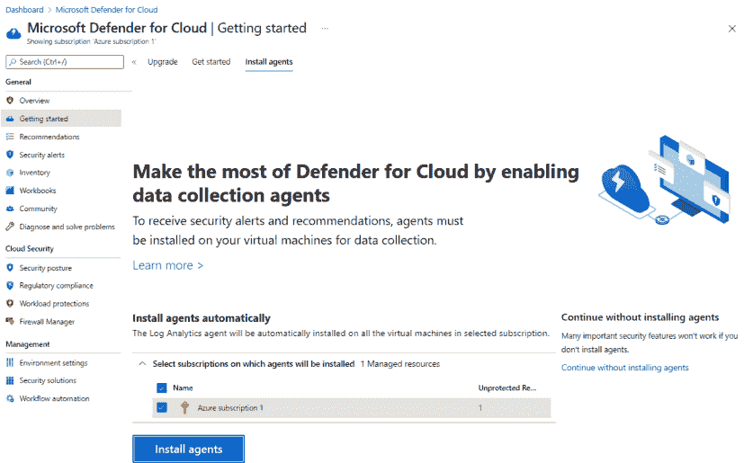

图 13.37 – 安装代理边栏

- 10. 您现在可以访问 CSPM 和 CWPP 功能：

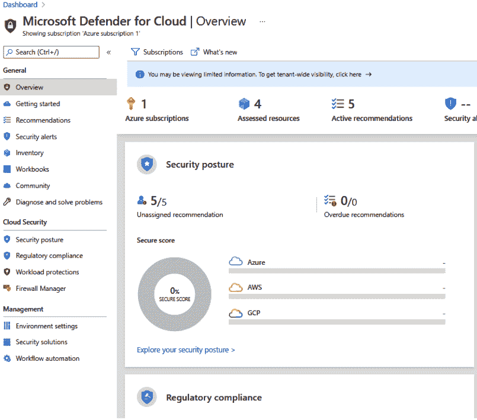

图 13.38 – Defender for Cloud 设置

在此任务中，我们启用了高级功能并升级了 Defender for Cloud。

至此，我们已完成此练习。此练习教授了设置 Microsoft Defender for Cloud 的技能。下一个练习将探讨设置 Microsoft Sentinel 并将其与 Microsoft Defender for Cloud 集成。

### 练习 – 设置 Microsoft Sentinel

为此练习，您需要准备好以下内容：

- 具有所有者或参与者订阅角色的 Azure 门户访问权限
- 对创建 Sentinel 工作区的资源组具有参与者角色访问权限

在以下小节中，您将看到按任务划分的完成练习的步骤，以便更好地理解：

## 任务 1 – 访问 Azure 门户

- 1. 登录到 Azure 门户：https://portal.azure.com。或者，您也可以使用 Azure 桌面应用：https://portal.azure.com/App/Download。

## 任务 2 – 启用 Microsoft Sentinel

- 2. 在搜索栏中键入 sentinel；从服务列表中单击 Microsoft Sentinel：

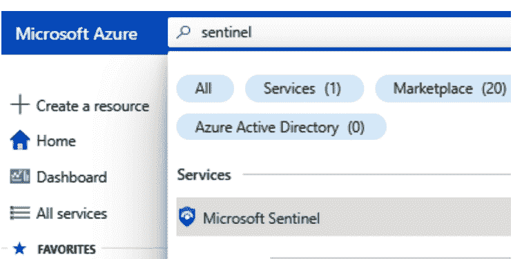

图 13.39 – 搜索 Sentinel

- 3. 从 Microsoft Sentinel 边栏中，单击顶部菜单上的 + 创建：

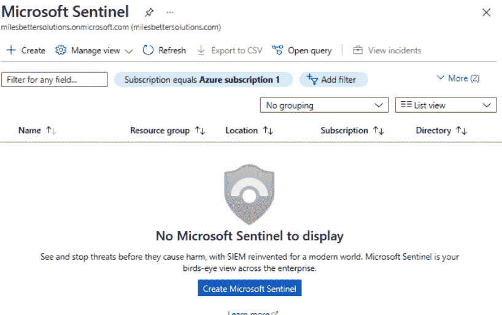

图 13.40 – 创建 Sentinel 实例

- 4. 从“将 Microsoft Sentinel 添加到工作区”边栏中，单击 + 创建新工作区：

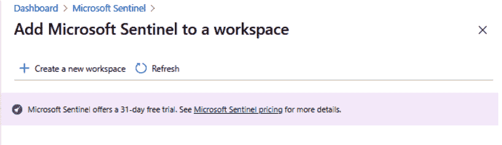

| 工作区 | 位置 | 资源组 | 订阅 | 目录 |
| :--- | :--- | :--- | :--- | :--- |
| sm-079-law-dfc | uksouth | sm-079-law-dfc-rg | Azure subscription 1 | milesbettersolutions.omni... |

图 13.41 – 创建工作区

- 5. 在“创建 Log Analytics 工作区”边栏中，按要求填写项目详细信息和实例详细信息设置，然后单击查看 + 创建：

仪表板 > 将 Microsoft Sentinel 添加到工作区 >

### 创建 Log Analytics 工作区

Log Analytics 工作区是 Azure Monitor 日志的基本管理单元。创建新的 Log Analytics 工作区时，应考虑特定事项。了解更多信息

使用 Azure Monitor 日志，您可以轻松存储、保留和查询从 Azure 和其他环境中的监控资源收集的数据，以获得有价值的见解。Log Analytics 工作区是收集和存储日志数据的逻辑存储单元。

### 项目详细信息

选择要管理其部署资源和成本的订阅。使用资源组（如文件夹一样）来组织和管理所有资源。

Subscription * Azure subscription 1

Resource group * (新建) sm-079-law-sen-rg 创建新

### 实例详细信息

Name * sm-079-law-sen

Region * 英国南部

图 13.42 – 创建 Log Analytics 工作区向导

- 6. 查看设置，然后单击 **创建**：

仪表板 > 将 Microsoft Sentinel 添加到工作区 >

### 创建 Log Analytics 工作区

**验证通过**

基础 标记 查看 + 创建

**Log Analytics 工作区**
由 Microsoft 提供

| | |
|---|---|
| 订阅 | Azure subscription 1 |
| 资源组 | sm-079-law-sen-rg |
| 名称 | sm-079-law-sen |
| 区域 | 英国南部 |

### 定价
定价层
按用量付费 (Per GB 2018)

工作区的成本取决于摄入的数据量和数据保留时间。有关区域定价详细信息，请参阅 Azure Monitor 定价页面。工作区创建后，可以更改为其他定价层。了解有关 Log Analytics 定价模型的详细信息。

### 标记
(无)

[创建] [<< 上一步] 下载用于自动化的模板

图 13.43 – 审阅工作区

- 7. 您将收到部署已完成的信息。

- 8. 单击 **刷新** 以查看您 *已创建的工作区*，选择要启用 Sentinel 的工作区，然后单击 **添加**：

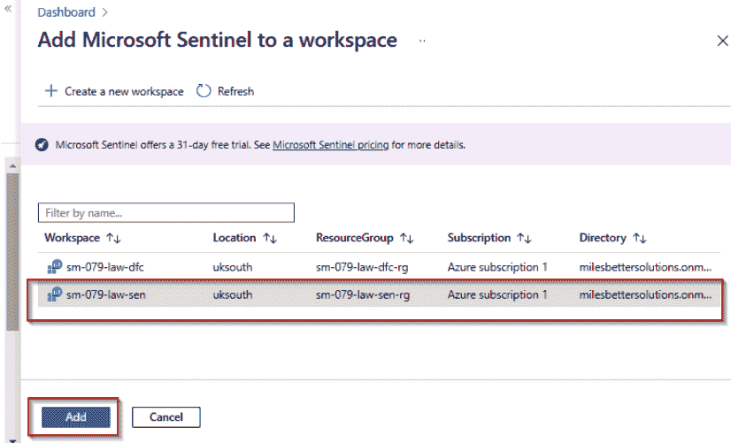

图 13.44 – 将工作区添加到 Sentinel

- 9. 您将收到 Sentinel 已添加的通知：

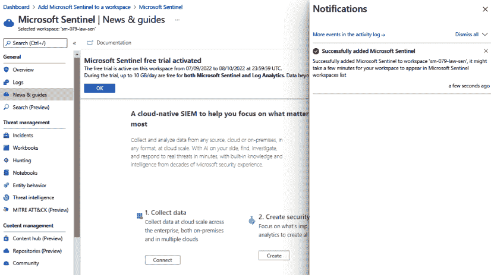

图 13.45 – 已添加 Sentinel

- 10. Sentinel 现已启用。

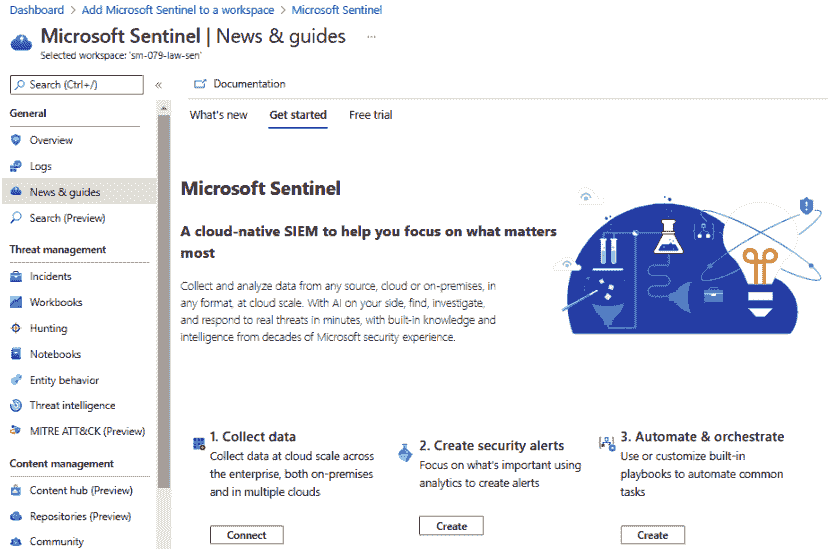

图 13.46 – 已启用 Sentinel

### 任务 3 – 将 Sentinel 与 Defender for Cloud 集成

在此任务中，我们将 Sentinel 与 Defender for Cloud 集成。执行以下步骤：

- 1. 导航到配置部分下的数据连接器边栏：

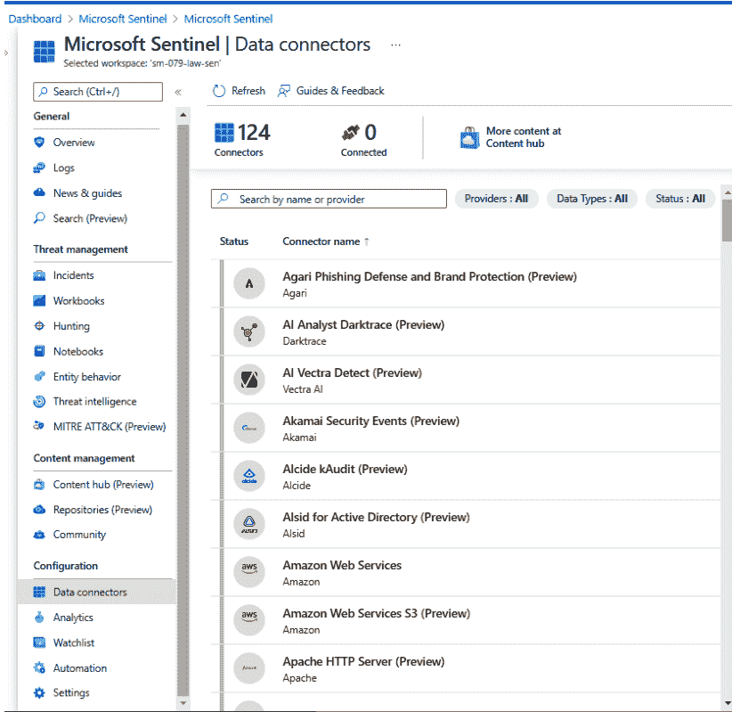

图 13.47 – Sentinel 数据连接器

- 2. 搜索 Microsoft Defender for Cloud 连接器并单击打开数据连接器边栏；然后，选择打开连接器页面：

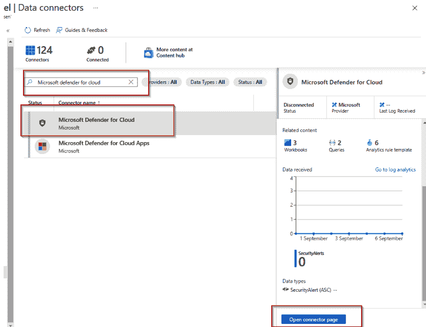

图 13.48 – Defender for Cloud 数据连接器

- 3. 在连接器页面上，选择您的订阅；在屏幕底部，单击“为创建事件 – 推荐！启用”。然后，单击连接并接受弹出对话框：

### 配置

将 Microsoft Defender for Cloud 连接到 Microsoft Sentinel。标记要将其警报导入 Microsoft Sentinel 的每个 Azure 订阅的复选框，然后在列表上方选择连接。

连接器仅可在 Microsoft Defender for Cloud 中至少启用了一个 Microsoft Defender 计划的订阅上启用，并且仅由对订阅具有安全读取者权限的用户启用。

| 连接 | 断开连接 | 启用双向同步 | 禁用双向同步 | 为所有订阅启用 Microsoft Defender > |
|---|---|---|---|---|
| 搜索 |
| 订阅 | 状态 | 双向同步 | Microsoft Defender 计划 |
| Azure subscription 1 | 已断开连接 | 已禁用 | 已启用部分 | 为全部启用 > |

> 创建事件 - 推荐！
从此连接的服务生成的所有警报自动创建事件。[启用]

图 13.49 – 连接数据连接器

- 4. 您现在将看到 Defender for Cloud 数据连接器标记为已连接：

| 连接 | 断开连接 | 启用双向同步 | 禁用双向同步 |
|---|---|---|---|
| 搜索 |
| 订阅 | 状态 | 双向同步 |
| Azure subscription 1 | 已连接 | 已启用 |

图 13.50 – 已连接的数据连接器


- 5. 数据连接器边栏确认 Microsoft Defender for Cloud 已连接到 Sentinel：

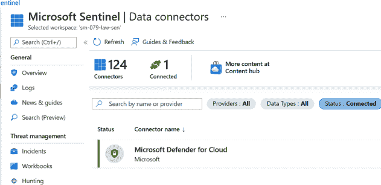

图 13.51 – 已连接的数据连接器（续）

- 6. Defender for Cloud 现在已与 Sentinel 集成，并准备好让你开始安全操作：

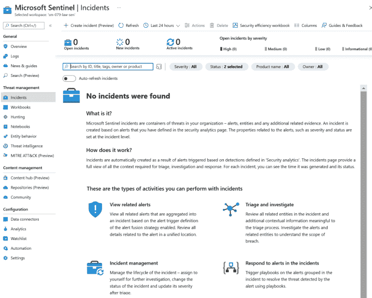

图 13.52 – 已与 Sentinel 集成的 Defender for Cloud

借此，我们已完成本练习。本练习教会了我们设置 Microsoft Sentinel 并将 Microsoft Defender for Cloud 与之集成的技能。现在，让我们总结本章。

## 摘要

本章涵盖了 AZ-800 管理 Windows Server 混合核心基础设施：在混合环境中管理 Windows 服务器和工作负载考试的内容。

本章内容进一步增强了你在本地网络基础设施服务方面的知识和技能。

你了解了管理 Windows Server 用户和网络访问、为混合 Windows 服务器实现 Azure Arc 和 Azure Automation、设置 Microsoft Defender for Cloud 并将其与 Microsoft Sentinel 集成的知识。随后，我们通过动手练习结束本章，以进一步提升你的技能。

你通过所提供的信息获得了新技能，本章的目标是将你的知识提升至考试目标之上，使你为现实世界中日常以混合环境为重点的角色做好准备。

下一章将教你有关实现和管理 Azure 网络基础设施的内容。

## 进一步阅读

本节提供额外学习参考和考试信息的链接：

- 微软认证：Windows Server 混合管理员助理：https://docs.microsoft.com/en-us/learn/certifications/windows-server-hybrid-administrator/
- 考试 AZ-800：管理 Windows Server 混合核心基础设施：https://docs.microsoft.com/en-us/learn/certifications/exams/az-800
- 考试 AZ-800：技能大纲：https://query.prod.cms.rt.microsoft.com/cms/api/am/binary/RWKIO1r
- Microsoft Learn：https://docs.microsoft.com/en-us/training/paths/manage-windows-servers-workloads-hybrid-environment/

## 技能检查

用本章所学内容挑战你自己：

- 1. 内置计算类别访问角色有哪些？
- 2. 可以使用哪个 PowerShell cmdlet 来管理角色？
- 3. 可以使用哪些接口和工具来访问 Windows Server Azure VM？
- 4. 什么是 Azure Arc？
- 5. 什么是 Azure Arc 启用的服务器？
- 6. Azure Arc 所需的部署角色有哪些？
- 7. 网络连接选项有哪些？
- 8. 什么是 Azure Policy 和来宾配置策略？
- 9. 什么是 Log Analytics 代理？列举一些用例场景。
- 10. Log Analytics 的两个组件是什么？
- 11. Azure Log Analytics 与 Azure Arc 之间是什么关系？
- 12. 什么是 Azure Automation 更新管理？
- 13. 什么是 Microsoft Defender for Cloud？
- 14. 什么是 Microsoft Sentinel？
- 15. Defender for Cloud 如何与 Microsoft Sentinel 集成？
