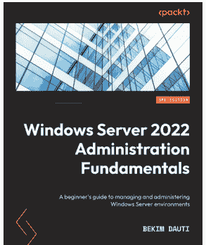
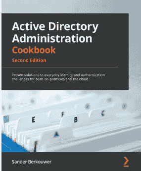

### Index

### Symbols

- .adml 文件 81
- .admx 文件 81

### A

- AAD DC 管理员 85
- AADDC 计算机 59
- AADDC 用户 59
- 访问控制列表 (ACL) 240
- 访问密钥 271, 275-277
- Active Directory (AD) 4, 106

### Active Directory 管理中心 (ADAC) 24, 31, 58

- 参考链接 31

### Active Directory 域服务 (AD DS) 4-7, 141, 241

- 可用性规划 23
- 创建 23
- 数据保护规划 24
- 域控制器部署 25
- 在 Windows Server 上安装 34-45
- 逻辑组件 6
- 管理 31
- 监视工具 33
- 性能规划 23
- 物理组件 6
- 故障排除工具 33

### Active Directory 域服务 (AD DS) 组件

- 数据存储 18, 19
- 域控制器 20
- 域 14, 15
- 林 15, 16
- 全局目录 (GC) 21
- 对象 7
- 操作主控角色 21, 22
- 架构 19
- 站点 22, 23
- 站点链接 23
- 子网 22, 23
- 信任 16-18

### Active Directory 联合身份验证服务 (AD FS) 113, 114

- 预身份验证 166

- Active Directory 用户和计算机 9
- Active Directory 用户和计算机管理单元 58
- AD Connect 54

### AD DS 数据库分区

- 应用程序分区 19
- 配置分区 19
- 域分区 19
- 架构分区 19

- AD 运行状况检查工具 110

### AD 模块 31

- 参考链接 32
- 用于 PowerShell 32

- AD PowerShell 58
- Anycast DNS 199
- 追加 Blob 268
- 应用程序安全组 (ASG) 195, 197, 198
- 已启用 Arc 的服务器 400
- 异步复制 260

### 身份验证/AuthN 4

- 身份验证协议选项 164

- 权威的 141
- 权威还原 25
- 授权/AuthZ 5

### Azure

- 管理 Windows Server VM 的访问权限 394
- 实现名称解析 199
- 实现网络连接 187
- 实现网络保护 195
- 分割视图 DNS 202
- 实现 VNet 181

### Azure Active Directory (Azure AD) 50, 106

- 常见服务 50

### Azure AD 应用程序代理 167

- 工作原理 168

### Azure AD Connect 106, 107

- 添加自定义域名 120-124
- 自定义安装 109
- 管理目录同步用户 131-133
- 下载 124-130
- 快速安装 109
- 实现 117, 118
- 安装 124-130
- 为目录同步准备不可路由域 118-120
- 操作 106
- 规划 107-109
- 实用技能 116
- 暂存模式 109
- 验证同步 130, 131
- 使用 116

- Azure AD Connect 云同步 107

### Azure AD DS 51

- 优势 52
- GPO 85, 86
- 安装 62-71
- 创建实例 62
- 用例 51, 52

### Azure AD DS 托管域 52

- 管理管理特权 58
- 带订阅的 Azure AD 租户 55
- 特征 52-54
- 创建 54
- 域名 56
- 林类型 58
- 位置 56
- 管理工具 58
- 管理 58
- 网络和 DNS 55, 56
- 网络拓扑 55
- 管理组织单位 (OU) 60
- 特权 55
- SKU 57
- 管理用户帐户 60
- 管理 VM 域加入 61
- 配置 VNet 59

### Azure Arc

- 为混合 Windows 服务器实现 399, 400

### Azure 作为 IaaS

- 部署域控制器 30

### Azure 自动化

- 为混合 Windows 服务器实现 404
- 更新管理 404

- Azure CLI 269
- Azure 连接的计算机代理 400

### Azure 桌面应用

- 下载链接 62

- Azure DevOps 组织 365

### Azure DNS 180, 199

- 访问 Azure 门户 224
- 实现 224
- 限制 200
- 私有 DNS 区域 199
- 创建私有区域 227
- 公共 DNS 区域 199
- 创建公共区域 224, 225
- 添加记录 225, 226
- 链接 VNet 227

### Azure DNS, 私有区域

- 功能 200

- Azure ExpressRoute 180
- Azure 扩展网络 190

### Azure 文件

- 实现 270, 271
- 存储身份验证 275
- 存储加密 273
- 存储网络访问 274, 275
- 存储保护 274
- 存储冗余 272
- 存储层 271

### Azure 文件共享特定内置角色

- 存储文件数据 SMB 共享参与者 278
- 存储文件数据 SMB 共享提升参与者 278

### Azure 文件同步 279

- Azure 文件同步代理 279
- 云备份 280
- 云终结点 279
- 云分层 280
- 从 DFS-R 部署迁移 280, 281
- 灾难恢复 280
- 使用 Azure 门户实现 280
- 多站点同步 279
- 注册的服务器 279
- 服务器终结点 279
- 存储同步服务 279
- 同步组 279

### Azure 防火墙 180, 198

- 功能 198

### Azure IaaS VM 磁盘类型

- 高级 SSD 359
- 标准 HDD 359
- 标准 SSD 359
- Ultra 磁盘 359

### Azure IaaS VM

- 网络访问 399
- 用户访问 394-398

- Azure 密钥保管库 273
- Azure Monitor 代理 (AMA) 400
- Azure 网络适配器 180, 193

### Azure 网络服务 179, 181

- 功能 180

- Azure Pipelines 363

### Azure 策略分配

- 创建 413-419

### Azure 门户

- URL 62, 368
- 用于管理数据磁盘 367
- 部署 WAC 383
- 实现 WAC 以管理 Azure VM 388-391

- Azure 中继 180, 193
- Azure 资源管理器 (ARM) 269, 400
- Azure 基于角色的访问控制 (Azure RBAC) 394
- Azure Stack 超融合基础设施 (HCI) 300
- Azure 存储磁盘，缓存性能和配置参考链接 358
- Azure 存储服务 267
- Azure 虚拟桌面 (AVD) 52, 405

### Azure 虚拟 WAN 180, 193-195

- 功能 194
- 实现步骤 195

- 分配 Azure VM 访问权限 407-413
- 配置到 365 的连接
- 配置持续交付 363-365
- 调整大小 361-363, 374-376
- Windows Server DNS 200, 201

- 管理 Azure VM 数据磁盘 357-360

### Azure VNet 181, 182

- 创建 203-207

### 实现 Azure VNet 网关 191, 192

- 资源 191

### Azure VPN 网关 180

- 访问 Azure 门户 228
- 实现 228
- 创建 VNet 网关 228-232

### Azure VPN 网关实现

- 创建 VNet 网关 232

## B

### 备份副本还原 25

- 权威还原 25
- 非权威还原 25

- 基础 OS 层，容器映像 348
- Bicep 269

### 二进制大型对象 (Blob) 268

- 追加 Blob 268
- 块 Blob 268
- 页 Blob 268

- 块继承 84
- 引导程序协议 (BOOTP) 147
- 使用边界网关协议 (BGP) 192
- 内置容器 8
- 业务单元 (BU) 159

## C

- 使用 PowerShell 管理缓存设置，参考链接 358
- 集中式拓扑 159

### 证书颁发机构 (CA) 56, 165

- 私有 CA 165
- 公有 CA 165

- 证书服务 4
- 质询握手身份验证协议 (CHAP) 164, 249
- 无类别域间路由 (CIDR) 格式 183

### 云身份验证模型 111

- PHS 混合身份验证模型 111, 112
- PTA 混合身份验证模型 112, 113

- 仅云身份场景 53
- 云安全态势管理 (CSPM) 405
- 云工作负载保护平台 (CWPP) 405

### 冷土豆路由 186

- 优势 187
- 劣势 187
- 与热土豆路由的比较 187

- 命令行界面 (CLI) 342
- 计算机帐户 11
- 计算机对象 11
- 计算机容器 8
- 有条件转发 146
- 配置凭据安全支持提供程序 (CredSSP) 385

### 连接

- 配置到 Azure VM 的连接 365

- 容器扩展 346
- 容器对象 7, 8
- 组织单位 8, 9

### 容器 6, 340

- 与虚拟机 (VM) 的比较 340, 341

- 持续交付 363
- 为 Azure VM 配置 363-365

### 控制面板

- 创建 GPO 以限制访问 96-99

- 聚合部署 254

### CPU 组

- 参考链接 318

- 跨本地连接 181
- 客户托管密钥 (CMK) 273

## D

- 数据库 6

### Windows Server 中的数据重复数据删除

- 配置重复数据删除 263-265
- 安装重复数据删除角色 262, 263
- 实现 262

### 数据磁盘 358

- 附加到 VM 368-371
- 访问 Azure 门户 368
- 使用 Azure 门户管理 367
- 调整到 VM 的大小 371-374
- 数据磁盘，在不停机的情况下扩展参考链接 358

### 数据保护

- 备份副本还原 25
- 规划 24
- 回收站还原 24

### dcldiag 33

- 参考链接 34

### 分散式拓扑 159, 160

- IPAM 服务器实现 160
- 前提条件 160

- 默认域控制器策略 78
- 默认域策略 78
- 默认第一个站点名称 22
- 拒绝服务 (DoS) 146

### Deploy-WACAzVM.ps1 脚本

- 下载链接 380

### Azure 门户桌面应用

- 下载链接 368

- DFS 命名空间 (DFS-N) 261

### DFS-R 部署

- 迁移到 Azure 文件同步 280, 281

- DFS 复制 (DFS-R) 261
- DHCP Administrators 本地组 157
- DHCP 监视模块 158
- DHCP 拆分作用域 156
- DHCP Users 本地组 157
- DirectAccess 162
- 目录信息存储 18
- 目录复制代理 (DRA) 33
- 目录服务 4
- 目录服务 (DS) 解决方案 105
- 目录服务还原模式 (DSRM) 25
- 离散设备分配 (DDA) 314
- Diskpart 工具 310


### 分布式文件系统 (DFS) 241
- 实现 261, 262

### 分布式文件系统 (DFS)，服务器角色
- DFS 命名空间 (DFS-N) 261
- DFS 复制 (DFS-R) 261

### 分发组 13

### DNS即服务 199

### DNS-DHCP-IPAM (DDI) 147

### DNSKEY 记录 146

### DNS多服务器管理模块 158

### DNS服务器 26

### Docker 342
- 组件 342
- URL 342

### Docker客户端 342

### Docker命令 345

### docker commit命令 346

### Docker引擎 342, 345

### docker images命令 345

### Windows Server上的Docker
- 使用 PowerShell 安装 349, 350
- 使用 Windows Admin Center (WAC) 安装 350-355

### docker rm命令 346

### docker run命令 345

### docker start命令 346

### Docker文本文件 345

### 域 14

### 域容器 8

### 域控制器 (DC) 4, 8, 20
- 部署 25
- 从介质部署 30
- 在 Azure 中作为 IaaS 部署 30
- 在 Windows Server Core 上部署 29
- 在带有 Server Manager GUI 的 Windows Server 上部署 25-29
- 操作系统，升级 31

### 域控制器 OU 容器 8

### 域 GPO 78

### 域本地组 13

### 域名系统 (DNS) 140
- DNS 记录，创建 172-174
- DNS 角色，安装 169
- DNS 区域，创建 170, 171
- 转发器 145
- 实现 143, 144, 169
- 记录 145
- 安全 146
- 故障排除 146
- 故障排除命令，示例 146
- 工作原理 140-142
- 区域 144

### 域名系统安全扩展 (DNSSEC) 146, 200

### 域服务 4, 14

### 域拓扑 14

### 域树 14

### 双栈 184

### 动态主机配置协议 (DHCP) 147, 181
- 授权 153, 154
- 可用性 154-156
- 命令，用于管理 177
- DHCP 角色，安装 174
- 组 157
- 实现 147, 153, 174
- 管理 147, 156, 157
- 选项 152
- 预留 150, 152
- 作用域，创建 175, 176
- 作用域 149, 150
- 工作原理 147-149

### 动态路由
- 使用 192

### Dynamics 365 (D365) 193

## E
- EAP-传输层安全 (EAP-TLS) 164
- 出站路由 186
- 冷土豆路由 186
- 热土豆路由 187
- 提权 PowerShell 会话 348
- 增强会话模式 315-318
- ExpressRoute 180
- ExpressRoute 线路 192, 193
- 实现步骤 192
- 扩展文件分配表 (exFAT) 240
- 可扩展身份验证协议 (EAP) 164
- 可扩展存储引擎 (ESE) 18
- 外部服务提供商 (ESP) 146
- 外部信任 16

## F
- 新技术文件系统 (NTFS) 240
- 弹性文件系统 (ReFS) 240
- 文件传输协议 (FTP) 279
- 防火墙即服务 (FWaaS) 198
- 防火墙管理器 199
- 灵活单主操作 (FSMO) 21
- 林 15, 16
- 林根域 15
- 林信任 16
- 林范围身份验证 18
- 完全限定域名 (FQDN) 140
- FAT32 240
- 联合身份验证模型
  - Active Directory 联合身份验证服务 (AD FS) 113, 114
- 联合服务 4
- 光纤通道 (FC) 244
- 以太网上的光纤通道 (FCoE) 244
- 文件分配表 (FAT) 240
- 文件 268
- 文件服务器资源管理器 (FSRM) 241, 242
- 功能 242
- 文件共享权限，Azure Files 278, 279
- 文件系统 240
- 文件系统，类型
  - 扩展文件分配表 (exFAT) 240
  - 文件分配表 (FAT) 240

## G
- 网关子网 191
- 异地冗余存储 (GRS) 272
- 异地可用区冗余存储 (GZRS) 272
- 全局目录 (GC) 21
- 全局组 13
- GPO 容器 78
- GPO 模板 78
- GPRESULT 86
- GPUPDATE 86
- 组托管服务帐户 (gMSAs) 11
- 参考链接 11
- 组对象 12
- 范围 13, 14
- 类型 12
- 组策略 76, 77
- 实现 96
- 组策略管理控制台 (GPMC) 工具 77, 86
- 组策略管理工具
  - 安装 90-95

### 组策略对象 (GPOs)
- 8, 52, 77, 78, 160
- 管理模板 80, 82
- 管理模板，类型 81
- 组件 78-80
- 创建，以限制对控制面板的访问 96-99
- 在 Azure AD DS 中 85, 86
- 管理和故障排除工具 86-89
- 处理顺序 83-85
- 范围 82, 83
- 测试 100
- 类型 78
- 更新，强制 99
- 验证 99

### 组策略对象 (GPOs)，管理模板
- .adml 文件 81
- .admx 文件 81

### 组策略对象 (GPOs)，范围
- 域范围 82
- OU 范围 82
- 站点范围 82

### 组策略对象 (GPOs)，类型
- 域 GPO 78
- 本地 GPO 78

### 防护结构 322
- Hyper-V 工作负载，使用防护结构保护 322
- 安全解决方案 322
- 屏蔽虚拟机，启动 324

### 防护结构组件
- 防护主机 322
- 主机守护服务 (HGS) 322
- 屏蔽虚拟机 322

### 来宾配置策略
- 使用 401

### 来宾操作系统 301, 302

### GUID 分区表 (GPT) 261

## H
### 硬盘驱动器 (HDD) 271

### HGS 性能证明服务
- 主机密钥性能证明 323
- TPM 信任性能证明 323

### 高可用性 (HA) 154, 188

### 主机总线适配器 (HBA) 247

### 主机计算服务 (HCS) 318

### 主机文件 140

### 主机守护服务 (HGS) 323
- HGS 性能证明服务 323
- 密钥保护服务 (KPS) 323

### 主机操作系统 301

### 热土豆路由 187
- 优点 187
- 缺点 187
- 与冷土豆路由相比 187

### HTTPS 381

### 混合连接 181

### 混合功能和云操作
- 配置 400
- 治理 400
- 监控 400
- 保护 400

### 混合身份 51, 105, 106
- 身份验证方法 110
- 身份验证方法，选择 114, 115

### 混合身份，身份验证方法
- 云身份验证 111
- 联合身份验证 113
- SSO 116

### 混合身份场景 53

### 混合 Runbook 辅助角色，部署方法
- 代理基于 (v1) 404
- 扩展基于 (v2) 404

### 混合 Windows 服务器
- Azure Arc，实现 399-401
- Azure 自动化，实现 404
- Azure Policy 来宾配置 401
- 部署先决条件 401
- Log Analytics 代理 402, 403
- Microsoft Defender for Cloud，实现 405, 406
- 网络连接 401

### 超汇集部署 254, 255

### Hyper-V 300
- 架构 301
- 示例用例 300
- 实现 301
- 管理 302, 303

### Hyper-V 来宾服务接口 313

### Hyper-V 来宾关机服务 313

### Hyper-V 心跳服务 313

### Hyper-V 集成服务 313

### Hyper-V 隔离 342, 343

### 虚拟机监控程序调度程序 319

### Hyper-V 管理器
- 功能 304

### Hyper-V 网络
- 虚拟网络适配器 302
- 虚拟网络交换机 302

### Hyper-V PowerShell 直连服务 313

### Hyper-V 副本 321

### Hyper-V 时间同步服务 313

### Hyper-V 虚拟机
- 检查点 320
- 配置版本 306, 307
- CPU 组 318
- 创建 305
- 磁盘类型 310
- 代版本 305
- 管理 305
- 远程管理 322
- 内存 311, 312
- 资源组 318
- 设置 307-309
- 虚拟硬盘 (VHD) 格式 310

### Hyper-V 卷副本请求者 313

### Hyper-V 工作负载
- 使用防护结构保护 322

### 身份和访问管理 (IAM) 6

### 身份即服务 (IDaaS) 106

### 基于身份的身份验证 271, 275, 276, 289, 293

### 身份提供者 (IDP) 4, 50, 105

### IdFix 工具 110

### 基础设施即服务 (IaaS) 23, 252, 394

### 基础设施即代码 (IaC) 269, 363

### 集成组件 313

### 互联网密钥交换 (IKE) 188

### 互联网密钥交换 (IKE) 2 (IKEv2) 164

### 互联网协议安全 (IPsec) 协议 188

### Internet 小型计算机系统接口 (iSCSI) 244
- 组件 244
- 实现 247
- 工作原理 246

### IP 寻址
- 实现 183, 184

### IP 寻址实现
- Azure 扩展网络，使用 184, 185

### IP 地址管理 (IPAM)
- 集中式拓扑 159
- 实现 157, 158
- 管理 157, 161, 162
- 工作原理 157

### IP 地址空间管理模块 158

### IP 地址跟踪模块 158

### IPAM 客户端 158

### IPAM 发现模块 158

### IPAM 模块
- DHCP 监控模块 158
- DNS 多服务器管理模块 158
- IP 地址空间管理模块 158
- IP 地址跟踪模块 158
- IPAM 发现模块 158
- 运营审核模块 158

### IPAM 服务器 158

### iSCSI 实现，注意事项
- 高可用性 249
- 网络拓扑 247, 248
- 安全 249
- 工作负载 247

### iSCSI，逻辑组件
- Internet 存储名称服务 (iSNS) 245
- iSCSI 合格名称 (IQN) 245

### iSCSI，物理组件
- 以太网络 244
- iSCSI 发起程序 244
- iSCSI 目标 245

## J
### 刚好足够的管理 (JEA) 386, 387

### 实时 (JIT) 399

## K
### Kerberos AES256 260

### Kerberos 身份验证 276

### 密钥分发中心 (KDC) 20

### 密钥分发服务 (KDS) 11

## L
### 第二层隧道协议（带 Internet 协议安全） (L2TP/IPsec) 164

### LDIFDE 86

### 租约 149

### 提升和转移场景 344

### 轻量目录访问协议 (LDAP) 4, 51

### 业务线 (LOB) 服务器 23, 257

### LiveResize 358

### LMHOSTS 文件 140

### 本地管理员组 58

### 局域网 (LAN) 181

### 本地 GPO 78

### 本地组 13

### 本地冗余存储 (LRS) 272

### Log Analytics 代理 402
- 部署 402
- 局限性 402

### 逻辑单元号 (LUN) 249, 359

## M
### 中间人攻击 242

### 主引导记录 (MBR) 261

### 介质
- DC，从介质部署 30

### 媒体访问控制 [MAC] 地址 152

### 消息摘要 5 (MD5) 164

### 元数据 19


- 微软-CHAPv2 (MS-CHAPv2) 164
- 微软容器注册表 (MCR) 345
- 微软数据保护管理器 (DPM) 256
- 微软 Defender for Cloud
  - 为混合 Windows 服务器实施 405, 406
  - 设置 420
- 微软 Defender for Cloud, 设置
  - 高级功能, 启用 424, 426, 427
  - Azure 门户, 访问 420
  - Log Analytics 工作区, 创建 420, 422-424
- 微软安装程序 (MSI) 380
- 微软托管密钥 (MMK) 273
- 微软管理控制台 (MMC) 31
  - 参考链接 33
- 微软监视代理 (MMA) 402
- 微软多路径输入/输出 (MPIO) 249
- 微软 Office 365 (M365) 193
- 微软对等互连 193
- 微软 Sentinel
  - Azure 门户, 访问 428
  - 启用 428-432
  - 与 Defender for Cloud 集成 434-437
  - 设置 428
- MMC 管理单元工具 32
- 多因素身份验证 (MFA) 167
- 多主复制模型 14, 23
- 每会话多个连接 (MCS) 249
- 多协议标签交换 (MPLS) 网络 192
- 多站点 VPN 连接 190

## N

- 名称解析 140
  - 在 Azure 中实施 199
- 名称服务器 (NS) 142
- Nano Server 基础映像 344, 345
- 嵌套虚拟化 302
  - 启用 303
  - 要求 303
- netdom 34
  - 参考链接 34
- 网络地址转换 (NAT) 180
- 网络基本输入/输出系统 (NetBIOS) 140
- 网络连接
  - 在 Azure 中实施 187
- 网络文件系统 (NFS) 270, 279
- 网络接口卡 (NIC) 联网 320
  - 参考链接 320
- 网络策略服务器 (NPS) 158, 165
- 网络保护
  - 在 Azure 中实施 195
- 网络安全组 (NSG) 180, 195, 366, 381
  - 与子网关联 215, 216
  - Azure 门户, 访问 207
  - 数据点 195
  - 实施 207
  - 入站规则, 添加以允许 RDP 访问 216-219
  - 从 VM 访问 Internet 221
  - 网络接口 196
  - 创建 NSG 213, 214
  - 出站规则, 添加以拒绝 Internet 访问 221-224
  - 规则 196
  - 子网 196
  - 通过 RDP 连接访问 VM 219, 220
  - 创建 VM 208-212
- 网络虚拟设备 (NVA) 180
- 新技术文件系统 (NTFS) 240
  - 权限 271
  - 用例 241
- 非权威恢复 25

## P

- 页 Blob 268
- 父子信任 16
- 直通身份验证 (PTA) 110
- 直通预身份验证 166
- 密码身份验证协议 (PAP) 164
- 密码哈希同步 (PSH) 110
- 性能监视工具 33
- PHS 混合身份验证模型 111, 112

## O

- 对象标识符 (OID) 7
- 对象 7
  - 计算机对象 11
  - 容器对象 7, 8
  - 组对象 12
  - 服务对象 10, 11
  - 用户对象 9, 10
- 开放系统互连 (OSI) 246
- 操作审核模块 158
- 操作主角色 21, 22
- 组织单位 (OU) 8, 9, 77
  - AADDC Computers 60
  - AADDC Users 60
- 操作系统
  - 升级域控制器 (DC) 31
- 物理机
  - 与虚拟机 (VM) 对比 298-300
- 平台即服务 (PaaS) 51, 180
- 指针 (PTR) 记录 142
- 时间点 243
- 接入点 (POP) 186
- 点对点隧道协议 (PPTP) 164
- 点到站点 VPN 188
  - 协议 189
  - 用例 189
- PowerShell 31, 86, 162, 269
  - 用于在 Windows Server 上安装 Docker 349, 350
  - 与 AD 模块一起 32
- PowerShell 5.0 386
- PowerShell 远程处理 380, 384
  - 示例 384
  - JEA 386, 387
  - 要求 384
  - 第二台服务器访问 385
- 高级磁盘 SKU 360
- 高级性能 Azure 文件共享
  - 创建 290-293
- 私有 CA 165
- 专用 DNS 区域 199
  - 实施步骤 200
- 专用终结点 180
- 专用对等互连 193
- 进程隔离 342, 343
- 生产检查点 320
- PTA 混合身份验证模型 112, 113
- 公共 CA 165
- 公共 DNS 区域 199
  - 实施步骤 199
- 将公共 IP 地址关联到 VM
  - 参考链接 367
- 公钥基础结构 (PKI) 165

## Q

- 服务质量 (QoS) 247
- 队列 268

## R

- RDP 访问 366, 367
  - 参考链接 366
- 读取访问异地冗余存储 (RA-GRS) 273
- 读取访问异地区域冗余存储 (RA-GZRS) 273
- 只读域控制器 (RODC) 20
  - 部署 30
- 域信任 16
- 恢复点目标 (RPO) 321
- 恢复时间目标 (RTO) 24
- 回收站 24
- 独立磁盘冗余阵列 (RAID) 249
- 远程访问
  - 实施 162
  - 管理 162
- 远程访问管理 162
- Windows Server 中的远程访问选项 162
- Azure AD 应用程序代理 167
- 分布式拓扑 159, 160
- DirectAccess 162
- 网络策略服务器 (NPS) 165
- 公钥基础结构 (PKI) 165
- 远程访问服务 (RAS) 162
- 路由 163
- 虚拟专用网络 (VPN) 163, 164
- Web 应用程序代理 (WAP) 166
- 远程访问服务 (RAS) 162
- 远程桌面 58
- 远程桌面协议 (RDP) 58, 207
- 远程桌面 (RD) 167
- 远程桌面服务协议 (RDP) 365
- 远程直接内存访问 (RDMA) 260
- 远程过程调用 (RPC) 22
- 远程服务器管理工具 (RSAT) 29, 31, 58, 156
  - 参考链接 32
- Repadmin 33
  - 参考链接 33
- 保留 150
- 弹性文件系统 (ReFS) 240, 241
  - 用例 241
- 资源林 58
- 资源记录 140
  - 示例 141
- 策略结果集 (RSoP) 84
- 反向查找
  - 参考链接 143
- 权限管理服务 4
- 基于角色的访问控制 (RBAC) 6, 158, 278, 386
- 角色功能文件 387
- 为 Azure Linux 虚拟机配置滚动部署策略
  - 参考链接 365
- 基于路由的 VPN 190
- 路由 163
- 路由和远程访问 (RRAS) 162

## S

- 同一登录 (SSO) 116
- 横向扩展文件服务器 (SoFS) 层 254
- 架构 6, 19
- 脚本
  - 用于部署 WAC 网关服务器 380, 381
- 安全外壳协议 (SSH) 366
- 安全套接字隧道协议 (SSTP) 164
- 安全组 12
- 安全标识符 (SID) 17
- 安全编排、自动化和响应 (SOAR) 405
- 安全主体名称 (SPN) 168
- 选择性身份验证 18
- 自助密码重置 (SSPR) 53, 107
- 串行连接 SCSI (SAS) 存储 252
- 服务器管理器 GUI
  - 用于在 Windows Server 上部署域控制器 (DC) 25-29
- 服务器消息块 (SMB) 242, 268, 270, 279
  - 功能 242
- 服务帐户 10
- 服务总线中继 193
- 服务终结点 180
- 服务对象 10
- 会话配置文件 387
- 阴影副本 243
- 共享访问签名 (SAS) 271, 275, 277, 278
- Shiva 密码身份验证协议 (SPAP) 165
- 快捷信任 16
- SID 筛选 17
- 同时多线程 (SMT) 319
- 单一管理界面 (SPOG) 158
- 单一登录 (SSO) 4, 109, 167
- 站点 22, 23
- 站点链路 23
- 站点到站点 VPN 188-190
- 小型计算机系统接口 (SCSI) 244
- 管理单元工具 32
- 软件即服务 (SaaS) 50
- 软件开发工具 363
- 固态硬盘 (SSD) 271
- 脑裂 DNS 202
- 水平分割 DNS
  - 在 Azure 中 202
- SQL Server 数据库 158
- 标准检查点 320
- 标准托管服务帐户 (sMSA) 11
  - 参考链接 11
- 标准性能 Azure 文件共享
  - 创建 286-289
- 起始授权 (SOA) 142
- 库存单位 (SKU) 184, 359
- 存储帐户
  - 创建 281-285
- Azure 存储帐户 268-270
- 存储区域网络 (SAN) 244
- Azure Files 的存储身份验证 275
  - 访问密钥身份验证 276, 277
  - 基于标识的身份验证 276
  - 共享访问签名 (SAS) 277, 278
- Azure Files 的存储加密 273
- 存储文件数据 SMB 共享参与者 278
- 存储文件数据 SMB 共享提升参与者 278
- 存储文件数据 SMB 共享读取者 278
- Azure Files 的存储网络访问 274, 275
- Azure Files 的存储保护 274
- Azure Files 的存储冗余
  - 异地冗余存储 (GRS) 272
  - 异地区域冗余存储 (GZRS) 272


## S

### 存储
- 本地冗余存储 (LRS) 272
- 区域冗余存储 (ZRS) 272

### 存储副本 259

### 存储空间 249
- 组件 250
- 实现 249
- 限制 252
- 工作原理 250

### 存储空间直通 252, 253
- 功能和优势 253
- 组件 253
- 实现 249
- 工作原理 253

### 存储空间直通，部署选项 254
- 融合部署 254
- 超融合部署 254, 255

### 存储空间，功能
- 管理 252
- 预配模型 251
- 弹性级别 252
- 存储层 251
- 回写缓存 252

### 存储层，Azure 文件
- 冷 271
- 高级 271
- 事务优化 271

### 存储类型，Azure
- 二进制大型对象 (Blob) 268
- 文件 268
- 队列 268
- 表 268

### 结构化查询语言 (SQL) 160

### 子网 22, 23

### 同步复制 260

### 系统卷 (SYSVOL) 358

## T

### 表 268

### TCP 卸载引擎 (TOE) 247

### 临时磁盘 357

### Terraform 269

### 票据授予服务 (TGS) 20

### 生存时间 (TTL) 145

### 传统 SAN 存储模型 250

### 传输层安全协议 (TLS) 1403

### 树根信任 16

### 信任 16-18
- 参考链接 18

### 隧道协议
- 选项 164

## U

### Ultra 磁盘限制
- 参考链接 360

### Ultra Disk SKU 360

### 统一资源标识符 (URI) 277

### 通用组 13

### 更新层，容器镜像 348

### UPN 前缀 10

### UPN 后缀 10, 108

### 用户帐户 9, 11

### 用户定义路由 (UDR) 180

### 用户林 58

### 用户对象 9, 10

### 用户主体名称 (UPN) 10, 108, 168

### 用户容器 8

## V

### VHDX 310

### 虚拟 CPU (vCPU) 298

### 虚拟桌面基础设施 (VDI) 场景 254

### 虚拟可扩展局域网 (VXLAN) 184

### 虚拟硬盘 (VHD) 253, 310

### 虚拟化 297

### 虚拟局域网 (VLAN) 247, 302

### 虚拟机连接 (VMConnect) 315

### 虚拟机 (VM) 25, 180, 298, 340
- 与容器比较 340, 341
- 与物理机比较 298-300

### 虚拟网络适配器 (vNIC) 类型
- 旧版网络适配器 302
- 合成适配器 302

### 虚拟网络适配器 (vNIC) 343

### 虚拟网络 (VNet) 55, 380
- 配置 59
- 在 Azure 中实现 181

### 虚拟网络交换机
- 外部 302
- 内部 302
- 私有 302

### 虚拟专用网络 (VPN)
- 162-164, 180, 188, 383
- 连接类型 188
- 点到站点 VPN 188
- 站点到站点 VPN 189, 190

### 虚拟处理器 298

### 虚拟交换机 (vSwitch) 343
- 外部 vSwitch 344
- 内部 vSwitch 344

### VM 域加入
- 挑战 61
- 管理 61

### VNet 对等互连 180, 182
- 添加 233, 234
- 全局 182
- 实现 232
- 区域 182

### VNet 路由
- 实现 185-187

### VNet 到 VNet VPN 190

### 卷复制服务 (VSS) 241, 243
- 组件 243
- 工作原理 243

### VPN 网关 182, 188

### VSS 提供程序 243

### VSS 请求程序 243

### VSS 服务 243

### VSS 写入程序 243

## W

### WAC 网关服务器
- 部署 379
- 手动部署 381
- 脚本部署 380, 381

### Web 应用程序代理 (WAP) 162, 166

### 广域网 (WAN) 26, 193

### Windows 管理中心 (WAC) 9, 31, 32, 301, 346, 347, 380
- 访问 382, 383
- 在 Azure 门户中部署 383
- 在 Azure 门户中实现以管理 Azure VM 388-391
- 参考链接 32
- 要求 383, 384
- 资源 383
- 用于在 Windows Server 上安装 Docker 350-355

### Windows 基础镜像 344, 345
- 参考链接 345

### Windows 容器网络驱动程序
- 参考链接 344

### Windows 内部数据库 (WID) 158

### Windows Internet 名称服务 (WINS) 140

### Windows 管理规范 (WMI) 380

### Windows 远程管理 (WinRM) 365, 380, 384

### Windows Server
- Active Directory 域服务 (AD DS)，安装 35-45
- 域控制器 (DC)，部署
  - 使用 Server Manager GUI 25-29

### Windows Server 备份 25

### Windows Server 备份映像 344, 345

### Windows Server 容器镜像
- 创建 344, 345
- 管理 345-348

### Windows Server 容器
- 网络 343, 344
- 安全 342, 343

### Windows Server Core
- 域控制器，部署 29

### Windows Server Core 基础镜像 344

### Windows Server 数据删除重复 255
- 组件 256
- 磁盘空间节省，场景 257
- 实现 255-258
- 工作原理 256, 257

### Windows Server 数据删除重复，实现
- 作业，调度 259
- 按需作业，运行 258

### Windows Server DNS 180
- 实现 139
- 管理 139
- 在 Azure VM 上 200, 201

### Windows Server DNS，在 Azure VM 上
- 实现，场景 200

### Windows Server 文件服务器
- 管理 240

### Windows Server 文件系统 240

### Windows Server 存储副本 259
- 实现 259-261
- 方法 260
- 工作原理 259, 260

### Windows Server 更新服务 (WSUS) 405

### WinNAT 344

### WinRM 访问 365, 366
- 参考链接 366

### 工作节点 404

### 回写 107

### WS-Management (WS-Man) 协议 384

## Z

### 区域冗余存储 (ZRS) 272

### 区域签名过程 146

Subscribe to our online digital library for full access to over 7,000 books and videos, as well as industry leading tools to help you plan your personal development and advance your career. For more information, please visit our website.

订阅我们的在线数字图书馆，即可完整访问超过 7,000 本书籍和视频，以及行业领先的工具，帮助您规划个人发展并推进职业生涯。如需了解更多信息，请访问我们的网站。

## Why subscribe?

- Spend less time learning and more time coding with practical eBooks and Videos from over 4,000 industry professionals
- Improve your learning with Skill Plans built especially for you
- Get a free eBook or video every month
- Fully searchable for easy access to vital information
- Copy and paste, print, and bookmark content

## 为什么要订阅？

- 使用来自超过 4,000 名行业专业人士的实用电子书和视频，花更少的时间学习，花更多的时间编码
- 使用专为您构建的技能计划，改善您的学习体验
- 每月获得一本免费电子书或视频
- 全文可搜索，轻松获取重要信息
- 复制粘贴、打印和加书签内容

Did you know that Packt offers eBook versions of every book published, with PDF and ePub files available? You can upgrade to the eBook version at packt.com and as a print book customer, you are entitled to a discount on the eBook copy. Get in touch with us at customercare@packtpub.com for more details.

你知道吗？Packt 为每本出版的图书提供电子书版本，并提供 PDF 和 ePub 文件。您可以在 packt.com 升级到电子书版本，作为印刷书籍客户，您有资格获得电子书副本的折扣。如需了解更多详情，请通过 customercare@packtpub.com 与我们联系。

At www.packt.com, you can also read a collection of free technical articles, sign up for a range of free newsletters, and receive exclusive discounts and offers on Packt books and eBooks.

在 www.packt.com 上，您还可以阅读一系列免费技术文章，订阅多种免费通讯，并获取 Packt 图书和电子书的独家折扣和优惠。

## Other Books You May Enjoy

If you enjoyed this book, you may be interested in these other books by Packt:



## 您可能还喜欢的其他图书

如果您喜欢这本书，可能对 Packt 的这些其他图书感兴趣：


## Windows Server 2022 Administration Fundamentals - Third Edition

Bekim Dauti

ISBN: 978-1-80323-215-7

- Grasp the fundamentals of Windows Server 2022
- Understand how to deploy Windows Server 2022
- Discover Windows Server post-installation tasks
- Add roles to your Windows Server environment
- Apply Windows Server 2022 GPOs to your network
- Delve into virtualization and Hyper-V concepts
- Tune, maintain, update, and troubleshoot Windows Server 2022
- Get familiar with Microsoft’s role-based certifications

## Windows Server 2022 管理基础 - 第三版

Bekim Dauti

ISBN: 978-1-80323-215-7

- 掌握 Windows Server 2022 的基础知识
- 了解如何部署 Windows Server 2022
- 探索 Windows Server 安装后任务
- 向 Windows Server 环境添加角色
- 将 Windows Server 2022 GPO 应用于您的网络
- 深入了解虚拟化和 Hyper-V 概念
- 调整、维护、更新和排除 Windows Server 2022 的故障
- 熟悉 Microsoft 的基于角色的认证



## Active Directory Administration Cookbook - Second Edition

Sander Berkouwer

ISBN: 978-1-80324-250-7

- Manage the Recycle Bin, gMSAs, and fine-grained password policies
- Work with Active Directory from both the graphical user interface (GUI) and command line
- Use Windows PowerShell to automate tasks
- Create and remove forests, domains, domain controllers, and trusts
- Create groups, modify group scope and type, and manage memberships
- Delegate, view, and modify permissions
- Set up, manage, and optionally decommission certificate authorities
- Optimize Active Directory and Azure AD for security

## Active Directory 管理手册 - 第二版

Sander Berkouwer

ISBN: 978-1-80324-250-7

- 管理回收站、gMSA 和精细密码策略
- 从图形用户界面 (GUI) 和命令行两个方面使用 Active Directory
- 使用 Windows PowerShell 自动化任务
- 创建和删除林、域、域控制器和信任
- 创建组，修改组范围和类型，并管理成员身份
- 委派、查看和修改权限
- 设置、管理并可选地停用证书颁发机构
- 优化 Active Directory 和 Azure AD 以提高安全性

## Packt is searching for authors like you

If you're interested in becoming an author for Packt, please visit authors.packtpub.com and apply today. We have worked with thousands of developers and tech professionals, just like you, to help them share their insight with the global tech community. You can make a general application, apply for a specific hot topic that we are recruiting an author for, or submit your own idea.

## Packt 正在寻找像您这样的作者

如果您有兴趣成为 Packt 的作者，请立即访问 authors.packtpub.com 并申请。我们已与成千上万的开发者和技术专业人士（就像您一样）合作，帮助他们将见解分享给全球技术社区。您可以提交通用申请，申请我们正在招募作者的特定热门主题，或提交您自己的想法。

## Share Your Thoughts

Now you've finished Administering Windows Server Hybrid Core Infrastructure AZ-800 Exam Guide, we'd love to hear your thoughts! If you purchased the book from Amazon, please click here to go straight to the Amazon review page for this book and share your feedback or leave a review on the site that you purchased it from.

Your review is important to us and the tech community and will help us make sure we're delivering excellent quality content.

## 分享您的想法

您现已完成《Administering Windows Server Hybrid Core Infrastructure AZ-800 Exam Guide》，我们很乐意听取您的想法！如果您从 Amazon 购买了此书，请单击此处直接前往该书的 Amazon 评论页面，分享您的反馈或在购买该书的网站上留下评论。

您的评论对我们和技术社区非常重要，并将帮助我们确保提供高质量的内容。


## 下载本书的免费 PDF 副本

感谢您购买本书！

您是否喜欢随时随地阅读，却无法随身携带印刷书籍？您的电子书购买是否与您所选设备不兼容？

别担心，现在每本 Packt 图书均免费附赠该书的 DRM-free PDF 版本。

随时随地、在任何设备上阅读。直接从您喜爱的技术图书中搜索、复制并粘贴代码到您的应用程序中。

福利不仅如此，您还能每天在收件箱中收到独家折扣、新闻通讯和精彩免费内容。

按照以下简单步骤即可获取这些福利：

- 1. 扫描二维码或访问以下链接


```
https://packt.link/free-ebook/9781803239200
```

- 2. 提交您的购买证明

- 3. 大功告成！我们将把免费 PDF 和其他福利直接发送到您的邮箱。

