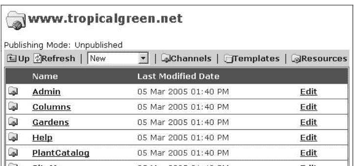
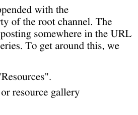
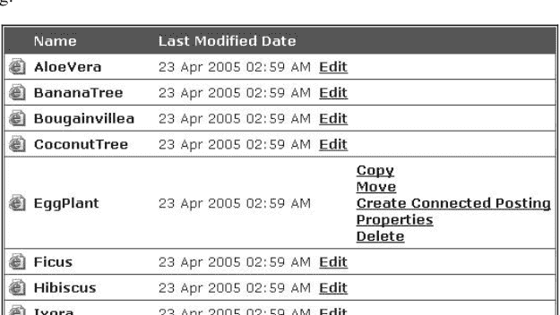
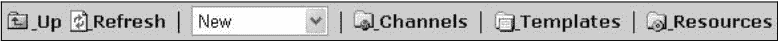
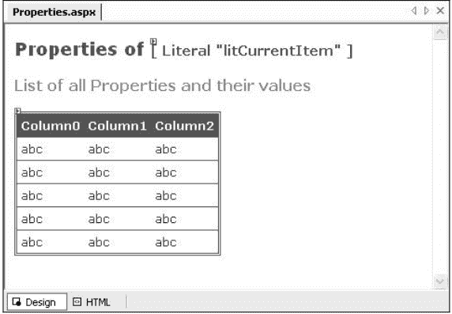
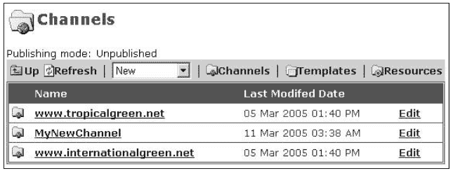
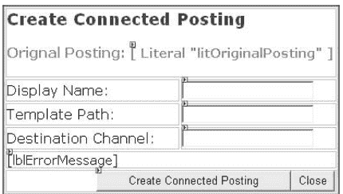
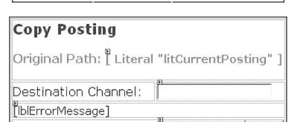
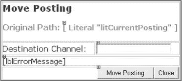

## Credits

**Authors**

Lim Mei Ying  
Stefan Goßner  
Angus Logan  
Andrew Connell

**Technical Reviewers**

Mick Badran  
Spencer Harbar  
David Mielcarek  
Chester Ragel  
Christopher Walker  
Joel Ward

**Editorial Manager**

Dipali Chittar

**Development Editor**

Douglas Paterson

**Technical Editor**

Richard Deeson

**Indexer**

Niranjan Jahagirdar

**Proofreader**

Chris Smith

**Production Coordinator**

Manjiri Nadkarni

**Cover Designer**

Helen Wood

## Chester Ragel

是一名计算机专业人士，获得莫拉图瓦大学计算机科学与工程学位。他持有 MCSD.NET 资格，喜欢使用 Microsoft 技术。

Chester 为 MCMS 社区和多家 IT 杂志做出贡献。他居住在斯里兰卡，可在 http://chestermr.blogspot.com 上找到他的博客。

## Christopher Walker

是 Microsoft Services 的高级顾问，为集成门户解决方案提供专业建议（SharePoint、MCMS、BizTalk 和 InfoPath）。Christopher 在 Unisys 担任门户开发和技术工作，并曾在门户软件 ISV 任职。

Christopher 通过其博客 http://blogs.msdn.com/cjwalker/ 为社区做出贡献，为使用 Microsoft 技术的客户提供实际解决方案。

Christopher 居住在澳大利亚布里斯班。

## Joel Ward

在 Booz Allen Hamilton 担任技术经理和开发人员。Joel 喜欢从事 ASP.NET、MCMS 和 SharePoint 项目，并帮助在 Booz Allen 创建了一个 .NET 用户组。他在设计、编程和架构方面有背景，自 2001 年 MCMS 首次发布以来就一直使用 MCMS。

作为 Microsoft 最有价值专家，Joel 因其在全球技术社区中的积极参与而受到同行和 Microsoft 的认可。Joel 居住在美国弗吉尼亚州。

- 使用 DataGrid 占位符控件 281
- 关闭离开警告提示 282
- 摘要 284

# 第 9 章：验证占位符控件

- ASP.NET 验证控件的局限性 285
- MCMSValidators 项目 286
- 验证 HtmlPlaceholderControl 287
- 获取 HtmlPlaceholderControl 的当前值 287
- 检查 HtmlPlaceholderControl 是否为空 289
- 使用正则表达式匹配标签 291
- 构建必需的 HTML 占位符验证器 292
- 重写 ControlPropertiesValid() 方法 293
- 重写 OnPreRender() 方法 293
- 重写 AddAttributesToRender() 方法 295
- 重写 EvaluateIsValid() 方法 297
- 将自定义验证器添加到模板文件 297
- 防止包含无效内容的页面被保存 298
- 保存新页面并进行验证 299
- 保存并退出时进行验证 299
- 保存时进行验证 300
- 将修改后的按钮添加到作者控制台 301
- 实现服务器端验证 302
- 带验证的 HtmlPlaceholderControl 303
- 带服务器端验证的 RequiredHTMLPHValidator 305
- 检查输入文本的长度 306
- 取消保存操作 308
- 验证 SingleImagePlaceholderControl 309
- 获取 SingleImagePlaceholderControl 的值 309
- 检查 SingleImagePlaceholderControl 是否为空 310
- RequiredImagePHValidator 310
- 验证 SingleAttachmentPlaceholderControl 312
- SingleAttachmentPlaceholderControl 的存储值 313
- 检查 SingleAttachmentPlaceholderControl 是否为空 313
- RequiredAttachmentPHValidator 314
- 摘要 316

# 第 10 章：静态页面分发

### 简述 Site Stager 318

- 安装 Site Stager 319
- 定义目标用户 319
- Site Stager 管理对话框 320
- 创建分发配置文件 321
- 运行作业 323
- 安排配置文件 324
- 删除配置文件 324

### ASP.NET Stager 应用程序 325

- DotNetSiteStager 项目 325
- 配置 Stager 设置 326
- 将消息记录到日志文件 329
- 以 'Stage As' 用户身份登录 330
- 显示隐藏的发布项 331

### 分发频道和发布项 331

- 获取起始频道 331
- 遍历频道树 332
- 发出 HTTP 请求 333
- 获取响应并创建文件 334

### 分发附件 336

# 第 11 章：使用 MCMS Web Services 的 InfoPath

### 项目概述 347

### 什么是 ASP.NET Web Services？ 349

### 创建 MCMS Web Service 项目 349

### 创建业务层 350

- 维护自定义属性 351
- 创建轻量级模板类 354

## 引言

继 *Building Websites with Microsoft Content Management Server*（Packt Publishing，2005 年 1 月，ISBN 1-904811-16-7）之后，本书将 MCMS 开发提升到更高水平，无论是功能还是集成度。像其前作一样，本书包含大量代码示例和从未公开过的 MCMS 秘诀。

Microsoft Content Management Server 2002 是一个动态 Web 发布系统，可帮助您快速且经济地构建网站。MCMS 提供管理、创作和数据管理功能，而您提供网站界面、逻辑和工作流。本书中还介绍了 Microsoft SharePoint Portal Server（SPS）。SPS 2003 使企业能够部署智能门户，无缝连接用户、团队和知识，以便人们能够利用跨业务流程的相关信息，从而更高效地工作。

您已经掌握了 MCMS 的基础知识，并搭建了自己的 MCMS 安装环境。但您只触及了表面。本书是您充分利用 MCMS 和 SPS 投资的门户，也是让这两个应用程序协同工作以提供卓越内容交付和易于维护性的途径。

### 本书涵盖内容

*第 1 章* 通过构建 **CMS Explorer** 管理工具来管理 MCMS 网站，展示了 MCMS 发布 API（PAPI）的强大功能。*第 2 章* 在 CMS Explorer 的基础上增加了管理频道和发布项的能力。*第 3 章* 通过 PAPI 查看模板、模板库和资源的创建、提交、复制、移动和删除。

在 *第 4 章* 中，您将学习如何为搜索索引准备发布项。我们探讨了几种可以提高搜索结果准确性并优化搜索引擎的技巧。

SharePoint Portal 技术通过提供协作、文档库和搜索功能来补充 MCMS，从而增强 MCMS 强大的发布工作流。*第 5 章* 指导您使用 SharePoint Portal Server 为 MCMS 站点添加搜索功能，无论是通过 MCMS Connector for SharePoint Technologies 还是自行构建解决方案。

*第 6 章* 演示了如何使用 MCMS Connector for SharePoint 构建自己的组件，以在 MCMS 和 SharePoint 之间共享内容。*第 7 章* 展示了如何构建 Web Parts，将 MCMS 内容集成到 SharePoint 门户站点中。

*第 8 章* 讨论了五个自定义占位符控件，它们提供了默认控件中没有的、经常被请求的特性：日期时间选择器占位符控件、允许多个附件的占位符控件、图像轮播占位符控件、用于存储各种 HTML 标签的占位符控件，以及 DataGrid 占位符控件。

内容验证是许多 MCMS 实现中的关键需求。第 9 章探讨了如何将 ASP.NET 验证技术应用于每个开箱即用的占位符控件。

静态页面通常用于直接邮件、帮助文件，甚至用于归档目的。第 10 章讨论了可用于创建发布项静态快照的几种技术。

创作体验并不总是需要通过浏览器进行。第 11 章详细介绍了维护内容的一种对作者友好的方式。在本章中，我们利用 InfoPath 的强大功能，快速创建 GUI，允许作者直接从 Microsoft Word 提交内容，并借助 MCMS Web Services。

自 2002 年 MCMS 发布以来，许多技术已经发生了变化。使用 RSS 进行网站聚合已成为常态，为此，第 12 章指导您完成创建网站最近更改的动态 RSS Feed 的步骤。

最后，第 13 章提供了大量关于 MCMS 的内部技巧和窍门，以及常见 MCMS 问题的解决方案，包括如何将发布项恢复到以前版本、更改发布项的模板、构建回收站，以及使用站点部署 API 导出资源库项目等宝贵技巧。

### 阅读本书所需条件

本书面向具备扎实 C# 基础的 ASP.NET 开发人员。要使用本书，您需要能够访问以下资源：

- Visual Studio .NET Professional 或更高版本（2002 或 2003 版本）。
- Microsoft Content Management Server 2002 Developer 或 Enterprise 版。您也可以使用 Standard 版，但请注意某些功能将不可用。Enterprise 版的 120 天评估版可在 http://www.microsoft.com/cmserver 获取。

要安装和运行 Microsoft Content Management Server 2002，您需要以下条件：

- .NET Framework 1.0 或 1.1。
- 以下操作系统之一：Windows Server 2003、Windows 2000 Professional、Windows 2000 Server 或 Windows XP Professional。
- SQL Server 2000 Developer 或 Enterprise 版的安装。

部分章节使用了 Microsoft SharePoint Portal Server 2003。对于这些章节，您需要：

- .NET Framework 1.1。
- Windows Server 2003。
- SQL Server 2000 Developer 或 Enterprise 版的安装。
- SharePoint Portal Server 2003 的安装。120 天评估版可在 http://www.microsoft.com/sharepoint 获取。


## 约定

在本书中，你会看到多种文本样式，用来区分不同类型的信息。本节提供了这些样式的示例，并解释了它们的含义。

代码有三种样式。文中出现的代码词显示如下："将任何对象的路径作为 Searches.GetByPath() 方法的输入参数传递，以检索请求的该对象"。

如果我们有一个代码块，它将如下设置：

```
HierarchyItem hlItem = cmsContext.Searches.GetByPath(
"/Channels/TropicalGreen/MysteryObject");

if (hlItem is Channel)
{
    // Object is a Channel
}
else if (hlItem is Posting)
{
    // Object is a Posting
}
```

当我们希望引起你对代码块中某一特定部分的注意时，相关行将被加粗：

```
private CmsHttpContext cmsContext;
private void Page_Load(object sender, System.EventArgs e)
{
    // Put user code to initialize the page here
    cmsContext = CmsHttpContext.Current;
    if (!Page.IsPostBack)
    {
        GetPlantFactSheets();
    }
}
```

**新术语**和**重要词语**以粗体字体引入。你在屏幕上看到的词语、在菜单中、在对话框中等等，在我们的文本中显示如下："点击 Next 按钮会带你到下一屏幕"。

一般提示、建议或重要说明会出现在如下的框中。

故障排除提示和建议以以下格式出现：

### 我想要安装的组件选项是灰色的，我无法选择它。

这是因为你没有该组件所需的前置条件。例如，如果你没有安装 Microsoft Visual Studio，你将无法安装 Developer Tools。要了解缺少什么，请点击该组件并阅读对话框右侧的说明。

## 构建 CMS Explorer

《使用 Microsoft Content Management Server 构建网站》一书（Packt Publishing，2005 年 1 月，ISBN 1-904811-16-7）大量使用了 MCMS 的 Publishing Application Programming Interface（PAPI）。我们展示了如何使用它在模板文件中提供自定义功能、向工作流事件添加业务流程、定制 Web Author Console，以及为读者在阅读本书过程中构建的 Tropical Green 网站实现表单身份验证。

PAPI 实际上是一个庞大的库。你可以用它编程数月，仍会发现从未知道的新技巧！这是三章中的第一章，旨在补充你从本书中获得的理解，并尝试将你对 PAPI 的理解提升到另一个层次。跟随我们演示几种非常有用的技术，并展示它们如何在真实场景中发挥作用，我们将把它们应用于 Tropical Green 网站。

> **我在哪里可以下载 Tropical Green 网站的副本？**
> 
> 在此书下载页面上提供了在先前书籍过程中创建的 Tropical Green 网站的代码文件作为下载包。前往 Packt 网站 `http://www.packtpub.com/support/`，并在下拉菜单中选择 Advanced Microsoft Content Management Server Development。

### 一个中央管理工具：CMS Explorer

我们在创建示例时进行了深入思考，这个示例不仅能让你全面掌握 PAPI 中更高级的方法，而且还能为你留下你在日常 MCMS 工作中会觉得方便的工具。从我们在软件行业的时间关键世界中作为 MCMS 开发人员的自身经验来看，我们发现一个定制的 MCMS 管理工具非常宝贵。在本书的前三章中，我们将带你逐步构建这样的工具，我们将它命名为 CMS Explorer。

CMS Explorer 完成后将如下所示：



界面由两个部分组成：

- 在页面顶部（以防你没猜到，我们将把工具作为 Web 应用程序创建），你会看到一个工具栏。工具栏提供一个下拉列表，可创建新的 postings 和 channels。它还有三个按钮：一个用于切换到 channels 和 postings 列表，一个用于列出 template galleries 和 templates，第三个用于 resource galleries 和 resources。
- 页面的后半部分是一个 DataGrid。网格列出了当前容器中的项目。每行都有一个 Edit 按钮，点击时会显示每个对象的操作列表。

对于导航，你可以向两个方向移动：点击容器的名称查看其内容，或使用工具栏上的 Up 按钮向上移动一级。

为什么要构建工具，而开箱即用的解决方案提供了不止一个、而是三个管理 MCMS 对象的工具？Site Manager 和 Web Author 以及 Visual Studio .NET 中的 Template Explorer 已经可用。构建 CMS Explorer 工具值得做的原因有几个：

- 首先当然是，你将亲身体验使用 PAPI 中许多更高级的方法。构建此工具后，你不仅会非常熟悉 PAPI，而且也将迈向成为其专家的道路！
- 尽管 PAPI 包含大量类，但它并不涵盖所有内容。虽然希望 CMS Explorer 能做到与 MCMS 随附的工具一样多，但它不能超出 PAPI 中可用的范围。接下来几章的次要目标之一是突出 PAPI 的局限性。

### 如何切换到 Update 模式？

要切换到 Update 模式，只需改用 ChannelItem.QueryStringModeUpdate 属性，如下所示：

```
if (CmsContext.Mode != PublishingMode.Update)
{
    Response.Redirect("default.aspx?"
        + CmsHttpContext.Current.RootChannel.QueryStringModeUpdate);
}
```

### 使用 CmsApplicationContext 切换模式

另一种流行的切换模式方法利用 CmsApplicationContext 对象。该对象通常用于在 IIS 外部运行的独立应用程序，例如控制台和桌面应用程序。在这些情况下，CmsHttpContext 无意义且无法使用。

你也可以在 Web 应用程序中使用 CmsApplicationContext 对象，当你需要额外的 CmsContext 对象时，尤其是在处理不同模式时。你可以在 Published 模式下维护 CmsHttpContext，并在 Update 模式下使用单独的 CmsApplicationContext。使用 CmsApplicationContext 的另一个优点是它减少了所需的客户端往返次数。

我们不会在 CMS Explorer 应用程序中使用 CmsApplicationContext。尽管如此，没有 CmsApplicationContext 类的介绍，关于模式切换的课程就不算完整。

> CmsApplicationContext 类在第 13 章 *Essential How-Tos, Tips, and Tricks* 中有详细介绍。

要使用 CmsApplicationContext 对象，首先创建它的一个新实例：

```
// Create a new CmsApplicationContext
CmsApplicationContext cmsContext = new CmsApplicationContext();
```

与 CmsHttpContext 不同，CmsApplicationContext 必须使用四种身份验证方法之一对 MCMS 服务器进行身份验证。每种身份验证方法都接受一个类型为 PublishingMode 的输入参数，指定你希望工作的模式。

- **AuthenticateAsCurrentUser**  
  使用当前登录用户的凭据进行身份验证。此方法在 Web 应用程序内部无法正确工作。它仅在应用程序在 IIS 外部运行时使用，例如从控制台应用程序运行，因为它使用进程令牌。对于 Web 应用程序，使用进程令牌意味着当前登录的用户是 machine.config 文件中配置的用户（在 IIS 5 中）或应用程序池账户（在 IIS 6 中），而不是在 CmsHttpContext 中经过身份验证的用户（它使用线程令牌）。
  
  要以当前用户身份进行身份验证：

```
// authenticate as the current user
cmsContext.AuthenticateAsCurrentUser(PublishingMode.Unpublished);
```


## 示例 Markdown

这是一个包含多行文本的**示例**段落。

- 项目 A
- 项目 B
- 项目 C

| 列 1 | 列 2 |
| --- | --- |
| 单元格 1 | 单元格 2 |
| 单元格 3 | 单元格 4 |



> > 这是一个块引用。
> > 引用的第二行。

```python
print('Hello')
```

```csharp
{
    url += cmsContext.RootChannel.QueryStringModeUpdate;
}
return url;
}
```

下次从 ChannelItem.Url 属性（或任何生成 URL 的属性）请求 URL 时，查询字符串将包含两个额外的参数：

```text
http://localhost/cmsexplorer/default.aspx?
CMSObject=Templates&

NRMODE=Unpublished&
FRAMELESS=true&
CMSObjectGuid=%7b4D1912B-9DD3-11D1-B44E-
006097071264%7d&NRNODEGUID=%7bE4D19123-9DD3-11D1-B44E-006097071264%7d
```

在我们继续阅读 CMS Explorer 代码时，稍后将使用 PrepareUrl() 来生成 URL。

## 指定父容器

在此示例中，我们计划使用 DataGrid 来显示所选容器中所有对象的列表。然而，在让 DataGrid 显示对象列表之前，我们需要指定一个父容器。父容器可以是频道（channel）、资源库（resource gallery）或模板库（template gallery）。我们需要这个容器来确定要在 DataGrid 中显示的对象。如果用户没有指定父容器，则使用根容器（即 Channels 频道、Templates 模板库和 Resources 资源库）。

在 Page_Load() 事件处理程序的上方及内部，添加以下代码：

```csharp
// the current CmsHttpContext
private CmsHttpContext cmsContext;

// the parent container whose contents we are displaying
private HierarchyItem startItem;
private void Page_Load(object sender, System.EventArgs e)
{
    cmsContext = CmsHttpContext.Current;

    // Get the URL of the current page
    string currentUrl = HttpContext.Current.Request.Url.ToString();

    // Redirect if not in unpublished mode
    if (cmsContext.Mode != PublishingMode.Unpublished
        && cmsContext.Mode != PublishingMode.Update)
    {
        string query;
        query = cmsContext.RootChannel.QueryStringModeUnpublished;
        Response.Redirect(currentUrl + "?" + query);
    }

    InitializeStartItem();

    if (!Page.IsPostBack)
    {
        // Display the publishing mode
        lblPublishingMode.Text = "Publishing Mode: "
            + cmsContext.Mode.ToString();

        // use the start channel's display name as the
        // header for the page
        litCurrentContainer.Text = startItem.Name;
    }

}

private void InitializeStartItem()
{
    // determine the object type
    string cmsObject = "";
    if (Request.QueryString["CMSObject"] != null)
    {
        cmsObject = Request.QueryString["CMSObject"].ToString();
    }

    // determine the GUID of the working container
    string cmsObjectGuid = "";
    if (Request.QueryString["CMSObjectGuid"] != null)
    {
        cmsObjectGuid = Request.QueryString["CMSObjectGuid"].ToString();
    }

    if (cmsObjectGuid == "")
    {
        // if not specified, we start with channels
        startItem = cmsContext.Channel;
    }
    else
    {
        startItem = cmsContext.Searches.GetByGuid(cmsObjectGuid);
    }

    // no working container has been specified. Use the root containers
    if (startItem == null)
    {
        switch(cmsObject)
        {
            case "Templates":
                // using the root template gallery
                startItem = cmsContext.RootTemplateGallery;
                break;
            case "Resources":
                // using the root resource gallery
                startItem = cmsContext.RootResourceGallery;
                break;
            default:
                // using the root channel
                startItem = cmsContext.RootChannel;
                break;
        }
    }
}
```

将 **InitializeStartItem()** 方法直接添加到 Page_Load() 事件处理程序的下方：

该代码首先确定您正在处理的对象类型：频道、模板库或资源库。它从 **CMSObject** 查询字符串参数中获取此信息。

对于频道，逻辑很简单。有关频道的信息可从 **CmsHttpContext.Channel** 属性获得。如果它不为 null，**DataGrid** 将使用它作为起始频道。否则，根容器被分配给 **startItem**。

对于模板库和资源库，无法从当前 **CmsHttpContext** 获取当前库项目。对于这些对象，PAPI 从我们之前插入的 **CMSObjectGuid** 查询字符串参数中获取工作容器的 GUID。

同时，我们需要提供频道显示名称周围超链接的 URL。对于频道，URL 指向 `default.aspx?QueryStringModeUnpublished`，而发布项不可点击，因此其周围 `<A>` 标签的 Href 属性将留空。

我们可以修改脚本，逐一遍历每个对象，并在将 DataTable 绑定到 DataGrid 之前将这些额外的列添加到 DataTable。然而，那将意味着修改我们的代码。好消息是，我们不必重写代码。我们可以实现 `DataGrid1_ItemDataBound` 事件处理程序，根据对象是频道还是发布项，为列填充自定义值。

首先，向 DataGrid 添加一个新的 TemplateColumn：

```aspx
<Columns>
  <asp:TemplateColumn>
    <ItemTemplate></ItemTemplate>
  </asp:TemplateColumn>
  <asp:TemplateColumn HeaderText="Name">
    <ItemTemplate>
      <a id="aName" runat="server">
        <%# DataBinder.Eval(Container.DataItem, "Name") %>
      </a>
    </ItemTemplate>
  </asp:TemplateColumn>
  <asp:BoundColumn DataField="LastModifiedDate" ReadOnly="True" HeaderText=
    "Last Modified Date" DataFormatString="{0:d MMM yyyy hh:mm}"/>
</Columns>
```

新的 TemplateColumn 将包含一个图像，指示绑定到此行的对象的类型。

接下来，我们实现 `DataGrid1_ItemDataBound()` 事件处理程序。注册该事件处理程序的一种快捷方式是选择 DataGrid1 属性窗口顶部的“事件”按钮（在“设计”视图中可用）。双击 ItemDataBound 字段，转到代码隐藏文件中的 DataGrid1_ItemDataBound 事件处理程序，并按下所示进行修改：

```csharp
private void DataGrid1_ItemDataBound(object sender,
    System.Web.UI.WebControls.DataGridItemEventArgs e)
{
    if (e.Item.ItemType==ListItemType.EditItem
        || e.Item.ItemType==ListItemType.Item
        || e.Item.ItemType==ListItemType.AlternatingItem)
    {
        string guid = DataGrid1.DataKeys[e.Item.ItemIndex].ToString();
        HierarchyItem hItem = cmsContext.Searches.GetByGuid(guid);

        if (hItem is Channel)
        {
            // if the object is a channel, show the channel icon
            // set the Name to be a hyperlink
            // that points to default.aspx?{QueryStringModeUnpublished}
            e.Item.Cells[0].Text="";
            HtmlAnchor aName;
            aName=e.Item.Cells[1].FindControl("aName") as HtmlAnchor;
            aName.HRef = "default.aspx?"
                + ((Channel)hItem).QueryStringModeUnpublished;
        }
        else if (hItem is Posting)
        {
            // if the object is a posting, show the posting icon
            // leave the Name as text
            e.Item.Cells[0].Text="";
        }
        else if (hItem is TemplateGallery)
        {
            // if the object is a template gallery, show the
            // template gallery icon
            // set the Name to be a hyperlink
            // that points to default.aspx?{QueryStringModeUnpublished}
            e.Item.Cells[0].Text="";
            HtmlAnchor aName;
            aName=e.Item.Cells[1].FindControl("aName") as HtmlAnchor;
            aName.HRef = PrepareUrl(hItem, PublishingMode.Unpublished,
                                    "default.aspx");
        }
        else if (hItem is Template)
        {
            // if the object is a template, show the template icon
            // leave the Name as text
            e.Item.Cells[0].Text="";
        }
        else if (hItem is ResourceGallery)
        {
            // if the object is a resource gallery, show the
            // resource gallery icon
            // set the Name to be a hyperlink
            // that points to default.aspx?{QueryStringModeUnpublished}

            e.Item.Cells[0].Text="";
            HtmlAnchor aName;
            aName=e.Item.Cells[1].FindControl("aName") as HtmlAnchor;
            aName.HRef = PrepareUrl(hItem, PublishingMode.Unpublished,
                                    "default.aspx");
        }
        else if (hItem is Resource)
        {
            // if the object is a resource, show the resource icon
            // leave the name as text
            e.Item.Cells[0].Text="";
        }
        // add actions specific to the object type
        if (e.Item.ItemType==ListItemType.EditItem)
        {
            // in the table generated by the datagrid,
            // the action column is the 4th cell
            TableCell actionCell = e.Item.Cells[4];
            AddActionItems(actionCell, hItem);
        }
    }
}
```

此方法确定正在绑定的 HierarchyItem 的类型，无论是频道、发布项、资源库、资源、模板库还是模板。然后，它将 DataGrid 每行中的图标设置为表示该对象类型的图像的 URL。如果对象是频道、模板库或资源库，则使用我们的 PrepareUrl() 方法链接对象名称，以重新加载页面并将其设置为 startItem。最后一部分调用 AddActionItems() 方法，我们将使用该方法为 DataGrid 中的每一行构建编辑操作菜单。让我们在下一节中看看这个方法。

## 构建编辑菜单

我们需要向每一行添加一个“编辑”按钮。单击该按钮时，会显示可对该对象执行的操作列表。下表显示了每种对象类型的操作列表。


| 对象类型 | 操作 |
|---|---|
| 通道、模板库、模板、资源库 | 属性<br>删除 |
| 发布 | 复制<br>移动<br>创建关联发布<br>属性<br>删除 |
| 模板 | 复制<br>移动<br>创建关联模板<br>属性<br>删除 |
| 资源 | 替换<br>属性<br>删除 |

完成后，DataGrid 的显示效果如下，并且我们点击了 Egg Plant 发布项的编辑按钮：



我们向 DataGrid 添加了两列新列，一列用于显示编辑按钮，另一列用于包含可能的动作列表。

```xml
<Columns>
<asp:TemplateColumn>
<ItemTemplate></ItemTemplate>
</asp:TemplateColumn>
<asp:TemplateColumn HeaderText="DisplayName">
<ItemTemplate>
<a id="aName" runat="server">
<%= DataBinder.Eval(Container.DataItem, "DisplayName") %>
</a>
</ItemTemplate>
</asp:TemplateColumn>
<asp:BoundColumn DataField="LastModifiedDate" ReadOnly="True"
HeaderText="Last Modified Date"
DataFormatString="{0:dd MMM yyyy hh:mm tt}"></asp:BoundColumn>

<asp:EditCommandColumn ButtonType="LinkButton" EditText="Edit">
<asp:EditCommandColumn>
<asp:TemplateColumn></asp:TemplateColumn>
</Columns>
```

点击编辑按钮时，我们将 DataGrid1 的 EditItemIndex 设置为所选行的索引。在 DataGrid1 的事件属性窗口中，双击 EditCommand 以注册事件处理程序并添加以下代码：

```csharp
private void DataGrid1_EditCommand(object source,
System.Web.UI.WebControls.DataGridCommandEventArgs e)
{
    DataGrid1.EditItemIndex = e.Item.ItemIndex;
    BindData();
}
```

同时，我们希望显示可在所选对象上执行的操作列表。这由 AddActionItems() 方法完成。该方法为上表中定义的每个操作项创建超链接。AddActionItems() 方法接受两个输入参数：

- 一个名为 actionCell 的 TableCell。这是要添加操作按钮的单元格。
- 一个名为 hlItem 的 HierarchyItem。这是我们为其创建操作按钮的项目。

确定传递给 AddActionItems() 方法的对象类型后，我们为当前对象添加类型特定的操作按钮。例如，如果传递了一个发布项，则会添加复制和移动按钮。

除了类型特定的选项外，还会向菜单中添加一个适用于所有对象的属性按钮。最后，我们将检查用户是否有权限删除当前对象，如果有，则添加删除按钮。

请注意，我们使用 PrepareUrl() 方法生成的 URL 将其分配给每个操作按钮的 NavigateUrl 属性。在 DataGrid1_EditCommand() 事件处理程序下方添加 AddActionItems() 方法：

```csharp
private void AddActionItems(TableCell actionCell, HierarchyItem hlItem)
{
    if (hlItem is Posting)
    {
        Posting currentPosting = hlItem as Posting;
        // actions for postings include:
        // Copy, Move, Create Connected Posting.

        // the copy option
        HyperLink hCopy = new HyperLink();
        hCopy.Text = "Copy<br>";
        hCopy.Target = "_blank";
        hCopy.NavigateUrl = PrepareUrl(hlItem, PublishingMode.Update,
            "CopyPosting.aspx");
        actionCell.Controls.Add(hCopy);

        // the move option
        if (currentPosting.CanMove)
        {
        }

        // add shared options include:
        // Properties and Delete.

        // the properties option
        HyperLink hProperties = new HyperLink();
        hProperties.Text = "Properties<br>";
        hProperties.Target = "_blank";
        hProperties.NavigateUrl = PrepareUrl(hItem, PublishingMode.Update,
                                    "Properties.aspx");

        actionCell.Controls.Add(hProperties);

        // the delete option
        if (hItem.CanDelete)
        {
            HyperLink hDelete = new HyperLink();
            hDelete.Text = "Delete<br>";
            hDelete.Target = "_blank";
            hDelete.NavigateUrl = PrepareUrl(hItem, PublishingMode.Update,
                                     "Delete.aspx");

            actionCell.Controls.Add(hDelete);
        }
    }
}
```

> 如果在测试上述代码时收到 JavaScript 错误消息，您可能需要将打开的表单标签中的 ID 更改为其他名称，例如 "CMSExplorerDefault"，因为浏览器可能不喜欢 Visual Studio .NET 分配给表单的 ID "default"。

保存并构建解决方案，然后导航到 **http://localhost/CmsExplorer**。此时，您可以通过点击频道名称浏览频道，并查看我们的操作菜单。

接下来我们需要的是一个工具栏，用于从当前选择的父容器中向上移动一级层级、刷新页面，以及选择除频道之外的其他根路径，例如模板或资源。

## 构建工具栏

网格顶部的灰色条是工具栏。它将由六个控件组成：

- 将用户带回频道层级上一级的向上按钮
- 更新显示的刷新按钮
- 包含创建新频道、发布、模板、模板库或资源的选项的 DropDownList
- 用于浏览可用频道和发布的 Channels 按钮
- 用于浏览可用模板库和模板的 Templates 按钮
- 用于浏览可用资源库和资源的 Resources 按钮



| StartItem 类型 | 添加的选项 |
|---|---|
| Channel | 新频道<br>新发布 |
| TemplateGallery | 新模板库<br>新模板 |
| ResourceGallery | 新资源 |

例如，如果 startItem 是频道并且用户有权在父频道中创建频道和发布，则会添加“新频道”和“新发布”选项。

在 ddlNewItem_SelectedIndexChanged() 下方添加以下 PrepareToolbar() 方法，该方法会在下拉列表中插入选项：

```csharp
private void PrepareToolbar()
{
    // remove any pre-existing options from the DropDownList
    ddlNewItem.Items.Clear();
    ddlNewItem.Items.Add(new ListItem("New",""));

    ListItem li = null;

    if (startItem is Channel)
    {
        Channel currentChannel = startItem as Channel;

        // if the user has rights to create channels, add option to create
        // a new channel
        if (currentChannel.CanCreateChannels)
        {
            li = new ListItem("New Channel","NewChannel");
            ddlNewItem.Items.Add(li);
        }

        // if the user has rights to create postings, add option to create
        // a new posting
        if (currentChannel.CanCreatePostings)
        {
            li = new ListItem("New Posting","NewPosting");
            ddlNewItem.Items.Add(li);
        }

        imgTitle.ImageUrl = "images/channelopen_big.gif";
    }
    else if (startItem is TemplateGallery)
    {
        TemplateGallery templateGallery = startItem as TemplateGallery;

        // if the user has rights to create template galleries, add option
        // to create a new template gallery
        if (templateGallery.CanCreateTemplateGalleries)
        {
            li = new ListItem("New Template Gallery",
                "NewTemplateGallery");
            ddlNewItem.Items.Add(li);
        }

        // if the user has rights to create templates, add option to create
        // a new template
        if (templateGallery.CanCreateTemplates)
```

```csharp
MyObject.GetType().GetMethods();
```

要获取其属性列表，可以调用：

```csharp
MyObject.GetType().GetProperties();
```

正如您所见，反射是一个强大的功能。在此示例中，而不是编写 40 多行代码来列出 ChannelItem 对象的属性，我们将简单地使用反射遍历每个属性并显示其值。

让我们在 DataGrid 中显示属性列表。首先，向 CMSExplorer 项目添加一个新的 Web 表单。将新 Web 表单命名为 Properties.aspx。切换到 HTML 视图并向表单添加几个标题以描述其功能：

```html
<form>
<h1>Properties of <asp:Literal Runat="server" ID="litCurrentItem"/></h1>
<h2>List of all Properties and their values</h2>
</form>
```

在 Web 表单的代码隐藏文件中，导入 Microsoft.ContentManagement.Publishing 和 System.Reflection 命名空间，并在 Page_Load() 事件处理程序中添加以下代码：

```csharp
. . . code continues . . .
// MCMS PAPI
using Microsoft.ContentManagement.Publishing;

// for reflection
using System.Reflection;

namespace CMSExplorer
{
    /// <summary>
    /// Summary description for Properties.
    /// </summary>
    public class Properties : System.Web.UI.Page
    {
        HierarchyItem hlItem; // the current item

        private void Page_Load(object sender, System.EventArgs e)
        {
            CmsHttpContext cmsContext = CmsHttpContext.Current;
            hlItem = null;

            string cmsObjectGuid = "";
            if (Request.QueryString["CMSObjectGuid"]!=null)
            {
                // template gallery items and resource gallery items
                cmsObjectGuid = Request.QueryString["CMSObjectGuid"];
                hlItem = cmsContext.Searches.GetByGuid(cmsObjectGuid);
            }
            else
            {
                // channels and postings
                hlItem = cmsContext.ChannelItem;
            }

            // list all properties and their values in the grid
            if (hlItem!=null)
            {
                litCurrentItem.Text = hlItem.Path;
                ListProperties();
            }
        }
    }
```


    - - - code continues - - -
}
}

该代码获取对你要查看其属性的 `HierarchyItem` 的引用。对于模板库、模板、资源库和资源，这是通过从 `CMSObjectGuid` 查询字符串参数获取 GUID，并使用 `Searches.GetByGuid()` 方法获得的。频道和发布则从 `CmsHttpContext.Current.ChannelItem` 属性获取。

在设计视图中，将 `Styles.css` 文件和 `DataGrid` 拖放到 `Properties.aspx` Web 窗体上，并为 `DataGrid` 设置以下属性值：

| 属性 | 值 |
|---|---|
| Auto Format | Simple 3 |
| Font-Size | 10pt |
| ID | DataGrid1 |



在 `Page_Load()` 事件处理程序下方，添加 `ListProperties()` 方法。该方法首先创建一个包含以下列的 `DataTable`：

+   - 属性名称
+   - 属性值
+   - 该属性是否可以写入

我们使用 `GetType.GetProperties()` 方法检索与层次结构项关联的所有属性的集合。接下来，遍历当前 `ChannelItem` 的每个属性，并将每个属性作为一行添加到 `DataTable` 中。请注意，属性值是通过调用 `PropertyInfo.GetValue()` 并将层次结构项作为输入参数传递来获取的。最后，我们将 `DataTable` 绑定到 `DataGrid`。

在 `Page_Load()` 事件处理程序中，添加代码以读取当前层次结构项的 Description（描述）并将其显示在屏幕上。

```
private void Page_Load(object sender, System.EventArgs e)
{
    // Put user code to initialize the page here
    CmsHttpContext cmsContext = CmsHttpContext.Current;
    hlItem = null;

    string cmsObjectGuid = "";
    if (Request.QueryString["CMSObjectGuid"] != null)
    {
        // template gallery items and resource gallery items
        cmsObjectGuid = Request.QueryString["CMSObjectGuid"];
        hlItem = cmsContext.Searches.GetByGuid(cmsObjectGuid);
    }
    else
    {
        // channels and postings
        hlItem = cmsContext.ChannelItem;
    }

    // list all properties and their values in the grid
    if (hlItem != null)
    {
        litCurrentItem.Text = hlItem.Path;
        if (!Page.IsPostBack)
        {
            txtDescription.Text = hlItem.Description;
        }
        ListProperties();
    }
}
```

切换到设计模式并双击 `btnUpdate` 按钮。在 `btnUpdate_OnClick()` 事件处理程序中，我们将编写代码，根据在文本框中输入的文本更新 `HierarchyItem` 的 `Description` 属性值。

```
private void btnUpdate_Click(object sender, System.EventArgs e)
{
    try
    {
        // IMPORTANT: You must be in update mode for the code to work

        // update the description
        hlItem.Description = txtDescription.Text;

        // commit the change
        CmsHttpContext.Current.CommitAll();

        // refresh the page to ensure that the change shows up in the
        // datagrid
        Response.Redirect(HttpContext.Current.Request.Url.ToString());
    }
    catch(Exception ex)
    {
        CmsHttpContext.Current.RollbackAll();

        // after a rollback the CMS context needs to be disposed.
        CmsHttpContext.Current.Dispose();

        lblErrorMessage.Text = ex.Message;
    }
}
```

请注意，在调用 `CommitAll()` 之前，频道不会被永久创建。

> > 尽管我们只设置了新频道的选定属性，但您可以轻松扩展界面，以包含频道对象的所有可写属性。

完成后，保存并生成项目。

## 验证名称

MCMS 在命名对象时应用以下规则：

+   - 名称只能包含以下字符：
+     - A-Z a-z 0-9（仅字母数字）
+     - _（下划线）
+     - -（连字符）
+     - （空格）
+     - ()（左括号和右括号）
+     - .（句点）
+   - 名称不能以句点结尾。
+   - 名称不能包含两个连续的句点。

为了确保赋予频道、发布、模板库、模板和资源的所有名称都有效，我们将定义一个名为 `ValidateMCMSObjectName()` 的自定义方法。该方法接受对象的名称作为输入参数，并返回一个布尔值。返回值为 `true` 表示用户提供的名称满足 MCMS 的所有要求并且有效。

由于我们将向 CMS Explorer 添加用于创建各种 MCMS 对象的对话框，因此我们将把 `ValidateMCMSObjectName()` 方法添加到类文件 `Utility.cs` 中。这样，我们就可以在项目中的所有 Web 窗体之间重用该方法。

+   1. 向项目添加一个类文件。将文件命名为 `Utility.cs`。
+   2. 在命名空间声明上方，添加 `System.Text.RegularExpressions`。

```
using System;
using System.Text.RegularExpressions;
namespace CMSExplorer
{
    - - - code continues - - -
}
```

+   3. 在 `Utility()` 构造函数正下方，添加 `ValidateMCMSObjectName()` 方法：

```
public static bool ValidateMCMSObjectName(string name)
{
    bool isValid;

    // test for other characters as the ones in the list
    Regex regEx1 = new Regex(@"[^A-Z0-9 _\-()\.]",
                             RegexOptions.IgnoreCase);
```

```
// test for "." at the end
Regex regEx2 = new Regex(@"[\\.]$", RegexOptions.None);

// test for double "."
Regex regEx3 = new Regex(@"\\.{2}", RegexOptions.None);

Match match1 = regEx1.Match(name);
Match match2 = regEx2.Match(name);
Match match3 = regEx3.Match(name);

// valid = no invalid chars, no double dot, and no dot at the end
isValid = !match1.Success && !match2.Success && !match3.Success;

return isValid;
}
```

`ValidateMCMSObjectName()` 方法使用三个正则表达式来检查名称的有效性。

第一个正则表达式如下所示：

```text
[^A-Z0-9 _\\ (.-]
```

该模式用于查找名称中所有不属于字母数字、空格、下划线、左括号和右括号、句点和连字符的字符（请注意，反斜杠字符用作转义字符），从而满足有效名称的第一个条件。

第二个正则表达式测试名称是否以句点结尾：

```text
[\\.]$
```

同样，反斜杠用作转义字符。方括号之间的句点表示我们要查找句点。美元符号指示该模式匹配字符串的末尾。

第三个也是最后一个正则表达式测试字符串中是否有两个连续的句点：

```text
\\.{2}
```

和之前一样，反斜杠用作转义字符。大括号中的数字 2 表示我们要查找连续出现两次的句点。

最后，我们运行所有三个正则表达式。只要没有无效字符，名称末尾没有句点，也没有连续的句点，该名称就被视为有效。

要在对话框中使用 `ValidateMCMSObjectName()` 方法，我们只需在代码中调用它。以下是 Create Channel 对话框的实现方法。将以下代码添加到 `btnCreate_Click()` 事件处理程序中：

```csharp
private void btnCreate_Click(object sender, System.EventArgs e)
{
    - - - code continues - - -

    try
    {
        - - - code continues - - -

        // get the name of the channel
        string Name = txtName.Text.Trim();

        // check to see if the name is valid
        if (!Utility.ValidateMCMSObjectName(Name))
```

```
{
    throw new Exception("Specified channel name is not "
        + "valid. Must be only alphanumeric "
        + "characters, open or close parens, "
        + "hyphens, underscores, periods, or "
        + "spaces. No period at the end and no "
        + "consecutive periods are allowed.");
}

// create the new channel
Channel newChannel;
newChannel = parentChannel.CreateChannel();
}
    - - - code continues - - -
catch(Exception ex)
{
    - - - code continues - - -
}
```

如果 `ValidateMCMSObjectName()` 检测到名称无效，我们将抛出一个异常。保存并生成项目。

## 测试 Create Channel 对话框

让我们试用一下 Create Channel 对话框：

+   1. 导航到 http://localhost/CmsExplorer。
+   2. 从 DropDownList 中选择 New | New Channel。这将打开一个包含 Create Channel 对话框的新浏览器窗口。
+   3. 在 Create Channel 对话框中，输入以下值：
+   4. 单击 Create Channel，然后单击 Close。
+   5. 单击主窗口中的 Refresh。

| 属性 | 值 |
|---|---|
| Name | MyNewChannel |
| DisplayName | My New Channel |
| Description | 此频道是使用 PAPI 创建的！ |

如果一切顺利，新频道将被创建并显示在 CMS Explorer 中，如下所示：




> 你也可以通过在 Web Author 控制台中附加此对话框的方式提供“创建频道”选项，使用我们在《使用 Microsoft Content Management Server 构建网站》（Packt Publishing，2005 年 1 月，ISBN 1-904811-16-7）一书的第 19 章《自定义 Web Author 控制台》中讨论的技术。

## 创建帖子

与频道一样，帖子也可以使用 PAPI 以编程方式创建。为了演示如何实现，我们将在 CMS Explorer 中创建一个用于创建帖子的对话框：

- 1. 在 CMSEXplorer 解决方案中添加一个新的 Web 表单，并将其命名为 CreatePosting.aspx。
- 2. 在设计视图中，从解决方案资源管理器将 Styles.css 文件拖放到表单上。这会将样式表应用到页面。
- 3. 切换到 HTML 视图并插入以下用于创建包含六行的表格的代码：

```
<table>
<tr>
<td colspan="2">
<h1>Create Posting</h1>
<h2>Parent Channel: (Add Literal for displaying the path here)</h2>
</td>
</tr>
<tr>
<td>Name:</td>
<td>(Add the text box for the Name here)</td>
</tr>
<tr>
<td>Description:</td>
<td>(Add the text box for the Description here)</td>
</tr>
<tr>
<td>Template Path:</td>
<td>(Add the text box for the Template Path here)</td>
</tr>
<tr>
<td colspan="2">(Add the Label for displaying error messages here)</td>
</tr>
<tr>
<td colspan="2" align="right">
(Add the Create Posting button here)
<INPUT type="button" value="Close" onclick="javascript:window.close();">
</td>
</tr>
</table>
```

- 4. 在设计视图中，添加控件（来自工具箱的 Web Forms 部分）到 Web 表单并按以下图所示进行排列。请注意，我们通过使用文本框来指定模板路径从而简化了界面。你可以将其增强为模板选择器，为用户提供友好的界面以从他们有权访问的模板列表中选择模板，类似于 Web Author 中使用的模板选择对话框。

## 使用 PAPI 管理频道和帖子

- 7. 切换回设计视图并双击 btnCreate 按钮以进入 btnCreate_OnClick() 事件处理程序。输入以下所示的代码：

```
private void btnCreate_Click(object sender, System.EventArgs e)
{
    // IMPORTANT: You must be in update mode for the code to work
    CmsHttpContext cmsContext = CmsHttpContext.Current;
    Channel parentChannel = cmsContext.Channel;

    try
    {
        // get the template the new posting would be based on
        Template template;
        template = cmsContext.Searches.GetByPath(txtTemplate.Text)
            as Template;
        if (template != null)
        {
            // check if we can create a posting
            if (!parentChannel.CanCreatePostings)
            {
                throw new Exception("Current user does not have "
                    + "permissions to create postings in channel: "
                    + "parentChannel.Path);
            }

            // get the name of the posting
            string Name = txtName.Text.Trim();

            if (!Utility.ValidateCMSObjectName(Name))
            {
                throw new Exception("Specified posting name is not "
                    + "valid. May contain only alphanumeric "
                    + "characters, open or close parens, "
                    + "hyphens, underscores, periods, or "
                    + "spaces. No period at the end and no "
                    + "consecutive periods are allowed. ");
            }

            // create the new posting
            Posting newPosting;
            newPosting = parentChannel.CreatePosting(template);

            // set the properties of the new posting
            newPosting.Name = txtName.Text;
            newPosting.Description = txtDescription.Text;

            // commit the changes
            cmsContext.CommitAll();

            // display the success message
            lblErrorMessage.Text = "Posting created successfully!";
        }
        else
        {
            // could not access the specified template
            lblErrorMessage.Text = "Invalid Template path or you "
                + "don't have the appropriate permissions to "
                + "use the specified Template";
        }
    }
    catch(Exception ex)
    {
        // rollback the changes
        cmsContext.RollbackAll();

        // after a rollback it is required to dispose of the CMS context
        cmsContext.Dispose();
    }
}
```

```
// display the error message
lblErrorMessage.Text = ex.Message;
}
```

此代码首先访问父频道，即新帖子将在其中创建的频道。接下来，基于输入的模板路径，我们使用 Searches.GetByPath() 方法获取新帖子应基于的模板对象的实例。如果可以访问模板对象，我们将其作为输入参数传递给 Channel.CreatePosting() 方法，该方法创建新的帖子。

创建帖子后，我们设置其属性值。在此示例中，我们将 Name 和 Description 属性设置为文本框中输入的值。你可能希望增强此对话框以包含用于设置帖子的所有可写属性和占位符的输入控件。

直到调用 cmsContext.CommitAll() 时，新帖子才会被保存到存储库。如果发生错误，消息将显示在 lblErrorMessage 标签中。

保存并构建解决方案。要查看其运行效果：

- 1. 打开 http://localhost/CMSEXplorer。
- 2. 点击 MyNewChannel 查看其内容。频道目前为空，因为我们尚未在其中创建任何帖子或频道。
- 3. 从工具栏中选择 New | New Posting。这将打开一个包含创建帖子对话框的新浏览器窗口。
- 4. 在创建帖子对话框中输入：

| 属性 | 值 |
|---|---|
| Name | My New Posting |
| Description | This posting was created using the PAPI! |
| Template Path | /Templates/TropicalGreen/PlantCatalog/Plant |

- 5. 点击 Create Posting，然后点击 Close。
- 6. 在主窗口中点击 Refresh。新的帖子已在频道中创建！

## 我收到以下异常：“Unable to retrieve PostingEvents. The module Microsoft.ContentManagement.Publishing.Events.PostingEventsModule must be included in the section of the web.config and must be assigned the name 'CmsPosting'.”。我该怎么办？

很可能你在第 1 章中没有创建 MCMS Web 应用程序项目，而是创建了一个常规的 ASP.NET Web 应用程序。当你创建 MCMS Web 应用程序时，它会向应用程序的 web.config 中添加 HttpModules。

要将 ASP.NET Web 应用程序转换为 MCMS Web 应用程序，请在 Visual Studio .NET 的项目菜单中选择 Enable as MCMS project。

> 如果你已安装在《使用 Microsoft Content Management Server 构建网站》一书中创建的 Tropical Green 项目（第 1 章《构建 CMS Explorer》中提到），请注意，由于 CMS Explorer 与 Tropical Green 处于不同的应用程序范围，因此添加到 Tropical Green 项目的 `global.asxc.cs` 文件中的工作流事件处理程序将不会被触发。

## 连接的帖子

连接的页面是两个不同的帖子对象的副本，它们共享相同的占位符值。由于连接的帖子共享占位符定义和值，因此对一个帖子的属性所做的任何更改都将反映在其所有连接的帖子中。

让我们创建一个创建连接帖子的对话框：

- 1. 在 CMSExplorer 项目中添加一个名为 `CreateConnectedPosting.aspx` 的 Web 表单。
- 2. 将 `Styles.css` 拖放到 Web 表单上。
- 3. 切换到 HTML 视图并在 `<form>` 标签之间添加以下由六行组成的表格。
- 4. 切回设计视图。从工具箱的 Web Forms 部分拖放以下控件。

```
```html
<table>
<tr>
    <td colspan="2">
        <h1>Create Connected Posting</h1>
        <h2>Original Posting: (Add Literal for displaying the path here)</h2>
    </td>
</tr>
<tr>
    <td>Display Name:</td>
    <td>(Add the text box for the Name here)</td>
</tr>
<tr>
    <td>Template Path:</td>
    <td>(Add the text box for the Template File here)</td>
</tr>
<tr>
    <td>Destination Channel:</td>
    <td>(Add the text box for the Destination Channel here)</td>
</tr>
<tr>
    <td colspan="2">(Add the Label for displaying error messages here)</td>
</tr>
<tr>
    <td colspan="2" align="right">
        (Add the Connected Posting button here)
        <INPUT type="button" value="Close"
               onClick="javascript:window.close();">
    </td>
</tr>
</table>
```
```


| Control | Property | Property Value |
|---|---|---|
| Literal | ID | litOriginalPosting |
| TextBox | ID | txtDisplayName |
| TextBox | ID | txtTemplate |
| TextBox | ID | txtDestination |
| Button | ID | btnCreate |
|  | Text | Create Connected Posting |
| Label | ID | lblErrorMessage |
|  | Text | (empty string) |



- 5. 在设计视图中，双击表单以打开代码隐藏文件。添加命名空间 Microsoft.ContentManagement.Publishing：

```
// ... code continues ...
// MCMS API
using Microsoft.ContentManagement.Publishing;

namespace CmsExplorer
{
... code continues ...
}
```

- 6. 在 Page_Load() 事件处理程序中，我们获取将作为连接发布的基础的发布实例（或原始发布），并在 litOriginalPosting 文本中显示其路径。我们将首先从 CmsObjectGuid 查询字符串参数中检索发布的 GUID，然后使用 Searches.GetByGuid() 方法获取其实例。

```
private void Page_Load(object sender, System.EventArgs e)
{
    // Display the path of the original posting
    Posting posting = CmsHttpContext.Current.Searches.GetByGuid(
        Request.QueryString["CMSObjectGuid"]) as Posting;
    if (posting != null)
        litOriginalPosting.Text = posting.Path;
    else
        lblErrorMessage.Text = "Requested posting does not exist.";
}
```

## 使用 PAPI 管理频道和发布

连接发布的创建方式与创建新发布非常相似。要创建连接发布，请调用 `Channel.CreateConnectedPosting()` 方法。该方法接受两个参数：

- - 发布应基于的模板（模板需要与原始发布的模板相同，或为原始模板的连接模板）。
- - 原始发布。

7. 切回设计视图。双击 btnCreate 按钮以进入 btnCreate_Click() 事件处理程序。添加如下所示的代码：

```
private void btnCreate_Click(object sender, System.EventArgs e)
{
    CmsHttpContext cmsContext = CmsHttpContext.Current;
    Posting originalPosting;
    originalPosting = cmsContext.Searches.GetByGuid(
        Request.QueryString["CMSObjectGuid"]) as Posting;

    if ( originalPosting != null )
    {
        try
        {
            // get the destination channel
            Channel destination;
            destination = cmsContext.Searches.GetByPath(txtDestination.Text)
                as Channel;

            if ( destination != null )
            {
                // check if the current user has permissions to
                // create postings in the target channel
                if (!destination.CanCreatePostings)
                {
                    throw new Exception("Current user does not have permissions "
                        + "to create postings in channel: "
                        + destination.Path);
                }

                // get the connected template
                Template connectedT;
                connectedT = cmsContext.Searches.GetByPath(txtTemplate.Text)
                    as Template;
                if ( connectedT != null )
                {
                    if ( connectedT.CanUseForAuthoring )
                    {
                        // create the connected posting
                        Posting newConnectedPosting;
                        newConnectedPosting = destination.CreateConnectedPosting(
                            connectedT, originalPosting);

                        // set the properties of the connected posting
                        newConnectedPosting.DisplayName = txtDisplayName.Text;

                        // commit the changes
                        cmsContext.CommitAll();

                        // display the success message
                        lblErrorMessage.Text = "Connected Posting created successfully!";
                    }
                }
            }
        }
    }
}
```

```
```csharp
else
{
    throw new Exception("Current user does not have permissions "
        + "to create postings using template: "
        + connectedT.Path);
}
}
}
else
{
    lblErrorMessage.Text = "Destination Channel not found";
}
}
catch(Exception ex)
{
    // rollback the changes
    cmsContext.RollbackAll();

    // after a rollback it is required to dispose of the CMS context
    cmsContext.Dispose();

    // display the error message
    lblErrorMessage.Text = ex.Message;
}
else
{
    //display the error message
    lblErrorMessage.Text = "Requested posting does not exist.";
}
```
```

保存并构建解决方案。

代码首先获取在 `txtDestination` 文本框中指定的目标频道的实例。然后通过查看 `Channel.CanCreatePostings` 属性返回的值来检查用户是否有权在目标频道中创建发布。

一旦我们确定目标频道存在并且用户有权在该频道内创建发布，我们就会获取连接模板的实例。连接模板的路径从 `txtTemplate` 文本框中检索。我们仅在以下情况下继续：

- - 连接模板存在。
- - 当前用户有权使用该模板创建发布。这是通过查看 `Template.CanUseForAuthoring` 属性返回的值来检查的。

要创建连接发布，请调用 `Channel.CreateConnectedPosting()`。我们将模板和原始发布作为输入参数传递。创建连接发布后，我们设置其属性。在这里，我们根据 `txtDisplayName` 文本框中输入的值设置其显示名称。当然，您可以设置发布的任何可写属性（请记住这是允许的，并且对某些属性定义和值的更改可能会影响其他连接发布）。

如果一切顺利，成功消息将显示在屏幕上。否则，将显示错误消息，并且整个操作将被回滚。

尝试使用我们刚刚创建的对话框添加一个连接发布。

- 1. 打开 `http://localhost/CMSExplorer`。
- 2. 点击 MyNewChannel。
- 3. 点击我们之前创建的 My New Posting 发布旁边的 Edit 链接。
- 4. 点击 Create Connected Posting。
- 5. 在 Create Connected Posting 对话框中，输入：

| Property | Value |
|---|---|
| Display Name | MyConnectedPosting |
| Template Path | /Templates/TropicalGreen/PlantCatalog/Plant |
| Destination Channel | /Channels/TropicalGreen/ |

- 6. 点击 Create Connected Posting，然后点击 Close。
- 7. 返回 CMS Explorer，导航到 TropicalGreen 频道。您应该会看到新的连接发布。

## 复制发布

发布可以从一个频道复制到另一个频道，甚至复制到同一频道。与连接发布不同，通过复制操作创建的发布作为独立实体存在。它们不共享占位符值，因此对原始发布属性的更改不会以任何方式影响副本。

复制可以使用 `Posting.CopyTo()` 方法完成。让我们为 CMS Explorer 创建一个 Copy Posting 对话框：

- 1. 向 CMSExplorer 项目添加一个新的 Web 表单。将新 Web 表单命名为 `CopyPosting.aspx`。
- 2. 在设计视图中，从解决方案资源管理器将 `Styles.css` 文件拖放到表单上。这会将样式表应用到页面。
- 3. 切换到 HTML 视图并在 `<form>` 标签之间添加如下所示的代码，以创建一个包含四行的表格：

```
```html
<table>
<tr>
    <td colspan="2">
        <h1>Copy Posting</h1>
        <h2>Original Path: (Add Literal for displaying the path here)</h2>
    </td>
</tr>
<tr>
    <td>Destination Channel:</td>
    <td>(Add the text box for the Destination Channel here)</td>
<tr>
    <td colspan="2">(Add the Label for displaying error messages here)</td>
</tr>
<tr>
    <td colspan="2" align="right">
        (Add the Copy Posting button here)
        <INPUT type="button" value="Close"
```


```
onclick="javascript:window.close();"
</td>
</tr>
</table>
```

4. 切换回“设计”视图。将控件拖放到Web窗体上，并按下一页截图所示进行排列。

| 控件 | 属性 | 属性值 |
|---|---|---|
| Literal | ID | litCurrentPosting |
| TextBox | ID | txtDestination |
| Button | ID | btnCopy |
|  | Text | 复制发布项 |
| Label | ID | lblErrorMessage |
|  | Text | (空字符串) |



5. 双击Web窗体以打开其代码隐藏文件。导入 `Microsoft.ContentManagement.Publishing` 命名空间。我们将在 `Page_Load()` 事件处理程序中将要复制的发布项的路径放入 `litCurrentPosting` 标签中。

```
// ... 代码继续 ...
// MCMS PAPI
using Microsoft.ContentManagement.Publishing;

namespace CmsExplorer
{
    /// <summary>
    /// CopyPosting 的摘要说明。
    /// </summary>
    public class CopyPosting : System.Web.UI.Page
    {
        protected System.Web.UI.WebControls.TextBox txtDestination;
        protected System.Web.UI.WebControls.Label lblErrorMessage;
        protected System.Web.UI.WebControls.Button btnCopy;
        protected System.Web.UI.WebControls.Literal litCurrentPosting;

        private void Page_Load(object sender, System.EventArgs e)
        {
            // 显示要复制的发布项的路径
            Posting posting = CmsHttpContext.Current.Searches.GetByGuid(
                Request.QueryString["CMSObjectGuid"]) as Posting;

            if (posting != null)
                litCurrentPosting.Text = posting.Path;
```
```
else
    lblErrorMessage.Text = "请求的发布项不存在。";
}
```

- - - 代码继续 - - -

6. 切换回“设计”视图并双击 `btnCopy` 按钮。在 `btnCopy_Click()` 事件处理程序中添加如下代码：

```
private void btnCopy_Click(object sender, System.EventArgs e)
{
    CmsHttpContext cmsContext = CmsHttpContext.Current;

    // 获取要复制的发布项
    Posting currentPosting;
    currentPosting = cmsContext.Searches.GetByGuid(
                         Request.QueryString["CMSObjectGuid"]) as Posting;

    if (currentPosting != null)
    {
        try
        {
            // 获取目标通道
            Channel destination;
            destination = cmsContext.Searches.GetByPath(
                              txtDestination.Text) as Channel;

            if (destination != null)
            {
                // 检查是否可以创建发布项
                if (!destination.CanCreatePostings)
                {
                    throw new Exception("当前用户没有在通道中创建发布项的权限：" + destination.Path);
                }

                // 复制发布项
                Posting copiedPosting;
                copiedPosting = currentPosting.CopyTo(destination);

                // 你可以继续设置复制后的发布项的属性
                // 例如：copiedPosting.DisplayName = "发布项的副本";

                // 提交更改
                cmsContext.CommitAll();

                // 显示成功消息
                lblErrorMessage.Text = "发布项复制成功！";
            }
            else
            {
                // 无法访问目标通道
                lblErrorMessage.Text = "目标通道路径无效";
            }
        }
        catch(Exception ex)
        {
            // 回滚更改
            cmsContext.RollbackAll();

            // 回滚后需要释放 CMS 上下文
```
```
cmsContext.Dispose();

// 显示错误消息
lblErrorMessage.Text = ex.Message;
} }
}
```

该代码首先获取要复制的发布项的引用，然后获取在 `txtDestination` 文本框中指定的目标通道。`Posting.CopyTo()` 方法接受目标通道对象作为输入参数。创建副本后，你可以继续设置其属性。只有在调用 `CommitAll()` 之后，复制操作才会被持久化。

为了测试“复制发布项”对话框，我们首先创建一个用于复制发布项的通道：

+   1. 导航到 http://localhost/CmsExplorer。
+   2. 选择“新建” | “新建通道”。
+   3. 将新通道命名为 MyNewChannel2。单击“创建通道”，然后点击“关闭”。
+   4. 点击 MyNewChannel。
+   5. 单击“My New Posting”所在行的“编辑”按钮。
+   6. 点击“复制”。这将打开一个新的浏览器窗口，其中包含“复制发布项”对话框。
+   7. 在“复制发布项”对话框中，在“目标通道”文本框中输入 /Channels/MyNewChannel2，单击“复制发布项”，然后点击“关闭”。

请注意，MyNewChannel2 中创建了 My New Posting 的一个副本。复制的发布项与原始发布项具有相同的属性和占位符内容，但以下情况除外：

+   - CreatedBy、LastModifiedBy 和 OwnedBy；这些属性保存执行复制操作的人员的服务器帐户
+   - CreatedDate 和 LastModifiedDate；这些属性包含执行复制操作的日期和时间

复制之后，被复制的发布项的状态为“已保存”（Saved）。它必须先经过审批，然后才能发布。

## 移动发布项

您可以通过移动发布项来更改其父容器。发布项可以在 Web 作者（使用“移动发布项”选项）和 Site Manager（将发布项从一个通道拖放到另一个通道）中移动。移动后，如果目标通道分配了审核人，则发布项需要审核人批准。

PAPI 提供了 `Posting.MoveTo()` 方法，用于通过代码移动发布项。该方法的一个常见应用是自动批准被移动的发布项。当重新组织大量发布项时，编写脚本来自动执行移动并立即批准它们，通常比手动执行这些步骤更快。

为了了解 `Posting.MoveTo()` 方法在代码中的使用方式，我们将为 CMS Explorer 创建一个“移动发布项”对话框：

## 使用 PAPI 管理通道和发布项

+   1. 向 CMSExplorer 项目中添加一个新的 Web 窗体。将新 Web 窗体命名为 `movePosting.aspx`。
+   2. 在“设计”视图中，将 `Styles.css` 文件从“解决方案资源管理器”拖放到窗体上。
+   3. 切换到 HTML 视图。在 `<form>` 标签之间添加以下四行表格代码。
+   4. 在“设计”视图中，添加控件并按下图所示排列。
+   5. 双击窗体以打开代码隐藏文件。和之前一样，导入 `Microsoft.ContentManagement.Publishing` 命名空间。在 `Page_Load()` 事件处理程序中，将要移动的发布项的路径填充到 `litCurrentPosting` Literal 中。

```
```html
<table>
<tr>
    <td colspan="2">
        <h1>移动发布项</h1>
        <h2>原始路径：（在此处添加用于显示路径的 Literal）</h2>
    </td>
</tr>
<tr>
    <td>目标通道：</td>
    <td>（在此处添加用于目标通道的文本框）</td>
<tr>
    <td colspan="2">（在此处添加用于显示错误消息的 Label）</td>
</tr>
<tr>
    <td colspan="2" align="right">
        （在此处添加“移动发布项”按钮）
        <INPUT type="button" value="关闭"
            onClick="javascript:window.close();">
    </td>
</tr>
</table>
```
```

| 控件 | 属性 | 属性值 |
|---|---|---|
| Literal | ID | litCurrentPosting |
| TextBox | ID | txtDestination |
| Button | ID | btnMove |
|  | Text | 移动发布项 |
| Label | ID | lblErrorMessage |
|  | Text | (空字符串) |



```
```csharp
// 代码继续 - - -
// MCMS PAPI
using Microsoft.ContentManagement.Publishing;

namespace CmsExpExplorer
{
    /// <summary>
    /// MovePosting 的摘要说明。
    /// </summary>
    public class MovePosting : System.Web.UI.Page
    {
        protected System.Web.UI.WebControls.TextBox txtDestination;
        protected System.Web.UI.WebControls.Label lblErrorMessage;
        protected System.Web.UI.WebControls.Button btnMove;
        protected System.Web.UI.WebControls.Literal litCurrentPosting;

        private void Page_Load(object sender, System.EventArgs e)
        {
            // 显示要移动的发布项的路径
            Posting currentPosting;
            currentPosting = CmsHttpContext.Current.Searches.GetByGuid(
                Request.QueryString["CMSObjectGuid"]) as Posting;
            if (currentPosting != null)
                litCurrentPosting.Text = currentPosting.Path;
            else
                lblErrorMessage.Text = "请求的发布项不存在。";
        }

        #region Web Form Designer generated code
        // - 代码继续 - - -
        #endregion
    }
}
```
```

6. 切换到“设计”视图并双击 **btnMove** 按钮。在 `btnMove_Click()` 事件处理程序中添加以下代码：

```
```csharp
private void btnMove_Click(object sender, System.EventArgs e)
{
    CmsHttpContext cmsContext = CmsHttpContext.Current;

    // 获取要移动的发布项
    Posting currentPosting = cmsContext.Searches.GetByGuid(
        Request.QueryString["CMSObjectGuid"]) as Posting;

    if (currentPosting != null)
    {
        try
        {
            // 获取目标通道
            Channel destination;
            destination = cmsContext.Searches.GetByPath(
                txtDestination.Text) as Channel;

            if (destination != null)
            {
                // 检查是否可以创建发布项
                if (!destination.CanCreatePostings)
                    throw new Exception("当前用户没有在通道中创建发布项的权限："
                        + destination.Path);

                currentPosting.MoveTo(destination);

                // 你可以在此处批准发布项
                // 或设置其属性
                // 例如：currentPosting.Approve();

                cmsContext.CommitAll();
            }
        }
    }
}
```
```


```csharp
// display the success message
lblErrorMessage.Text = "Posting moved successfully!";
}
else
{
    lblErrorMessage.Text = "Invalid Destination Channel";
}
catch (Exception ex)
{
    // rollback the changes
    cmsContext.RollbackAll();

    // after a rollback it is required to dispose of the CMS context
    cmsContext.Dispose();

    // display the error message
    lblErrorMessage.Text = ex.Message;
}
else
{
    lblErrorMessage.Text = "Requested posting does not exist.";
}
```

The Posting.MoveTo() method accepts the destination channel as an input parameter. In the code above, we use the Searches.GetByPath() method to get the destination channel based on the path entered in the txtDestination textbox. If the channel exists, we pass it in as an input parameter to the Posting.MoveTo() method.

Let's see the move in action. First, if you haven't already done so, build the CMSExplorer project, then:

1. Open http://localhost/CMSExplorer.
2. Click on MyNewChannel.
3. Click on the Edit button of the MyPosting posting and click Move.
4. In the Move Posting dialog, enter /Channels/MyNewChannel2/ as the destination channel. Click Move Posting.

And MyPosting gets moved from MyNewChannel to MyNewChannel2.

Moving postings does not modify any of their placeholder or property values. However, if there are moderators assigned to the destination channel, the posting would be in a "Waiting For Moderator Approval" state. At the same time, the LastModifiedBy and LastModifiedDate properties of the moved posting are modified to indicate the person who executed the move and the date and time that the operation was performed.

## Summary

In this chapter we used the MCMS Publishing API (PAPI) to add additional functionality to our CMS Explorer management application. We demonstrated how the PAPI can be used to create new channels and postings as well as copying or moving postings from one channel to another channel. In the next chapter, we will look at the ability to manage templates, template galleries, resources, and resource galleries with the PAPI as we continue to enhance the CMS Explorer.
