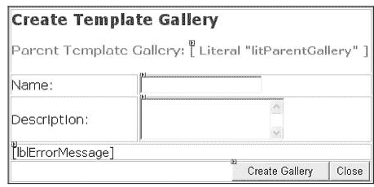
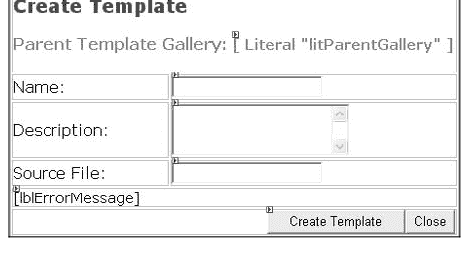
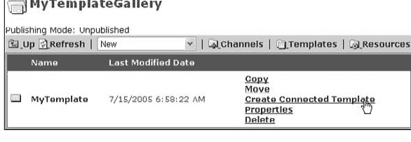
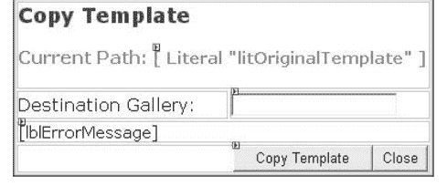
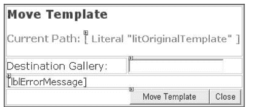
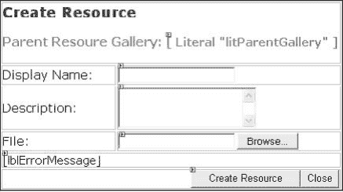

# 3 Managing Templates, Template Galleries, and Resources

In this chapter, we turn our attention to three main MCMS object types—templates, template galleries, and resources. We will enhance the CMS Explorer (developed in Chapter 1) to manage these objects using the MCMS Publishing API (PAPI).

### Managing Template Galleries and Templates

Out of the box, you can choose to manage template galleries and templates using either Site Manager or Template Explorer, which might be OK if you are using Visual Studio .NET as your development tool (as recommended). A compelling reason to write an administrative module to manage template galleries and templates is to work with them without having to open VS.NET. We have found this particularly useful when attempting to work in an environment where VS.NET is not installed such as on a production or a staging server. Or perhaps business requirements call for certain actions to be performed when a template gallery or template is created. Whatever the occasions may be, you may need to modify template gallery and template properties, placeholder definition and custom property collections through code.

The PAPI offers a wide range of methods and properties to work with template galleries and templates. We explore the most frequently used methods in this section, beginning with the creation of template galleries.

### Creating Template Galleries

Template galleries can be created from both Site Manager and Template Explorer. Now we will show you how we can create them from code. Let's add a Create Template Gallery dialog to the CMS Explorer interface.

1. Add a new web form to the project with the name CreateTemplateGallery.aspx.
2. In Design view, drag and drop styles.css from Solution Explorer onto the web form.
3. Toggle to HTML view. Insert a table with five rows. Code it in the same way as shown overleaf. A level-1 heading with the text Create Template Gallery forms the first row. The rest of the table consists of text labels and temporary markers indicating where the controls should go later.

```html
<table>
<tr>
<td colspan="2">
<h1>Create Template Gallery</h1>
<h2>Parent Template Gallery:
(Add Literal for displaying the path here)
</h2>
</td>
</tr>
<tr>
<td>Name:</td>
<td>(Add the text box for the Name here)</td>
</tr>
<tr>
<td>Description:</td>
<td>(Add the text box for the Description here)</td>
</tr>
<tr>
<td colspan="2">
(Add the Label for displaying error messages here)
</td>
</tr>
<tr>
<td colspan="2" align="right">
(Add the Create Gallery button here)
<INPUT type="button" value="Close" onclick="javascript:window.close();">
</td>
</tr>
</table>
```

4. Switch back to Design view, drag the following controls from the Web Forms section of the Toolbox onto the form and delete the text markers. Arrange them as shown in the following diagram. Template galleries only have Name and Description properties to modify.

| Control | Property | Value |
| --- | --- | --- |
| Literal | ID | litParentGallery |
| TextBox | ID | txtName |
| TextBox | ID | txtDescription |
|  | Rows | 3 |
|  | TextMode | MultiLine |
| Label | ID | lblErrorMessage |
|  | Text | (empty string) |
| Button | ID | btnCreate |
|  | Text | Create Gallery |



5. Add the Microsoft.ContentManagement.Publishing namespace to the code-behind file:

```csharp
// MCMS API
using Microsoft.ContentManagement.Publishing;

namespace CmsExplorer
{
    // ... code continues ...
}
```

6. In the Page_Load() event handler, we get the GUID of the parent template gallery from the CMSObjectGuid querystring parameter, and pass it to the Searches.GetByGuid() method to get a reference to the gallery itself.

```csharp
TemplateGallery parentGallery;
CmsHttpContext cmsContext;

private void Page_Load(object sender, System.EventArgs e)
{
    cmsContext = CmsHttpContext.Current;
    lblErrorMessage.Text = String.Empty;
    string cmsObjectGuid = String.Empty;
    if (Request.QueryString["CMSObjectGuid"] != null)
    {
        cmsObjectGuid = Request.QueryString["CMSObjectGuid"];
        parentGallery = cmsContext.Searches.GetByGuid(cmsObjectGuid) as TemplateGallery;
        if (parentGallery != null)
        {
            litParentGallery.Text = parentGallery.Path;
        }
        else
        {
            lblErrorMessage.Text = "Parent Gallery not found!";
        }
    }
}
```

7. Toggle to Design view and double-click on the btnCreate button. In the btnCreate_Click() event handler, add the following code:

```csharp
private void btnCreate_Click(object sender, System.EventArgs e)
{
    try
    {
        if (parentGallery.CanCreateTemplateGalleries)
        {
            // get the template gallery's name
            string name = txtName.Text.Trim();
            if (!Utility.ValidateCMSObjectName(name))
            {
                throw new Exception("Specified template gallery name is not " +
                    "valid. Must be only alphanumeric " +
                    "characters, open or close parens, " +
                    "hyphens, underscores, periods, or " +
                    "spaces. No period at the end and no " +
                    "consecutive periods are allowed.");
            }

            // create the template gallery
            TemplateGallery newGallery;
            newGallery = parentGallery.CreateTemplateGallery();
            newGallery.Name = name;
            newGallery.Description = txtDescription.Text;
            cmsContext.CommitAll();

            // display the success message
            lblErrorMessage.Text = "Template Gallery created successfully!";
        }
        else
        {
            lblErrorMessage.Text = "You do not have rights to create a " +
                "template gallery.";
        }
    }
    catch (Exception ex)
    {
        // rollback all changes
        cmsContext.RollbackAll();

        // the CMS context needs to be disposed of after a rollback
        cmsContext.Dispose();

        // display error message
        lblErrorMessage.Text = ex.Message;
    }
}
```

Before creating the template gallery, the code performs a couple of validation checks to see if:

- The user has the rights to create sub-template galleries in the parent template gallery. This is done by checking that the TemplateGallery.CanCreateTemplateGalleries property returns a Boolean true.
- The name supplied by the user is a valid template gallery name. A valid name contains only the characters, A-Z, a-z, 0-9, -, _, (space), (), and periods. It should also not end with a period or contain two or more consecutive periods. These checks are carried out by the ValidateCMSObjectName() method defined in Utility.cs, which we created in Chapter 2.

If all validation checks pass, the code uses the TemplateGallery.CreateTemplateGallery() method to create a new template gallery object. We then set the gallery's Name and Description properties to the values entered in the textboxes. As before, we call the CmsHttpContext.CommitAll() method to save the new template gallery to the repository.


保存并生成解决方案。让我们使用新的对话框创建一个模板库：

- 1. 在 CMS Explorer 界面中，单击“模板”。
- 2. 选择“新建”|“新建模板库”。
- 3. 在“新建模板库”对话框中，输入以下值：

| 属性 | 值 |
|---|---|
| 名称 | MyTemplateGallery |
| 描述 | 此模板库是使用 PAPI 创建的 |

- 4. 单击“创建库”并关闭对话框。刷新 CMS Explorer，检查新模板库是否已在根模板库中创建。作为练习，你可以编写代码让对话框自动关闭并刷新父页面。

## 创建模板

PAPI 的另一个有用功能是能够通过代码生成模板。当您需要基于某些预定义逻辑（例如，要从旧版应用程序迁移到 MCMS 的架构）生成许多包含占位符和自定义属性定义的模板时，此功能尤其有用。

在本练习中，我们将为 CMS Explorer 构建一个“创建模板”对话框：

- 1. 向 CMS Explorer 项目添加一个新的 Web 窗体。将新窗体命名为 CreateTemplate.aspx。
- 2. 在“设计”视图中，将 styles.css 从“解决方案资源管理器”拖放到 Web 窗体上。
- 3. 切换到“HTML”视图，并添加一个由六行组成的表格，如下所示：

```html
<table>
<tr>
<td colspan="2">
<h1>Create Template</h1>
<h2>
Parent Template Gallery:
(Add Literal for displaying the path here)
</h2>
</td>
</tr>
<tr>
<td>Name:</td>
<td>(Add text box for the Name here)</td>
</tr>
<tr>
<td>Description:</td>
<td>(Add text box for the Description here)</td>
</tr>
<tr>
<td>Source File:</td>
<td>(Add text box for the source file here)</td>
</tr>
<tr>
<td colspan="2">(Add the label for displaying error messages here)</td>
</tr>
<tr>
<td colspan="2" align="right">
(Add the Create Template button here)
<INPUT type="button" value="Close" onclick="javascript:window.close();">
</td>
</tr>
</table>
```

- 4. 在“设计”视图中，从“工具箱”的“Web 窗体”部分添加控件，并按如下所述进行排列：

| 控件 | 属性 | 值 |
|---|---|---|
| Literal | ID | litParentGallery |
| TextBox | ID | txtName |
| TextBox | ID | txtDescription |
|  | Rows | 3 |
|  | TextMode | MultiLine |
| TextBox | ID | txtSourceFile |
| Label | ID | lblErrorMessage |
|  | Text | （空字符串） |
| Button | ID | btnCreate |
|  | Text | 创建模板 |



- 5. 在代码隐藏文件中，添加以下命名空间：

```csharp
- - - code continues - - -

// MCMS API
using Microsoft.ContentManagement.Publishing;

// Following is required for creating placeholder definitions
using Microsoft.ContentManagement.Publishing.Extensions.Placeholders;

namespace CmsExplorer
{
- - - code continues - - -
}
```

```csharp
else
{
    lblErrorMessage.Text = "You do not have rights to create a template.";
}
catch(Exception ex)
{
    // rollback all changes
    cmsContext.RollbackAll();

    // the CMS context needs to be disposed of after a rollback
    cmsContext.Dispose();

    // display error message
    lblErrorMessage.Text = ex.Message;
}
```

与之前一样，代码在创建模板之前会执行以下验证检查：

- 检查用户是否具有在当前模板库中创建模板所需的权限。我们通过检索 `TemplateGallery.CanCreateTemplates` 属性的值来实现这一点。
- 检查 `txtName` 文本框中提供的名称是否为有效名称。命名模板库的规则同样适用于模板。

该代码基本上使用 `TemplateGallery.CreateTemplate()` 方法创建模板。一旦模板创建完成（并且在我们为其分配 Name、Description 和 SourceFile 属性值之前），新模板将获得以下属性值：

- Custom Property（自定义属性）集合和 Placeholder Definition（占位符定义）集合均为空。
- CreatedBy、LastModifiedBy 和 OwnedBy 反映执行创建模板操作的用户。
- CreatedDate 和 LastModifiedDate 包含模板创建的日期和时间。
- 模板的状态为 New。
- 其名称为 New Template。
- SourceFile 和 Description 为空字符串。

成功创建模板后，我们将文本框中输入的名称、描述和源文件值分配给新模板。请注意，SourceFile 相当于在模板资源管理器中看到的 Template File 属性。

与之前一样，为了永久保留更改，我们将其提交到数据库。`CmsHttpContext.CommitAll()` 方法类似于模板资源管理器中的“保存”功能。提交后，模板的状态将从 New 变为 Saved。如果有任何错误，消息将显示在标签中，并回滚所有更改。

## 提交模板

模板创建并提交到存储库后，它将处于 Saved 状态。在通过模板资源管理器签入并发布之前，其他模板设计者无法修改它。PAPI 中签入模板的等效操作是 `Template.Submit()` 方法。提交后，模板的状态将从 Saved 更改为 Published。然后作者和编辑就可以使用它来创建发布内容。

修改 `btnCreate_Click()` 事件处理程序中的代码，以提交新模板，如下所示：

```csharp
private void btnCreate_Click(object sender, System.EventArgs e)
{
    try
    {
        // create the new template
        Template newTemplate;

        if (parentGallery.CanCreateTemplates)
        {
            // get the template's name
            string name = txtName.Text.Trim();

            if (!Utility.ValidateCMSObjectName(name))
            {
                throw new Exception("Specified template gallery name is not "
                    + "valid. Must be only alphanumeric "
                    + "characters, open or close parens, "
                    + "hyphens, underscores, periods, or "
                    + "spaces. No period at the end and no "
                    + "consecutive periods are allowed.");
            }

            newTemplate = parentGallery.CreateTemplate();
            newTemplate.Name = name;
            newTemplate.Description = txtDescription.Text;
            newTemplate.SourceFile = txtSourceFile.Text;

            // commit the changes
            cmsContext.CommitAll();

            // submit the template
            if (newTemplate.CanSubmit)
            {
                newTemplate.Submit();
                cmsContext.CommitAll();

                // display the success message
                lblErrorMessage.Text = "Template created successfully!";
            }
            else
            {
                lblErrorMessage.Text = "You do not have rights to submit"
                    + " a template.";
            }
        }
        else
        {
            lblErrorMessage.Text = "You do not have rights to create a template.";
        }
    }
    catch(Exception ex)
    {
        // rollback all changes
        cmsContext.RollbackAll();

        // the CMS context needs to be disposed of after a rollback
        cmsContext.Dispose();

        // display error message
        lblErrorMessage.Text = ex.Message;
    }
}
```

该代码首先检查 `Template.CanSubmit` 属性，以确定用户是否可以提交该模板。如果可以，则调用 `Template.Submit()` 方法。

## 创建自定义属性定义

对于给定的模板对象，您可以向其现有集合中添加自定义属性定义。在本示例中，我们将采用另一种快捷方式。我们将直接编写代码，而不是像模板资源管理器那样提供用户界面来输入自定义属性的名称、类型和默认值。我们将创建一个具有以下属性和值的文本自定义属性定义：

| 属性 | 值 |
|---|---|
| Name | LastSubmittedBy |
| DefaultValue | （空字符串） |

在 `btnCreate_Click()` 事件处理程序中，在 try 块内添加以下代码：

```csharp
private void btnCreate_Click(object sender, System.EventArgs e)
{
    try
    {
        // create the new template
        Template newTemplate;

        if (parentGallery.CanCreateTemplates)
        {
            . . . code continues . . .

            newTemplate = parentGallery.CreateTemplate();
            newTemplate.Name = txtName.Text;
            newTemplate.Description = txtDescription.Text;
            newTemplate.SourceFile = txtSourceFile.Text;

            // create the custom property definition
            CustomPropertyDefinition customProp;
            customProp = newTemplate.CreateCustomPropertyDefinition();
            customProp.Name = "LastSubmittedBy";
            customProp.DefaultValue = String.Empty;

            // commit the changes
            cmsContext.CommitAll();

            // submit the template
            if (newTemplate.CanSubmit)
            {
                newTemplate.Submit();
                cmsContext.CommitAll();

                // display the success message
                lblErrorMessage.Text = "Template created successfully!";
            }
            else
            {
```


```csharp
lblErrorMessage.Text = "You do not have rights to submit" + " a template.";
}
}
else
{
    lblErrorMessage.Text = "You do not have rights to create a template.";
}
}
catch(Exception ex)
{
    // rollback all changes
    cmsContext.RollbackAll();
    // the CMS context needs to be disposed of after a rollback
    cmsContext.Dispose();
    // display error message
    lblErrorMessage.Text = ex.Message;
}
```

代码使用 `Template.CreateCustomPropertyDefinition()` 方法向模板添加自定义属性定义。创建自定义属性后，我们为其分配属性值。

> 使用 PAPI 创建模板并向其添加自定义属性定义时，必须在 `TemplateGallery.CreateTemplate()` 和 `Template.Submit()` 调用之间某处调用 `CommitAll()`。否则，你会发现模板多了一个名为 NewCustomPropertyDefinitionX（其中 X 为递增数字）的自定义属性定义。这是 PAPI 的一个已知 bug。

在本示例中，我们添加了一个简单的文本自定义属性定义。对于更复杂的选择自定义属性定义，技术非常相似。下面的代码片段展示了如何创建一个名为 MenuLocation 的自定义属性定义，并允许四个值：Left、Right、Top 和 Bottom。它指定 Top 为默认值。

```csharp
CustomPropertyDefinition customPropSelection;
customPropSelection = Template.CreateCustomPropertyDefinition();
customPropSelection.Name = "MenuLocation";
customPropSelection.AddAllowedValue("Left");
customPropSelection.AddAllowedValue("Right");
customPropSelection.AddAllowedValue("Top");
customPropSelection.AddAllowedValue("Bottom");
customPropSelection.DefaultValue = "Top";
```

## Creating Placeholder Definitions

占位符定义也可以通过编程方式创建，这要归功于 PAPI 的 `Template.CreatePlaceholderDefinition()` 方法。你可以将任何占位符定义添加到模板中。在这样做之前，最好导入其命名空间，这就是我们之前导入 `Microsoft.ContentManagement.Publishing.Extensions.Placeholders` 的原因。

```csharp
placeholderDef.Description = "A placeholder created from the PAPI";
placeholderDef.AllowHyperlinks = true;
placeholderDef.AllowLineBreaks = true;
placeholderDef.AllowAttachments = true;
placeholderDef.AllowImages = true;
placeholderDef.MustUseResourceGallery = false;
placeholderDef.UseGeneratedIcon = false;
placeholderDef.Formatting =
    HtmlPlaceholderDefinition.SourceFormatting.FullFormatting;

// commit the changes
cmsContext.CommitAll();

- - - code continues - - -
```

Create Template 对话框现已完成。保存并构建解决方案。让我们测试一下是否有效：

1. 在 CMS Explorer 中，单击 Templates 按钮。打开之前创建的 MyTemplateGallery 模板库。
2. 选择 New | New Template。
3. 在 Create Template 对话框中，输入以下值：

| Property | Value |
| --- | --- |
| Name | MyTemplate |
| Description | This template was created using the PAPI |
| SourceFile | /tropicalgreen/plantcatalog/plant.aspx |

4. 单击 Create Template 并关闭对话框。
5. 刷新 CMS Explorer 屏幕并验证 MyTemplate 是否已在 MyTemplateGallery 中创建。

## Creating Connected Templates

连接模板的创建方式与模板相同，只是我们现在调用 `TemplateGallery.CreateConnectedTemplate()` 方法。

让我们试试：

1. 在项目中添加一个新的 Web 表单，名称为 `CreateConnectedTemplate.aspx`。
2. 将 `Styles.css` 拖放到 Web 表单上。
3. 切换到 HTML 视图并输入以下代码（包括文本标记）：

```html
<table>
<tr>
  <td colspan="2">
    <h1>Create Connected Template</h1>
    <h2>
      Original Template:
      (Add literal for displaying the path of the original template here)
    </h2>
  </td>
</tr>
<tr>
  <td>Name:</td>
  <td>(Add the text box for the Name here)</td>
</tr>
```

5. 现在让我们获取一个模板实例（或原始模板），以便基于它创建连接模板。在这样做之前，先考虑模板设计师和管理员如何从 CMS Explorer 创建连接模板。他们将：

- 单击 Templates 按钮。
- 导航到包含原始模板的模板库。
- 单击原始模板旁边的 Edit 链接。
- 选择 Create Connected Template 链接。



Create Connected Template 链接中编码了指向 CreateConnectedTemplate.aspx 的路径以及一个名为 CMSObjectGuid 的查询字符串参数，其中包含原始模板的 GUID。以下是生成的 URL 示例，为便于阅读已拆分为多行：

```
http://localhost/cmsexplorer/CreateConnectedTemplate.aspx?
NRMODE=Update
&FRAMELESS=true
&CMSObjectGuid=%7b5010EF8C-C33C-4F68-8430-D8DFAABA2EE0%7d
&NRNODEGUID=%7bE4D19123-9DD3-11D1-B44E-006097071264%7d
```

为了获取原始模板的实例，我们将从 CMSObjectGuid 查询字符串参数中提取 GUID，并将其作为 `Searches.GetByGuid()` 方法的输入参数传递。

为了证明我们确实拥有原始模板的实例，我们将在屏幕上显示原始模板的路径。如果由于某种原因无法获取模板实例，则会显示错误消息。我们将在下一步添加执行此操作的代码。

1. 双击 Web 表单上的任意位置以进入其代码隐藏文件。添加 `Microsoft.ContentManagement.Publishing` 命名空间。

```csharp
- - - code continues - - -
// MCMS API
using Microsoft.ContentManagement.Publishing;

namespace CmsExplorer
{
- - - code continues - - -
```

2. 在 `Page_Load()` 事件处理程序上方并内部添加突出显示的代码：

```csharp
private CmsHttpContext cmsContext;
private Template originalTemplate;

private void Page_Load(object sender, System.EventArgs e)
```

```csharp
}
newConnectedTemplate =
    parentGallery.CreateConnectedTemplate(originalTemplate);

// set the connected template's name
newConnectedTemplate.Name = txtName.Text;

// Set the connected template's description
newConnectedTemplate.Description = txtDescription.Text;

// Set the connected template's source file
newConnectedTemplate.SourceFile = txtSourceFile.Text;

// Commit the changes
cmsContext.CommitAll();

// Submit the connected template
if (newConnectedTemplate.CanSubmit)
{
    newConnectedTemplate.Submit();
    cmsContext.CommitAll();

    // display the success message
    lblErrorMessage.Text = "Connected Template created successfully!";
}
else
{
    lblErrorMessage.Text = "You do not have rights to submit"
        + " a template.";
}
}
else
{
    lblErrorMessage.Text =
        "You do not have rights to create a template.";
}
}
catch(Exception ex)
{
    // rollback all changes
    cmsContext.RollbackAll();

    // the CMS context needs to be disposed of after a rollback
    cmsContext.Dispose();

    // display error message
    lblErrorMessage.Text = ex.Message;
}
```

试用代码！

1. 在 CMS Explorer 工具栏上，单击 Templates。
2. 选择我们之前创建的 MyTemplateGallery 模板库。
3. 单击 MyTemplate 模板旁边的 Edit 链接。
4. 单击 Create Connected Template。
5. 在 Create Connected Template 对话框中输入以下值：

4. 切换到 Design 视图。从工具箱的 Web Forms 部分拖放以下控件并按指定设置其属性：

| Control | Property | Value |
| --- | --- | --- |
| Literal | ID | litOriginalTemplate |
| TextBox | ID | txtDestination |
| Label | ID | lblErrorMessage |
|  | Text | (empty string) |
| Button | ID | btnCopy |
|  | Text | Copy Template |

以下是 Design 视图中完成的对话框：



要复制模板，我们将按照以下步骤操作：

- 获取我们希望复制的模板的实例。
- 获取目标模板库的实例。
- 通过调用 `Template.CopyTo()` 方法执行复制操作。

让我们先获取我们希望复制的模板的实例。

5. 向代码隐藏文件添加 `Microsoft.ContentManagement.Publishing` 命名空间：

```csharp
. . . code continues . . .
// MCMS API
using Microsoft.ContentManagement.Publishing;

namespace CmsExplorer
{
. . . code continues . . .
}
```

6. 接下来，我们从 CMSObjectGuid 查询字符串参数中获取模板的 GUID，并将其作为输入参数传递给 `Searches.GetByGuid()` 方法。如果该方法返回模板的实例，我们将在屏幕上显示其路径。否则，我们将显示错误消息。添加突出显示的代码，放在 `Page_Load()` 事件处理程序上方并内部。


```csharp
private CmsHttpContext cmsContext;
private Template originalTemplate;

private void Page_Load(object sender, System.EventArgs e)
{
    cmsContext = CmsHttpContext.Current;

    // Clear all error messages, if any
    lblErrorMessage.Text = String.Empty;

    // Get an instance of the original template
    string cmsObjectGuid = String.Empty;
    if (Request.QueryString["CMSObjectGuid"] != null)
    {
        cmsObjectGuid = Request.QueryString["CMSObjectGuid"];
        originalTemplate = cmsContext.Searches.GetByGuid(cmsObjectGuid) as Template;

        if (originalTemplate != null)
        {
            // Display the template's path
            litOriginalTemplate.Text = originalTemplate.Path;
        }
        else
        {
            // Uh-oh we can't get an instance of the template.
            lblErrorMessage.Text = "Original Template not found!";
        }
    }
}
```

7. 现在，让我们获取目标模板库的实例。用户应该已在提供的文本框中输入了目标模板库的路径。因此，要获取目标模板库的实例，我们只需使用 Searches.GetByPath() 方法。如果用户输入了无效路径或一个其无权创建模板的库的路径，则会在屏幕上显示错误消息。切换到设计视图并双击 btnCopy 按钮以进入 btnCopy_Click() 事件处理程序。添加以下代码：

```csharp
private void btnCopy_Click(object sender, System.EventArgs e)
{
    try
    {
        // creating a copy of a template

        // get the destination template gallery
        TemplateGallery destinationGallery;
        string destinationGalleryPath = txtDestination.Text;
        destinationGallery = cmsContext.Searches.GetByPath(
            destinationGalleryPath) as TemplateGallery;

        if (destinationGallery != null)
        {
            if (destinationGallery.CanCreateTemplates)
            {
                // TODO:Add code to copy template here
            }
            else
            {
                // We do not have rights to create templates in the
                // specified destination template gallery
                lblErrorMessage.Text =
                    "You do not have rights to create templates "
            }
        }
    }
}
```

复制的模板将继承原始模板的所有已提交属性值以及自定义属性和占位符定义集合。

与连接的模板不同，复制的模板与原始模板没有任何关联。对原始模板的更新不会更改复制模板的属性、定义集合或状态。

让我们尝试复制 Plant 模板：

1. 在 CMS Explorer 中，单击 Templates。
2. 导航到 TropicalGreen | PlantCatalog。
3. 单击 Plant 模板的 Edit 链接。
4. 单击 Copy。
5. 在 Destination Gallery 字段中，输入 /Templates/MyTemplateGallery/。
6. 单击 Copy Template。
7. 单击 Close。
8. 返回 CMS Explorer，导航到 MyTemplateGallery。Plant 模板的副本现在位于其中。

> 复制模板库的唯一方法是使用 Site Manager。PAPI 中没有 TemplateGallery.CopyTo() 方法。
> 
> 然而，使用 Site Manager 中的“Copy”功能复制模板库时要小心。如果源库中包含连接的模板，则该关系不会保留在目标库中。

## 移动模板库和模板

模板库和模板是通过模板资源管理器或站点管理器将对象从一个容器拖放到另一个容器来移动的。PAPI 提供了 TemplateGalleryItem.MoveTo() 方法以编程方式移动这些对象。

该技术与复制模板类似。我们需要做的是：

- 首先，获取我们希望移动的模板库项的引用。
- 接下来，获取模板库项将被移动到的目标模板库的引用。
- 最后，调用 TemplateGalleryItem.MoveTo() 方法。

让我们为 CMS Explorer 构建一个移动模板对话框。

向项目添加一个名为 MoveTemplate.aspx 的 Web 表单。

1. 将 styles.css 拖放到 Web 表单上。
2. 在 HTML 视图中，输入以下代码：

```html
<table>
<tr>
<td colspan="2">
<h1>Move Template</h1>
(Add Literal for displaying the path here)
</td>
</tr>
<tr>
<td>Destination Gallery:</td>
<td>
(Add the text box for the destination gallery here)
</td>
</tr>
<tr>
<td colspan="2">(Add the Label for displaying error messages here)</td>
</tr>
<tr>
<td colspan="2" align="right">
(Add the Move Template button here)
<INPUT type="button" value="Close" onclick="javascript:window.close();">
</td>
</tr>
</table>
```

3. 切换到设计视图。从工具箱的 Web Forms 部分拖放以下控件并按如下所示设置其属性：

| Control | Property | Value |
|---|---|---|
| Literal | ID | litOriginalTemplate |
| TextBox | ID | txtDestination |
| Label | ID | lblErrorMessage |
|  | Text | (empty string) |
| Button | ID | btnMove |
|  | Text | Move Template |

完成后，Web 表单在设计视图中如下所示：



4. 双击表单以进入其代码隐藏文件。添加 Microsoft.ContentManagement.Publishing 命名空间：

```csharp
. . . code continues . . .
// MCMS PAPI
using Microsoft.ContentManagement.Publishing;

namespace CmsExplorer
{
. . . code continues . . .
}
```

5. 在 Page_Load() 事件处理程序中，我们获取要移动的模板的实例。在之前的示例中，我们在用户单击按钮后才检查用户是否有权操作项目。这次我们尝试不同的方法。不是向没有必要权限的用户返回错误消息，我们将相应地启用或禁用按钮。
我们通过检查 Template.CanMove 属性值来检查用户是否有权移动模板。如果 Template.CanMove 返回 true，则表示用户是管理员或被分配到当前模板库的频道管理员或模板设计师角色的权限组。如果用户有权移动模板，我们保持 btnMove 按钮启用；否则，禁用它。

```csharp
private CmsHttpContext cmsContext;
private Template originalTemplate;

private void Page_Load(object sender, System.EventArgs e)
{
    cmsContext = CmsHttpContext.Current;

    // Clear all error messages, if any.
    lblErrorMessage.Text = String.Empty;

    // Get an instance of the original template
    string cmsObjectGuid = String.Empty;
    if (Request.QueryString["CMSObjectGuid"] != null)
    {
        cmsObjectGuid = Request.QueryString["CMSObjectGuid"];
        originalTemplate = cmsContext.Searches.GetByGuid(cmsObjectGuid)
            as Template;

        if (originalTemplate != null)
        {
            // Display the template's path
            litOriginalTemplate.Text = originalTemplate.Path;

            if (originalTemplate.CanMove)
            {
                btnMove.Enabled = true;
            }
            else
            {
                // we can't move this template.
                lblErrorMessage.Text = "You do not have rights to " +
                    "move this template.";
                btnMove.Enabled = false;
            }
        }
        else
        {
            // Uh-oh we can't get an instance of the template.
            lblErrorMessage.Text = "Original Template not found!";
        }
    }
}
```

6. 接下来，我们获取目标模板库的实例。我们仅在用户有权在目标模板库中创建模板时才执行移动操作。一旦我们确定目标模板库有效，我们将调用 Template.MoveTo() 方法，并将目标模板库的实例作为输入参数传递。移动模板后，其状态为 Saved。


直到对已移动的模板调用`Template.Submit()`之前，其他模板设计人员无法修改该已移动的模板或其任何相连的模板。切换到“设计”视图，然后双击btnMove按钮进入btnMove_Click()事件处理程序。添加如下所示的代码：

```csharp
private void btnMove_Click(object sender, System.EventArgs e)
{
    try
    {
        // Moving a template

        // get the destination template gallery
        TemplateGallery destinationGallery;
        string destinationGalleryPath = txtDestination.Text;
        destinationGallery = cmsContext.Searches.GetByPath(
            destinationGalleryPath) as TemplateGallery;
        if (destinationGallery != null)
        {
            if (destinationGallery.CanCreateTemplates)
            {
                // move the template
                originalTemplate.MoveTo(destinationGallery);

                // commit the move to the repository and its state
                // changes to "Saved"
                cmsContext.CommitAll();

                // submit it to change its state from "Saved" to "Published"
                // and to make it available to other template designers
                if (originalTemplate.CanSubmit)
                {
                    originalTemplate.Submit();
                    cmsContext.CommitAll();
                }

                // display the success message
                lblErrorMessage.Text = "Template moved successfully!";
            }
            else
            {
                // We do not have rights to create templates
                // in the specified destination template gallery
                lblErrorMessage.Text = "You do not have rights to "
                    + "create templates in the "
                    + "destination template gallery.";
            }
        }
        else
        {
            // We can't get an instance of the destination template gallery
            lblErrorMessage.Text = "Destination Template Gallery not found!";
        }
    }
    catch(Exception ex)
    {
        // rollback all changes
        cmsContext.RollbackAll();

        // the CMS context needs to be disposed of after a rollback
        cmsContext.Dispose();

        // display error message
}
```

> PAPI不提供创建资源库的方法。资源库只能通过使用站点管理器来创建。

让我们为CMS Explorer构建一个“创建资源”对话框：

- 1. 向CMSExplorer项目添加一个新的Web窗体。将新Web窗体命名为CreateResource.aspx。
- 2. 在“设计”视图中，将styles.css拖放到Web窗体上。
- 3. 切换到“HTML”视图并添加一个具有六行的表格，如下所示：
- 4. 在“设计”视图中打开CreateResource.aspx Web窗体，将控件（来自工具箱的“Web Forms”部分）添加到窗体，并按如下所示进行设置。

```html
<table>
<tr>
<td colspan="2">
<h1>Create Resource</h1>
<h2>
Parent Resource Gallery:
(Add Literal for displaying the path here)
</h2>
</td>
</tr>
<tr>
<td>Display Name:</td>
<td>(Add the text box for the display name here)</td>
</tr>
<tr>
<td>Description:</td>
<td>(Add the text box for the description here)</td>
</tr>
<tr>
<td>File:</td>
<td><INPUT type="file" id="File1" runat="server"></td>
</tr>
<tr>
<td colspan="2">(Add the label for error messages here)</td>
</tr>
<tr>
<td colspan="2" align="right">
(Add the Create Resource button here)
<INPUT type="button" value="Close" onclick="javascript:window.close();">
</td>
</tr>
</table>
```

| 控件 | 属性 | 值 |
|---|---|---|
| 文本控件 | ID | litParentGallery |
| 文本框 | ID | txtDisplayName |
| 文本框 | ID | txtDescription |
|  | Rows | 3 |
|  | TextMode | MultiLine |

| 控件 | 属性 | 值 |
|---|---|---|
| 标签 | ID | lblErrorMessage |
|  | Text | (空字符串) |
| 按钮 | ID | btnCreate |
|  | Text | 创建资源 |



- 5. 由于正在通过表单向服务器上传文件，请切换到“HTML”视图，并将表单的ENCTYPE属性设置为`multipart/form-data`。

```html
<body MS_POSITIONING="FlowLayout">
<form id="Form1" method="post" runat="server" enctype="multipart/form-data">
</form>
</body>
```

- 6. 如上所述，除了现有的命名空间之外，还需要在代码后置文件中添加`Microsoft.ContentManagement.Publishing`命名空间。

```csharp
// - - - code continues - - -
// CMS MCM PAPI
using Microsoft.ContentManagement.Publishing;

namespace CmsExplorer
{
    // - - - code continues - - -
}
```

- 7. 在Page_Load()事件处理程序中，我们添加代码以从CMSObjectGuid查询字符串参数中检索父资源库的GUID。将其传递给Searches.GetByGuid()方法，即可获得对父资源库的引用。

获取父资源库的实例后，我们检查ResourceGallery.CanCreateResources属性。如果用户具有必要权限，该属性返回布尔值true（表示用户是MCMS管理员、资源管理员、模板设计员或分配给父资源库的频道管理员），并且“创建资源”按钮被启用。否则，它将被禁用。

```csharp
- - - code continues - - -

private CmsHttpContext cmsContext;
private ResourceGallery parentGallery;

private void Page_Load(object sender, System.EventArgs e)
{
    cmsContext = CmsHttpContext.Current;
    lblErrorMessage.Text = String.Empty;
    string cmsObjectGuid = String.Empty;

    if (Request.QueryString["CMSObjectGuid"] != null)
    {
        cmsObjectGuid = Request.QueryString["CMSObjectGuid"];
        parentGallery = cmsContext.Searches.GetByGuid(cmsObjectGuid)
            as ResourceGallery;

        if (parentGallery != null)
        {
            litParentGallery.Text = parentGallery.Path;

            // Enable or Disable the Create Resource button
            btnCreate.Enabled = parentGallery.CanCreateResources;
        }
        else
        {
            lblErrorMessage.Text = "Parent Gallery not found!";
        }
    }
}
```

- 8. 接下来，我们将所有上传的文件存储在服务器上的一个临时文件夹中。MCMS已经提供了这样一个具有必要写入权限的文件夹。可以通过访问`CmsHttpContext.Current.TemporaryUploadFolder`属性来获取它。代码首先检查上传的文件是否具有有效名称（符合MCMS设置的命名规则），然后将上传的文件保存到MCMS服务器目录中的Temp文件夹中。文件上传后，我们调用`ResourceGallery.CreateResource()`方法，并将文件路径作为输入参数传入。创建资源后，我们设置其Name和DisplayName属性，并将更改提交到存储库。切换到“设计”视图并双击btnCreate按钮。在btnCreate_Click()事件处理程序中，添加如下所示的代码：

```csharp
private void btnCreate_Click(object sender, System.EventArgs e)
{
    try
    {
        if (File1.PostedFile != null)
        {
            // the temp folder for saving the posted file to
            string filePath = CmsHttpContext.Current.TemporaryUploadFolder;

            // get the file name from the posted file
            string fileName = File1.PostedFile.FileName;
            int indexOfSlash = fileName.LastIndexOf("\\") + 1;
            fileName = fileName.Substring(indexOfSlash, fileName.Length - indexOfSlash);

            // append the file name to the path of the temp folder
            filePath += "\\" + fileName;

            // check to see if the file name is valid
            if (!Utility.ValidateMCMSObjectName(fileName))
            {
                throw new Exception("Specified template gallery name is not "
                    + "valid. Must be only alphanumeric "
                    + "characters, open or close parens, "
                    + "hyphens, underscores, periods, or ");
            }
        }
    }
}
```


```csharp
+ "spaces. No period at the end and no "
+ "consecutive periods are allowed. ");
}

// save the file to a specified temp folder
File1.PostedFile.SaveAs(filePath);

// create the new resource
Resource newResource = parentGallery.CreateResource(filePath);
newResource.Name = fileName;
newResource.DisplayName = txtDisplayName.Text;

// commit the changes
cmsContext.CommitAll();

// delete the file that was saved to the temp folder
System.IO.File.Delete(filePath);

// display the success message
lblErrorMessage.Text = "Resource created successfully!";
}
else
{
    // no file was selected for uploading
    lblErrorMessage.Text = "Please select a file to upload";
}
}
catch(Exception ex)
{
    // rollback all changes
    cmsContext.RollbackAll();

    // the CMS context needs to be disposed of after a rollback
    cmsContext.Dispose();

    // display error message
    lblErrorMessage.Text = ex.Message;
}
}
```

> 必须先将要添加到资源库的文件作为物理文件上传到 MCMS 服务器。ResourceGallery.CreateResource() 方法仅接受文件系统中现有文件的有效路径。

保存并构建解决方案。要测试新的对话框：

- 1. 打开 CMS Explorer。
- 2. 单击 Resources 并导航到 PlantCatalog 资源库。
- 3. 从工具栏中选择 New | New Resource。
- 4. 在 Create Resource 对话框中，输入以下值：
- 5. 单击 Create Resource。

| Property | Value |
|---|---|
| DisplayName | MyResource |
| Description | This resource was created from the PAPI |
| File | Select any file located on your desktop |

观看所选文件被上传并作为 PlantCatalog 资源库中的新资源创建（单击 Refresh 按钮以查看最新视图）。

## Replacing Resources

更新资源时，最好替换其内容而不是删除后重新上传。替换意味着保留 GUID 和 URL，这样帖子中对该资源的超链接不仅会保持完整，而且会立即链接到更新后的内容。

使用 PAPI，资源通过 Resource.SetContentFromFile() 方法进行替换。在本示例中，我们将为 CMS Explorer 构建一个新的替换资源对话框：

- 1. 向 CMSEXplorer 项目添加一个新的 Web 表单。将新 Web 表单命名为 ReplaceResource.aspx。
- 2. 在 Design 视图中，从 Solution Explorer 拖动 styles.css 并将其放到 Web 表单上。
- 3. 切换到 HTML 视图并将表单的 ENCTYPE 属性设置为 multipart/form-data：
- 4. 添加一个包含四行的表格：
- 5. 在 Design 视图中，拖放控件并按以下详细说明设置它们：

```
<form id="Form1" method="post" runat="server"
    enctype="multipart/form-data">
</form>
```

```
<table>
<tr>
    <td colspan="2">
        <h1>Replace Resource</h1>
        <h2>Current Resource: (Add Literal for displaying the path here)</h2>
    </td>
</tr>
<tr>
    <td><INPUT type="file" id="File1" runat="server"></td>
</tr>
<tr>
    <td colspan="2">(Add the Label for error messages here)</td>
</tr>
<tr>
    <td colspan="2" align="right">
        (Add the Replace Resource button here)
        <INPUT type="button" value="Close" onclick="javascript:window.close();">
    </td>
</tr>
</table>
```

| Control | Property | Value |
|---|---|---|
| Literal | ID | litCurrentResource |
| Label | ID | lblErrorMessage |
|  | Text | (empty string) |
| Button | ID | btnReplace |
|  | Text | Replace Resource |

- 8. 切换到 Design 视图并双击 btnReplace 按钮。在 btnReplace_Click() 事件处理程序中，添加以下代码：

```
private void btnReplace_Click(object sender, System.EventArgs e)
{
    try
    {
        if (File1.PostedFile != null)
        {
            // the temp folder for saving the posted file to
            string filePath = CmsHttpContext.Current.TemporaryUploadFolder;

            // get the file name from the posted file
            string fileName = File1.PostedFile.FileName;
            int indexOfSlash = fileName.LastIndexOf("\\") + 1;
            fileName = fileName.Substring(indexOfSlash, fileName.Length - indexOfSlash);

            // check to see if the file name is valid
            if (!Utility.ValidateCMSObjectName(fileName))
            {
                throw new Exception("Specified template gallery name is not "
                    + "valid. Must be only alphanumeric "
                    + "characters, open or close parens, "
                    + "hyphens, underscores, periods, or "
                    + "spaces. No period at the end and no "
                    + "consecutive periods are allowed.");
            }

            // append the file name to the path of the temp folder
            filePath += "\\" + fileName;

            // save the file to a specified temp folder
            File1.PostedFile.SaveAs(filePath);

            // replace the contents of the resource
            currentResource.SetContentFromFile(filePath);
            currentResource.Name = fileName;

            // commit the changes
            cmsContext.CommitAll();

            // display the success message
            lblErrorMessage.Text = "Resource replaced successfully!";
        }
        else
        {
            // no file was selected for uploading
            lblErrorMessage.Text = "Please select a file to upload";
        }
    }
    catch(Exception ex)
    {
        // rollback all changes
        cmsContext.RollbackAll();

        // the CMS context needs to be disposed of after a rollback
        cmsContext.Dispose();

        // display error message
        lblErrorMessage.Text = ex.Message;
    }
}
```

## Managing Templates, Template Galleries, and Resources

我们首先检索要上传的文件名并检查其是否有效。在将上传的文件保存到 MCMS 服务器目录中的 Temp 文件夹后，我们调用 Resource.SetContentFromFile() 方法，该方法接受文件系统中有效文件的路径。与创建资源时一样，此文件必须位于 MCMS 服务器上。更新资源内容后，我们将更改提交到内容存储库。

保存并构建解决方案。让我们试用 Replace Resource 对话框：

- 1. 打开 CMS Explorer。
- 2. 单击 Resources 并导航到 PlantCatalog 资源库。
- 3. 单击 CoconutTree.JPG 资源旁边的 Edit 链接。
- 4. 单击 Replace。
- 5. 在 Replace Resource 对话框中，浏览到现有的 JPG 文件。
- 6. 单击 Replace Resource。
- 7. 单击 Close 关闭对话框。

资源的内容将被新上传的文件替换。请注意，您只能用相同 MIME 类型的文件替换资源。例如，CoconutTree.JPG 资源只能用其他 *.JPG 文件替换。如果您选择了 *.XLS 文件，则会收到以下错误消息：

MIME Content-Types do not match. application/vnd.ms-excel does not match image/jpg.

## Deleting Objects

PAPI 为每个 channel、posting、template、template gallery、resource gallery 和 resource 对象提供 Delete() 方法。我们在存储库中创建了相当多的测试对象，因此让我们编写一个 Delete 对话框，以便 CMS Explorer 可以删除它们：

- 1. 向 CMSExplorer 项目添加一个新的 Web 表单并将其命名为 Delete.aspx。
- 2. 在 Design 视图中，从 Solution Explorer 拖放 styles.css 到 Web 表单上。
- 3. 切换到 HTML 视图并添加一个包含四行的表格：

```
<table>
<tr>
  <td><h1>Confirm Delete</h1></td>
</tr>
<tr>
  <td>
    Click YES to permanently delete
    (Add literal to show the path of the item to be deleted here)
  </td>
</tr>
<tr>
  <td align="right">
    (Add the Yes button here)
    <INPUT type="button" value="No" onclick="javascript:window.close();" style="width:120px">
  </td>
</tr>
<tr>
  <td>(Add label for displaying error messages here)</td>
</tr>
</table>
```


```
deletedObject = cmsContext.Searches.GetByGuid(cmsObjectGuid);
}
// display the path of the object to be deleted
if (!Page.IsPostBack)
{
    litCurrentItem.Text = deletedObject.Path;
}
btnYes.Enabled = deletedObject.CanDelete;
}
```

7. 切换回设计视图，双击 btnYes 按钮。在 btnYes_Click() 事件处理程序中，只需调用 HierarchyItem.Delete() 方法并提交删除操作：

```
private void btnYes_Click(object sender, System.EventArgs e)
{
    try
    {
        deletedObject.Delete();
        cmsContext.CommitAll();
        // display the success message
        lblErrorMessage.Text = "Item deleted successfully!";
    }
    catch(Exception ex)
    {
        // rollback all changes
        cmsContext.RollbackAll();
        // the CMS context needs to be disposed of after a rollback
        cmsContext.Dispose();
        // display error message
        lblErrorMessage.Text = ex.Message;
    }
}
```

如果在处理过程中发生任何错误，删除操作将被回滚，并显示错误消息。

使用 PAPI 删除对象时，需要注意以下几个要点：

-   包含对象的容器只有在其中所有项目都被删除后才能删除。
-   具有现有依赖项的对象只有在所有依赖项被移除后才能删除。例如，如果有基于模板的发布项，则必须先删除这些发布项，才能删除模板。
-   链接到资源的发布项即使资源已被删除，仍会保留到该资源的链接。这是为了防止链接断裂。但是，资源管理器将无法再访问该文件。只有管理员才能查看它们。在第 13 章中，我们将在技巧 #4：如何应对指向已删除资源的链接 中提出处理这些链接的方法。
-   与 Site Manager 中的“删除”选项（删除的对象存储在“已删除项目”回收站中并可恢复）不同，使用 PAPI 删除的对象在删除提交后将无法再访问。MCMS 后台进程将删除所有未被发布项引用的资源。被发布项引用的资源可以通过向 Microsoft 支持部门请求存储过程（参考编号：SOX040517700117）来恢复。

## 总结

在本章中，我们学习了如何使用 PAPI 管理模板库、模板和资源。我们为 CMS Explorer 提供了几个增强功能，包括创建模板库、模板和资源的对话框。我们还展示了如何以编程方式提交（或签入）、复制和移动模板。我们探索的另一个功能是替换现有资源，即可以在保留资源的 GUID 和 URL 的同时替换其文件内容。最后，我们了解了如何使用 PAPI 从内容存储库中删除对象。

正如您所看到的，PAPI 不仅为您提供了构建由 MCMS 管理的网站的基本工具，还允许您对其进行自定义，以满足各种独特的业务需求。

某些搜索引擎使用 META 标签来实现分类法。当页面被索引时，搜索引擎可能会将 Description META 标签的内容添加到名为 description 的字段中。然后，您可以使用搜索引擎的 API 来搜索所有仅在此 description 字段中包含特定关键字的页面。组合多个 META 标签可以实现复杂搜索。例如，您可以编程搜索 description META 标签包含单词“plant”且 location META 标签包含“South America”的页面，以检索所有关于南美洲植物的页面。

请注意，并非每个搜索引擎都支持使用 META 标签，因为它们可能会使用与页面内容无关的信息来影响索引。例如，Google 等引擎有自己内部的机制来为每个页面生成摘要。请参阅您所使用搜索引擎的文档，以查找其识别的 META 标签列表。

大多数搜索引擎能够执行“增量抓取”，即只索引自上次索引以来被修改的页面。执行增量抓取（而不是完全抓取）可以优化索引过程。MCMS 驱动的网站的一个问题是页面内容是动态的，每次访问站点时内容都可能不同。对于搜索索引器，这些网站要么不返回最后修改日期信息，要么总是看起来已被修改。因此，MCMS 站点无法进行增量抓取。在本章中，我们将开发一个解决方案，将最后修改日期输出到 HTTP 响应头中，从而使搜索引擎能够对 MCMS 站点执行增量抓取。

此外，搜索准确性可能会受到页面上的导航控件以及常见的页眉和页脚元素的影响。这可能导致搜索结果中出现过多噪声（例如，如果“新闻稿”页面出现在共享菜单控件中，搜索该页面将产生所有带有此菜单的页面）。通过在站点被索引时隐藏导航元素，可以提高准确性。我们将演示如何实现这一点。

在本章中，我们还将探讨一些技巧和诀窍，以获得最佳、最准确的搜索引擎结果，包括标题、关键字和描述。
