## 使用 SharePoint 搜索 MCMS

自从以内容为中心的网站出现以来，搜索内容的需求就一直存在。许多最成功的互联网企业都是搜索网站，如 Yahoo! 和 Google。每隔几个月就会有一个新的搜索网站上线，其中许多会同时对多个站点进行聚合搜索。在另一个极端，许多网站所有者需要的搜索能力是只返回其特定站点的结果。

Microsoft Content Management Server (MCMS) 虽然是一个非常强大的内容管理解决方案，但并未内置任何搜索功能。然而，拥有 MCMS 网站并不意味着你就没有办法使用搜索功能。

## MCMS 搜索选项

在 MCMS 网站上实现搜索的方式相当多，每种方式都有不同的成本、实现复杂度和限制。与往常一样，每种选择都有其优缺点。Google (http://www.google.com) 提供一个 Web Service API，供你免费提交查询，但每天限制为 1,000 次搜索，并且有一些关于徽标放置的许可要求。Coveo (http://www.coveo.com) 为其 Enterprise Search 产品提供免费且永不过期的许可证，但仅限搜索 5,000 个文档（超过 5,000 个文档需要从 Coveo 购买许可证）。Mondosoft (http://www.mondosoft.com) 的 MondoSearch 与 MCMS 无缝集成，并提供强大的功能集，但并非免费。

Microsoft 的企业门户解决方案 SharePoint Portal Server 2003 (SPS) 包含一个强大且可定制的搜索引擎。SPS 创建的索引可以通过 Web Service 提交 Microsoft SQL 全文查询来进行搜索。如果你的组织已经实施或计划部署 SPS，那么你可以将它用作 MCMS 搜索引擎。但请注意，如果你的站点可公开访问，此解决方案可能不太有吸引力，因为需要 SharePoint External Connector 许可证。因此，我们讨论的 SharePoint 搜索解决方案通常只适用于基于 Intranet 的 MCMS 站点。

在本章中，我们将利用 SPS 的搜索功能为我们的 Tropical Green MCMS 站点提供强大的搜索能力。在此过程中，我们将配置 SharePoint 来索引 Tropical Green 站点。我们还将尝试一些免费组件，你可以在 MCMS 站点中使用这些组件来针对 SharePoint 索引执行搜索查询。

## Microsoft SharePoint Portal Server 搜索

要充分利用 SharePoint Portal Server 搜索功能，你需要了解它的工作原理以及如何配置它。在解释其工作原理之前，需要先了解几个关键组件：

- **内容源（content source）**：包含将被索引的信息。内容源可以是外部网站、文件共享、Windows SharePoint Services 站点、Microsoft Exchange 公用文件夹，或其他为 SharePoint 搜索提供协议处理程序的系统（如 Lotus Notes）。
- **索引文件（Index files）**：包含从一个或多个内容源爬取的内容。聚合和编录来自不同内容源的内容可以使未来的搜索查询更加高效。索引文件也可以复制或传播到 SharePoint Web 服务器上，以实现更高效的搜索。创建新门户时会默认创建两个索引：`Portal_Content` 和 `Non_Portal_Content`。正如所料，前者包含存储在门户中的所有内容，后者包含门户之外的内容。
- **搜索范围（Search scopes）**：用于对内容源进行逻辑分组，供最终用户搜索。例如，一家公司可能有多个内部文件共享和网站。员工查找特定文档时，并不关心它是在站点 A 还是文件共享 B 中，他们只知道它就在那里。管理员可以创建多个内容源，并将它们分组到用户可搜索的单个搜索范围中。此外，搜索范围可以配置为仅包含网站的特定部分，从而更细致地控制哪些内容被索引并可供用户搜索。
- SharePoint **收集器（gatherer）**：负责爬取所有内容源、提取内容、删除干扰词（如 'and'、'a'、'the'、'or' 等，干扰词文件可自定义，因此你可以添加自己的干扰词），并创建用于执行搜索查询的索引文件。

收集器是 MSSearch 服务的一部分，该服务执行内容爬取并创建索引文件。此服务按计划运行，你可以通过 SharePoint 管理中心工具配置该计划。MSSearch 服务会根据指定的计划时间表激活收集器，从而生成搜索查询的主索引。

最终用户使用搜索范围来选择要查询的内容源集合。SharePoint 会查看包含内容源的目录，并确定与搜索查询匹配的最佳候选项。


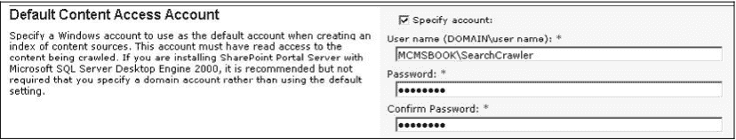

现在，我们需要为我们的 SearchCrawler 帐户授予对整个 Tropical Green 网站的订阅者权限。

> 我们假定你已经安装了 MCMS Connector for SharePoint Technologies，因为其安装程序会在 Site Manager 中创建一个 MCMS Search 订阅者组，用于搜索你的 MCMS 频道结构。有关安装 MCMS Connector 的帮助，请参阅附录 B。

1. 通过指向“开始 | 所有程序 | Microsoft Content Management Server | Site Manager”启动 Site Manager。
2. 在 Site Manager 的左侧面板中选择“用户角色”按钮。
3. 选择“订阅者”用户角色。
4. 然后右键单击“MCMS Search User Subscribers”角色并选择“属性”。
5. 单击“组权限”选项卡，查看 MCMS Search User 角色拥有权限的所有频道、模板和资源。所有频道、模板和资源都应处于勾选状态。
6. 单击“组成员”选项卡，并单击“修改”按钮。
7. 输入我们上面添加的 `MCMSBOOK\SearchCrawler` 用户作为 SharePoint 爬网帐户，然后点击“确定”。
8. 再次点击“确定”以关闭属性窗口。

现在，我们已经配置 SharePoint 使用专用帐户爬网我们的站点，并授予该帐户访问 Tropical Green 站点内所有内容的权限。

## 为 Tropical Green 启用来宾访问

由于我们的站点将向公众开放，我们需要确保它不会要求访问者登录。要将我们的 Tropical Green 站点配置为允许来宾查看，我们需要启用来宾访问。如果你想了解如何完成此操作的完整详细信息，在第一本书《*使用 Microsoft Content Management Server 构建网站*》（Packt Publishing，2005 年 1 月，ISBN 1-904811-16-7）中给出了完整说明。另请参阅第 18 章中的“*欢迎来宾访问站点*”一节。

> 如果你已经为站点配置了来宾访问，则可以跳过此步骤。

为了允许来宾进入我们的站点，我们需要：

1. 在域中或作为服务器上的本地用户创建一个新的 MCMS 来宾帐户。
2. 使用 SCA 配置 MCMS，以允许来宾进入，并使用步骤 1 中创建的帐户作为来宾登录帐户。
3. 现在 MCMS 已配置为允许来宾进入站点，请将步骤 1 中创建的帐户添加到订阅者权限组，并授予该权限组访问站点中当前存在的所有频道、资源库和模板库的权限，但位于 Gardens 频道中的 Members 频道除外。

> 为了简单起见，我们选择启用站点的来宾访问。不过，SharePoint 也可以使用 Forms 或 Windows 身份验证来索引我们的站点。对于 Forms 身份验证，我们需要创建一个特殊的首页，该页面使用预定义帐户自动将用户登录，以便访问站点并让 SharePoint 开始爬网。我们必须授予 SharePoint 爬网帐户相应的订阅者权限组权限。
>
> 如果你选择创建一个备用首页，让 SharePoint 自动登录到你的站点，请记住，任何用户都可以使用这个页面来访问你的站点。如果使用这种方法，应特别小心，例如向此页面添加 IP 限制，以便只有 SharePoint 服务器才能访问它。

## 发布项的输出缓存和 Last-Modified 日期

在生成 HTTP 状态代码方面，ASP.NET 并不特别复杂，它只是为每个请求返回 HTTP 状态代码 200（OK），而不是发送 Last-Modified HTTP 头。当 SharePoint Portal Server 执行增量索引爬网时，它会向发现的站点上的每个页面发送 HTTP GET 请求。如果某个页面之前已被索引并返回了 Last-Modified 头，SharePoint Portal Server 会发送一个条件 HTTP GET 请求，其中包含 If-Modified-Since HTTP 头，其日期为之前 Last-Modified HTTP 头中返回的日期。如果响应是 HTTP 状态代码 304（未修改），SharePoint 将不会重新索引该页面。但是，由于 ASP.NET 总是返回状态代码 200，该站点将永远不会被 SPS 增量爬网，实际上每次执行采集器时都会进行一次完整索引。由于 MCMS 模板文件实际上是一种特殊的 ASP.NET Web 窗体，因此这也会影响基于这些模板文件的发布项。有关如何解决此问题的说明，请参阅第 4 章“准备发布项以进行搜索索引”。

需要考虑的一点是频道渲染脚本，以及包含指向其他发布项的链接的动态列表的发布项。虽然这些脚本和发布项自上次索引以来可能未发生变化，但这些脚本生成的内容可能会在发布项的不同调用之间发生变化。如果这些内容是你希望搜索的内容，则应确保包含此类控件的发布项始终被索引，方法是不返回 Last-Modified HTTP 头。

## 使用 SharePoint 搜索 MCMS

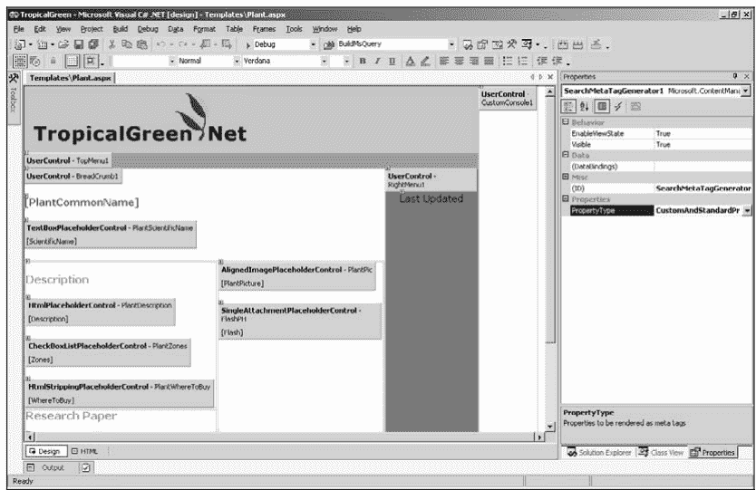

5. 由于 Visual Studio .NET 设计器不允许我们将控件拖放到页面的 `<head></head>` 部分，我们需要将 SearchMetaTagGenerator 控件的代码声明从页面主体移动到 head 部分。切换到 HTML 视图，找到我们刚刚添加的 SearchMetaTagGenerator 控件，并将其向上移动到 `<head>` 和 `</head>` 标记之间。
6. 与任何更改一样，我们现在应该重新生成 Tropical Green 项目。
7. 打开浏览器，在站点中导航到该站点植物目录部分中的一个植物发布项。花点时间查看你导航到的发布项的源代码。请注意所有已添加的额外 META 标签。下面是一个示例：

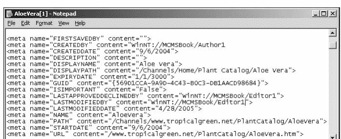

> 请注意 META 标签顶部列出的 FIRSTSAVEDBY 属性。这是已添加到发布项中的自定义属性。它会添加到 META 标签中，是因为我们在 SearchMetaTagGenerator 控件中选择了 CustomAndStandardProperties 属性类型。其他 META 标签是 SearchMetaTagGenerator 控件生成的标准属性。

渲染后，任何使用 Plant 模板实现的发布项都将在页面的 `<HEAD>` 部分为页面的每个自定义属性和标准属性包含 META 标签。

PropertyType 字段中可供我们使用的选项之一是 `PropertiesFromXMLFile`。此选项允许我们使用位于 `Microsoft Content Management Server\Server\IIS_CMS\WssIntegration\SearchPropertyCollection.xml` 的 XML 文件来精确指定哪些属性将作为 META 标签导出。

一旦你指定了要使用的属性，包括你添加的自定义属性，就需要告诉 SharePoint 在爬网时索引这些属性。MCMS Connector 附带的控制台应用程序 `SearchPropertiesSetup.exe` 会将更新后的 XML 文件告知 SharePoint。请使用以下语法运行它：

```
SearchPropertiesSetup.exe -file "<path to file>\SearchPropertyCollection.xml"
```

> SearchPropertiesSetup.exe 实用工具可在以下位置找到：
> `<install drive>:\Program Files\MCMS 2002 Connector for SharePoint Technologies\WSS\bin\`。

请按上述方式执行 SearchPropertiesSetup.exe 实用工具，因为我们的自定义搜索解决方案将使用它生成的其中一个 META 标签。

> 如果更改 SearchPropertyCollection.xml 文件，则需要重新执行 SearchPropertiesSetup.exe 实用工具。

MCMS Connector for SharePoint Technologies 包含一个帮助文件，其中介绍了如何修改此 XML 文件。请注意，微软支持知识库中有一篇文章专门说明该帮助文件说明中的错误。MSKB 文章“在 Content Management Server 2002 Connector for SharePoint Technologies 中向模板添加 SearchMetaTagGenerator 控件时出现问题”（#872932）包含更正后的说明。

我们的 Tropical Green 站点现已配置为允许来宾访问；我们的模板已经过修改，以便对 SPS 搜索更友好；并且我们已在所有渲染发布项的 `<HEAD>` 部分中包含了额外的元数据。现在，让我们继续在 SharePoint 中创建内容源来索引我们的站点。

## 配置 SharePoint Portal Server 搜索

我们的 MCMS 站点已准备好进行索引，现在转向 SPS。首先，我们将配置 SharePoint 为我们的 Tropical Green 站点建立索引。创建索引后，我们将创建一个源组，该源组将


一个常见错误，地址无法找到，通常是由链接到未配置使用频道渲染脚本的空频道引起的。由于我们预计访客在浏览网站时会收到此错误，因此 SharePoint 收集器遇到相同问题也就不足为奇了。这不是 SharePoint 索引的问题，而是我们网站结构的问题：可能为空的频道应具有频道渲染脚本或从导航中隐藏。

- 6. 如果没有问题，我们可以测试我们的索引。点击门户导航中的 Home 链接进入主页。在右上角，选择下拉菜单中的 TropicalGreen.net (SearchSetup.exe)（由于下拉菜单宽度设计限制，全名可能不会全部显示），在搜索框中输入 ficus，然后点击绿色箭头执行搜索。搜索结果应能找到植物目录中的帖子。

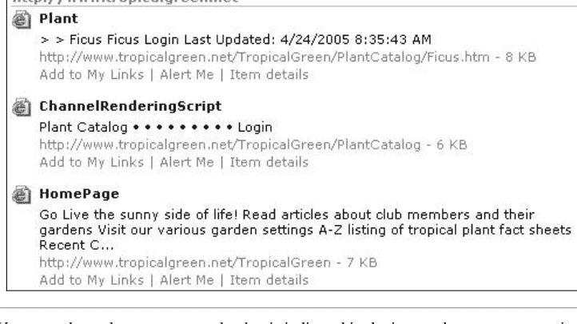

您的搜索结果可能与上图所示不符，因为您的帖子可能最近已被修改。

我们现在已创建了一个 SharePoint 搜索范围并对我们的 Tropical Green 网站进行索引。虽然此搜索范围可在门户内用于搜索我们的网站，但我们将通过 MCMS 网站上的 SPS Query Service Web Service 使用它，为用户提供搜索功能。

## 手动创建内容源

另一种选择是手动在 SharePoint 中创建内容源，而不是允许 SearchSetup.exe 实用程序为我们创建。我们将逐步指导您完成这些步骤，以便您了解在 SharePoint 门户中创建内容源和源组所涉及的内容。

尽管我们解释了如何使用 SearchSetup.exe 实用程序和手动使用相同的内容源名称创建内容源，但您必须只选择一种方法，因为无法创建两个具有相同名称的内容源。

让我们开始在我们的 SharePoint 门户中创建我们 Tropical Green 网站的索引：

请参阅附录 A，了解创建门户步骤的演练。

- 1. 通过指向 开始 | 所有程序 | SharePoint Portal Server | SharePoint 中央管理 来启动 SharePoint 中央管理。
- 2. 点击 门户站点和虚拟服务器配置 部分下的 列出并管理门户站点。
- 3. 管理门户站点 页面包含 SharePoint 农场中所有门户的列表。将鼠标光标拖到列表的右侧，并在鼠标光标悬停在门户上方时出现的下拉箭头上点击，然后选择 管理门户站点属性（如下图所示）：
- 4. 在 搜索设置和索引内容 部分下，点击 配置搜索和索引 链接。

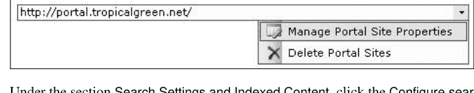

以下说明假定您尚未启用 SharePoint 的高级搜索管理模式。基本模式和高级模式的主要区别在于高级模式允许您直接使用内容索引。基本模式在创建内容源时创建内容索引。在我们的示例中，基本模式足以满足我们的需求。

现在我们将创建内容源。

- 1. 在 通用内容设置和索引状态 部分下，点击 添加内容源 链接。
- 2. 在 添加内容源 页面上，选择 Web 页面或网站 并点击下一步。

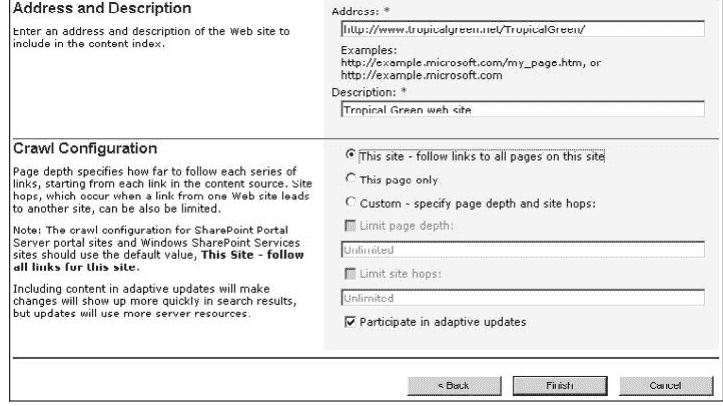

- 4. 一旦您在上一步中点击完成，SharePoint 将创建内容源并向您展示确认页面。在 创建的 Web 页面或网站内容源 底部，在 开始更新 部分，勾选 开始完整更新 选项并点击确定。这将触发收集器开始构建 Tropical Green 网站的索引。

手动创建内容源后，请按照 创建新的搜索范围 部分下的说明，使用以下表格中的设置创建新的源组：

| 字段 | 值 |
| --- | --- |
| 名称： | TropicalGreen.net |
| 主题和区域： | 在此范围内不包含任何主题或区域 |
| 内容源组： | 将范围限制为以下内容源组：<br>Tropical Green 网站 |

## MCMS 应用池帐户的搜索权限

SharePoint 门户通常不允许匿名用户访问站点，用户必须登录。随 MCMS Connector 提供的 SearchResultControl，我们稍后会使用它，使用触发搜索查询的 MCMS 站点所在的应用池标识帐户的帐户来访问 SharePoint 搜索服务。

- 1. 通过打开 Internet Explorer 并导航到 http://portal.tropicalgreen.net 浏览我们之前创建的门户。然后，点击右上角的 站点设置。
- 2. 在 通用设置 部分下，选择 管理安全性和其他设置。
- 3. 在 管理站点组 页面上，点击 添加站点组。当提示输入新组的信息时，输入以下值：

| 属性 | 值 |
|---|---|
| 站点组名称 | 仅搜索 |
| 描述 | 此站点组授予用户查询搜索索引的权利 |
| 权限 | 搜索 – 搜索门户站点及所有相关内容 |

> 当您选择 搜索 – 搜索门户站点及所有相关内容 时，SharePoint 会自动勾选 查看页面 – 在区域中查看页面 选项。在勾选搜索选项后取消勾选查看页面选项。

- 4. 在 管理站点组 页面上，点击 Search Only，即我们新组的名称。
- 5. 在 “Search Only” 的成员 页面上，点击 添加成员。添加配置为您的 MCMS 站点运行的应用池标识的帐户。选择帐户后，点击确定。

> 要找到您的 MCMS 站点运行的应用池的标识，请打开 Internet Information Services。展开 本地计算机 | 应用池 节点。查找您的 MCMS 站点配置为使用的应用池并查看其属性。标识列在 标识 选项卡下。

- 6. 选择帐户后，在 添加用户 页面上，确保在 步骤 2：选择站点组 部分下已勾选 Search Only，然后点击确定。
- 7. 在最后一页，SharePoint 会要求您确认要添加的帐户的详细信息，确保未勾选 发送以下电子邮件以通知这些用户他们已被添加 选项，然后点击完成。

我们的 MCMS 站点现在具有登录我们的门户并执行搜索所需的权限。

## 向 MCMS 站点添加搜索页面

我们有两种可用的选项来实现我们 Tropical Green 站点的搜索功能：

- 利用 MCMS Connector for SharePoint Technologies 中包含的 ASP.NET 服务器控件，允许执行搜索查询。
- 创建我们自己的解决方案。

MCMS Connector 包含以下三个控件，可帮助您通过利用 SharePoint 搜索范围为 MCMS 站点实现搜索功能：

- **SearchInputControl：** 用于创建要提交的搜索的搜索表单输入。
- **SearchResultControl：** 接收 SearchInputControl 中输入的搜索条件，对 SPS 搜索 Web 服务执行搜索，并以列表形式显示结果。
- **SearchMetaTagGenerator：** 根据 PropertyType 设置创建 HTML META 标签。生成的 META 标签可包括标准页面属性以及自定义属性。

您可以在同一页面或不同页面上使用这三个控件。这非常方便，因为您可能希望在站点所有页面上包含一个小的搜索关键词输入框，将搜索提交到单独的结果页面，但您也可能希望在搜索结果页面上提供搜索输入。

一旦我们使用 MCMS Connector 控件创建了可工作的搜索页面，我们将创建一个不包含 MCMS Connector 提供的任何内容的自定义解决方案。我们的解决方案将包括针对我们站点的高级搜索和自定义搜索结果列表。

两种选项各有明显的优缺点。您在 MCMS 站点上实现哪一种将完全取决于您的需求、定制需求和可用的开发时间。以下表格概述了使用 MCMS Connector 控件以及自行构建解决方案的一些更突出的优点和缺点：

## 利用 MCMS Connector 控件实现搜索：

| 优点 | 缺点 |
|---|---|
| 快速安装并集成到页面和模板中 | 无法自定义搜索输入控件 |
| 开箱即用，最小配置即可工作 | 无法自定义搜索结果列表 |

## 使用自定义解决方案实现搜索：

| 优点 | 缺点 |
|---|---|
| 完全控制搜索输入表单的布局 | 需要额外的开发时间和测试 |
| 完全控制搜索结果列表 | |
| 根据特定站点需求创建特殊高级搜索 | |

## 使用 MCMS SharePoint Connector 进行搜索

我们首先要做的就是在我们的 Tropical Green 项目中创建一个新的搜索页面。此页面不会是新的 MCMS 模板，而是一个普通的 ASP.NET 页面。您可以将其设为模板，但这样做没有实际优势，因为我们的网站上只有一个搜索页面且没有额外内容。

- 1. 在 Visual Studio .NET 中，右键点击 Tropical Green 项目并选择 添加 Web 表单。
- 2. 将新的 ASPX 页面命名为 Search.aspx 并点击打开。
- 3. 如果页面未在设计模式下加载，请点击左下角的设计。


+   4. 将页面布局更改为 **FlowLayout**。
+   5. 从解决方案资源管理器将 /Styles/styles.css、/UserControls/TopMenu.ascx 和 /UserControls/RightMenu.ascx 文件拖放到设计器上。
+   6. 切换到 HTML 模式并按如下方式修改 body 标签：
+   `<body topmargin="0" leftmargin="0" rightmargin="0">`
+   7. 在 `<form>` 和 `</form>` 标签之间添加以下代码，替换刚刚添加的两个用户控件：
+   ```
+   <form id="Form1" method="post" runat="server">
+   <table width="100%" border="0" cellspacing="0" cellpadding="0">
+   <tr>
+   <td width="100%" colspan="2" valign="top" bgcolor="#ffc00">
+   
+   </td>
+   <td vAlign="top" rowSpan="10">&nbsp;</td>
+   </tr>
+   <tr bgColor="#66cc33">
+   <td colspan="2"><uc1:TopMenu id="TopMenu1" runat="server"></uc1:TopMenu></td>
+   </tr>
+   <tr>
+   <td vAlign="top" style="PADDING-RIGHT:30px; PADDING-LEFT:30px; PADDING-BOTTOM:30px;">
+   <p>&nbsp;</p>
+   <table cellspacing="0" cellpadding="10" border="1" bordercolor="#669900">
+   <tr vAlign="top">
+   <td>Tropical Green Search:</td>
+   </tr>
+   <tr>
+   <td vAlign="top">
+   </td>
+   </tr>
+   </table>
+   </td>
+   <td class="RightMenuBar" width="20%" valign="top" height="100%" align="center" rowspan="2" bgcolor="#669900">
+   <uc1:RightMenu id="RightMenu1" runat="server"></uc1:RightMenu>
+   </td>
+   </tr>
+   </table>
+   </form>
+   ```

## 为什么我们要将用户控件拖到页面上然后再替换生成的 HTML？

将用户控件拖到页面上会为我们自动添加 ASPX 中的 `<%@ Register %>` 行，以及 HTML 中的用户控件 ASP.NET 标签。然后我们只需要修改 HTML 使其更美观即可。

## 使用 SharePoint 搜索 MCMS

现在你在设计模式下查看的页面应该如下所示：

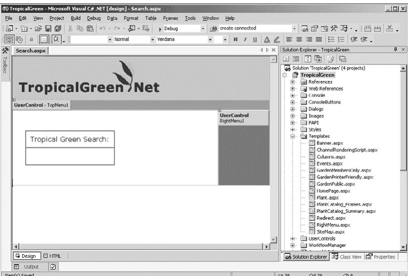

让我们保存新的搜索页面，构建 Tropical Green 项目，并在浏览器中导航到它，以确保一切正常，然后再添加搜索输入和结果控件。

+   1. 保存 search.aspx 页面的所有更改。
+   2. 右键单击 TropicalGreen 项目并选择 Build。
+   3. 如果构建没有错误，打开浏览器并导航到：http://www.tropicalgreen.net/TropicalGreen/Search.aspx。
+   4. 如果有任何问题，重新检查我们到目前为止采取的步骤，解决错误，然后重试该 URL。

现在我们已经有一个可用的搜索页面，我们需要为其添加一些功能。我们将添加两个 MCMS Connector 服务器控件，进行一些配置更改，构建解决方案并测试我们的搜索页面。

+   1. 如果尚未打开，请在 Visual Studio .NET 中打开 search.aspx 页面，并切换到设计视图。
+   2. 打开 Visual Studio .NET 工具箱并将 SearchInputControl 和 SearchResultsControl 拖入 Tropical Green Search 单元格下方的表格单元格中。参考以下图片了解放置位置：

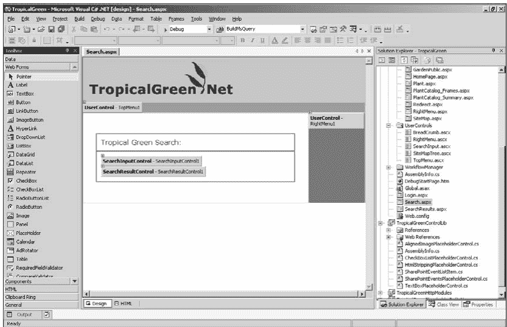

3. 选择我们添加到 search.aspx 的 SearchInputControl 并在 Visual Studio .NET 属性窗口中设置以下属性：

| 属性 | 值 |
|---|---|
| SearchMode | Simple |
| SearchResultPage | /TropicalGreen/Search.aspx |

4. 选择我们添加到 search.aspx 页面的 SearchResultControl 并使用 Visual Studio .NET 属性窗口设置以下属性：

| 属性 | 值 |
|---|---|
| PortalUrl | http://portal.tropicalgreen.net/ |
| SearchResultPageSize | 10 |

> 我们使用的是附录 A 中创建的门户的 URL。请用你在本章前面步骤中为内容源和搜索组配置的门户 URL 替换此 URL。

## 使用 SharePoint 搜索 MCMS

让我们看看我们的搜索是否正常工作。保存 search.aspx 的所有更改，构建 Tropical Green 项目，并在浏览器中访问 http://www.tropicalgreen.net/TropicalGreen/Search.aspx。你应该会看到如下类似的页面：

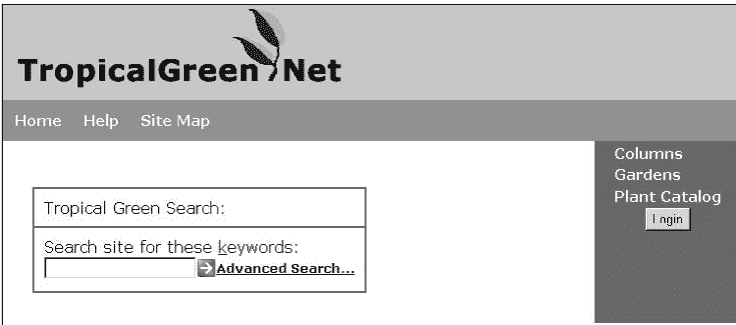

输入一个你知道会在网站上找到的词，例如 ficus。你会看到与在包含内容索引的门户中搜索同一字符串时返回的搜索结果列表相同。

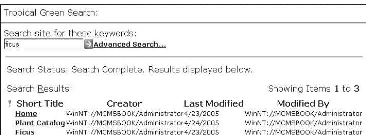

如果收到错误消息“加载输入控件时出现问题。系统返回的错误是：找不到路径的一部分 c:\inetpub\wwwroot\tropicalgreen\cms\wssintegration\searchpropertycollection.xml”，请仔细检查你是否在 TropicalGreen Web 应用程序中添加了 CMS 虚拟目录。

此时，我们的网站已通过 MCMS Connector 控件和 SPS 的搜索功能获得了搜索能力。但此解决方案非常有限，例如无法更改这些控件的外观和感觉，也无法配置结果页面中显示的属性，例如为返回的文档显示简短描述。

为了解决这个问题，我们现在将构建自己的搜索控件。

## 构建自定义搜索实现

如前所述，MCMS Connector 搜索控件有优点也有缺点。最明显的是 SearchResultControl 不允许我们配置 SPS 搜索返回的结果。我们现在将构建自己的搜索实现，该实现将利用 SPS 搜索 Web 服务，为用户提供高级和专门的搜索功能，并以可自定义的方式呈现结果。

### 关于 SharePoint Portal Server 查询服务

我们即将构建的一切都依赖于 SPS 中包含的查询服务 Web 服务，该服务向远程客户端（如我们的网站）公开搜索功能。此 Web 服务接受 Microsoft.Search.Query XML 格式的请求，并以 Microsoft.Search.Response XML 格式返回响应。为了构建健壮的解决方案，我们提交的请求将使用 Microsoft SQL 语法进行全文搜索。查询服务提供的一种方法是 QueryEx，我们将使用它，因为它以 DataSet 的形式返回结果。

> 有关 Microsoft SharePoint Portal Server 查询服务 Web 服务的更多信息和文档，请参阅 MSDN 文档：
> http://msdn.microsoft.com/library/default.asp?url=/library/en-us/spptsdk/html/cPSQueryService_SV01004360.asp。

### 构建搜索输入控件

我们首先要做的是构建一个搜索输入控件，该控件将向页面提交搜索查询以进行处理。此实现将使我们能够快速地将小型搜索组件添加到所有模板中。在提交搜索查询后，我们的用户控件将把查询参数添加到查询字符串并将请求重定向到结果页面。

让我们先开始创建一个新的用户控件。

+   1. 在 Visual Studio .NET 中，右键单击 Tropical Green 项目中的 User Controls 文件夹，并选择 Add | Add Web User Control。
+   2. 将新控件命名为 SearchInput.ascx。
+   3. 在设计视图中，从工具箱拖放控件到 Web 表单上并按如下所示排列：

| 控件 | 属性 |
|---|---|
| TextBox | ID = txtSearchInput |
| Button | ID = btnExecuteSearch<br>Text = Go |
| LinkButton | ID = lnkAdvancedSearch<br>Text = advanced search options |

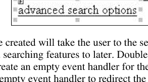

4. 我们创建的 LinkButton 将把用户带到搜索结果页面，我们稍后将为其添加一些高级搜索功能。双击我们的 LinkButton。Visual Studio .NET 将为 Click() 事件创建一个空事件处理程序。向此空事件处理程序添加一行代码以将用户重定向到搜索结果页面：

```
private void lnkAdvancedSearch_Click(object sender, System.EventArgs e)
{
    Response.Redirect(Request.ApplicationPath + "/SearchResults.aspx");
}
```

5. 接下来，我们需要为用户单击 Go 按钮时创建一个事件处理程序。我们将获取 TextBox 中输入的关键字并将搜索请求发送到搜索结果页面。双击 Go 按钮并将以下代码添加到事件处理程序中：

```
private void btnExecuteSearch_Click(object sender, System.EventArgs e)
{
    string keywords = this.txtSearchInput.Text;
    keywords = HttpUtility.UrlEncode(keywords);
    Response.Redirect(Request.ApplicationPath
        + "/SearchResults.aspx?keywords="
        + keywords);
}
```

让我们看看我们新的搜索输入控件是否一切正常。保存更改并构建项目。如果收到任何错误消息，请重新检查步骤并确保没有拼写错误。

在使用此控件之前，我们需要将其添加到现有模板中。虽然我们理想情况下希望在网站的所有页面上提供搜索功能（通常通过将其添加到全局页眉控件），但我们现在只将其添加到主页。

+   1. 打开 \Templates\HomePage.aspx 模板并将我们新的 SearchInput.ascx 拖到顶部单元格中，位于 logo 的右侧。
+   2. 切换到 HTML 视图并找到我们刚刚添加的控件。它很可能具有 uc1:SearchInput 的开始标签。用 HTML DIV 包裹此控件并将其对齐方式设置为右对齐，如以下代码所示：

```
<td width="100%" colspan="2" valign="top" bgcolor="#ffcc00">
    &nbsp;
    <div align="right">
        <uc1:SearchInput id="SearchInput1" runat="server"></uc1:SearchInput>
    </div>
</td>
```


+   1. 右键单击项目并选择 Add | Add Web Form。
+   2. 将新页面的名称设为 SearchResults.aspx。
+   3. 在 Design 视图中，从 Solution Explorer 将 Styles.css 文件拖放到表单上以将样式表应用到页面。
+   4. 将页面布局更改为 FlowLayout。
+   5. 将以下用户控件拖到设计器中：
+      - \UserControls\TopMenu.ascx
+      - \UserControls\RightMenu.ascx
+   6. 切换到 HTML 视图并按如下方式修改 body 标签：
+      <body topmargin="0" leftmargin="0">
+   7. 在 <form> 标签之间向页面添加以下 HTML 代码，替换我们刚刚添加的两个控件：

```
<form id="Form1" method="post" runat="server">
<table width="100%" border="0" cellspacing="0" cellpadding="0">
<tr>
<td width="100%" colspan="2" valign="top" bgcolor="#ffcc00">

</td>
<td valign="top" rowspan="10">
</td>
</tr>
<tr bgcolor="#66cc33">
<td colspan="2">
<uc1:TopMenu id="TopMenu1" runat="server">
</uc1:TopMenu>
</td>
</tr>
<tr>
<td valign="top" style="PADDING-RIGHT:30px; PADDING-LEFT:30px; PADDING-BOTTOM:30px; PADDING-TOP:10px">
<p>&nbsp;</p>
<table cellspacing="0" cellpadding="10" border="1" bordercolor="#669900">
<tr valign="top">
<td>
<b>Tropical Green Search:</b>
</td>
</tr>
<tr>
<td valign="top">
<b>Advanced Search</b>
<p>
<b>Search Results</b>
</td>
</tr>
</table>
</td>
<td class="RightMenuBar" width="20%" valign="top" height="100%" align="center" rowspan="2" bgcolor="#669900">
<uc1:RightMenu id="RightMenu1" runat="server">
</uc1:RightMenu>
</td>
</tr>
</table>
</form>
```

我们现在有了高级搜索和搜索结果页面的基本布局，其外观与我们网站中的其他模板类似。让我们为高级搜索添加一些控件。

+   1. 在 Design 视图中，从 Toolbox 拖动一个 TextBox 并将其放置在 Advanced Search 文本下方。
+   2. 在 Design 视图中，从 Toolbox 拖动一个 Button 并将其放置在 TextBox 的右侧。
+   3. 我们需要添加的下一件事是包含搜索结果的 DataGrid。在 Design 视图中，从 Toolbox 拖动一个 DataGrid 控件到 Add Search Results Here 文本正下方。我们稍后再担心格式化此控件，现在我们只需要一些东西来显示我们的数据。
+   4. 根据以下表格设置我们刚刚添加的控件的属性：

| Property | Value |
|---|---|
| TextBox | ID = txtAdvancedSearch |
| Button | ID = btnAdvancedSearch<br>Text = Go |
| DataGrid | ID = dgrSearchResults |

我们的高级搜索页面现在应该如下所示：

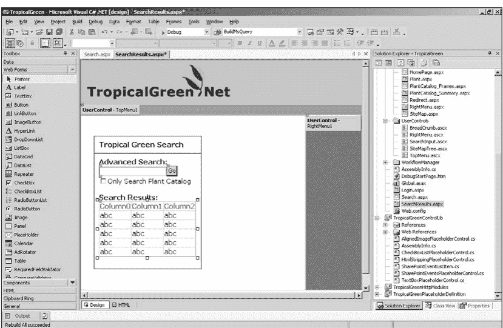

现在是开始编写搜索逻辑的时候了。首先，我们需要为高级搜索按钮添加一个事件处理程序。

+   1. 在 Design 视图中，双击 btnAdvancedSearch 按钮以创建单击事件处理程序。Visual Studio .NET 将在代码隐藏文件中添加一个事件处理程序方法。
+   2. 将以下代码添加到 btnAdvancedSearch_Click() 事件处理程序中：

```
private void btnAdvancedSearch_Click(object sender, System.EventArgs e)
{
    string keywords = this.txtAdvancedSearch.Text;
    keywords = HttpUtility.UrlEncode(keywords);
    Response.Redirect(Request.ApplicationPath
        + "/SearchResults.aspx?keywords="
        + keywords);
}
```

接下来，我们需要在 Page_Load() 事件处理程序中检查 querystring，以查看是否从 SearchInput.ascx 控件或 txtAdvancedSearch TextBox 传递了任何关键字。

添加以下代码以检查是否提供了任何关键字并在提供时执行搜索：

```
private void Page_Load(object sender, System.EventArgs e)
{
    if (Request.QueryString["keywords"] != null
        && Request.QueryString["keywords"] != String.Empty)
    {
        string keywords = Request.QueryString["keywords"];
        DataSet ds = ExecuteSearch(keywords);
        this.dgrSearchResults.Visible = true;
        this.dgrSearchResults.DataSource = ds;
        this.dgrSearchResults.DataBind();

        // autofill the keyword input box with the search keywords
        this.txtAdvancedSearch.Text = keywords;
    }
    else
    {
        this.dgrSearchResults.Visible = false;
    }
}
```

现在我们需要创建将对 SPS 内容索引执行搜索的方法。此方法将：

+   - 创建我们刚刚添加到项目的 Query Service Web Service 的实例。
+   - 调用将构建要提交给 Query Service 的 MSQuery 的方法。
+   - 执行搜索。
+   - 将搜索结果绑定到 DataGrid。

在 SearchResults.aspx.cs 文件中导入以下命名空间：

```
using System.Security.Principal;
using System.Runtime.InteropServices;
using System.Net;
using System.Text;
using System.Text.RegularExpressions;
using Microsoft.ContentManagement.Publishing;
```

将以下方法添加到 SearchResults.aspx.cs 文件中 Page_Load() 事件处理程序之后。此方法将确保当前线程在任何可能之前调用的模拟下仍在原始安全上下文下运行：

```
```csharp
// Get reference to the RevertToSelf method
[DllImport("ADVAPI32.DLL")]
public static extern int RevertToSelf();

/// <summary>
/// Builds the appropriate MSQuery,
/// submits the query to the SPS Query Service,
/// and returns the results as a DataGrid.
/// </summary>
/// <param name="keywords">String of keywords to search for.</param>
/// <returns>DataSet of search results.</returns>
private DataSet ExecuteSearch(string keywords)
{
    // decode the list of keywords
    keywords = HttpUtility.UrlDecode(keywords);

    // create reference to the Query Service Web service
    net.tropicalgreen.portal.QueryService spsQueryService =
        new net.tropicalgreen.portal.QueryService();

    // use the current application pool identity to login
    // to the SharePoint Query Service Web service
    WindowsIdentity CurrentUser = WindowsIdentity.GetCurrent();

    try
    {
        // use the Application Pool account to do access the
        // SharePoint Search Services
        RevertToSelf();
        spsQueryService.Credentials = CredentialCache.DefaultCredentials;
    }
    catch(System.Exception exception)
    {
        throw new System.Exception(exception.Message);
    }
    finally
    {
        // ensure that the original user is being impersonated again
        CurrentUser.Impersonate();
        CurrentUser = null;
    }

    // build MSQuery XML string to send to the Query Service
    // - change the content source to "CMSChannels" if you used SearchSetup.exe
    string msQuery = BuildMSQuery(keywords, "Tropical Green website");

    // execute the query and return the dataset
    return spsQueryService.QueryEx(msQuery);
}
```
```

> 如果您使用 SearchSetup.exe 程序创建了内容源，则应将代码中“ Tropical Green website”改为内容源组“CMSChannels”。

我们的 ExecuteSearch() 方法调用另一个名为 BuildMSQuery() 的方法，该方法构造要发送到 QueryEx() Web 方法的 MSQuery。MSQuery 由 XML 标签组成，这些标签为 Query Service 提供指令，例如请求中返回的结果数

和一个 Microsoft SQL 全文 (MSSQLFT) 查询。构建 MSSQLFT 查询和 MSQuery 可能是实现 SharePoint 搜索中最复杂的部分。我们将其分为两个任务：构建实际的 MSSQLFT 查询和构建 MSQuery XML 字符串。我们将首先构建 MSQuery 将在构造发送到 Query Service 的 XML 字符串时使用的全文查询。

## 构建 Microsoft SQL 全文查询

SPS 的搜索过程使用全文索引和查询来快速查找关键字，以便及时响应最终用户。全文查询与 Microsoft SQL Server 中的常规 T-SQL 查询非常相似，但您可以使用额外的函数或谓词来增强查询的功能。其中一个在搜索 SharePoint 索引时有用的谓词是 FREETEXT。FREETEXT 接受由空格分隔的单词列表，确定哪些单词和短语是重要的，并使用该信息构建内部查询以高效地搜索目标数据。

首先，您需要了解查询中可用的各种字段或属性。SharePoint 在门户的 Site Settings 管理页面中提供了此信息列表。

+   1. 打开 Internet Explorer 的新实例并导航到我们的门户：http://portal.tropicalgreen.net。
+   2. 单击右上角的 Site Settings 链接。
+   3. 在 Search Settings and Indexed Content 部分下，单击 Manage properties from crawled documents 链接。

对于每个被抓取的文档，Manage Properties of Crawled Content 页面列出了 SharePoint 可能包含索引数据的所有属性。对于我们的目的，我们只会查看以下两个字段，因为它们包含我们搜索结果页面的信息：

+   - DAV:href
+   - DAV:getlastmodified

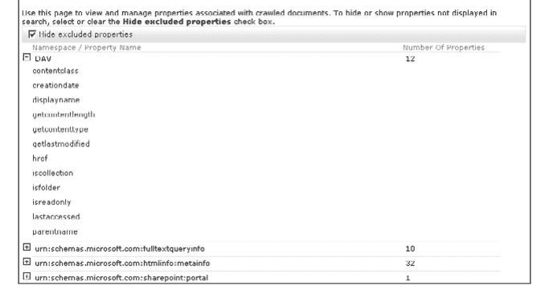


请注意，urn:schemas.microsoft.com:htmlinfo:metainfo 组下列出的一些字段，与我们使用 MCMS Connector 中的 SearchMetaTagGenerator 用户控件添加到模板 META 标签中的字段相同。

我们还需要其他一些信息：我们创建的搜索范围名称、内容索引名称以及关键字。一旦获得了所有这些信息，为了可读性，最合理的做法是将 MSSQLFT 查询构建在独立的方法中。我们将这个方法命名为 BuildMssqlftQuery()，并向它传递包含搜索关键字和要查询的搜索范围的字符串。请在 SearchResults.aspx.cs 页面末尾添加以下方法：

```csharp
/// <summary>
/// Builds the Microsoft SQL FullText query based on the parms.
/// </summary>
/// <param name="keywords">Keywords submitted for search.</param>
/// <param name="searchScope">SPS Search scope to filter.</param>
/// <returns>String of the MSSQLFT query.</returns>
private string BuildMssqlftQuery(string keywords, string searchScope)
{
    StringBuilder mssqlftQuery = new StringBuilder();
    ArrayList whereClause = new ArrayList();

    #region FILTER: keywords
    // list of keywords to include
    if (keywords != null && keywords.Length >0)
    {
        // add the keyword filter, use a calculated weighted field
        // just as SPS does
        whereClause.Add(string.Format("{0} {{1}}",
            "WITH (\"DAV:contentclass\":0,"
            + "\"urn:schemas.microsoft.com:fulltextqueryinfo:description\":0,"
            + "\"urn:schemas.microsoft.com:fulltextqueryinfo:sourcegroup\":0,"
            + "\"urn:schemas-microsoft-com:office:office#Keywords\":1.0,"
            + "\"urn:schemas-microsoft-com:office:office#Title\":0.9,"
            + "\"DAV:displayname\":0.9,"
            + "\"urn:schemas-microsoft-com:publishing:Category\":0.8,"
            + "\"urn:schemas-microsoft-com:office#Subject\":0.8,"
            + "\"urn:schemas-microsoft-com:office:office#Author\":0.7,"
            + "\"urn:schemas-microsoft-com:office:office#Description\":0.5,"
            + "\"urn:schemas-microsoft-com:sharepoint:portal:profile:PreferredName\":0.2,contents:0.1,*:0.05) "
            + "AS #WeightedProps, "
            + "FREETEXT(#WeightedProps, \"" + keywords.ToString().Trim() + "\")"
        );
    }
    #endregion

    #region FILTER: sps source group
    // filter source group
    whereClause.Add(string.Format("{0}",
        "(\"urn:schemas.microsoft.com:fulltextqueryinfo:Sourcegroup\" = \""
        + searchScope + "\"))"));
    #endregion

    //build search query
    mssqlftQuery.Append("SELECT ");
    mssqlftQuery.Append("\"DAV:href\", ");
    mssqlftQuery.Append("\"DAV:getlastmodified\"");
    mssqlftQuery.Append(" FROM Non_Portal_Content..SCOPE()");
    mssqlftQuery.Append(" WHERE ");
    int i=0;
    foreach (string s in whereClause)
    {
        if (i > 0)
            mssqlftQuery.Append(" AND ");
        mssqlftQuery.Append(s);
        i++;
    }
    return mssqlftQuery.ToString();
}
```

注意，我们添加了一个计算字段，用于为某些字段应用一定权重。SharePoint 实际上就是这样执行其自身搜索的。您可以配置属性权重，以在查询中更加强调特定属性。例如，您可能希望赋予页面标题或存储在 HTML META 标签中的关键字比页面内容更高的权重。

现在我们已经有了这个方法，接下来继续创建 MSQuery 字符串。我们将在构造 MSQuery 字符串时使用这个方法。

## 构建 MSQuery XML 字符串

我们知道，SPS 查询服务 Web 服务只接受一个参数：MSQuery 字符串。该字符串实际上是一个 XML 文档，但作为字符串传递给查询服务。这个字符串中的 XML 标签告诉查询服务它支持的响应类型、结果中返回的记录数以及开始搜索结果的起始结果索引。`<StartAt></StartAt>` 元素可用于对结果集进行分页。由于我们的站点较小，我们不会在其中加入分页功能，但您可以看到实现分页是多么容易。

让我们开始创建 BuildMSQuery() 方法，该方法返回一个完整的 MSQuery XML 字符串，其中包含针对 SharePoint 索引执行查询所需的全部信息。请在 SearchResults.aspx.cs 页面末尾添加以下方法：

```csharp
/// <summary>
/// Builds an MSQuery with an embedded MSSQLFT query embedded
/// for submission to SharePoint Query Service.
/// </summary>
/// <param name="keywords">Keywords submitted for search.</param>
/// <param name="searchScope">SPS Search scope to filter.</param>
/// <returns>MSQuery</returns>
public string BuildMSQuery(string keywords, string searchScope)
{
    StringBuilder msQuery = new StringBuilder();

    // create the main header of the XML string
    msQuery.Append("<?xml version=\"1.0\" encoding=\"utf-8\" ?>"
        + "<QueryPacket xmlns=\"urn:Microsoft.Search.Query\" "
        + "Revision=\"1000\">"
        + "<Query domain=\"QDomain\">"
        + "<SupportedFormats>"
        + "<Format>urn:Microsoft.Search.Response.Document.Document</Format>"
        + "</SupportedFormats>");

    // create the actual full-text query
    msQuery.Append("<Context>"
        + "<QueryText language=\"en-US\" type=\"MSSQLFT\">"
        + "<![CDATA[" + this.BuildMssqlftQuery(keywords, searchScope)
        + "]]</QueryText></Context>");

    // create the range, page, and number of results
    // to return
    msQuery.Append("<Range><StartAt>1</StartAt><Count>20</Count>"
        + "</Range></Query></QueryPacket>");
    return msQuery.ToString();
}
```

MSQuery 在开头 QueryPacket 节点之后的两个节点（Query 和 SupportedFormats）不应修改。Context 节点包含实际的搜索查询，您可以根据需求更改。最后一个节点 Range 包含指令，用于告诉 SPS 查询服务 Web 服务返回多少结果以及从哪个索引开始结果集。

例如，如果您每页显示 20 条结果，并且想要显示第三页结果，则应将 StartAt 节点设置为 41，并将 Count 节点保留为 20。

现在，我们拥有了一个包含全文查询的完整 MSQuery 字符串。

让我们看看搜索现在是否能够正常工作。构建 Tropical Green 项目并导航到 http://www.tropicalgreen.net/。在搜索框中输入 ficus，然后点击 Go。您应该会看到与下图类似的结果（稍后我们会考虑让它看起来更美观）：

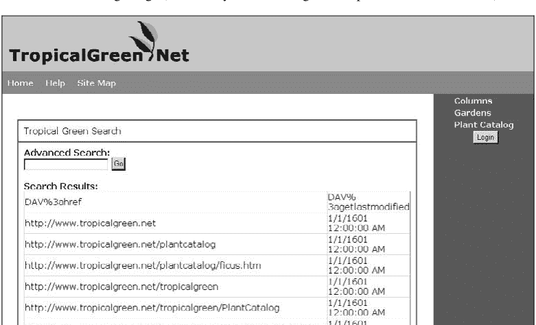

每个好的搜索引擎提供的功能不仅仅是关键字搜索。有些站点按主题过滤，有些按产品过滤。就我们而言，我们可以将所有结果过滤为仅显示植物目录，排除站点的其余部分。使用 MCMS Connector 提供的控件，您无法以用户友好的方式做到这一点。虽然知识渊博的访客可能会意识到他们可以在高级搜索选项之一中输入部分 CMS 路径，但对于网站的普通访客来说，这并不直观。这正是您可以真正开始利用自定义搜索组件的地方。

- 4. 让我们看看过滤器是如何工作的。保存更改并构建 Tropical Green 项目。构建完成后，打开浏览器并导航到 http://www.tropicalgreen.net/TropicalGreen/SearchResults.aspx。在文本框中输入 ficus，选中“仅搜索植物目录”复选框，然后点击 Go 按钮：

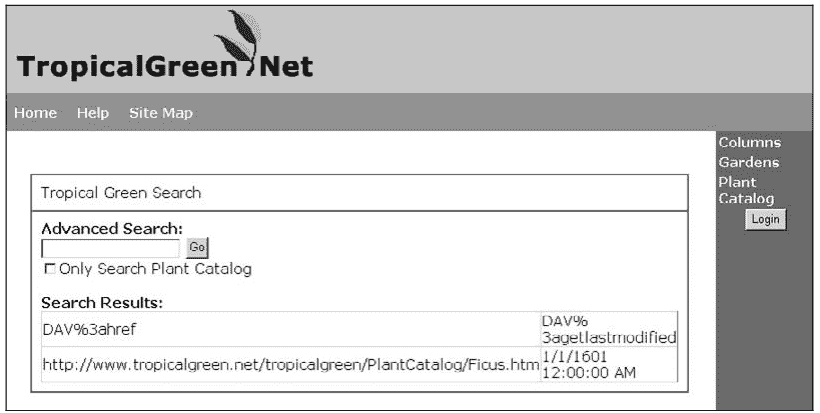

太棒了！现在我们只看到 Tropical Green 植物目录中的记录！这让我们很好地了解了过滤带来的好处。我们可以按很多事情进行过滤，例如只显示最近一个月或一周内更新过的文章。可能性几乎是无穷无尽的。

让我们看看能否通过去掉 DataGrid 并用 Repeater 替换它来清理这些搜索结果。同时，我们将添加对搜索结果的过滤，以便用户只能看到他们有权访问的文章。

尽管我们在全文查询中列出了许多 SharePoint 索引属性，但在主结果页分析结果时，我们将只使用 DAV:href 属性来获取对指定 MCMS 频道或文章的引用，以确定用户是否有权浏览该资源，并确定和返回实际文章的名称和描述。

- 1. 在设计视图中打开 SearchResults.aspx 页面。删除 DataGrid。
- 2. 将 Repeater 对象拖放到页面上原来放置 DataGrid 的位置。为 Repeater 分配 ID 为 rptSearchResults。
- 3. 在设计视图中，选择新的 Repeater 并打开“属性”窗口。在窗口顶部，单击“事件”按钮以显示我们可以使用的所有事件。双击 ItemDataBound 右侧的框，创建一个空的事件处理程序，该处理程序将在每次将项目绑定到 Repeater 时触发。
- 4. 切回到 SearchResults.aspx 的 HTML 视图，滚动到新的 Repeater。


```
else
{
    // try to get the object via the URL
    return CmsHttpContext.Current.Searches.GetByUrl(url);
}
// if this point reached, unknown URL
return null;
}
catch
{
    return null;
}
```

3. 现在，找到 `rptSearchResults_ItemDataBound()` 事件处理程序。我们需要在 Repeater 中绑定到 `ItemTemplate` 或 `AlternatingItemTemplate` 时捕获该事件。然后，我们将获取正在绑定到模板的数据项的引用，在我们的例子中是一个 DataRow，并获取我们在模板中添加的 ASP.NET 对象的引用。最后，我们将使用 DataRow 中的数据来填充控件的属性。以下是我们完成的 `ItemDataBound()` 事件处理程序的样子：

```
private void rptSearchResults_ItemDataBound(object sender,
    System.Web.UI.WebControls.RepeaterItemEventArgs e)
{
    if ((e.Item.ItemType == ListItemType.AlternatingItem)
        || (e.Item.ItemType == ListItemType.Item))
    {
        // get a reference to the datarow being bound
        DataRow row = e.Item.DataItem as DataRow;
        HierarchyItem hi = GetResult(row[0].ToString());

        // get references to all the ASP.NET objects
        PlaceHolder resultContainer = e.Item.FindControl("phdSearchResult")
                                      as PlaceHolder;
        HyperLink resultTitle = e.Item.FindControl("hlkResultTitle")
                                as HyperLink;
        Literal resultDesc = e.Item.FindControl("litResultDescription")
                             as Literal;

        // if the URL doesn't resolve to an MCMS resource,
        // output it to the results
        if (hi != null)
        {
            // user has rights to this item so display it.
            resultContainer.Visible = true;

            // use values in DataRow to populate objects
            resultDesc.Text = hi.Description;
            if (hi is ChannelItem)
            {
                resultTitle.Text = (hi as ChannelItem).DisplayName;
                resultTitle.NavigateUrl = (hi as ChannelItem).Url;
            }
            else
            {
                if (hi is Resource)
                    resultTitle.NavigateUrl = (hi as Resource).Url;
                resultTitle.Text = hi.Name;
            }
        }
    }
}
```

最终结果看起来像这样：

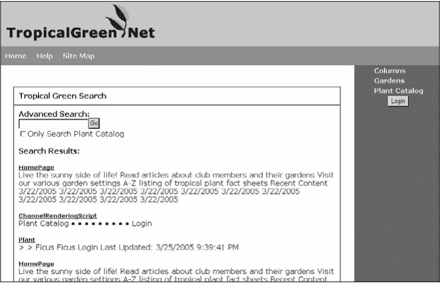

你会看到描述字段可能并不完全是我们想要的，但这种技术让我们可以随心所欲地自定义搜索结果列表。你可以直接从索引值中提取帖子的描述，前提是你使用 SearchPropertyCollection.xml 文件公开了页面描述。或者，你甚至可以在所有模板中放置一个名为“Search Description”的 HtmlPlaceholder，让内容所有者输入在搜索结果中显示时要展示的描述。

## Summary

在本章中，我们讨论了 MCMS 开发人员为其站点添加搜索功能可用的一些选项。我们深入研究了 SharePoint Portal Server 内置的搜索功能，以及它们如何被用作 MCMS 站点的后端搜索主力。在开始添加搜索功能之前，我们必须对站点和模板进行一些更改，并使用 SharePoint 构建一个索引来爬取我们的站点。

一旦我们的站点配置为索引爬取，并且 SharePoint 配置为爬取我们的站点并构建索引，我们就详细探讨了使用 SharePoint 爬虫为 Tropical Green 站点添加搜索功能的两种选项：

- 首先，我们使用 MCMS Connector for SharePoint Technologies 实现搜索，这是一个开箱即用的解决方案。
- 然后，我们构建了自己的解决方案，使用 SharePoint Query Service Web Service 和自定义全文 T-SQL 查询来提供搜索过滤器和自定义结果。
