## Publishing Content Between MCMS and SharePoint

Microsoft Content Management Server (MCMS) 和 SharePoint Products and Technologies (SPS 和 WSS) 提供了互补的功能集。MCMS 是一种内容发布产品，提供强大的发布工作流引擎。SharePoint 是一种在线协作产品，为用户提供共享信息（如文档库和列表）的平台。它还包含一个集中式的企业级搜索和索引引擎，使用户能够在许多较小的站点内搜索不同类型的内容。两者都不能被视为彼此的替代品，因为它们具有如此具体且不同的用途。然而，如果正确利用，这两种产品的核心功能可以相互受益。

在本章中，我们将探讨在两种产品之间发布 MCMS 和 SharePoint 内容，以展示利用两种产品各自强大功能所带来的诸多可能性。我们首先将研究一些不同的场景，说明为什么、如何以及何时希望从一种产品向另一种产品发布内容。然后，我们将详细研究从 MCMS 发布内容到 SharePoint 以及反之亦然的情况。每个分析都将检查 MCMS Connector for SharePoint Technologies 为完成这些内容共享任务提供了什么，以及讨论并在某些时候构建自定义解决方案，以填补 Connector 因其定制能力有限而留下的空白。

正如你所期望的，本章不会涵盖使用 SharePoint Portal Server 作为 MCMS 站点的搜索引擎，因为这已在第 5 章 *Searching MCMS with SharePoint* 中详细讨论过。

在本章中，我们将进一步探讨 SharePoint 和 MCMS 如何携手合作，提供强大的内容创作和协作解决方案。

在某些情况下，建立在 SPS 和 MCMS 之上的内联网实现将通过部署多个门户来促进员工之间的在线协作，这些门户从数百个或数千个较小的 WSS 站点聚合内容。小团队使用这些团队站点进行项目、新产品、程序和任务的开发。与此同时，人力资源部门正在使用 MCMS 来严格控制公司政策、标准、规则和程序，这些内容更具导向性，需要发布工作流解决方案。两种产品如何被利用来提供单一解决方案的可能性是无穷无尽的。

除了单一的组合解决方案之外，SPS 和 MCMS 还可以部署在不同的环境中，以解决不同的业务挑战。例如，公司可能会使用 MCMS 实现其互联网站点，并使用 SPS 或 WSS 实现内部部门站点。然而，即使两种产品未组合在一起，它们也可以相互发布和提取内容和数据。考虑一个由产品团队使用的 WSS 站点，用于管理产品相关的活动和文档。公司互联网站点可以从 WSS 站点中的活动列表 Web Part 中提取内容，以向非员工展示即将举行的活动。此外，WSS 站点可以从互联网站点中提取包含产品销售信息的帖子供内部使用。这消除了内容录入和管理的重复。

> 上述描述的解决方案概述了在组织内部使用 SharePoint 的情况，其中部分内容发布到互联网，但这并不是常见场景。利用 MCMS 和 SharePoint Portal Server 的最常见情况是两种产品都在公司内部使用，如内联网示例中所述，因为使 SharePoint 数据可供公司非员工访问需要购买 External Connector License，这是一个重大的成本因素。

这些只是你如何将 SPS 和 MCMS 结合起来为业务问题或挑战提供解决方案的两个例子。幸运的是，微软认识到这两种产品非常互补，并提供了一套免费的工具和实用程序，供开发人员快速启动将两种产品融合在一起：MCMS Connector for SharePoint Technologies（以下简称 Connector）。

### Joining MCMS and SharePoint in a Single Solution

没有一种最佳的方式来连接这两种产品。正如我们之前所讨论的，每个产品都有强大的领域可以互补。你需要评估哪种方式最适合特定业务挑战的需求。在做出这一决定之前，你需要了解每个产品如何实现。

MCMS 可以配置为从一个或多个配置为 MCMS Web Entry Points 的 IIS 网站提供内容。无论单个物理服务器上有多少个 MCMS Web Entry Points，所有 MCMS Web Entry Points 都将使用相同的 MCMS Repository，因为每台机器只能配置一个数据库。


## 在 MCMS 和 SharePoint 之间发布内容

当 SharePoint 和 MCMS 位于同一台物理服务器上时，您可以选择在独立的虚拟服务器中运行它们，也可以在同一虚拟服务器中运行它们。

> 在 Microsoft Internet Information Services 中，虚拟服务器也称为网站。

如您所见，对于这两个产品的部署方式，您有多种选择：

- 1. 将 MCMS 和 SharePoint 部署在同一台物理服务器和同一个虚拟服务器上
- 2. 将 MCMS 和 SharePoint 部署在同一台物理服务器但不同的虚拟服务器上
- 3. 将 MCMS 和 SharePoint 部署在不同的物理服务器上，因而使用不同的虚拟服务器

由于选项众多，您需要首先决定的事项之一是：这两个产品中哪一个将作为解决方案的主要入口点。如果 SharePoint 和 MCMS 位于不同的物理服务器或虚拟服务器上，则两者均可充当主要入口点。但是，如果 MCMS 和 SharePoint Portal Server 配置为在同一虚拟服务器上运行，并且用户访问站点根目录（例如 http://www.TropicalGreen.net），则 SharePoint 将是主要入口点。

> 在同一虚拟目录中运行 MCMS 和 SPS 需要在 SharePoint 管理中进行一些手动配置，以排除某些 URL 路径不被 SharePoint ISAPI 筛选器管理。这允许请求由 MCMS ISAPI 筛选器处理。遗憾的是，SharePoint 不允许排除门户的根目录。这意味着任何发送到虚拟服务器根目录的 HTTP 请求（如 http://www.TropicalGreen.net/default.aspx）都将由 SharePoint ISAPI 筛选器处理。只有根目录以下的子目录（例如 http://www.TropicalGreen.net/TropicalGreen/default.aspx）可以排除在 SharePoint 之外，从而由 MCMS 管理。
> 
> 有关如何在同一虚拟服务器上设置 MCMS 和 SharePoint 的更多信息，请参阅附录 A《_在同一虚拟服务器上设置 MCMS 和 SPS_》。

本章将介绍可覆盖两种情况的解决方案：MCMS 和 SharePoint 位于同一虚拟服务器上，以及位于不同服务器（虚拟或物理）上。如果您选择在不同的物理服务器上运行这两个产品，则需要实现一个自定义解决方案来在计算机之间发布内容。最常见的方法是使用 Web 服务。

> SharePoint 附带一长串 Web 服务，可公开其大部分内容。这些 Web 服务位于站点根目录下的 `_vti_bin` Web 应用程序中，该应用程序为每个 SharePoint 门户和 Windows SharePoint Services 站点自动创建。有关为 MCMS 创建 Web 服务的更多信息，请参阅第 11 章《_与 Web 服务结合的 InfoPath_》，该章节涵盖了 MCMS 的 Web 服务。在该章节中创建的 Web 服务由 Microsoft Office InfoPath 使用，但也很容易被自定义代码使用。

- Tropical Green 使用 MCMS 和 SharePoint 来提供完整的 Intranet 解决方案。SharePoint 主要用于托管较小的团队站点，并为整个 Intranet 提供集中式搜索引擎，而 MCMS 则在 Intranet 中内容密集的部分被使用。

在上述场景中，您会注意到一个共同点：解决方案从一个环境（例如 SharePoint 或 MCMS）提取内容，以在另一个环境中显示。请注意，内容不会被复制，并且是只读的（SharePointDocumentLibrary 占位符除外，MCMS 模板使用它来显示 SharePoint 文档库中的内容）；内容只是被拉取进来，从而减少了数据重复。限制数据重复可以减少错误以及管理、更新两个产品中信息的成本。然而，解决方案的整体性能将会下降，因为如果它拥有数据的副本而不是从另一个产品实时拉取数据，性能会更好。上述三个场景虽然相当简单，但应该能让您了解在 SharePoint 和 MCMS 之间共享内容的一些可能性。

## 用于 SharePoint 技术的 MCMS 连接器

2004 年 2 月，Microsoft 发布了该连接器，其中包含一组 SharePoint Web 部件、MCMS 控件和占位符，以及一些命令行实用程序，开发人员可以利用这些工具在 MCMS 中发挥 SharePoint 的优势，反之亦然。该连接器完全免费、由 Microsoft 提供支持并有完整文档，且包含一个示例项目（带数据），演示了该包中包含的功能。

> 有关从何处获取连接器、安装说明以及其所包含内容的详细信息，请参阅附录 B“用于 SharePoint 技术的 MCMS 连接器”。

我们将要讨论的第一个场景涉及在 SharePoint 中呈现 MCMS 内容。连接器提供了三种使用 Web 部件在 SharePoint 站点中查看 MCMS 内发布项的方法。

- MCMS 页面列表 Web 部件：显示所选 MCMS 频道中的发布项列表。该列表的呈现可通过不同视图进行修改。本章稍后我们将为此 Web 部件创建一个自定义视图。
- MCMS 生产中的页面 Web 部件：显示当前用户正在处理的发布项列表，类似于 MCMS 中的生产经理。
- MCMS 等待审批的页面 Web 部件：显示可由当前用户批准的发布项列表，类似于 MCMS 中的审批助手。

安装连接器后，这三个 Web 部件会自动安装到所有门户站点上。如果您要在安装连接器之后创建门户，则需要手动安装这三个 Web 部件，它们都包含在一个单独的 CAB 文件中。遗憾的是，连接器附带的文档并未说明如何安装 Web 部件。SharePoint 要求您使用命令行实用程序来安装 Web 部件并执行其他管理功能。此实用程序 stsadm.exe 位于目录 C:\Program Files\Common Files\Microsoft Shared\web server extensions\60\BIN\ 中。

## 安装 MCMS 连接器 Web 部件

- 1. 单击“开始”|“运行”（或按 Windows + R），在对话框中输入 cmd 以打开命令行窗口。

- 2. 输入 cd c:\Program Files\Common Files\Microsoft Shared\web server extensions\60\BIN\，将目录更改为 STSADM.EXE 实用程序所在的位置。

- 3. 在安装之前，我们先查看一下我们站点上所有门户中已安装了哪些 Web 部件。我们使用 enumwppacks 选项来执行此操作，该选项将显示每个虚拟服务器上安装的所有 Web 部件的列表。在提示符下输入以下命令：STSADM.exe -o enumwppacks。如果您尚未向门户中安装任何内容，您应该会看到类似下面的信息：

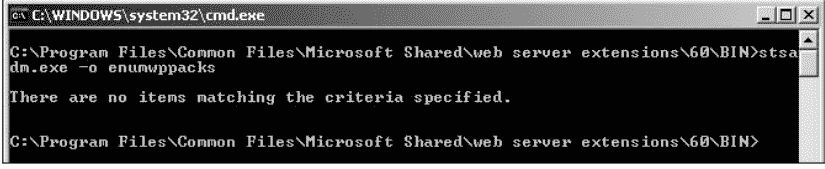

- 4. 现在，让我们继续将连接器 Web 部件安装到我们服务器上所有已扩展 SharePoint 的虚拟服务器中。您需要找到包含连接器所附带的三个 Web 部件的 CAB 文件。如果您将连接器安装到了默认安装目录，您会在 c:\Program Files\MCMS Connector for SharePoint Technologies\WSS\Bin\CmsWebParts.cab 找到 CAB 文件。在命令控制台中输入以下内容：STSADM.exe -o addwppack -filename "C:\Program Files\MCMS Connector for SharePoint Technologies\WSS\Bin\CmsWebParts.cab"。您应该会看到如下响应：

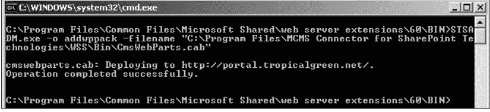

- 5. 看起来一切安装成功。让我们再次检查，看看 enumwppacks 选项现在报告了什么（同时确认 Web 部件已安装）。输入 stsadm.exe -o enumwppacks。您应该会看到以下内容：


现在我们已经安装了连接器 Web 部件，让我们逐一了解它们。

## MCMS 页面列表 Web 部件

MCMS 页面列表 Web 部件显示指定频道中的帖子。将此 Web 部件添加到 SharePoint Web 部件页面后，您需要指定包含要显示的帖子的 MCMS 站点根 URL 和频道路径。拥有修改 Web 部件设置相应权限的用户还可以指定每页显示的帖子数、帖子的排序顺序以及他们希望如何显示或查看列表。

让我们将 MCMS 页面列表 Web 部件添加到 SharePoint Web 部件页面，看看效果如何。

- 1. 在 Internet Explorer 中导航至 SharePoint 门户。我们将使用附录 A 中创建并在第 5 章用于搜索的门户：http://portal.tropicalgreen.net。
- 2. 单击左侧垂直“操作”菜单中的“编辑页面”链接：
- 3. 页面处于编辑模式后，单击左上角的“修改共享页面”链接。在出现的动态下拉菜单中，选择“添加 Web 部件”，然后选择“浏览”。

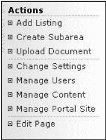

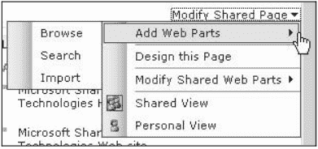

- 4. 当 SharePoint Web 部件工具窗格在浏览器右侧加载时，它会列出门户 Web 部件库中的所有 Web 部件（在我们的例子中是 Tropical Green 库）。当您在 SharePoint 站点（SPS 或 WSS）中安装 Web 部件时，它们会被添加到虚拟服务器库。由于我们安装了连接器附带的 Web 部件，因此需要通过单击选择虚拟服务器库。

### 什么是 SharePoint Web 部件工具窗格？

SharePoint Web 部件工具窗格是 SharePoint Web 部件页面上的一个任务窗格，用于从 Web 部件库添加 Web 部件，以及修改自定义和通用 Web 部件属性。

### 为什么我们安装的 Web 部件位于虚拟服务器库中？

当您安装 Web 部件时，实际上是在将其安装到特定的虚拟服务器。即使您选择将其安装到所有站点或全局程序集缓存中，也会在每个虚拟服务器中添加记录，以告知该虚拟服务器中的 SharePoint 门户（或站点）可以使用该 Web 部件。

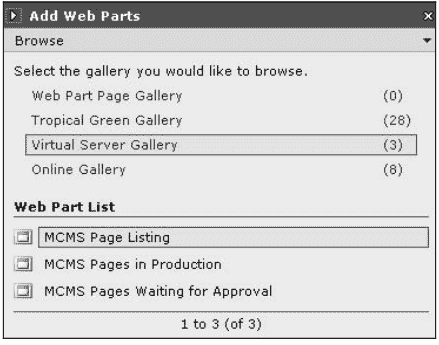

- 5. 现在，您应该会在“添加 Web 部件”工具窗格中看到连接器附带的三个 Web 部件，如前面的图像所示。选择 MCMS 页面列表，将其拖到页面上，放置在顶部区域，如下图所示：

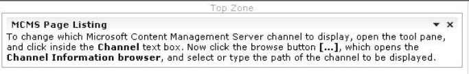

```
left:-10px;\"> {0}</span><br>".
    posting.Description) );
}
// add the last date the posting was modified
html.Append(string.Format(
    "<span style=\"margin-left:10px; font-style:italic;\"
    + ">Last Modified: {0}</span>",
    posting.LastModifiedDate.ToString("F") )); 
// return the built HTML string
return html.ToString();
}
```

至此，我们的自定义视图中的编码已完成。我们仍然需要为程序集指定强名称，这是 SharePoint 环境中运行任何程序集所必需的。

为了给程序集指定强名称，我们首先需要一个密钥。要创建密钥，我们将从 Visual Studio .NET 命令提示符中运行强名称工具：

- 1. 通过选择“开始”|“所有程序”|“Visual Studio .NET 2003”|“Visual Studio .NET 工具”|“Visual Studio .NET 2003 命令提示符”来启动命令窗口。

- 2. 为简单起见，我们将密钥放在 C: 驱动器的根目录下。在命令提示符下输入以下内容来创建密钥：

  ```
  sn -k c:\PlantCatalogCustomView.snk
  ```

  现在我们需要告诉编译器，在构建程序集时使用刚刚创建的密钥来指定强名称。为此，请打开项目中的 AssemblyInfo.cs 文件，并按照下面的代码所示修改版本号和密钥文件属性：

  ```
  [assembly: AssemblyVersion("1.0.0.0")]
  [assembly: AssemblyKeyFile("c:\\PlantCatalogCustomView.snk")]
  ```

- 3. 创建自定义视图的最后步骤包括以发布模式构建程序集并将其部署到全局程序集缓存（GAC）。要将程序集添加到 GAC，请复制项目的发布版程序集 TropicalGreenPlantCatalogCustomView.dll，并将其粘贴到 GAC 中，该 GAC 位于 C:\Windows\assembly\。

- 4. 让我们验证自定义程序集是否已成功安装到 GAC：

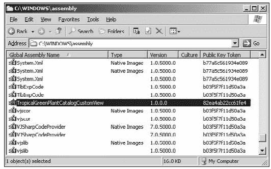

> 记下我们程序集列出的公钥令牌。稍后我们会用到它。

我们现在已经为 MCMS 页面列表 Web 部件构建并部署了第一个自定义视图。但是，在使用之前，我们需要通过修改 MCMS 应用程序的 Web.config 来注册它，该应用程序是我们在将 MCMS 页面列表 Web 部件添加到 SharePoint Web 部件页面时指定为站点根 URL 的应用程序。在我们的案例中，它是：`http://www.tropicalgreen.net/MCMS/`。

> MCMS 应用程序由服务器配置应用程序（SCA）在您将虚拟服务器设置为 MCMS Web 入口点时创建。您可以在以下目录中找到此应用程序的 Web.config：`C:\Program Files\Microsoft Content Management Server\Server\MCMS`。

打开在 MCMS 页面列表 Web 部件中指定为站点根 URL 的 Web 应用程序的 Web.config，并添加以下元素：

```xml
<?xml version="1.0" encoding="utf-8"?>
<configuration>
  <configSections>
    <sectionGroup name="CustomPageListingViews">
      <section name="CustomView1" type="Microsoft.ContentManagement.SharePoint.Dialogs.NameValueSectionHandler, Microsoft.ContentManagement.SharePoint.Dialogs, Version=1.0.1000.0, Culture=neutral, PublicKeyToken=31bf3856ad364e35" />
    </sectionGroup>
  </configSections>

  <CustomPageListingViews>
    <CustomView1>
      <add key="assembly" value="TropicalGreenPlantCatalogCustomView, Version=1.0.0.0, Culture=neutral, PublicKeyToken=82ea4ab22cc61fe4" />
      <add key="customListingType" value="TropicalGreenPlantCatalogCustomView.PlantCatalogCustomView" />
    </CustomView1>
  </CustomPageListingViews>

  - - - code continues - - -
```

> 请注意，上面 Web.config 中列出的 PublicKeyToken 与 GAC 中显示的相同。

获取公钥令牌的一种简单方法是从 GAC 中程序集的属性窗口复制它。

另一种获取公钥令牌的方法是在 Visual Studio .NET 命令窗口中输入以下命令：`c:\sn -T [path to Web Part]\mywebpart.dll`。

请记住，Web.config 与任何 XML 文件一样区分大小写，因此如果您遇到任何语法错误，请仔细检查是否有拼写错误。

现在一切都已就绪：我们的自定义视图程序集已部署到 GAC，并已注册为第一个自定义视图选项。是时候看看它是否有效了！

回到门户，通过单击左侧垂直导航中的“编辑页面”将页面切换到编辑模式，然后从 MCMS 页面列表 Web 部件的下拉菜单（通过单击右上角的下拉箭头激活）中选择“修改共享 Web 部件”以打开 SharePoint Web 部件工具窗格。展开该 Web 部件的“自定义属性”部分，为“视图”选择“自定义 1”，然后单击底部的“应用”。请耐心等待，因为您的自定义视图首次加载可能需要一点时间。加载后，您应该会看到与以下屏幕截图类似的内容：

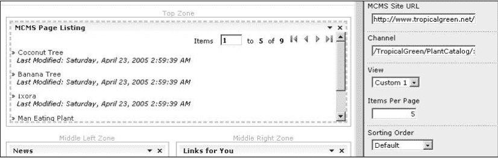

恭喜！您现在已经为 MCMS 页面列表 Web 部件构建了第一个自定义视图。

尽管自定义视图有助于创建您自己的呈现方式，但 MCMS 页面列表 Web 部件不允许完全控制 HTML 输出。不幸的是，您只能访问每行的表格单元格内容，这迫使您采用垂直列表呈现方式。如果您想以水平列表显示帖子怎么办？如果您只想显示频道怎么办？如果您想显示频道中的子频道和帖子怎么办？实现这一点的唯一方法是创建一个自定义 Web 部件，该部件引用频道内的帖子列表。

让我们看看连接器附带的另外两个 Web 部件。

## MCMS 生产中的页面 Web 部件

MCMS 生产中的页面 Web 部件显示当前登录用户已创作但尚未发布的 MCMS 站点中的帖子列表。显示的帖子来自 MCMS 站点中的所有频道，而不仅仅是特定频道。让我们实际看看这个 Web 部件。

> 连接器不支持表单身份验证，因为 SharePoint 仅支持 Windows 身份验证。这将影响 MCMS 生产中的页面 Web 部件和 MCMS 等待审批的页面 Web 部件的数据检索。
>
> 由于此限制，我们当前对 Tropical Green 网站的配置将不适用于这两个 Web 部件。尽管如此，如果您有一个使用 Windows 身份验证的 MCMS 站点，我们将逐步介绍实现和配置这些 Web 部件的步骤。


我们需要做的第一件事是将 Web Part 添加到 Web Part 页面。我们将其放在之前使用的 MCMS 页面列表 Web Part 下方。要添加该 Web Part，请重复我们添加 MCMS 页面列表 Web Part 时执行的相同步骤：

- 1. 在 Internet Explorer 中导航到 SharePoint 门户：
  http://portal.tropicalgreen.net。
- 2. 通过单击左侧垂直“操作”菜单中的“编辑页面”链接切换到编辑模式。
- 3. 单击左上角的“修改共享页面”链接。使用出现的下拉菜单，选择“添加 Web Part”，然后选择“浏览”。
- 4. 切换到“虚拟服务器库”以查看当前虚拟服务器上已安装的 Web Part。
- 5. 现在我们的页面上已经有了 Web Part，我们需要设置其属性。单击我们刚刚添加到页面上的“生产中的 MCMS 页面”Web Part 右上角的小向下箭头，然后选择“修改共享 Web Part”。
- 6. 单击“自定义属性”部分标题左侧的图标，展开“自定义属性”部分。
- 7. 我们需要告诉 Web Part 我们的 MCMS Web 应用程序的 URL。为“MCMS 站点根 URL”属性输入 http://www.tropicalgreen.net/MCMS/。单击工具窗格底部的“应用”按钮。

## 等待审批的 MCMS 页面 Web Part

“等待审批的 MCMS 页面”Web Part 显示等待当前用户审批的发布项目列表。此 Web Part 与之前的“生产中的 MCMS 页面”Web Part 具有完全相同的功能、实施步骤和配置设置。两者之间的唯一区别在于发布项目的状态。由于这两个 Web Part 非常相似，我们就不在 SharePoint Web Part 页面上逐步演示添加和配置此 Web Part 的步骤了。

## 为什么 MCMS 页面列表 Web Part 适用于启用了匿名访问的表单身份验证 MCMS 站点，而“生产中的 MCMS 页面”Web Part 和“等待审批的 MCMS 页面”Web Part 却不适用？

当您的站点配置为匿名访问时，您很可能已在 Site Manager 中为设置为 MCMS 匿名登录帐户的帐户授予了“订阅者”角色。这就是匿名访问帐户枚举指定频道中的发布项目并将其显示在 MCMS 页面列表 Web Part 中所需的全部权限。但是，“生产中的 MCMS 页面”Web Part 和“等待审批的 MCMS 页面”Web Part 需要比“订阅者”角色提供的权限更高的权限（例如作者、编辑者或审核者权限），因此这些 Web Part 将显示一条权限错误消息：“提供的 Windows 凭据无法验证。”

如果我们的 Tropical Green MCMS 站点未设置为匿名访问，我们将因相同原因遇到与 MCMS 页面列表 Web Part 相同的问题。

如果您的 MCMS 站点设置为使用 Windows 身份验证，并且您将“生产中的 MCMS 页面”Web Part 和“等待审批的 MCMS 页面”Web Part 配置为使用这个启用了 Windows 身份验证的 MCMS 站点，那么这两个 Web Part 的外观将类似于：

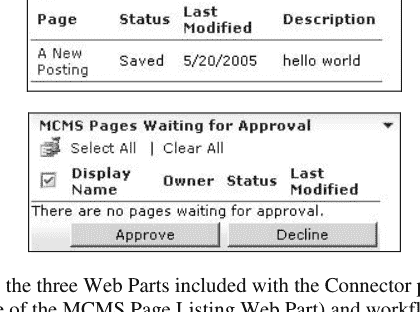

正如我们所展示的，连接器附带的三个 Web Part 提供了对 MCMS 内容的有限呈现（如 MCMS 页面列表 Web Part 的情况）和工作流管理（如“生产中的 MCMS 页面”和“等待审批的 MCMS 页面”Web Part 的情况）。如果您需要显示特定发布项目中的内容，或者以列表形式显示一系列频道和发布项目，该怎么办？

虽然 MCMS 页面列表 Web Part 可以显示频道内的发布项目，但其呈现方式有些受限。正如我们之前看到的，每个发布项目都列在一个每行一个单元格的 HTML 表格中。我们可以控制放在表格单元格中的 HTML 内容。如果我们需要对呈现方式有更多控制怎么办？或者如果我们想显示频道、子频道和发布项目的树状组织，又该怎么办？

## MCMS 连接器用于 SharePoint 的局限性

连接器解决了将内容从 MCMS 站点发布到 SharePoint 时的一些最常见需求和用途。然而，正如之前的问题所示，还有更多发布可能性。为了满足这些要求，我们可以选择构建自定义 Web Part，以更可配置的方式将内容从 MCMS 拉取到 SharePoint 中。为此，我们需要访问内容。这可以通过以下三种方式之一实现：

- 1. 将虚拟服务器扩展为 SharePoint 站点，并将其配置为 MCMS Web 入口点。此选项将允许 SharePoint 站点中的 Web Part 通过 MCMS PAPI 直接访问 MCMS 内容。这将在第 7 章“构建 SharePoint Web Part”中我们创建的 Web Part 中进行演示。
- 2. 将 MCMS 和 SharePoint 配置为在两个独立的虚拟服务器上运行。您希望发布的 MCMS 内容可以通过 MCMS 站点上的 Web 服务公开。然后，SharePoint Web Part 可以使用这些 Web 服务，并将数据呈现在 SharePoint Web Part 页面上。构建和利用 Web 服务来公开 MCMS 发布项目和频道的内容将在第 11 章“InfoPath 与 MCMS Web 服务”中介绍。

> 我们已经在第 5 章“使用 SharePoint 搜索 MCMS”中探讨了实现索引和搜索功能所涉及的所有控件和占位符。

SharePoint 文档占位符使内容所有者能够链接由 SharePoint Portal Server 管理的文档，并将其呈现在 MCMS 发布项目中。内容所有者还可以在 MCMS 页面中显示所链接文档的属性。文档及其属性的呈现方式由 XSLT 样式表控制，这些样式表可以集中控制，也可以单独应用于需要的位置。一旦文档链接到 MCMS 发布项目，用户就可以通过 SharePoint Portal Server 或 MCMS 站点访问该文档，这为用户查看文档内容提供了无缝体验，无论他们从何种环境访问该文档。

存储在 SharePoint 文档库中的任何文档都可以通过 SharePoint 文档占位符添加到发布项目。如果您选择的显示视图包含图标，该占位符将使用与 MCMS 服务器上该文档类型关联的图标。如果文档类型是 Microsoft Office InfoPath 表单或 Word 标记语言 (WordML) 文档，您可以在占位符控件中显示文档内容。相反，所有其他文档类型将作为附件和/或文档属性显示。这取决于您选择用来呈现文档库项的 XSLT 选项。

> 如果文档是 InfoPath 表单，您需要确保用户（内容消费者）对包含该表单的 SharePoint 站点具有权限。这是因为 SharePoint 文档库包含用于在 InfoPath 中显示表单的模板。

当通过 SharePoint 文档占位符将文档添加到 MCMS 发布项目时，该文档会从 SharePoint 文档库复制到 MCMS 存储库中，作为本地附件。如果文档是 XML 类型，例如 InfoPath 或 WordML 文档，则 XML 也会保存在 MCMS 占位符中（此占位符中的内容在 MCMS 站点内设置为只读）。对 SharePoint 文档库中文档所做的更改不会自动反映到 MCMS 中。连接器包含文档更新程序实用工具，用于将文档库中所做的更改同步到 MCMS（如果在创建发布项目时已在 SharePoint 文档占位符控件中选中了“自动更新”复选框）。该工具 WssDocumentUpdater.exe 可以在连接器的安装目录 C:\Program Files\MCMS Connector for SharePoint Technologies\CMS\bin\ 中找到。可以使用 Windows 任务计划程序将此命令行工具设置为按固定时间间隔运行。

## 使用 SharePoint 文档占位符

让我们看看 SharePoint 文档占位符的实际效果。首先，我们需要在 SharePoint 文档库中创建并上传一个文档：

- 1. 创建一个新的 Microsoft Word 文档，并在文档正文中输入以下文本：这是保存在 Microsoft Word 文件中的内容。
- 2. 将文档以文件名 MCMS Published Document 保存到您的桌面。
- 3. 打开 Internet Explorer 并浏览到我们的 SharePoint 门户：http://portal.tropicalgreen.net/。


4. 在门户左侧的“操作”导航下，单击“上载文档”。

   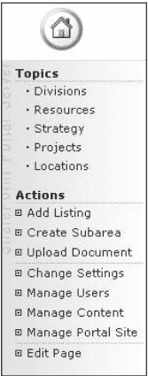

5. 在“文档库：上载文档”页面上，单击“浏览”并选择我们刚创建的文档。在“所有者”文本框中输入您的姓名，在“状态”下拉列表中选择“最终”，确保选中“为此文档添加列表项”复选框，然后点击表单顶部的“保存并关闭”。

   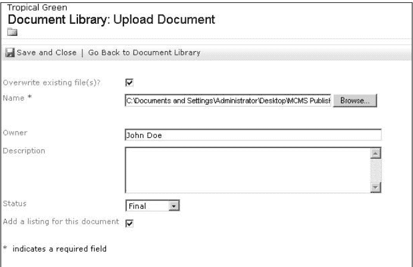

6. 在“添加列表项”页面上，只需单击页面底部的“确定”按钮即可接受所有默认选项。

上载文档并创建新的列表项后，系统会自动将您带回门户主页。如果在“为您提供的链接”Web 部件下查看，您会看到我们的文档列在列表顶部：

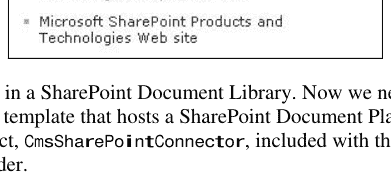

我们现在已在 SharePoint 文档库中有了一个文档。接下来需要使用一个承载 SharePoint 文档占位符的模板，在 MCMS 中创建新的发布项。在这种情况下，我们将使用连接器自带的示例项目 CmsSharePointConnector 来演示此占位符。

> 可以在 `C:\Program Files\Microsoft Content Management Server\Sample Data\CmsSharePointConnector\` 找到 CmsSharePointConnector 项目。
>
> 有关安装连接器、示例项目和示例数据的更多信息，请参阅附录 B“用于 SharePoint 技术的 MCMS 连接器”。
>
> 我们建议您仔细研究 CmsSharePointConnector 示例代码，其中包含的控件和样式可用于使您的 MCMS 发布项具有与 SharePoint 门户网站相同的观感以及导航。

打开 Internet Explorer，浏览到位于 http://portal.tropicalgreen.net/CmsSharePointConnector/ 的 CmsSharePointConnector 项目。

## 是否收到 404 未找到错误？

如果收到了，很可能是 CmsSharePointConnector Web 应用程序尚未被排除在 SharePoint 的托管路径之外。请参阅附录 A“在同一虚拟服务器上设置 MCMS 和 SPS”，添加排除路径。

CmsSharePointConnector 主页包含一些描述连接器、示例数据和有用链接的信息。我们有意使用 Internal 发布项和模板，因此请单击“Internal 频道”链接。

如您所见，Internal 频道中的主页看起来就像 SharePoint 门户网站。我们要使用 News 模板创建新发布项，因为它包含 SharePoint 文档占位符。

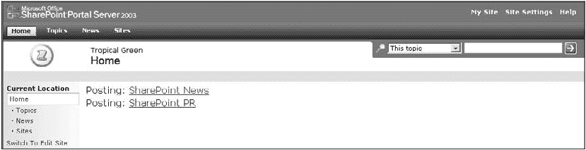

1. 单击“切换到编辑网站”链接，页面重新加载后，再单击“创建新页面”链接。

2. 当提示选择模板时，单击“Internal 模板库”，然后选择 News 模板。

3. 新发布项显示后，在最顶部的 HtmlPlaceholder 中输入以下文本：我的第一个 SharePoint 文档占位符发布项。

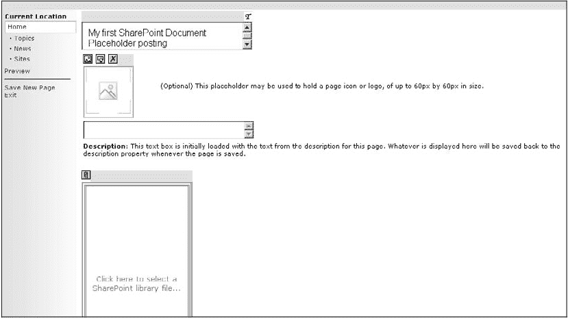

4. 现在是将我们刚创建并上载到 SharePoint 文档库的 Microsoft Word 文档添加进去的时候了。单击占位符容器内包含以下文本的占位符，激活“占位符属性”对话框：单击此处选择 SharePoint 库文件...

5. 在“占位符属性”对话框中，通过单击“MCMS Published Document.doc”链接选择我们上载的文档，并单击“下一步”按钮。

6. 现在您可以选择布局选项，这些选项可以是“无”、“带文件名的图标”或“带文件名和属性的图标”。这些布局选项可在 catalog.xml 文件中配置，可用的选项取决于文件类型。选择“带图标和属性的附件”选项，然后点击“完成”按钮。

## 占位符属性

选择用于显示文件属性和文件内容的布局。

使用以下方式显示文件属性：

| 布局 | 说明 |
| --- | --- |
| （无） | 不显示附件或文件的任何属性。 |
| 带图标的附件 | 附加所选项，并使用图标及其文件名显示。 |
| 带图标和属性的附件 | 附加所选项，并使用图标、文件名及其 SharePoint 库文件属性显示。 |

使用以下方式显示文件内容：

使用示例内容预览所选布局：

单击“使用示例内容预览所选布局：”标签旁边的“确定”按钮将打开另一个窗口，允许您查看文档在发布项中的各种显示方式。

选择文档和显示选项后，对话框将关闭，发布项将重新加载，您将看到 SharePoint 文档占位符如何显示您的文档。

让我们通过单击左侧导航中的“保存新页面”链接并为其指定名称和显示名称为“My First SP Doc Placeholder Posting”来保存并发布该发布项。然后通过单击“批准”链接发布发布项。批准发布项后，单击“切换到实时网站”链接，查看发布项在发布后的实际外观：

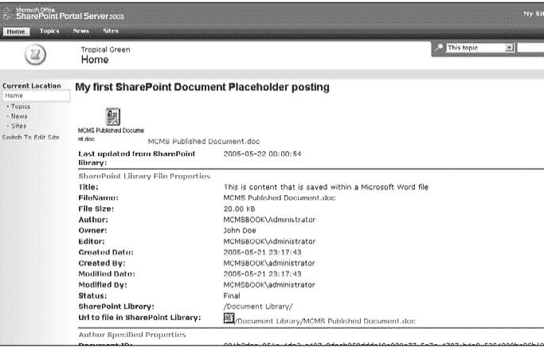

之前我们提到，您可以使用可扩展样式表语言（XSL）样式表将文档属性和内容中的 XML 转换为 HTML。文档属性和内容分别使用单独的样式表。所有文档都包含用于其文档属性的 XML 文件，但只有 InfoPath 和 WordML 文件是 XML，可以使用内容样式表进行转换。您可以在添加文档时刚刚遇到的“占位符属性”对话框中指定要在转换中使用的样式表。连接器附带了我们已使用的默认样式表。这些样式表位于 `C:\Program Files\Microsoft Content Management Server\Server\IIS_CMS\WssIntegration\Dialogs\WssDocumentFinder\TemplateCatalog\`。下表列出了连接器附带的默认样式表：

| 样式表名称 | 说明 |
| --- | --- |
| AttachmentIcon.xsl | 将文档显示为图标附件。仅当附加的文件是文档时可用。 |
| AttachmentIconProps.xsl | 将文档显示为带属性的图标附件。仅当附加的文件是文档时可用。 |
| ImageTagOnly.xsl | 内联显示图像。仅当附加的文件是图像时可用。 |
| ImageAndProps.xsl | 内联显示图像及其属性。仅当附加的文件是图像时可用。 |

上表基于随连接器附带的“Microsoft Content Management Server 2002 用于 SharePoint 技术的连接器”帮助文件中的文档。

SharePoint 文档占位符通过单个 XML 文件来确定适用于可附加到占位符的不同文件类型的样式表。该文件 catalog.xml 与上面列出的样式表位于同一目录中。catalog.xml 文件包含有关每种可用样式的以下信息：

- 样式表可以应用到的文件类型，例如 jpg、gif、contentxml 或 all（以 * 表示）
- 在“占位符属性”对话框的下拉列表中显示的描述性名称
- 样式表的说明
- 指定用于转换的 XSL 样式表位置的 URL
- 示例呈现 URL，该 URL 是一个 XML 文件，用于在附加文档时模拟发送到占位符的 XML 馈送，让用户预览最终呈现效果

此外，您还可以通过 catalog.xml 文件 type 节点中的 SpecificWebUrl 和 SpecificLibrary 属性，指定样式表可以应用到的特定库。使用 SpecificWebUrl 属性指定 WSS 或 SPS 站点，使用 SpecificLibrary 属性指定可应用样式表的 WSS 或 SPS 库的名称。

您可以为特定的 SharePoint 文档占位符实现创建自己的 catalog.xml 文件，以限制或为该库提供特定的呈现选项。只需创建一个符合 catalog.xsd 架构定义文件（与 catalog.xml 和样式表位于同一目录中）的新 XML 文件，然后在使用 SharePoint 文档占位符的 MCMS 模板的 HTML 中指定该文件，使用


`RenderingTemplateCatalogUrl` 属性并指定虚拟路径到你的目录文件。例如，如果你创建了一个名为 `mycatalog.xml` 的新目录，SharePoint 文档占位符在 MCMS 模板文件中的外观如下：

```xml
<cc1:SharePointDocumentPlaceholderControl id="SharePointDocumentPlaceholderControl" runat="server" KeepSynchronized="False" PlaceholderToBind="SPDdocument" RenderingTemplateCatalogUrl="mycatalog.xml">
</cc1:SharePointDocumentPlaceholderControl>
```

## MCMS SharePoint 连接器的局限性

不幸的是，连接器只提供了一种在 MCMS 站点中发布 SharePoint 内容的方式：`SharePointDocumentPlaceholder`，我们刚刚介绍过。但 SharePoint 门户可以包含的内容远不止文档库。SharePoint 中最常用的内容元素之一是列表。SharePoint 随附了许多不同类型的配置列表，例如问题、任务、链接、事件，以及自定义列表。这些列表非常动态、功能强大且可定制，因为它们可以从头构建。连接器最大的缺点之一是它没有提供在 MCMS 网站中发布 SharePoint 列表数据的方法。

能够拥有一个可以显示 SharePoint 列表数据的 MCMS 占位符控件会很有用。由于连接器中未包含此功能，让我们自己构建一个！

我们将继续使用之前的示例，使用我们的 Tropical Green MCMS Internet 站点 http://www.tropicalgreen.net/TropicalGreen/ 和 Tropical Green SharePoint Portal Server Intranet 门户 http://portal.tropicalgreen.net/。假设我们在 SharePoint 门户 Intranet 中有一个事件 Web 部件列表，供员工维护所有与 Tropical Green 相关的事件：

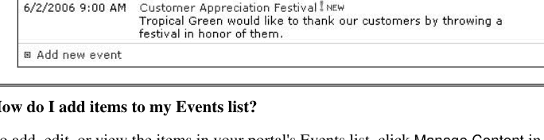

## 如何向我的事件列表添加项目？

要添加、编辑或查看门户事件列表中的项目，请从门户主页左侧操作菜单中单击管理内容。在文档和列表页面上，单击事件链接。你的列表中可能有也可能没有项目。要添加项目，请单击列表标题中的新建项目链接，输入必要的信息，然后单击表单标题中的保存并关闭链接。重复此过程任意多次。

现在，我们想要做的是在主页上显示所有这些事件。我们将构建一个自定义占位符控件，从 SharePoint 列表中检索这些事件。此自定义占位符控件将添加到现有的 `TropicalGreenControlLib` 项目中，并添加到 `Homepage.aspx` 模板中。`TropicalGreenControlLib` 项目可以在 Tropical Green 下载中找到，并创建于书籍 *Building Websites with Microsoft Content Management Server*（Packt Publishing，2005 年 1 月，ISBN 1-904811-16-7）中。

## 一个用于显示 SharePoint 列表内容的占位符控件

由于我们的占位符控件将检索列表中的所有项目，因此我们需要确定如何访问 SharePoint 门户中的实际列表。一个选项是使用 SharePoint API，但这种方法有一个缺点：我们的 MCMS 站点和 SharePoint 门户必须位于同一服务器上，因为 SharePoint API 只能访问安装它的服务器，而不能访问远程服务器。虽然这在测试环境和某些生产环境中是可行的，但限制很大。另一个选项是通过 SharePoint 随附的 Web 服务访问 SharePoint 列表。列表服务 Web 服务包含返回列表架构、添加、更新和删除项目以及检索列表内容的方法的函数。每个 SharePoint 站点都有对该 Web 服务的引用，因此所有列表都对外部应用程序可见。

通过 Web 服务访问列表比通过 API 访问列表更好。此解决方案可以在同时安装 MCMS 和 SharePoint 的服务器上工作，也可以在两个产品安装在单独服务器上的情况下工作。

我们的占位符控件 `SharePointEventsPlaceholderControl` 将利用 SharePoint 列表服务 Web 服务来检索 SharePoint 事件列表中的项目。在创作模式下，它将要求作者输入 SharePoint 站点的 Web 服务 URL 和事件列表的名称。

让我们开始吧。我们需要做的第一件事是为我们的占位符控件创建一个新类并向项目添加必要的引用：

1. 向 `TropicalGreenControlLib` 项目添加一个新类。将新类命名为 `SharePointEventsPlaceholderControl.cs`。
2. 右键单击项目并选择添加 Web 引用…
3. 在 URL 文本框中指定列表服务 URL，然后单击转到按钮。在我们的例子中，列表服务的地址是 `http://portal.tropicalgreen.net/_vti_bin/lists.asmx`。加载后，通过单击添加引用按钮接受默认的 Web 引用名称。

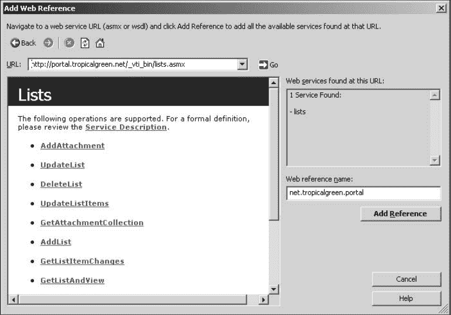

现在我们的项目已设置了对 SharePoint 列表服务 Web 服务的引用，并且包含一个空代码文件，其中将包含我们的占位符控件。

我们需要将新类从空壳转换为自定义占位符控件类，通过继承基类并重写必要的方法。为此，我们将添加对一些必要命名空间的引用，继承 BasePlaceholderControl 类，并重写基类中的五个方法（我们不需要为自定义占位符控件添加任何额外引用，因为我们使用的是 `TropicalGreenControlLib` 项目，该项目已包含所有必要的引用，因为它包含其他自定义占位符控件）：

```csharp
using System;
using Microsoft.ContentManagement.Publishing;
using Microsoft.ContentManagement.Publishing.Extensions.Placeholders;
using Microsoft.ContentManagement.WebControls;
using Microsoft.ContentManagement.WebControls.Design;

namespace TropicalGreenControlLib
{
    [SupportedPlaceholderDefinitionType(typeof(XmlPlaceholderDefinition))]
    public class SharePointEventsPlaceholderControl : BasePlaceholderControl
    {
        public SharePointEventsPlaceholderControl()
        {
        }

        protected override void CreateAuthoringChildControls
            (BaseModeContainer authoringContainer)
        {
        }

        protected override void CreatePresentationChildControls
            (BaseModeContainer presentationContainer)
        {
        }

        protected override void LoadPlaceholderContentForAuthoring
            (PlaceholderControlEventArgs e)
        {
        }

        protected override void LoadPlaceholderContentForPresentation
            (PlaceholderControlEventArgs e)
        {
        }

        protected override void SavePlaceholderContent
            (PlaceholderControlSaveEventArgs e)
        {
        }
    }
}
```

我们的空类现在包含了 MCMS 自定义占位符控件的骨架。此时，让我们考虑在发布处于创作模式时，我们需要从用户那里获得哪些输入。此占位符控件的目标是检索 SharePoint 列表的内容。我们已经有了对 SharePoint 列表服务 Web 服务的引用，我们将使用它来检索列表内容，但我们需要知道 Web 服务的确切地址，以防此控件用于访问另一个 SharePoint 站点，而不仅仅是我们的门户。Web 服务包含十二个方法，但我们只对 `GetListItems()` 感兴趣。此方法接受一些参数，但我们唯一需要关心的是 `ListName`（我们将接受其他所有参数的默认值）。

我们需要从用户那里收集以下两个值：

- 包含我们要显示的列表的 SharePoint 站点或门户的 SharePoint 列表服务 Web 服务 URL
- SharePoint 列表的名称

这意味着我们需要两个 `TextBox` 控件，每个输入一个。我们还将添加一个 `LinkButton`，它将使用提供的信息检索列表中的项目并显示事件。最后，因为我们希望控件整齐对齐，我们将使用 HTML 表格来控制布局。

为此，将以下突出显示的代码添加到代码文件顶部：

```csharp
using System;
using System.Collections;
using System.Net;
using System.Web.UI;
using System.Web.UI.HtmlControls;
using System.Web.UI.WebControls;
using System.Xml;
using Microsoft.ContentManagement.Publishing;
using Microsoft.ContentManagement.Publishing.Extensions.Placeholders;
using Microsoft.ContentManagement.WebControls;
using Microsoft.ContentManagement.WebControls.Design;
```

```csharp
namespace TropicalGreenControlLib
{
    [SupportedPlaceholderDefinitionType(typeof(XmlPlaceholderDefinition))]
    public class SharePointEventsPlaceholderControl : BasePlaceholderControl
```


```
```csharp
{
    // authoring controls
    TextBox txbSharePointUrl;
    TextBox txbListName;
    LiteralControl litEventItemsLiteral;
    HtmlTable tblLayout;

    public SharePointEventsPlaceholderControl()
    {
    }
    - - - code continues - - -
```
```

接下来我们需要构建占位符控件的用户界面部分。我们将通过在我们重写的 `CreateAuthoringChildControls()` 方法中创建一个 HTML 表格来实现：

```
```csharp
protected override void CreateAuthoringChildControls(BaseModeContainer authoringContainer)
{
    // create our layout table
    tblLayout = new HtmlTable();

    // build row containing the SharePoint URL input prompt
    tblLayout.Rows.Add(BuildAuthoringSharePointSiteTableRow());

    // build row containing the SharePoint Event List name input prompt
    tblLayout.Rows.Add(BuildAuthoringSharePointEventListTableRow());

    // add table to the authoring container
    authoringContainer.Controls.Add(tblLayout);
}
```
```

现在我们需要创建这些 HTML 表格行的构建方法。我们首先需要的是创建 SharePoint 站点 URL 和列表名称输入的方法：

```
```csharp
private HtmlTableRow BuildAuthoringSharePointSiteTableRow()
{
    HtmlTableRow row;
    HtmlTableCell cell;

    // create sharepoint Web service label & input
    txbSharePointUrl = new TextBox();

    row = new HtmlTableRow();
    cell = new HtmlTableCell();
    cell.Controls.Add(new LiteralControl("SharePoint Portal Site URL:<br>"));
    cell.Controls.Add(txbSharePointUrl);
    row.Cells.Add(cell);

    // return the built row
    return row;
}

private HtmlTableRow BuildAuthoringSharePointEventListTableRow()
{
    HtmlTableRow row;
    HtmlTableCell cell;

    // create SharePoint event list name label & input
    txbListName = new TextBox();

    row = new HtmlTableRow();
    cell = new HtmlTableCell();
    cell.Controls.Add(new LiteralControl("SharePoint Event List Name:<br>"));
    cell.Controls.Add(txbListName);
```
```

```
row.Cells.Add(cell);
// return the built row
return row;
}
```

让我们看看我们的占位符控件目前的样子。构建 TropicalGreenControlLib 项目。假设没有错误，现在让我们将占位符控件添加到模板中。与其将其添加到现有模板，不如在 TropicalGreen 项目中创建一个新的模板文件（在 Templates 子目录下）并将其命名为 Events.aspx。使用 Homepage.aspx 模板作为 Events.aspx 页面的基础，但删除内容区域，以便最终的 Events 模板页面的 HTML 包含以下内容（注意我们添加了新的占位符控件的高亮部分）：

```
<%@ Page language="c#" Codebehind="Events.aspx.cs" AutoEventWireup="false" Inherits="TropicalGreen.Templates.Events" %>
<%@ Register TagPrefix="uc1" TagName="DefaultConsole" Src="../Console/DefaultConsole.ascx" %>
<%@ Register TagPrefix="cc1" Namespace="TropicalGreenControlLib" Assembly="TropicalGreenControlLib" %>
<%@ Register TagPrefix="uc1" TagName="RightMenu" Src="../UserControls/RightMenu.ascx" %>
<%@ Register TagPrefix="uc1" TagName="TopMenu" Src="../UserControls/TopMenu.ascx" %>
<!DOCTYPE HTML PUBLIC "-//W3C//DTD HTML 4.0 Transitional//EN" >
<HTML>
<HEAD>
<title>Events</title>
<meta content="Microsoft Visual Studio .NET 7.1" name="GENERATOR">
<meta content="C#" name="CODE_LANGUAGE">
<meta content="JavaScript" name="vs_defaultClientScript">
<meta content="http://schemas.microsoft.com/intellisense/ie5" name="vs_targetSchema">
<LINK href="/tropicalgreen/Styles/Styles.css" type="text/css" rel="stylesheet">
</HEAD>
<body leftMargin="0" topMargin="0">
<form id="Form1" method="post" runat="server">
<table cellSpacing="0" cellPadding="0" width="100%" border="0">
<tr>
<td vAlign="top" width="100%" bgColor="#ffcc00" colSpan="2">

</td>
<td vAlign="top" rowSpan="10">
<uc1:DefaultConsole id="DefaultConsole1" runat="server"></uc1:DefaultConsole>
</td>
</tr>
<tr bgColor="#66cc33">
<td colSpan="2">
<uc1:topmenu id="TopMenu1" runat="server"></uc1:topmenu>
</td>
</tr>
<tr>
<td style="PADDING-RIGHT: 30px; PADDING-LEFT: 30px; PADDING-BOTTOM: 30px; PADDING-TOP: 10px" vAlign="top">
<p>&nbsp;</p>
<b>Tropical Green Events</b>
<cc1:SharePointEventsPlaceholderControl id="SharePointEvents" runat="server" PlaceholderToBind="SharePointEventsConfig" />
</td>
<td class="RightMenuBar" vAlign="top"
```

```
align="center" width="20%" bgColor="#669900"
height="100%" rowSpan="2"
<uc1:rightmenu id="RightMenu1" runat="server"></uc1:rightmenu>
</td>
</tr>
</table>
</form>
</body>
</HTML>
```

一旦我们有了模板文件，我们需要在 MCMS 模板资源管理器中创建一个模板，以便使用我们的 Events 模板创建帖子。创建一个名为 Events 的新模板并将其放在 TropicalGreen 库下。

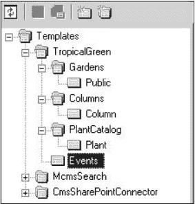

然后，创建一个单一的占位符定义，类型为 XmlPlaceholder，并将其命名为 SharePointEventsConfig。

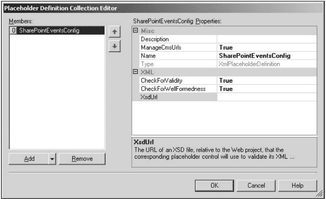

最后，选择我们的新 Events.aspx 作为此新模板的模板文件。

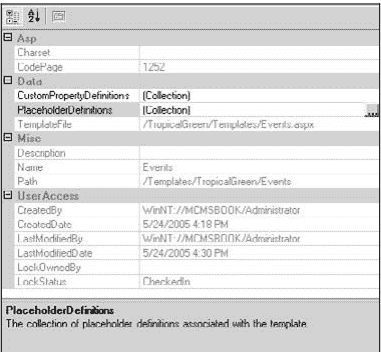

签入模板并构建 TropicalGreen 项目。我们需要做的最后一件事是使用新的 Events 模板创建一个新的帖子。虽然它不会做太多，但它将帮助我们在构建占位符控件的每个部分时看到我们的控件变得活跃起来。通过浏览到 Tropical Green 站点的根目录创建新帖子，切换到编辑模式，使用 Events 模板创建一个新帖子，并以“Events”为名称和显示名称保存它。一旦帖子已保存，请继续批准它。

我们现在有一个可工作的占位符控件（尽管目前它没做什么），一个新的模板，以及我们在 Tropical Green 站点上的一个活动页面。在活动页面上（其 URL 为 http://www.tropicalgreen.net/TropicalGreen/Events.htm），点击 Web Author 控制台中的 Switch To Edit Site 链接，然后点击 Edit 以切换到该帖子的创作模式。你应该会看到我们为占位符创建的输入框和标签：

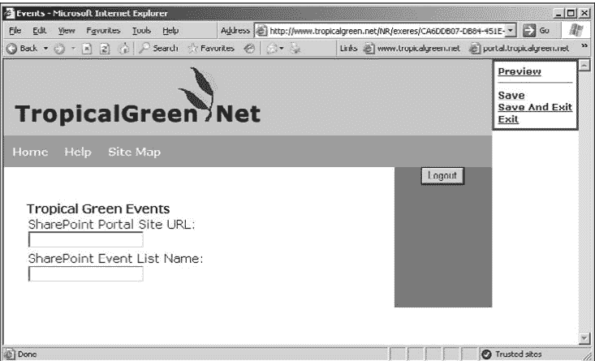

## 在 MCMS 和 SharePoint 之间发布内容

有了创作控件和一个用于查看我们进度的帖子，让我们继续为我们的占位符控件添加一些功能。无论帖子处于创作模式还是展示模式，我们都需要通过 SharePoint 列表服务 Web 服务检索 SharePoint 事件列表中的项目。为了访问此 Web 服务，我们需要服务的 URL、包含我们感兴趣的项目的列表的名称，以及该站点的有效登录凭据。

> 为简单起见，我们将对凭据进行硬编码。但是，我们强烈建议您采用更安全的解决方案，例如在站点的 Web.config 中加密用户名和密码，或允许内容所有者在占位符控件中与 URL 和列表名称一起输入凭据。Microsoft 建议使用 .NET 基类库中可用的数据保护 API（DPAPI）。

由于我们需要在两种模式下都使用此功能，我们将创建一个名为 `GetSharePointListItems()` 的方法，它需要 Web 服务 URL 和列表名称，同时返回列表中所有项目的数组。对于返回数组中的每个项目，我们希望了解有关该事件的以下信息：

- Title
- Description
- Location
- Start Date/Time
- End Date/Time

存储这些细节的最佳方式是在 `TropicalGreenControlLib` 项目中创建一个新类。将其命名为 `SharePointEventListItem.cs` 并添加以下代码以定义表示 SharePoint 事件列表中项目的业务对象：

```
using System;

namespace TropicalGreenControlLib
{
    public class SharePointEventListItem
    {
        private string _title;
        private string _location;
        private DateTime _startDateTime;
        private DateTime _endDateTime;

        // force callers to use the Factory method below
        private SharePointEventListItem() {}

        // Factory method used to create a new SharePointEventListItem
        public static SharePointEventListItem CreateItem(string title,
            string location, DateTime start, DateTime end)
        {
            SharePointEventListItem li = new SharePointEventListItem();
            li._title = title;
            li._location = location;
            li._startDateTime = start;
            li._endDateTime = end;
            return li;
        }
    }
```


```csharp
// title of the event
public string Title
{
    get
    {
        return _title;
    }
}

// location where the event will take place
public string Location
{
    get
    {
        return _location;
    }
}

// datetime when the event will begin
public DateTime StartDateTime
{
    get
    {
        return _startDateTime;
    }
}

// datetime when the event will end
public DateTime EndDateTime
{
    get
    {
        return _endDateTime;
    }
}
}
```

现在我们已经有了包含列表中每个项目的对象，请将 GetSharePointEventListItems() 方法添加到占位符控件类的末尾，SharePointEventsPlaceholderControl.cs。此方法将使用指定的 URL 调用 SharePoint Web 服务，以检索指定列表中的所有项目。

```csharp
private ArrayList GetSharePointEventListItems(string sharePointUrl,
                                               string listName)
{
    ArrayList wsResultArray = new ArrayList();

    // make sure URL and list name are provided
    if ((sharePointUrl == string.Empty) || (listName == string.Empty))
        return null;

    // we hardcode the Web service credentials for simplicity
    // You are strongly recommended to secure the login credentials
    // in the same way you'd secure any other credentials such
    // as a database connection string
    // NOTE: You'll need to change the credentials to use an account on your
    // computer that has access to the SharePoint Web services and the
    // specified list.
    NetworkCredential nc = new
        NetworkCredential("administrator", "password", "MCMSBOOK");

    // create a reference to the SharePoint List Service web service;
    // assign the provided url and credentials
    net.tropicalgreen.portal.Lists spWsList =
        new TropicalGreenControlLib.net.tropicalgreen.portal.Lists();
```

```csharp
resultItemNode.Attributes["ows_Location"].Value.ToString(),
Convert.ToDateTime(resultItemNode.Attributes["ows_EventDate"].Value.ToString()),
Convert.ToDateTime(resultItemNode.Attributes["ows_EndDate"].Value.ToString())
);
wsResultArray.Add(li);
}
return wsResultArray;
}
```

在我们连接自定义占位符控件并预览事件之前，我们还需要一个最后的方法来渲染我们的 SharePoint 事件列表项。将以下方法添加到占位符控件类。此方法调用我们的 GetSharePointEventListItems() 方法以获取指定 SharePoint 列表中的所有项目。一旦获取到 SharePoint 列表的内容，它就会使用 HTML 将其渲染以供展示：

```csharp
private void DisplaySharePointEventListItems(string spWsUrl, string spListName)
{
SharePointEventListItem li;

// make sure enough information provided in the input boxes
if ( (spWsUrl == string.Empty) || (spListName == string.Empty) )
return;

// get the SharePoint items
ArrayList items = GetSharePointEventListItems(spWsUrl, spListName);

// verify results returned
if (items == null)
litEventItemsLiteral.Text = "<p>No events at this time. Please check back later.</p>";
else
{
litEventItemsLiteral.Text = string.Empty;

// loop through each item in the list
foreach (object o in items)
{
// cast the object in the ArrayList as a SharePointEventListItem
li = o as SharePointEventListItem;

// if the cast was successful, show the event & increment the counter
if (li != null)
{
litEventItemsLiteral.Text += string.Format("<p><b>{0}</b><br>{1}<br><em>{2} - {3}</em></p>",
li.Title, li.Location,
li.StartDateTime.ToString("MMM dd, yyyy h:ss tt"),
li.EndDateTime.ToString("MMM dd, yyyy h:ss tt"));
}
}
}
}
```

此时我们已经重写了 CreateAuthoringChildControls() 方法来创建我们的编辑控件，并创建了从 SharePoint 事件列表检索和显示项目所需的所有方法。我们占位符控件编辑模式的最后两个任务是重写 LoadPlaceholderContentForAuthoring() 方法，该方法从绑定到我们占位符控件的 XmlPlaceholder 对象检索先前保存的配置信息，以及重写 SavePlaceholderContent() 方法，该方法将配置信息保存到底层的 XmlPlaceholder 对象中。

LoadPlaceholderContentForAuthoring() 方法将从绑定的 XmlPlaceholder 对象获取有关已配置 SharePoint 事件列表的信息，提取 SharePoint 列表服务 Web 服务 URL 和事件列表的名称，并调用我们的 DisplaySharePointEventListItems() 方法来显示列表的内容：

```csharp
protected override void LoadPlaceholderContentForAuthoring(
    PlaceholderControlEventArgs e)
{
    EnsureChildControls();

    XmlDocument placeholderContents = new XmlDocument();
    string sharePointUrl = string.Empty;
    string spListName = string.Empty;

    // load the saved config from the posting
    placeholderContents.LoadXml(((XmlPlaceholder)this.BoundPlaceholder)
        .XmlAsString);

    // extract the necessary information
    sharePointUrl = placeholderContents.DocumentElement.ChildNodes[0]
        .Attributes["sharePointUrl"].Value;
    spListName = placeholderContents.DocumentElement.ChildNodes[0]
        .Attributes["listName"].Value;

    // bind the config info to the text boxes
    txbSharePointUrl.Text = sharePointUrl;
    txbListName.Text = spListName;

    // show the items
    DisplaySharePointEventListItems(sharePointUrl, spListName);
}
```

SavePlaceholderContent() 方法将创建一个包含 Web 服务 URL 和列表名称的小型 XML 字符串并将其插入到绑定的占位符中：

```csharp
protected override void SavePlaceholderContent(PlaceholderControlSaveEventArgs e)
{
    string config = string.Empty;

    // make sure enough information is provided in the input boxes
    if ((txbSharePointUrl.Text == string.Empty)
        || (txbListName.Text == string.Empty))
        return;

    // save the config information
    config = string.Format("<config><sharepointlist sharePointUrl=\"{0}\""
        + " listname=\"{1}\" /></config>",
        txbSharePointUrl.Text, txbListName.Text);

    ((XmlPlaceholder)this.BoundPlaceholder).XmlAsString = config;
}
```

让我们看看我们的控件在编辑模式下是什么样子。构建 TropicalGreenControlLib 项目，打开浏览器并导航到 http://www.tropicalgreen.net/TropicalGreen/Events.htm。如果您尚未登录，请继续登录。登录后，单击 Web Author Console 中的 Switch To Edit Site 链接，然后单击 Edit 以切换到帖子的编辑模式。输入以下内容到两个输入框中，然后在 Web Author Console 中单击 Save and Exit：

| 名称 | 值 |
|---|---|
| SharePoint Portal Site URL | http://portal.tropicalgreen.net |
| SharePoint Event List Name | Events |

现在我们只需要连接另外两个方法，使用 `CreatePresentationChildControls()` 创建并填充我们占位符控件的展示控件，从绑定的占位符获取有关已配置 SharePoint 事件列表的信息，并调用 `DisplaySharePointEventListItems()` 来使用名为 `LoadPlaceholderContentForPresentation()` 的方法显示项目：

```csharp
protected override void CreatePresentationChildControls
    (BaseModeContainer presentationContainer)
{
    litEventItemsLiteral = new LiteralControl();
    presentationContainer.Controls.Add(litEventItemsLiteral);
}

protected override void LoadPlaceholderContentForPresentation
    (PlaceholderControlEventArgs e)
{
    EnsureChildControls();

    XmlDocument placeholderContents = new XmlDocument();
    string sharePointUrl = string.Empty;
    string spListName = string.Empty;

    // load the saved config from the posting
    placeholderContents.LoadXml(((XmlPlaceholder)this.BoundPlaceholder)
        .XmlAsString);

    // extract the necessary information
    sharePointUrl = placeholderContents.DocumentElement.ChildNodes[0]
        .Attributes["sharePortalUrl"].Value;
    spListName = placeholderContents.DocumentElement.ChildNodes[0]
        .Attributes["listname"].Value;

    // show the items
    DisplaySharePointEventListItems(sharePointUrl, spListName);
}
```

应该就这样了……最后一次构建 TropicalGreenControlLib 项目并返回到 http://www.tropicalgreen.net/TropicalGreen/Events.htm 上的 Events 页面。


这些只是你在设计和开发自己的实现时需要考虑的部分额外问题。从 SharePoint 列表服务 Web 服务中拉取内容的难点，已通过这个简短的占位符控件得到了演示。你可以发挥想象力，根据自己的特定需求来定制这个占位符控件。

## 摘要

在本章中，我们介绍了在 SharePoint 站点中发布 MCMS 内容，以及在 MCMS 站点中发布 SharePoint 内容的多种方式。在这两种情况下，我们都探讨了 Microsoft 提供的免费下载——用于 SharePoint Technologies 的 MCMS 连接器——在两种环境之间发布内容时能提供哪些协助。

为了在 MCMS 站点中发布 SharePoint 内容，我们在 MCMS 模板上使用了 SharePoint 文档占位符控件，以显示存储在 SharePoint 文档库中的文档的属性和/或内容。此外，我们还构建了一个新的占位符控件，作为 SharePoint 列表内容的聚合器。

为了在 SharePoint 站点中发布 MCMS 内容，我们使用了连接器附带的页面列表 Web 部件，将 MCMS 站点中指定频道内的所有发布项以列表形式显示在 SharePoint 中。我们还介绍了连接器附带的两个管理 Web 部件——生产中的 MCMS 页面和等待审批的 MCMS 页面，以及它们如何协助 MCMS 站点的发布工作流。
