## 构建 SharePoint Web 部件

在前面的章节中，我们通过自定义代码以及使用用于 SharePoint Technologies 的 MCMS 连接器随附的组件，了解了集成 MCMS 和 SharePoint 的几种不同方式。我们尚未涉及的一个重要方面，是为 SharePoint 创建自定义 Web 部件，以便将 MCMS 内容集成到 SharePoint 站点或门户中。在本章中，我们将创建一个可配置的 Web 部件，作为指定频道中发布项的导航组件。但在深入探讨我们要构建的 MCMS 导航 Web 部件之前，先让我们了解一下什么是 Web 部件。

Microsoft SharePoint Portal Server (SPS) 和 Windows SharePoint Services (WSS) 在称为 **Web 部件页** 的页面中显示内容和交互式组件。构成这些页面的构建块是 **Web 部件区域**，可以包含一个或多个 Web 部件。具有所需权限的业务用户可以根据需要将这些 Web 部件排列在 Web 部件页上。

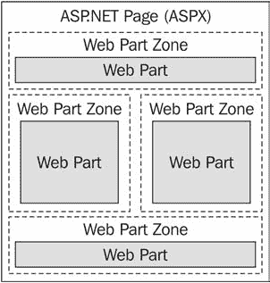

Web 部件是一种单一模块，可以排列在 Web 部件页上以提供特定功能，例如日历。MCMS 仅随附三个占位符控件，而 SPS 和 WSS 随附了许多已安装的 Web 部件，用于处理公告、联系人、任务、事件、数据查看和 XML。这些 Web 部件提供了一个良好的起点，并且易于配置，无需开发人员干预即可满足大多数用户的需求。

## 构建 SharePoint Web 部件

由于多种原因，包括更紧密的集成、更具体的需求以及性能或复杂性方面的问题，您可能需要从头创建 Web 部件。在设计 Web 部件的早期阶段，开发人员可以有多种途径：

- 配置开箱即用的 WSS/SPS 列表和 Web 部件，以提供所需的数据存储、数据输入和呈现方法
- 从零开始将 Web 部件开发为 ASP.NET 服务器控件
- 将业务逻辑开发为 Web 服务，并使用 XML Web 部件或 DataView Web 部件作为图形用户界面
- 开发单独的 Web 窗体，并使用 IFrame 集成门户和卫星应用程序。使用此方法时应考虑浏览器兼容性
- 将 Web 部件设计和开发为 .NET 用户控件，并利用通用 Web 部件（如 'SmartPart' (http://www.smartpart.info)）来承载你的 .NET 用户控件

每种方法都有优点和缺点，应在设计时进行权衡，例如开发难易度、可扩展性、可伸缩性、互操作性、部署和安全性。下表总结了这些内容：

| 方法 | 现有 Web 部件 | 使用 Web 服务作为业务层，搭配 XML Web 部件 / DataView Web 部件 | 与 SmartPart 集成的用户控件 | ASP.NET 服务器控件 | IFrame 到 ASP.NET Web 窗体 |
|---|---|---|---|---|---|
| 开发难易度 | 无需任何开发 | 简单 | 需要了解 SmartPart，但本质上就是 ASP.NET 用户控件开发 | 复杂 | 简单 |
| 可扩展性 | 取决于特定 Web 部件提供的功能 | 开发人员对 UI 的控制能力有限，但获得了 FrontPage 2003 作为开发工具，以及独立的 ASP.NET 业务层。 | 可扩展性极强 | 可扩展性极强 | 可扩展性极强 |
| 可伸缩性 | 随 WSS/SPS 服务器扩展 | 端点 Web 服务必须按需扩展。 | 随 WSS/SPS 服务器扩展 | 随 WSS/SPS 服务器扩展 | 通过 IFrame 内嵌的 ASP.NET 应用程序必须按需扩展 |
| 互操作性 | 可以轻松与 WSS/SPS 的其他部分交互 | 与 WSS/SPS 对象交互更为复杂，但仍然可行。 | 可以轻松与 WSS/SPS 的其他部分交互 | 可以轻松与 WSS/SPS 的其他部分交互 | 与 WSS/SPS 对象交互更为复杂，但仍然可行。 |
| 部署 | 开箱即用的 Web 部件无需部署，可下载的 Web 部件部署也非常简单 | 无需部署 | 需要安装 SmartPart Web 部件。 | 复杂 | 简单 |
| 安全性 | 无安全影响 | 对 SPS/WSS 无安全影响，因为安全将由 ASP.NET Web 服务强制实施 | 无安全影响 | 安全由 SPS/WSS 强制实施。 | 由 ASP.NET Web 应用程序强制实施 |
| 备注 | 需要的开发知识最少 | 非常适合需要在 Web 部件页中显示 WSS/SPS 外部数据的 .NET 开发人员 | 允许你将 .NET 用户控件作为 Web 部件运行，并允许在 Web 部件框架内开发丰富的用户界面。 | 开发时提供了最大的灵活性，但需要手动定义 UI。在 Web 部件框架内执行。 | 允许通过 SharePoint 使用单独的 ASP.NET Web 应用程序。 |

在本章中，我们将重点介绍 ASP.NET 服务器控件方法。

## SharePoint MCMS 导航控件

在本章中，我们将开发一个 Web 部件作为服务器控件，具体做法是构建一个用作 MCMS 导航组件的 Web 部件。我们之所以选择服务器控件方法，是因为它是最灵活的方法。具有 WSS/SPS Web 设计器权限的最终用户将能够把 Web 部件添加到 Web 部件页，并通过指定 MCMS 频道来配置该 Web 部件。所配置的 MCMS 频道中的项目将使用 XSLT（可扩展样式表语言转换）样式表在 Web 部件中呈现，以生成如下显示：

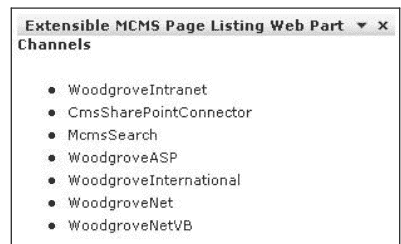

要构建此 Web 部件，我们将执行以下步骤：

- 准备开发环境
- 创建 Web 部件项目
- 创建 Web 部件
- 定义 Web 部件的自定义属性
- 开发 Web 部件的自定义属性
- 构建数据层
- 构建表示层
- 部署 Web 部件

> 我们将要构建的 Web 部件既可在 SPS 也可在 WSS 下运行，因为我们不会使用 Microsoft SharePoint Portal Server 的任何特定功能。

## 准备开发环境

为了最有效地将 Web 部件开发为 ASP.NET 服务器控件，我们需要安装 Web 部件所需的 Visual Studio .NET 模板。这些模板不随 Visual Studio .NET 2003 提供，但可从 Microsoft 网站下载：

http://www.microsoft.com/downloads/details.aspx?FamilyID=CAC3E0D2-BEC1-494C-A74E-75936B88E3B5&displaylang=en

在安装 Web 部件模板期间，系统会提示你提供 Microsoft.SharePoint.dll 的位置。此程序集位于 SharePoint（WSS/SPS）服务器上的 Program Files\Common Files\Microsoft Shared\Web Server Extensions\60\ISAPI\ 目录中。你可能需要从安装了 SPS 或 WSS 的服务器上将 Microsoft.SharePoint.dll 复制到你的开发电脑上。


## 创建 Web Part 项目

Web Parts 应使用 Web Part 库项目构建。现在我们就来创建该项目。

1. 在 Visual Studio .NET 中，选择“新建项目”（Shift + Ctrl + N）。
2. 选择项目类型为 Visual C# 项目，并从右侧窗格中选择新的 Web Part 库模板。
3. 将新项目命名为 ExtensibleMCMSPageListingWebPart，并将项目目录放在“我的文档\Visual Studio Projects”下。
4. 单击“确定”。

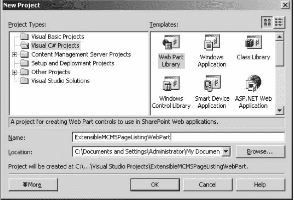

创建新项目后，我们可以看到模板创建的各种文件和引用：

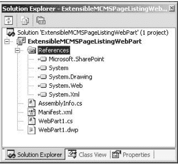

| 属性 | 说明 | 数据类型 | 默认值 | 类别 |
|---|---|---|---|---|
| PresentationXsl | 用于控制数据展示的 XSL 样式表 | String | 从 DefaultXsl.xslt 加载 | MCMS 列表展示 |
| TestXml | 用于测试转换而不连接 MCMS 的 XML | String | 从 TestXml.xml 加载 | MCMS 列表展示 |

将 Web Part 添加到 Web Part 页面后，可以通过从 Web Part 右上角选择“修改共享 Web Part”（或“修改个人 Web Part”）在浏览器中修改其自定义属性。

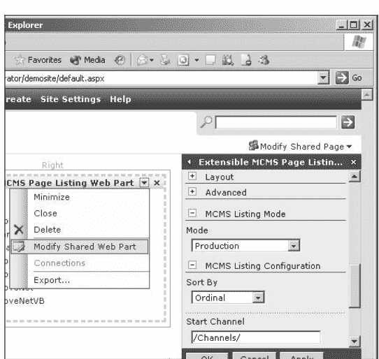

如上所示，每个属性使用的控件会根据数据类型而有所不同。我们之前指定的属性 Mode 的类型为 enumMode，它有四个可能的值，因此工具窗格会呈现一个下拉列表。工具窗格还会为数字和字符串呈现文本框。自定义属性可以使用属性上的 Category 特性进行分组，这样可以让我们对多个属性进行分组，例如 MCMS 列表配置。

## 为 Web Part 开发自定义属性

在 NavigationWebPart.cs 中，在创建属性之前，我们将移除模板添加的一些附加代码。移除所有生成的注释以及以下内容：

- **DebugShowException**——用于测试实际 MCMS 数据以及当前配置的样式表。如果发生异常，它们将以纯文本形式显示——这是你在生产站点上会避免的。
- **Production**——与 DebugShowException 类似，但隐藏异常详细信息并显示友好的错误消息。

```
#region declarations - enumerations, constants and private variables

// The mode of the Web Part used for troubleshooting and exception handling.
public enum enumMode
{
    DebugWithTestData,   // Render the Web Part using the XSLT and TestXml
    DebugShowXml,        // Output the XML
    DebugShowException,  // If an exception is thrown return the details
    Production           // Mode for running in production, suppress error
                         // messages.
}
```

第二个枚举 enumSortBy 指定 MCMS 返回的频道项的排序顺序：

```
public enum enumSortBy
{
    Default,      // No Sort
    ChangeDate,
    DisplayName,
    DisplayPath,
    ExpiryDate,
    Importance,
    Ordinal,
    StartDate
}
```

```
#endregion
```

下一步，我们为 Web Part 定义自定义属性。每个公共属性将获取和设置一个私有变量，并且还有一个默认值。下表显示了分配给每个公共属性的 Web Part 框架特性：

| 特性名称 | 说明 |
|---|---|
| Browsable | 必须设置为 True，自定义属性才会出现在工具窗格中。 |
| Category | 定义工具窗格中的分组。如果此值留空或未定义，类别将为“自定义属性”。 |
| DefaultValue | 如果 Web Part 的值与此特性中的值不同，该值将存储在 Web Part 存储系统中。 |
| Description | 将显示在工具窗格中友好名称之上的工具提示。 |
| FriendlyName | 将显示在工具窗格中的名称。 |
| ReadOnly | 如果设置为 True，自定义属性将显示在工具窗格中，但用户将无法修改它。 |
| WebPartStorageAttribute | 通过将此特性设置为 Storage.Personal 可以在每个用户级别存储自定义属性，或通过使用 Storage.Shared 在全局级别存储。如果设置为 Storage.None，该值将不会存储在 Web Part 存储系统中，并且该属性也不会出现在工具窗格中。 |

我们的 Web Part 所必需的属性包括：其运行模式（Mode）、用于排序的列（SortBy）、应枚举的频道（StartChannel）以及定义用于渲染的 XSLT 样式表的属性（PresentationXsl）。

我们还将有一个只在 DebugWithTestData 模式下使用的属性（TestXml）。该属性将允许我们配置在调试 XSLT 样式表时使用的测试 XML 数据。

```
```csharp
#region properties

// Declare the private variables for the Mode property
// By default we run the Web Part in Production mode (suppressing exceptions)
const NavigationWebPart.enmMode _ModeDefault =
    NavigationWebPart.enmMode.Production;
private NavigationWebPart.enmMode _Mode = _ModeDefault;

// Set the attributes for the property
[ Browsable(true) ]
[ Category("MCMS Listing Mode") ]
[ DefaultValue(_ModeDefault) ]
[ Description("The mode of the Webpart.") ]
[ FriendlyName("Mode") ]
[ WebPartStorageAttribute(Storage.Shared) ]
public NavigationWebPart.enmMode Mode
{
    get{ return _Mode; }
    set{ _Mode = value; }
}
```
```

SortBy 属性设置 MCMS 返回的频道项的排序顺序。默认情况下，频道项将按序号排序。

```
```csharp
// Declare the start channel private variables
const NavigationWebPart.enmSortBy _SortByDefault =
    NavigationWebPart.enmSortBy.Ordinal;
private NavigationWebPart.enmSortBy _SortBy = _SortByDefault;

// Set the attributes for the property
[ Browsable(true) ]
[ Category("MCMS Listing Configuration") ]
[ DefaultValue(_SortByDefault) ]
[ Description("The Sort order of the Webpart.") ]
[ FriendlyName("Sort By") ]
[ WebPartStorageAttribute(Storage.Shared) ]
public NavigationWebPart.enmSortBy SortBy
{
    get{ return _SortBy; }
    set{ _SortBy = value; }
}
```
```

StartChannel 属性设置我们要列出的频道（其子项，包括频道和/或发布）的路径：

```
```csharp
// Declare the start channel private variables, default is /Channels/
const string _StartChannelDefault = "/Channels/";
private string _StartChannel = _StartChannelDefault;

// Set the attributes for the property
[ Browsable(true) ]
[ Category("MCMS Listing Configuration") ]
[ DefaultValue(_StartChannelDefault) ]
[ Description("The channel to list the child items of.") ]
[ FriendlyName("Start Channel") ]
[ WebPartStorageAttribute(Storage.Shared) ]
public string StartChannel
```

## 构建 SharePoint Web Parts

```
```csharp
{
    get{ return _StartChannel; }
    set{ _StartChannel = value; }
}
```
```

我们将添加的下两个属性是 TestXml 和 PresentationXsl 属性。如果未设置其值，这两个属性都会从 Web Part 资源文件夹（wpresources）中存储的文件加载数据。这确保了 Web Part 在首次添加到页面时会有默认的 XSLT 样式表和 XML 测试数据。

```
```csharp
// Declare the Presentation XSLT private variables
// Default is empty because we will load from a file
const string _PresentationXslDefault = "";
private string _PresentationXsl = _PresentationXslDefault;

// Set the attributes for the property
[ Browsable(true) ]
[ Category("MCMS Listing Presentation") ]
[ DefaultValue(_PresentationXslDefault) ]
[ Description("The XSLT the MCMS listing will display.") ]
[ FriendlyName("Presentation Xsl") ]
[ WebPartStorageAttribute(Storage.Shared) ]
public string PresentationXsl
{
    get
    {
        if (_PresentationXsl == "")
        {
            // Load XSLT from the wpresources folder if PresentationXsl not set
            string XslFile = "./wpresources/ExtensibleMCMSPageListingWebPart/"
                           + "DefaultXsl.xslt";

            try
            {
                System.Xml.XmlDocument _doc = new System.Xml.XmlDocument();
                // Get the path of the DefaultXsl.xslt that is stored in
                // /wpresources/ExtensibleMCMSPageListingWebPart/
                _doc.Load(HttpContext.Current.Server.MapPath(XslFile));
                // Set the local variable to be the string representation
                // of the XSL file
                _PresentationXsl = _doc.OuterXml;
            }
            catch
            {
                _PresentationXsl = "Failed to load from "
                                  + HttpContext.Current.Server.MapPath(XslFile);
            }
        }
        return _PresentationXsl;
    }
    set{ _PresentationXsl = value; }
}

// Declare the TestXsl private variables
const string _TestXmlDefault = "";
private string _TestXml = _TestXmlDefault;

// Set the attributes for the property
[ Browsable(true) ]
[ Category("MCMS Listing Presentation") ]
[ Description("The Xml to be parsed for testing when in debug mode.") ]
[ FriendlyName("Test XML") ]
[ WebPartStorageAttribute(Storage.Shared) ]
[ DefaultValue(_TestXmlDefault) ]
```
```


public string TestXml
{
    get
    {
        if (_TestXml == "")
        {
            // Load XML from the wpresources folder if _TestXml not set
            string XmlFile = "/wpresources/ExtensibleMCMSPageListingWebPart"
                + "/TestXml.xml";
            try
            {
                System.Xml.XmlDocument _doc = new System.Xml.XmlDocument();
                // Get the path of the TestXml.xml that is stored in
                // /wpresources/ExtensibleMCMSPageListingWebPart/
                _doc.Load(HttpContext.Current.Server.MapPath(XmlFile));
                // Set the local variable to be the string representation
                // of the XML file.
                _TestXml = _doc.OuterXml;
            }
            catch
            {
                _TestXml = "Failed to load from "
                    + HttpContext.Current.Server.MapPath(XmlFile);
            }
        }
        return _TestXml;
    }
    set{ _TestXml = value; }
}
#endregion

为了代码可维护性，使用 #region 和 #endregion 在 Visual Studio .NET 中有效组织代码文件中的各部分。

## Building the Data Layer

Web Part 将生成 XML，列出配置的 StartChannel 中使用配置的 SortOrder 的所有 ChannelItems。XML 的使用促进了表现层与数据层的分离。我们的 数据层 将是 Web Part 项目中的另一个类，但它也可以放在完全不同的程序集中以实现进一步的抽象。

> 由于我们使用的是 MCMS Publishing API (PAPI)，此 Web Part 只能在安装了 MCMS 的 SPS/WSS 服务器上运行，因为 PAPI 无法连接到远程 MCMS 服务器。如果 SPS/WSS 和 MCMS 位于不同的服务器上，一个解决方案是使用 Web 服务调用从 Web Part 到 MCMS 服务器。

- 1. 在 Visual Studio .NET 中，右键单击 ExtensibleMCMSPageListingWebPart 项目并选择 Add New Item。
- 2. 在 Add 子菜单下，选择 Add New Class。

## Building SharePoint Web Parts

- 3. 输入 `NavigationWebPartMCMSIntegration` 作为名称并单击 OK。
- 4. 添加对 `Microsoft.ContentManagement.Publishing.dll` 的引用。与 `Microsoft.ContentManagement` 命名空间中的其他库文件一样，它位于 `<install directory>/Microsoft Content Management Server/server/bin` 目录中。
- 5. 现在你应该在屏幕上看到空的 `NavigationWebPartMCMSIntegration` 类。向新类文件添加以下命名空间：
  
  ```csharp
  using System;
  using Microsoft.ContentManagement.Publishing;
  using System.Security.Principal;
  using System.Web;
  using System.Xml;
  using System.IO;
  ```
  
- 6. 我们现在将添加 `GetListing()` 方法，该方法连接到 MCMS 并生成列出所有 ChannelItems 的 XML：

```csharp
public static System.Xml.XmlDocument GetListing(string StartChannelPath,
                                                NavigationWebPart.enmSortBy sortBy)
{
    // Get the channel from the searches object
    Channel startChannel = CmsHttpContext.Current.Searches.GetByPath(
                                                StartChannelPath) as Channel;

    // Was the channel found?
    if (startChannel != null)
    {
        // Get all Children from the Start Channel
        ChannelAndPostingCollection _Children = startChannel.AllChildren;

        // Sort the Items
        _Children = SortMCMSChannelItems(sortBy, _Children);

        // Declare the string writer and the XmlTextWriter
        StringWriter tw = new StringWriter();
        XmlTextWriter _Writer = new XmlTextWriter(tw);

        // Write the <Channel> element
        _Writer.WriteStartDocument();
        _Writer.WriteStartElement("Channel");
        _Writer.WriteAttributeString("path", startChannel.Path);
        _Writer.WriteAttributeString("displayname", startChannel.DisplayName);

        // Loop through all the channel items
        foreach (ChannelItem _ChannelItem in _Children)
        {
            // Write the ChannelItem element and set its attributes
            _Writer.WriteStartElement("ChannelItem");
            _Writer.WriteAttributeString("path", _ChannelItem.Path);
            _Writer.WriteAttributeString("url", _ChannelItem.Url);
            _Writer.WriteAttributeString("displayname",
                                        _ChannelItem.DisplayName);

            // Check what type of Channel Item it is and set the type attribute
            if (_ChannelItem is Posting)
            {
                _Writer.WriteAttributeString("type", "Posting");
            }
            else
            {
                _Writer.WriteAttributeString("type", "Channel");
            }
            _Writer.WriteEndElement();
        }
```
由于我们将 Web Part 构建为服务器控件，我们必须声明控件并通过重写 NavigationWebPart.cs 中的 CreateChildControls 方法来实例化它们：

```
#region declarations - Web controls
protected System.Web.UI.WebControls.Xml XmlXsIWebControl;
#endregion

#region Preparing the controls
protected override void CreateChildControls()
{
    XmlXsIWebControl = new System.Web.UI.WebControls.Xml();
    this.Controls.Add(XmlXsIWebControl);
}
#endregion
```

System.Web.UI.WebControls.Xml Web 控件可以使用指定的 XSLT 转换 XML，这比手工开发 XML/XSLT 更高效。

需要重写 RenderWebPart() 方法以确保其余代码正在执行。让我们向 RenderWebPart() 方法添加代码以生成 MCMS 列表：

```
#region Methods
protected override void RenderWebPart(HtmlTextWriter output)
{
    // Check our child controls are created OK
    EnsureChildControls();

    try
    {
        // Get the Page listing from MCMS
        ExecuteMCMSListing(output);
    }
    catch(Exception ex)
    {
        // In production show only a short message with no internal exception details
        if (this.Mode == enumMode.Production)
        {
            // Suppress Exceptions
            output.Write("An Error Occurred in the Navigation Web Part.");
        }
        else
        {
            // Output detailed exception message (escape characters)
            output.Write(SPEncode.HtmlEncode(ex.Message + "," + ex.Source + "," + ex.StackTrace));
        }
    }
}
```

下一个方法 ExecuteMCMSListing() 确定 Web Part 运行的模式并检索频道列表数据。频道列表数据可以从 MCMS 读取，也可以从文件系统加载测试 XML 文件。

```
/// <summary>
/// Executes the MCMS listing code
/// </summary>
private void ExecuteMCMSListing(HtmlTextWriter output)
{
    // Check the mode we are in and perform the correct action
    switch (this.Mode)
    {
        case ennMode.Production:
        case ennMode.DebugShowException:
            // Set up the Xml/Xsl Webcontrol and render its output to the
            // HtmlTextWriter
            XmlXslWebControl.Transform = GetTransform();
            XmlXslWebControl.Document = NavigationWebPartMCMSIntegration.GetListing(this.StartChannel, this.SortBy);
            XmlXslWebControl.RenderControl(output);
            break;

        case ennMode.DebugShowXml:
            System.Xml.XmlDocument _Listing =
                NavigationWebPartMCMSIntegration.GetListing(this.StartChannel, this.SortBy);

            // Output the escaped XML directly to the HtmlTextWriter
            output.Write(SPEncode.HtmlEncode(_Listing.OuterXml));
            break;

        case ennMode.DebugWithTestData:
            // Get the Test XML Data & load into an XmlDocument
            System.Xml.XmlDocument _DataDocument = new System.Xml.XmlDocument();
            _DataDocument.LoadXml(this.TestXml);
            // Setup XML/XSLT Web control and render its output to HtmlTextWriter
            XmlXslWebControl.Transform = GetTransform();
            XmlXslWebControl.Document = _DataDocument;
            XmlXslWebControl.RenderControl(output);
            break;

        default:
            throw new Exception("Invalid Mode!");
    }
}
```

为了检索 XsltTransform 对象，我们将创建一个名为 GetTransform() 的辅助方法。此方法将通过将 XSLT 样式表从文件系统加载到 XmlDocument 对象中来返回 XsltTransform 对象。然后将 XmlDocument 对象加载到 XsltTransform 对象中并返回：

```
/// <summary>
/// Get the XSLT as a System.Xml.XslTransform object
/// </summary>
/// <returns>The System.Xml.XslTransform object</returns>
private System.Xml.Xsl.XslTransform GetTransform()
{
    // Get the XSLT and load it into an XML document
    System.Xml.XmlDocument _TransformDoc = new System.Xml.XmlDocument();
    _TransformDoc.LoadXml(this.PresentationXsl);
    System.Xml.Xsl.XslTransform _Transform = new System.Xml.Xsl.XslTransform();
    // Load our XSLT
    _Transform.Load(_TransformDoc.CreateNavigator(), null, null);
    return(_Transform);
}
#endregion
```


由于我们正在动态地向 Controls 集合添加控件，RenderWebPart() 中的第一次调用应该是 EnsureChildControls()。EnsureChildControls() 方法会在 ChildControlsCreated 属性为 false 时调用 CreateChildControls()。

我们还必须定义将用于将我们的 XML 转换为 HTML 的 XSLT 样式表。

- 1. 在 Visual Studio .NET 中，右键单击 ExtensibleMCMSPageListingWebPart 项目并选择 Add New Item。
- 2. 从 Categories 窗格中选择 Data，然后选择 XSLT File。
- 3. 输入 DefaultXslt.xslt 作为名称并单击 Open。 在代码面板中输入以下 XSLT：

```xml
<?xml version="1.0" standalone="no"?>
<xsl:stylesheet xmlns:xsl="http://www.w3.org/1999/XSL/Transform" version="1.0">
<xsl:template match="/">
<b>
<a href="{@url}">
<xsl:value-of select="/Channel/@displayname" />
</a>
</b>
<br />
<ul>
<xsl:apply-templates />
</ul>
</xsl:template>

<xsl:template match="//ChannelItem">
<li><a href="{@url}"><xsl:value-of select="@displayname" /></a></li>
<ul><xsl:apply-templates /></ul>
</xsl:template>
</xsl:stylesheet>
```

此时让我们构建整个解决方案，看看是否有任何编译错误。

## Web Part 部署

Web Parts 编译为 .NET 程序集，可以在 Windows SharePoint Services 和 SharePoint Portal Server 中多次重用。Web Parts 通常使用 cabinet (.CAB) 文件部署。我们将在 Visual Studio .NET 中创建一个 cabinet 文件项目，该项目将封装我们的 Web Part 的程序集和元数据。然后必须使用随 WSS/SPS 提供的 stsadm.exe 实用程序安装此 cabinet 文件。要部署 Web Part，我们将执行以下步骤：

- 1. 准备 Web Part 描述
- 2. 准备 Web Part 清单
- 3. 创建 CAB 文件部署项目
- 4. 执行部署

另一个用于打包和部署 Web Parts 的安装工具，名为 WPPackager，可在 http://www.microsoft.com/downloads/details.aspx?familyid=0fda5912-c136-4b44-911a-011adfcc66e3&displaylang=en 获取。WPPackager 为您的 Web Part 创建 Windows 安装程序文件 (MSI)，在安装期间执行 SPS/WSS 的必要配置。

有关此工具的更多信息，请参阅 *Using WPPackager to Package and Deploy Web Parts for Microsoft SharePoint Products and Technologies*，网址为 http://msdn.microsoft.com/library/default.asp?url=/library/en-us/odc_SP2003_ta/html/sharepoint_deployingwebparts_msi.asp。

## 准备 Web Part 描述 (.DWP) 文件

将 Web Part 部署到 SharePoint 时，部署过程中应填充多个文件。其中一个文件是 Web Part 描述 (.DWP) 文件。

- 1. 在 Visual Studio .NET 中，右键单击 `ExtensibleMCMSPageListingWebPart` 项目并选择 Add New Item。
- 2. 在左侧的 Categories 窗格中，展开 Local Project Items 并选择 Data。
- 3. 选择 Web Part DWP。
- 4. 输入名称为 `NavigationWebPart` 并单击 OK。

.DWP 文件描述了我们的 Web Part，给出了属性的默认值以及 Web Part 所需的任何程序集。让我们为我们的导航 Web Part 创建此文件：

```xml
<?xml version="1.0" encoding="utf-8"?>
<WebPart xmlns="http://schemas.microsoft.com/WebPart/v2" >
  <Title>Extensible MCMS Page Listing Web Part</Title>
  <Description>
    Displays MCMS Postings and Channels within a specified channel and
    transforms the display using XSLT.
  </Description>
  <Assembly>ExtensibleMCMSPageListingWebPart</Assembly>
  <TypeName>ExtensibleMCMSPageListingWebPart.NavigationWebPart</TypeName>
</WebPart>
```

此文件中指定的值允许 Windows SharePoint Services 为 Web Part 生成元数据。元素的含义在下表中给出：

| 元素名称 | 描述 |
|---|---|
| `Title` | 用户在 Web Part 库中看到的标题，以及 Web Part 添加到 Web Part 区域后的默认标题。 |
| `Description` | 在 Web Part 库中悬停在 Web Part 标题上时出现的工具提示。 |
| `Assembly` | 程序集名称。对于本示例，我们仅使用程序集名称，但也可以使用完整的 Web Part 程序集描述，如下所示：`AssemblyName`（不带 `.DLL` 扩展名），`Version=VersionNumber`，`Culture=Culture`，`PublicKeyToken=PublicKeyToken` |
| `TypeName` | 命名空间限定的类名。 |

## 准备 Web Part 清单文件

将 Web Part 作为 CAB 文件部署时，我们必须创建一个 Web Part 清单文件，为 CAB 文件部署项目提供我们 Web Part 和 Web Part 描述文件的详细信息。

- 1. 在 Visual Studio .NET 中，右键单击 ExtensibleMCMSPageListingWebPart 项目并选择 'Add New Item'。
- 2. 在左侧的 Categories 窗格中，展开 Local Project Items 并选择 Data。
- 3. 选择 WPManifest。
- 4. 输入名称为 `Manifest` 并单击 Open。

为此文件输入以下代码以对应我们的 Web Part：

```xml
<?xml version="1.0"?>
<WebPartManifest xmlns="http://schemas.microsoft.com/WebPart/v2/Manifest">
  <Assemblies>
    <Assembly FileName="ExtensibleMCMSPageListingWebPart.dll">
      <ClassResources>
        <ClassResource FileName="TestXml.xml"/>
        <ClassResource FileName="DefaultXslt.xslt"/>
      </ClassResources>
      <SafeControls>
        <SafeControl Namespace="ExtensibleMCMSPageListingWebPart"
                     TypeName="*" />
      </SafeControls>
    </Assembly>
  </Assemblies>
  <DwpFiles>
    <DwpFile FileName="NavigationWebPart.dwp"/>
  </DwpFiles>
</WebPartManifest>
```

`Manifest.xml` 允许我们在部署 CAB 文件中包含多个程序集、资源和 Web Part 描述文件。元素如下所述：

| 元素名称 | 描述 |
|---|---|
| Assemblies | 允许我们在 cabinet 文件中包含多个程序集。 |
| Assembly | 用于通过将 `FileName` 属性设置为 DLL 名称来定义程序集。 |
| ClassResources | 定义我们的类使用的资源。资源路径必须相对于项目文件。资源是支持文件，例如图像或数据文件。 |
| SafeControls | 列出此 Web Part 将使用的安全控件（以便在部署时可以将它们添加到 SharePoint 站点的 Web.config 中）。 |
| DwpFiles | 用于定义此 Web Part 使用的 Web Part 描述文件。 |

## 创建部署项目

此时，我们拥有一个完成的 Web Part 项目，其中包含必要的部署配置文件。现在我们需要创建一个部署项目，将 Web Part 和其他必要文件封装到单个 cabinet 文件中以供安装。

- 1. 在 Visual Studio .NET 中，右键单击 ExtensibleMCMSPageListingWebPart 解决方案并选择 'Add New Project'。
- 2. 在 Project Types 窗格中，选择 Setup and Deployment Projects，并在模板窗格中选择 Cab Project。
- 3. 输入名称 ExtensibleMCMSPageListingWebPartDeployment 并单击 OK。
- 4. 右键单击 ExtensibleMCMSPageListingWebPartDeployment 项目并选择 Add 然后 Project Output。
- 5. 从项目下拉列表中选择 ExtensibleMCMSPageListingWebPart。
- 6. 按住 Ctrl 键，选择 Primary Output 和 Content Files 并单击 OK。

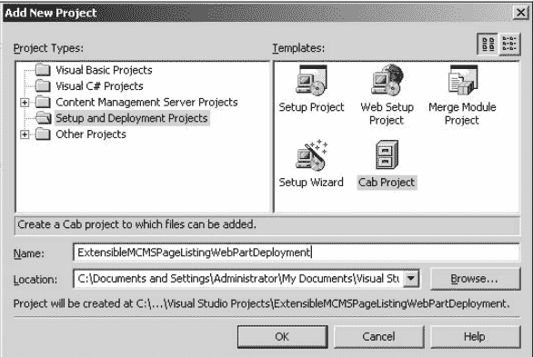

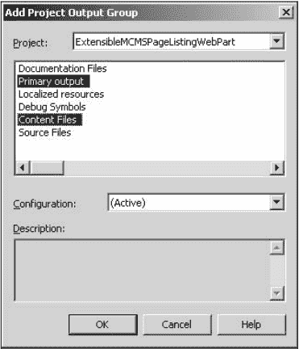

- 7. 在 ExtensibleMCMSPageListingWebPart 项目中，右键单击 NavigationWebPart.dwp 并单击 Properties。
- 8. 将 Build Action 属性设置为 Content。这将允许部署项目将文件添加到包中。

您的部署项目现在应如下所示：

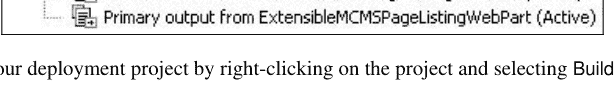

现在通过右键单击项目并选择 Build 来构建您的部署项目。

## 执行部署

现在我们有了 cabinet 文件，让我们将其部署到 SharePoint 服务器。

> 如果您在远程工作站上开发，请在执行以下步骤之前将 cabinet 文件复制到服务器。

我们将使用 stsadm.exe 部署它，您可以在 <local_drive>\Program Files\Common Files\Microsoft Shared\Web Server Extensions\60\bin\ 下找到它。

启动 DOS 命令提示符，并输入以下命令：

```
cd "C:\Program Files\Common Files\Microsoft Shared\web server extensions\60\BIN"
```

```
STSADM.EXE -o addwppack -filename "C:\Documents and Settings\Administrator\My Documents\Visual Studio Projects\ExtensibleMCMSPageListingWebPartDeployment\Debug\ExtensibleMCMSPageListingWebPartDeployment.cab" -globalinstall -force
```

路径 C:\Documents and Settings\Administrator\My Documents\Visual Studio Projects\ 可能需要更改，具体取决于您创建项目的路径。

如果 Web Part 成功部署，您应该会看到：

```
ExtensibleMCMSPageListingWebPartDeployment.cab: Deploying to http://server/.
Operation completed successfully.
```

> 当您以 Release 模式编译部署项目时，命令行将更改为：
> STSADM.EXE -o addwppack -filename "C:\Documents and Settings\Administrator\My Documents\Visual Studio Projects\ExtensibleMCMSPageListingWebPartDeployment\Release\ExtensibleMCMSPageListingWebPartDeployment.cab" -globalinstall -force


## 构建 SharePoint Web 部件

- 9. 点击确定，再次点击确定，然后点击关闭。
- 10. 浏览到 `C:\Documents and Settings\Administrator\My Documents\Visual Studio Projects\ExtensibleMCMSPageListingWebPartDeployment\Debug\`，右键单击 `ExtensibleMCMSPageListingWebPartDeployment.cab` 并选择安装 Web 部件以部署你的 Web 部件。

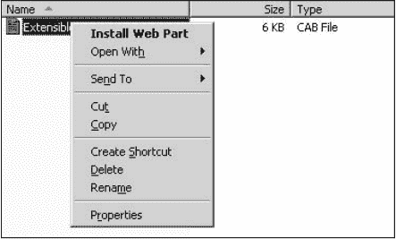

### 将我们的 Web 部件添加到页面

Web 部件现已部署到服务器。接下来需要将其添加到 Web 部件页面以查看所有组件的整合。

- 1. 启动 Internet Explorer 并浏览到你喜欢的 WSS 站点（确保你在该站点上具有设计者权限）。
- 2. 点击修改共享页面链接并选择添加 Web 部件 | 浏览：

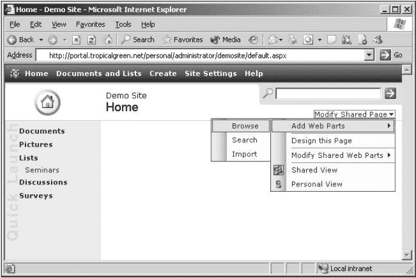

- 3. 你现在将看到工具窗格，其中列出了 Web 部件库。选择虚拟服务器库：

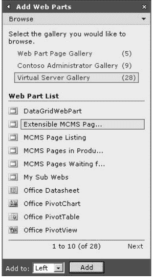

- 4. 点击可扩展 MCMS 页面导航 Web 部件并将其拖到屏幕左侧的任意 Web 部件区域。你应该会看到以下内容：

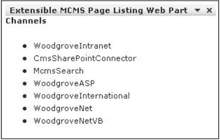

如果可扩展 MCMS 页面导航 Web 部件未出现在虚拟服务器库中，请使用 *执行部署* 中概述的方法重新部署 Web 部件到服务器，并验证 `stsadm.exe -o addwppack` 命令期间未发生错误。

如果出现错误消息“发生错误”，请验证 `Web.config` 中的信任级别设置是否足够。

另一个经常出现的错误是“此 Web 部件页面上的 Web 部件或 Web 表单控件无法显示或导入，因为它在此站点上未注册为安全。” 如果你看到此消息，请验证 `Manifest.xml` 和 `NavigationWebPart.dwp` 文件的内容是否存在拼写错误。

- 5. 要关闭工具窗格，请点击右上角的 X。

### 配置 Web 部件

我们现在已将 Web 部件添加到 Web 部件页面，并且它正在使用默认设置运行。在下一步中，我们将更改这些设置。

- 1. 在 Web 部件右上角，点击向下箭头以调出 Web 部件菜单并选择修改共享 Web 部件

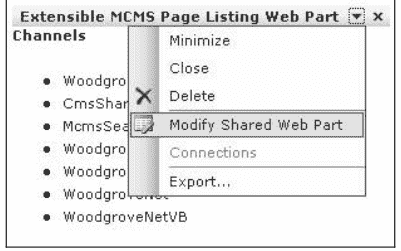

由于我们已将属性上的 `WebPartStorage` 属性设置为 `Storage.Shared`，因此我们只能修改共享视图，该视图适用于所有用户的此 Web 部件实例。如果我们希望用户存储个性化的 Web 部件自定义属性值，则必须将属性上的 `WebPartStorage` 属性设置为 `Storage.Personal`。

- 2. 工具窗格现在将出现在屏幕右侧。
- 3. 展开 MCMS 列表呈现组。
- 4. 将 `DefaultXslt.xslt` 的内容复制到呈现 XSLT 文本框中（可通过点击文本框右侧的省略号 [...] 打开更大的文本框）。
- 5. 将 `TestXml.xml` 的内容复制到测试 XML 文本框中。
- 6. 点击应用以在屏幕上查看设置，或点击确定以应用设置并关闭工具窗格。

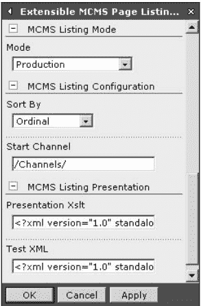

页面应刷新，Web 部件将呈现 MCMS /Channels/ 路径中的项目列表。

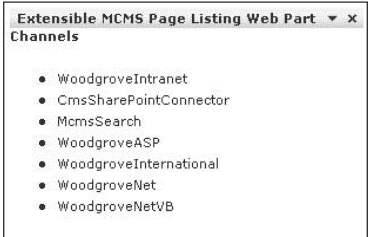

### 调试 Web 部件

由于我们的 Web 部件现在通过 WSS/SPS 运行，因此我们无法通过 Visual Studio .NET 开始调试选项直接调试 Web 部件。

默认情况下，WSS/SPS 已关闭调试。要打开调试，请编辑 IIS 虚拟服务器的 Web.config 并将 debug 属性设置为 true。

要使用 Visual Studio .NET 从 SPS/WSS 服务器调试我们的 Web 部件，我们必须将 Web 部件添加到 Web 部件页面并执行以下操作：

- 1. 在 Visual Studio .NET 中打开 ExtensibleMCMSPageListingWebPart 项目。
- 2. 在 NavigationWebPart.cs 中的 RenderWebPart() 方法上设置断点。
- 3. 从工具菜单中选择调试进程（或按 Ctrl+Alt+P）。
- 4. 选择 w3wp.exe 进程并点击附加。
- 5. 验证是否已选中公共语言运行时，然后点击确定：

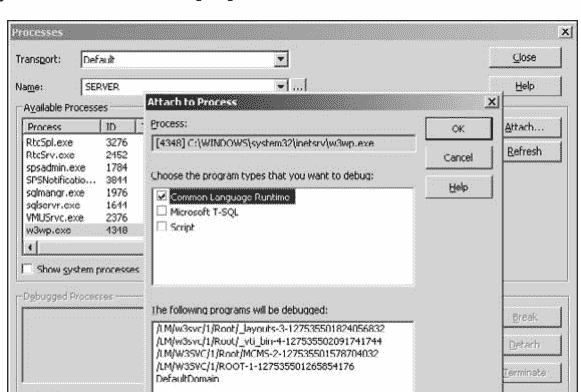

- 6. 点击进程对话框上的关闭并刷新 Web 部件页面。
- 7. 你的断点现在应被选中，你应该能够逐步执行代码。

你的 Web 部件必须以调试配置进行编译，以确保调试符号部署到服务器。

### 总结

在本章中，我们通过构建一个 MCMS 导航 Web 部件来探索 Web 部件框架的基础，该部件可以从 SharePoint 站点中显示 MCMS 频道项目。在开发过程中，我们利用了 Visual Studio .NET 的 Web 部件模板来创建我们的 Web 部件。这使我们能够利用 Visual Studio .NET 的服务器控件开发架构。我们的 Web 部件生成所发现频道中频道项目和子频道的 XML 表示。然后使用可配置的 XSLT 样式表转换 XML 数据。最后，我们通过创建 CAB 文件部署项目并运行 SharePoint STSADM.EXE 部署工具将 Web 部件部署到 SharePoint 服务器。

## 有用的占位符控件

MCMS 最令人兴奋的功能之一是创建自定义占位符服务器控件的灵活性。你可以创建各种形状和大小的占位符控件，为任何组织的作者提供多种量身定制的解决方案。如果开箱即用不可用——就构建它！而且很有可能你甚至不必从头开始构建自定义占位符控件。世界各地的 MCMS 开发人员可能已经在自己的工作中构建了类似的控件。本章汇编了常用且非常有用的占位符控件集合。

- **日期时间选择器占位符控件**  
  这为作者提供了按其选择的格式选择日期和时间值的选择器。告别格式错误和无效的日期，使用这个巧妙的控件。

- **接受多个附件的占位符控件**  
  这使作者能够上传所需的文件数量，通过提供一个像多个 `SingleAttachmentPlaceholderControls` 协同工作一样的控件。我们还将探讨随 Web Author 提供的未记录的插入附件对话框，并展示如何在自定义占位符控件中重用它。

- **图像旋转占位符控件**  
  作者可以使用此控件通过从指定的资源库中随机选择图像来管理网络广告。每次在呈现视图中加载控件时都会显示随机图像。

- **存储各种 HTML 标签的占位符控件**  
  如果你曾经想允许作者上传受限的 HTML 标签和 JavaScript，这个控件适合你。我们展示了需要进行的修改，以使 `HtmlPlaceholderControl` 接受所有 HTML 标签——包括 IFRAME、OBJECT 和 APPLET 标签以及表单元素！

- **DataGrid 占位符控件**  
  这使用熟悉的 DataGrid 来管理 XML 内容。作者可以在无需了解其技术细节的情况下添加、编辑和删除 XML 内容的行。我们还展示了如何优雅地处理需要回发的占位符，而不会产生离开警告警报。

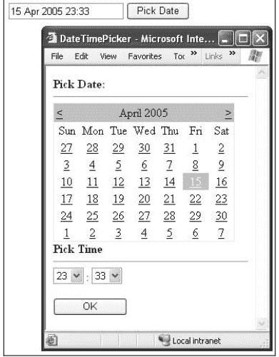

在呈现视图中，所选的日期和时间会显示在屏幕上。

15 Apr 2005 23:33

为了几乎不可能将无效日期保存到数据库中，日期时间选择器控件的内容通常在保存前进行验证。

MCMS 未随附日期时间选择器占位符控件，因此让我们从头开始构建一个。

### DateTimePickerPlaceholderControl 类

让我们通过向 UsefulPlaceholderControls 项目添加一个名为 DateTimePickerPlaceholderControl.cs 的类文件开始构建日期时间选择器占位符控件。

控件需要使用下面突出显示的命名空间中的方法，因此将它们添加到类文件中。

```
using System;
using System.Web.UI.HtmlControls;
using System.Web.UI.WebControls;
using Microsoft.ContentManagement.Publishing;
using Microsoft.ContentManagement.Publishing.Extensions.Placeholders;
using Microsoft.ContentManagement.WebControls.Design;
using Microsoft.ContentManagement.WebControls;
```


## 有用的占位符控件

最后，我们在创作容器中添加一个 Label 控件。该 Label 将用于显示过程中可能出现的错误消息。与 TextBox 一样，我们会将其设置为类级变量，以便在其他方法中使用它。

```
private TextBox txtAuthoring;
private Label lblMessage;

protected override void CreateAuthoringChildControls
        (BaseModeContainer authoringContainer)
{
    - - - code continues - - -

    // Add a label for displaying messages
    lblMessage = new Label();
    authoringContainer.Controls.Add(lblMessage);
}
```

## 检索已保存的内容

当帖子打开进行编辑时，日期时间选择器控件的文本框会显示之前保存的日期和时间值。对于新帖子，不会有之前的选项；我们将只使用当前日期和时间。重写 LoadPlaceholderContentForAuthoring()：

```
protected override void LoadPlaceholderContentForAuthoring
        (PlaceholderControlEventArgs e)
{
    EnsureChildControls();
    try
    {
        if (WebAuthorContext.Current.Mode == WebAuthorContextMode.AuthoringNew)
        {
            // The default value of the control is the current date and time
            txtAuthoring.Text = DateTime.Now.ToString("dd MMM yyyy HH:mm");
        }
        else
        {
            txtAuthoring.Text = ((HtmlPlaceholder)this.BoundPlaceholder).Text;
        }
    }
    catch(Exception ex)
    {
        lblMessage.Text = "Failed to load placeholder content: " + ex.Message;
    }
}
```

## 保存日期和时间

当帖子保存时，我们读取存储在 TextBox 中的值，并将其写入底层的 HtmlPlaceholder。任何异常都会通过 try-catch 块捕获，并在屏幕上显示详细的错误消息。将重写的 SavePlaceholderContent() 方法添加到代码中：

```
protected override void SavePlaceholderContent(PlaceholderControlSaveEventArgs e)
{
    EnsureChildControls();
    try
    {
        ((HtmlPlaceholder)this.BoundPlaceholder).Html = txtAuthoring.Text;
    }
    catch(Exception ex)
    {
```

## 验证日期和时间

为了确保只保存有效的日期，我们将重写 OnSavingContent() 方法。我们通过尝试将 TextBox 中存储的字符串转换为 DateTime 对象来检查要保存的值是否为有效日期。如果是有效日期，就不会引发异常。否则，我们捕获异常，保存操作可以被取消。

```
protected override void OnSavingContent(PlaceholderControlSavingEventArgs e)
{
    try
    {
        DateTime.Parse(txtAuthoring.Text.Trim());
        base.OnSavingContent(e);

        // Clear any messages on the screen
        lblMessage.Text = "";
    }
    catch(Exception ex)
    {
        e.Cancel = true;
        lblMessage.Text = ex.Message;
    }
}
```

## 显示选中的日期和时间

在展示模式下，选中的日期和时间显示在屏幕上的一个 Label 控件中。让我们重写 CreatePresentationChildControls() 方法，并向展示容器中添加一个 Label 控件。

```
private Label lblPresentation;

protected override void CreatePresentationChildControls(
        BaseModeContainer presentationContainer)
{
    lblPresentation = new Label();
    presentationContainer.Controls.Add(lblPresentation);
}
```

存储在底层 HtmlPlaceholder 中的先前保存的日期和时间值会从内容仓库中检索出来，并显示在之前加载的 Label 控件中。添加重写的 LoadPlaceholderContentForPresentation() 方法，如下所示：

```
protected override void LoadPlaceholderContentForPresentation
        (PlaceholderControlEventArgs e)
{
    EnsureChildControls();
    try
    {
        lblPresentation.Text = ((HtmlPlaceholder)this.BoundPlaceholder).Text;
    }
    catch(Exception ex)
    {
        lblPresentation.Text = ex.Message;
    }
}
```

日期时间选择器占位符控件已完成。接下来，让我们构建用于选择日期和时间的对话框。

## 日期和时间选择器对话框

日期和时间选择器对话框包含：

- 一个用于选择日期的 ASP.NET Calendar 控件
- 两个 DropDownList 控件，一个用于选择小时，另一个用于选择分钟
- 一个用于设置日期和时间值的 Button 控件

向 MCMS Web 项目中添加一个名为 DateTimePicker.aspx 的 Web 窗体（在本示例中，我们将其添加到 Tropical Green 项目的 Dialogs 文件夹中）。确保将 Page Layout 属性更改为 FlowLayout。现在切换到 HTML 视图，并向表单中添加以下标题：

```
- - - code continues - - -
<form id="DateTimePicker" method="post" runat="server">
<b>Pick Date:</b>
<hr>
<b>Pick Time</b>
<hr>
</form>
- - - code continues - - -
```

切换回设计视图。将以下控件拖放到 Web 窗体上，并如下所示进行排列。

| 控件 | 属性 | 属性值 |
|---|---|---|
| Calendar | ID | Calendar1 |
| DropDownList | ID | ddlHour |
| DropDownList | ID | ddlMinute |
| Button | ID | btnOK |
|  | Text | OK |
|  | Width | 100px |

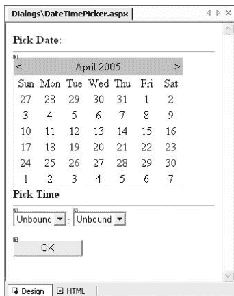

双击窗体进入代码后置文件。在 Page_Load() 事件处理程序中，我们从 InitialValue 查询字符串参数中检索之前选定的日期和时间。如果由于某种原因（可能是 TextBox 为空）该参数不包含有效的日期和时间，我们将使用当前日期和时间。

```
private void Page_Load(object sender, System.EventArgs e)
{
    if(!Page.IsPostBack)
    {
        // Retrieve the previously saved date and time
        DateTime initialDate;

        try
        {
            initialDate = DateTime.Parse(Request.QueryString["InitialValue"]
                .ToString());
        }
        catch
        {
            // No previously saved date and time found.
            // Use the current date and time.
            initialDate = DateTime.Now;
        }
    }
```

先前选定的日期和时间用于初始化 Calendar 控件以及构成选中时间小时和分钟的两个下拉列表。在 Page_Load() 事件处理程序中，我们还填充小时和分钟下拉框。

```
private void Page_Load(object sender, System.EventArgs e)
{
    if (!Page.IsPostBack)
    {
        . . . code continues . . .
        Calendar1.SelectedDate = initialDate;
```

虽然对话框运行良好，但我需要一个更便携的控件，可以在项目之间使用，而无需每次使用该控件时都重新创建 Web 窗体。我有哪些选择？

要在多个项目中部署此控件，请考虑以下选项之一：

1. 在 `/IIS_CMS/` 文件夹内创建一个文件夹，并将对话框存储在那里。由于所有 MCMS Web 项目都有一个名为 CMS 的虚拟目录映射到 `IIS_CMS` 文件夹，因此对话框的路径将是 `/CMS/SubFolder/datetimepicker.aspx`。
2. 您可以效仿 MCMS 在将 `/nr/` 文件夹部署到同一台计算机上的所有网站时使用的概念，即把包含 DateTimePicker 控件的文件夹添加到每个使用该控件的虚拟网站。
3. 或者，使用 MCMS 在将 `/CMS/` 文件夹部署到新的 MCMS 模板项目时使用的技术。将包含 DateTimePicker 控件的文件夹添加到需要它的每个模板项目。在代码中获取控件路径时，使用 `Page.Request.ApplicationPath` 返回的值。要为新项目实现自动化，您可以为 Visual Studio .NET 创建新的企业模板。有关创建和编辑企业模板的更多信息，请参阅 `http://msdn.microsoft.com/Library/en-us/vsent7/html/vxoriEnterpriseTemplates.asp`。
4. 重写日期时间选择器控件，使日历、小时和分钟下拉菜单在控件本身上生成。您可以将它们嵌入 `<div>` 标记中，并使用客户端脚本在点击“选择日期”按钮时显示它们。

## 将占位符控件添加到模板文件

要将该控件添加到 MCMS 项目中，您必须将该组件添加到工具箱中：

- 右键单击要将控件添加到的选项卡。
- 选择“添加/移除项”，然后选择添加“.NET Framework 组件”。
- 选择“浏览…”，然后选择 `UsefulPlaceholderControls.dll`。单击“打开”。
- 单击“确定”关闭对话框，并将控件添加到工具箱。

将控件添加到工具箱后，您可以像使用常规占位符控件一样，将其拖放到模板文件上并设置其属性。


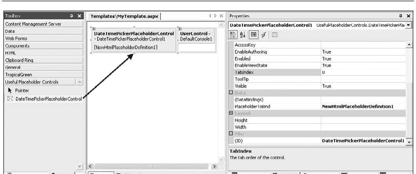

继续；将日期时间选择器占位符控件添加到现有模板文件中。将 PlaceholderToBind 属性设置为合适的 HtmlPlaceholderDefinition。导航到使用该模板的帖子并编辑它。你应该会看到一个文本框和一个 Pick Date 按钮。点击 Pick Date 按钮并选择一个日期。保存帖子。注意文本框和按钮控件会被一个显示你所选日期和时间的单个标签所取代。

## 用于多附件的占位符控件

我们已经见识过 SingleImagePlaceholderControl 和 SingleAttachmentPlaceholderControl 的工作方式。它们是管理单个文件的便捷控件。作者可以直接从本地计算机上传文件，或从资源库中的共享资源中选择。

然而，这些控件的最大缺点是文件必须一次处理一个。更常见的情况是，作者需要附加多个图像或附件。他们可能有一份支持文章的文档列表，或是一系列伴随故事的图像。无论情况如何，单个附件槽可能并不总是足够。

你可以通过以下三种方式之一解决此单文件限制：

- 为作者提供一个 HtmlPlaceholderControl。
- 增加页面上的 SingleAttachmentPlaceholders 和 SingleImagePlaceholderControls 的数量。提供作者所需的数量。
- 构建一个自定义占位符控件，允许上传多个文件和图像。

让我们考虑第一个选项，它需要使用 HtmlPlaceholderControl。随着 WYSIWYG 编辑器，作者可以上传所需的任意数量的图像和附件。另一方面，他们也可以向占位符控件添加不需要的文本。虽然给予作者完全自由会让他们满意，但在作者沉迷于应用自己的样式和布局时可能会引起问题。更常见的是，网站所有者希望对上传内容的显示方式有更多控制，甚至可能限制图像和附件的数量——而这些都无法使用 HtmlPlaceholderControl 实现。

第二个选项，即增加页面上的 SingleAttachmentPlaceholders 和 SingleImagePlaceholderControls 的数量，如果所需附件和图像的数量可以准确估计，则是可行的。这种方法的一个主要缺点是，对于引入的每个占位符控件，都必须创建一个相应的占位符定义。如果估计的附件数量很大，则相应的占位符定义数量也会很大。帖子使用的占位符越多，数据库查询需要检索的信息就越多，可能损害网站的整体性能。

显然，这两种开箱即用的解决方案都不能完全满足此需求。为了弥补差距，让我们探索最后一个选项，构建我们自己的自定义占位符控件，使用友好的图形用户界面接受多个附件。

附件的最大数量将由开发者决定。作为一个占位符控件，它在展示和作者模式下会有不同的视图。在作者模式下，控件将显示为一个包含多行的表格，每行提供一个槽供作者上传附件。此控件的一个有趣方面是它将重用随 Web Author 一起提供的插入附件对话框。

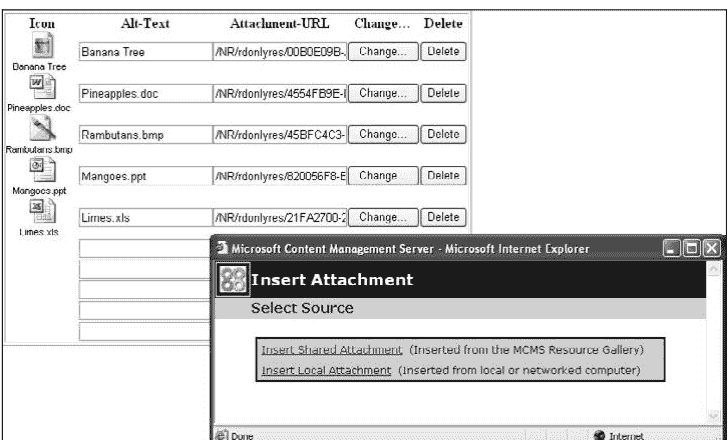

在展示视图中，附件显示为超链接列表。开发者可以选择将链接显示为图标或文本。在这里，我们选择将它们显示为图标列表。当然，你可以增强代码以按任何你喜欢的方式排列它们，水平、垂直，甚至在表格内。

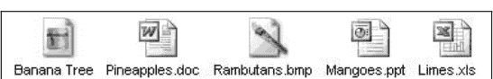

## MultipleAttachmentPlaceholderControl 类

首先，我们在 UsefulCustomPlaceholders 项目中添加一个名为 MultipleAttachmentPlaceholderControl.cs 的类。

类文件使用下面突出显示的命名空间中的方法。在命名空间声明上方添加它们：

```
using System;

using System.Xml;
using System.Web;
using System.Text;
using System.Web.UI;
using System.Web.UI.WebControls;
using Microsoft.ContentManagement.Publishing;
using Microsoft.ContentManagement.WebControls;
using Microsoft.ContentManagement.WebControls.Design;
using Microsoft.ContentManagement.Publishing.Extensions.Placeholders;

namespace UsefulCustomPlaceholders
{
    ... code continues ...
}
```

管理像我们在这里创建的这样的列表的一种好方法是将其存储为 XML。XML 为我们提供了以后以多种方式呈现附件的灵活性。因此，控件将支持 XmlPlaceholderDefinition 并通过继承 BasePlaceholder 构建：

```
[SupportedPlaceholderDefinitionType(typeof(XmlPlaceholderDefinition))]
public class MultipleAttachmentPlaceholderControl : BasePlaceholderControl
{
    ... code continues ...
}
```

控件将为开发者提供三个属性：

- **MaxAttachments**。指定控件支持的最大附件数量。初始值将设置为 10。开发者可以通过调整控件属性对话框中的值在设计时更改此值。
- **DisplayAsIcon**。指定附件是显示为图标还是文本。与 HtmlPlaceholderDefinition 类中的 UseGeneratedIcon 属性类似。
- **ResourceGalleryOnly**。指定是否可以从作者的计算机上传文件作为附件，或作者必须从资源库中的资源中选择。

在类构造函数下方添加以下三个属性：

```
private static int m_maxAttachments = 10;
public int MaxAttachments
{
    get
    {
        return m_maxAttachments;
    }

    set
    {
        m_maxAttachments = value;
    }
}
```

```
}
private bool m_displayAsIcon = false;
public bool DisplayAsIcon
{
    get
    {
        return m_displayAsIcon;
    }
    set
    {
        m_displayAsIcon = value;
    }
}

private bool m_resourceGalleryOnly = false;
public bool ResourceGalleryOnly
{
    get
    {
        return m_resourceGalleryOnly;
    }
    set
    {
        m_resourceGalleryOnly = value;
    }
}
```

## 生成附件表格

作者的用户界面包括以下内容：

- 一个包含多行的表格，每行对应一个附件。
- 每行包含一个标记为 Change... 的按钮，用于调用 Web Author 的插入附件对话框，一个删除按钮用于从列表中移除附件，以及用于显示附件显示文本和 URL 的文本框。
- 它还显示代表上传附件的图标。

以下是作者视图中的多附件占位符控件：

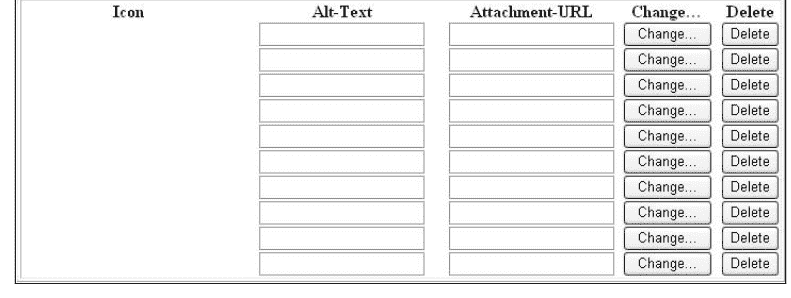

## 有用的占位符控件

通常，在构建自定义占位符控件时，添加这些控件的逻辑是通过重写 `CreateAuthoringChildControls()` 方法来编码的。我们在这里不会这样做，因为我们将在控件中大量使用 JavaScript。添加所有客户端脚本最简单、最省事的方法是采用老式的方式：作为常规 HTML。

因此，在重写的 `CreateAuthoringChildControls()` 方法中，我们将只添加一个单一的 Literal Web 控件。稍后，我们将 HTML 代码附加到此 Literal 控件的 Text 属性。添加以下代码到 ResourceGalleryOnly 属性下方：

```
private System.Web.UI.WebControls.Literal baseAuthoringContainer;

protected override void CreateAuthoringChildControls
    (BaseModeContainer authoringContainer)
{
    baseAuthoringContainer = new Literal();
    authoringContainer.Controls.Add(baseAuthoringContainer);
}
```

现在，让我们创建表格。由于表格是动态生成的，其中混合了占位符内容和 HTML，我们将在重写的 `LoadPlaceholderContentForAuthoring()` 方法中对其进行编码。

表格包含五列：

| Column 1 | Column 2 | Column 3 | Column 4 | Column 5 |
|---|---|---|---|---|
| 显示附件作为图标。显示的图标与文件类型相关。例如，Office Word 文档将具有如下所示的图标。 | 包含一个显示附件显示文本的 TextBox 控件。它还保存一个用于存储第 1 列中显示的图标 URL 的隐藏表单字段。它是隐藏的，因此你在展示视图中看不到它，但其值将被我们稍后编写的客户端脚本使用。 | 包含一个只读 TextBox，显示附件的 URL。 | 提供一个标记为 Change... 的按钮，触发上传过程。 | 包含一个删除按钮，用于从列表中移除附件。 |
| Doc1.doc | Alt-Text: Doc1.doc | Attachment-URL: /NR/rdonlyres/00000015/i | Change... | Delete |

由于我们是从类文件编写代码，我们不能像使用常规 HTML 或 ASPX 文件那样直接插入 HTML。相反，我们将把代码写成字符串变量并将其添加到我们之前创建的 Literal 控件的 Text 属性中。我们将从表格的标题开始。将以下代码附加到类文件：

```
private string crlf = "\n";

protected override void
LoadPlaceholderContentForAuthoring(PlaceholderControlEventArgs e)
```


# 有用的占位符控件

```
htmlCode.Append("<td align=center>");

// Add a hidden form field to store the icon
htmlCode.Append("<input type=\"hidden\" name=\"MAPH_AttIconUrl_" + sPhName
                + "_" + i.ToString() + "\">");

// Add the text box to display the attachment's display text
htmlCode.Append("<input type=\"text\" name=\"MAPH_AttName_" + sPhName
                + "_" + i.ToString() + "\">");

// End the cell
htmlCode.Append("</td>" + crlf);
}

  - - - code continues - - -

}
```

在第三个单元格中，我们生成一个只读文本框来显示附件的 URL。我们通过在字符串 MAPH_AttLink_ 后追加占位符的名称和一个数字来为其赋予唯一名称。稍后，我们将使用客户端脚本在此处显示 URL。

```
protected override void LoadPlaceholderContentForAuthoring
                                      (PlaceholderControlEventArgs e)
{
  - - - code continues - - -

  for (int i = 0; i < m_maxAttachments; i++)
  {
    - - - code continues - - -

    // Add the cell for that attachment's URL
    htmlCode.Append("<td align=center>");

    // Add the read-only Text box to display the attachment's URL
    htmlCode.Append("<input readonly type=\"text\" name=\"MAPH_AttLink_"
                   + sPhName + "_" + i.ToString() + "\">");

    // End the cell
    htmlCode.Append("</td>" + crlf);
  }

  - - - code continues - - -

}
```

接下来，我们添加包含 Change... 按钮的单元格作为第四列。该按钮会打开插入附件对话框。

```
protected override void LoadPlaceholderContentForAuthoring
                                      (PlaceholderControlEventArgs e)
{
  - - - code continues - - -

  for (int i = 0; i < m_maxAttachments; i++)
  {
    - - - code continues - - -

    // Add the cell that contains the button
    htmlCode.Append("<td width=100 align=center>");

    // Add the Change... button to trigger the upload process
    htmlCode.Append("<INPUT type=BUTTON value=\"Change...\" onclick=\""
                   + GetAttachmentDialog(i) + "\">");

    // End the cell
```

| 参数 | 其作用 |
|---|---|
| `strPostQueryString` | 一个查询字符串，其中包含有关未发布模式下帖子的信息，例如其 GUID，或者如果是新帖子，则为频道的 GUID。 |
| `strPhName` | 占位符的名称。 |
| `strPhType` | 此处的值决定插入附件对话框如何将有关附件的信息传回调用控件。处理附件时，Web Author 识别以下值： |
|  | - **MultiPurpose.** 应用于接受带完整格式化的 HTML 的控件。 |
|  | - **SingleAttachment.** 由 `SingleAttachmentPlaceholderControl` 用于单个文件上传。 |
|  | - **ThinEditIE.** 与 `MultiPurpose` 类似。不同之处在于对占位符的插入使用占位符文档对象模型 DOM。我们将在本示例中使用此选项。 |
| `bAllowUpload` | 一个布尔值，用于指示是否允许本地附件。值为 `false` 表示只能附加资源库项目。 |
| `bAttachIcon` | 一个布尔标志，用于指示是否应将附件渲染为图标。当设置为 `true` 时，附件将作为图标添加到内容中。否则，它将以文本链接的形式显示。 |
| `bAllowVideo` | 最后一个布尔值指示是否支持视频附件。这是 MCMS 早期版本支持视频的遗留功能。在 MCMS 2002 中，此值应始终设置为 `false`。 |

综合起来，下面是启动插入附件对话框的脚本。当然，GUID 和占位符名称是需要动态生成的变量。以下代码片段将允许本地附件并使用图标来表示附件：

```
WBC_LaunchAttachmentGallery("wbc_purpose=Basic&NRMODE=Unpublished&WBCMODE=PresentationUnpublished&FRAMELESS=TRUE&CHANNELGUID=C40686DA-83CF-452F-AF24-3D990FA2BAC1}&NRNOGUID={7AF93078-5FF8-4963-A9F9-1BA0977258A7}&NewHtmlPlaceholderDefinition1", "ThinEditIE", true, true, false);
```

`GetAttachmentDialog()` 方法生成所需的客户端脚本。该脚本收集有关以下内容的信息：

- 频道和帖子的 GUID。
- 控件绑定的占位符的名称。
- 是否允许本地附件。
- 附件应以图标还是文本形式显示。对于此控件，我们将始终将此参数设置为 `true`，因为我们希望在作者表格中显示图标。

收集必要数据后，它将它们作为 `WBC_LaunchAttachmentGallery()` 函数的参数组合在一起。现在添加 `GetAttachmentDialog()` 方法：

# 有用的占位符控件

```csharp
private string GetAttachmentDialog(int i)
{
    // Check to see if the NRCHANNELGUID querystring contains a value
    // If it does, then it's most likely a new posting
    string channelGUID = Page.Request.QueryString["NRCHANNELGUID"];
    if (channelGUID != "")
    {
        channelGUID = "&NRCHANNELGUID=" + channelGUID;
    }

    // Get the GUID from the NRNODEGUID querystring parameter
    string postingGUID = Page.Request.QueryString["NRNODEGUID"];

    // Get the name of the placeholder to bind
    string placeholderName = this.PlaceholderToBind;

    // Are local attachments allowed?
    string allowLocalAttachments = (!m_resourceGalleryOnly).ToString();

    StringBuilder script = new StringBuilder();

    // Specify the name of the placeholder that we are adding the attachment to
    script.Append("MAPH_DestPH = \"" + placeholderName + "_" + i.ToString()
                 + "\";");

    // Launch the Insert Attachment Dialog
    script.Append("WBC_launchAttachmentGallery(\""
        + "wbc_purpose=Basic&"
        + "NRMODE=Unpublished&"
        + "WBCMODE=PresentationUnpublished&"
        + "FRAMELESS=true" + channelGUID + "&"
        + "NRNODEGUID=" + postingGUID + "&"
        + "\" + placeholderName + \"\","
        + "ThinEditIE,"
        + allowLocalAttachments.ToLower() + ","
        + "true,"
        + "false);");

    script.Append("return false");

    return script.ToString();
}
```

# 从对话框返回值的

插入附件对话框允许作者指定附件及其显示文本。它不是模态对话框。因此，为了将内容写回占位符控件，对话框会访问调用窗口中的客户端函数。

根据所选的占位符类型，Web Author 会准备不同的客户端例程。本示例中使用的“ThinEditIE”占位符类型调用位于 `<install directory>\Microsoft Content Management Server\IIS_CMS\WebAuthor\Client\PlaceholderControlSupport\` 目录下的 AuthorFormClientIE.js 脚本中的 WBC_setThinEditIEAttachment() 方法。

我们需要修改 WBC_setThinEditIEAttachment() 例程，以使用附件的图标、显示文本和 URL 更新作者表格。棘手的部分是这样做而不修改原始代码（否则我们将跨越 Microsoft 支持边界，而且不修改原始文件可以防止代码在将来应用服务包时被覆盖）。作为变通方法，我们将创建一个修改版本的方法并将其添加到页面中。当

浏览器看到两个具有相同名称的 JavaScript 方法时，一个定义在页面内，另一个定义在单独的 *.js 文件中，浏览器将选择运行页面中嵌入的那个。

首先，让我们看一下下面所示的原始 WBC_setThinEditIEAttachment() 例程。它接受三个输入参数：

- 正在接受附件的占位符的名称
- 已上传附件的 URL
- 附件的显示名称

它使用附件文件的 URL 和显示名称来构建 HTML 锚标记。锚标记通过调用占位符 DOM 的 insertHtml() 方法添加到占位符中。现在不必担心输入代码。我们稍后将编写一个服务器端函数来动态生成此脚本。

```
function WBC_setThinEditIEAttachment(strPhName, strURL, strDispText)
{
    var strMyDispText = strDispText;
    if (strMyDispText == "")
    {
        strMyDispText = strURL;
    }

    document.all["NCPHRICH_" + strPhName].insertHtml("<a href=\"" + strURL
                                             + "\">" + strMyDispText + "</a>");
}
```

虽然 WBC_setThinEditIEAttachment() 方法对于常规 HtmlPlaceholderControls 来说运行完美，但为了使其在 MultipleAttachmentPlaceholderControl 中正常运行，我们需要进行多项修改：

- 该方法调用 ID 为 NCPHRICH_(PlaceholderName) 的对象；我们的自定义控件具有不同的命名约定，执行此行代码将导致错误。
- 而不是在 HtmlPlaceholderControl 中插入整个锚标记，我们需要将有关附件的信息传回多个附件占位符控件中表格的相应隐藏字段和单元格。

# 所有类型占位符控件的客户端脚本

让我们解决第一个问题。默认情况下，WBC_setThinEditIEAttachment() 方法仅适用于开箱即用的占位符控件。随 MCMS 一起提供的占位符控件的 ID 前缀为 NCPHRICH，以区别于我们构建的自定义控件。我们的控件的 ID 不是 NCPHRICH_(PlaceholderName)。因此，以下代码行在使用对话框与自定义控件时会导致“document.all[...] is null or not an object”错误。

```
document.all["NCPHRICH_" + strPhName].insertHtml("<a href=\"" + strURL
                                         + "\">" + strMyDispText + "</a>");
```

另一方面，我们不能完全删除该行代码，因为同一页面上可能存在一些需要它的开箱即用占位符控件。为了解决这个问题，我们将把该行包装在一个检查对象是否未定义的检查中（对于多个


附件占位符控件）。同样，暂时不用担心向类文件添加代码的问题，稍后我们会展示如何注入JavaScript。

```
function WBC_setThinEditIEAttachment(strPhName, strURL, strDispText)
{
    var strMyDispText = strDispText;
    if (strMyDispText == "")
    {
        strMyDispText = strURL;
    }
    if(typeof document.all["NCPHRICH_" + strPhName] != "undefined")
    {
        document.all["NCPHRICH_" + strPhName].insertHtml("<a href=\"" + strURL + "\">" + strMyDispText + "</a>");
    }
}
```

### 将附件信息传递给占位符控件

现在，继续解决第二个问题：将附件信息传回多个附件占位符控件。我们会在隐藏字段和文本框里填入附件图标、显示文本和URL等信息。

为了获取这些信息，我们来看传给 WBC_setThinEditIEAttachment() 方法的两个输入参数：

| 输入参数 | 含义 |
|---|---|
| strURL | 顾名思义，该参数包含附件的URL。 |
| strMyDispText | 存储图标。返回的HTML是一个图像标签，如下所示： |

因此，strURL 包含附件的URL，而 strMyDispText 保存图标，如下面的脚本所示：

```
function WBC_setThinEditIEAttachment(strPhName, strURL, strDispText)
{
    var strMyDispText = strDispText;
    if (strMyDispText == "")
    {
        strMyDispText = strURL;
    }
    if(typeof document.all["NCPHRICH_" + strPhName] != "undefined")
    {
        document.all["NCPHRICH_" + strPhName].insertHtml("<a href=\"" + strURL + "\">" + strMyDispText + "</a>");
    }
    else
    {
        // Return the image of the icon
        if (typeof document.all["MAPH_AttIcon_" + MAPH_DestPH] != "undefined")
        {
```

### 生成 WBC_setThinEditIEAttachment() 方法

由于我们的自定义占位符控件完全由服务器端代码构建，我们需要动态生成上述客户端脚本，并通过 Page.RegisterStartUpScript() 注册它。为此，我们必须将下面所示的辅助函数 RenderResourceGalleryRelatedJavascript() 添加到代码中：

```csharp
private void RenderResourceGalleryRelatedJavascript()
{
    StringBuilder script = new StringBuilder();

    // Start the script block
    script.Append("<SCRIPT language=\"javascript\">" + crlf);

    // Declare the MAPH_DestPH variable
    script.Append("var MAPH_DestPH = \"\";" + crlf);

    // Define WBC_setThinEditIEAttachment function to replace one defined by MCMS
    script.Append("function WBC_setThinEditIEAttachment(strPhName, strURL,"
        + "strDispText){" + crlf);

    script.Append("var strMyDispText = strDispText;" + crlf
        + "if (strMyDispText == \"\")"
        + "{"
        + "strMyDispText = strURL;"
        + "}" + crlf);

    script.Append("if(typeof document.all[\"NCPHRICH_\" + strPhName] != "
        + "\"undefined\")"
        + "{"
        + "document.all[\"NCPHRICH_\" + strPhName].insertHtml(\"<a href=\\\"\" + strURL + \"\\\">\" + strMyDispText + \"</a>\");"
        + "}" + crlf);

    script.Append("else"
        + "{"
        + "elements = strMyDispText.split(\"\"); " + crlf);

    script.Append("if(typeof document.all[\"MAPH_AttIcon_\" + MAPH_DestPH] != \"undefined\")"
        + "{"
        + "document.all[\"MAPH_AttIcon_\" + MAPH_DestPH].innerHTML=strMyDispText;"
        + "}" + crlf);

    script.Append("if(typeof document.all[\"MAPH_AttLink_\" + MAPH_DestPH] != \"undefined\")"
        + "{"
        + "document.all[\"MAPH_AttLink_\" + MAPH_DestPH].value = strURL;"
        + "}" + crlf);

    script.Append("if (typeof document.all[\"MAPH_AttIconUrl_\"+MAPH_DestPH]!=\"undefined\")"
        + "{"
        + "document.all[\"MAPH_AttIconUrl_\" + MAPH_DestPH].value=strMyDispText;"
        + "}" + crlf);

    script.Append("if (typeof "
        + "document.all[\"MAPH_AttName_\"+MAPH_DestPH]!=\"undefined\")"
        + "{"
        + "document.all[\"MAPH_AttName_\""
```

## 实用的占位符控件

```
for (int i = 0; i < m_maxAttachments; i++)
{
    if (Page.Request.Form["MAPH_AttLink_" + sPhName + "_" + i.ToString()] != "")
    {
        XmlNode xAttachment = xd.CreateElement("Attachment");

        // Store the attachment's display text
        XmlNode xDisplayName = xd.CreateElement("DisplayText");
        xDisplayName.InnerText = Page.Request.Form["MAPH_AttName_" + sPhName
                                    + "_" + i.ToString()];
        xAttachment.AppendChild(xDisplayName);

        // Store the attachment's URL
        XmlNode xUrl = xd.CreateElement("Url");
        xUrl.InnerText = Page.Request.Form["MAPH_AttLink_" + sPhName + "_"
                                  + i.ToString()];
        xAttachment.AppendChild(xUrl);

        // Store the icon
        XmlNode xIcon = xd.CreateElement("Icon");
        xIcon.InnerText = Page.Request.Form["MAPH_AttIconUrl_" + sPhName + "_"
                                   + i.ToString()];
        xAttachment.AppendChild(xIcon);

        // Add the node to the XML Doc
        xnRoot.AppendChild(xAttachment);
    }
}
xph.XmlAsString = xnRoot.OuterXml;
}
```

### 检索已保存的内容

要显示存储的内容，必须先将其检索出来。计划如下：

- 首先准备三个数组，用于存储附件的 URL、图标和显示文本。
- 接下来，从底层 `XmlPlaceholder` 中检索已保存的 XML。
- 获得 XML 后，我们从标签中提取附件信息，并将其存储到已准备好的数组中。
- 最后，将内容重新加载到所有已上传附件的表格中。

### 准备用于存储附件信息的数组

让我们准备三个字符串数组，用于存储附件的 URL、图标和显示文本列表。将以下代码添加到 LoadPlaceholderContentForAuthoring() 方法的开头：

```
// Stores the URL of the attachment
private string[] attUrl = new string[m_maxAttachments];

// Stores the icon
private string[] attIcon = new string[m_maxAttachments];

// Stores the display text
private string[] attName = new string[m_maxAttachments];

protected override void LoadPlaceholderContentForAuthoring
                               (PlaceholderControlEventArgs e)
{
    - - - code continues - - -
}
```

我们先从图标开始。附件的图标显示在每行的第一个单元格中。我们将获取存储在 attIcon[] 数组中的图标，并将其添加到单元格中。添加下面突出显示的代码：

```
protected override void LoadPlaceholderContentForAuthoring(
    PlaceholderControlEventArgs e)
{
    . . . code continues . . .
    // Add the cell for the attachment's icon
    htmlCode.Append("<td align=center id=\"MAPH_AttIcon_" + sPhName
        + "_" + i.ToString() + "\">" + attIcon[i] + "</td>" + crlf);
    . . . code continues . . .
}
```

该图标还会存储在表格第二列的一个隐藏字段中。该隐藏字段的名称以 MAPH_AttIcon 开头，与第一列的单元格一样，它将填充 attIcon[] 数组的内容。

```
protected override void
LoadPlaceholderContentForAuthoring(PlaceholderControlEventArgs e)
{
    . . . code continues . . .
    // Add a hidden form field to store the icon
    htmlCode.Append("<input type=\"hidden\" name=\"MAPH_AttIconUrl_" + sPhName
        + "_"+i.ToString() + "\" value=\"" + attIcon[i] + "\">");
    . . . code continues . . .
}
```

附件的显示文本显示在一个名称以 MAPH_AttName 开头的文本框中。我们将其设置为保存 attName[] 数组的内容。

```
protected override void
LoadPlaceholderContentForAuthoring(PlaceholderControlEventArgs e)
{
    . . . code continues . . .
    // Add the Text box to display the attachment's display text
    htmlCode.Append("<input type=\"text\" name=\"MAPH_AttName_" + sPhName
        + "_" + i.ToString() + "\" value=\"" + attName[i] + "\">");
    . . . code continues . . .
}
```

最后一项要填写的是附件的 URL。这些 URL 显示在以 MAPH_AttLink 开头的文本框中。attUrl[] 数组的内容将用于填充它们的值。

```
protected override void LoadPlaceholderContentForAuthoring(
    PlaceholderControlEventArgs e)
{
    . . . code continues . . .
    // Add the read-only Text box to display the attachment's URL
    htmlCode.Append("<input readonly type=\"text\" name=\"MAPH_AttLink_"
        + sPhName + "_" + i.ToString()+"\" value=\""+attUrl[i]+"\">");
    . . . code continues . . .
}
```


# 有用的占位符控件

```csharp
protected override void LoadPlaceholderContentForPresentation(
                                      PlaceholderControlEventArgs e)
{
    EnsureChildControls();

    // Get the current CmsHttpContext
    CmsHttpContext cmsContext = CmsHttpContext.Current;

    // Get an instance of the selected resource gallery
    string xml = ((XmlPlaceholder)this.BoundPlaceholder).XmlAsString;
    m_resourceGalleryPath = GetResourceGalleryPath(xml);

    ResourceGallery rg = cmsContext.Searches.GetByPath(m_resourceGalleryPath)
                             as ResourceGallery;
}
```

获取到资源库实例后，会生成一个随机数。同样，我们将编写一个辅助函数 RandomNumberGenerator()，从零到资源库中资源数量减一的范围内选取一个数字：

```csharp
private int RandomNumberGenerator(int max)
{
    // generate a random number
    int seed;
    int index = 0;
    seed = (int)System.DateTime.Now.Ticks % System.Int32.MaxValue;
    System.Random rand = new System.Random(seed);
    index = rand.Next(0,max);

    return index;
}
```

接下来，获取对应于随机选择索引的资源。按如下所示修改 LoadPlaceholderContentForPresentation() 方法：

```csharp
protected override void LoadPlaceholderContentForPresentation(
                                      PlaceholderControlEventArgs e)
{
    . . . code continues . . .

    if (rg != null)
    {
        // Randomly select a resource from the gallery
        int indexOfResource = RandomNumberGenerator(rg.Resources.Count);
        Resource r = rg.Resources[indexOfResource];
    }
}
```

为了确定文件的类型，我们检查其 MIME 类型（多用途互联网邮件扩展类型）。MIME 类型用于浏览器确定内容应如何显示。例如，MIME 类型为 `applications/x-shockwave-flash` 的文件将在 Flash 播放器中播放，而不是作为图像或文本显示。Resource.MimeType 属性返回的确切值取决于服务器的注册表。

```
```html
<TD>Greet the world: </TD>
<TD></TD>
</TR>
</TBODY>
</TABLE>
```
```

发生了什么？HtmlPlaceholder 对象设计为仅存储特定标签，如 `<table>`、`<tr>` 和 `<td>` 标签（请注意，这些表格标签仅在允许完整格式时才被接受）。完整列表可以从文档中获得。

## 我在哪里可以找到 HtmlPlaceholder 接受的完整标签列表？

允许的标签完整列表记录在 MCMS 手册中，章节为 *Mapping HTML Placeholder Definition Properties to Content Authoring Behavior*。在线版本可在 `http://msdn.microsoft.com/library/en-us/sitedevl/htm/cms_sd_dev_vsnetintegration_lcua.asp` 找到。

设置此类限制是为了防止可能危险的标签被输入并保存在占位符中。此类代码可能导致无限循环，打开新的浏览器窗口，窃取 cookie，甚至启动恶意小程序或其他控件。

尽管如此，可能存在作者需要贡献包含这些禁止标签的内容的情况。作者可能需要在占位符内容中嵌入客户端脚本、IFRAMES、小程序或 ActiveX 控件。通常，这些对象在模板文件中定义，但这样做需要开发人员插入代码。技术熟练的作者可能希望自行管理此类内容，从而绕过因开发人员繁忙而造成的潜在工作流瓶颈。

默认的 HtmlPlaceholder 占位符对象不允许所有标签。为了解决这个问题，我们将构建一个自定义占位符控件。我们称之为 AllTagsHtmlPlaceholderControl。该控件的外观和感觉与 HtmlPlaceholderControl 相同，但它会修改内容，使底层 HtmlPlaceholder 在发布保存时不再检测到不允许的标签。

以下是作者视图中完成的 AllTagsHtmlPlaceholderControl。它看起来与 HtmlPlaceholderControl 完全相同。作者甚至不会注意到区别。

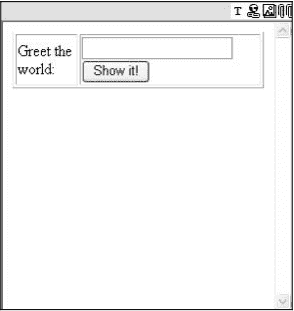

为了欺骗占位符接受每个标签，无论是简单的粗体标签 <b> 还是脚本标签 <script>，我们将用字符串 "~LT~" 和 "~GT~" 分别替换所有小于号 (<) 和大于号 (>) 字符。结果是保存到占位符的内容只是像这样有趣的文本：

```text
~LT~script~GT~
function Greet()
{
    alert(document.all.MyTextBox.value);
}
~LT~/script~GT~
```

转换后的文本不包含任何受限标签。它可以毫无问题地保存到占位符中。有趣的是，流行的 Telerik r.a.d. 编辑器使用相同的技术来允许特殊标签。

由于转换过程是在发布保存时完成的，我们将修改 SavePlaceholderContent() 方法。将重写的 SavePlaceholderContent() 方法添加到构造函数正下方。在保存时，我们将调用一个名为 Escape() 的方法（定义在之后），该方法将所有标签转换为文本。

```csharp
protected override void SavePlaceholderContent(PlaceholderControlSaveEventArgs e)
{
    EnsureChildControls();
    ((HtmlPlaceholder)(this.BoundPlaceholder)).Html = Escape(this.Html);
}
```

## 转义标签

Escape() 方法只是用 ~LT~ 替换所有小于号 (<) 字符，用 ~GT~ 替换所有大于号 (>) 字符。

值得注意的是，只有 HTML 标记标签才包含 < 和 > 字符。如果作者将这些字符作为占位符中正文的一部分输入，MCMS 会将小于号编码为 &lt;，大于号编码为 &gt;。因此我们不必担心 Escape() 例程会搞乱作者输入的内容。

```csharp
private string Escape(string input)
{
    return input.Replace("<", "~LT~").Replace(">", "~GT~");
}
```

## 反转义标签

将 ~LT~ 和 ~GT~ 字符转换回 < 和 > 字符的操作由 UnEscape() 方法完成。将其直接添加到 Escape() 方法下方。

```csharp
private string UnEscape(string input)
{
    return input.Replace("~LT~", "<").Replace("~GT~", ">");
}
```

## 加载用于编辑和展示的内容

要显示内容，我们所需要做的就是将 ~LT~ 和 ~GT~ 字符串分别转换回 < 和 > 字符。

内容显示的第一个位置是在作者视图中，作者更新占位符内容时。我们仅在编辑占位符时，或当 Web Author 处于 AuthoringReedit 模式时才需要转换文本。前面定义的 UnEscape() 方法执行转换。添加下面所示的重写 LoadPlaceholderContentForAuthoring() 方法：

```
protected override void LoadPlaceholderContentForAuthoring(
    PlaceholderControlEventArgs e)
{
    EnsureChildControls();
    if (WebAuthorContext.Current.Mode == WebAuthorContextMode.AuthoringReedit)
    {
        base.Html = UnEscape(((HtmlPlaceholder)(base.BoundPlaceholder)).Html);
    }
    else
    {
        base.LoadPlaceholderContentForAuthoring(e);
    }
}
```

上传的内容，不用说，也会在展示视图中显示。无论是在查看发布内容的预览或已发布模式时是否显示内容，~LT~ 和 ~GT~ 字符串都必须分别转换回 < 和 > 字符。我们将在重写的 LoadPlaceholderContentForPresentation() 方法中执行转换。将该方法追加到代码中：

```
protected override void LoadPlaceholderContentForPresentation(
    PlaceholderControlEventArgs e)
{
    EnsureChildControls();
    base.Html = UnEscape(((HtmlPlaceholder)(base.BoundPlaceholder)).Html);
}
```

控件已完成。保存并构建解决方案。

## 使用 AllTagsHtmlPlaceholderControl

要使用 AllTagsHtmlPlaceholderControl，将 UsefulPlaceholderControl.dll 库文件复制到 bin 目录，或将其作为引用添加到项目中。添加控件到工具箱后，像使用常规占位符控件一样将其拖放到模板文件上。将控件的 PlaceholderToBind 属性设置为现有的 HtmlPlaceholderDefinition。

此外，如果作者计划保存受限标签，如 <script> 块和 <input> 元素，则需要将控件的 AllowHtmlSourceEditing 属性设置为 true。WYSIWYG 编辑器不允许作者在设计视图中复制和粘贴受限标签。他们必须在作者工具栏上单击 HTML 按钮，然后将 HTML 代码粘贴到控件中。


## 有用的占位符控件

DataGrid 创建完成后，我们就可以开始插入列了。我们要添加的第一列是编辑/更新列。在 DataGrid 的术语中，这就是 EditCommandColumn。它包含一个 Edit 链接，供作者选择他们想要修改的网格行。点击后，该行会转变为一系列文本框。作者修改完行内容后，点击 Update 链接即可将工作保存回网格。

当然，如果不编写必要的逻辑，Edit 和 Update 链接不会执行编辑和更新的工作。我们将在稍后编写 OnEditCommand() 方法用于编辑，以及 OnUpdateCommand() 方法用于更新。与此同时，我们将这些方法分别注册到 DataGrid 的 EditCommand 和 UpdateCommand 事件。

```
// - - - code continues - - -
protected override void CreateAuthoringChildControls(
                                  BaseModeContainer authoringContainer)
{
    // Add a DataGrid control to the authoring container
    dg = new DataGrid();

    // Add an Edit/Update column to the DataGrid
    EditCommandColumn c0 = new EditCommandColumn();
    c0.EditText = "Edit";
    c0.UpdateText = "Update";
    dg.Columns.Add(c0);
    dg.EditCommand += new DataGridCommandEventHandler(this.OnEditCommand);
    dg.UpdateCommand += new DataGridCommandEventHandler(this.OnUpdateCommand);

    authoringContainer.Controls.Add(dg);
}
```

我们还将为作者提供一个 Delete 按钮，以便从 DataGrid 中删除行。自动在 DataGrid 中创建按钮的列类型是 ButtonColumn。与之前添加的编辑和更新链接一样，我们需要为删除项目编写逻辑。我们在 OnDeleteCommand() 事件处理程序中执行此操作，将在稍后处理。现在，我们将该方法注册为另一个 DataGridCommandEventHandler 到 DataGrid 的 DeleteCommand 事件。

```
// - - - code continues - - -
protected override void CreateAuthoringChildControls(
                                  BaseModeContainer authoringContainer)
{
    // - - - code continues - - -

    // Add a Delete button to the DataGrid
    ButtonColumn c1 = new ButtonColumn();
    c1.CommandName = "Delete";
    c1.Text = "Delete";
    dg.Columns.Add(c1);
    dg.DeleteCommand += new DataGridCommandEventHandler(this.OnDeleteCommand);

    authoringContainer.Controls.Add(dg);
}
```

接下来，我们添加一个 Label 用于在从 DataGrid 加载和保存内容时显示错误信息（如果有）。请记住将 Label 定义为类级变量，以便类中的其他方法可以访问它。

```
// - - - code continues - - -
private Label lblMessage;
protected override void CreateAuthoringChildControls(
                                  BaseModeContainer authoringContainer)
```

## 我正在使用 Telerik MCMS 占位符控件。如何使用客户端脚本访问其内容？

使用客户端脚本访问 Telerik MCMS 占位符控件中的内容的技术是类似的。首先，我们需要获取包含 HTML 的对象的 ID。为此，在 Telerik MCMS 占位符控件中输入一些文本并保存页面。返回到编辑模式并使用 Notepad 查看页面的 HTML 源代码。按 Ctrl+F 并搜索刚刚输入的文本。注意包含内容的 `<div>` 标签的 ID，在控件 v2.12 中类似于这样：

```
`radEditorContainer_(ID of control)_AuthoringModeControlsContainer_Editor_(ID of Control)_AuthoringModeControlsContainer`
```

对于 ID 为 RadEditorPlaceholderControl1 的占位符控件，检索其内容的 JavaScript 如下：

```html
<script language="javascript">

var content =
document.all.radEditorContainerRadEditorPlaceholderControl1_AuthoringModeControlsContainer_EditorRadEditorPlaceholderControl1_AuthoringModeControlsContainer.innerHTML;

</script>
```

请注意，在控件的不同版本中，包围内容的 `<div>` 标签的 ID 会有所不同。你必须检查生成的源代码以获取你正在使用的特定版本的 `<div>` 标签的 ID。

## 检查 HtmlPlaceholderControl 是否为空

现在我们知道了如何检索 HtmlPlaceholderControl 的当前内容，就可以继续验证它了。当满足以下任一条件时，HtmlPlaceholderControl 被认为为空：

- 它包含一个空字符串。
- 它仅包含不可见标签和空格，例如 `<p>&nbsp;</p>`，或 `<p><div>&nbsp;</div></p>` 等。

根据你的需求，你可能还需要检查占位符内容是否包含默认文本。

用于检查这些条件的 JavaScript 在本节中介绍。要验证的控件的名称将被添加到例程的名称中，以确保如果在同一模板文件中放置了多个验证控件；它们各自将拥有自己的客户端例程。代码使用了客户端的 `isEmpty()` 方法来检查占位符是否为空。

```
else
{
    // content is valid
    return true;
}
}
function isEmpty(content)
{
    // Add more tags to ignore in this list if you need to.
    // Here, we ignore <hr> and  tags
    // Additional tags should be added and separated with a "|" character.
    var tagsToKeep = "img|hr";

    // This regular expression matches all  and <hr> tags
    var regExpTagsToKeep = "<[\\s]*(\" + tagsToKeep + ")\\b[^>]*>";
    var reTagsToKeep = new RegExp(regExpTagsToKeep, "gim");

    // exit if one of the tags to keep is included.
    if (content.match(reTagsToKeep))
    {
        // Placeholder is not empty.
        return false;
    }

    // This regular expression gets all tags in the content
    var regExpForAllTags = "<[ ^ ]*>";
    var reAllTags = new RegExp(regExpForAllTags,"gim");

    // Remove all tags by replacing with an empty string
    content = content.replace(reAllTags, "");

    // Remove all spaces and non-breaking spaces (&nbsp;)
    content = content.replace(" ","");
    content = content.replace("&nbsp;","");

    if (content == "")
    {
        // if after removing all tags, we are left with an empty string
        // Placeholder is empty.
        return true;
    }
    else
    {
        // if after removing all tags, we still have content.
        // Placeholder is not empty.
        return false;
    }
}
</script>
```

## 使用正则表达式匹配标签

我们刚刚看到的 isEmpty() JavaScript 函数使用了两个正则表达式。第一个检查 HTML 中是否存在  和 <hr> 标签。 recall 只要 HTML 包含这些单标签项，就不为空。让我们更仔细地看看这个表达式：

<[\s|/]*(img|hr)\b[^>]*>

第一个和最后一个字符 < 和 > 匹配所有 HTML 标签的开始和结束角括号。

在开始的角括号之后是空格或正斜杠的转义序列，后跟一个星号（Kleene 星），\s*。这确保了在开始角括号后带有空格的标签（例如 < img>）和闭合标签都包含在匹配中。


```csharp
if (this.RenderUpLevel && this.EnableClientScript)
{
    // Perform validation only in authoring mode.
    if (WebAuthorContext.Current.Mode == WebAuthorContextMode.AuthoringNew
        || WebAuthorContext.Current.Mode == WebAuthorContextMode.AuthoringReedit)
    {
        writer.AddAttribute("evaluationfunction", "validate"
            + this.ControlToValidate);
    }
}
```

## 重写 EvaluateIsValid() 方法

要完成代码，我们需要实现基类的 EvaluateIsValid() 方法，否则项目将无法编译。这里我们实现服务器端检查。目前，我们将 EvaluateIsValid() 留空并使其始终返回 true。虽然这不是生产环境中应该做的事情，但不用担心。我们将在后面的 *实现服务器端验证* 部分填充此方法以提供服务器端验证。将 EvaluateIsValid() 方法直接添加到 AddAttributesToRender() 方法下方。

```csharp
protected override bool EvaluateIsValid()
{
    bool valid = true;
    return valid;
}
```

自定义验证控件现已完成。保存并编译解决方案。

## 将自定义验证器添加到模板文件

在使用自定义控件之前，我们首先需要将其复制到项目文件的 bin 目录，或将其作为引用添加到 MCMS Web 应用程序项目中。完成此操作后，通过选择 Add/Remove Items 选项（或 VS.NET 2002 的 Customize Toolbox 选项）将控件添加到 Visual Studio .NET 工具箱。然后您可以将其拖放到模板文件上。为了使控件正常工作，您必须将 ControlToValidate 属性设置为要验证的 HtmlPlaceholderControl 的 ID 值，并将 ErrorMessage 属性设置为作者友好的错误消息。

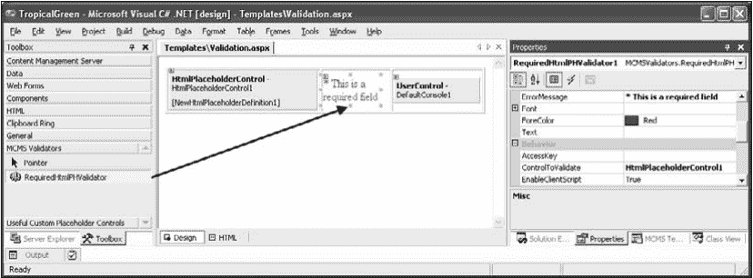

HtmlPlaceholderControl 的 ID 并未出现在 ControlToValidate 下拉列表中。下拉列表不应该填充与正在验证的控件类型匹配的占位符 ID 吗？

为了使控件的 ID 包含在下拉列表中，我们必须使 HtmlPlaceholderControl 与 ASP.NET 验证控件架构兼容。我们将在 *带验证的 HtmlPlaceholderControl* 部分中完成此操作。

## 防止包含无效内容的页面被保存

还有一个问题需要解决。虽然自定义验证控件已包含所有必要代码，但除非有人点击其 Control.CausesValidation 属性设置为 true 的 ASP.NET 控件，例如 Button，否则它将无法工作。否则，即使必需的占位符未填写，页面仍会被保存。

如果您查看 Default Console 上的控件是如何编码的（在 DefaultConsole.ascx 文件中），您会发现它们只是简单的 HTML 锚点标签。HTML 锚点标签不是按钮，因此不会触发页面验证。因此，点击控制台上的任何操作链接都不会触发我们的自定义验证控件。

我们需要在用户点击以下三个操作按钮之一时触发验证器：

- Save New Page
- Save
- Save and Exit

我们将修改每个按钮的行为，以便在页面无效时取消保存操作。

要了解如何强制这些控件在点击时验证页面，我们再次从 ASP.NET 中获取线索。前面我们看到 ASP.NET 如何生成 Button 控件：

```
<input type="submit"
name="Button1"
value="Button"
onclick="if (typeof(Page_ClientValidate)==‘function’)
Page_ClientValidate();"
language="javascript"
id="Button1" />
```

高亮的行显示了在表单提交前确保客户端验证发生的代码。它基本上调用了 WebUIValidation.js 文件中的 Page_ClientValidation() 客户端脚本。此行代码可确保我们的 HTML 锚点表现出与 Button 相同的行为。

我们需要在调用客户端保存方法之前插入它，这意味着我们应该修改三个控制台操作按钮中的每一个，从 Save New Page 控件开始。

## 带验证的 Save New Page

向 `MCMSValidators` 项目添加一个名为 `ValidatedSaveNewAction.cs` 的类文件。在命名空间声明上方，添加以下必需的命名空间：

```
using System;
using Microsoft.ContentManagement.Publishing;
using Microsoft.ContentManagement.WebControls;
using Microsoft.ContentManagement.WebControls.ConsoleControls;
namespace MCMSValidators
{
}
```

与其从头重写 Save New Page 操作控件，我们将通过继承 AuthoringSaveNewAction 类来创建它：

```
public class ValidatedSaveNewAction : AuthoringSaveNewAction
{
}
```

我们唯一需要做的修改是重写 ActionJavascript 属性。我们首先检查控件是否对用户可用。如果可用，我们使用 Page.Validators.Count 属性查找验证控件的存在。一旦确定页面上存在验证控件，我们就注入 JavaScript 语句以调用 Page_ClientValidate() 方法。

在 ValidatedSaveNewAction() 构造函数下方，添加重写的 ActionJavascript 属性：

```
public override string ActionJavascript
{
    get
    {
        string strReturn = null;
        if (this.Available)
        {
            // Check to see if we have any validation controls on this page
            if (this.Page.Validators.Count > 0)
            {
                strReturn += "if (typeof(Page_ClientValidate) == 'function') ";
                strReturn += "{";
                strReturn += "if (!Page_ClientValidate()) return false;";
                strReturn += "}";
            }
            strReturn += base.ActionJavascript;
        }
        return strReturn;
    }
}
```

## 带验证的 Save and Exit

我们将要修改的下一个按钮是 Save and Exit 按钮。向 `MCMSValidators` 项目添加一个名为 `ValidatedReeditSaveAndExitAction.cs` 的类文件。按如下所示插入所需的命名空间：

```
using System;
using Microsoft.ContentManagement.Publishing;
using Microsoft.ContentManagement.WebControls;
using Microsoft.ContentManagement.WebControls.ConsoleControls;
namespace MCMSValidators
{
}
```

```
else
{
    base.OnSavingContent(e);
}
}
```

控件完成！

## 带有服务器端验证的 RequiredHTMLPHValidator

早在构建 `RequiredHtmlPHValidator` 控件时，我们快速查看了如何实现服务器端验证，但并未实际编写执行工作的代码。让我们重新审视该控件并通过重复在服务器端检查控件是否包含内容的逻辑来完成代码。

首先，我们将修改 `EvaluateIsValid()` 方法，使其仅在更新模式下执行验证。我们查找要验证的 `HtmlPlaceholderControl` 并使用布尔 `IsEmpty()` 方法（在下一部分定义），该方法在占位符为空时返回 true，否则返回 false。

```
protected override bool EvaluateIsValid()
{
    bool valid = true;
    // Perform validation only in update mode
    if (CmsHttpContext.Current.CurrentMode == PublishingMode.Update)
    {
        HtmlPlaceholderControl ctrl;
        ctrl = FindControl(ControlToValidate) as HtmlPlaceholderControl;
        if (IsEmpty(ctrl.Html))
        {
            valid = false;
        }
    }
    return valid;
}
```

接下来，我们在 `EvaluateIsValid()` 方法正下方添加 `IsEmpty()` 方法。它是我们之前编写的 JavaScript 例程的服务器端版本。

```
private bool IsEmpty(string content)
{
    // Add more tags to ignore in this list if you need to.
    // Here, we ignore <hr> and  tags
    // additional tags need to be added and separated
    // with a '|' character.
    string tagsToKeep = "img|hr";

    // This regular expression matches all  and <hr> tags
    string regExpTagsToKeep = "<\\s*(" + tagsToKeep + ")\\b[^>]*>";
    Regex reTagsToKeep = new Regex(regExpTagsToKeep,
        RegexOptions.IgnoreCase | RegexOptions.Compiled);

    // Check if one of the tags to keep is included and exit.
    if (reTagsToKeep.IsMatch(content))
    {
        // Placeholder is not empty.
        return false;
    }

    // This regular expression gets all tags in the content
    string regExpForAllTags = "<[^>]*>";
    Regex reAllTags = new Regex(regExpForAllTags,
        RegexOptions.IgnoreCase | RegexOptions.Compiled);
```


将突出显示的代码添加到 RequiredHTMLPHValidator.cs 类中。

```
protected override bool EvaluateIsValid()
{
    bool valid = true;
    // perform validation only in update mode
    if (CmsHttpContext.Current.Mode == PublishingMode.Update)
    {
        HtmlPlaceholderControl ctrl;
        ctrl = FindControl(ControlToValidate) as HtmlPlaceholderControl;
        if (IsEmpty(ctrl.Html) || IsLessThanMin(RemoveAllTags(ctrl.Html)))
        {
            valid = false;
        }
    }
    return valid;
}
// Property for storing the maximum length of the content
private int minLength = 0;
public int MinLength
{
    get
    {
        return minLength;
    }
    set
    {
        minLength = value;
    }
}
// Remove all tags
private string RemoveAllTags(string content)
{
    // This regular expression gets all tags in the content
    string regExpForAllTags = "<[>^]*>";
    Regex reAllTags = new Regex(regExpForAllTags, RegexOptions.IgnoreCase | RegexOptions.Compiled);

    content = reAllTags.Replace(content, "");

    // Remove non-breaking spaces (&nbsp;)
    content = content.Replace("&nbsp;","");
    return content;
}
// Determine if the content is below the specified minimum length
private bool IsLessThanMin(string content)
{
    bool lessThanMin = false;
    if (minLength > 0)
    {
        if (content.Length < minLength)
        {
            lessThanMin = true;
        }
    }
    return lessThanMin;
}
```

保存并生成解决方案。要使用自定义控件，请按照前面“将自定义验证程序添加到模板文件”一节中概述的步骤操作。简而言之，您需要：

- 在 MCMS Web 项目中添加对 MCMSValidators 的引用。
- 将该控件添加到工具箱。

- 将所有需要验证的 HtmlPlaceholderControl 替换为此控件，并将其绑定到 HtmlPlaceholderDefinition。
- 添加 RequiredHTMLPHValidator 控件，并将其 ControlToValidate 属性设置为要验证的 HtmlPHWithValidation 控件。为其提供适当的错误消息（例如“请输入超过 50 个字符”）。此外，将 MinLength 属性设置为 50。

下次保存时，请注意，除非您输入的文本超过 50 个字符（不包括标签和不间断空格），否则无法保存占位符内容。

## 取消保存操作

在上面的示例中，我们验证了 HtmlPlaceholderControl，并且仅当其包含超过 50 个字符的文本时才保存其内容。但是，您是否注意到常规占位符控件的内容仍然被保存？我们只是阻止了 HtmlPHWithValidation 的内容被保存。页面的其余部分继续保存回存储库。

如果您选择了“保存并退出”选项会怎样？页面不会取消整个页面的保存，而是切换回 AuthoringUnpublished 模式，并且不会告知作者占位符内容尚未保存。显然，当作者发现自己所有的辛劳只因一个占位符留空而消失时，他们是不会高兴的。

为了解决这些问题，我们将修改 Web Author 控制台中执行保存的所有按钮，以便：

- 检查页面上是否存在验证控件。如果存在，则要求对页面进行验证。
- 如果页面包含无效内容，则引发错误，取消整个保存操作。
- 在屏幕上显示错误消息，告知作者保存操作失败。

让我们从修改“保存并退出”按钮开始。我们将通过重写 PerformActionBehavior() 方法来更改按钮的原始行为，以检查页面是否包含无效内容。如果包含，我们将取消保存并在错误控制台中显示错误消息。否则，我们继续保存。

在 ValidatedReeditSaveAndExitAction.cs 类文件中，将以下重写的 PerformActionBehavior() 方法直接添加到 ActionJavascript 属性下方：

```
protected override void PerformActionBehavior()
{
    // Get the current CmsHttpContext
    CmsHttpContext cmsContext = CmsHttpContext.Current;
    // Get the current Web Author Context
    WebAuthorContext wac = WebAuthorContext.Current;
    // Check to see if there are validation controls on the page
    if (Page.Validators.Count > 0)
    {
        // Validation Controls exist. Validate the page.
        Page.Validate();
        // Check to see if the page is valid.
        if (Page.IsValid)
```

```
<input type="hidden" value="" name="NCPHHRef_ImagePlaceholderDefinitionName"/>
<input type="hidden" value="" name="NCPHAltText_ImagePlaceholderDefinitionName"/>
<input type="hidden" value="" name="SingleImagePlaceholderControl1:AuthoringModeControlsContainer:ImageEditControl" />
- - - code continues - - -
```

突出显示的行显示了用于存储已上传图像名称的隐藏表单字段。要获取其值，我们只需使用以下 JavaScript：

```
<script language="javascript">
var fileName = document.all.NCPH_ImagePlaceholderDefinitionName.value;
</script>
```

> 其他隐藏表单字段包含备用文本和单击图像时指向的超链接。备用文本保存在 NCPHAltText_NameOfPlaceholderDefinition 隐藏字段中。NCPHHRef_NameOfPlaceholderDefinition 隐藏字段对应超链接。将文本 NameOfPlaceholderDefinition 替换为模板资源管理器中定义的占位符名称。

## 检查 SingleImagePlaceholderControl 是否为空

NCPH_NameOfPlaceholderDefinition 字段包含已上传图像的路径和文件名。当未向占位符控件上传图像时，它存储空字符串。为了确定作者是否将其留空，我们将使用以下 JavaScript：

```
<script language="javascript">
function validateIDofPlaceholder()
{
var fileName = document.all.NCPH_ImagePlaceholderDefinitionName.value;
if (filename == "")
{
return false;
}
else
{
return true;
}
}
</script>
```

字符串 IDofPlaceholder 将被替换为占位符控件的实际 ID。这样，每个占位符控件都将拥有自己的客户端验证函数。

## RequiredImagePHValidator

让我们构建 RequiredImagePHValidator。首先，向 MCMSValidator 项目添加一个名为 RequiredImagePHValidator.cs 的类文件。

在命名空间声明上方添加所需的命名空间。

```
using System;
using System.Web.UI;
using System.Web.UI.WebControls;
using System.Text;
```

```
using Microsoft.ContentManagement.WebControls;
using Microsoft.ContentManagement.Publishing;
namespace MCM SValidation
{
}
```

和之前一样，从 BaseValidator 类继承：

```
public class RequiredImagePHValidator: BaseValidator
{
```

接下来，我们在重写的 OnPreRender() 方法中使用 Page.RegisterClientScriptBlock() 函数注入用于执行客户端验证的 JavaScript 函数。AddAttributesToRender() 方法将 JavaScript 连接到评估函数属性。将以下代码直接添加到 RequiredImagePHValidator() 构造函数下方：

```
// register the client-side validation script
protected override void OnPreRender(System.EventArgs e)
{
    base.OnPreRender(e);
    // Add the script only in authoring mode.
    if ((WebAuthorContext.Current.Mode == WebAuthorContextMode.AuthoringNew || WebAuthorContext.Current.Mode == WebAuthorContextMode.AuthoringReedit)
    {
        string phName = "NCPH ";
        if ((FindControl(this.ControlToValidate) == null) || !(FindControl(this.ControlToValidate) is SingleImagePlaceholderControl))
            return;
        phName += ((SingleImagePlaceholderControl)FindControl(this.ControlToValidate)).BoundPlaceholder.Name;
        StringBuilder sb = new StringBuilder();
        sb.Append("<script language=\"javascript\">");
        sb.Append("function validate" + this.ControlToValidate + "()\n");
        sb.Append("{\n");
        sb.Append("  var fileName = document.all." + phName + ".value;\n");
        sb.Append("  if (fileName == '')\n");
        sb.Append("  {\n");
        sb.Append("    return false;\n");
        sb.Append("  }\n");
        sb.Append("  else\n");
        sb.Append("  { return true;\n");
        sb.Append("  }\n");
        sb.Append("}");
        sb.Append("</script>");
        if (this.RenderUplevel && this.EnableClientScript)
        {
            if (!Page.IsClientScriptBlockRegistered("ReqImgPhValid_" + phName + "_ClientScript"))
            {
                Page.RegisterClientScriptBlock("ReqImgPhValid_"+phName+"ClientScript", sb.ToString());
            }
        }
    }
}
```

```
// wiring the client-side javascript to the Template File
protected override void AddAttributesToRender(
    System.Web.UI.HtmlTextWriter writer)
{
    base.AddAttributesToRender(writer);
    if (this.RenderUplevel && this.EnableClientScript)
    {
```


``` 
// perform validation only in authoring mode.
if (WebAuthorContext.Current.Mode == WebAuthorContextMode.AuthoringNew
    || WebAuthorContext.Current.Mode == WebAuthorContextMode.AuthoringReedit)
{
    writer.AddAttribute("evaluationfunction", "validate"
        + this.ControlToValidate);
}
}
```

我们希望当要验证的控件是 SingleImagePlaceholderControl 时，`ControlPropertiesValid()` 方法返回 true。请在 `AddAttributesToRenderer()` 方法下方添加以下代码：

``` 
protected override bool ControlPropertiesValid()
{
    Control ctrl = FindControl(ControlToValidate);
    if (ctrl != null)
    {
        return (ctrl is SingleImagePlaceholderControl);
    }
    else
    {
        return false;
    }
}
```

最后，我们实现 `EvaluateIsValid()` 方法。虽然我们已经使用客户端脚本实现了完全相同的检查，但始终建议在服务器端重复检查。这里，我们检查 `SingleImagePlaceholderControl` 的 `ImageUrl` 属性。仅当图片已上传到占位符控件时，验证才会通过。

``` 
protected override bool EvaluateIsValid()
{
    bool valid = true;
    if (CmsHttpContext.Current.Mode == PublishingMode.Update)
    {
        SingleImagePlaceholderControl ctrl;
        ctrl = FindControl(ControlToValidate) as SingleImagePlaceholderControl;
        if (ctrl.ImageUrl == "")
        {
            valid = false;
        }
    }
    return valid;
}
```

控件已完成。保存并生成项目。

### 验证 SingleAttachmentPlaceholderControl

SingleAttachmentPlaceholderControl 与其他占位符控件一样，无法使用默认的 ASP.NET 服务器端验证控件进行验证。在本节中，我们将构建一个名为 `RequiredAttachmentPHValidator` 的自定义验证控件，用于检查文件是否已上传到该控件。如果没有上传任何附件，页面将无法保存。

``` 
else
{
    return true;
}
</script>
```

#### RequiredAttachmentPHValidator

我们已经构建了两个自定义验证器，这第三个遵循熟悉的模式。我们将直接深入代码，并只强调有趣的部分。

将名为 `RequiredAttachmentPHValidator.cs` 的类文件添加到 MCMSValidators 项目中。

如下所示编写代码：

``` 
using System;
using System.Web.UI;
using System.Web.UI.WebControls;
using System.ComponentModel;
using System.Text;
using Microsoft.ContentManagement.WebControls;
using Microsoft.ContentManagement.Publishing;
namespace MCMSValidators
{
    public class RequiredAttachmentPHValidator : BaseValidator
    {
        public RequiredAttachmentPHValidator()
        {
            // nothing to do
        }

        // register the client-side validation script
        protected override void OnPreRender(System.EventArgs e)
        {
            base.OnPreRender(e);

            // Add the script only in authoring mode.
            if (WebAuthorContext.Current.Mode == WebAuthorContextMode.AuthoringNew
                || WebAuthorContext.Current.Mode == WebAuthorContextMode.AuthoringReedit)
            {
                string phName = "NCPH_";
                if ((FindControl(this.ControlToValidate) == null)
                    || (!(FindControl(this.ControlToValidate)
                        is SingleAttachmentPlaceholderControl)))
                    return;

                phName +=
                    ((SingleAttachmentPlaceholderControl)
                        FindControl(this.ControlToValidate)).BoundPlaceholder.Name;

                StringBuilder sb = new StringBuilder();
                sb.Append("<script language=\"javascript\">");
                sb.Append("function validate" + this.ControlToValidate + "()");
                sb.Append("{");
                sb.Append("    var fileName = document.all." + phName + "_value; ");
                sb.Append("    if (fileName == '')");
                sb.Append("    {");
                sb.Append("        return false;");
                sb.Append("    }");
                sb.Append("    else");
                sb.Append("    {");
                sb.Append("        return true;");
                sb.Append("    }");
                sb.Append("}");
                sb.Append("</script>");

                if (this.RenderUplevel && this.EnableClientScript)
```

仔细检查代码，你会发现它与前两个自定义验证控件非常相似。

-   用于检查文件是否已上传到 SingleAttachmentPlaceholderControl 的 JavaScript 在 `OnPreRender()` 方法中被注入到模板文件中。
-   `ControlPropertiesValid()` 方法验证要验证的控件确实是 SingleAttachmentPlaceholderControl。
-   最后，`EvaluateIsValid()` 方法执行服务器端检查，以查看 `SingleAttachmentPlaceholderControl.AttachmentUrl` 属性是否包含文件的路径。如果没有，该方法返回 `false`。与前几个示例一样，此方法可能不会被触发，因为我们依赖客户端检查进行验证。如果需要进行服务器端验证，则必须按照“实现服务器端验证”一节中的描述创建自定义占位符控件。

### 总结

在本章中，我们探讨了如何验证 MCMS 占位符控件。我们首先说明了 ASP.NET 附带的验证 Web 控件不能用于 MCMS 占位符控件。为了克服这一限制，我们构建了三个验证控件：一个用于 HTMLPlaceholderControl，第二个用于 SingleImagePlaceholderControl，第三个用于 SingleAttachmentPlaceholderControl。我们演示了如何使用客户端脚本技术执行简单的空占位符检查。我们还说明了通过构建自定义占位符控件，服务器端验证是可行的。本章讨论的方法可以扩展，以满足更复杂和更严格的验证要求，从检查电话号码、邮政编码或电子邮件地址是否为有效格式，到根据外部数据库中存储的内容进行验证。
