# 10 暂存静态页面

如今的网站动态且功能多样。动态站点相比静态站点具有许多优势。使用 MCMS，您可以个性化并配合 PAPI 工作，以创建真正交互式、个性化的用户体验。例如，我们已经看到了如何根据个人访问权限隐藏或显示导航结构。事实上，内容更新如此频繁，交互需求如此之高，以至于像 MCMS 这样的内容管理系统会即时组装页面。最多也只是将页面的快照缓存在内存或服务器硬盘上，以加速页面交付过程。缓存会在经过一定时间段后或内容发生变化时失效。没有任何东西会永远冻结：只会提供新鲜内容。

在一本关于创建动态站点的书中，你可能会觉得奇怪，这一整章都在讲述暂存静态页面。事实是，尽管技术需求日新月异，有时也需要稍微放慢脚步。整个网站的静态副本在以下情况下可能很有用：

-   创建页面以打包到 CD ROM 等离线媒体上。用户指南和帮助文件通常以电子文档的形式包含在盒装软件的 CD 中。甚至 Microsoft 帮助文件（或 CHM 文件）本身也是由静态 HTML 文件构建的。
-   为存档或备份目的拍摄网站快照。
-   创建静态文件，供 Index Server 或其他需要物理文件存在的搜索引擎建立索引。
-   在多台服务器之间共享内容。是的，您可以在其他服务器上安装 MCMS，甚至可以使用 Web 服务来联合内容。然而，有时最简单的解决方案就是最好的——只需制作共享内容的静态副本，并使用良好的文件复制技术（如 FTP）来传输它们（从而避免获取更多生产 MCMS 许可证的需要）。

如果需要生成 MCMS 网站的静态版本，有两种可用选项：

-   使用 MCMS 2002 附带的 Site Stager 实用程序。
-   编写一个自定义暂存工具，为每个页面生成静态快照。

> **重要说明：** Site Stager 仅基于 ASP 模板暂存来自发布的静态页面。它不适用于基于 ASP.NET 模板的发布。


## 安装 Site Stager

使用 Site Stager 的第一步是安装它。要查找 Site Stager 是否已安装在您的机器上，请选择 开始 | 程序 | Microsoft Content Management Server。查看是否列出了 Site Stager 的条目。

否则，请按照以下步骤安装 Site Stager：

- 1. 从控制面板中选择 添加/删除程序。
- 2. 从当前已安装程序的列表中选择 Microsoft Content Management Server。单击更改。
- 3. 在程序维护对话框中，选择修改程序功能。
- 4. 在自定义设置对话框中，选择 Site Stager 组件。

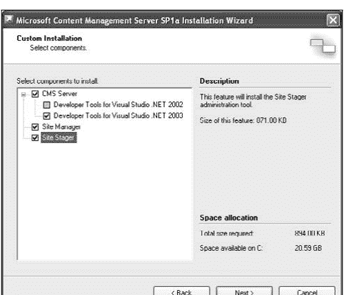

- 5. 单击下一步以确认您的选择。
- 6. 单击安装以开始安装过程。
- 7. 安装完成后，单击完成以关闭对话框。

现在开始菜单中会出现 Site Stager 的条目。单击它即可启动。

## 定义目标用户

首次启动 Site Stager 时，系统会要求您指定目标用户，即将在目标服务器上创建文件夹和文件时使用的用户凭据的用户。该用户应在运行 Site Stager 的机器上具有以下权限：

- 本地计算机管理员组的成员。
- “本地登录”权限。
- “作为批处理作业登录”权限。

下表描述了每个字段。按指示输入测试值。完成后单击确定。

| Field | Description | Test Value |
|---|---|---|
| Profile Name | 输入配置文件名称。赋予有意义的名称。此值将由管理员用于区分同一服务器上的各种配置文件。 | My Staging Profile |
| Active | 选中此框以激活配置文件。或者，取消选中它以防止计划作业在指定时间运行。 | Checked |
| Site Map URL | 包含默认设置：http://ContentServer/nr/system/staging/sitemap.asp sitemap.asp 文件为分级器提供所有要分级的频道和发布的 XML 列表。您可以复制 sitemap.asp 并对其进行自定义。例如，而不是分级整个站点，您可以生成其选定的部分。 | http://localhost/nr/system/staging/sitemap.asp |
| Description | 输入配置文件的描述。同样，这会显示在 Site Stager 管理对话框中，因此最好提供有意义的描述。考虑添加诸如配置文件的作用以及谁创建了它的背景信息。 | Created by [Your Name] to see how Site Stager works |
| Shell After Staging | 在此处指定分级完成后立即运行的应用程序。管理员通常会附加脚本来 double-check 所有文件是否已成功生成。 | Leave blank |

## 源设置

| Stage As User | 输入将用于分级文件的 MCMS 用户名。该用户应被授予以下访问权限：对将要分级的全部频道的订阅者访问权限。要防止站点的某些部分被分级，只需拒绝用户访问这些站点区域。至少一个资源管理器或模板设计师权限组的成员。权限组无需分配给任何容器。 | 以以下格式输入至少具有对频道订阅者权限和对模板模板设计师权限的用户 ID：DOMAIN\UserName |
| User Password | 输入“Stage As”用户的密码。 | 输入密码 |

## 目标设置

| Default Filename | 指定所有频道渲染脚本的文件名。Site Stager 建议使用名称 index.htm。请随意相应更改此值。您可以将文件重命名为 default.asp、default.htm，甚至 default.abc。 | Default.htm |

## ASP.NET Stager 应用程序

在上一节中，我们已经了解了 Site Stager 的工作原理。它是创建基于 ASP 站点的静态快照的好工具。显然，我们不想倒退一大步，将所有模板从 ASP.NET 转换为 ASP。那么，我们该如何分级使用更新且改进的 ASP.NET 的站点呢？为了绕过 Site Stager 的这一限制，我们将构建我们自己的分级工具版本。好消息是我们不会完全从头开始：我们将借用 Site Stager 背后的一些概念和思想。

让我们构建一个控制台应用程序，模仿 Site Stager 对 MCMS 2001 或 MCMS 2002 中基于 ASP 的模板所做的工作。请注意，该应用程序使用 MCMS PAPI，并且需要在安装了 MCMS 的服务器上执行。

以下是应用程序将执行的操作：

- 从指定的起始频道开始遍历整个频道结构。对于找到的每个发布和频道封面页，将生成一个静态 HTML 文件。
- 扫描每个频道封面页和发布中的附件并分级它们。
- 为管理员提供设置以更改分级器的行为。例如，管理员可以指定起始频道、是否分级隐藏发布等。

我们将假设分级的页面将放置在与站点管理器中相同的[content]

## 安装 Site Stager

使用 Site Stager 的第一步是安装它。要查找 Site Stager 是否已安装在您的机器上，请选择 开始 | 程序 | Microsoft Content Management Server。查看是否列出了 Site Stager 的条目。

否则，请按照以下步骤安装 Site Stager：

- 1. 从控制面板中选择 添加/删除程序。
- 2. 从当前已安装程序的列表中选择 Microsoft Content Management Server。单击更改。
- 3. 在程序维护对话框中，选择修改程序功能。
- 4. 在自定义设置对话框中，选择 Site Stager 组件。


- 5. 单击下一步以确认您的选择。
- 6. 单击安装以开始安装过程。
- 7. 安装完成后，单击完成以关闭对话框。

现在开始菜单中会出现 Site Stager 的条目。单击它即可启动。

## 定义目标用户

首次启动 Site Stager 时，系统会要求您指定目标用户，即将在目标服务器上创建文件夹和文件时使用的用户凭据的用户。该用户应在运行 Site Stager 的机器上具有以下权限：

- 本地计算机管理员组的成员。
- “本地登录”权限。
- “作为批处理作业登录”权限。

下表描述了每个字段。按指示输入测试值。完成后单击确定。

| Field | Description | Test Value |
|---|---|---|
| Profile Name | 输入配置文件名称。赋予有意义的名称。此值将由管理员用于区分同一服务器上的各种配置文件。 | My Staging Profile |
| Active | 选中此框以激活配置文件。或者，取消选中它以防止计划作业在指定时间运行。 | Checked |
| Site Map URL | 包含默认设置：http://ContentServer/nr/system/staging/sitemap.asp sitemap.asp 文件为分级器提供所有要分级的频道和发布的 XML 列表。您可以复制 sitemap.asp 并对其进行自定义。例如，而不是分级整个站点，您可以生成其选定的部分。 | http://localhost/nr/system/staging/sitemap.asp |
| Description | 输入配置文件的描述。同样，这会显示在 Site Stager 管理对话框中，因此最好提供有意义的描述。考虑添加诸如配置文件的作用以及谁创建了它的背景信息。 | Created by [Your Name] to see how Site Stager works |
| Shell After Staging | 在此处指定分级完成后立即运行的应用程序。管理员通常会附加脚本来 double-check 所有文件是否已成功生成。 | Leave blank |

## 源设置

| Stage As User | 输入将用于分级文件的 MCMS 用户名。该用户应被授予以下访问权限：对将要分级的全部频道的订阅者访问权限。要防止站点的某些部分被分级，只需拒绝用户访问这些站点区域。至少一个资源管理器或模板设计师权限组的成员。权限组无需分配给任何容器。 | 以以下格式输入至少具有对频道订阅者权限和对模板模板设计师权限的用户 ID：DOMAIN\UserName |
| User Password | 输入“Stage As”用户的密码。 | 输入密码 |

## 目标设置

| Default Filename | 指定所有频道渲染脚本的文件名。Site Stager 建议使用名称 index.htm。请随意相应更改此值。您可以将文件重命名为 default.asp、default.htm，甚至 default.abc。 | Default.htm |

## ASP.NET Stager 应用程序

在上一节中，我们已经了解了 Site Stager 的工作原理。它是创建基于 ASP 站点的静态快照的好工具。显然，我们不想倒退一大步，将所有模板从 ASP.NET 转换为 ASP。那么，我们该如何分级使用更新且改进的 ASP.NET 的站点呢？为了绕过 Site Stager 的这一限制，我们将构建我们自己的分级工具版本。好消息是我们不会完全从头开始：我们将借用 Site Stager 背后的一些概念和思想。

让我们构建一个控制台应用程序，模仿 Site Stager 对 MCMS 2001 或 MCMS 2002 中基于 ASP 的模板所做的工作。请注意，该应用程序使用 MCMS PAPI，并且需要在安装了 MCMS 的服务器上执行。

以下是应用程序将执行的操作：

- 从指定的起始频道开始遍历整个频道结构。对于找到的每个发布和频道封面页，将生成一个静态 HTML 文件。
- 扫描每个频道封面页和发布中的附件并分级它们。
- 为管理员提供设置以更改分级器的行为。例如，管理员可以指定起始频道、是否分级隐藏发布等。

我们将假设分级的页面将放置在与站点管理器中相同的


## 暂存静态页面

```csharp
private static string m_DefaultFileName;
private static string m_DestinationDirectory;
private static string m_DefaultFileExtension;
private static string m_CodePage;
private static string m_BaseUrl;
private static string m_LocalBaseUrl;

// ArrayLists for handling attachments
private static ArrayList m_AttachmentUrls;

// CmsApplicationContext for working with the MCMS PAPI
private static CmsApplicationContext cmsContext;

// Network credentials for downloading pages
private static NetworkCredential m_credentials;
[STAThread]
static void Main(string[] args)
{
    - - - code continues - - -
}
```

我们的应用程序将处理两种类型的文件：

- **内容页面：** 发布项和频道呈现脚本
- **内容二进制文件：** 图像、Office 文档和其他附件

我们将声明一个名为 EnumBinary 的枚举来标识这些文件类型。请将以下代码添加到 Main() 例程上方。

```csharp
// Have enum values for each file type handled
enum EnumBinary
{
    ContentBinary,
    ContentPage
}
```

在 Main() 例程中，我们将初始化上面声明的各个变量。请自行更改它们的值。你至少需要设置 'Stage As' 用户、域和密码，以及起始频道和目标目录，以匹配你的计算机环境。

```csharp
[STAThread]
static void Main(string[] args)
{
    // Set parameter values
    m_LogFile = @"c:\StagedSite\logs\";
    m_StageAsDomain = "localmachine";
    m_StageAsUser = "StagerUser";
    m_StageAsPwd = "StagerPassword";
    m_DoNotExportHiddenItems = true;
    m_StartChannel = "/Channels/www.tropicalgreen.net/";
    m_SourceHost = "http://www.tropicalgreen.net";
    m_UserAgent = "Mozilla/4.0 (compatible; MSIE 6.0 Windows NT 5.1)";
    m_HttpHeader = "DotNetSiteStager";
    m_DefaultFileName = "default.htm";
    m_DestinationDirectory = @"c:\StagedSite\";
    m_DefaultFileExtension = "htm";
    m_CodePage = "UTF-8";
    m_BaseUrl = "http://tropicalgreen";
    m_LocalBaseUrl = m_BaseUrl;
    m_AttachmentUrls = new ArrayList();
}
```

## 将消息记录到日志文件

当暂存器执行任务时，在暂存某些 URL 时可能会遇到异常。我们不会终止整个进程，而是捕获所有异常，并将所有错误消息写入日志文件。日志文件的位置在先前定义的 m_LogFile 变量中设置。

下面显示了将消息写入日志文件的辅助函数。请将其直接添加到 Main() 方法下方。

```
private static void WriteToLog(string message)
{
    Console.WriteLine(message);
    FileStream fsLog = new FileStream(m_LogFile, FileMode.Append,
                                      FileAccess.Write);
    StreamWriter wLog = new StreamWriter(fsLog);
    wLog.WriteLine(message);
    wLog.Flush();
    wLog.Close();
    fsLog.Close();
}
```

出于审计目的，我们将记录当前日期和时间以及先前在日志文件中定义的设置。在 Main() 例程中，添加以下代码：

```
[STAThread]
static void Main(string[] args)
{
    ... code continues ...
    // Ensure that the logfile directory is created
    Directory.CreateDirectory(m_LogFile);
    // Generate the name of the log file (in the format log_yyyMMdd_HHmm.txt)
    if (!m_LogFile.EndsWith("\\"))
    {
        m_LogFile = m_LogFile + "\\";
    }
    m_LogFile = m_LogFile + "log_" + DateTime.Now.ToString("yyyyMMdd_HHmm")
              + ".txt";

    System.Text.StringBuilder sb = new System.Text.StringBuilder();
    string newLine = System.Environment.NewLine;

    // Write the timestamp to the log file
    sb.Append(DateTime.Now.ToString("dd MMM yyyy HH:mm") + newLine);
    sb.Append("----------------" + newLine);

    // Write the settings to the log file
    sb.Append("Log File = " + m_LogFile + newLine);
    sb.Append("Stage As Domain = " + m_StageAsDomain + newLine);
    sb.Append("Stage As User = " + m_StageAsUser + newLine);
    sb.Append("Do Not Export Hidden Items = " + m_DoNotExportHiddenItems
              + newLine);
    sb.Append("Start Channel = " + m_StartChannel + newLine);
    sb.Append("HTTP Host = " + m_SourceHost + newLine);
    sb.Append("User Agent = " + m_UserAgent + newLine);
    sb.Append("HTTP Header = " + m_HttpHeader + newLine);
    sb.Append("Default File Name = " + m_DefaultFileName + newLine);
```

更好的做法是将设置存储在应用程序配置文件（app.config）中。这样，每次设置更改时，你不必重新编译代码。为简单起见，在此示例中我们将它们保留为类变量。

```
+ m_StageAsUser, m_StageAsPwd);
    m_credentials = new NetworkCredential(m_StageAsUser,
    m_StageAsPwd, m_StageAsDomain);
}
else
{
    cmsContext.AuthenticateAsGuest();
    m_credentials = null;
}
catch
{
    WriteToLog("Error: Unable to authenticate with MCMS server.");
}
}
```

## 显示隐藏的发布项

接下来，应用程序读取存储在 m_DoNotExportHiddenItems 变量中的设置，并使用它来设置 CmsApplicationContext.SessionSettings.AutoFilterHidden 属性。当此属性设置为 false 时，CmsApplicationContext 将显示在发布时被设置为隐藏的项（或 ChannelItem.IsHiddenModePublished 属性设置为 true 的频道项）。因此，隐藏的频道项将被暂存。

```
[STAThread]
static void Main(string[] args)
{
    ... code continues ...
    // Reveal all hidden postings?
    cmsContext.SessionSettings.AutoFilterHidden = m_DoNotExportHiddenItems;
}
```

## 暂存频道和发布项

该过程的下一步是为“Stage As”用户可看到的每个频道和发布项生成静态页面。以下是我们将要执行的操作的简要说明：

- 获取 m_StartChannel 变量中定义的起始频道的实例。
- 从起始频道开始，遍历所有频道和发布项。
- 对每个频道和发布项发出 HTTP 请求。
- 获取响应并将其保存到文件中。

### 获取起始频道

在遍历频道和发布项列表之前，我们首先需要获取 m_StartChannel 变量中指定的起始频道。迭代过程从该频道开始。

一旦我们获得了起始频道的实例，我们就可以开始迭代过程了，该过程由接下来定义的 CollectChannel() 方法触发。

将下面突出显示的代码追加到 Main() 例程中：

```
[STAThread]
static void Main(string[] args)
{
    ... code continues ...
    // Start the iteration process
    Channel rootChannel = cmsContext.Searches.GetByPath(m_StartChannel) as Channel;
    if (rootChannel != null)
    {
        CollectChannel(rootChannel);
    }
    else
    {
        WriteToLog("Error: Start Channel " + m_StartChannel + " cannot be " + "found or user does not have sufficient rights!");
    }
}
```

### 遍历频道树

从起始频道开始，CollectChannel() 方法遍历树的其余部分，查找频道和发布项。

当它看到频道时，将创建频道呈现脚本或默认发布项的静态版本，以及其集合中的所有发布项。该方法递归调用自身，直到树中的所有频道都被暂存。

Download() 辅助方法将执行下载内容和生成静态页面的任务，我们稍后会看到。请将 CollectChannel() 方法添加到代码中：

```
static void CollectChannel(Channel channel)
{
    // Download the channel rendering script or the default posting
    Download(GetUrlWithHost(channel.Url), channel.Path.Replace(m_StartChannel, ""), m_DefaultFileName, EnumBinary.ContentPage);
    // Download all the postings within the channel
    foreach (Posting p in channel.Postings)
    {
        WriteToLog("Info: Downloading Posting: " + p.Path);
        Download(GetUrlWithHost(p.Url), channel.Path.Replace(m_StartChannel, "/"), p.Name, EnumBinary.ContentPage);
    }
    foreach (Channel c in channel.Channels)
    {
        CollectChannel(c);
    }
}
```

CollectChannel() 方法使用了一个辅助函数 GetUrlWithHost()，该函数将 URL 中发现的任何主机名替换为存储在 m_SourceHost 变量中的值。我们这样做的原因是处理链接中不包含主机名的 URL，尤其是对于未启用主机头映射的站点。对于此类站点，Channel.Url 将返回不带主机头的值，例如：/plantcatalog/ficus.htm。为了成功发出获取页面的 HTTP 请求，必须在 URL 前面加上主机值（在我们的示例中为 http://www.tropicalgreen.net）。


```
```csharp
request.Headers.Add(m_HttpHeader, "true");
request.AllowAutoRedirect = false;
}
}
catch(Exception ex)
{
    StringBuilder sb = new StringBuilder();
    string newLine = System.Environment.NewLine;
    sb.Append("[" + newLine);
    sb.Append("Exception of type [" + ex.GetType() + "] has been thrown!"
        + newLine);
    sb.Append("Error Processing URL:" + url + newLine);
    sb.Append("Message: " + ex.Message + newLine);
    sb.Append("Source: " + ex.Source + newLine);
    sb.Append("Stack Trace: " + ex.StackTrace + newLine);
    sb.Append("]" + newLine);
    WriteToLog(sb.ToString());
}
}
```
```

使用我们自定义的 DotNetSiteStager HTTP 头来编程你的页面，使其在被我们的分期工具请求时表现不同。例如，要在生成的静态页面中包含选定内容，你可以这样做：

```
```csharp
if (Request.Header("DotNetSiteStager") != null)
{
    // The following line of code will only execute when the page
    // is requested by the stager
    Response.Write("Page generated by DotNetSiteStager.");
}
```
```

## 获取响应并创建文件

发出 HTTP 请求后，我们调用 HttpWebResponse.GetResponse() 方法来获取响应。如果一切顺利，我们将获得 HTTP 200（OK）状态码，这意味着页面已成功下载。

然后将 resulting 字节数组使用 FileStream 对象转换为静态文件。

```
```csharp
static void Download(string url, string path, string fileName,
                     EnumBinary flag)
{
    // Stage only postings
    if (flag == EnumBinary.ContentPage)
    {
        try
        {
            . . . code continues . . .
            // Get the response;
            HttpWebResponse response = request.GetResponse() as HttpWebResponse;

            // If all goes well, we will retrieve a status code of 200 (OK)
            if (response.StatusCode == HttpStatusCode.OK)
            {
                BinaryReader br = new BinaryReader(response.GetResponseStream());
                int contentLength = (int)response.ContentLength;
                byte[] buffer = br.ReadBytes(contentLength);

                // Process page and download attachments
                ProcessPageAndGetAttachments(response.ContentEncoding, ref buffer);

                Directory.CreateDirectory(filePath);
                if (fileName.IndexOf(".") < 0)
                {
                    fileName = fileName + "." + m_DefaultFileExtension;
```
```

```
private static void ProcessPageAndGetAttachments(string encodingName,
    ref byte[] buffer)
{
    // ... code continues ...
    // Replace special characters to make it easier to find
    content = content.Replace("\t", " ").Replace("\n", " ").Replace("\r", " ");
    // Get attachments

    // Start searching for attachments!
    FindAttachment(ref content, "base", "href");
    FindAttachment(ref content, "a", "href");
    FindAttachment(ref content, "link", "href");
    FindAttachment(ref content, "script", "src");
    FindAttachment(ref content, "xml", "src");
    FindAttachment(ref content, "img", "src");
    FindAttachment(ref content, "frame", "src");
    FindAttachment(ref content, "iframe", "src");
    FindAttachment(ref content, "embed", "src");
    FindAttachment(ref content, "body", "background");
    FindAttachment(ref content, "td", "background");
    FindAttachment(ref content, "th", "background");
    FindAttachment(ref content, "table", "background");
    FindAttachment(ref content, "layer", "background");
}
```

当然，根据作者使用的标签，上面的列表可能并不详尽。请随意向列表中添加更多标签和属性。

FindAttachment() 方法接受三个输入参数：

- **input**: 正在扫描的页面的 HTML
- **tagName**: 要查找的标签，例如 
- **attribute**: 存储附件 URL 的属性，例如 src

它会在内容中查找该标签的所有实例。例如，当它找到一个  标签时，它会使用 ExtractUrlFromTag() 方法从其 src 属性中提取 URL（稍后定义）。

如果成功提取到 URL，则会使用 AddToUrlList() 辅助函数将其添加到 URL 列表中（也稍后定义）。

<base> 标签是单独处理的。之前我们讨论过，<base> 标签由 RobotMetaTag 注入到所有帖子中。浏览器通过在其 href 属性的值前加上前缀来解释所有相对链接。如果 FindAttachment() 看到 <base> 标签，它会调用 SetBaseUrl() 例程，该例程将提取的 URL 存储在 m_LocalBaseUrl 变量中，以便稍后在下载相对链接时使用。

将 FindAttachment() 方法添加到类中：

```
private static void FindAttachment(ref string input, string tagName,
    string attribute)
{
    // Pattern that extracts all tags with the specified tagName
    string pattern = @"<\s*" + tagName + @"\b[^>]*>";
    // The regular expression that finds all the tags
    Regex findTags = new Regex(pattern, RegexOptions.IgnoreCase);
    foreach (Match tag in findTags.Matches(input))
    {
        // Extract the URL from each tag based on the specified attribute
        string url = ExtractUrlFromTag(tag.Value, attribute);
        // We have successfully extracted a URL
```

SetBaseUrl() 例程处理 <base> 标签。<base> 标签通常嵌入在 <head> 标签之间。以下是一个 <base> 标签的示例：

```
<base href="http://tropicalgreen/TropicalGreen/Templates/Plant.aspx?NRMODE=Published&NRORIGINALURL=%2fPlantCatalog%2fAloeVera%2ehtm&NRNODEGUID=%7b569D1CCA-9A9D-4C43-B0C3-DB1AACD98684%7d&NRCACHEHINT=NoModifyGuest">
```

请注意，模板文件的 URL 存储在其 href 属性中。浏览器会将此 href 值添加到页面中找到的所有相对链接中。在 SetBaseUrl() 方法中，我们将提取 <base> 标签的 href 属性的值并将其存储在 m_LocalBaseUrl 变量中。稍后，我们将使用此值来构造页面上找到的相对附件的实际 URL。

```
private static void SetBaseUrl(string url)
{
    if (url.IndexOf("?") > -1)
    {
        url = url.Substring(0,url.IndexOf("?"));
    }
    if (!url.EndsWith("/"))
    {
        object o = cmsContext.Searches.GetByUrl(url);
        if (o != null)
        {
            if (o is Channel)
            {
                url += "/";
            }
        }
    }
    url = url.Substring(0,url.LastIndexOf("/")+1);
    if (url.StartsWith("http://"))
    {
        url = url.Remove(0,7);  // remove "http://"
        url = url.Remove(0,(url+"/").IndexOf("/"));
    }
    m_LocalBaseUrl = url;
}
```

## 将附件信息存储到列表中

一旦找到附件，我们就会将其 URL 和格式类型记录到 ArrayList 中。在这样做之前，我们会准备 URL 并运行多个检查以查看其是否有效。我们将在 AddToUrlList() 方法中完成所有这些操作。

首先，删除书签。书签示例包括“返回顶部”类型的超链接，通常看起来像这样： <a href="somepage.htm#Top">。由于书签是指向页面本身位置的定位标记，我们可以将其从 URL 中删除，仍然能够下载该页面。将 AddToUrlList() 方法添加到类中：

```
private static void AddToUrlList(string url)
{
    // Remove internal bookmarks from the URL
    string origUrl = url;
    if (url.IndexOf("#") >= 0)
    {
        url = url.Substring(0, url.IndexOf("#"));
    }
}
```

所有相对 URL 都必须转换为绝对 URL，以便可以下载和分期。我们使用在 <base> 标签中找到的值，如果找到的话。

```
private static void AddToUrlList(string url)
{
    ... code continues ...
    // Convert Relative URLs to Absolute URLs
    if (!url.StartsWith("/"))
    {
        url = m_LocalBaseUrl + url;
    }
}
```

接下来，我们从 URL 中删除主机信息。这使得我们稍后处理其余 URL 变得更容易，尤其是在尝试检查附件是否为频道项目时。

```
private static void AddToUrlList(string url)
{
    ... code continues ...
    // Remove host information from the URL
    if (url.StartsWith(m_SourceHost))
    {
        url = url.Remove(0, m_SourceHost.Length);
    }
}
```

我们只会添加有效的 URL。有效 URL：

- 不包含单引号或双引号。
- 不会链接到其他端口（例如 http://localhost:81/somepage.htm）或其他域。由于我们之前已删除主机信息（这会使我们得到类似 :80/ 或 :80/somepage.htm 的 URL），因此我们只需查找冒号的存在即可检查具有端口号的 URL。
- 不包含查询字符串参数。我们将通过确保 URL 不包含问号来强制执行这一点。不处理带查询字符串的页面的原因是它们很可能是动态页面（*.aspx 或 *.asp），而这些页面的静态快照无法处理查询字符串参数。

```
private static void AddToUrlList(string url)
{
    ... code continues
    // Check URLs to see if they are valid
    bool isValidUrl = true;
    string reason = "";
    if ((url.IndexOf("'") >= 0 || url.IndexOf("\"") >= 0)
        || url.IndexOf(":") >= 0 || url.IndexOf("?") >= 0)
    {
        // URL is invalid
        isValidUrl = false;
        reason = "Ignoring invalid url or url from external domain";
    }
}
```

我们还将检查 URL 是否属于将由前面定义的 CollectChannel() 方法分期的帖子或频道封面页。我们可以省略此检查，让分期工具根据它们出现的次数生成这些页面，但请记住，分期文件越少，处理速度越快！

请注意，我们使用了辅助函数 EnhancedGetByUrl()。它基本上与 Searches.GetByUrl() 方法执行相同的任务，但包括我们稍后将看到的几项改进。


请注意，“将频道名称映射到主机头”功能在 MCMS 标准版中不可用。

然而，对于频道名称映射到主机头名称的站点，`Searches.GetByUrl()` 方法并不能可靠地工作。例如，当 `Searches.GetByUrl()` 方法接收到顶级频道的 URL（如 `http://tropicalgreen`）时，我们期望它返回 `tropicalgreen` 频道的一个实例。问题在于它返回的是一个空对象。这是因为 `Searches.GetByUrl()` 方法存在一个问题，导致它期望输入的 URL 是 `http://localhost/tropicalgreen`，无论“将频道名称映射到主机头”选项设置为“是”还是“否”。我们将创建 `EnhancedGetByUrl()` 方法来解决这个问题。

`EnhancedGetByUrl()` 方法首先检查“将频道名称映射到主机头”选项是设置为“是”还是“否”。它通过查看根频道的已发布 URL 来实现这一点。当“将频道名称映射到主机头”设置为“是”时，根频道的 URL 将是 `http://Channels/`。否则，它将只是 `/Channels/`。

如果“将频道名称映射到主机头”选项设置为“是”，我们将把输入的 URL 转换为路径，并使用 `Searches.GetByPath()` 方法来检索频道项的实例。例如，如果 URL 是 `http://tropicalgreen/plantcatalog`，例程会将其转换为频道路径：`/Channels/tropicalgreen/plantcatalog`。将以下代码添加到类中：

```
static ChannelItem EnhancedGetByUrl(string url)
{
    if (IsMapChannelToHostHeaderEnabled())
    {
        // Remove "http://" from the URL and remove any trailing forward slashes
        string hostName = m_SourceHost.ToLower().Replace("http://", "").Trim(new Char[] {'/'});
        // Convert the URL to a path
        string Path = HttpUtility.UrlDecode(url);
        Path = Path.Replace("http://", "/Channels/");
        if (!Path.StartsWith("/Channels/"))
        {
            Path = "/Channels/"+hostName+Path;
        }
        if (Path.EndsWith(".htm"))
        {
            Path = Path.Substring(0,Path.Length - 4);
        }
        if (Path.EndsWith("/"))
        {
            Path = Path.Substring(0,Path.Length - 1);
        }
        return (ChannelItem)(cmsContext.Searches.GetByPath(Path));
    }
    else
    {
        return cmsContext.Searches.GetByUrl(url);
    }
}
static bool IsMapChannelToHostHeaderEnabled()
{
    return (cmsContext.RootChannel.UrlModePublished == "http://Channels/");
}
```

## 下载附件

一旦我们为每个频道封面页或张贴收集了附件列表，我们就可以准备生成它们的静态副本了。为此，我们将在 `CollectChannel()` 方法中的两个位置调用辅助函数 `DownloadAttachments()`：

-   在频道的封面页被暂存之后
-   在每个张贴被暂存之后

按照下面代码中突出显示的部分，将对 `DownloadAttachments()` 方法的调用添加进去：

```
static void CollectChannel(Channel channel)
{
    // Download the channel itself
    WriteToLog("Info: Downloading Channel: " + channel.Path);
    Download(GetUrlWithHost(channel.Url), channel.Path.Replace(
        m_StartChannel,""),
        m_DefaultFileName, EnumBinary.ContentPage);

    // Download all attachments in the cover page or channel rendering script
    DownloadAttachments();

    // Download all the postings within the channel
    foreach (Posting p in channel.Postings)
    {
        WriteToLog("Info: Downloading Posting: " + p.Path);
        Download(GetUrlWithHost(p.Url), channel.Path.Replace(m_StartChannel,"/"),
            p.Name, EnumBinary.ContentPage);

        // Download all attachments in the posting
        DownloadAttachments();
    }
    foreach (Channel c in channel.Channels)
    {
        CollectChannel(c);
    }
}
```

`DownloadAttachments()` 方法遍历 `m_AttachmentUrls` 数组的每个元素，并从其 URL 中提取附件的路径和文件名。调用之前定义的 `Download()` 方法将每个附件暂存为静态文件。

```
private static void DownloadAttachments()
{
    for (int i = 0; i < m_AttachmentUrls.Count; i++)
    {
        string path = m_AttachmentUrls[i].ToString();
        string[] arrPath = path.Split('/');
        string fileName = arrPath[arrPath.Length - 1];
        path = "";
        for (int j = 0; j < arrPath.Length - 1; j++)
        {
            path += arrPath[j] + "/";
        }
        Download(GetUrlWithHost(m_AttachmentUrls[i].ToString()), path, fileName,
            EnumBinary.ContentBinary);
    }
    m_AttachmentUrls.Clear();
}
```

用户将能够启动单个 InfoPath 表单，并选择他们希望修改的张贴，该张贴可以基于任何 MCMS 模板。然后，将进行一个 Web 服务调用，使用 MCMS 发布 API（PAPI）从 MCMS 存储库加载张贴、占位符和自定义属性。随后，InfoPath 表单将被这些数据填充，以便用户可以对内容进行修改。一旦更改完成，它们就可以被发送回 ASP.NET Web 服务并保存到 MCMS。

为简单起见，本章概述的解决方案仅允许编辑现有张贴的 `HtmlPlaceholder` 和 `Text` 自定义属性，但可以扩展为创建新的张贴、使用不同类型的占位符以及设置选择自定义属性。有关更多增强思路，请参阅本章末尾的“此解决方案可能的增强”部分。

我们将创建的表单检索并显示张贴和模板详细信息，并允许修改自定义属性和占位符。占位符将使用 InfoPath 的富文本控件，该控件允许对内容进行格式化。此解决方案的一个额外好处是，所有占位符内容都将转换为 XHTML（可扩展超文本标记语言，其最基本形式是符合 XML 标准的 HTML），因为 InfoPath 的数据以 XML 存储。

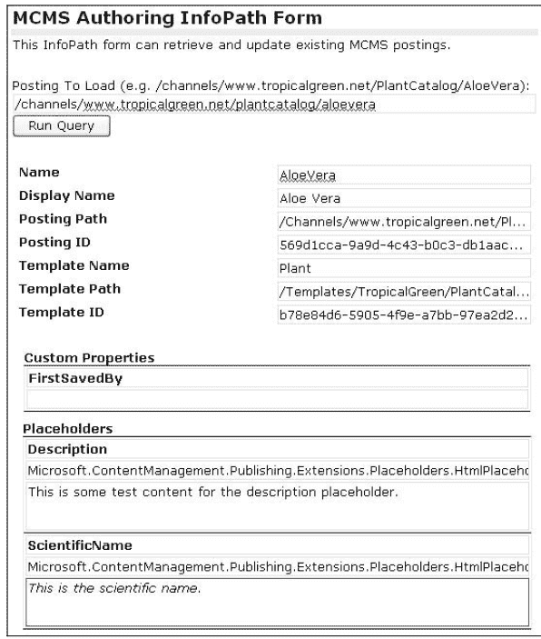

## 什么是 ASP.NET Web 服务？

ASP.NET Web 服务允许软件开发人员为其应用程序创建一个支持跨应用程序域集成的接口。ASP.NET Web 服务由一个或多个 Web 方法组成。Web 方法类似于常规 .NET 对象的方法，但通过网络调用并在托管 Web 服务的服务器上执行。这与远程过程调用（RPC）和 DCOM 对象调用类似。

调用 Web 方法时，可以传递参数，并且可以检索任何返回值。由于方法调用使用 HTTP 发送到托管 Web 服务的机器，因此作为参数传递的对象会被转换为适合传输的格式。在这种情况下，采用 XML 序列化，这是将对象从内存中的二进制形式转换为 HTTP 安全的 XML 格式的过程。

我们选择使用 ASP.NET Web 服务将 InfoPath 与 MCMS 集成，因为它允许我们利用 .NET 的健壮性，同时保留在 InfoPath 中构建的灵活 GUI。Web 服务是平台无关的，也是 InfoPath 的首选集成方法。另一种可能的解决方案是在 InfoPath 内部开发代码，通过编写对 MCMS 的查询脚本并手工制作 InfoPath 表单来实现，但那样我们会失去拥有一个集中式业务逻辑和处理存储的好处，从而降低我们扩展和支持解决方案的能力。

## 创建 MCMS Web 服务项目

MCMS 创作 Web 服务将通过发布 API 访问 MCMS。一系列 Web 方法将允许开发人员检索模板详细信息和更新张贴。MCMS 创作 Web 服务项目将从 Visual Studio .NET 2003 中的 MCMS Web 服务项目模板创建。MCMS Web 服务项目模板自动包含正确的引用和 `web.config` 条目，以便与 MCMS 通信。

让我们继续创建这个 ASP.NET Web 服务应用程序：

1.  启动 Visual Studio .NET，从“文件”菜单中，选择“新建 | 项目”。
2.  从“项目类型”窗格中，在“Content Management Server Projects”下选择“Visual C# Projects”。
3.  从“模板”窗格中，选择“MCMS Web Service”。
4.  输入位置为 `http://localhost/McmsAuthoringWebService`，然后点击“确定”。


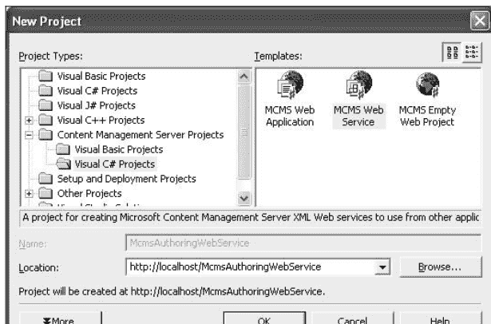

现在应该已经创建了一个项目，并且您会注意到所有必需的 MCMS 引用都已自动创建。由于不需要 Console 文件夹，可以将其从项目中删除。

## 创建业务层

现在我们已经创建了项目，接下来看一下业务层。业务层中的类将封装 MCMS 对象的关键属性，例如 Name、Path、Value 和 ID（等同于 MCMS 的 Guid 属性）。我们对象模型中的所有对象都必须是可序列化的，也就是说，必须能够将它们转换为 XML，以便通过 Web 服务进行传输。我们无法直接通过 ASP.NET Web 服务传输标准的 PAPI 对象，因为目前还没有办法将其直接序列化为 XML。因此，我们将使用自己的类来重建部分 MCMS 对象模型，这些类支持序列化，以便 ASP.NET Web 服务能够发送和接收它们。

PAPI 类不包含默认构造函数，因此无法序列化为 XML。有关 XML 序列化的更多信息，请参阅 http://msdn.microsoft.com/library/default.asp?url=/library/en-us/cpguide/html/cpconintroducingxmlserialization.asp。

我们将开发以下类：

- LightweightPosting
- LightweightTemplate
- LightweightPlaceholderCollection
  - LightweightPlaceholder
- LightweightCustomPropertyCollection
  - LightweightCustomProperty

- 4. 对象若要被序列化，它必须有一个不带参数的构造函数。.NET Framework 在序列化期间需要这个默认构造函数，并且在创建类时 VS .NET 会自动添加。但是，我们还需要添加以下构造函数，该构造函数接受公共变量的值作为其参数：

```csharp
/// <summary>
/// Instantiate the custom property setting the Name and Current value.
/// </summary>
/// <param name="_Name">The name of the custom property</param>
/// <param name="_Value">The current value of the custom property</param>
public LightweightCustomProperty(string _Name, string _Value)
{
    this.Name = _Name;
    this.Value = _Value;
}
```

- 5. 自定义属性值将保存回相关的 MCMS 发布项。因此，让我们创建 Save() 方法，该方法为作为参数传入的发布项设置自定义属性的值。

```csharp
/// <summary>
/// Save the custom property value
/// </summary>
/// <param name="_Posting">The posting to be updated</param>
public void Save(Posting _Posting)
{
    // Get the custom property of the posting and set the value
    _Posting.CustomProperties[this.Name].Value = this.Value;
}
```

发布项可能使用定义了多个自定义属性的模板。为了存储这些自定义属性的集合，我们将定义一个强类型的 LightweightCustomProperty 对象集合，称为 LightweightCustomPropertyCollection。

- 1. 在 Visual Studio .NET 中创建一个新类，并将其命名为 LightweightCustomPropertyCollection。为其添加命名空间 Microsoft.ContentManagement.Publishing，并使其继承 System.Collections.CollectionBase。

```csharp
using System;
using Microsoft.ContentManagement.Publishing;
namespace McmsAuthoringWebService
{
    /// <summary>
    /// Summary description for LightweightCustomPropertyCollection.
    /// </summary>
    public class LightweightCustomPropertyCollection
        : System.Collections.CollectionBase
    {
        . . . code continues . . .
    }
}
```

- 2. 由于 LightweightCustomPropertyCollection 是一个强类型集合，其默认属性将是一个 LightweightCustomProperty。

```csharp
/// <summary>
/// The indexed LightweightCustomProperty
/// </summary>
public LightweightCustomProperty this[int index]
{ get { // Cast the list item to a LightweightCustomProperty return(this.InnerList[index] as LightweightCustomProperty); } set { this.InnerList[index] = value; } }
```

- 3. 现在我们将定义 Add() 方法，以便向集合中添加一个 LightweightCustomProperty。

```csharp
/// <summary>
/// Add an item to the collection
/// </summary>
/// <param name="item">The LightweightCustomProperty to be added</param>
public void Add(LightweightCustomProperty item)
{
    this.InnerList.Add(item);
}
```

- 4. LightweightCustomPropertyCollection 将由 Microsoft.ContentManagement.Publishing.Posting 对象填充，因此我们将定义 Load() 方法。Load() 方法将枚举发布项的自定义属性，并为每个自定义属性实例化一个 LightweightCustomProperty，然后将其添加到集合中。

  在本示例中，我们仅维护 Text 类型的自定义属性。可以扩展此代码以支持 Selection 类型的自定义属性。

```csharp
/// <summary>
/// Load the lightweight custom property collection from a posting.
/// </summary>
/// <param name="_Posting">Posting to be loaded from</param>
public void Load(Posting _Posting)
{
    if (_Posting != null)
    {
        // Loop through the custom properties
        foreach (CustomProperty _CustomProperty in _Posting.CustomProperties)
        {
            // Check if the custom property is of type `text`
            // (custom properties will have > 0 allowed values)
            if (_CustomProperty.AllowedValues.Count == 0)
            {
                // Instantiate a lightweight custom property and
                // add it to the collection
                this.Add(new LightweightCustomProperty(_CustomProperty.Name, _CustomProperty.Value));
            }
        }
    }
}
```

- 5. 我们还需要能够保存集合中持有的所有自定义属性。

```csharp
/// <summary>
/// Save the collection of custom properties
/// </summary>
/// <param name="_Posting">
/// Posting to save the custom property value to
/// </param>
public void Save(Posting _Posting)
{
    // Loop through the custom properties in the collection
    foreach (LightweightCustomProperty _LightweightCustomProperty in this)
    {
        // Save the custom property against the posting
        _LightweightCustomProperty.Save(_Posting);
    }
}
```

现在我们已经定义了用于维护自定义属性的类，项目在类视图中应该如下所示：

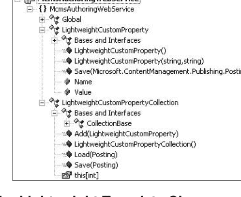

## 创建 Lightweight Template 类

模板的路径和 GUID 将包含在 InfoPath 表单中，以便用户知道发布项使用的是哪个模板。为此，我们将创建 LightweightTemplate 类，这是 Microsoft.ContentManagement.Publishing.Template 类的一个可序列化的精简表示。

- 1. 在 Visual Studio .NET 中，右键单击 McmsAuthoringWebService 项目，创建一个名为 LightweightTemplate 的新类。
- 2. 添加 Microsoft.ContentManagement.Publishing 命名空间。

```csharp
using System;
using Microsoft.ContentManagement.Publishing;
namespace McmsAuthoringWebService
{
    /// <summary>
    /// Summary description for LightweightTemplate.
    /// </summary>
    public class LightweightTemplate
    {
        ... code continues ...
    }
}
```

- 3. 在类中定义以下公共变量：

```csharp
/// <summary>
/// The name of the template in MCMS
/// </summary>
public string Name;

/// <summary>
/// The path of the template in MCMS
/// </summary>
public string Path;

/// <summary>
/// The Guid of the template in MCMS
/// </summary>
public Guid ID;
```

- 4. 由于模板对象将从 Microsoft.ContentManagement.Publishing.Template 类的实例加载，我们现在定义 Load() 方法：

```csharp
/// <summary>
/// Load the lightweight object from the MCMS Template
/// </summary>
/// <param name="_Template">The MCMS template to load from</param>
public void Load(Template _Template)
{
    this.Name = _Template.Name;
    this.Path = _Template.Path;
    // Create a new guid object because MCMS stores Guids in string format.
    this.ID = new Guid(_Template.Guid);
}
```

## 维护占位符值

ASP.NET Web 服务将能够加载并维护发布项的占位符值。为此，我们将创建两个对象，即 LightweightPlaceholder 和相应的 LightweightPlaceholderCollection。

- 1. 在 Visual Studio .NET 中，右键单击项目，创建一个名为 LightweightPlaceholder 的新类。
- 2. 向文件中添加以下命名空间：

```csharp
using System;
using System.Xml;
using System.IO;
using Microsoft.ContentManagement.Publishing;
using Microsoft.ContentManagement.Publishing.Extensions.Placeholders;
```


namespace McmsAuthoringWebService
{
    . . . code continues . . .
}

+   3. 现在，让我们为我们的类添加以下公共变量，它们将包含占位符的名称、占位符的类型及其值：

```
/// <summary>
/// The placeholder name in MCMS
/// </summary>
public string Name;

/// <summary>
/// The type of placeholder e.g. Microsoft.ContentManagement.Publishing-Extensions.Placeholders.HtmlPlaceholder
/// </summary>
public string Type;

/// <summary>
/// The XmlNode representation of the current value of the placeholder
/// </summary>
public XmlNode Value;
```

为了能够加载包含 HTML 的 XmlNode，我们将把 HTML 转换为格式良好的 XHTML。我们将通过使用 Chris Lovett 创建的一个公开工具 SgmlReader 来实现此操作，Chris Lovett 供职于一家名为 Microsoft Corporation 的小型公司。

> SGML 代表 Standard Generalized Markup Language，即 XML 的前身。SgmlReader 工具套件提供了多种创建格式良好的 XML 的方法，但就本示例而言，我们只需要 SgmlReader.dll。

要设置和配置 SgmlReader，请按照以下步骤操作：

+   1. 从 GotDotNet 下载该工具，网址为 http://www.gotdotnet.com/Community/UserSamples/Details.aspx?SampleGuid=b90fddce-e60d-43f8-a5c4-c3bd760564bc。
+   2. 将 ZIP 文件解压到 c:\sgml\SgmlReader。
+   3. 在 <local_drive>\Program Files 下创建一个名为 SgmlReader 的目录，并将 C:\SGML\SgmlReader\SgmlReaderDll\bin\release\SgmlReaderDll.dll 文件复制到新文件夹。

我们现在准备创建 CleanHtml() 方法，该方法将把 HTML 转换为格式良好的 XHTML，例如将  转换为 </img>。此方法将使用我们之前引用的 SgmlReader 程序集。在转换之前，HTML 必须用单个标签包裹，在本例中为 <html>，这样 SgmlReader 才能将其识别为一个元素。转换后返回，我们将转义一些 InfoPath 无法转义的字符，并从内容中移除包围的 <html> 元素。

+   1. 在 Visual Studio .NET 中打开 McmsAuthoringWebService 项目，并添加对 <local_drive>\Program Files\SgmlReader\SgmlReaderDll.dll 的引用。

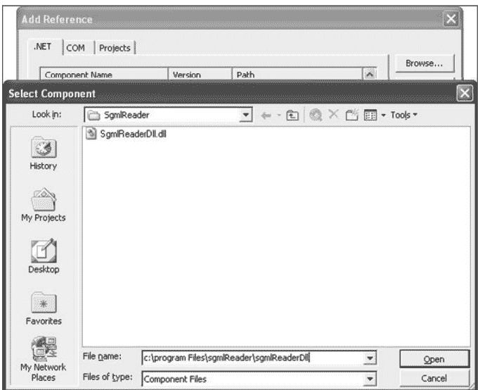

2. 在 LightweightPlaceholder.cs 中创建以下方法：

```
/// <summary>
/// Convert "badly formed" HTML into well formed XHTML using the
/// SgmlReader utility by Chris Lovett, Microsoft Corporation
/// </summary>
/// <param name="BadlyFormedHtml">The badly formed HTML</param>
/// <returns>Well formed XHTML representation of the HTML</returns>
public string CleanHtml(string BadlyFormedHtml)
{
    // Wrap the entire HTML string in a single tag so the
    // SGMLReader can process the data as one element
    BadlyFormedHtml = "<html>" + BadlyFormedHtml + "</html>";

    // Load the string reader with the badly formed HTML
    StringReader _stringReader = new StringReader(BadlyFormedHtml);

    // instantiate and set the badly formed HTML string reader
    // as the input stream of the SgmlReader
    Sgml.SgmlReader _sgmlReader = new Sgml.SgmlReader();
    _sgmlReader.InputStream = _stringReader;

    // Instantiate the string writer and xmlText writer
    // that will be used to hold the well formed XHTML
    StringWriter _stringWriter = new StringWriter();
    XmlTextWriter _xmlTextWriter = new XmlTextWriter(_stringWriter);

    // Read the stream
```

```
_sgmlReader.Read();
// loop through the SgmlReader until the end of the stream
while(!_sgmlReader.EOF)
{
    // add a node to the XML text writer
    _xmlTextWriter.WriteNode(_sgmlReader, true);
}

// cleanup the XML text writer
_xmlTextWriter.Flush();
_xmlTextWriter.Close();

// Replace non-breaking spaces (&nbsp;) with spaces
// as InfoPath escapes these in placeholders.
string strCleanedXHTML = _stringWriter.ToString().Replace("&amp;nbsp;", " ");

// Remove the surrounding <html> tag by using an XmlDocument
// Create a new XmlDocument and load in the clean XHTML
XmlDocument _tempDocument = new XmlDocument();
_tempDocument.LoadXml(strCleanedXHTML);

// Get the html node and return the inner XML
return _tempDocument.SelectSingleNode("/html").InnerXml;
```

3. 现在我们能够从 HtmlPlaceholder 中存储的 HTML 创建格式良好的 XHTML，我们可以填充 XmlNode 属性，该属性将用于 InfoPath 的占位符内容存储。

```
/// <summary>
/// Create an XHTML XmlNode from "badly formed" HTML
/// </summary>
/// <param name="BadlyFormattedHtml">The badly formed HTML string</param>
/// <returns>XHTML XmlNode representation of input HTML</returns>
public XmlNode LoadXHTML(string BadlyFormattedHtml)
{
    // Create a temporary XmlDocument object to generate nodes
    System.Xml.XmlDocument tempDocument = new System.Xml.XmlDocument();

    // Create a wrapper node for the data so InfoPath will correctly detect
    // the XHTML content
    System.Xml.XmlElement theNode =
        (System.Xml.XmlElement)tempDocument.CreateNode(
            System.Xml.XmlNodeType.Element, "theNode", "");

    // Create a "RichText" element in the XHTML namespace
    System.Xml.XmlElement theRichText = (System.Xml.XmlElement)
        tempDocument.CreateNode(System.Xml.XmlNodeType.Element, "RichText",
            "http://www.w3.org/1999/xhtml");

    // Clean the badly formed HTML and set the inner XML of the RichText node
    theRichText.InnerXml = CleanHtml(BadlyFormattedHtml);

    // Append the RichText node to the wrapper node
    theNode.AppendChild( theRichText );

    //Return the wrapper element.
    return theNode;
}
```

4. 接下来我们将为 LightweightPlaceholder 类添加一个构造函数，该构造函数接受一个 Microsoft.ContentManagement.Publishing.Placeholder 参数。Name 和 Type 属性连同 Value 属性一起设置。为了加载值，我们首先验证占位符是否为 HtmlPlaceholder，然后调用 LoadXHTML() 方法并传入占位符的 HTML。LoadXHTML() 将把占位符的 HTML 转换为 XmlNode。

```
/// <summary>
/// Instantiate and load a MCMS placeholder
/// </summary>
/// <param name="_Placeholder">MCMS placeholder to load</param>
public LightweightPlaceholder(Placeholder _Placeholder)
{
    // Set the name and the type of placeholder
    this.Name = _Placeholder.Name;
    this.Type = _Placeholder.GetType().ToString();

    // Is this an HtmlPlaceholder?
    if (_Placeholder is HtmlPlaceholder)
    {
        // Convert the contents of the placeholder to XHTML
        // and set the Value property
        this.Value = LoadXHTML(((HtmlPlaceholder)_Placeholder).Html);
    }
}
```

5. 占位符值将保存回相关帖子的 MCMS。因此让我们创建 Save() 方法。此解决方案目前仅适用于 HtmlPlaceholders，因此我们必须首先检查占位符是否为 HtmlPlaceholder，然后可以将 Html 属性设置为存储在 Value XmlNode 中的 XML。

```
/// <summary>
/// Save the placeholder contents to a posting
/// </summary>
/// <param name="_Posting">Posting to save against</param>
public void Save(Posting _Posting)
{
    // Set the placeholder value for the current placeholder
    // to the InnerXml of the Value property
    // Note: This will only work with HtmlPlaceholders. If enhanced for
    // other placeholders we would check the placeholder type before
    // casting.
    if (_Posting.Placeholders[this.Name] is HtmlPlaceholder)
    {
        ((HtmlPlaceholder)_Posting.Placeholders[this.Name]).Html =
            this.Value.InnerXml;
    }
    else
    {
        throw new Exception("The placeholder " + this.Name
            + " is not an HtmlPlaceholder.");
    }
}
```

## Maintaining Placeholder Collections

让我们现在创建一个集合类来保存 LightweightPlaceholders，我们称之为 LightweightPlaceholderCollection。LightweightPlaceholderCollection 将用于帖子可能定义多个占位符的情况。


+   1. 在 Visual Studio .NET 中，创建一个新的类 LightweightPlaceholderCollection，并向其添加 MCMS Publishing 和 Placeholders 命名空间。 同时将该类更改为扩展 System.Collections.CollectionBase：

```
using System;
using Microsoft.ContentManagement.Publishing;
using Microsoft.ContentManagement.Publishing.Extensions.Placeholders;
namespace McmsAuthoringWebService
{
    /// <summary>
    /// Summary description for LightweightPlaceholderCollection.
    /// </summary>
    public class LightweightPlaceholderCollection
        : System.Collections.CollectionBase
    {
        ... code continues ...
    }
}
```

+   2. 由于 LightweightPlaceholderCollection 是一个强类型集合，其默认属性将是一个 LightweightPlaceholder：

```
/// <summary>
/// The indexed LightweightPlaceholder
/// </summary>
public LightweightPlaceholder this[int index]
{
    get
    {
        // Cast the list item to a LightweightPlaceholder
        return(this.InnerList[index] as LightweightPlaceholder);
    }
    set
    {
        this.InnerList[index] = value;
    }
}
```

+   3. 我们现在定义 Add() 方法，该方法将向集合中添加一个 LightweightPlaceholder：

```
/// <summary>
/// Add an item to the collection
/// </summary>
/// <param name="item">The LightweightPlaceholder to be added</param>
public void Add(LightweightPlaceholder item)
{
    this.InnerList.Add(item);
}
```

+   4. LightweightPlaceholderCollection 将通过加载一个 Microsoft.ContentManagement.Publishing.Posting 对象来填充，因此让我们创建 Load() 方法。

为本示例的目的，我们仅维护类型为 HtmlPlaceholder 的占位符。 代码可以很容易地扩展以维护不同类型的占位符。

```
/// <summary>
/// Load the lightweight Placeholder collection from a posting.
/// </summary>
/// <param name="_Posting">Posting to be loaded from</param>
public void Load(Posting _Posting)
{
    if (_Posting != null)
    {
        // Loop through the Placeholders
        foreach (Placeholder _Placeholder in _Posting.Placeholders)
        {
            // Check if the custom Placeholder is an HtmlPlaceholder
            if (_Placeholder is HtmlPlaceholder)
            {
                // Instantiate a lightweight Placeholder and
                // add it to the collection
                this.Add(new LightweightPlaceholder(_Placeholder));
            }
        }
    }
}
```

+   5. 为了保存集合中所有占位符的内容，我们将创建一个 Save() 方法，该方法遍历所有占位符并为每个占位符调用 Save()：

```
/// <summary>
/// Save the collection of placeholders
/// </summary>
/// <param name="_Posting">Posting to save the placeholder values to</param>
public void Save(Posting _Posting)
{
    // Loop the Placeholders in the collection
    foreach (LightweightPlaceholder _LightweightPlaceholder in this)
    {
        // Save the Placeholder against the posting
        _LightweightPlaceholder.Save(_Posting);
    }
}
```

现在我们已经定义了用于维护自定义属性和占位符的类，以及用于存储模板定义数据的类，MomsAuthoringWebService 项目应如下图所示：

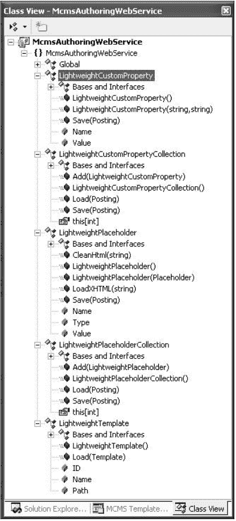

## 创建一个用于维护 Postings 的对象

ASP.NET Web 服务将能够加载和维护 postings。 为此我们将创建一个名为 **LightweightPosting** 的类。 在 Visual Studio .NET 中，右键单击项目 **McmsAuthoringWebService** 并添加一个名为 **LightweightPosting** 的新类。 添加下面突出显示的命名空间：

```
```csharp
using System;
using System.IO;
using System.Security.Principal;
```
```

```
using System.Xml;
using System.Xml.Serialization;
using Microsoft.ContentManagement.Publishing;
namespace McmsAuthoringWebService
{
    /// <summary>
    /// Summary description for LightweightPosting.
    /// </summary>
    public class LightweightPosting
    {
        - - - code continues - - -
    }
}
```

LightweightPosting 类需要包含几个公共变量：

```
#region Declarations and public variables

/// <summary>
/// The MCMS name of the posting
/// </summary>
public string Name;

/// <summary>
/// The MCMS Display name of the posting
/// </summary>
public string DisplayName;

/// <summary>
/// The MCMS Path of the posting
/// </summary>
public string Path;

/// <summary>
/// The GUID of the posting
/// </summary>
public Guid ID;

#endregion
```

为了在 Update 模式下检索当前用户的 CmsContext，我们将在类上定义一个辅助属性，该属性返回这样的 CmsContext。 你还会注意到，由于我们需要对象处于 Update 模式，因此我们使用的是 CmsApplicationContext 类而不是 CmsHttpContext。

```
#region MCMS Current Context

/// <summary>
/// Declare the cms context as a private variable so we
/// don't need to load it every time we access the property.
/// </summary>
private CmsContext _CurrentCmsContext;

/// <summary>
/// Get the current MCMS context in update mode.
/// </summary>
private CmsContext CurrentCmsContext
{
    get
    {
        // Do we need to load the cmscontext?
        if (_CurrentCmsContext == null)
        {
            // Create the new application context
            CmsApplicationContext cmsContext = new CmsApplicationContext();

            // We need to get the identity of the current user
            WindowsIdentity ident = System.Web.HttpContext.Current.User.Identity as WindowsIdentity;

            // Authenticate into update mode
            cmsContext.AuthenticateUsingUserHandle(ident.Token, PublishingMode.Update);

            // Set the private variable
            _CurrentCmsContext = cmsContext;
        }

        // Return the private variable
        return(_CurrentCmsContext);
    }
}

#endregion
```

通过调用方法 AuthenticateUsingUserHandle() 对 CmsApplicationContext 进行身份验证的过程仅在使用 Windows 身份验证时才有效。

接下来我们将定义一个属性来加载 Microsoft.ContentManagement.Publishing.Posting 对象，该对象对应于当前的 LightweightPosting 对象。 该属性将使用 Microsoft.ContentManagement.Publishing.Searches 类来加载 posting，如果未找到 posting，则会抛出异常：

```
#region Related MCMS Posting

/// <summary>
/// The MCMS Posting object private variable
/// (so we don't need to reload it when accessing the property)
/// </summary>
private Posting _Posting;

/// <summary>
/// The MCMS Posting object that corresponds to this Lightweight posting.
/// It loaded from the Path property
/// </summary>
private Posting CmsPosting
{
	get
	{
		// Is the posting object set?
		if (_Posting == null)
		{
			// Make sure the Guid for the posting is set
			if (this.Path != null)
			{
				// Perform a search to get the posting object by path
				_Posting = (Posting)CurrentCmsContext.Searches.GetByPath(this.Path);

				// Verify the posting object was found
				if (_Posting == null)
				{
					throw new Exception("The posting could not be found at path " + this.Path + "");
				}
			}
		}

        // Return the posting object
        return(_Posting);
    }
    set
    {
        _Posting = value;
    }
}
#endregion
```

为了访问当前 posting 的自定义属性，我们将向 LightweightPosting 类添加 CustomProperties 属性，该属性在必要时将加载一个 LightweightCustomPropertyCollection：

```
#region Property - Custom Properties

/// <summary>
/// The lightweight custom properties private variable
/// </summary>
private LightweightCustomPropertyCollection _CustomProperties;

/// <summary>
/// Get/Set the lightweight custom properties collection.
/// If _CustomProperties is null the custom properties will be
/// loaded by the current CmsPosting
/// </summary>
public LightweightCustomPropertyCollection CustomProperties
{
    get
    {
        // Have the custom properties been loaded?
        if (_CustomProperties == null)
        {
            // Instantiate the new lightweight custom properties
            _CustomProperties = new LightweightCustomPropertyCollection();

            // Load by current MCMS Posting
            _CustomProperties.Load(this.CmsPosting);
        }

        // return the collection
        return(_CustomProperties);
    }
    set
    {
        // set the local variable
        _CustomProperties = value;
    }
}
#endregion
```

与我们为 posting 加载自定义属性的方式类似，我们现在将添加 Placeholders 属性，该属性实例化一个 LightweightPlaceholderCollection 并为当前 MCMS posting 加载它：

```
#region Property - Placeholders

/// <summary>
/// The lightweight Placeholders private variable
/// </summary>
```


```csharp
}

// return the private variable
return(_Template);
}
set
{
    // Set the private variable
    _Template = value;
}

#endregion
```

现在在构造函数逻辑中添加从 MCMS 发布对象填充 LightweightPosting 的 Name、DisplayName、Path 和 ID。我们将通过调用 ToString() 方法来初始化 CustomProperties、Placeholders 和 Template 属性，该方法会通过调用默认构造函数隐式实例化对象。对象初始化后，它们将被填充。之后，我们可以释放 CurrentCmsContext 对象，因为我们不再需要它。

```csharp
#region Constructor - Instantiate by MCMS Posting Object

/// <summary>
/// Instantiate and load the LightweightPosting
/// object from an MCMS Posting object.
/// </summary>
/// <param name="_Posting">MCMS Posting object</param>
public LightweightPosting(Posting _Posting)
{
    this.Name = _Posting.Name;
    this.DisplayName = _Posting.DisplayName;
    this.Path = _Posting.Path;
    this.ID = new Guid(_Posting.Guid);

    // Initialize the properties
    this.CustomProperties.ToString();
    this.Placeholders.ToString();
    this.Template.ToString();

    // Dispose the context
    this.CurrentCmsContext.Dispose();
}

#endregion
```

现在我们已经定义了用于加载 MCMS 对象（如模板、占位符和自定义属性）的属性，我们将添加 Save() 方法以将属性值或集合的任何更改保存到 MCMS。Save() 方法会检查 DisplayName 或 Name 是否已更改，如果已更改则会覆盖 Posting 对象的相应值。然后它会在 Placeholders 属性上调用 Save() 方法以保存每个占位符的值。然后提交发布并提交事务。

```csharp
#region Save
/// <summary>
/// Save the Lightweight posting object's properties
/// and collections to the MCMS database.
/// </summary>
public void Save()
{
    // Check if the display name has changed
    if (this.DisplayName != this.CmsPosting.DisplayName)
    {
        // it has changed - apply the change to the posting object
        this.CmsPosting.DisplayName = this.DisplayName;
    }

    // Check if the posting name has changed
    if (this.Name != this.CmsPosting.Name)
    {
        // it has changed - apply the change to the posting object
        this.CmsPosting.Name = this.Name;
    }

    // Save the placeholders collection passing in the current posting
    this.Placeholders.Save(this.CmsPosting);

    // Can we submit the posting?
    if (this.CmsPosting.CanSubmit)
    {
        // Yes, submit it
        this.CmsPosting.Submit();

        // Commit the transaction
        this.CurrentCmsContext.CommitAll();
    }

    // Dispose of the current CMS Context
    this.CurrentCmsContext.Dispose();
}
#endregion
```

LightweightPosting 对象现在应如下所示：

5. 删除以下代码，因为我们不再需要它：

```csharp
// WEB SERVICE EXAMPLE
// The HelloWorld() example service returns the string Hello World
// To build, uncomment the following lines then save and build the project
// To test this web service, press F5

//     [WebMethod]
//     public string HelloWorld()
//     {
//         return "Hello World";
//     }
```

## The GetPosting() Web Method

现在让我们定义 GetPosting() Web 方法，它将从 MCMS 填充我们的自定义 LightweightPosting 对象之一。GetPosting() 必须具有 [WebMethod] 属性才能通过 Web 服务访问。如果 strPath 参数为空字符串，我们将初始化一个空的 LightweightPosting 对象，以便序列化完整的对象模型。

```csharp
/// <summary>
/// Gets a Lightweight posting and all the properties by path
/// </summary>
/// <param name="strPath">Path of the posting</param>
/// <returns>LightweightPosting</returns>
[WebMethod]
public LightweightPosting GetPosting(string strPath)
{
    // Did we pass in a path?
    if (strPath == "")
    {
        // Define a lightweight posting object
        LightweightPosting _lightweightPosting = new LightweightPosting();

        // Initialize the Custom Properties, Placeholders and Template
        _lightweightPosting.CustomProperties =
            new LightweightCustomPropertyCollection();
        _lightweightPosting.Placeholders =
            new LightweightPlaceholderCollection();
        _lightweightPosting.Template = new LightweightTemplate();

        // Create an empty placeholder
        LightweightPlaceholder _placeholder = new LightweightPlaceholder();

        // Load an empty string into the Value property
        _placeholder.Value = _placeholder.LoadXHTML("");

        // Add the placeholder to the collection
        _lightweightPosting.Placeholders.Add(_placeholder);

        // Return the posting object
        return(_lightweightPosting);
    }
    else
    {
        // Declare a Posting object
        Posting _posting = null;

        // Create the new application context
        CmsApplicationContext cmsContext = new CmsApplicationContext();

        // We need to get the identity of the current user
        WindowsIdentity ident = System.Web.HttpContext.Current.User.Identity
            as WindowsIdentity;

        try
        {
            // Authenticate into update mode
            cmsContext.AuthenticateUsingUserHandle(ident.Token,
                    PublishingMode.Update);
        }
        catch(Exception ex)
        {
            // Dispose the CMS Context
            cmsContext.Dispose();

            throw new Exception("Failed to Authenticate user by handle. "
                    + "The user may not have author permissions.", ex);
        }

        // Get the MCMS Posting object by path
        _posting = (Posting)cmsContext.Searches.GetByPath(strPath);

        // Verify the posting was found
        if (_posting == null)
        {
            // Dispose the CMS Context
            cmsContext.Dispose();

            throw new Exception("The posting was not found at path \""
                    + strPath + "\";");
        }

        // Instantiate the Lightweight posting passing
        // in the MCMS posting to the constructor.
        LightweightPosting _LightweightPosting = new LightweightPosting(_posting);

        // Dispose the CMS Context
        cmsContext.Dispose();

        // Return the Lightweight posting
        return(_LightweightPosting);
    }
}
```

## Configuring IIS Security

由于我们使用当前用户的 Windows 身份来验证 CmsApplicationContext，我们应验证对该 Web 服务的匿名访问已禁用。

1. 在 web.config 文件中，验证 authentication 元素是否设置为：`<authentication mode="Windows" />`
2. 在 Internet Information Services (IIS) 管理控制台中，右键单击 McmsAuthoringWebService 虚拟目录并选择 Properties。
3. 选择 Directory Security 选项卡。
4. 在 Anonymous access and authentication control 下，选择 Edit。
5. 取消选中 Anonymous access 并选中 Integrated Windows authentication。
6. 单击 OK 并关闭所有打开的对话框。
7. 关闭 IIS 管理控制台。

## Testing the Web Service

要进行测试，我们可以通过在 Solution Explorer 中右键单击 authoring.asmx 并选择 Set As Start Page，将 Web 服务设置为项目的起始页。然后通过按 Control-F5 或从 Debug 菜单中选择 Start Without Debugging 以不调试的方式启动。

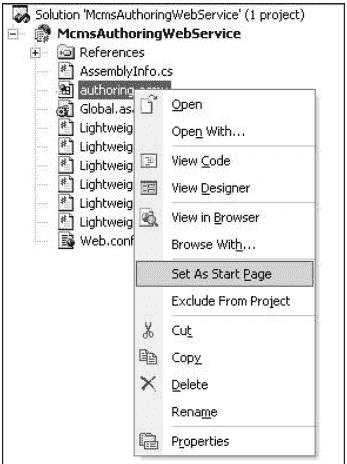

我们现在应该会看到 ASP.NET Web 服务测试页，列出 GetPosting 作为唯一可用的 Web 方法：

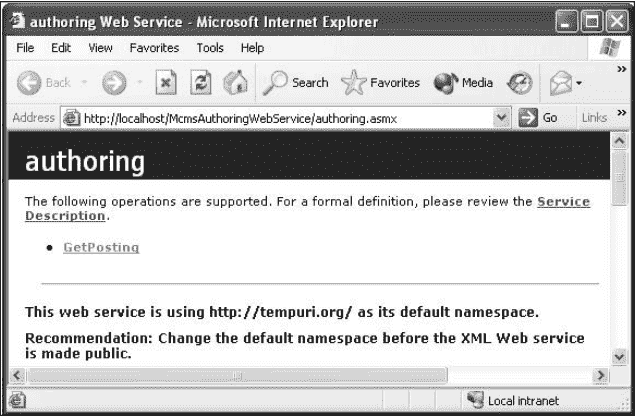

我们使用的示例站点是 Tropical Green 站点，可从 Packt 网站上本书的代码下载部分获取。

如果现在单击 GetPosting，您将看到参数 strPath 的文本框。输入 `/channels/www.tropicalgreen.net/PlantCatalog/AloeVera` 到该框中并单击 Invoke。

您现在将看到 `LightweightPosting` 对象及其所有可序列化属性的序列化视图：

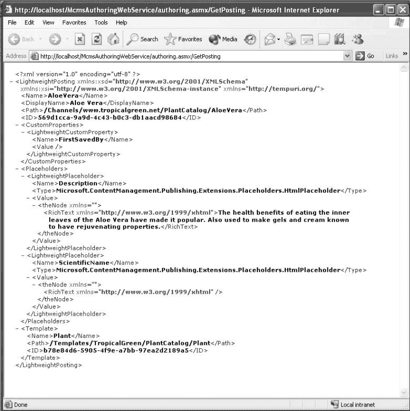


## The SavePosting() Web Method

让我们再创建一个 Web 方法 SavePosting()，它将接受一个 LightweightPosting 对象作为参数并将其内容保存到 MCMS。将以下代码添加到 authoring.asmx.cs 文件中并重新生成解决方案：

```
/// <summary>
/// Save a lightweight posting object to MCMS
/// </summary>
/// <param name="_Posting">LightweightPosting object to save</param>
[WebMethod]
public void SavePosting(LightweightPosting _Posting)
{
    // Save the posting
    _Posting.Save();
}
```

SavePosting() Web 方法不能像我们对 GetPosting() 所做的那样从浏览器进行测试，因为它需要一个复杂数据类型（LightweightPosting）作为参数。我们将在稍后创建的 InfoPath 表单中通过 InfoPath 表单来测试 SavePosting()。

## Preparing the InfoPath Environment

此时，您需要在计算机上安装 Microsoft InfoPath 2003 和 Office 2003 Service Pack 1（SP1）。如果您的 Office 2003 安装尚未应用 SP1，您可以从以下位置下载：

http://www.microsoft.com/downloads/details.aspx?FamilyID=9c51d3a6-7cb1-4f61-837e-5f938254fc47

您还应从以下位置下载 InfoPath 2003 SDK 以供进一步参考：

http://www.microsoft.com/downloads/details.aspx?FamilyId=351F0616-93AA-4FE8-9238-D702F1BFBAB4

要验证是否已安装 Service Pack 1，请启动 InfoPath 并单击 Help | About Microsoft Office InfoPath。最新服务包的名称会打印在产品版本号旁边。

## Creating the InfoPath Document

InfoPath 文档在创建 InfoPath 表单模板并将其连接到 Web 服务以进行数据检索和提交之前，需要一个在 InfoPath 中设计的 InfoPath 模板（.xsn）。按照以下步骤创建一个将连接到我们刚刚创建的 Web 服务的 InfoPath 模板：

- 1. 启动 Microsoft InfoPath 2003。
- 2. 在 Fill Out a Form 窗口左侧，选择 Design a Form。如果 Fill Out a Form 窗口未打开，请选择 File | Design a Form。
- 3. 从右侧的任务窗格中，选择 New from Data Connection。
- 4. 在 Data Connection Wizard 中，选择 Web Service 并单击 Next。
- 5. 选择 Receive and submit data 并单击 Next。

现在让我们为此表单添加一个标题。单击 Click to add title 标签并输入 MCMS Authoring InfoPath Form。选择文本并使其加粗。

最后，我们将在标题下方输入一些简要说明。单击 Click to add form content 标签上的任意位置。在提供的空间中输入 This InfoPath form can retrieve and update existing MCMS postings。

## Creating the Controls in InfoPath

通过从 XML Web 服务生成文档，InfoPath 允许我们在几分钟内而不是在其他环境中花费数小时或数天创建一个功能齐全的用户界面。为了允许用户输入帖子的路径并查询 Web 服务，请按照以下步骤操作：

- 1. 在任务窗格中，选择 Data Source 类别。
- 2. 展开 `myFields`、`queryFields` 和 `s0:GetPosting`。
- 3. 将 `strPath` 元素拖到表单上标记为 "Drag query fields here." 的区域。
- 4. 将标签 `strPath` 更改为 "Posting To Load"（例如 `/Channels/www.TropicalGreen.net/PlantCatalog/AloeVera`）。
- 5. 将 Run Query 按钮拖到 `strPath` 文本框下方，并删除 Run Query 按钮之前多余的行中断。
- 6. 选择布局表的底部边框并将其向上拖动以减小表的高度。

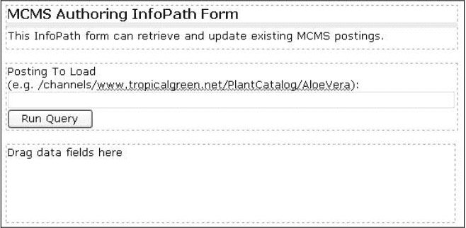

我们的表单现在允许用户输入帖子的路径，该路径传递给 ASP.NET Web 服务，后者返回一个序列化的 LightweightPosting 对象。

让我们创建显示帖子属性并允许编辑的用户界面。

- 1. 在 Data Source 窗格中，展开 `dataFields` 和 `s0:GetPostingResponse`。
- 2. 将 `GetPostingResult` 节点拖到 "Drag data fields here" 标签上。
- 3. 将出现一个上下文菜单，列出可以执行的操作。对于此节点，我们将创建带控件的部分，因此单击 Section with Controls。
- 4. 现在已生成以下表单。现在不要担心布局，我们将在下一节中使其更易于使用。

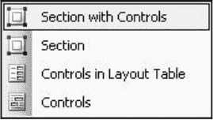

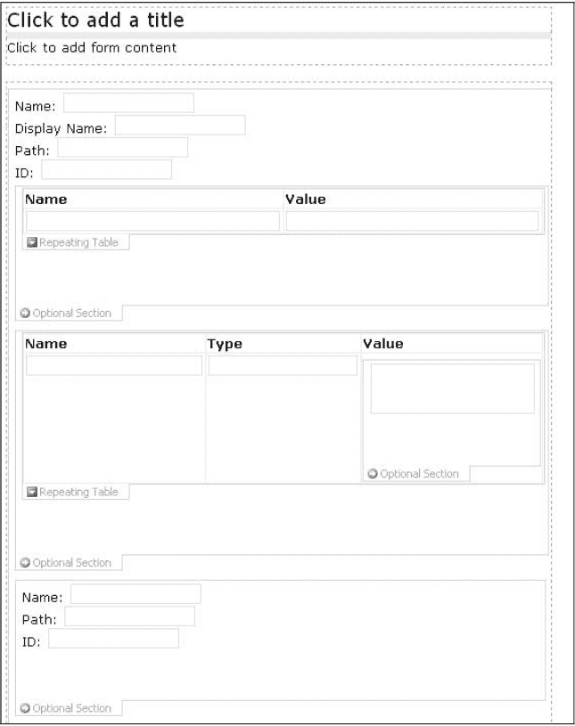

## Cleaning Up the Generated Form

当我们选择 Section with Controls 时，InfoPath 生成的界面完全可用，但美观性不佳，也不包含所有正确的控件配置。我们可以通过简单地将控件拖放到不同区域来重新排列表单上的控件。

首先，让我们更好地排列所有常见的帖子和模板属性。

- 1. 将光标放在最上面的 Name: 标签左侧（标题正下方的标签），从 Table 菜单中选择 Insert | Layout Table。
- 2. 将列数设置为 2，行数设置为 7，然后单击 OK。
- 3. 现在已生成布局表。将以下文本添加到第一列的单独单元格中：
  - Name
  - Display Name
  - Posting Path
  - Posting ID
  - Template Name
  - Template Path
  - Template ID
- 4. 选择单元格并将文本设置为粗体。
- 5. 我们现在必须将生成的文本字段移动到其对应标签旁边。将 Name、Display Name、Posting Path 和 ID 标签下方的四个文本字段拖到表格右侧列的前四行中。然后删除多余的标签。
- 6. 与模板属性相关的文本框已在表单底部生成，因为它们由另一个 XML 元素表示。将这些文本框拖到其对应标签旁边的列中。您可以通过选择它们并查看右侧的 Data Source 窗格来轻松验证属性与哪个对象相关。顶部表格现在应如下所示：

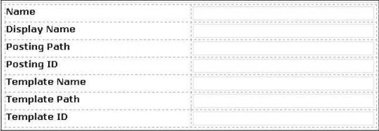

从屏幕顶部的工具栏更新一些占位符值和自定义属性，然后按 Submit。如果您浏览到 http://www.tropicalgreen.net/PlantCatalog/AloeVera.htm，更新现在应该可见——您可能需要切换到 Unpublished Mode，因为更改需要在上线前获得编辑批准。完成后，单击屏幕顶部的 Close Preview，表单将返回设计模式。

## Saving the InfoPath Form

InfoPath 模板开发完成后，可以通过将完成的表单发布到 SharePoint、Web 服务器或网络共享等共享位置来分发。或者模板也可以保存到文件系统以便稍后修改。

要将模板保存到本地文件系统，请选择 File | Save，然后在对话框中选择 Save。然后只需输入或浏览到合适的[content]

## The SavePosting() Web Method

让我们再创建一个 Web 方法 SavePosting()，它将接受一个 LightweightPosting 对象作为参数并将其内容保存到 MCMS。将以下代码添加到 authoring.asmx.cs 文件中并重新生成解决方案：

```
/// <summary>
/// Save a lightweight posting object to MCMS
/// </summary>
/// <param name="_Posting">LightweightPosting object to save</param>
[WebMethod]
public void SavePosting(LightweightPosting _Posting)
{
    // Save the posting
    _Posting.Save();
}
```

SavePosting() Web 方法不能像我们对 GetPosting() 所做的那样从浏览器进行测试，因为它需要一个复杂数据类型（LightweightPosting）作为参数。我们将在稍后创建的 InfoPath 表单中通过 InfoPath 表单来测试 SavePosting()。

## Preparing the InfoPath Environment

此时，您需要在计算机上安装 Microsoft InfoPath 2003 和 Office 2003 Service Pack 1（SP1）。如果您的 Office 2003 安装尚未应用 SP1，您可以从以下位置下载：

http://www.microsoft.com/downloads/details.aspx?FamilyID=9c51d3a6-7cb1-4f61-837e-5f938254fc47

您还应从以下位置下载 InfoPath 2003 SDK 以供进一步参考：

http://www.microsoft.com/downloads/details.aspx?FamilyId=351F0616-93AA-4FE8-9238-D702F1BFBAB4

要验证是否已安装 Service Pack 1，请启动 InfoPath 并单击 Help | About Microsoft Office InfoPath。最新服务包的名称会打印在产品版本号旁边。

## Creating the InfoPath Document

InfoPath 文档在创建 InfoPath 表单模板并将其连接到 Web 服务以进行数据检索和提交之前，需要一个在 InfoPath 中设计的 InfoPath 模板（.xsn）。按照以下步骤创建一个将连接到我们刚刚创建的 Web 服务的 InfoPath 模板：

- 1. 启动 Microsoft InfoPath 2003。
- 2. 在 Fill Out a Form 窗口左侧，选择 Design a Form。如果 Fill Out a Form 窗口未打开，请选择 File | Design a Form。
- 3. 从右侧的任务窗格中，选择 New from Data Connection。
- 4. 在 Data Connection Wizard 中，选择 Web Service 并单击 Next。
- 5. 选择 Receive and submit data 并单击 Next。

现在让我们为此表单添加一个标题。单击 Click to add title 标签并输入 MCMS Authoring InfoPath Form。选择文本并使其加粗。

最后，我们将在标题下方输入一些简要说明。单击 Click to add form content 标签上的任意位置。在提供的空间中输入 This InfoPath form can retrieve and update existing MCMS postings。

## Creating the Controls in InfoPath

通过从 XML Web 服务生成文档，InfoPath 允许我们在几分钟内而不是在其他环境中花费数小时或数天创建一个功能齐全的用户界面。为了允许用户输入帖子的路径并查询 Web 服务，请按照以下步骤操作：

- 1. 在任务窗格中，选择 Data Source 类别。
- 2. 展开 `myFields`、`queryFields` 和 `s0:GetPosting`。
- 3. 将 `strPath` 元素拖到表单上标记为 "Drag query fields here." 的区域。
- 4. 将标签 `strPath` 更改为 "Posting To Load"（例如 `/Channels/www.TropicalGreen.net/PlantCatalog/AloeVera`）。
- 5. 将 Run Query 按钮拖到 `strPath` 文本框下方，并删除 Run Query 按钮之前多余的行中断。
- 6. 选择布局表的底部边框并将其向上拖动以减小表的高度。


我们的表单现在允许用户输入帖子的路径，该路径传递给 ASP.NET Web 服务，后者返回一个序列化的 LightweightPosting 对象。

让我们创建显示帖子属性并允许编辑的用户界面。

- 1. 在 Data Source 窗格中，展开 `dataFields` 和 `s0:GetPostingResponse`。
- 2. 将 `GetPostingResult` 节点拖到 "Drag data fields here" 标签上。
- 3. 将出现一个上下文菜单，列出可以执行的操作。对于此节点，我们将创建带控件的部分，因此单击 Section with Controls。
- 4. 现在已生成以下表单。现在不要担心布局，我们将在下一节中使其更易于使用。


## Cleaning Up the Generated Form

当我们选择 Section with Controls 时，InfoPath 生成的界面完全可用，但美观性不佳，也不包含所有正确的控件配置。我们可以通过简单地将控件拖放到不同区域来重新排列表单上的控件。

首先，让我们更好地排列所有常见的帖子和模板属性。

- 1. 将光标放在最上面的 Name: 标签左侧（标题正下方的标签），从 Table 菜单中选择 Insert | Layout Table。
- 2. 将列数设置为 2，行数设置为 7，然后单击 OK。
- 3. 现在已生成布局表。将以下文本添加到第一列的单独单元格中：
  - Name
  - Display Name
  - Posting Path
  - Posting ID
  - Template Name
  - Template Path
  - Template ID
- 4. 选择单元格并将文本设置为粗体。
- 5. 我们现在必须将生成的文本字段移动到其对应标签旁边。将 Name、Display Name、Posting Path 和 ID 标签下方的四个文本字段拖到表格右侧列的前四行中。然后删除多余的标签。
- 6. 与模板属性相关的文本框已在表单底部生成，因为它们由另一个 XML 元素表示。将这些文本框拖到其对应标签旁边的列中。您可以通过选择它们并查看右侧的 Data Source 窗格来轻松验证属性与哪个对象相关。顶部表格现在应如下所示：


从屏幕顶部的工具栏更新一些占位符值和自定义属性，然后按 Submit。如果您浏览到 http://www.tropicalgreen.net/PlantCatalog/AloeVera.htm，更新现在应该可见——您可能需要切换到 Unpublished Mode，因为更改需要在上线前获得编辑批准。完成后，单击屏幕顶部的 Close Preview，表单将返回设计模式。

## Saving the InfoPath Form

InfoPath 模板开发完成后，可以通过将完成的表单发布到 SharePoint、Web 服务器或网络共享等共享位置来分发。或者模板也可以保存到文件系统以便稍后修改。

要将模板保存到本地文件系统，请选择 File | Save，然后在对话框中选择 Save。然后只需输入或浏览到合适的

## Possible Enhancements to this Solution

以下是一些可以轻松纳入此解决方案的可能增强功能：

- 通过选择模板创建新帖子的能力。
- 对 Selection Type 自定义属性的支持。
- 对 HtmlPlaceholder 以外的占位符对象支持。
- 支持将图像粘贴到富文本框中，该图像必须解码并上传到资源库。
- 保存以便稍后修改的能力。
- InfoPath 表单中的另一个视图，允许用户列出和选择他们想要修改的帖子。

## Summary

在本章的整个过程中，我们见证了 Microsoft Office InfoPath 2003 的强大功能，我们迅速创建了一个灵活的内容创作解决方案，利用其丰富的 UI。与此同时，我们能够在解决方案的各层之间保持标准的数据表示。

在这一过程中，我们探索了 ASP.NET Web 服务，特别是如何创建一个可序列化为 XML 的 .NET 对象模型，以便通过 ASP.NET Web 服务发送和接收。

我们使用 InfoPath 生成了一个表单，并将此表单绑定到我们的 ASP.NET Web 服务。InfoPath 表单的布局是从 Web 服务定义自动生成的，重新排列生成的界面非常简单。测试表单也易如反掌，正如我们在检索示例帖子、进行一些修改并提交更改时所看到的那样。


