# 12 MCMS 与 RSS

过去几年中，Web 发生了变化。浏览网站以查看其是否发生变化的日子已经一去不复返了。你可以浏览网站来获得内容的整体视图，但与其花时间在忙碌的一天中检查每个你喜爱的网站，不如自动聚合所有变化，以便快速扫描相关内容？Really Simple Syndication（RSS），一种 XML 格式，已经存在了好几年，它提供了向用户提供内容和更新的基础。

RSS 在 Weblog（博客）社区中已经得到广泛采用，现在企业和社区网站也开始采用这种通过聚合来增加内容覆盖率的方式。内容管理系统（Content Management System）的有效性通常可以通过维护内容所需的时间以及网站用户查找内容变化所需的时间来衡量。如果用户无需返回网站浏览即可获知内容变化，我们就能减少用户查看新信息所需的时间。

### 展望未来

在本章中，我们将创建并配置一个 RSS feed，将 Tropical Green 网站的最新内容聚合给用户。我们还将创建一个 RSS 聚合占位符，可以由作者配置以消费 RSS feed 并显示其内容。

Overleaf 是我们在本章中将生成的 RSS feed 结构的截图。

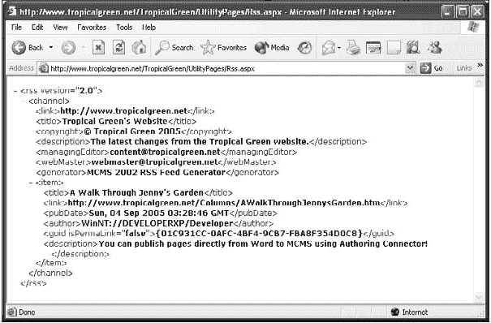

下图是我们将要构建的 RSS Aggregation 控制的作者界面。它允许用户输入要显示的 RSS feed 的 URL，并配置呈现模式视图的各个方面。

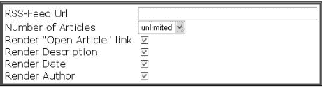

在呈现模式下，我们的 RSS Aggregation 控制将显示 RSS feed 中的每篇文章，并且根据配置显示 Open Article 链接、描述、日期和作者，如以下截图中所示：

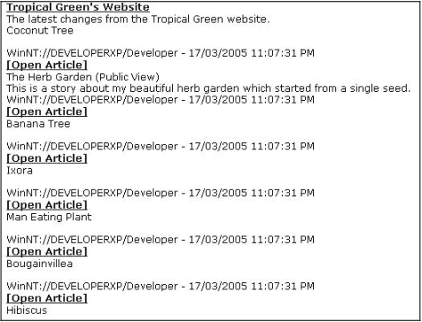

### RSS Feed 的结构

RSS feed 是一个符合特定规范的 XML 文档。我们将使用 RSS 版本 2.0，如 `http://blogs.law.harvard.edu/tech/rss` 中所述。以下表格概述了 RSS feed 包含的元素。

| Parent | Element | Description |
|---|---|---|
| *(this is the root element)* | `rss` | RSS feed 的顶层元素。 |
| `rss` | `channel` |  |
| `channel` | `link` | 网站的 URL。 |
| `channel` | `title` | RSS Feed 的标题，例如 Tropical Green。 |
| `channel` | `copyright` | 与 RSS feed 相关的版权信息。 |
| `channel` | `description` | RSS feed 的描述。 |
| `channel` | `managingEditor` | 负责内容的人员的电子邮件地址。 |
| `channel` | `webMaster` | Webmaster 的电子邮件地址。 |
| `channel` | `generator` | 用于生成 feed 的应用程序名称。 |
| `channel` | `item` | 每个要聚合的文章的重复元素。 |
| `item` | `title` | 文章的标题。在此我们使用 postings 的 `DisplayName` 属性。 |
| `item` | `link` | 文章的 HTML 版本的链接（或更多信息）。 |
| `item` | `pubDate` | 项目发布的日期。 |
| `item` | `author` | 项目的作者姓名或电子邮件地址。 |
| `item` | `guid` | 项目的全局唯一 ID。此元素完美映射到 MCMS，因为 postings 已有 GUID。 |
| `item` | `description` | 将包含在此项目中的内容。 |

请记住，由于 RSS feed 是 XML，所有元素名称区分大小写。下面是一个示例 feed：

```xml
<rss version="2.0">
  <channel>
    <link>http://localhost</link>
    <title>Tropical Green's website</title>
    <copyright>© Tropical Green 2005</copyright>
    <description>The latest changes from the Tropical Green website.</description>
    <managingEditor>content@tropicalgreen.net</managingEditor>
    <webMaster>webmaster@tropicalgreen.net</webMaster>
    <generator>MCMS 2002 RSS Feed Generator</generator>
    <item>
      <title>A Walk Through Jenny's Garden</title>
      <link>http://localhost/www.tropicalgreen.net/Columns/AWalkThroughJennysGarden.htm</link>
      <pubDate>Thu, 17 Mar 2005 13:07:31 GMT</pubDate>
      <author>WinNT://DEVELOPERXP/Developer</author>
      <guid isPermaLink="false">{01C931CC-0AFC-4BF4-9CB7-FBA8F354D0C8}</guid>
      <description>You can publish pages directly from Word to MCMS using Authoring Connector</description>
    </item>
  </channel>
</rss>
```

### 作为 RSS Feed 提供内容

我们将创建一个机制，允许用户将他们的 RSS aggregator 指向一个页面并检索在设定天数内已更新的 postings。RSS aggregator 是一种可以从一个或多个 RSS feed 检索项目并以可读形式显示项目的程序。

### 创建 RSS Feed

为本示例的目的，我们将在 Tropical Green 示例站点中创建一个新的 web form。

让我们直接进入代码：

- 1. 在 Visual Studio .NET 中启动 Tropical Green 解决方案。
- 2. 通过右键单击 TropicalGreen 项目并选择 Add | New Folder 创建一个新文件夹来存储我们的 RSS web form。命名新文件夹为 UtilityPages。
- 3. 通过右键单击 UtilityPages 并选择 Add | Add New Web Form 在 UtilityPages 文件夹中创建一个新的 web form。
- 4. 命名该项为 rss.aspx 并单击 Open。
- 5. 我们现在应该有一个空白的 web form 已创建并在 Design 视图中打开。

我们创建的 web form 将返回 XML 而不是 HTML，因此我们需要从 rss.aspx 文件中删除生成的元素，因为它们不会成为我们 RSS XML 文档的一部分。

- 1. 在屏幕左下角，单击 HTML 以切换到 HTML 模式。
- 2. 删除 Page 指令下方的所有内容：

```aspx
<%@ Page language="c#" Codebehind="rss.aspx.cs" AutoEventWireup="false" Inherits="TropicalGreen.UtilityPages.rss" %>
```

- 3. 由于许多不同的 aggregator 可以以自动方式访问你的 feed，feed 对整个站点性能的影响可能非常巨大。我们无法控制 aggregator 轮询 feed 查找变化的频率，因为该设置通常可以在 aggregator 本身进行配置。为了最大限度地减少对站点性能的影响，我们将为提供 feed 的 web form 实现输出缓存。在 Page 指令正下方添加以下指令，将输出缓存设置为 300 秒，即五分钟：

```aspx
<%@ OutputCache Duration="300" VaryByParam="none" %>
```

- 4. 切换到 web form 的代码视图，我们将开始添加生成 RSS feed 的代码。导入以下命名空间：

```csharp
using System;
using System.Collections;
using System.ComponentModel;
using System.Data;
using System.Drawing;
using System.Web;
using System.Web.SessionState;
using System.Web.UI;
using System.Web.UI.WebControls;
using System.Web.UI.HtmlControls;
using System.Configuration;
using Microsoft.ContentManagement.Publishing;
using Microsoft.ContentManagement.Publishing.Extensions.Placeholders;
using System.IO;
using System.Xml;
using System.Text;

namespace TropicalGreen.UtilityPages
{
    /// <summary>
    /// Summary description for rss.
    /// </summary>
    public class rss : System.Web.UI.Page
    {
        - - - code continues - - -
    }
}
```

让我们创建 GenerateRssXml() 方法，该方法以 RSS 格式的字符串形式返回我们 MCMS 网站的最新更新。首先我们设置临时内存流和 XmlTextWriter，以便创建发送给客户端的 XML 流：

```csharp
/// <summary>
/// Generate the RSS feed xml
/// </summary>
/// <returns>RSS XML</returns>
private string GenerateRssXml()
{
    // Create the Memory Stream
    MemoryStream _MemoryStream = new MemoryStream();

    // Create an XmlTextWriter to write to the memory stream
    XmlTextWriter XmlWriter = new XmlTextWriter(_MemoryStream, Encoding.UTF8);

    // Create the top element <rss>
    XmlWriter.WriteStartElement("rss");

    // Set the version attribute of the RSS Feed
    XmlWriter.WriteAttributeString("version", "2.0");

    // Create the Channel Element
    XmlWriter.WriteStartElement("channel");
```

RSS feed 的一般信息，如 link、title 和 copyright，将从 Web.config 文件中读取，我们稍后将创建这些 Web.config 条目。GenerateRssXml() 依赖于两个我们将很快开发的辅助方法 GetPostingSummary()，它将检索 postings 的摘要（要么是 HtmlPlaceholder 要么是 Description 属性），以及 GetAccountFriendlyName()，它旨在返回作者的全名。

```csharp
// Get the general info from the Web.config
string strFeed_Title = ConfigurationSettings.AppSettings.Get("RSS_Title");
string strWebsiteUrl = ConfigurationSettings.AppSettings.Get("RSS_WebsiteUrl");
string strFeed_Copyright = ConfigurationSettings.AppSettings.Get(
    "RSS_Copyright");
```


XmlWriter.WriteElementString("author", GetAccountFriendlyName(_Posting.LastModifiedBy.ClientAccountName));

// Set the GUID element to the posting's guid
// Also set the isPermaLink attribute to false.
XmlWriter.WriteStartElement("guid");
XmlWriter.WriteAttributeString("isPermaLink","false");
XmlWriter.WriteRaw(_Posting.Guid);
XmlWriter.WriteEndElement();

// Output the posting's summary as the description element
XmlWriter.WriteElementString("description", GetPostingSummary(_Posting));

// Close the </item> element
XmlWriter.WriteEndElement();
}

接下来，我们关闭 XML 元素，刷新 XmlWriter，并返回 XML 字符串。

```
// Close the <channel> element
XmlWriter.WriteEndElement();

// Close the <rss> element
XmlWriter.WriteEndElement();

// Flush the XmlWriter
XmlWriter.Flush();

// Reset the position of the memory stream
_MemoryStream.Position = 0;

// create a new stream reader and read the memory stream
StreamReader _StreamReader = new StreamReader(_MemoryStream);

// Return the contents of the stream reader
return (_StreamReader.ReadToEnd());
}
```

第一个辅助方法 GetPostingSummary() 必须检索将由 RSS feed 描述的 posting 的描述或内容。

GetPostingSummary() 使用一个名为 RSS_Summary_PlaceholderName 的配置变量，该变量将从 Web.config 文件中读取。RSS_Summary_PlaceholderName 可以存储将聚合到 RSS feed 的 description 元素中的占位符的名称。如果该值为空或未找到占位符，则将使用 posting 的 description 属性（Posting.Description）。

让我们将 GetPostingSummary() 方法添加到 rss 类中。

```
/// <summary>
/// Get the summary for a posting
/// </summary>
/// <param name=" Posting">Posting to get the summary for</param>
/// <returns></returns>
private string GetPostingSummary(Posting _Posting)
{
    string _Summary = "";

    // Get the Summary Placeholder's name from the Web.config
    string SummaryPlaceholderName =
```

```
/// <summary>
/// Overridden render method that calls the
/// GenerateRssXml method and writes it to the output stream.
/// </summary>
/// <param name="writer"></param>
protected override void Render( HtmlTextWriter writer)
{
    // change the page response to XML instead of HTML
    Response.ContentType = "text/xml; charset=utf-8";

    // Write the GenerateRssXml's response to the response stream.
    writer.Write(GenerateRssXml());
}
```

## 在 Web.config 中定义全局设置

为了提高灵活性，我们需要在 rss.aspx.cs 中方法使用的 Web.config 的 <appSettings> 元素中定义几个变量。Web.config 中指定的设置将应用于整个站点。

在 Web.config 的 <configuration> 元素内，添加 <appSettings> 元素和以下键：

```
<configuration>
  <appSettings>
    <add key="RSS_Summary_PlaceholderName" value="Summary" />
    <add key="RSS_Title" value="Tropical Green's Website" />
    <add key="RSS_WebsiteUrl" value="http://www.tropicalgreen.net" />
    <add key="RSS_Copyright" value="© Tropical Green 2005" />
    <add key="RSS_Description" value="The latest changes from the Tropical Green Website." />
    <add key="RSS_ManagingEditor" value="content@tropicalgreen.net" />
    <add key="RSS_WebMaster" value="webmaster@tropicalgreen.net" />
    <add key="RSS_StartChannel" value="/channels/www.tropicalgreen.net/" />
    <add key="RSS_NumberOfDaysOld" value="20" />
  </appSettings>
... code continues ...
```

为了获得更大的灵活性，这些配置数据可以存储在频道属性中，并且 RSS feed 可以由 posting 或频道渲染脚本而不是 Web 表单生成。

## 测试 RSS Feed

要测试 feed，我们可以直接在 Web 浏览器中加载页面并查看响应。为此，我们将把 rss.aspx 设置为起始页并在不调试的情况下启动。

- 1. 右键单击 rss.aspx，并选择设为起始页。
- 2. 从 Debug 菜单中，选择不调试启动。
- 3. 页面现在应该已加载，RSS 应该出现：

## MCMS 和 RSS

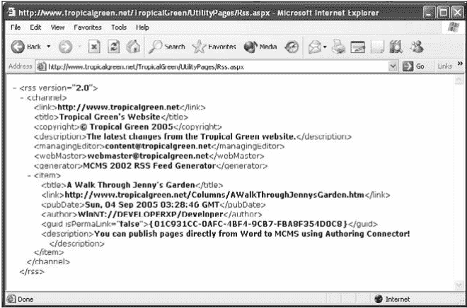

要包含在 RSS feed 中的 posting 必须在最近 20 天内创建或修改并发布，因为这是我们在 Web.config 中配置的时间范围。

## 在聚合器中测试 RSS Feed

如果你的计算机上有一个 RSS 聚合器，你可以通过将聚合器指向 `http://localhost/TropicalGreen/UtilityPages/rss.aspx` 来测试 RSS feed。下面是 feed 被 RSS Bandit（www.rssbandit.org）聚合的屏幕截图，它是免费 RSS 聚合器中最受欢迎的之一。

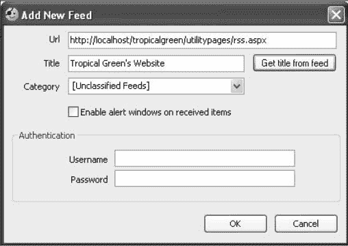

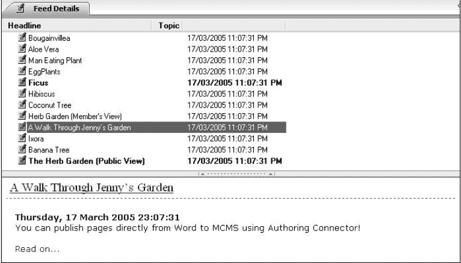

我们生成的 feed 是一个 RSS 2.0 兼容的 feed。如果您想将 feed 转换为另一种类型，例如 Podcast 兼容的 feed，您可以利用 FeedBurner（www.feedburner.com），它提供了这种转换功能。

## 将 RSS Feed 聚合到 MCMS

对于下一个示例，我们将创建一个占位符控件，允许用户输入 RSS feed 的 URL 并将内容聚合到 posting 中。

## 创建占位符控件

要创建 RSS 聚合占位符控件，我们将在 TropicalGreenControlLib 项目中创建一个新的占位符。

- 1. 在 Visual Studio .NET 中加载 Tropical Green 解决方案。
- 2. 右键单击 TropicalGreenControlLib 项目并选择添加 | 添加类。
- 3. 将新类命名为 RssReaderPlaceholderControl.cs 并单击确定。
- 4. 导入以下命名空间：

```
using System;
using System.Net;
using System.Text;
using System.Xml;
using System.Web;
using System.Web.UI;
using System.Web.UI.WebControls;
using Microsoft.ContentManagement.Publishing;
using Microsoft.ContentManagement.Publishing.Extensions.Placeholders;
using Microsoft.ContentManagement.WebControls.Design;
using Microsoft.ContentManagement.WebControls;
```

5. 由于占位符可以通过 Visual Studio .NET 工具箱添加到模板中，并且将绑定到 XmlPlaceholder，因此我们需要在类上添加一些属性。我们还需要继承 BasePlaceholderControl 类：

```
[ToolboxData("{0}:RssReaderPlaceholderControl runat=server></{0}:RssReaderPlaceholderControl>"), SupportedPlaceholderDefinitionType(typeof(XmlPlaceholderDefinition))]
public class RssReaderPlaceholderControl : BasePlaceholderControl
{ 
. . . code continues . . .
```

6. 现在我们必须声明占位符控件将使用的枚举器、变量和控件。在 RssReaderPlaceholderControl() 构造函数之后添加以下声明：

```
#region Declarations - Variables

enum enmState { none, Channel, Item };
private string RssUrl = "";
private int ItemsToDisplay = int.MaxValue;
private bool ShowOpenArticleLink = true;
private bool ShowDescription = true;
private bool ShowDate = true;
private bool ShowAuthor = true;

#endregion

#region Declarations - Controls
private LiteralControl basePresentationControl;
private System.Web.UI.WebControls.PlaceHolder baseAuthoringContainer;
private TextBox txtRSSUrl;
private DropDownList ddlItemsToDisplay;
private CheckBox chkShowOpenArticleLink;
private CheckBox chkShowDescription;
private CheckBox chkShowDate;
private CheckBox chkShowAuthor;

#endregion
```

7. 为了开发方便，我们将在类上创建 BoundXmlPlaceholder 属性。此属性将继承的 BoundPlaceholder 属性强制转换为 XmlPlaceholder：

```
#region Properties

/// <summary>
/// Returns the Strongly Typed
/// Bound XmlPlaceholder
/// </summary>
private XmlPlaceholder BoundXmlPlaceholder
{
    get
    {
        return (this.BoundPlaceholder as XmlPlaceholder);
    }
}

#endregion
```

8. 为了管理此占位符数据的存储和检索，我们将创建两个方法 LoadSettingsFromXml() 和 GetSettingsAsXml()：

```
#region Load/Set Settings

/// <summary>
/// Load the settings of the placeholder from an XmlString
/// </summary>
/// <param name="strXml"></param>
public void LoadSettingsFromXml(string strXml)
{
    // Create a new xml Document
    XmlDocument _doc = new XmlDocument();

    // Load the xml into the xml document
    _doc.LoadXml(strXml);

    // Set the variables from the XML
    this.RssUrl = _doc.SelectSingleNode("/Content/RssUrl").InnerText;
    this.ItemsToDisplay = System.Convert.ToInt32(
        _doc.SelectSingleNode("/Content/ItemsToDisplay").InnerText);
    this.ShowOpenArticleLink = Boolean.Parse(
        _doc.SelectSingleNode("/Content/ShowOpenArticleLink").InnerText);
    this.ShowDescription = Boolean.Parse(
        _doc.SelectSingleNode("/Content/ShowDescription").InnerText);
    this.ShowDate = Boolean.Parse(
        _doc.SelectSingleNode("/Content/ShowDate").InnerText);
    this.ShowAuthor = Boolean.Parse(
        _doc.SelectSingleNode("/Content/ShowAuthor").InnerText);
}
```

9. 要在 GetSettingsAsXml() 方法中创建 XML 字符串，我们将使用 StringBuilder 类来构建 XML 字符串。我们同样可以使用 XmlTextWriter 对象。

```
/// <summary>
/// Get the current set of settings as an Xml string
/// </summary>
/// <returns></returns>
public string GetSettingsAsXml()
{
    // Create a new string builder
    StringBuilder sb = new StringBuilder();

    // Create the Content XML string and populate elements
    sb.Append("<Content>");
    sb.Append("  <RssUrl>" + HttpUtility.HtmlEncode(this.txtRSSUrl.Text)
        + "</RssUrl>");
    sb.Append("<ItemsToDisplay>"
        + this.ddlItemsToDisplay.Items[ddlItemsToDisplay.SelectedIndex].Value
        + "</ItemsToDisplay>");
    sb.Append("<ShowOpenArticleLink>"
        + this.chkShowOpenArticleLink.Checked.ToString()
        + "</ShowOpenArticleLink>");
    sb.Append("<ShowDescription>"
        + this.chkShowDescription.Checked.ToString()
        + "</ShowDescription>");
    sb.Append("<ShowDate>" + this.chkShowDate.Checked.ToString()
        + "</ShowDate>");
    sb.Append("<ShowAuthor>" + this.chkShowAuthor.Checked.ToString()
        + "</ShowAuthor>");
    sb.Append("</Content>");
```


接下来，我们定义每一行并创建两个表格单元格。我们将标签和文本框 Web 控件添加到表格单元格中。对用户可指定的每个设置都重复此过程：

```
// 行：文本
tableCell = new TableCell();
tableCell.Width = 130;
tableRow.Cells.Add(tableCell);
LiteralControl ltCn = new LiteralControl();
ltCn.Text = "RSS-Feed Url";
tableCell.Controls.Add(ltCn);

tableCell = new TableCell();
tableCell.Width = 10;
tableRow.Cells.Add(tableCell);

// 行：URL 输入框
tableCell = new TableCell();
tableRow.Cells.Add(tableCell);
txtRSSUrl = new TextBox();
txtRSSUrl.ID = "RssUrl";
txtRSSUrl.Width = 300;
txtRSSUrl.TextMode = System.Web.UI.WebControls.TextBoxMode.SingleLine;
tableCell.Controls.Add(txtRSSUrl);

// 新行
tableRow = new TableRow();
TableHoldingTheControls.Rows.Add(tableRow);

// 行：文章数量
tableCell = new TableCell();
tableRow.Cells.Add(tableCell);
ltCn = new LiteralControl();
ltCn.Text = "Number of Articles";
tableCell.Controls.Add(ltCn);

tableCell = new TableCell();
tableCell.Width = 10;
tableRow.Cells.Add(tableCell);

// 计数输入框
tableCell = new TableCell();
tableRow.Cells.Add(tableCell);
ddlItemsToDisplay = new DropDownList();
ddlItemsToDisplay.EnableViewState = false;
ddlItemsToDisplay.ID = "Count";
ddlItemsToDisplay.Items.Add("5");
ddlItemsToDisplay.Items.Add("10");
ddlItemsToDisplay.Items.Add("15");
ddlItemsToDisplay.Items.Add("20");
ddlItemsToDisplay.Items.Add(new ListItem("unlimited", int.MaxValue.ToString()));

ddlItemsToDisplay.SelectedIndex = 4;
tableCell.Controls.Add(ddlItemsToDisplay);

// 新行
tableRow = new TableRow();
TableHoldingTheControls.Rows.Add(tableRow);

// 文本
tableCell = new TableCell();
tableRow.Cells.Add(tableCell);
ltCn = new LiteralControl();
ltCn.Text = "Render \"Open Article\" link";
```

```
// 文本
tableCell = new TableCell();
tableRow.Cells.Add(tableCell);
ltCn = new LiteralControl();
ltCn.Text = "Render Author";
tableCell.Controls.Add(ltCn);

tableCell = new TableCell();
tableCell.Width = 10;
tableRow.Cells.Add(tableCell);

// 日期和作者
tableCell = new TableCell();
tableRow.Cells.Add(tableCell);
chkShowAuthor = new CheckBox();
chkShowAuthor.EnableViewState = false;
chkShowAuthor.ID = "RenderAuthor";
chkShowAuthor.Checked = true;
tableCell.Controls.Add(chkShowAuthor);
```

然后我们添加一个名为 baseAuthoringContainer 的占位符，并将外层表格添加到其中。接着将 baseAuthoringContainer 添加到创作容器的控件集合中：

```
// 最后是创作容器
this.baseAuthoringContainer = new System.Web.UI.WebControls.PlaceHolder();
baseAuthoringContainer.Controls.Add(OuterTable);
baseAuthoringContainer.ID = "RssPhAuthoringControl";
authorContainer.Controls.Add(this.baseAuthoringContainer);
}
```

为了从 XmlPlaceholder 字符串中加载值，我们将创建一个名为 LoadSettingsFromXml() 的方法。XmlPlaceholder 的内容将被加载到 XmlDocument 中，然后我们之前定义的变量将被填充。

```
/// <summary>
/// 加载占位符的内容以用于
/// 创作模式
/// </summary>
/// <param name="e"></param>
protected override void LoadPlaceholderContentForAuthoring(PlaceholderControlEventArgs e)
{
    try
    {
        // 检查子控件是否创建成功
        EnsureChildControls();

        // 加载占位符控件的设置
        this.LoadSettingsFromXml(this.BoundXmlPlaceholder.XmlAsString);

        // 设置 Web 控件的值
        this.txtRSSUrl.Text = this.RssUrl;
        this.ddlItemsToDisplay.SelectedItem.Value = this.ItemsToDisplay.ToString();
        this.chkShowOpenArticleLink.Checked = this.ShowOpenArticleLink;
        this.chkShowDescription.Checked = this.ShowDescription;
        this.chkShowDate.Checked = this.ShowDate;
        this.chkShowAuthor.Checked = this.ShowAuthor;
    }
    catch(Exception ex)
    {
        // 处理任何异常
    }
}
```

现在我们将通过重写 SavePlaceholderContent() 方法将占位符内容保存回 MCMS。我们将使用 GetSettingsAsXml() 方法获取当前设置，并将其设置为 XmlPlaceholder 的 XmlAsString 属性：

```
/// <summary>
/// 将占位符内容保存回 MCMS
/// </summary>
/// <param name="e"></param>
protected override void SavePlaceholderContent(PlaceholderControlSaveEventArgs e)
{
    // 检查子控件是否创建成功
    EnsureChildControls();

    // 设置 Xml 占位符
    this.BoundXmlPlaceholder.XmlAsString = GetSettingsAsXml();
}
#endregion
```

## 检索并解析 RSS 源

现在让我们创建 LoadAndRenderRssFeed() 方法，该方法将通过 HTTP 请求检索 RSS 源并解析它。它还将根据已保存到 XmlPlaceholder 中的设置输出 RSS 源中的条目。

> 在本示例中，我们没有编写代理服务器交互的代码，但如果你有代理服务器，应将地址（以及必要时所需的凭据）存储在 Web.config 中。

```
#region 检索并解析 RSS 源

/// <summary>
/// 通过 WebRequest 加载 RSS 源
/// 然后解析输入并返回字符串
/// </summary>
public string LoadAndRenderRssFeed()
{
```

首先，我们将从 XML 占位符中加载设置：

```
// 从 Xml 中加载设置
this.LoadSettingsFromXml(this.BoundXmlPlaceholder.XmlAsString);

enmState CurrentState = enmState.none;
string Title = "";
string Link = "";
string Author = "";
string PubDate = "";
string Descript = "";

// 声明并实例化将用于
// 写入 HTML 的字符串构建器。
StringBuilder sb = new StringBuilder();
```

接下来，我们使用 WebRequest 类发出一个 Web 请求。如果需要指定代理，请取消注释代理代码并将 proxyserver 替换为你的代理名称。

```
// 创建一个指向 XmlPlaceholder 中
// <RssUrl> 元素所指定 URL 的新 WebRequest
```

```
HttpWebRequest request = (HttpWebRequest)WebRequest.Create(RssUrl);

// 如果你有代理，请取消注释
// WebProxy proxy = null;
// proxy = new WebProxy("http://proxyserver:port");
// request.Proxy = proxy;

// 从 Web 请求获取响应
HttpWebResponse response = (HttpWebResponse)request.GetResponse();
```

然后，响应被加载到 XmlTextReader 中。我们读取 XmlTextReader 的内容，并为源中的不同文章生成 HTML，例如作者姓名：

```
// 将流加载到 XmlTextReader 中
XmlTextReader rsReader = new XmlTextReader(response.GetResponseStream());

int actItem = 0;

// 循环遍历读取器
while (!rsReader.EOF)
{
```

一个源可以提供许多文章。我们需要添加一个检查，以确保只显示配置数量的文章：

```
// 我们要显示多少条？
if (actItem >= this.ItemsToDisplay)
    break;
```

现在让我们遍历当前源条目的所有 XML 标签，并收集当前条目的所有数据。由于不同的源使用不同的标准（如 RSS 1.0、2.0 或 Atom），我们要查找的内容可能编码在不同的标签中：

```
// RSS 源中当前元素是什么
switch (rsReader.Name.ToLower())
{
```

feed 或 channel 元素包含了当前 RSS 源的信息：

```
case "feed":
case "channel":
{
    CurrentState = ennState.Channel;
    rsReader.Read();
    break;
}
case "title":
{
    if (rsReader.NodeType == XmlNodeType.Element)
        Title = HttpUtility.HtmlDecode(rsReader.ReadInnerXml());
    else
        rsReader.Read();
    break;
}
case "link":
{
    if (rsReader.NodeType == XmlNodeType.Element)
    {
        string Link1 = rsReader.GetAttribute("href");
        string Link2 = rsReader.ReadInnerXml();
        if (Link1 != null)
            Link = Link1;
        else
            Link = Link2;
    }
```


## 在演示模式下呈现 RSS Feed

我们现在将创建用于呈现 RSS Feed 的界面。在未发布模式下，RssReader 占位符控件将显示“Feed will be shown in published mode”，并且当占位符在已发布模式下查看时，LoadAndRenderRssFeed() 将被执行以检索 feed 并将其输出绑定到 basePresentationControl。

首先我们重写 CreatePresentationChildControls() 来创建演示子控件：

```csharp
#region Presentation

/// <summary>
/// Create the Presentation Controls
/// </summary>
/// <param name="presentationContainer"></param>
protected override void CreatePresentationChildControls(
    BaseModeContainer presentationContainer)
{
    // Instantiate a literal control and
    // set the base presentation control
    this.basePresentationControl = new LiteralControl();

    // Set the ID of the base presentation control
    this.basePresentationControl.ID = "PresentationControl";
    // Add the base presentation control to
    // the presentation container
    presentationContainer.Controls.Add(this.basePresentationControl);
}
```

```csharp
// Date?
if (this.ShowDate)
{
    // Append the Date
    sb.Append(PubDate);
}

sb.Append("</div>\n");

// Are we showing the Open Article Link?
if (this.ShowOpenArticleLink)
{
    sb.Append(" <div>");
    sb.Append("<a target=\"_blank\" href=\"" + Link
        + "\">[Open Article]</a>");
    sb.Append("</div>\n");
}

sb.Append("</div>\n");
rsReader.Read();
break;
}
default:
{
    rsReader.Read();
    break;
}
}
}

// return the string builder contents
return(sb.ToString());
}

#endregion
```

要加载 RSS feed 并使用占位符控件输出项目，我们将重写 LoadPlaceholderContentForPresentation() 方法。feed 在“Presentation Unpublished”模式下不会被呈现，以提高作者效率。

为了最小化对 feed 提供者的影响，我们将为占位符控件实现内容缓存。这意味着即使在配置的时间范围内有多个用户请求包含 RssReaderPlaceholderControl 的帖子，也只有一个 Web 请求会命中 feed 站点。这最大限度地减少了 feed 站点以及托管此占位符控件的网站的流量和处理开销。

缓存持续时间目前硬编码为五分钟。如果您需要更灵活，可以将缓存持续时间存储在 Web.config 中，或在作者模式中添加一个文本框来捕获缓存持续时间并将其保存为 XmlPlaceholder 的附加配置值。

```csharp
/// <summary>
/// Load and parse the RSS feed. Output the feed
/// items to the basePresentationControl
/// </summary>
/// <param name="e"></param>
protected override void
LoadPlaceholderContentForPresentation(PlaceholderControlEventArgs e)
{
    // Verify the child controls have been created
    EnsureChildControls();

    try
    {
        // Check the current mode
        if (WebAuthorContext.Current.Mode ==
            WebAuthorContextMode.PresentationUnpublished)
        {
            this.basePresentationControl.Text =
                "Feed will be shown in published mode";
        }
        else
        {
            // Load the settings from the XML
            this.LoadSettingsFromXml(this.BoundXmlPlaceholder.XmlAsString);

            // Get the current Cache object from HttpContext
            System.Web.Caching.Cache cache = HttpContext.Current.Cache;

            // we will vary the cache entry by the content of the
            // current placeholder object. This will ensure that different
            // feeds can be served from the same website
            string CacheKey = this.BoundXmlPlaceholder.XmlAsString;

            // check if content is already in Cache
            string cacheXml = cache["RssReader." + CacheKey] as string;
            if (cacheXml == null)
            {
```

## 对 RSS Feed 生成器的增强

- 作者姓名—该解决方案可以通过与 Active Directory 集成来检索作者的完整姓名，从而得到增强。
- 基于频道的 feed 生成—将频道属性设置为配置参数以供 feed 使用，并从帖子或频道渲染脚本生成它。
- 存储历史记录—组织可能需要保留其网站上所有历史内容的副本。RSS feed 目前每 5 分钟可能发生变化一次（当缓存过期时）。为了使 RSS feed 充当出现在页面修订历史记录中的内容，可以在保存时发出对 feed 的请求，并将生成的 HTML 保存到 HtmlPlaceholder 中。然后可以编写一个自动更新工具，在计划的时间，例如每 60 分钟，更新聚合的 feed。

## 对 RSS 聚合占位符控件的增强

- 设计—RSS 聚合控件仅具有基础的外观和感觉，可以通过向 div 元素添加 class 属性来轻松增强，以应用页面 CSS 样式表中定义的样式。

## 总结

我们现在已为 Tropical Green 网站提供了通过 RSS 同步和聚合内容的能力。内容作者将能够指定要在特定帖子上聚合和显示的 RSS feed。最终用户现在有机会订阅我们 MCMS 网站上的 RSS feed，以便在内容发生变化时自动收到通知，而无需浏览网站。此外，MCMS 网站现在可以从互联网上的其他服务器聚合 RSS feed 的内容并显示其自身网站的部分内容。

在 Current Version 标题下方，我们将添加包含指向帖子工作版本的超链接的表格。切换到设计视图。从菜单栏中选择 Table | Insert | Table... 并插入一个包含一行两列的表格。在左侧列的表格单元格中，添加单词 Name。将 HyperLink 控件（来自工具箱的 Web Forms 部分）拖放到右侧单元格中。为 HyperLink 指定 ID aName（请注意，我们已在前面加上字母 'a'），并将其 Text 属性设置为空字符串。

接下来，将 DataGrid 拖动到 Available Revisions 标题下方。DataGrid 将列出帖子的所有修订。将 DataGrid 的 ID 设置为 dgPageRevisionsList，并将 AutoGenerateColumns 属性设置为 false。切换到 HTML 视图并向网格添加四列。第一列显示该特定版本的帖子名称，第二列显示修订日期，第三列是链接到预览页面的超链接，第四列是触发页面还原过程的按钮。

```xml
<asp:DataGrid ID="dgPageRevisionsList" Runat="server"
AutoGenerateColumns="False">
<Columns>
<asp:BoundColumn DataField="Name" HeaderText="Name"></asp:BoundColumn>
<asp:BoundColumn DataField="RevisionDate" HeaderText="Revision Date">
</asp:BoundColumn>
<asp:HyperLinkColumn Text="Preview" Target="CMSPageRevertPreviewWindow" DataNavigateUrlField="Url">
</asp:HyperLinkColumn>
<asp:ButtonColumn Text="Revert" CommandName="RevertTo">
</asp:ButtonColumn>
</Columns>
</asp:DataGrid>
```

切换到设计视图。将两个 CheckBox 控件拖动到 DataGrid 上方。将第一个 CheckBox 的 ID 设置为 chkRevertContent，其 Text 属性设置为 Revert Placeholder Content。第二个 CheckBox 的 ID 为 chkRevertCustomProperties，Text 值为 Revert Custom Property Values。将两个 CheckBox 的 Checked 属性都设置为 true。

拖动一个 Label 控件并将其放置在 DataGrid 下方。将 Label 的 ID 设置为 lblMessage，其 Text 属性设置为空字符串。我们将在此处显示来自应用程序的消息（例如错误）。

您应该看到以下内容：


revision dates. 我们希望以降序显示列表，最新的修订排在最前，因此将布尔值设为 false。

获取并排序修订集合后，我们将其绑定到 DataGrid，dgPageRevisionsList。所有这些操作都在 GetListOfRevisions() 方法中完成，该方法添加在 Page_Load() 事件处理程序的正下方。

```
public void GetListOfRevisions()
{
    // Get a list of all revisions of the current posting
    PostingCollection pc = currentPostingVersion.Revisions(true, false);

    // Sort the revisions by descending order of the revision date
    pc.SortByRevisionDate(false);

    // Bind the collection to datagrid
    dgPageRevisionsList.DataSource = pc;
    dgPageRevisionsList.DataBind();
}
```

> 除非定期清除修订历史，否则每个帖子都可能累积大量修订。要清除修订历史，请在站点管理器中选择 工具 | 清除修订历史... 选项。

## 编程触发页面还原过程的按钮

DataGrid 上的 Revert 按钮触发页面还原过程。网格中列出的每个修订都有一个 Revert 按钮。作者将点击他们希望将帖子回滚到的版本的按钮。还原过程的工作方式如下：

- 首先，作者点击所选修订旁边的 Revert 按钮。
- 当点击 Revert 按钮时，dgPageRevisionsList_ItemCommand() 事件处理程序将被调用。在事件处理程序内部，我们将从修订集合中检索所选修订并调用几个关键过程：
  - CopyPostingContent() 方法，将所选修订中的所有占位符内容复制到工作版本
  - CopyCustomProperties() 方法，将所选修订中的所有自定义属性值复制到工作版本
- 最后，我们刷新父窗口以显示具有最近还原内容的帖子。

## 访问 DataGrid 的 ItemCommand() 事件处理程序

让我们开始通过编辑 ItemCommand() 事件处理程序来使用 DataGrid 的标准 ASP.NET 行为。

当点击 Revert 按钮时，dgPageRevisionsList DataGrid 的 ItemCommand() 事件处理程序将被触发。这就是我们将添加执行页面还原过程的代码的地方。要访问此事件处理程序，请以设计视图打开 PageRevert.aspx。在 dgPageRevisionsList DataGrid 对象的属性窗口中，单击事件按钮（它是带有黄色

`CopyPostingContent()` 方法将帖子的旧版本内容复制到当前工作版本。信息从一个占位符传输到另一个占位符，按名称匹配。我们保证能找到匹配的占位符对，因为占位符定义不是版本化的。这意味着工作副本和修订中的占位符集合将是相同的。例如，如果占位符定义被重命名，则当前工作版本和所有先前的修订都将共享重命名的占位符定义。

> 我们的一位模板设计师不小心删除了一个占位符定义。我们的所有内容都丢失了！我们能做什么？

由于占位符定义不是版本化的，如果模板设计师删除了占位符定义，当前帖子和其修订的内容都将丢失。

您可以通过重新创建相同名称和类型的占位符定义来恢复内容。尽管如此，始终最好谨慎行事，小心删除任何内容。

一旦找到匹配项，我们就会将占位符内容从上一个版本复制到当前版本。在此代码示例中，我们将使用 `Placeholder.DataSource.RawContent` 来复制内容。这会绕过占位符对象的内部处理，通常不建议用于检索占位符内容。在这种情况下，我们对内容本身不感兴趣，只希望在不检查的情况下将其复制到另一个占位符，`Placeholder.DataSource.RawContent` 可以安全使用。

在 `PageRevert.aspx.cs` 文件中，将 `CopyPostingContent()` 方法直接添加到 `dgPageRevisionsList_ItemCommand()` 事件处理程序下方。

```
public void CopyPostingContent(Posting source, Posting destination)
{
    // Copy all placeholder contents from the source to the destination
    foreach (Placeholder sourcePH in source.Placeholders)
    {
        Placeholder destinationPH = destination.Placeholders[sourcePH.Name];

        // We don't worry about how the placeholder internally modifies content
        // before it gets displayed. Even if it is encrypted or whatever—we just
        // copy the content as-is from the previous version without modification.
        destinationPH.DataSource.RawContent = sourcePH.DataSource.RawContent;
    }
}
```

## 复制自定义属性值

接下来，我们处理自定义属性值。自定义属性与占位符内容一样，由 MCMS 进行版本控制。这意味着要还原其值，我们所需要做的就是将旧版本中存储的值复制到工作版本。

`CopyPostingCustomProperties()` 方法遍历源中的每个自定义属性，并将其值设置在目标帖子的对应自定义属性中。将 `CopyCustomProperties()` 直接添加到 `CopyPostingContent()` 方法下方。

```
public void CopyPostingCustomProperties(Posting source, Posting destination)
{
    string errorMessage = "";

    // Copy all custom property values from the source to the destination.
    foreach(CustomProperty customProp in source.CustomProperties)
    {
        if(destination.CustomProperties[customProp.Name] != null)
        {
            try
            {
                destination.CustomProperties[customProp.Name].Value =
                    customProp.Value;
            }
            catch
            {
                errorMessage += "Failed to copy custom property value for Custom"
                    + "Property:" + customProp.Name + "<br>";
            }
        }

        // Throw a summary of all failed items
        if (errorMessage != "")
        {
            throw(new Exception(errorMessage));
        }
    }
}
```

try-catch 块围绕设置自定义属性值的语句。这会捕获复制过程中可能发生的任何异常。由于自定义属性定义不是版本化的，可能会出现异常。例如，模板设计师可能向选择类型自定义属性定义中添加了新值。尝试保存不在当前列表中的值将生成异常。

页面还原对话框现已完成。

## 向 Web Author 控制台添加新操作

让我们在 Web Author 控制台上放置一个按钮，以便作者访问我们刚刚构建的页面还原对话框。当用户点击该按钮时，对话框将作为新窗口打开。

向项目添加一个名为 PageRevertButton.cs 的类文件。如果您使用的是来自本书配套网站的下载的 Tropical Green 项目，请将文件添加到 ConsoleButtons 文件夹。否则，只需将其添加到项目中的适当位置即可。

添加以下命名空间：

```
using System;
using Microsoft.ContentManagement.Publishing;
using Microsoft.ContentManagement.WebControls.ConsoleControls;

namespace TropicalGreen.ConsoleButtons
{
    - - - code continues - - -
}
```

为了方便作者，页面还原对话框将作为新窗口打开。因此，我们的控制台操作将继承自 BaseNewWindowAction 类。

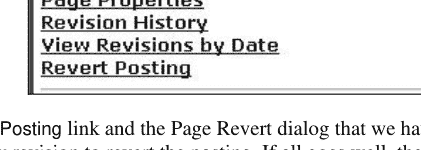

点击 Revert Posting 链接，我们创建的页面还原对话框就会打开。选择任何修订上的 Revert 按钮即可还原帖子。如果一切顺利，屏幕上会出现以下消息：Page Revert Succeeded。它必须在更改生效前得到批准，并且父窗口中的帖子会刷新以显示最新更新。关闭对话框。继续批准帖子以发布更改。

> 而不是自动还原所有占位符内容，您可以增强对话框，为作者提供选择希望回滚哪些占位符的选项。

## 提示 #2：如何更改帖子的模板

使用 MCMS 原生创建帖子的方法是首先选择模板，填写帖子的占位符内容并发布它。如果作者错误地选择了错误的模板会怎样？一些模板可能看起来非常相似，作者可能不知道模板一开始就不是正确的，仍然会发布它。

或者需求可能已经改变。为了最大限度地减少对当前站点的干扰，与当前模板并存的新模板已被构建。是时候重新启动站点了，需要大量帖子切换到新模板。如何以作者或开发人员付出最少努力的方式完成这项工作？

根据文档，您会发现帖子对象的 Template 属性是只读字段。一旦帖子被创建，模板与帖子之间的链接就是不可变的；没有简单的方法让帖子使用另一个模板。

为了规避这一限制，我们可以选择：

- 继续使用当前模板，但覆盖现有的占位符定义、自定义属性定义或模板文件值。

修改现有模板是最简单的解决方案，只要可能就应考虑。然而，在作者选择了错误模板的情况下，您确实需要让帖子指向另一个模板。这也意味着对模板的任何更改都会立即在服务器上看到——如果您在生产机器上更新模板，这不是一个好情况。在这种情况下，修改现有模板可能不是最好的主意。


在设计视图中，将以下控件拖放到表单上并按下方图所示排列。

| Control | Property | Property Value |
|---|---|---|
| Label | ID | lblPostingDisplayName |
|  | Text | (empty string) |
| Label | ID | lblTemplatePath |
|  | Text | (empty string) |
| TextBox | ID | txtTemplatePath |
| Button | ID | btnGetPlaceholderDefinitions |
|  | Text | Get Placeholders |
| Button | ID | btnSwitch |
|  | Text | Switch |
|  | Visible | false |
| Placeholder | ID | phPlaceholderDefinitions |
| Label | ID | lblMessage |
|  | Text | (empty string) |

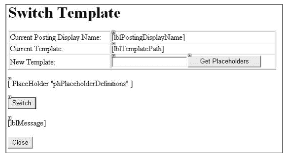

双击表单上的任意位置以打开其代码隐藏文件。在类的命名空间声明上方添加解决方案所需的三个命名空间。

```csharp
- - - code continues - - -
using Microsoft.ContentManagement.WebControls;
using Microsoft.ContentManagement.Publishing;
using Microsoft.ContentManagement.Publishing.Extensions.Placeholders;
namespace TropicalGreen.Dialogs
{
  - - - code continues - - -
}
```

Page_Load() 事件处理程序将用于显示一些基本信息：

- 当前发布的显示名称
- 其所基于的模板的路径

此外，我们检查是否处于更新模式，这是必需的，因为我们将创建和删除发布。我们应该已经处于正确的模式，因为对话框将由自定义按钮（我们稍后将构建）从 Web Author 控制台触发，该按钮会将必要的信息传递给它。如果我们不在更新模式下，则会切换到该模式。

```csharp
private CmsHttpContext cmsContext;
private Posting currentPosting;

private void Page_Load(object sender, System.EventArgs e)
{
    // Get the current CmsHttpContext
    cmsContext = CmsHttpContext.Current;

    // Get the current posting
    currentPosting = cmsContext.Posting;

    // Display the current posting's display name
    lblPostingDisplayName.Text = currentPosting.DisplayName;
    // Display the path of the current template
    lblTemplatePath.Text = currentPosting.Template.Path;

    // Check to see if we are in update mode. If we are not, switch.
    if(cmsContext.Mode!=PublishingMode.Update)
    {
        Response.Redirect(Request.ServerVariables["URL"] + "?"
                          + currentPosting.QueryStringModeUpdate);
    }

    // Initialize the controls
    lblMessage.Text = "";
    btnSwitch.Visible = false;
}
```

作者指定要切换到的模板后，他或她单击 Get Placeholders 按钮。首先，我们获取指定的模板。如果模板存在并且对作者可见，我们通过调用 DisplayListOfPHDefinitions() 方法（稍后定义）从源模板和目标模板获取定义列表。一旦我们获得了目标模板和占位符定义列表，我们就会显示 Switch 按钮。交换过程中发生的任何错误都会被捕获并在屏幕上显示错误消息。切换到设计视图并双击 Get Placeholders 按钮以创建 btnGetPlaceholderDefinitions_Click() 事件处理程序。

```csharp
private void btnGetPlaceholderDefinitions_Click(object sender,
System.EventArgs e)
{
    try
    {
        // Get the template specified by the Author
        Template newTemplate =
            cmsContext.Searches.GetByPath(txtTemplatePath.Text.Trim())
                                      as Template;

        // Get a list of placeholder definitions
        DisplayListOfPHDefinitions(currentPosting.Template, newTemplate);

        // Display the Switch Button
        btnSwitch.Visible = true;
    }
    catch(Exception ex)
    {
        // Uh-oh. We've hit an error.
        lblMessage.Text = "Failed to get placeholder definitions. " + ex.Message;
    }
}
```

DisplayListOfPHDefinitions() 方法以表格形式列出源模板和目标模板的占位符定义。源模板的占位符定义列在右侧。左侧我们有一个下拉列表，其中包含目标模板的所有占位符定义。作者可以从下拉列表中选择映射到源占位符定义的<|message|> 目标占位符定义。如果作者决定不复制该特定内容，他或她可以选择最后一个选项 None。填充完成后，表格将添加到 phPlaceholderDefinitions 控件中。以下是生成的表格可能的样子示例：

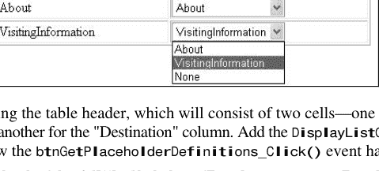

让我们开始生成表格标题，它将由两个单元格组成——一个代表“Source”列，另一个代表“Destination”列。将 DisplayListOfPHDefinitions() 方法直接添加到 btnGetPlaceholderDefinitions_Click() 事件处理程序下方。

```csharp
private void DisplayListOfPHDefinitions(Template source, Template destination)
{
    Table table = new Table();
    table.Attributes.Add("border","1");

    // Add the table headers
    TableRow header = new TableRow();
    table.Rows.Add(header);

    // Define the header
    TableHeaderCell th1 = new TableHeaderCell();
    th1.Text = "Source";
    header.Cells.Add(th1);

    TableHeaderCell th2 = new TableHeaderCell();
    th2.Text = "Destination";
    header.Cells.Add(th2);
}
```

接下来，我们将遍历源模板上的所有占位符定义并为每个定义创建一个表格行。

```csharp
private void DisplayListOfPHDefinitions(Template source, Template destination)
{
    . . . code continues . . .
    // Iterate through all placeholder definitions on the source template
    foreach(PlaceholderDefinition sourceDef in source.PlaceholderDefinitions)
    {
        // Add a new row
        TableRow tr = new TableRow();
        table.Rows.Add(tr);
    }
}
```

每个表格行将由两列组成。在第一列中，我们将显示源占位符的名称。

```csharp
private void DisplayListOfPHDefinitions(Template source, Template destination)
{
    - - - code continues - - -

    // Iterate through all placeholder definitions on the source template
    foreach(PlaceholderDefinition sourceDef in source.PlaceholderDefinitions)
    {
        - - - code continues - - -

        // Display the name of the source placeholder definition
        TableCell td1 = new TableCell();
        td1.Text = sourceDef.Name;
        tr.Cells.Add(td1);
    }
}
```

在每一行的第二列中，我们将提供一个下拉菜单。作者将从此列表中的项目中选择目标占位符。

```csharp
private void DisplayListOfPHDefinitions(Template source, Template destination)
{
    - - - code continues - - -

    // Iterate through all placeholder definitions on the source template
    foreach(PlaceholderDefinition sourceDef in source.PlaceholderDefinitions)
    {
        - - - code continues - - -

        // Generate a DropDownList of destination placeholder definitions
        DropDownList ddl = new DropDownList();
        ddl.ID = "ddl" + sourceDef.Name;

        // Add the dropdown list to a table cell
        TableCell td2 = new TableCell();
        td2.Controls.Add(ddl);
        tr.Cells.Add(td2);
    }
}
```

下拉菜单将列出新模板中所有占位符的名称。此外，它只会在占位符定义与源模板定义相同时才显示该占位符。在不兼容的占位符类型之间移动内容（例如从 HtmlPlaceholder 到 ImagePlaceholder）是没有意义的。

我们还将在下拉菜单中添加一个值为“None”的选项。作者可以通过从列表中选择此选项来决定不移动所选源占位符的内容。

```csharp
private void DisplayListOfPHDefinitions(Template source, Template destination)
{
    - - - code continues - - -

    // Iterate through all placeholder definitions on the source template
    foreach(PlaceholderDefinition sourceDef in source.PlaceholderDefinitions)
```


```csharp
{ . . . code continues . . . 
// Generate a DropDownList of destination placeholder definitions
DropDownList ddl = new DropDownList();
ddl.ID = "ddl" + sourceDef.Name;
foreach (PlaceholderDefinition destDef in destination.PlaceholderDefinitions)
{
    // Only show the placeholder if placeholder definition is of identical type
    if (destDef.GetType() == sourceDef.GetType())
    {
        ListItem li = new ListItem();
        li.Text = destDef.Name;

        // We have a match!
        if (li.Text == sourceDef.Name)
        {
            li.Selected = true;
        }
        ddl.Items.Add(li);
    }
}

// Add an option "None"
ListItem liNone = new ListItem();
liNone.Text = "None";
liNone.Value = "";
ddl.Items.Add(liNone);

// Add the dropdownlist to a table cell
TableCell td2 = new TableCell();
td2.Controls.Add(ddl);
tr.Cells.Add(td2);
}
```

最后，我们将生成的表格添加到对话框中。

```csharp
private void DisplayListOfPHDefinitions(Template source, Template destination)
{ . . . code continues . . . 
    // Add the table to the dialog
    phPlaceholderDefinitions.Controls.Add(table);
}
```

模板的交换发生在作者点击 Switch 按钮时。切换到 Design 视图并双击 Switch 按钮以获取 `btnSwitch_Click()` 事件处理程序。帖子模板的切换是通过调用稍后定义的 `SwitchTemplate()` 方法来完成的。

```csharp
private void btnSwitch_Click(object sender, System.EventArgs e)
{ try
    {
        // Get the template specified by the Author
        Template newTemplate = cmsContext.Searches.GetByPath(txtTemplatePath.Text) as Template;

        // We've got the Template object, now let's perform the switch!
        if (newTemplate != null)
        {
            SwitchTemplate(currentPosting, newTemplate);
        }
    }
}
```

```csharp
// It's the same as that of the existing posting
Channel currentChannel = p.Parent;

// Create a new posting based on the new template
if (currentChannel.CanCreatePostings)
{
    Posting newPosting = currentChannel.CreatePosting(t);

    // Get the name of the posting
    string postingName = p.Name;

    // Copy all properties that can be set, except for the name
    newPosting.DisplayName = p.DisplayName;
    newPosting.Description = p.Description;
    newPosting.ExpiryDate = p.ExpiryDate;
    newPosting.StartDate = p.StartDate;
    newPosting.IsHiddenModePublished = p.IsHiddenModePublished;
    newPosting.IsImportant = p.IsImportant;
    newPosting.IsRobotFollowable = p.IsRobotFollowable;
    newPosting.IsRobotIndexable = p.IsRobotIndexable;
    newPosting.SortOrdinal = p.SortOrdinal;

    // Copy all custom property values.
    CopyPostingCustomProperties(p, newPosting);

    // Copy all placeholder values
    CopyPostingContent(p, newPosting);

    // Commit all changes
    cmsContext.CommitAll();

    // Delete the existing posting
    if (p.CanDelete)
    {
        p.Delete();
        cmsContext.CommitAll();
    }

    // Set the posting's name
    newPosting.Name = postingName;
    cmsContext.CommitAll();

    // Display the posting that we have just created on the parent window
    // Close the dialog
    string script = "";
    string url = "";
    url = WebAuthorContext.Current.GetUrlForMode(newPosting, WebAuthorContextMode.PresentationUnpublished);
    script += "<script language=\"javascript\">";
    script += "window.opener.location.href=\"" + url + "\";";
    script += "window.close();";
    script += "</script>";
    if (!Page.IsClientScriptBlockRegistered("RedirectToNewPosting"))
    {
        Page.RegisterClientScriptBlock("RedirectToNewPosting", script);
    }
}
```

> 在实际实现中，作者会希望脚本额外检查新模板和当前模板的占位符和自定义属性定义。如果新模板缺少某些定义，则应在执行切换前警告作者。此外，新模板上的逻辑可能要求某些自定义属性为必填且不能为空。否则，你将接到愤怒作者的电话，询问为什么应用程序删除了珍贵的内容，或为什么切换后帖子停止正确显示。

在 *Tip #1: How to Revert a Posting to a Previous Version* 中，我们编写了一个 `CopyPostingContent()` 方法，用于将内容从源帖子复制到目标帖子。在本例中，我们的源是模板要更改的原始帖子；目标是基于新模板的新帖子。代码大致相同，只是这次目标占位符是作者从下拉列表中挑选出来的。将 `CopyPostingContent()` 方法直接添加到 `SwitchTemplate()` 方法下方。

```csharp
public void CopyPostingContent(Posting source, Posting destination)
{
    // Copy all placeholder content from the old version and create a new
    // version with that content
    foreach (Placeholder sourcePH in source.Placeholders)
    {
        // Look for the value in the corresponding DropDownList in the dialog
        string destinationPHName = Request.Form["ddl" + sourcePH.Name];

        // do not copy placeholder if the user chose "None"
        if (destinationPHName != "")
        {
            Placeholder destinationPH = destination.Placeholders[destinationPHName];

            // we do not bother about how the placeholder internally modifies the
            // content before it gets displayed. Even if it is encrypted or
            // whatever -- we just copy the content from the previous version as is
            if (destinationPH != null)
            {
                destinationPH.Datasource.RawContent = sourcePH.Datasource.RawContent;
            }
        }
    }
}
```

`CopyPostingCustomProperties()` 方法与我们在 *Tip #1: How to Revert a Posting to a Previous Version* 中之前编写的完全相同。将它直接添加到 `CopyPostingContent()` 方法下方。

```csharp
public void CopyPostingCustomProperties(Posting source, Posting destination)
{
    // Copy all custom property values from the source to the destination.
    foreach (CustomProperty customProp in source.CustomProperties)
    {
        if (destination.CustomProperties[customProp.Name] != null)
        {
            try
            {
                destination.CustomProperties[customProp.Name].Value =
                    customProp.Value;
            }
            catch
            {
                throw (new Exception("Failed to copy custom property value for "
                                    + "Custom Property: " + customProp.Name));
            }
        }
    }
}
```

对话框已完成。接下来，我们将在 Web Author Console 中添加一个 Change Template 按钮，以在新窗口中打开此对话框。

## 向 Web Author Console 添加 Change Template 按钮

向 Web Author Console 添加新按钮已在 *Tip #1: How to Revert a Posting to a Previous Version* 中详细说明。让我们为更改帖子模板创建一个类似的按钮。

向你的 Web 项目添加一个名为 `SwitchTemplateButton.cs` 的类文件（如果你正在使用 Tropical Green 项目，请将其添加到 `ConsoleButtons` 文件夹）。

在命名空间声明上方，添加所需的命名空间。

```csharp
using System;

using Microsoft.ContentManagement.Publishing;
using Microsoft.ContentManagement.WebControls.ConsoleControls;

namespace TropicalGreen.ConsoleButtons
{
    . . . code continues . . .
}
```

由于对话框以新窗口打开，按钮将继承自 `BaseNewWindowAction` 类。

```csharp
public class SwitchTemplateButton : BaseNewWindowAction
{
}
```

在 `SwitchTemplateButton()` 构造函数中，将按钮的标签设置为 Switch Template。

```csharp
public SwitchTemplateButton()
{
    // Set the text of the button
    this.Text = "Switch Template";
}
```

接下来，我们将在重写的 `UrlNewWindow` 属性中设置 Switch Template 对话框的 URL。在我们的示例中，对话框的 URL 为 `/Dialogs/ChangeTemplate.aspx`。你需要根据 ChangeTemplate.aspx 文件在网站中的位置调整此值。将 `UrlNewWindow` 属性附加到代码中。

```csharp
public override string UrlNewWindow
{
    get
    {
        // Set the URL of the new window
        return Page.Request.ApplicationPath + "/Dialogs/ChangeTemplate.aspx?"
             + CmsHttpContext.Current.Posting.QueryStringModelUpdate;
    }
}
```


该按钮仅在作者有权在当前频道中创建新发布，且发布未连接时才应可用。在 UrlNewWindow 属性的正下方添加重写的 Available 属性。

```
public override bool Available
{
    get
    {
        Channel currentChannel = CmsHttpContext.Current.Channel;
        Posting currentPosting = CmsHttpContext.Current.Posting;

        if (currentPosting != null)
        {
            return (currentChannel.CanCreatePostings && currentPosting.CanDelete && !currentPosting.IsConnected);
        }
        else
        {
            return false;
        }
    }
}
```

> 在此示例中，我们假设发布不会在连接的模板之间切换。在连接的模板之间切换是一个直接的任务：只需基于你想要切换到的连接模板创建一个新的连接发布，然后删除原始发布即可。

最后，我们将重写 ActionJavascript 属性，以提供在新窗口中打开对话框的客户端脚本。在 Available 属性的下方添加 ActionJavascript 属性。

```
public override string ActionJavascript
{
    get
    {
        if (this.Available)
        {
            return "WBC_openWindowOnFocus('" + this.UrlNewWindow + "', '" + "WBC_winChangePosting", " + " WBC_UseDefaultSizing(window.top))";
        }
        else
        {
            return "";
        }
    }
}
```

控制台按钮已完成。保存并编译项目。

在将按钮添加到控制台之前，我们需要确保页面顶部存在注册项目文件库（在我们的情况下，将是 tropicalgreen）的指令。否则，请添加它：

```
<%@ Register TagPrefix="TropicalGreenConsole" Namespace="TropicalGreen.ConsoleButtons" Assembly="tropicalgreen" %>
```

将名为 DeleteWithRecycle.cs 的类文件添加到 MCMS 项目中。如果你正在使用下载的 Tropical Green 项目，请将该文件添加到 ConsoleButtons 文件夹中。

该类需要使用以下命名空间中的对象：

```
using System;
using System.Web;
using Microsoft.ContentManagement.Publishing;
using Microsoft.ContentManagement.WebControls.ConsoleControls;

namespace TropicalGreen.Console.Buttons
{
    - - - code continues - - -
}
```

我们将利用默认 Delete 操作中的一些可用功能，例如 Confirm Delete 对话框。为了节省重新创建这些功能的精力，我们的类将继承自 DeleteAction 类：

```
public class DeleteWithRecycle : DeleteAction
{
    - - - code continues - - -
}
```

在 DeleteWithRecycle() 构造函数中，我们首先获取当前的 CmsHttpContext。我们将在整个类中使用该上下文。接下来，我们获取充当回收站的频道的实例。在我们的示例中，回收站直接位于根频道下方。你可能需要根据决定放置频道的位置对路径进行调整。

我们在构造函数中执行最后一个任务——即设置操作按钮的 Text 属性。为了将其与常规 Delete 操作区分开来，我们在其旁边添加了单词（Recycle）。

```
Channel recycleBin;
CmsHttpContext cmsContext;

public DeleteWithRecycle()
{
    // Get the current CmsHttpContext
    cmsContext = CmsHttpContext.Current;

    // Get a reference to the recycle bin
    recycleBin = cmsContext.Searches.GetByPath("/Channels/RecycleBin/")
        as Channel;

    // Set the Text property of the action button to be "Delete (Recycle)".
    this.Text = "Delete (Recycle)";
}
```

操作按钮仅当用户有权删除当前发布时才对其可用。我们还会检查他/她是否能够查看并向回收站添加内容。否则，Delete (Recycle) 按钮将被隐藏。

```
public override bool Available
{
    get
    {
        bool isAvailable = false;

        // Button is available only if:
        // 1. The user has the rights to delete the posting
        // 2. The user has the rights to move the posting to the Recycle bin
        Posting currentPosting = cmsContext.Posting;
```

```
if (currentPosting != null && recycleBin != null)
{
    if (currentPosting.CanDelete && recycleBin.CanCreatePostings)
    {
        isAvailable = true;
    }
    return isAvailable;
}
```

大部分操作发生在重写的 PerformActionBehavior() 方法中。当用户单击 Delete (Recycle) 按钮时，他/她会收到提示：“删除此页面将将其从系统中永久移除。是否继续？”用户的答案存储在发布上名为 __CMS_ConfirmedDelete 的隐藏表单字段中（此字段以双下划线开头）。选择确定会将 __CMS_ConfirmedDelete 设置为 true，取消则将其设置为 false（默认值）。为了确定用户是否决定继续，我们检查此隐藏表单字段的值。

```
protected override void PerformActionBehavior()
{
    string confirmDelete =
        Page.Request.Form["__CMS_ConfirmedDelete"].ToString();
    if (confirmDelete == "true")
    {
        // User has confirmed the delete
    }
}
```

一旦用户确认删除，我们继续获取要删除的发布的实例。然后，我们获取其父频道的 URL，并在发布被删除后将用户重定向到该 URL。

```
protected override void PerformActionBehavior()
{
    string confirmDelete =
        Page.Request.Form["__CMS_ConfirmedDelete"].ToString();
    if(confirmDelete=="true")
    {
        // User has confirmed the delete

        // Get the current posting
        Posting p = cmsContext.Posting;

        // Get the URL of the posting's parent
        string returnURL = p.Parent.Url;

        // TODO: Enter code for performing the delete operation

        // Redirect the user to the Channel's URL
        HttpContext.Current.Response.Redirect(returnURL);
    }
}
```

“删除”该发布是一个四步流程。我们并不是删除它，而是：

+   1. 将发布的原始过期日期和父频道的 GUID 作为其描述中 XML 字符串的一部分进行存储。
+   2. 使发布过期。
+   3. 将其移动到 RecycleBin 频道。
+   4. 提交更改。

发布的过期日期和父频道的 GUID 将作为其描述中 XML 字符串的一部分存储。我们将使用频道的 GUID 而不是其路径，这样即使父频道已移动，也可以恢复该发布。如果我们决定恢复已删除的发布，这些信息以后将非常有用。XML 字符串的格式为：

```
<DeletedItem>
<ExpiryDate>1 Jan 3000 12:00:00 AM</ExpiryDate>
<ChannelGuid>{7AF93078-5FF8-4963-A9F9-B1A0977258A7}</ChannelGuid>
</DeletedItem>
```

描述中是否包含其他值并不重要。我们只需将整个 XML 追加到描述的末尾。描述字段最多可容纳 500 个字符。我们将假设此限制永远不会达到。

> 如果担心达到 Description 属性的 500 字符限制，请考虑将额外信息存储在发布的自定义属性中（这要求每个模板都定义了自定义属性，但字符限制更高）或外部数据库中。或者，你可以将内容存储在 XMLPlaceholder 中，并使用 PAPI 将定义添加到模板中（如果尚不存在的话）。

我们将整个操作包装在 try-catch 块中。如果在“删除”该发布时发生任何错误，我们将回滚所有更改，错误消息将自动显示在错误控制台上。

```
protected override void PerformActionBehavior()
{
string confirmDelete =
    Page.Request.Form["__CMS_ConfirmedDelete"].ToString();
if(confirmDelete=="true")
{
// User has confirmed the delete

// Get the current posting
Posting p = cmsContext.Posting;

// Get the URL of the posting's parent
string returnURL = p.Parent.Url;

try
{
// 1. Copy the expiry date and posting's path to its description
// in the following format:
// <DeletedItem>
// <ExpiryDate></ExpiryDate>
// <ChannelGuid></ChannelGuid>
// </DeletedItem>
string deletedInfo = "<DeletedItem>";
deletedInfo += "<ExpiryDate>";
deletedInfo += p.ExpiryDate.ToString("dd MMM yyyy hh:mm:ss tt");
deletedInfo += "</ExpiryDate>";
deletedInfo += "<ChannelGuid>";
deletedInfo += p.Parent.Guid;
deletedInfo += "</ChannelGuid>";
deletedInfo += "</DeletedItem>";
```


## 回收站对话框

回收站对话框列出了所有已删除的帖子。这是一个相对简单的窗体，由一个DataGrid和几个标签控件组成。

向项目添加一个名为RestorePosting.aspx的新Web窗体（如果你在Tropical Green项目中工作，请将其添加到Dialogs文件夹）。将页面布局设置为FlowLayout。

在HTML视图中打开窗体，添加一个显示“回收站”的一级标题和一个关闭对话框的按钮。

```
<form id="RestorePosting" method="post" runat="server">
<h1>Recycle Bin</h1>
<input type="button" value="Close" onclick="window.close();">
</form>
```

切换到设计视图。将以下控件拖放到窗体上，并按如下图所示排列。

| 控件 | 属性 | 属性值 |
|---|---|---|
| DataGrid | ID | dgDeletedItems |
|  | AutoGenerateColumns | False |
| Label | ID | lblMessage |
|  | Text | （空字符串） |
| Button | ID | btnEmpty |
|  | Text | 清空回收站 |

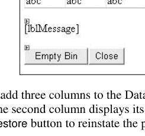

切换回HTML视图，并向DataGrid添加三列。第一列包含已删除帖子的GUID。第二列显示其名称，并超链接到其URL。最后一列提供“还原”按钮以恢复该帖子。

```
<form id="RestorePosting" method="post" runat="server">
<h1>Recycle Bin</h1>
<asp:datagrid id="dgDeletedItems" Runat="server" AutoGenerateColumns="False">
```

## 从回收站中永久删除项目

可以理解，随着时间推移，发送到回收站的项目数量会增加。有些网站甚至可能在一周内收到数千个帖子被发送到回收站。当已删除项目数量庞大时，显示列表可能会变得异常缓慢，以致无法在合理的时间范围内渲染页面。在发生这种情况之前，让我们对“清空回收站”按钮进行编程，清除回收站中的所有项目。

切换到设计视图，双击“清空回收站”按钮，进入btnEmpty_Click()事件处理程序。我们将获取回收站中的所有帖子并逐一删除。

```
private void btnEmpty_Click(object sender, System.EventArgs e)
{
    // Empty the items in the bin permanently
    foreach(Posting deletedItem in bin.Postings)
    {
        deletedItem.Delete();
        cmsContext.CommitAll();
    }
    dgDeletedItems.DataSource = bin.Postings;
    dgDeletedItems.DataBind();
}
```

对话框已完成！

## 将回收站按钮添加到Web Author控制台

我们已经构建了显示回收站内容的对话框。现在让我们在Web Author控制台中添加一个“回收站”按钮来打开它。

向项目添加一个名为RecycleBin.cs的新类文件（如果你使用Tropical Green项目，请将其添加到ConsoleButtons文件夹）。

该对话框会在新窗口中打开，因此RecycleBin类将继承自BaseNewWindow类。基本上，它与此前技巧（技巧#1和#2）中的控制台操作非常相似。以下代码展示了完整实现。不同之处在于：

- 它带有“回收站”标签。
- 它打开回收站对话框，在本示例中该对话框位于 /Dialogs/RestorePosting.aspx。您可能需要根据Web窗体在站点中的位置调整此值。
- 仅当用户有权访问回收站频道时才可用。

以下是完整代码：

```
using System;
using Microsoft.ContentManagement.Publishing;
using Microsoft.ContentManagement.WebControls.ConsoleControls;

namespace TropicalGreen.ConsoleButtons
{
    public class RecycleBin: BaseNewWindowAction
    {
        private Channel bin;
        public RecycleBin()
```

```csharp
{
    // Get the bin
    bin = CmsHttpContext.Current.Searches.GetByPath("/Channels/RecycleBin/")
        as Channel;

    // Set the text of the button
    this.Text = "Recycle Bin";
}

protected override void PerformActionBehavior()
{
    base.GenerateStartupScriptActionJavascript();
}

public override bool Available
{
    get
    {
        if (bin != null)
        {
            return true;
        }
        else
        {
            return false;
        }
    }
}

public override string ActionJavascript
{
    get
    {
        if (this.Available)
        {
            return "WBC_openWindowOnFocus('" + this.UrlNewWindow + "', '" 
                + "WBC_winRecycleBin", "+ "WBC_UseDefaultSizing(window.top)";
        }
        else
        {
            return "";
        }
    }
}

protected override void OnInit(System.EventArgs e)
{
    base.OnInit(e);

    this.UrlNewWindow = Page.Request.ApplicationPath
        + "/Dialogs/RestorePosting.aspx?"
        + bin.QueryStringModeUpdate;
}
}
```

> 将回收站的路径（或其GUID——如果这样做，请修改代码以使用Searches.GetByGuid()检索）作为键存储在项目web.config文件的<appSettings>标记中。这样，您无需重新编译代码即可轻松更改其路径。

按照技巧#1中“向Web Author控制台添加按钮”的方法，将按钮添加到控制台。

确保页面顶部有用于注册项目文件库（在我们的示例中为tropicalgreen）的指令。否则，请添加以下内容：

```
<%@ Register TagPrefix="TropicalGreenConsole" Namespace="TropicalGreen.ConsoleButtons" Assembly="tropicalgreen" %>
```

按钮的合适位置是“审批助理”按钮下方。因此，在闭合的</CmsConsole:ResourceManagerAction>标记之后，添加以下代码：

```
<TropicalGreenConsole:RecycleBin id="RecycleBin1" runat="server">
<a id=RecycleBinAnchor onclick="<%# Container.ActionJavascript %>;return false" href="#" target="_self">
<%# Container.Text %>
</a>
<br>
</TropicalGreenConsole:RecycleBin>
```

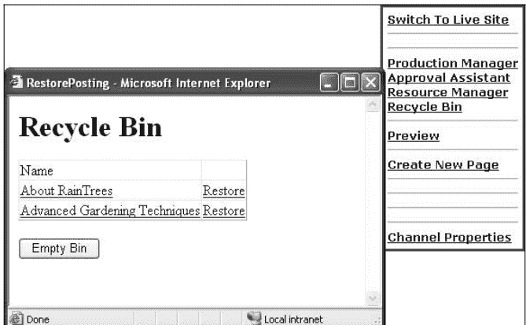

添加“回收站”按钮后，单击它。它会显示回收站中存储的所有帖子列表，包括我们之前删除的项目。单击任一帖子的“还原”按钮，观察它们被移动到其来源频道。如果你检查已还原帖子的属性，会发现它不再过期，描述也已清理，不再包含<DeletedItem></DeletedItem>标记。

## 技巧#4：如何处理对已删除资源的链接

在典型组织中，不同团队负责同一网站的不同方面。可能有一组人员负责发布文章和故事（作者、编辑和版主），另一组人员负责图形、图片和整体设计（资源管理器和模板设计人员）。不可避免地，在某个环节中，总有人会从资源库中删除资源。如果该资源被生产站点上的帖子所使用，就会产生许多问题。

之前，我们构建了一个回收站来存储已删除的帖子，这些帖子以后可以恢复。为什么不针对资源构建类似的解决方案呢？与帖子和频道一样，在Web Author的资源管理器对话框中删除的资源会从系统中永久移除。然而，与帖子不同，目前没有直接的方法来防止任何人删除资源。也没有可以捕获的事件处理程序。PAPI未提供在资源库之间移动资源的任何方式。因此，无法为资源构建回收站。为防止意外删除，您最多只能完全删除对话框中的“删除资源”按钮；这是一种激烈的解决方式。

我们的一位资源经理意外删除了一项资源。我们知道该资源仍在系统中的某处，因为我们的管理员可以从帖子中查看它。我们无法重新上传该资源，因为那意味着创建一个具有新GUID和URL的新资源。从备份中检索内容也不可能。我们该如何恢复它？

一旦被删除，资源通常无法恢复。Microsoft现在提供了一个可行选项：如果您需要恢复尚未被后台进程清除出系统的已删除资源，可以打开一个支持案例（参考编号：SOX040517700117）以获取存储过程。该存储过程会将这些已删除资源恢复到站点管理器中的“已删除项目”回收站。然后管理员可以将它们移回到适当的资源库。

## 当帖子使用的资源被删除时会发生什么

首先，图像会显示为损坏。指向附件的链接将导致HTTP 404页面未找到或HTTP 401需要身份验证错误。这还不是全部！作者将无法保存包含指向已删除资源链接的页面。当他们尝试这样做时，会出现以下错误：

保存占位符失败
--------------------------------
错误详细信息：
当前用户没有编辑所请求项目的权限。如果在执行MCMS模板时看到此异常，说明您已将CmsAuthorizationModule从web.config的HttpModules部分中移除。只有在以下情况下才能移除此模块：1. 对Web应用程序中每个MCMS模板的所有请求将只会


## 必备操作、提示和技巧

- 使用 `WebAuthorContext.SavePostingEvent()` 事件在每个模板文件中注册清理已删除资源链接的方法。但是，这样做意味着需要在解决方案中的所有模板文件上重复代码。
- 在 `global.asax` 文件的 `CmsPosting_PlaceholderPropertyChanging()` 事件处理程序中添加清理死链所需的逻辑。

虽然这两种方案都可行，但让我们选择将清理代码放在 `global.asax` 文件的 `CmsPosting_PlaceholderPropertyChanging()` 事件处理程序中。这样可以确保只要占位符内容发生变化，就会触发清理过程。可以保证在资源被删除后保存的页面上不会存在指向已删除资源的链接。

首先，让我们注册 `CmsPosting_PlaceholderPropertyChanging()` 事件处理程序。

1. 打开 `global.asax` 文件的代码隐藏文件（`global.asax.cs`）。
2. 添加以下命名空间：

```csharp
using Microsoft.ContentManagement.Publishing;
using Microsoft.ContentManagement.Publishing.Events;
using Microsoft.ContentManagement.Publishing.Extensions.Placeholders;
```

3. 在 `Global()` 构造函数下方，添加 `CmsPosting_PlaceholderPropertyChanging()` 事件处理程序：

```csharp
protected void CmsPosting_PlaceholderPropertyChanging( Object sender,
    PropertyChangingEventArgs e )
{
}
```

资源通常链接在三个可能的位置。它们可能被用于：

- 作为图像的 `ImagePlaceholder`。资源链接存储在 `Src` 属性值中。
- 作为附件的 `AttachmentPlaceholder`。资源链接存储在 `Url` 属性值中。
- 作为图像或附件的 `HtmlPlaceholder`。它们混合在从 `Html` 属性值检索到的内容中。

> 资源链接也可以在 XmlPlaceholders 中找到。根据您特定的 XML 架构，也请考虑在解决方案中处理它们。

以下代码依次处理这些情况。将代码添加到 `global.asax.cs` 文件中的 `CmsPosting_PlaceholderPropertyChanging()` 事件处理程序内。

```csharp
public void CmsPosting_PlaceholderPropertyChanging( Object sender,
    PropertyChangingEventArgs e )
{
    string propName = e.PropertyName;
    string propValue = e.PropertyValue as string;
    switch (propName)
    {
        case "Src": // handle ImagePlaceholder
        case "Url": // handle AttachmentPlaceholder
        {
            propValue = HandleImgAndAttPlaceholderTypes( propValue );
            break;
        }
        case "Html": // handle HtmlPlaceholder
        {
            propValue = HandleImageTags( propValue );
            propValue = HandleAnchorTags( propValue );
            break;
        }
    }
    e.PropertyValue = propValue;
}
```

```csharp
private bool IsResourceDeleted(string link)
{
    // Extract Resource GUID from URL
    string[] split = link.Split('/');
    string GUID = split[3];

    // Create new context with admin rights to be able to see deleted items
    CmsApplicationContext appContext = new CmsApplicationContext();
    appContext.AuthenticateAsUser("WinNT://server/cmsAdmin",
                                 "cmsAdminPassword",
                                 PublishingMode.Unpublished);

    Resource r = appContext.Searches.GetByGuid("{"+GUID+"}") as Resource;

    // Check to see if it belongs to the Archive Folder
    bool isDeleted = false;
    if (r != null)
    {
        // Resource has been deleted
        isDeleted = r.Path.StartsWith("/Archive Folder");
    }
    else
    {
        // Unable to retrieve resource.
        // Possibly because the resource was deleted using Site Manager
        isDeleted = true;
    }

    // Dispose admin context
    appContext.Dispose();
    appContext = null;

    // Return result
    return isDeleted;
}
```

现在我们知道如何识别指向已删除资源的链接，我们可以删除它们！让我们先从 ImagePlaceholders 和 AttachmentPlaceholders 中的链接开始。

> 在上面的示例中，我们为了简单起见，将管理员的用户 ID 和密码硬编码到代码中。最好将其存储在 web.config 文件中并对密码进行加密。或者，将用户 ID 和密码存储在另一个文件夹中的文件中，并使用 Windows 安全措施对其进行保护。

### 从 ImagePlaceholders 和 AttachmentPlaceholders 中删除链接

从 ImagePlaceholders 和 AttachmentPlaceholders 中删除链接相对简单。我们首先检查 ImagePlaceholder.Src 和 AttachmentPlaceholder.Url 属性的值，看看它们是否包含指向已删除资源的链接，通过运行它们的值通过 IsResourceDeleted() 方法。如果链接确实指向已删除的资源，我们将 ImagePlaceholder.Src 和 AttachmentPlaceholder.Url 值设置为空字符串。

下面的 HandleImgAndAttPlaceholderTypes() 方法展示了如何操作。指向内部资源的链接始终以 /nr/rdonlyres/ 开头，因此我们只需要考虑以它开头的链接。将以下代码直接添加到 IsResourceDeleted() 方法下方。

```csharp
private string HandleImgAndAttPlaceholderTypes(string propValue)
{
    if (propValue.ToLower().StartsWith("/nr/rdonlyres"))
    {
        if (IsResourceDeleted(propValue))
        {
            propValue = "";
        }
    }
    return propValue;
}
```

### 从 HtmlPlaceholders 中删除链接

由于 HtmlPlaceholders 包含附件和图像混合在一堆 HTML 标签中，因此从中删除死链稍微复杂一些。

#### 处理图像

让我们先处理图像。图像通过图像标签 `` 链接到 HTML 文件。图像标签通常包含多个属性，如 src、border、alt 等。以下是 `` 标签的示例：

```html

```

获取整个标签的一个好方法是搜索起始 `。我们检查它是否链接到 MCMS 资源。如果是，我们将其通过之前定义的 **IsResourceDeleted()** 方法运行。显示已删除资源库项目的图像会通过删除整个 `` 标签来删除。

HandleImageTags() 方法执行此工作。将 HandleImageTags() 直接添加到 HandleImgAndAttPlaceholderTypes() 方法下方。

```csharp
private string HandleImageTags(string propValue)
{
    // Look for  tags within the content
    int start = propValue.ToLower().IndexOf(" tag.
    while (start >= 0)
    {
        // Get the closing angle bracket of the tag
        int end = propValue.IndexOf(">", start);
        if (end > start)
        {
            // Get the entire  tag
            string tag = propValue.Substring(start,end-start+1);

            // Get the link to the resource gallery item
            int linkStart = tag.ToLower().IndexOf("\"/nr/rdonlyres");
            if (linkStart >= 0)
            {
                int linkEnd = tag.IndexOf("\"", linkStart+1);
                if (linkEnd > linkStart)
                {
                    string linkStr = tag.Substring(linkStart, linkEnd-linkStart+1);

                    // Check to see if the link points to the deleted resource
                    if (IsResourceDeleted(linkStr))
                    {
                        // Resource has been deleted. Remove the tag entirely
                        propValue = propValue.Replace(tag,"");
                        tag = "";
                    }
                }
            }
        }
        // Look for more  tags
        start = propValue.ToLower().IndexOf(" 和 </a>。以下是 HTML 中锚标签的示例：

```html
<a href="/NR/rdonlyres/8C78AC41-591D-4626-AFC8-19AC8375914E/0/myresource.gif">
    My Resource
</a>
```

要增加复杂性，锚标签可能是嵌套的。

我们将像之前一样开始，通过查找起始 <a> 和结束 </a> 标签。一旦我们得到整个锚元素，我们检查它是否包含指向 MCMS 资源的链接。如果包含，我们使用 IsResourceDeleted() 方法确定资源是否已被删除。

执行此操作的代码是 HandleAnchorTags() 方法。将它直接添加到 HandleImageTags() 方法下方。如果附件指向已删除的资源，我们会使用稍后描述的 RemoveTagPair() 方法删除 <a></a> 标签对，但保留它们之间的内容不变。

```csharp
private string HandleAnchorTags(string propValue)
{
    // Get the index of the starting <a tag
    int start = propValue.ToLower().IndexOf("<a ");
    while (start >= 0)
    {
        // Get the closing angle bracket of the opening <a> tag
        int end = propValue.IndexOf(">",start);
        if (end > start)
        {
            string tag = propValue.Substring(start, end-start+1);
            int linkStart = tag.ToLower().IndexOf("\"/nr/rdonlyres");
            if (linkStart >= 0)
            {
                int linkEnd = tag.IndexOf("\"", linkStart+1);
                if (linkEnd > linkStart)
                {
                    string linkStr = tag.Substring(linkStart, linkEnd-linkStart+1);
                    if (IsResourceDeleted(linkStr))
                    {
                        propValue = RemoveTagPair(propValue, tag, "</a>", "<a");
                        tag = "";
                    }
                }
            }
            start = propValue.ToLower().IndexOf("<a ", start+tag.Length);
        }
    }
    return propValue;
}
```


RemoveTagPair() 方法会移除 `<a></a>` 标签，但保留标签之间的文本。例如，如果链接是：`<a href="/NR/rdonlyres/8C78AC41-591D-4626-AFC8-19AC8375914E/0/myresource.gif">My Resource </a>`，那么对这段文本运行 RemoveTagPair() 方法后，只会留下字符串 My Resource。

```csharp
private static string RemoveTagPair(string text, string tag, string endtag, string recursecompare)
{
    // Get the first occurrence of the <a> tag within the content
    int start = text.ToLower().IndexOf(tag.ToLower());

    // Initialize the end point to -1
    int end = -1;

    while (start >= 0)
    {
        // Find the end point
        end = FindTag(text, endtag, start, recursecompare);

        // Got the end point. Remove the end tag, </a>
        if (end > start)
        {
            text = text.Remove(end, endtag.Length);
        }

        // Remove the start tag <a>
        text = text.Remove(start, tag.Length);

        // Continue the search for <a></a> tags
        start = text.ToLower().IndexOf(tag.ToLower());
    }
    return text;
}
```

FindTag() 方法用于处理嵌套的锚点标签。我们可能会遇到一个锚点标签嵌套在另一个锚点标签中的情况，如下所示：

`<a href="/NR/rdonlyres/8C78AC41-591D-4626-AFC8-19AC8375914E/0/myresource.gif">My Resources @ <a href="http://www.mywebsite.com">MyWebSite</a>. Check it out now!</a>`

虽然嵌套锚点标签并不是良好的编程实践，但这种情况仍有可能发生，尤其是在作者使用内置的所见即所得编辑器，而没有机会查看 HTML 代码效果的时候。

FindTag() 通过检查是否存在多个 `<a></a>` 标签对来处理嵌套标签。如果存在，它会继续搜索，直到找到与第一个 `<a>` 标签匹配的最终结束标签 `</a>`。请将 FindTag() 方法直接添加到 RemoveTagPair() 方法下方。

```csharp
private static int FindTag(string text, string tag, int start, string recursecompare)
{
    // Get the position of the next </a> tag
    int pos = text.ToLower().IndexOf(tag.ToLower(), start);

    // Check to see if there are nested hyperlinks
    int check = text.ToLower().IndexOf(recursecompare.ToLower(), start+1);

    // Found a nested <a></a> tag
    if ((check >= 0) & (check < pos))
    {
        // Keep searching until we find the </a> tag that matches
        // the first <a> tag
        check = FindTag(text, tag, check, recursecompare);
        pos = text.ToLower().IndexOf(tag.ToLower(), check+1);
    }
    return pos;
}
```

代码已经完成。保存并编译解决方案。下次当你尝试保存一个包含指向已删除资源链接的页面时，该链接会被立即移除。试试吧！

下面的截图展示了页面在保存前后的作者视图，该页面包含指向一个已删除资源的链接。在这个例子中，被删除的资源是香蕉树的图片 BananaTree.jpg。超链接和图片都引用了它。

在保存页面之前，已删除的资源项仍然显示在屏幕上：

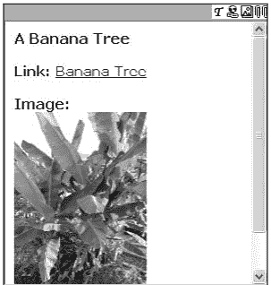

保存页面之后，超链接被移除，只留下了文本。图片也被删除：

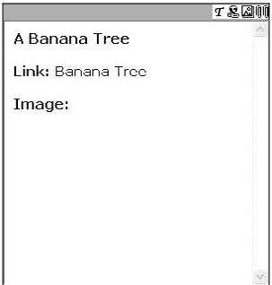

- HtmlPlaceholder 的 Html 属性
- ImagePlaceholder 的 Src 属性
- AttachmentPlaceholder 的 Url 属性
- XmlPlaceholder 的 XmlAsString 属性

> 如果你构建了自己自定义的占位符定义对，也需要搜索这些内容。

一旦我们获取了每个占位符的内容，就会用正则表达式将其与字符串 `/NR/rdonlyres/` 进行匹配。如果找到匹配项，则意味着占位符中包含指向资源库中某个资源或本地附件的链接。

为了区分这两者，我们使用 `Searches.GetByGuid()` 方法检索 URL 中存储的 GUID 所引用的对象。如果它不是资源库中的项目，则返回 null 值。否则，我们获取链接指向的资源，并将其路径记录到日志文件中。请将 `ScanPlaceholders()` 方法直接添加到 `WalkTree()` 方法下方。

```csharp
private static void ScanPlaceholders(Posting p, string filePath, CmsApplicationContext cmsContext)
{
    foreach(Placeholder ph in p.Placeholders)
    {
        string html = "";
        if (ph is HtmlPlaceholder)
        {
            html = ((HtmlPlaceholder)ph).Html;
        }
        else if (ph is ImagePlaceholder)
        {
            html = ((ImagePlaceholder)ph).Src;
        }
        else if (ph is AttachmentPlaceholder)
        {
            html = ((AttachmentPlaceholder)ph).Url;
        }
        else if (ph is XmlPlaceholder)
        {
            html = ((XmlPlaceholder)ph).XmlAsString;
        }

        // Find links to resources
        string pattern = @"/NR/rdonlyres/\S+";
        MatchCollection matches;
        matches = Regex.Matches(html, pattern, RegexOptions.IgnoreCase);
        if (matches.Count > 0)
        {
            foreach(Match match in matches)
            {
                //file is either a resource or a local attachment
                string[] arrUrl = match.Value.Split('/');
                string guid = "";
                Resource r;
                if(arrUrl.Length >= 3)
                {
                    guid = "{" + arrUrl[3] + "}";
                    if (IsGuid(guid))
                    {
                        r = cmsContext.Searches.GetByGuid(guid) as Resource;
                        if (r!=null)
                        {
                            WriteToLog(r.Path + "," + p.Path + "," + ph.Name, filePath);
                        }
                    }
                }
            }
        }
    }
}
```

我们使用辅助函数 `IsGuid()` 来测试从 URL 中获取的字符串，判断其是否为有效的 GUID。请将 `IsGuid()` 方法直接添加到 `ScanPlaceholders()` 方法下方。

```csharp
private static bool IsGuid(string guid)
{
    try
    {
        string guidRegEx = "[a-fA-F0-9]{8}-[a-fA-F0-9]{4}-[a-fA-F0-9]{4}-" +
            "[a-fA-F0-9]{4}-[a-fA-F0-9]{12}";
        Regex regex = new Regex(guidRegEx);
        Match m = regex.Match(guid);
        if (m.Success)
        {
            return(true);
        }
        else
        {
            return(false);
        }
    }
    catch
    {
        return (false);
    }
}
```

最后，辅助函数 `WriteToLog()` 会将包含资源信息的一行文本追加到日志文件中。请将其直接添加到 `IsGuid()` 方法下方。

```csharp
private static void WriteToLog(string message, string filePath)
{
    FileStream fs = File.Open(filePath, FileMode.Append);
    StreamWriter sw = new StreamWriter(fs);
    sw.WriteLine(message);

    sw.Flush();
    sw.Close();
    fs.Close();
}
```

代码已经完成。编译解决方案。

> 该解决方案用于查找资源。你可以编写类似的脚本来记录指向频道和帖子的所有链接，示例可见：
> 
> http://www.gotdotnet.com/Community/UserSamples/Details.aspx?SampleGuid=9804F9C9-54D3-4735-9967-41CF1FD88740
> 
> 资源管理者提出的问题，作者和编辑在考虑删除或移动频道和帖子时通常也会提出同样的问题。

## 生成报告

让我们运行脚本，看看生成的报告是什么样子。按 Visual Studio .NET 工具栏上的 F5 键来运行脚本。文件会创建在 FindResources 项目的 `/bin/Debug` 文件夹中。由于这是一个逗号分隔值文件（*.csv），双击它会启动 Microsoft Excel。

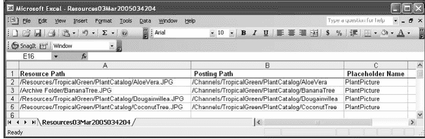

要获取使用了某个特定资源的帖子，只需点击“资源路径”（Resource Path）列，然后从菜单栏中选择“数据 | 排序”（Data | Sort），即可按资源路径对电子表格进行排序。数据排序完成后，按 F5 键搜索你要查找的资源。

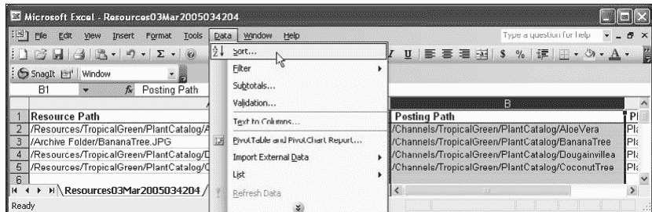

你也可以改为按帖子的路径进行排序，从而查找特定帖子中使用的资源列表。

当然，在电子表格中搜索不如查询数据库方便。除了写入日志文件，你也可以将数据写入数据库表或 XML 文件。你甚至可以在事件处理程序中编写代码，以便每次发布帖子时都更新资源列表。这样一来，你就能为资源管理者提供一个简单的查询界面，让他们实时找到问题的答案。


## 多个Python框架

Python是一种功能强大且易于学习的编程语言，广泛应用于Web开发、数据科学、人工智能等领域。Python拥有丰富的框架生态系统，每个框架都有其独特的优势和适用场景。

- Django：Python最流行的Web框架之一，遵循“约定优于配置”原则，自带ORM、Admin后台、认证系统等众多内置功能，适合快速构建大型Web应用。
- Flask：一个轻量级的Web框架，核心简单灵活，便于扩展，适合构建小型应用和API服务，常与SQLAlchemy、Jinja2等库配合使用。
- PyTorch：由Facebook开发的深度学习框架，采用动态计算图，调试方便，广受科研人员与开发者的喜爱，适合模型研究和快速原型开发。
- TensorFlow：由Google开发的深度学习框架，支持静态图和动态图，拥有强大的生产部署能力，适用于大规模机器学习和深度学习任务。

选择合适的框架取决于项目的具体需求和开发者的偏好。对于需要快速开发完整功能网站的场景，Django是不错的选择；对于追求轻量化和灵活性的项目，Flask更加适合；而在人工智能领域，PyTorch和TensorFlow则各有所长。

## 在发布模式下隐藏 Web 用户控件

我们希望该控件仅在创作模式下可见。我们首先检查当前的 Web Author Context 模式，判断其是 AuthoringNew 还是 AuthoringReedit。如果是，则显示并启用该控件；否则隐藏该控件。在 Page_Load() 事件处理程序中，添加如下所示的代码。

```
private void Page_Load(object sender, System.EventArgs e)
{
    ... code continues ...
    // Get the current Web Author Context mode
    WebAuthorContextMode webauthorMode = WebAuthorContext.Current.Mode;
    // Set the control to be visible only in authoring modes
    bool displayControl = false;
    if (webauthorMode == WebAuthorContextMode.AuthoringNew
    || webauthorMode == WebAuthorContextMode.AuthoringReedit)
    {
        displayControl = true;
    }
    this.Visible = displayControl;
}
```

## 捕获发布项的保存事件

保存发布项时，我们希望将 TextBox 的内容写入发布项的 DisplayName 属性。难点在于捕获保存事件。好消息是，你可以使用 WebAuthorContext 类的 SavePostingEvent() 事件处理程序。我们只需编写自己的事件（名为 saveDisplayName()，稍后定义），类型为 WebAuthorPostingEventHandler，并将其注册到 SavePostingEvent() 处理程序中。下面的代码演示了如何在 OnInit() 事件处理程序中完成此操作。将突出显示的部分添加到 OnInit() 中。你可能需要展开“Web 窗体设计器生成的代码”区域才能看到它。

```
override protected void OnInit(EventArgs e)
{
    InitializeComponent();
    base.OnInit(e);
    // Register new event being called during save
    WebAuthorContext.Current.SavePostingEvent += new
    WebAuthorPostingEventHandler(saveDisplayName);
}
```

最后，我们编写 saveDisplayName() 方法来保存发布项的显示名称。我们只需将发布项的 DisplayName 属性设置为 TextBox 的内容。

作为 WebAuthorPostingEventHandler 类型的事件，saveDisplayName() 方法接受两个参数：

- `object sender` 包含触发保存的对象。在本例中，sender 是“保存”、“保存并退出”或“保存新页面”按钮，具体取决于作者点击了哪一个。
- `WebAuthorPostingEventArgs e` 包含有关事件的数据。其中最重要的信息是当前正在保存的发布项。

将 saveDisplayName() 直接添加到 OnInit() 事件处理程序的下方。

```
// The event handler that saves the contents of the TextBox to the posting's
// DisplayName property
private void saveDisplayName(object sender, WebAuthorPostingEventArgs e)
{
    e.Posting.DisplayName = txtDisplayName.Text.Trim();
}
```

该控件就完成了。要使用该控件，只需将其拖放到任何需要它的模板文件上。在本示例中，我们选择仅保存发布项的显示名称。你可以轻松扩展该控件，使其处理发布项的所有其他属性和自定义属性。

> 如果你需要在多个项目之间重用代码，使用服务器控件比 Web 用户控件更高效。以下是此类控件的一个示例：
>
> http://www.gotdotnet.com/Community/UserSamples/Details.aspx?SampleGuid=2A85D442-286F-4AD6-8A03-82436BF956A5
