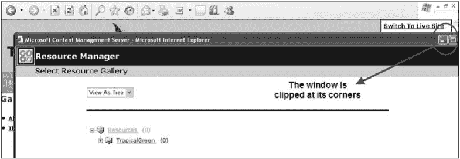

## 技巧 9：如何配置 Web 作者控制台对话框的位置和大小



这是因为 Web Author 试图将对话框偏移几个像素，以便让作者知道这是一个位于父窗口之上的新窗口。

解决此问题的方法是更改用于调整窗口大小的 JavaScript。对于基于 ASP.NET 的解决方案，需要修改的文件是 **Windows.js**，位于 **<install directory>\Microsoft Content Management Server\Server\IIS_CMS\WebAuthor\Client\** 目录中（温馨提醒：修改前请备份该文件）。

修改 `WBC_UseDefaultSizing()` 函数，减小窗口的高度和宽度，以确保新窗口位于父窗口内部。

```
function WBC_UseDefaultSizing(pWindow)
{
    var lWidth = WBC_getWindowWidth(pWindow) - 2 * IDS_WIDTH_OFFSET;
    var lHeight = WBC_getWindowHeight(pWindow) - 2 * IDS_HEIGHT_OFFSET;
    . . . code continues . . .
}
```

下次当你从 Web 作者控制台以最大化或全屏模式点击打开新窗口的按钮时，窗口将完美地显示在屏幕内。
