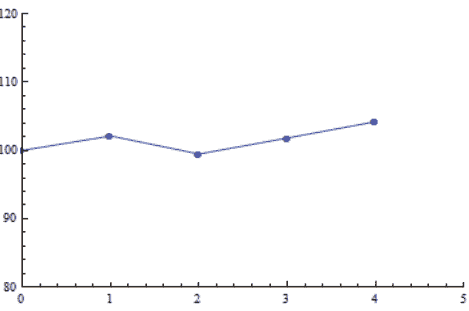
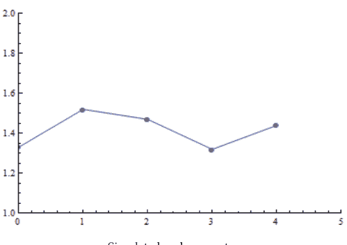

## 2 数学模型

在上一章中，我们将便当盒模板描述为一种结构化方法，用于定价金融衍生品。在便当盒模板的语境下，本章对应盒 2——数学模型。本节将回顾当今金融衍生品市场中用于描述标的资产行为的某些关键数学模型。特别是，标的资产的未来演变。以下是这些标的资产的示例：

- 股票或股份
- 汇率
- 利率
- 信用评级

### 股票

在股票资产类别中，标的资产是公司股票的价格。例如，伦敦证券交易所（www.londonstockexchange.com）在特定时间报价的 Vodafone PLC（VOD.L）一股的当前价格。价格可能为 2.32 英镑，时间可能为 2013 年 5 月 13 日 11:33:24。

从数学角度来看，因此，股票价格可以表示为当前时间 t 的标量函数。我们将此函数表示为 S(t)。请注意，从技术角度来看，S(t) 是一个时间序列，尽管表面上看是连续的（具有 C[0] 连续性），但实际上是不连续的（存在跳跃）。此外，它不是一个良好行为的函数，也就是说，它的导数不存在。

我们将把 S(t) 建模为随机变量。围绕此值构建的所有结构（例如收益 H(S_t) 的价值）因此也将是随机函数。在这种情况下，我们不能使用标准微积分工具（如泰勒级数、导数、黎曼积分），而是必须使用随机微积分工具（如伊托引数、拉顿-尼科迪姆导数、黎曼-斯蒂尔杰斯积分）来推进建模。

在这种情况下，变量 S(t) 的行为可以用随机微分方程（SDE）来描述。对于股票，用于描述股票行为的标准 SDE 称为 GBM。在所谓的实世界概率度量 P 下，GBM 在连续时间中的正式表示如下：

```
dS = \mu S dt + \sigma S dW^P
```

但是，在文献中，此表示不用于金融衍生品定价。它被以下在风险中性度量 Q 下的表示所取代：

```
dS = r S dt + \sigma S dW^Q
```

在上述方程中，我们将漂移项 \mu 替换为无风险利率 r，\sigma 是波动率，dW 是维纳过程的增量。方程 2 可以进一步表示如下：

```
\frac{dS}{S} = rdt + \sigma dW^Q
```

在上述方程中，我们可以将等式左边（LHS）的 dS/S 项识别为股票的收益。因此，等式右边（RHS）的两项分别是“漂移项”和“波动率项”。这些项均由参数 \mu 和 \sigma“缩放”，这些参数根据交易工具（如看涨期权和看跌期权）的当前市场价格进行校准。

请注意，方程 2 是描述金融衍生品世界中标的资产的基本方程。

为了定价衍生品，我们需要将方程 2 从连续时间转换为离散时间，以建模股票行为，例如每天（\(\Delta t = 1\) 天，但在金融领域我们始终使用年化期限，因此 \(\Delta t = 1 / 365 = 0.00274\) 年）。我们可以使用欧拉-丸山离散化轻松近似方程 2，如下：

\(\Delta S = rS\Delta t + \sigma S\Delta W\)

\(S_{t+1} - S_t = rS_t\Delta t + \sigma S_t \varepsilon_t \sqrt{\Delta t}\)

\(S_{t+1} = S_t + rS_t\Delta t + \sigma S_t \varepsilon_t \sqrt{\Delta t} = S_t \left( 1 + r\Delta t + \sigma \varepsilon_t \sqrt{\Delta t} \right)\)

公式 3

在上述方程中，我们将维纳过程的微分近似为 Δt 的平方根，乘以从均值为 0、标准差为 1 的高斯分布（\(N(0,1)\)）中抽取的一个值。公式 3 是一个线性迭代方程，我们可以通过给定起始值 \(S0\) 和若干时间步 \(S1, S2, ..., SN\) 来计算它。我们只需要参数 \(r\) 和 \(\sigma\) 的值，以及一个用于 \(\epsilon\) 值的高斯随机数生成器。

为了计算从标准正态分布累积分布函数中抽取的值，我们将使用一种称为 **Box-Muller** 的方法。Box-Muller 方法允许我们将均匀随机数转换为高斯随机数。这非常有用，因为在许多计算机库中，我们可以找到从均匀分布生成随机数的标准函数（例如，C 语言中的函数 `rand()`），并通过 Box-Muller 方法，我们可以生成所需的高斯抽样值。我们将在 *第 4 章 C++ 股票衍生品* 中进一步讨论此问题。

例如，假设我们想模拟公司 ABC 股票未来四天的行为。当前股票价值为 100 欧元。无风险年利率为 5%（p.a.），波动率为 30%（pa）。我们该如何操作？

首先，我们为需要取值的交易日构建一个时间网格（请注意，一年有 255 个交易日）。这些日期分别是 \(t0, t1, t2, t3\) 和 \(t4\)。它们分别对应星期一、星期二、星期三、星期四和星期五。在金融领域，我们始终使用年化期限，因此这些日期对应 \(\Delta t = 1 / 255\)，即 \(t0=0\)，\(t1=1/255\)，\(t2=2/255\)，\(t3=3/255\)，\(t4=4/255\)。

接下来，我们需要股票价格 S(t) 的网格。这些是 S(t0)、S(t1)、S(t2)、S(t3) 和 S(t4)，我们将分别将其分配给星期一、星期二、星期三、星期四和星期五，表示为 S0、S1、S2、S3 和 S4。我们已经知道 S0 的值，即初始价格（今日观察到），也就是星期一的 S0=100。

在此之前，我们需要一个来自标准正态分布累积分布函数的抽样向量，如下所示：

ε₁ = +0.4423, ε₂ = -0.1170, ε₃ = +0.0291, ε₄ = +0.6872

然后，我们可以迭代应用公式 3，从星期一的 S0 值过渡到星期二的 S1 值，如下所示：

S₁ = S₀ (1 + rΔt + σεᵢ√Δt)

或者，我们可以使用数值将星期一的 S0 值过渡到星期二的 S1 值，如下所示：

S₁ = (100)(1 + (0.05)(1/255) + (0.30)(+0.4423)√(1/255)) = 102.12

然后，我们可以计算其余天数的值，如下所示：

S₂ = (102.12)(1 + (0.05)(1/255) + (0.30)(-0.1170)√(1/255)) = 99.47

S₃ = (99.47)(1 + (0.05)(1/255) + (0.30)(+0.1121)√(1/255)) = 101.82

S₄ = (101.82)(1 + (0.05)(1/255) + (0.30)(+0.7373)√(1/255)) = 104.21

如果将这些计算出的股票价格集合起来并随时间绘图，我们将得到以下图表：




模拟股票价格

### 外汇

在外汇资产类别中，标的物是汇率的值。例如，欧元（EUR）与英镑（GBP）在某个特定时间的当前汇率。汇率可以是 EUR/GBP = 1.31，意味着 £1 将由 € 1.31 兑换，当前时间可以是 2013年5月13日 11:33:24。

因此，从数学角度，汇率可以表示为函数 X(t)，它是时间的标量函数，就像股票的情况一样。因此，汇率 X(t) 被建模为随机变量。从数学角度，X(t) 的行为使用 SDE 来描述，就像股票的情况一样。然而，虽然对于股票我们使用了 GBM，但在外汇的情况下，我们将使用来自 (Garman-Kohlhagen 1983) 工作的一个变体。根据这个模型，汇率的随机微分方程可以表示如下：

```
$dX = (r_d - r_f)Xdt + \sigma X dW^Q$
Equation 4
```

在前面的方程中，rd 和 rf 代表国内和国外无风险利率。波动率 σ 是校准到市场报价工具的参数。

就像我们之前做的一样，在继续进行衍生品定价之前，我们需要将方程 1 从连续时间转换为离散时间，以模拟汇率的行为，比如说每天（Δt = 1 天）。

我们再次将欧拉-丸山离散化应用于方程 1，将微分 dX 转换为差分 ΔX，保持常数 rd、rf 和 σ 不变，并将维纳过程的微分近似为 delta t 的平方根乘以从累积标准正态分布中抽取的值，如下所示：

\(\Delta X = (r_d - r_f)X\Delta t + \sigma X\Delta W\)

\(X_{t+1} - X_t = (r_d - r_f)X_t\Delta t + \sigma X_t \varepsilon_t \sqrt{\Delta t}\)

\(X_{t+1} = X_t + (r_d - r_f)X_t\Delta t + \sigma X_t \varepsilon_t \sqrt{\Delta t} = X_t \left(1 + (r_d - r_f)\Delta t + \sigma \varepsilon_t \sqrt{\Delta t}\right)\)

方程 5

像方程 2 的情况一样，方程 5 也是一个线性迭代方程，我们可以通过给定初始值 X0 并对多个时间步 X1、X2、...、XN 进行迭代来计算它。我们只需要参数 rd、rf 和 sigma 的值，以及用于 epsilon 值的高斯随机数生成器。

例如，假设我们想要模拟未来四天 EUR/USD 汇率在营业日最后报价值（称为每日收盘价（EOD））下的行为。EUR/USD 汇率的当前值为 1.33。国内无风险利率为 5% p.a.，国外无风险利率为 3% pa，而波动率为 30% pa。我们该如何进行？

首先，我们为需要取值的营业日构建一个时间网格（注意一年有 255 个营业日）。这些是 t0、t1、t2、t3 和 t4。它们分别对应星期一、星期二、星期三、星期四和星期五，依次对应年化下的 t0=0、t1=1/255、t2=2/255、t3=3/255 和 t4=4/255。

然后，我们需要 EOD 汇率 X(t) 的网格。这些是 X0、X1、X2、X3 和 X4。我们已经知道 X0 的值，即初始汇率（今日观察值），也就是星期一的 X0=1.33。就像我们之前做的一样，在继续之前，我们计算从累积标准正态分布中抽取的一组向量，以获得以下结果：

\(\varepsilon_1 = +0.4423, \varepsilon_2 = -0.1170, \varepsilon_3 = +0.0291, \varepsilon_4 = +0.6872\)

然后我们可以迭代应用方程 3，从星期一的值 X0 到星期二的值 X1，如下所示：

$$X_1 = X_0 \left(1 + (r_d - r_f)\Delta t + \sigma \varepsilon_i \sqrt{\Delta t}\right)$$

或者，我们可以使用数值从星期一的值 $S0$ 到星期二的值 $S1$，如下所示：

$$X_1 = (1.33)\left(1 + (0.05 - 0.03)(1/255) + (0.30)(+0.4423)\sqrt{(1/255)}\right) = 1.52$$

然后我们可以计算其余天数的值，如下所示：

$$X_2 = (1.52)\left(1 + (0.05 - 0.03)(1/255) + (0.30)(+0.4423)\sqrt{(1/255)}\right) = 1.47$$

$$X_3 = (1.47)\left(1 + (0.05 - 0.03)(1/255) + (0.30)(+0.4423)\sqrt{(1/255)}\right) = 1.32$$

$$X_4 = (1.32)\left(1 + (0.05 - 0.03)(1/255) + (0.30)(+0.4423)\sqrt{(1/255)}\right) = 1.44$$

如果将这些计算汇率集合并在一起，并将它们作为时间的函数绘制出来，我们将获得以下图表：



### 利率

在利率资产类别中，标的物是利率。利率非常复杂。如果我们考虑“今天的利率是多少？”这个问题，就可以看出这一点。答案当然不仅仅是“5% pa”，因为我们还需要指定我们想了解的利率期限（T）。因此，利率比股票或外汇等对象多一个维度。虽然当前观察到的股票值是标量量，即一个单一数字，但当前的利率曲线是一个向量。

例如，让我们考虑 2013年5月13日 观察到的 1个月、3个月、6个月和12个月期限的即期 EURIBOR 利率（由 http://www.euribor-ebf.eu/ 发布）。我们用 R(t,T) 表示这些即期利率，记为 R(0,3M)=EURIBOR 3M = 1% pa，R(0,6M)=EURIBOR 6M = 2% pa，R(0,9M)=EURIBOR 9M = 3% pa，R(0,12M)=EURIBOR 12M = 4% pa。请注意 t=0，因为我们将 2013年5月13日 视为当前日期。

这些利率各自将如何随时间演变？换句话说，我们如何建模 R(t, T)？我们有以下两种选择，反映了文献中存在的两种建模学派：

- 短端利率模型
- 市场模型

第一个是最古老的，而第二个是更近期的。

### 短端利率模型

在连续时间中，短端利率可以由 Vasicek 开发的以下 SDE 表示：

```
dr = (\theta - \lambda r) dt + \sigma dW
Equation 6
```

前面的方程是一个均值回归过程。参数 θ 是均值回归水平，λ 是均值回归速度，σ 是波动率。参数 θ、λ 和 σ 控制随机过程的行为。分配给 θ 的值将是利率将趋向的长期利率水平，而 λ 将控制利率返回长期均值水平的速度。波动率 σ 控制过程“跳跃”的幅度。这些参数可以校准到市场报价工具，例如利率互换期权（称为 **互换期权**）。

我们可以使用之前描述的欧拉-丸山方法近似 Vasicek 过程，以获得随机过程的离散化版本，如下所示：

\(\Delta r = (\theta - \lambda r_i) \Delta t + \sigma \Delta W\)

\(r_{i+1} - r_i = (\theta - \lambda r_i) \Delta t + \sigma \Delta W\)

\(r_{i+1} = r_i + (\theta - \lambda r_i) \Delta t + \sigma \varepsilon_i \sqrt{\Delta t}\)

方程 7

前面的方程是一个线性迭代方程，我们可以通过给定初始值 r0 并对多个时间步 r1、r2、...、rN 进行迭代来计算它。我们只需要参数 *θ*、*λ* 和 *σ* 的值，以及用于 *ε* 值的高斯随机数生成器。

例如，假设我们想要模拟未来四天短端利率的行为。当前利率值为 5%。参数 λ = 1.0 和 θ = 2.0，而波动率为 30% pa。我们该如何进行？

首先，我们为需要取值的天数构建一个时间网格。这些是 t0、t1、t2、t3 和 t4，以便分别对应星期一（t0）、星期二（t1）、星期三（t2）、星期四（t3）和星期五（t4），依次对应年化下的 t0=0、t1=1/365、t2=2/365、t3=3/365 和 t4=4/365。

然后，我们需要短端利率 r(t) 的网格。这些是 r0、r1、r2、r3 和 r4。我们将分别将它们分配给星期一、星期二、星期三、星期四和星期五。由于我们已经知道 r0 的值，即初始利率（今日观察值），我们有星期一的 r0=5%。


如我们之前所做，在继续之前，我们从累积标准正态分布中计算出一组抽样值以获得以下结果：

$\varepsilon_1 = +0.4423, \varepsilon_2 = -0.1170, \varepsilon_3 = +0.0291, \varepsilon_4 = +0.6872$

然后，我们可以迭代应用公式3，从星期一的值 $r_0$ 到星期二的值 $r_1$，如下所示：

$r_{t+1} = r_t + (\theta - \lambda r_t) \Delta t + \sigma \varepsilon_t \sqrt{\Delta t}$

或者，我们可以使用数值从星期一的值 $S_0$ 到星期二的值 $S_1$，如下所示：

$r_1 = r_0 + (\theta - \lambda r_0) \Delta t + \sigma \varepsilon_1 \sqrt{\Delta t}$

$r_1 = (0.05) + ((1) - (2)(0.05))(1 / 365) + (0.30)(0.4427)\sqrt{(1 / 365)}$

然后，我们可以按如下方式计算其余天数的值：

$r_2 = (0.05) + ((1) - (2)(0.05))(1 / 365) + (0.30)(0.4427)\sqrt{(1 / 365)}$

$r_3 = (0.05) + ((1) - (2)(0.05))(1 / 365) + (0.30)(0.4427)\sqrt{(1 / 365)}$

$r_4 = (0.05) + ((1) - (2)(0.05))(1 / 365) + (0.30)(0.4427)\sqrt{(1 / 365)}$

### 市场模型

**（Libor Market Model (LMM)）**是一种用于定价利率衍生品的高级数学模型。又称为BGM模型，以其作者（Brace, Gatarek, Musiela, 1997）命名，LMM已在全球金融市场中占据主导地位。文献中关于LMM的出版物种类繁多，主要涉及其众多变体及其复杂的高级问题。

实际上，LMM不应被视为单一模型，而应被视为一个庞大的模型家族（Rebonato 1998）和（Brigo and Mercurio 2006）。其众多变体包括考虑的因素数量、所使用的波动率建模类型、所使用的相关性建模类型、是否使用随机波动率或SABR、是否使用远期LIBOR利率或互换利率，以及是否使用半解析或数值求解方法等。

我们的方法和符号紧密遵循（Pelsser 2000），尽管简洁，但它为LMM提供了清晰的介绍。在LMM的所有可能变体中，在本作品中，我们选择了最简单的实现——体现在对远期利率使用对数正态SDE（GBM）以及所有利率中使用单个Wiener过程驱动波动率（即单因子情况）。在这些条件下，我们进一步探讨了使用平坦波动率。

我们首先将利率期限结构 \( N \) 分为一组远期利率 \( L \) 和一组重置时间 \( T \)，如下所示：

\( L_1(t), L_2(t), L_3(t),..., L_N(t) \quad \text{and} \quad T_0, T_1, T_2,..., T_N \)

前述的每个远期利率都有其自身的随机过程驱动，这将导致 \( N \) 个随机过程。遵循BGM，我们使用几何布朗运动（BGM）遵循（Brace, Gatarek, and Musiela 1997）来描述每个随机过程，如下所示：

\( dL_i = \mu_i L_i dt + \sigma_i L_i dW_i^Q \quad i = 1, N \)

公式 8

我们现在进一步简化模型并使用单个因子驱动所有远期利率。这种简化以后可以放宽为多因子LMM。可以证明，通过选择最后一个利率作为终端度量，漂移项的形式如下：

\( \mathrm{dL}_i = - \sum_{k=i+1}^{N} \frac{\alpha_k \sigma_k(T_n) L_k(T_n)}{1 + \alpha_k L_k(T_n)} \Omega_i(t) L_i(T_n) \mathrm{dT} + \Omega_i(T_n) \mathrm{dW} \)

请注意，前述GBM方程中的漂移项是远期利率的函数，因此不是常数，而是状态相关的。

鉴于LMM中过程的复杂性，无法为所有远期利率获得解析解。然而，这不是问题，因为可以使用稳健的数值方法求解远期利率的离散版本。一种广泛用于市场模型的重要方法是蒙特卡洛模拟。远期利率 Li(Tn) 是即期LIBOR利率的实现。在每一列中，远期利率 Li(Tn+1) 使用以下离散化进行更新：

$$L_i(T_{n+1}) = L_i(T_n) - \sum_{k=i+1}^N \frac{\alpha_k \sigma_k(T_n) L_k(T_n)}{1 + \alpha_k L_k(T_n)} \sigma_i(t) L_i(T_n) (T_{n+1} - T_n) + \sigma_i(T_n) (W^{N+1}(T_{n+1}) - W^{N+1}(T_n))$$

公式 9

如前面的方程，就像我们为股票和外汇展示的那样，应使用模拟进行迭代求解。远期利率可以按如下算术表排列：

| L1(T0) | | | |
|---|---|---|---|
| L2(T0) | L2(T1) | | |
| L3(T0) | L3(T1) | L3(T2) | |
| L4(T0) | L4(T1) | L4(T2) | L4(T3) |

在前面的表格中，左侧列表示时间 t=0 时的利率期限结构。给定针对 T1, T2, ...TN 实现的一组LIBOR利率，我们可以提取模拟所需的未来利率，即前面表格主对角线上的利率。

例如，考虑以下支付固定利率收取浮动利率 **利率互换（Interest Rate Swap，IRS）**，名义本金为100万欧元。该IRS每3个月支付5%利率，每3个月收取3个月期EURIBOR利率。该互换的总期限为一年，给定当前的利率期限结构如下：

| L1(0) | | | |
|---|---|---|---|
| L2(0) | L2(3M) | | |
| L3(0) | L3(3M) | L3(6M) | |
| L4(0) | L4(3M) | L4(6M) | L4(9M) |

使用LMM计算该互换的现值。我们该如何操作？

t=0 时的即期利率期限结构为：EURIBOR 3M = 1% 年利率，EURIBOR 6M = 2% 年利率，EURIBOR 9M = 3% 年利率，EURIBOR 12M = 4% 年利率。

首先，我们需要从时间 t=0 观察到的数据中通过引导法计算初始远期利率。我们使用以下方程获得：

```
L_1(0) = 1%, L_2(0) = 3%, L_3(0) = 5%, L_4(0) = 7%
```

然后使用迭代方程9，我们计算远期利率的未来值，如下所示：

| 左矩阵 | 对应 | 右矩阵 |
| :--- | :--- | :--- |
| $L_1(0)$ | | 1.0% |
| $L_2(0) \quad L_2(3M)$ | | 3.0% \quad 2.2% |
| $L_3(0) \quad L_3(3M) \quad L_3(6M)$ | | 5.0% \quad 4.3% \quad 5.2% |
| $L_4(0) \quad L_4(3M) \quad L_4(6M) \quad L_4(9M)$ | | 7.0% \quad 6.6% \quad 7.2% \quad 6.9% |

我们在最左侧列填充初始远期利率，并逐列向右推进，直到获得所有所需值，如右侧所示。有关计算的更多细节，请参见（Pelsser 2000）的书籍。请注意，尽管IRS可以“静态”定价（即无需模拟），但我们使用此示例来说明LMM方法计算所需的步骤。

### 信用

在信用衍生品建模中，标的物是信用风险。现代信用风险计量方法可分为两种替代方法——由（Merton 1974）开创的结构方法，以及利用基于强度的模型估计随机违约率的简化形式方法，由包括（Jarrow and Turnbull 1995）、（Jarrow, Lando, and Turnbull 1997）和（Duffie and Singleton 1999）在内的多位作者开创。

### 结构模型

信用风险的结构方法假设，当公司资产的市场价值低于其需支付的义务或债务时，公司将违约。因此，结构模型有时也被称为 **资产价值模型**。这些模型查看公司的资产负债表和资本结构以评估其信用度。

然而，这种方法的一个关键问题是公司资产的价值难以直接观察。年度报告仅提供公司真实资产的会计版本，而非其市场价值。对于上市公司，权益通常是可观察的，其债务也是如此。（Merton 1974）从以下极其简化的资本结构假设开始：

$V(t) = E(t) + D(t)$

公式 10

在前述方程中，V 代表公司的价值（公司资产总额），而 E 是其权益，D 是其债务。权益 E 被理解为公司权益的总价值，等于市场上一股（股票）的市场价值乘以市场上的股份数量。对于这个简化的公司，债务由单一到期期限为 T 的零息债券表示。

此时，Merton提出了这样的问题：“对于具有前述资本结构的公司，何时会违约？”嗯，这取决于我们对违约的定义。如果我们将违约定义为公司在某个特定未来时间 T 无法支付其义务，那么如果公司在时间 T 时的价值，即 V(T) 大于债务面值 D(T)，则该条件将得到满足。此时，债券持有人将要求付款，公司将有能力偿付。相反，如果在到期时，公司的价值小于其需支付的债务价值，那么它将无法履行其义务并将处于违约状态。这两种情景可以数学定义如下：

- 如果 V(T) > D(T)，则无违约
- 如果 V(T) < D(T)，则违约


那股权持有者呢？最终他们持有公司的股票。考虑到前面的两种情形，我们可以知道，如果公司违约，他们什么也得不到；而如果公司继续运营，他们在到期时可获得 V(T) 和 D(T) 之间的差额，从而得到以下等式：

if V(T) > D then E(T) = V(T) - D
if V(T) < D then E(T) = 0
E(T) = max(V(T) - D, 0)

请注意，左边的表达式可以简洁地写成右边的单个表达式。右边的表达式代表股权持有者在到期时的收益。此外，该表达式与基础资产 V(t) 和行权价 D 的欧式看涨期权收益形式完全相同。遵循 Merton 的思路，我们进一步假设公司的动态遵循以下几何布朗运动（GBM）：

dV = rVdt + σVdW^Q
Equation 11

这样一来，我们就在信用风险与股权衍生品定价之间搭建了一座桥梁。事实上，我们现在可以利用股权衍生品定价的所有结果来对信用风险的结构模型进行定价。请注意，波动率 σ 是公司资产的波动率，而非股权波动率。因此，时刻 t=0 时公司资产的价值可以使用 Black-Scholes 公式计算，如下：

E_0 = V_0 N(d_1) - D exp(-rT) N(d_2)
Equation 12

其中 d_1 = \frac{ln(V_0 / D) + (r + 0.5σ^2)T}{σ√T} 和 d_2 = d_1 - σ√T

在公式 12 中，N() 是累积标准正态分布。当我们需要计算公司首次公开募股（IPO）等问题，并根据公司特征确定其股权公平价格时，这是一个有用的表达式。

例如，假设我们有一家公司，其资产总价值为 1 亿美元。无风险利率为 5%。假设公司资产的波动率为 20%。其债务面值为 7000 万美元，四年后作为零息债券偿还。时刻 t=0 时其股权的公平价值应为多少？

我们采用信用风险结构模型框架，步骤如下。
参数为 \( V_0 = 100,000,000 \)，\( D = 70,000,000 \)，\( T = 4 \)，\( \sigma = 20\% \)，\( r = 5\% \)。
使用前述公式，我们得到以下等式：

```
\( d_1 = \frac{\ln(100 / 70) + (0.05 + 0.5 \times 0.2^2)4}{0.2\sqrt{4}} = 1.592 \)

\( d_2 = 1.592 - 0.20 \times \sqrt{4} = 1.192 \)

\( N(1.592) = 0.944, \quad N(1.192) = 0.883 \)

\( E_0 = 100 \times 0.944 - 70\exp(-0.05 \times 4) \times 0.883 = 43.79 \)
```

### 强度模型

违约是一个随机变量 tau（\(\tau\)），表示公司将在何时违约。违约可以描述为破产、无力偿付等。为了建模信用事件的到达风险，我们需要建模一个未知的随机时间点 \(\tau\)。

基于强度的模型直接关注违约的条件概率描述，无需定义确切的违约事件。强度模型基于生存概率的概念。这一思路借鉴自精算学和生物科学。生存概率是一个衰减的指数函数，描述了公司或主权国家生存多长时间的概率。从数学上讲，这可以用最简单的形式表示为：

```
\( P(t,T) = \exp[-\lambda(T - t)] \)
```

Equation 13

但我们要建模的是违约，而非生存。实际上，我们可以从当前时间 t 计算未来某个时期 [S, T] 的违约概率，只需取两个连续生存概率之差即可。该未来期间的违约概率 PD 可以使用以下公式计算：

```
$$PD(t, S, T) = \exp[-\lambda(S - t)] - \exp[-\lambda(T - t)]$$
```

Equation 14

前述公式对信用风险建模至关重要。有了它们，我们就可以描述违约的可能性，违约是一个将在未来发生的概率性事件。与这一未来事件相关的现金流因此取决于该事件的发生。遵循金融衍生品的经典框架，信用衍生品可以理解为或有索赔，触发未来现金流的事件是违约。

具体来说，考虑简化情形——我们预期将在未来某个时刻 T 从一家公司收到一笔现金流。这笔现金流的现值是多少？

如果不考虑信用风险，现金流的**现值（PV）**只是该现金流的**未来价值（FV）**的贴现值。如果中间期间的贴现因子为 DF，那么我们可以写出金融中最简单的公式，其内容如下：

```
$$PV = DF \times FV$$
```

我们可以进一步假设采用固定无风险利率 r 的连续复利，从而得到以下等式：

```
$$PV = \exp(-rT) \times FV$$
```

Equation 15

现在如果考虑公司的信用风险，会发生什么？首先要注意的是，现金流不再确定，而是不确定的。从数学角度看，它不再是确定性的，而是概率性的。因此，我们需要重写之前的公式。但由于未来现金流是未知的，它实际上是一个随机变量。我们应该将其写为该随机变量的期望值，如下：

```
$$PV = \exp(-rT) \times E[FV]$$
```

这个期望值因此引入了 FV 发生与否的概率。但这个概率是什么呢？公司未来还能存在以进行支付的概率。换句话说，即公司一直存活到那时的概率，也就是其生存概率。因此，我们可以用 FV × P(0, T) 替换 E[FV]，从而得到以下公式：

PV = exp(-rT) × FV × P(0, T)

此外，我们可以明确地将前述的生存概率表示为：

PV = exp(-rT) × FV × exp(-λT)

只有在未来公司还在（或存活下来）时，我们才会收到未来的现金流。考虑信用风险后，现金流现值的最终表达式如下：

PV = exp(-(r + λ)T) × FV

Equation 16

这个最后的表达式很有趣，因为它表明信用风险是一种“利差”，会加到我们通常用于贴现未来现金流的无风险利率上。

例如，假设我们预期从一家有信用风险的交易对手那里收到 100 万美元，其信用风险由危险率 λ = 3% 量化。假设无风险利率 r = 5%，首先计算不考虑信用风险的现金流现值，然后计算考虑信用风险的现金流现值。假设采用连续时间贴现。假设回收率 R = 100%。我们该如何操作？

通过应用前述公式，我们得到不考虑信用风险时的 PV 如下：

```
PV = exp(-rT) × FV
```

```
PV = exp(-(0.05)(1)) × (1,000,000) = 950,000
```

现在，如果考虑信用风险，我们有如下的 \( PV \)：

\( PV = \exp\big(-(r + \lambda)T\big) \times FV \)

\( PV = \exp\big(-(0.05 + 0.03)(1)\big) \times (1,000,000) = 880,000 \)

请注意，第二笔现金流小于第一笔。信用风险的作用是将今天的现金流价值（即其 \( PV \)）视为降低，因为它不确定，必须乘以其发生的概率（即其生存概率）。

在之前的分析中，我们假设当违约发生时，未来现金流 \( FV \) 将全部损失。但在大多数真实情况下，会收回一部分资金。如果我们将这一比例定义为回收率 \( R \)，那么带风险的未来现金流的现值 \( PV \) 仍然相同，如下：

\( PV = \exp(-rT) \times E \big[ FV \big] \)

但期望现在通过两种可能的状态（违约或未违约）来确定，每种状态都乘以其各自的概率，如下：

\( E \big[ FV \big] = \underbrace{FV \times P(0,T)}_{\text{未违约}} + \underbrace{FV \times R \times (1 - P(0,T))}_{\text{违约}} \)

在前述公式中，我们已将违约情况下的回收率 \( R \) 考虑在内。带风险现金流的现值 \( PV \) 现在如下：

\( PV = \exp(-rT) \times FV \times \big( P(0,T) + R(1 - P(0,T)) \big) \)

### 摘要

本章概述了现代金融市场中用于定价衍生品的基本模型。我们将以这些模型为基础，对我们回顾过的各类资产的基础资产进行建模，并应用多种数值方法在计算机中高效实现其计算。

在下一章中，我们将专注于数值方法。


