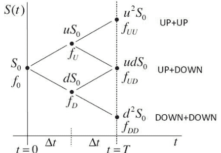

## 数值方法

在上一章中，我们回顾了一些用于描述金融衍生品标的资产行为的关键数学模型。特别是，我们了解了这些模型如何根据当前掌握的信息来描述这些资产的未来行为。这些模型通常用SDEs和 **偏微分方程（PDEs）**来表示。

在本章中，我们将描述当今金融市场中在金融衍生品背景下使用的三种主要数值方法。它们是将前一章中看到的抽象数学公式应用实际数值的一种方式。这些数值方法如下：

- 蒙特卡洛（MC）模拟
- 二叉树（BT）
- 有限差分法（FDM）

在Bento Box模板的上下文中，本章对应盒3——数值方法。还有一种较少使用的方法族，称为 **求积方法**，用于数值积分。这里不予讨论。

### 蒙特卡洛模拟方法

蒙特卡洛模拟以摩纳哥公国著名的赌场命名。由于其简便性、灵活性和可扩展性，它是业界用于定价金融衍生品最广泛使用的数值方法。

该方法的基本思想是构建一个模拟引擎，使我们能够预测标的资产未来可能演化的若干种方式（或路径）。这些路径可以视为潜在的经济或金融情景。通过MC模拟，我们试图回答诸如“鉴于今天观察到的沃达丰股票价格，未来一个月每天该股票的可能价格是多少？”之类的问题。

由于我们无法确定价格的未来演变，因此我们的结果需要基于概率，因此需要大量样本。使用我们在上一章中看到的随机模型来模拟一条可能的轨迹，通过MC模拟，我们将模拟许多可能的轨迹，并为每条轨迹计算如果未来价格遵循该特定路径，合约将获得的回报。随后，我们将取所有这些可能的回报并计算其期望值，即均值或平均值。这将使我们估计该合约在未来的价值。

MC模拟随后允许我们将金融衍生品的公允价格计算为其预期贴现回报。这一概念源于公允定价的金融原则，该原则指出，如果我们预期收到的现金流总和与我们预期支付的现金流总和相同，那么合约应具有的价格。有关MC模拟的更多详细信息，欢迎参阅《金融工程中的蒙特卡洛方法》。

为了直观理解为什么会这样，请考虑以下简单示例：

假设您在t=0时购买了一份标准欧式看涨期权合约。该合约将在到期时t=T为您提供回报H(S_T) = max(S_T - K, 0)。由于到期时标的资产的价值不确定，即S_T是一个随机变量，回报函数H(S_T)也不确定。我们可以写出回报函数H(S_T)的期望值为期望E[H(S_T)]。此外，在欧式看涨期权合约中，我们今天支付权利金，以便在到期时t=T拥有行权或不行权的权利。今天应该为该合约支付多少权利金？

如前所述，在公允价值设定下，我们预期收到的应等于我们预期支付的。将所有这些现金流合并在一起（正数表示收到，负数表示支付），我们可以写出以下内容：

- 在\(t=0\)时支付的金额写作\(-\pi\)
- 在\(t=T\)时将收到的金额写作\(+E[H(S_T)]\)

如果我们现在计算这些现金流的现值，我们得到以下方程：

\(-\pi + DF_T \times E[H(S_T)] = 0\)

换句话说，可以总结如下：

\(\pi = DF_T \times E[H(S_T)]\)

MC模拟方法的目的正是帮助我们计算回报的期望值\(E[H(S_T)]\)；计算出该值后，对其进行贴现即可获得衍生品的权利金。

这一相同的想法可以推广到具有许多复杂回报和标的资产的更复杂的设置中。

### MC方法的算法

对于欧式类型的衍生品，MC模拟由以下三个步骤组成：

- 1. 第一步是生成轨迹。

模拟从\(t=0\)到到期时间\(t=T\)的标的资产演化的\(M\)条轨迹。在此步骤中，我们使用描述标的资产演化的SDE的离散版本。在我们的情况中，我们使用GBM作为SDE，这将使我们能够将股票价值从当前值\(S_0\)带到到期时的值\(t=T\)。离散版本本质上是适用于有限时间步而非连续时间步的近似版本。有关更多详细信息，请参阅《金融工程中的蒙特卡洛方法》。我们将期权合约的生命周期离散化为\(N\)个步骤，每个步骤的大小为\(dt\)，可以简洁地写成如下：

\(\{ S_i^j \} \quad i = 0...N \quad j = 1...M\)

此步骤结束时，我们应该为$S_T$得到一个$M$个值的向量，如下：

```
\{ S_T^i \} \quad i = 1...M
```

这些表示了在时间$t=T$时标的资产$S$值的一组可能情景。我们使用GBM生成多条路径，以预测$S_T$在到期时的值。

- 2. 下一步是计算期望。

一旦我们得到到期时标的资产的值集合，我们现在需要计算到期时回报的期望。因此，我们取这些值中的每一个，并为每个值计算回报，如下：

```
H(S_T^i) \quad i = 1...M
```

前面的方程将为我们提供一个回报向量。为了计算期望，我们只需取回报的平均值，如下：

```
E[H(S_T^i)] = \frac{1}{M} \sum_{i=1}^{M} H(S_T^i)
```

- 3. 现在将期望贴现到当前。

最后一步是将回报的价值从到期时间贴现到当前时间。为此，我们将使用以下公式：

```
\pi = DF_T \times E[H(S_T)]
```

或者，我们也可以使用连续复利，如下：

```
\pi = \exp(-rT) \times E[H(S_T)]
```

前面的方程将为我们提供衍生品的价值$\pi$。请注意，在此情况下，我们假设利率和股票价格之间没有相关性。这就是为什么我们可以在前面的方程中整齐地分离这两个效应。如果利率和股票价格相关，那么我们将无法分离贴现因子和期望。这种无相关性假设对于简单的定价模型是标准的。

### MC方法示例

考虑我们希望对Vodafone股票（VOD.L）的六个月期欧式看涨期权进行定价的示例。Vodafone的当前股票价格为100.00英镑，波动率为20%，行权价为100英镑。我们假设股票不支付股息。当前无风险利率为5%年利率。我们如何使用MC模拟来解决这个问题？我们使用以下三个阶段进行操作：

- 1. 第一步是生成轨迹。

我们应用GBM来模拟VOD.L股票从今天的现货价格\( S_0 = £100.00 \)开始的值。为简单起见，我们选择将期权的生命周期从\( t=[0,T] \)离散化为\( N=5 \)个时间步，并使用GBM在离散条件下进行\( M=5 \)次模拟，如下：

```
\( S_{i+1} = S_i \left( 1 + r \Delta t + \sigma \epsilon_i \sqrt{\Delta t} \right) \)
```

因此，五条轨迹将如下：

```
\( S_0^1 \rightarrow S_1^1 \rightarrow S_2^1 \rightarrow S_3^1 \rightarrow S_4^1 \rightarrow S_5^1 \)
\( S_0^2 \rightarrow S_1^2 \rightarrow S_2^2 \rightarrow S_3^2 \rightarrow S_4^2 \rightarrow S_5^2 \)
\( S_0^3 \rightarrow S_1^3 \rightarrow S_2^3 \rightarrow S_3^3 \rightarrow S_4^3 \rightarrow S_5^3 \)
\( S_0^4 \rightarrow S_1^4 \rightarrow S_2^4 \rightarrow S_3^4 \rightarrow S_4^4 \rightarrow S_5^4 \)
\( S_0^5 \rightarrow S_1^5 \rightarrow S_2^5 \rightarrow S_3^5 \rightarrow S_4^5 \rightarrow S_5^5 \)
```

到期时股票的价格将如下：

```
\( \left\{ S_4^1 = 103.37, S_4^2 = 94.40, S_4^3 = 105.27, S_4^4 = 108.24, S_4^5 = 117.73 \right\} \)
```

- 2. 下一步是计算期望。

对于标的资产的每个值，我们现在计算回报，如下：

```
\( \left\{ H(S_5^1), H(S_5^2), H(S_5^3), H(S_5^4), H(S_5^5) \right\} \)
```


我们现在使用报酬的特定形式来描述欧洲式看涨期权，如下所示：

{max(S₄¹ - K, 0), max(S₄² - K, 0), max(S₄³ - K, 0), max(S₄⁴ - K, 0), max(S₄⁵ - K, 0)}

我们将以下数字应用于前面的方程，得到以下结果：

{3.37, 0.00, 5.27, 8.24, 17.73}

前面计算的期望值如下：

E[H(S_T')] = 1/5(3.37 + 0.00 + 5.27 + 8.24 + 17.73) = 6.92

- 3. 现在将期望贴现至现值。

我们现在使用以下连续复利来贴现我们在第2步中刚刚计算的预期报酬，以确定期权费的价值：

π = exp(-rT) × E[H(S_T)] = exp(-(0.05)(0.5)) × (6.92) = 6.75

在本示例中，我们对MC定价仅使用了五个场景。在实践中，为了获得可接受的误差，需要数百甚至数千个场景。很明显，使用的场景越多，近似值越准确。可以为MC方法推导一些误差界公式并展示收敛速度。有关更多详细信息，读者可参阅《金融工程中的蒙特卡洛方法》。将五个MC场景的所有轨迹合并在一起，我们得到下面的截图中所示的表格。在这里，我们看到所有轨迹都从S0=100开始，并导致某个最终值S5。对于每条轨迹，我们计算报酬H，然后对其进行平均以计算其期望值。然后将结果贴现，以获得衍生品的现值。

| S0 | S1 | S2 | S3 | S4 | S5 | H(S_T) |
|---|---|---|---|---|---|---|
| 100,00 | 101,06 | 107,10 | 115,81 | 113,49 | 103,37 | 3,37 |
| | 0,0884 | 0,8656 | 1,2070 | -0,3961 | -1,4890 | |
| 100,00 | 105,81 | 108,18 | 101,43 | 103,05 | 94,40 | 0,00 |
| | 0,8390 | 0,2757 | -1,0661 | 0,1735 | -1,4057 | |
| 100,00 | 100,17 | 102,71 | 99,83 | 105,65 | 105,27 | 5,27 |
| | -0,0515 | 0,3215 | -0,5230 | 0,8436 | -0,1360 | |
| 100,00 | 108,82 | 113,29 | 112,32 | 117,29 | 108,24 | 8,24 |
| | 1,3157 | 0,5703 | -0,2142 | 0,6198 | -1,2992 | |
| 100,00 | 103,79 | 102,30 | 101,87 | 112,90 | 117,73 | 17,73 |
| | 0,5200 | -0,3055 | -0,1464 | 1,6339 | 0,5973 | |
| 6,75 | | | | | 平均值 | 6,92 |

蒙特卡洛模拟示例

### 二叉树方法

**二叉树（BT）**可以追溯到Cox、Ross和 Rubinstein（1979）的工作。与MC方法类似，它们基于股票价格的离散化可以向上或向下跳跃的理念。与MC方法不同，BT不基于对许多可能路径的模拟，而是基于构建一条在每个节点处分叉的可能未来价格的单一路径。这些价格及其相关概率构成了树。一旦构建了这棵树，就可以确定到期时标的资产的价格，然后可以计算到期时的报酬并将其贴现至现值，以确定衍生品的期权费。

### BT方法的算法

BT方法在应用于定价衍生品时由三个阶段组成：价格树的构建（前向阶段）、报酬的计算（到期阶段）以及将报酬贴现至现值（后向阶段）。我们将在两步BT的简化环境下解释BT方法。这可以轻松推广到_N_步树。

首先，我们假设标的资产在下一个时间步只能上涨或下跌。因此，我们指定上涨因子$u$来描述今天的价值如何变为更高的价值，并指定下跌因子$d$来描述今天的价值如何变为更低的价值，使得上涨值为$S(T)=uS(0)$，下跌值为$S(T)=dS(0)$。此外，请参阅《期权定价：一种简化方法》。上涨和下跌值的公式可以显示如下：

$$u = \exp(\sigma\sqrt{\Delta t})$$
$$d = \exp(-\sigma\sqrt{\Delta t})$$

上涨概率的公式如下：

$$p = \frac{\exp(r\Delta t) - d}{u - d}$$

下跌概率为$1-p$。我们现在可以按照以下三个阶段构建我们的二叉树：

- 1. 第一阶段是前向阶段。在这里，我们构建树。与MC模拟一样，时间从t=0到t=T被离散化为步长$dt$。从步骤$tp$开始，标的资产的下一个价格可以按因子$u$或$d$上涨或下跌，如下面的公式所示：

$$\text{At } t=0: S_0$$
$$\text{At } t=t_1 : uS_0 \text{ or } dS_0$$
$$\text{At } t=t_2 : u^2S_0, udS_0, d^2S_0$$

因此，到期时树的值如下：

$$S_T^1 = u^2S_0, S_T^2 = udS_0, S_T^3 = d^2S_0$$

在一般情况下，我们以类似的方式进行，直到到达到期$T$，并且对变量$S$有$N+1$个值。我们将借助以下方程计算这些值：

$$\left\{ S_T^k \right\} \quad k=1...N+1$$

在我们的情况中，前面的方程可以总结如下：

$$\left\{ S_T^1, S_T^2, S_T^3 \right\}$$

整个过程在以下图中进行说明：



- 2. 第二阶段是报酬阶段。

在此阶段，我们使用到期时标的资产的值，并针对每个值计算报酬的值，如下所示：

$$\left\{ H \left( S_T^k \right) \right\} \quad k = 1...N+1$$

在我们的情况中，方程可以总结如下：

$$\left\{ H(S_T^1), H(S_T^2), H(S_T^3) \right\}$$

接下来是到期时T的期权值：

$$\left\{ V_T^k = H \left( S_T^k \right) \right\} \quad k = 1...N+1$$

在我们的情况中，前面的方程可以总结如下：

$$\left\{ V_T^1 = H(S_T^1), V_T^2 = H(S_T^2), V_T^3 = H(S_T^3) \right\}$$

- 3. 第三阶段是后向阶段。

在此最终阶段，我们获取到期时的报酬值，并以逆向方式进行。我们从最后一个节点移动到前一个节点，通过使用加权概率计算前节点的贴现预期报酬作为期权值，如下所示：

```
V^k_{T-1} = \exp(-r\Delta t)\big[p V^k_T + (1-p) V^k_T\big]
```

在我们的情况中，第二步的方程如下：

```
V^1_2 = \exp(-r\Delta t)\big[p V^1_3 + (1-p) V^2_3\big]
```

```
V^2_2 = \exp(-r\Delta t)\big[p V^2_3 + (1-p) V^3_3\big]
```

而在第一步，方程如下：

```
V^1_1 = \exp(-r\Delta t)\big[p V^1_2 + (1-p) V^2_2\big]
```

衍生品的期权费，即期权价格，是值\(\pi = V^1_1\)。

### BT方法示例

考虑以下示例：我们希望对Rolls Royce股票（R.R.L.）的六个月欧洲式看涨期权进行定价。该股票的当前股价为100.00英镑，年波动率为30%，行权价为90英镑。我们假设该股票不派发股息。当前无风险利率为5%年利率。我们如何使用BT来解决这个问题？

首先，我们将期权寿命分为两个步骤，因此dt=0.25。以下截图中的表格说明了将这三个步骤应用于此问题的每个步骤的数值：

| | | | |
|---|---|---|---|
| | | 134.99 | |
| | 116.18 | | |
| S0 100.00 | | 100.00 | |
| | 86.07 | | |
| | | 74.08 | |
| | | | ST |
| 时间 | 0.00 | 0.25 | 0.50 |

| | | | |
|---|---|---|---|
| | | 44.99 | |
| | | 10.00 | |
| | | 0.00 | |
| | | | H(ST) |
| 时间 | 0.00 | 0.25 | 0.50 |

| | | | |
|---|---|---|---|
| | | 44.99 | |
| | 27.30 | 10.00 | |
| V0 16.04 | | 4.98 | |
| | | 0.00 | |
| 时间 | 0.00 | 0.25 | 0.50 |

二叉树定价示例。

我们首先计算上涨和下跌因子以及上涨概率\(p\)。从数值上讲，这些是使用以下方程计算的：

\( u = \exp(\sigma\sqrt{\Delta t}) = \exp(0.30\sqrt{0.25}) = 1.16 \)
\( d = \exp(-\sigma\sqrt{\Delta t}) = \exp(-0.30\sqrt{0.25}) = 0.86 \)

上涨和下跌的概率分别如下：

\( p = \frac{\exp(r\Delta t) - d}{u - d} = \frac{\exp(0.05 \times 0.25) - 0.86}{1.16 - 0.86} = 0.50 \)

\( (1 - p) = 0.50 \)

有了所有这些参数，我们现在可以按照以下三个阶段构建我们的树：

- 1. 第一阶段是前向阶段。

我们现在可以按以下方式构建树的两个层级。

\( 在 t = 0 : S_0 = 100 \)
\( 在 t = t_1 : uS_0 = 116.18\ 或\ dS_0 = 86.07 \)
\( 在 t = t_2 : u^2S_0 = 134.99,\ udS_0 = 100,\ d^2S_0 = 74.08 \)

因此，到期时树的值如下：

\( \{ S_T^1 = 134.99, S_T^2 = 100, S_T^3 = 74.08 \} \)

- 2. 第二阶段是报酬阶段。

在此阶段，我们使用到期时标的资产的值，并针对每个值计算报酬的值，如下所示：

\( \{ H \left( S_T^k \right) \} \quad k = 1...N+1 \)

在我们的情况中，方程可以总结如下：

\( \{ H(S_T^1) = 44.99, H(S_T^2) = 10, H(S_T^3) = 0 \} \)


以下依次是期权在到期时 \( T \) 的值：

\(\{ V_T^k = H(S_T^k) \} \quad k = 1...N + 1\)

在我们的情况中，前面的方程可以总结如下：

\(\{ V_T^1 = 44.99, V_T^2 = 10, V_T^3 = 0 \}\)

- 3. 第三阶段是向后推阶段。

在此最终阶段，我们获取到期时的回报值，并按逆向方式进行。我们从最后一个节点移动到前序节点，通过使用加权概率，将之前节点的期权值计算为折现预期回报，如下所示：

\( V_{T-1}^k = \exp(-r \Delta t) [ p V_T^k + (1 - p) V_T^{k+1} ] \)

在我们的情况中，第二步的方程如下：

\( V_2^1 = \exp(-r \Delta t) [ p V_3^1 + (1 - p) V_3^2 ] = 27.30 \)

\( V_2^2 = \exp(-r \Delta t) [ p V_3^2 + (1 - p) V_3^3 ] = 4.98 \)

而在第一步中，方程如下：

\( V_1^1 = \exp(-r \Delta t) [ p V_2^1 + (1 - p) V_2^2 ] = 16.04 \)

### 有限差分法

有限差分（FD）方法是一种数值技术，直接关注微分方程的近似解。正如 (Black and Scholes 1973) 对股票金融衍生品（或然权益）所示，该问题以偏微分方程（PDE）的形式表达。

FDM 的基本思想是将微分方程离散化。该方法将微分方程中的导数转换为近似导数的量或比率。这些量不再是无穷小量，而是有限量，即它们具有有限长度。这就是有限差分名称的由来。如需更多详情，读者可参阅《金融衍生品数学：学生入门》。

请参考以下示例，其中连续函数 f(X) 及其第一个导数定义如下：

$f(x) = \frac{df}{dx} \approx \frac{\Delta f}{\Delta x} = \frac{f_{i+1} - f_i}{x_{i+1} - x_i} = \frac{f_{i+1} - f_i}{\Delta x}$

前面的函数也称为 **斜率**，它是函数相对于步长 $dx$ 的增长（或减少）的比率。使用前面的有限差分允许我们用代数量计算 $f(x)$ 函数的斜率。

在定量金融中，我们会遇到各种类型的 PDE。最重要的是 Black-Scholes PDE，其表达式如下：

$\frac{\partial V}{\partial t} + \frac{1}{2} \sigma^2 S^2 \frac{\partial^2 V}{\partial S^2} + rS \frac{\partial V}{\partial S} - rV = 0$

我们现在考虑在 $S$ 和 $t$ 轴上的矩形域内求解此方程。在 $S$ 轴上，域为 [a,b]。在 $t$ 轴上，域为 [0,T]。这可以数学表示为域 $\Omega = \{[a,b] \times [0, T]\}$。对于欧洲看涨期权，它有一个最终条件如下：

$V(S, T) = max(S - K, 0)$

以下为边界条件：

$V(a, t) = 0 \text{ and } V(b, t) = S.$

与其直接求解 Black-Scholes PDE（即使用变量 S 和 t），我们将遵循 (Wilmott et al. 1995)，并提出一个变量变换。这将把原始 PDE 转换为一个等价的 PDE，其求解更加容易，实际上是经典的热扩散方程。变量变换如下：

S = K exp(x)

t = T - \tau / (\frac{1}{2} \sigma^2)

前面的方程将 Black-Scholes PDE 转换为经典的热扩散方程，如下所示：

\frac{\partial u}{\partial \tau} = \frac{\partial^2 u}{\partial x^2} \quad -\infty < x < \infty, \tau > 0

而欧洲看涨期权回报被转换为以下方程：

u(x,0) = \max \left( \exp(\frac{1}{2}(k+1)x) - \exp(\frac{1}{2}(k-1)x), 0 \right)

其中参数 k 为：k = r / (\frac{1}{2} \sigma^2)。

### FDM 算法

将 FDM 应用到前面的 PDE 上，需要对时间求一阶导数，对 x 求二阶导数，从而得到以下方程：

\frac{\partial u}{\partial \tau} \approx \frac{\Delta u}{\Delta \tau} = \frac{u_{i,j+1} - u_{i,j}}{\Delta \tau}

\frac{\partial^2 u}{\partial x^2} \approx \frac{\Delta}{\Delta x} \left( \frac{\Delta u}{\Delta x} \right) = \frac{u_{i+1,j} - 2u_{i,j} + u_{i-1,j}}{\Delta x^2}

前面的近似可由泰勒级数展开推导得出。请参见 (Wilmott et al. 1995)，如同我们在前一节中所做的那样。

为此，我们需要将函数的域离散化为一组离散节点。对于 BS 方程，空间维度将有 $N$ 个划分（或 $N+1$ 个节点），时间维度将有 $M$ 个划分（或 $M+1$ 个节点）。

如果我们现在将之前的近似组合起来，将得到以下公式：

\(\frac{u_{i,j+1} - u_{i,j}}{\Delta \tau} = \frac{u_{i+1,j} - 2u_{i,j} + u_{i-1,j}}{\Delta x^2}\)

求解前面方程左边的项，我们最终得到 PDE 的以下离散化版本：

\(u_{i,j+1} = \alpha u_{i+1,j} + (1 - 2\alpha)u_{i,j} + \alpha u_{i-1,j}\)

前面方程中 \(\alpha = \frac{\Delta \tau}{(\Delta x)^2}\)。

PDE 的离散化版本可以在时间上迭代求解，使用 **显式** 或 **前向** 有限差分法（FDM），因为这是期权定价有限差分技术最简单的实现。我们现在准备好按照以下阶段来应用 FDM：

- 1. 首先，对域进行离散化。在空间和时间维度上均执行此步骤，时间步长为 \(\Delta \tau, \Delta x\)。

- 2. 现在使用有限差分近似每个导数。正如我们在前一节中所示，我们将应用将 PDE 的连续导数转换为有限近似的原理。这种有限近似将导致代数方程。在文献中，这组方程称为 **模板**。

- 3. 接下来，将模板拟合到域的所有节点。我们将模板应用于域中的所有节点，但表示初始条件和边界条件的节点除外。对于这些节点，我们知道其值是先验的，因此不需要计算。

- 4. 使用模板在时间上迭代求解，直到覆盖整个域。

在显式 FDM 中，您只需推进并计算未知函数 u 的值。请注意，在其他形式的 FDM（如隐式 FDM）中，我们需要通过矩阵问题求解方程组。关于隐式方法的更多详情，请参阅 (Wilmott et al. 1995)。

### FD 方法示例

请考虑以下示例：我们想要对 Barclays 股票（BARC.L）的六个月欧洲看涨期权进行定价。BARC 的当前股票价格为 75 英镑，波动率为每年 30%，行权价为 75 英镑。我们假设股票不派发股息。当前无风险利率为每年 5%。我们应如何使用 FDM 来求解此问题？

我们知道，当股票使用 GBM 建模时，股票金融衍生品满足 Black-Scholes PDE。因此，我们求解前一节中描述的热扩散方程。与之前一样，我们应用以下四个阶段来解决我们的 FDM 问题：

- 1. 首先离散化域。

我们将域划分为 N 个空间划分 dS 和 M 个时间划分 dt，因此 N=5 且 M=4。我们首先在空间和时间维度上应用这些值，时间步长为 \(\Delta\tau, \Delta x\)。

因此，我们得到以下六个时间点：

```
\(\tau = \{0.0225, 0.0180, 0.0135, 0.0090, 0.0045, 0.0000\}\)
```

空间中的五个点如下所示：

```
\(x = \{-1, -0.5, 0.0, +0.5, +1\}\)
```

- 2. 现在使用有限差分近似每个导数，如下所示。

```
$$u_{i,j+1} = \alpha u_{i+1,j} + (1-2\alpha)u_{i,j} + \alpha u_{i-1,j}$$
```

前面方程中 \(\alpha = 0.018\)。

- 3. 将模板拟合到域的所有节点。

以下为初始条件：

```
$$u(x,0) = \max \left( \exp(\frac{1}{2}(k+1)x) - \exp(\frac{1}{2}(k-1)x), 0 \right)$$
```

或者，以下为带有数值的条件：

```
$$u(x,0) = \{ 0.00, 0.00, 0.00, 0.67, 1.82 \}$$
```

前面方程中 \(k = 1.11\)。

以下为最终边界条件：

\(u(-1,\tau) = 0\) 且 \(u(+1,\tau) = 1.82\)。

- 4. 使用模板在时间上迭代求解，直到覆盖整个域。

以下为内部节点：

```
$$u_{i,j+1} = \alpha u_{i+1,j} + (1-2\alpha)u_{i,j} + \alpha u_{i-1,j}$$
```

- \(i = 2,3,4; j = 1 : u_{i,j+1} = \alpha u_{i+1,j} + (1-2\alpha)u_{i,j} + \alpha u_{i-1,j}\)

- \(i = 2,3,4; j = 2 : u_{i,j+1} = \alpha u_{i+1,j} + (1-2\alpha)u_{i,j} + \alpha u_{i-1,j}\)

- \(i = 2,3,4; j = 3 : u_{i,j+1} = \alpha u_{i+1,j} + (1-2\alpha)u_{i,j} + \alpha u_{i-1,j}\)


我们可以按照下方截图中的表格排列算法的数值结果，使用转换后的变量（上表）或原始变量（下表），其中可以发现，当 S=75 且 t=0 时，期权价格为 £4.20：

| x/tau | -1 | -0.5 | 0 | 0.5 | 1 |
|---|---|---|---|---|---|
| 0.0225 | 0.00 | 0.00 | 0.06 | 0.71 | 1.82 |
| 0.0180 | 0.00 | 0.00 | 0.05 | 0.70 | 1.82 |
| 0.0135 | 0.00 | 0.00 | 0.04 | 0.69 | 1.82 |
| 0.0090 | 0.00 | 0.00 | 0.02 | 0.68 | 1.82 |
| 0.0045 | 0.00 | 0.00 | 0.01 | 0.68 | 1.82 |
| 0.0000 | 0.00 | 0.00 | 0.00 | 0.67 | 1.82 |

| S/t | 27.59 | 45.49 | 75.00 | 123.65 | 203.87 |
|---|---|---|---|---|---|
| 0.0 | 0.00 | 0.15 | 4.20 | 50.49 | 125.93 |
| 0.1 | 0.00 | 0.09 | 3.41 | 50.14 | 126.56 |
| 0.2 | 0.00 | 0.05 | 2.60 | 49.79 | 127.20 |
| 0.3 | 0.00 | 0.02 | 1.76 | 49.42 | 127.84 |
| 0.4 | 0.00 | 0.00 | 0.90 | 49.04 | 128.48 |
| 0.5 | 0.00 | 0.00 | 0.00 | 48.65 | 128.87 |

有限差分定价示例。

### 摘要

在本章中，我们回顾了当前用于定价金融衍生品的三种关键数值方法的基础知识。对于每种方法，我们都提供了算法和数值示例。此外，这些方法的更高级特性可以参考先前讨论的所有章节中提到的优秀教材：(Glasserman 2003)、(Kloeden and Platen 1992) 和 (Wilmott et al. 1995)。

并非所有方法在所有情况下都适用，就像工具箱里的工具一样。某些方法对解决某些特定问题更有效。例如，使用二叉树，评估美式期权也很简单，而对于蒙特卡洛方法，则不那么直接。蒙特卡洛方法在高维问题中更为强大，而有限差分法可以有效用于低维问题。
