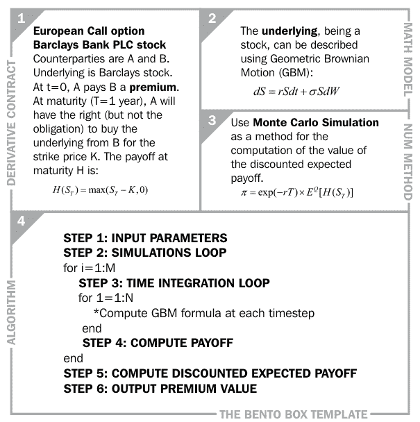
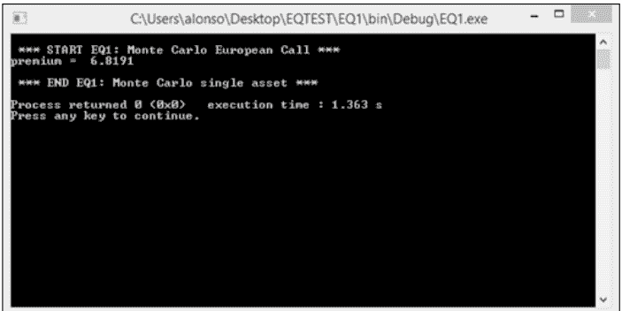
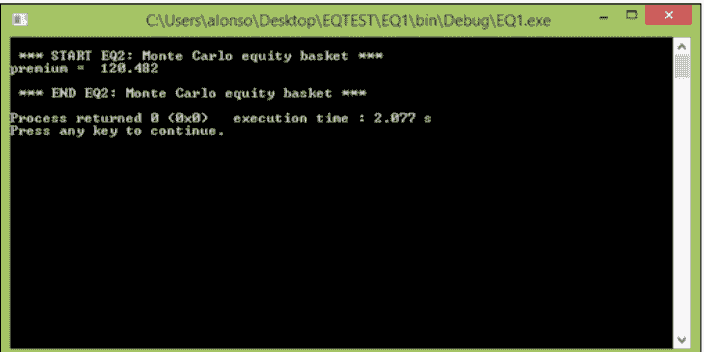

## C++ 中的股票衍生品

在前两章中，我们描述了用于模拟金融衍生品标的资产行为的关键数学模型（第 2 章，数学模型）以及用于对其定价的主要数值方法（第 3 章，数值方法）。

在本章中，我们将这些要素应用于股票衍生品的定价。我们考虑两个示例：标准欧式看涨期权定价（基本示例）以及基于两个资产最大值的股票篮子定价（高级示例）。我们为两者提供了完整的可运行 C++ 实现。注意，如果你是 OOP 新手，建议先学习 C 语言实现，再学习 C++ 实现，两者均可在本章的代码包中获取。

### 基本示例 – 欧式看涨期权

在本例中，我们考虑标准欧式看涨期权的定价。这个示例虽然非常简单，但至关重要；它将作为用蒙特卡洛模拟求解的其余期权定价问题的基础模块。

合同的完整特征、数学模型的选择及其数值方法如下所示，采用便当盒模板展示：



基本示例的便当盒模板：欧式看涨期权

我们的目标是计算该金融衍生品的权利金。我们按顺时针方向填写便当盒的内容，从左上角开始。我们首先填写合同的所有数据，特别是支付函数，对于简单的欧式看涨期权，该函数如下：

$H(S_T) = \max(S_T - K, 0)$

其次，我们应为标的资产选择数学模型，在股票的情况下为 GBM。第三，我们选择使用的数值方法为蒙特卡洛模拟。第四，我们构建将这些计算整合为一系列计算步骤的算法，这将作为我们在 C++ 中实现的蓝图。

算法在便当盒模板的方框 4 中显示。算法的 C++ 实现分别显示在代码片段 1、2 和 3 中。代码片段 1 (maineq1.cpp) 是定价算法本身，而代码片段 2 和 3 是辅助函数。该算法由六个步骤组成，从输入参数（STEP 1）一直延伸到权利金值的输出（STEP 6）。

该算法的一个重要特性是代码片段 2 (random.cpp) 中的函数。该函数实现了 Box-Muller 方法，以获取 GBM 所需的标准正态（高斯）分布的随机样本。代码片段 3 (random.h) 只是代码片段 2 (random.cpp) 的头文件。Box-Muller 方法从均匀分布中取两个独立样本，并将其转换为单个高斯分布样本；该值需要赋值给代码中的变量 epsilon。当然，也可以实现更高效的版本。Box-Muller 方法实际上将一对均匀变量转换为一对正态变量。最好也使用过程中生成的第二个正态样本，以提高计算效率。有关此更高效实现的详细信息，请参阅本书网站；有关进一步详细信息，请参阅原始论文（A Note on the Generation of Random Normal Deviates）。

作为输入参数的一部分，我们应定义 N 和 M。在此，N 表示 GBM 计算中使用的时间步数，而 M 表示使用的蒙特卡洛模拟次数。在我们的示例中，我们考虑对巴克莱股票（BARC.L）的欧式看涨期权进行定价，其当前价格为 £100，行权价 £100，无风险年利率 5%，年化波动率 10%，期限为一年。我们使用 N=500 和 M=10,000。在我的计算机上，期权权利金为 £6.81，执行时间为 1.34 秒。权利金值和执行时间会因计算机而异。

请注意，只需更改算法中的 STEP 4，此代码即可轻松修改以对其他支付函数进行定价。就 C++ 实现而言，可以使用类来定义支付函数，从而融入这一概念。此外，可以稍微修改 STEP 4 以包含对蒙特卡洛近似精度的估计。请参阅网站以获取包含这些功能的可下载实现。描述此示例的优秀教材是《金融期权定价导论：数学、随机过程与计算》。

### 代码 1 – EQ1 – 蒙特卡洛欧式看涨期权

以下是 EQ1_main.cpp 文件的代码片段：

```
// maineq1.cpp
// requires random.cpp
#include "random.h"
#include <iostream>
#include <cmath>
#include <algorithm>

using namespace std;
int main()
{
    cout << "\n *** START EQ1: Monte Carlo European Call *** \n";
    // STEP 1: INPUT PARAMETERS
    double T=1; // maturity
    double K=100; // strike
    double S0=100; // spot
    double sigma=0.10; // volatility
    double r=0.05; // interest rate
    int N=500; // number of steps
    int M=10000; // number of simulations
    double S[N+1];
    double sumpayoff=0;
    double premium=0;
    double dt = T / N;

    // STEP 2: MAIN SIMULATION LOOP
    for (int j=0; j < M; j++)
    {
        S[0]=S0; // initialize each path for simulation

        // STEP 3: TIME INTEGRATION LOOP
        for (int i=0; i < N; i++)
        {
            double epsilon = SampleBoxMuller(); // get Gaussian draw
            S[i+1] = S[i]*(1+r*dt+sigma*sqrt(dt)*epsilon);
        }
    }

    // STEP 4: COMPUTE PAYOFF
    sumpayoff += max(S[N]-K,0.0); // compute and add payoff

    // STEP 5: COMPUTE DISCOUNTED EXPECTED PAYOFF
```

```
premium = exp(-r*T)*(sumpayoff / M);

// STEP 6: OUTPUT RESULTS
cout <<"premium = " << premium << "\n";
cout << "\n *** END EQ1: Monte Carlo single asset *** \n";

return 0;
}
```

### 代码 2 - random.cpp 文件

以下是 random.cpp 文件的代码片段：

```
// random.cpp
// Computing Gaussian deviates using Box-Muller method

#include "Random.h"
#include <cstdlib>
#include <cmath>
using namespace std;

double SampleBoxMuller()
{
    double result;
    double x;
    double y;

    double xysquare;
    do
    {
        x = 2.0*rand()/static_cast<double>(RAND_MAX)-1;
        y = 2.0*rand()/static_cast<double>(RAND_MAX)-1;
        xysquare = x*x + y*y;
    }
    while
    (   xysquare >= 1.0 );
    result = x*sqrt( -2*log(xysquare)/xysquare );
    return result;
}
```


### Code 3 – random.h 头文件

以下是random.h文件的代码：

```
// random.h
double SampleBoxMuller();
```

编译并运行代码后，您应获得以下截图：



> **下载示例代码**
> 您可以从您的帐户下载所有已购买的 Packt 图书的示例代码文件，网址为 http://www.packtpub.com。如果您在其他地方购买了此书，可以访问 http://www.packtpub.com/support 并注册，以便文件直接发送到您的电子邮件。

### 高级示例 – 股票篮子期权

在这个更高级的第二个示例中，我们将说明股票篮子期权定价的实现，其收益为到期时两个资产价值中的较大值。该方法的详细信息显示在以下 Bento Box 模板中：

Equity Basket option on the maximum of two assets. Counterparties are A and B. Underlying is Barclays stock and Rolls Royce stock. At t=0, A pays B a premium. At maturity (T=1 year), A will receive from B the payoff H: $H(S1_r, S2_r) = max(S1_r, S2_r)$

作为股票的标的资产，每个都可以用 GBM 过程描述：$dS1 = rS1dt + \sigma_1 dW_1$ $dS2 = rS2dt + \sigma_2 dW_2$

使用蒙特卡洛模拟作为计算折现预期收益值的方法。$\pi = exp(-rT) * E^Q[H(S1_r, S2_r)]$

- 步骤 1：输入参数
- 步骤 2：模拟循环 i=1:M
- 步骤 3：时间积分循环 l=1:N
  - 在每个时间步计算资产 1 的 GBM
  - 在每个时间步计算资产 2 的 GBM
- 结束
- 步骤 4：计算篮子收益
- 结束
- 步骤 5：计算折现预期篮子收益
- 步骤 6：输出篮子权利金价值

高级示例的 Bento Box 模板：股票篮子期权

我们的目标与之前一样，计算期权权利金。

合同细节在 Box 1 中，特别是收益函数如下：

$H(S1_T, S2_T) = max(S1_T, S2_T)$

请注意，这是一个包含两个资产的篮子期权，我们现在需要两个 GBM 过程来描述标的资产的演变。这体现在 STEP 3 中，该步骤已在 box 4 的算法中更新。然后我们可以使用相同的 MC 数值方法来计算收益的期望。

此算法的 C++ 实现可在代码片段 4 中找到。它与 Code 1 只有两点细微差别：首先，关于输入参数（STEP 1）；其次，关于 GBM 的计算（STEP 4）。我们现在需要为两个过程指定参数，包括它们的现价和波动率。由于需要计算两个相关随机过程，所需的两个高斯样本现在计算如下：

```
\varepsilon_1 = \overline{\varepsilon_1}

\varepsilon_2 = \rho\overline{\varepsilon_1} + \sqrt{1-\rho^2}\overline{\varepsilon_2}
```

在前面的方程中，\(\overline{\varepsilon_1}, \overline{\varepsilon_2}\) 是高斯分布的两个独立样本，而 \(\varepsilon_1, \varepsilon_2\) 是包含相关性 \(\rho\) 影响的两个相关样本。Epsilon_1 和 epsilon_2 仍然是正态变量，因为它们的方差为单位，且它们乘积 \(\varepsilon_1 \varepsilon_2\) 的期望值等于 \(\rho$。

与之前一样，我们可以轻松修改 STEP 5 中的收益，并加入其他更复杂的收益。

例如，考虑以下篮子期权的定价：

我们有两个资产：巴克莱 PLC (BARC.L) 和劳斯莱斯 (RR.L)。我们想要定价一种期权，该期权在到期时（一年）支付这两个资产价值中的最大值。巴克莱的当前现价为 120 英镑，劳斯莱斯的现价为 100 英镑。它们的年化波动率分别为 10% 和 15%。我们选择将时间离散化为 300 个时间步，并使用 10,000 次模拟。在此条件下，该期权的权利金为 120.48 英镑，执行时间为 2.22 秒。

有关股票篮子衍生品的更多详细信息，欢迎查阅《Paul Wilmott on Quantitative Finance，第 2 版》。

### Code 4 – EQ2 – 股票篮子蒙特卡洛模拟

以下是 EQ2_main.cpp 文件的代码片段：

```
// maineq2.cpp
// requires random.cpp
#include "random.h"
#include <iostream>
#include <cmath>
#include <algorithm>
using namespace std;

int main()
{
 cout << "\n *** START EQ2: Monte Carlo equity basket *** \n";
 // STEP 1: INPUT PARAMETERS
 double T=1; // maturity
 double r=0.05; // interest rate
 double S10=120; // spot equity 1
 double S20=100; // spot equity 2
 double sigma1=0.10; // volatility
 double sigma2=0.15; // volatility
 double rho=0.5; // correlation
 int N=300; // number of steps
 int M=100000; // number of simulations
 double S1[N+1];
 double S2[N+1];
 double sumpayoff=0;
 double premium=0;
 double dt = T / N;

 // STEP 2: MAIN SIMULATION LOOP
 for (int j=0; j < M; j++)
 {
 S1[0]=S10;
 S2[0]=S20;
 // STEP 3: TIME INTEGRATION LOOP
 for (int i=0; i < N; i++)
 {
 double epsilon1 = SampleBoxMuller();
 double epsilon2 = SampleBoxMuller();
 S1[i+1] = S1[i]*(1+r*dt+sigma1*sqrt(dt)*epsilon1);
 epsilon2 = epsilon1*rho+sqrt(1-rho*rho)*epsilon2;
 S2[i+1]=S2[i]*(1+r*dt+sigma2*sqrt(dt)*epsilon2);
 }
 // STEP 4: TIME INTEGRATION LOOP
 sumpayoff += max(S1[N],S2[N]);
 }
 // STEP 5: COMPUTE DISCOUNTED EXPECTED PAYOFF
 premium = exp(-r*T)*(sumpayoff / M);

 // STEP 6: OUTPUT RESULTS
 cout <<"premium = " << premium << "\n";
 cout << "\n *** END EQ2: Monte Carlo equity basket *** \n";
 return 0;
}
```

编译并运行代码后，您应获得以下截图：



### 摘要

我们已解决了股票衍生品中的两个定价问题。我们看到一个非常简单的示例（我们称之为基础示例）和一个更复杂的示例，其中包含股票篮子期权。对于每个示例，我们都提供了完整的 C++ 实现。

我们现在将进入下一个资产类别，即外汇衍生品，我们也将解决两个问题，一个简单和一个高级，遵循下一章中 Bento Box 模板方法。
