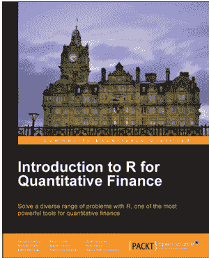
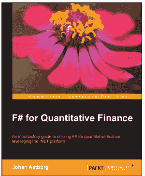
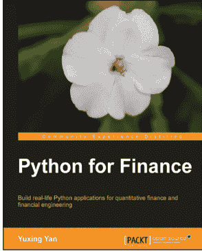
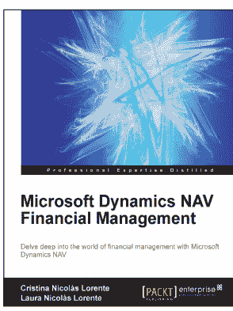

## 索引

### A

- 算法 9
- 资产价值模型 26

### B

- 国际清算银行（BIS）7
- 破产 (CR1) 示例
  - 关于 89, 90
  - 计算 94
- 便当盒模板 10, 11
- 二叉树方法。参见 BT 方法
- Boost 库 102
- Box-Muller 方法 15
- BT 方法
  - 关于 39
  - 算法 39-42
  - 示例 42-44

### C

- C# 9
- C++
  - 关于 9
  - Boost 库 102
  - 信用衍生品 89
  - 股权衍生品 51
  - 金融数值方法 102
  - 外汇衍生品 61
  - GSL 库 103
  - 利率衍生品 75
  - 数值方法 101
  - QuantLib 项目 102
- CDS (CR2) 示例
  - 关于 94-97
  - 计算 97, 100
- Code::Blocks
  - URL 9
- CR1_main.cpp 文件
  - 代码片段 91
- CR1_source.cpp 文件
  - 代码片段 92
- CR2_main.cpp 文件
  - 代码片段 98
- CR2_source.cpp 文件
  - 代码片段 99
- 信用违约互换 (CDS) 89
- 信用衍生品 89
- 信用评级
  - 关于 25
  - 强度模型 28-31
  - 结构模型 26-28

### D

- 漂移 8

### E

- EQ1_main.cpp 文件
  - 代码片段 54
- EQ2_main.cpp 文件
  - 代码片段 58
- 股权资产类别 13
- 股票篮子示例，
- 股权衍生品 56-60
- 股权衍生品
  - 股票篮子高级示例 56
  - 欧式看涨期权示例 51
- 股权模型
  - 回顾 13-16
- 欧式看涨期权合约 6
- 欧式看涨期权示例，
- 股权衍生品 51-56
- 欧洲外汇看涨期权 (FX1) 示例
  - 关于 61
  - 计算 67
- 金融衍生品溢价，计算 62-64
- 普通欧式看涨期权定价，演示 61
- 汇率
  - 回顾 17, 18
- 显式有限差法 47

### F

- FD 方法
  - 关于 44-46
  - 算法 46-48
  - 示例 48, 49
- 金融衍生品
  - 关于 5
  - 示例 6, 7
  - 特征 6
  - 远期 6
  - 期货 6
  - 期权 6
  - 互换 6
- 金融数值方法 102
- 有限差法。参见 FD 方法
- 有限差方法论 (FDM) 68
- 固定腿 7
- 浮动腿 7
- 外汇衍生品
  - 欧洲外汇看涨期权 (FX1) 示例 61
  - FX 障碍期权 (FX2) 示例 68
- 外汇资产类别 17
- 前向 FDM 47
- 未来值 (FV) 29
- FX1_main.cpp 文件
  - 代码片段 64
- FX1_source.cpp 文件
  - 代码片段 65
- FX2_main.cpp 文件
  - 代码片段 69
- FX2_source.cpp 文件
  - 代码片段 70
- FX 障碍期权 (FX2) 示例
  - 关于 68
  - 计算 72
  - Up-and-out 障碍期权定价，演示 68, 69

### G

- 几何布朗运动 (GBM) 8, 14, 89
- GSL 库 103

### I

- 首次公开募股 (IPO) 27
- 利率衍生品
  - 带上限利率互换 (IR2) 示例 82
  - 普通利率互换 (IR1) 示例 76
- 利率
  - 关于 20
  - 市场模型 22-25
  - 短利率模型 20, 21
- 利率互换 (IRS) 7, 24, 75
- IR1_main.cpp 文件
  - 代码片段 78
- IR1_source.cpp 文件
  - 代码片段 79
- IR2_main.cpp 文件
  - 代码片段 84
- IR2_source.cpp 文件
  - 代码片段 85
- 带上限利率互换 (IR2) 示例
  - 关于 82
  - 计算 88
  - 带上限利率互换定价，演示 82-87

### J

- Java 9

### L

- Libor 市场模型 (LMM) 20, 22, 75
- 伦敦证券交易所
  - URL 13

### M

- 金融市场数学模型
  - 信用评级 25
  - 股权 13
  - 汇率 17
  - 利率 20
- 数学
  - 关于 8
  - 模型 8
- Mathworks 9
- Matlab 9
- MC 模拟方法
  - 关于 34, 35
  - 算法 35, 36
  - 示例 37, 38
- MinGW
  - URL 9
- 蒙特卡洛 (MC) 68
- 蒙特卡洛模拟 9
- 蒙特卡洛模拟方法。参见 MC 模拟方法

### N

- 数值方法 101

### O

- 场外交易 (OTC) 6

### P

- 偏微分方程 (PDE) 44, 63
- 普通利率互换 (IR1) 示例
  - 关于 76
  - 计算 82
  - 普通利率互换定价，演示 76-79
- 现值 (PV) 29

### Q

- 数值积分方法 33
- 量化金融
  - 关于 5
  - C++ 编程 9
  - 金融衍生品 5
  - 信息学 9
  - 数学 8
- QuantLib 项目 102

### R

- random.cpp 文件
  - 代码片段 55
  - 参考文献 105, 106

### S

- 斜率 45
- 计算模板 47
- 随机微分方程 (SDEs)
  - 几何布朗运动 (GBM) 8
- 互换期权 21

### T

- 标的资产 5

### V

- VBA 9
- 波动率 8

### W

- Wolfram Mathematica 9

## 感谢购买

### 基于 C++ 的高级量化金融

## 关于 Packt 出版社

Packt，发音为 'packed'，于 2004 年 4 月出版了其第一本书 "Mastering phpMyAdmin for Effective MySQL Management"，此后继续专注于出版针对特定技术和解决方案的高度聚焦图书。

我们的图书和出版物分享了您的 IT 同行在调整和定制当今系统、应用程序和框架方面的经验。我们的解决方案导向型图书为您提供定制您正在使用的软件和技术以完成工作所需的知识和能力。与您过去见过的 IT 图书相比，Packt 图书更具体、更少泛泛而谈。我们独特的商业模式使我们能够为您提供更聚焦的信息，让您获得更多需要知道的内容，而减少不需要知道的内容。

Packt 是一家现代且独特的出版公司，致力于为开发者、管理员和新手等社区制作高质量、前沿的图书。
如需更多信息，请访问我们的网站：www.packtpub.com。

## 关于 Packt 开源

2010 年，Packt 推出了两个新品牌，即 Packt Open Source 和 Packt Enterprise，以继续专注于专业化。本书属于 Packt Open Source 品牌，该品牌收录了围绕开源许可证构建的软件图书，并面向从高级开发人员到初学者网页设计师的任何人提供信息。开源品牌还运行 Packt 的开源版税计划，据此，Packt 向每售出一本关于其软件图书的开源项目支付版税。

## 为 Packt 撰稿

我们欢迎所有有兴趣撰写书籍的人士提出询问。图书提案应发送至 author@packtpub.com。如果您的图书构想仍处于早期阶段，并在撰写正式图书提案之前希望先行讨论，请与我们联系；我们的一位委托编辑将与您取得联系。

我们寻找的不仅仅是已出版的作者；如果您拥有强大的技术技能但没有写作经验，我们经验丰富的编辑可以帮助您发展写作生涯，或者仅仅是为您的专业知识获得一些额外回报。

## 用于量化金融的 R 语言简介

ISBN: 978-1-78328-093-3 平装: 164 页

使用 R 解决各种各样的问题，R 是量化金融最强大的工具之一

- 1. 使用时间序列分析来建模和预测房价。
- 2. 使用政府债券价格估算利率期限结构。
- 3. 通过金融网络分析识别系统重要性金融机构。

## 用于量化金融的 F#

ISBN: 978-1-78216-462-3 平装: 286 页

一份利用 F# 基于 .NET 平台进行量化金融的入门指南

- 1. 学习具有易于遵循的理论和教程相结合的函数式编程。
- 2. 在代码片段的帮助下构建完整的自动化交易系统。
- 3. 使用 F# Interactive 进行探索性开发。
- 4. 使用 F# 利用 .NET 平台和其他来自 Microsoft 的现有工具。

## 用于金融的 Python

ISBN: 978-1-78328-437-5 平装: 408 页

构建用于量化金融和金融工程的真实世界 Python 应用程序

- 1. 使用真实世界数据估算市场风险，形成各种投资组合，并估算其方差-协方差矩阵。
- 2. 借助图表解释许多金融概念和交易策略。
- 3. 一个包含许多 Python 程序的循序渐进教程，将帮助您学习如何将 Python 应用于金融。

## Microsoft Dynamics NAV 财务管理

ISBN: 978-1-78217-162-1 平装: 134 页

使用 Microsoft Dynamics NAV 深入了解财务管理的世界

- 1. 探索销售和采购区域内的功能，以及包括付款、预算、现金流、固定资产和商业智能在内的功能。
- 2. 了解 Dynamics NAV 的不同方面与财务管理的关系。
- 3. 学习如何使用报告工具，帮助您在正确的时间做出正确的决策。

