# 第 1 部分：
Excel 的问题，
以及为什么基于规则的 AI
可以成为解决方案

本书的第一部分阐述了论点，展示了 AI 和业务规则方法如何帮助解决您在 Excel 中遇到的問題。

本节包含以下章节：

- *第 1 章，Wrestling with Excel? You Are Not Alone*，概述了您在 Excel 中可能面临的问题，但向您保证您并非唯一遇到这些问题的人，并展示了基于 AI 的规则方法如何提供帮助。
- *第 2 章，Choosing an AI and Business Rules Engine – Why KIE and Drools?*，说明了为什么 KIE 项目的规则引擎和 AI 工具是您作为 Excel 用户的最佳选择，并欢迎您加入由 IBM 和 Red Hat 支持的开放社区，在那里您可以获得持续的支持。
- *第 3 章，Your First Business Rule with the Online KIE Sandbox*，深入介绍编写业务规则并在在线 KIE Sandbox 中使用经典的 Hello World 示例创建您的第一个决策模型。

## Wrestling with Excel?
您并不孤单

如果您阅读了前言，您会知道很多人使用 Excel，您也是其中之一，并且您并非唯一一个对它作为工具的局限性感到沮丧的人。

根据您继续阅读的事实，您现在必须知道本书可以帮助您。但在我们深入探讨它如何帮助您之前，值得详细探讨我们试图解决的问题。在本章中，我们将涵盖以下内容：

- 为什么您使用 Excel？
- 企业解决方案与 Excel 之间的差距
- 您真正的业务问题是什么？
- 什么是人工智能，哪种类型最能帮助您？
- 实用的人工智能和业务规则
- 将 Excel 拆分为不同的部分

## 为什么您使用 Excel？

如果您问全球数十亿 Excel 用户中的大多数人，他们中的大多数人会说他们使用 Excel 的两个主要原因是：

- 作为存储信息的便捷场所——比使用便签更结构化，但又足够灵活以便随时间演变
- 作为交换信息的便捷方式——因为其他人都在使用它

如果您是 Excel 高级用户，您会再增加一个原因：

- 您使用 Excel 来处理重要信息。并且您的组织依赖于您头脑中的知识来确保流程正确

在工作中，您和您的同事将 Excel 用作驱动业务的核心引擎。让我们看几个现实世界的例子。

## Excel 作为业务的引擎室

每个企业都有许多重要工作（我用 *business* 作为 *任何组织* 的简写）。但如果没有捕获、处理和共享信息的方式，这些工作就会停滞不前。表面上看，Excel 非常擅长完成这些任务：

- 如果您为一家医疗公司工作，您可能会使用 Excel 来捕获疫苗订单，处理它们以预测需求，然后使用 Excel 将订单与全球各地的工厂共享
- 如果您在飞机租赁行业，您可能会使用 Excel 来跟踪您在全球各地的航空公司中放置了多少架飞机，处理信息以计算不同的风险情景（例如爆发大规模战争），然后使用 Excel 将信息与为您提供资金的银行共享
- 如果您是一家小型企业，您可以使用 Excel 来跟踪薪资信息，处理它以计算应缴工资税，并仔细与每位员工共享相关信息

下图显示了您在每种情况下如何使用 Excel：


图 1.1 – 您如何使用 Excel

该图非常简单，以至于您可能从未需要思考过它——您获取一些信息（例如来自电子表格），处理它（应用手工制作的公式或手动审查），然后共享它（也许保存到内部驱动器或 SharePoint 以供他人使用）。

而这正是问题的核心——您的处理与您收集和共享信息的方式捆绑在一起。这种工作流程非常适合入门，但迟早，您会在图 1.1 中的每个步骤相互妨碍时遇到问题。我们将在开始讨论解决办法之前，先看看您在日常工作中如何遇到这个问题。

## 日常 Excel 问题

您使用 Excel 的方式是独一无二的。但我猜您已经遇到过以下常见问题中的几个：

- 您一天的大部分时间都花在手动重复 Excel 中的任务上。这包括通过手动从一个工作表复制详细信息到另一个工作表来捕获信息。
- 反复通过电子邮件发送 Excel 文件，不确定是否使用的是最新版本，并且因编辑错误版本而丢失信息。
- 想知道您的公式是否可能被其他用户破坏，并花费数小时重新检查它们。


- 你使用复杂的 Excel 公式，其他人如果不花上几个小时仔细钻研根本无法理解。公式套公式，再加上更多的公式。有时，甚至连编写它们的人也记不起它们是如何工作的。

这些痛点在受监管的环境中（例如金融或医疗/生命科学）尤为严峻，在这些环境中需要数据完整性和审计决策是如何做出的。但这些痛点也存在于制造业和管理等行业，在这些行业中，基于有缺陷的电子表格做出的决策的后果可能很快变得非常昂贵。

这些问题的大部分核心在于，包含信息的同一个文件也包含了处理该信息的函数。如果可以把它们分开呢？

## 一个解决方案 – 分离信息和处理指令

解决这个问题的其中一种方法是使用两个 Excel 文件——一个数据源包含我们想要处理的信息，另一个用于处理指令或业务逻辑。

图 1.2 给出了一个示例：

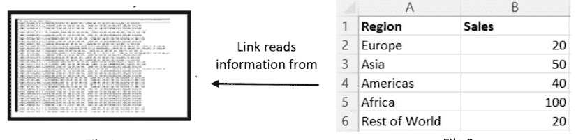

图 1.2 – 分离信息和处理指令

该图展示了一种解决方案，被许多 Excel 高级用户使用，用来将原始信息与作用于该信息的公式分开：

- 1. 文件 1 仅包含信息，而且只有信息。你可以与他人共享此文件并允许他们编辑它。
- 2. 文件 2 包含处理指令（公式），通常是一个汇总页或可打印的报表。
- 3. 两个文件使用标准的 Excel 跨工作簿引用公式进行链接，类似于以下形式：

```
= [Workbook_name] Sheet_name!Cell_address
```

这个解决方案更好——你可以传递第一个文件，并且知道你的公式永远不会被破坏（无论是意外还是故意）。第二个文件包含你所有重要的公式。它并不完美——更新这两个文件可能很棘手，而且很容易破坏链接（例如，将文件保存在错误的位置）。

这是一个迈向解决方案的开始。事实上，大多数企业计算机系统都是以这种方式分离信息和信息处理的。它们通常会将你正在处理的信息称为 **data**，而将处理指令（例如 Excel 函数）称为 **code**。

如果你曾经在 Excel 中编写过自己的函数或宏，使用 **Visual Basic for Applications (VBA)**，你之前一定遇到过这些术语。在接下来的章节中，你会经常看到数据和代码这两个术语。我们在书中推进时也会谈到企业解决方案——值得提醒自己它们是什么。

## 保持简单和安全

如果这个简单的解决方案解决了你的问题，就使用它。有关如何使用公式引用另一个 Excel 文件或电子表格中的单元格的更多信息，可在 Microsoft 网站上找到。

事实上，如果你只从这本书中带走一件事，那就是“不要完全信任任何其他人可以编辑的电子表格（即使它受密码保护）。”如果你还不信服，我建议你阅读一个交易员如何通过欺诈性操纵 Excel 几乎让一家大型国际银行破产的故事 – https://www.amazon.com/Panic-Bank-John-Rusnak-Million/dp/0717135632。

## 企业解决方案

本书的核心承诺之一是建立在你现有的 Excel 知识之上，并帮助你找到更具可扩展性、更稳健、并得到更广泛团队支持的解决方案。我们的意思是：

- **Scalable:** 我们构建的东西可以同时被数十或数百名用户使用，操作非常大的数据集。
- **Robust/durable:** 我们构建的东西可以自行运行，因为它不容易损坏，并且会使用可自动运行的测试来突出显示任何错误。
- **Supported by a wider team:** 大多数 Excel 表格仅由一个人维护。如果他离开了怎么办？我们构建的解决方案应该被许多人理解。

通常，这些被称为企业解决方案。在你的组织中，你可能有几个这样的系统，由内部或外部 IT 团队支持。让我们看几个例子。

## 企业解决方案的示例

我们之前举过一个公司使用 Excel 跟踪支付给员工的薪水并管理应缴税款的例子。但除非你是一家初创公司，否则你更可能找到另一种方法来做这件事——使用预建解决方案。如果你用 Google 搜索“Payroll Software”一词，你会找到数百个例子，其中许多会根据你所在国家的税制量身定制。一般来说，对于这种通用需求（因为每个公司都必须遵守相同的当地法律），使用现成的解决方案更好。

如果你是一家快餐连锁店之类的企业，这很棒。总部会告诉你使用什么企业系统，然后向你收取使用费。但大多数企业在努力赢得新客户时会做得略有不同。即使 80% 的需求（人力资源、物业管理和财务）相同，这些企业也可能有一些需要不同处理的事情。

一个例子可能是专注于向零工经济中收入波动的工人发放贷款的房屋贷款机构。它可能会决定构建自己的系统来批准这些贷款，因为决策过程与向有稳定 9-5 工作的人放贷的银行不同。

对于这些定制需求，其 IT 部门通常会使用 Java、C# 或 Python 等语言构建解决方案。他们会基于标准库和工具（如 Oracle、Microsoft SQL Server，甚至基于云的服务（例如来自 Amazon））进行构建。如果内部没有相关技能，他们可能会聘请外部公司来构建系统。

听起来很简单——我们只要让 IT 部门用企业软件解决方案重建我们的 Excel 表格就行了。显然，没那么简单；否则，10 亿人不会还在使用 Excel。

值得强调的是，我们认为 Excel 是一个很棒的工具，应该与你的企业解决方案集一起使用。它不仅非常灵活，把权力交到业务用户手中，而且在你的 IT 团队构建长期解决方案时，它通常可以作为一个足够好的临时方案。无论如何，现在 Excel 是一门一流的编程语言，不要害怕使用它。只要知道这本书为你在需要更好的东西时，从当前的 Excel 表格构建提供了路线图。

> **What is a first-class language?**
> 
> 有关这意味着什么的更多细节，请参阅以下链接。一般来说，不要让任何人吓唬你认为 Excel 不是一个合适的解决方案 - https://www.microsoft.com/en-us/research/podcast/advancing-excel-as-a-programming-language-with-andy-gordon-and-simon-peyton-jones/。

## Excel 与企业解决方案之间的鸿沟

那么，为什么你的 IT 部门不直接构建一个闪亮的新解决方案来解决你所有的 Excel 问题呢？事实证明，Excel 和真正的企业解决方案之间存在一定的鸿沟。我们将介绍你可能已经遇到的三个差距。

### Gap 1 – the need to code

编码或编程是指能够用计算机能理解的语言编写指令。这并不困难——你已经在 Excel 中这样做了。你在 Excel 中放入的函数、数字、图表等，都是向计算机发出指令以产生你想要的结果。

你已经完成了最困难的部分——将一个更大的问题分解成计算机可以逐步处理的更小问题。但与 Excel 一样，虽然编码很容易做，但要做好却更难。商业开发人员（包括你 IT 部门的同事）可能需要数年时间才能完全掌握自己的技艺。

### Gap 2 – business experts and tech experts are now two different people

作为 Excel 高级用户，你很可能是一名业务领域专家。你可能是知道美国中西部地区雨伞需求预测的全部情况的人。你也可能是知道如何调整在线和传统广告支出以在印度实现最大销售额的人。或者你可能是知道如何预测未来五年欧洲计算机备件需求的人。

这种业务知识非常宝贵，因为它是你的业务不可或缺的唯一东西。

很少有人既拥有这种业务知识又能编码。这并非不可能，只是掌握两件事（业务知识和编码）比掌握一件更困难。此外，这两个学科会导致不同的职业道路，因此同时精通两者很棘手。

没关系。两个人可以一起合作构建解决方案。但两个人一起工作会导致第三个差距。

### Gap 3 – knowledge disappearing into code

请看以下抵押贷款工具（一个房屋贷款计算器，可在 https://www.drcalculator.com/mortgage/ 获取）如图 1.3 所示：


## 但为什么我们不直接在 Excel 中构建它？

作为 Excel 高级用户，当你看到抵押贷款计算器网站时，你可能想过 *我可以在 Excel 中构建这个*。而且你可能确实可以。但随着你添加更多功能，你的 Excel 表格会变得如此复杂，以至于其他人很难阅读它，有点像代码示例。这正是本书提出的解决方案发挥作用的地方。

如果有一个折中的方案——让你能够以计算机可以理解的方式捕捉业务知识，同时仍然可供人阅读呢？本书提出业务规则作为解决方案的一部分。但为了解释为什么（以及如何），让我们先把 Excel 放在一边，来看看你试图解决的业务问题。

## 你的真正业务问题是什么？

我们之前谈到 Excel 是许多企业的发动机室。有人（客户或雇主）付钱让你使用它是有原因的。你嵌入在电子表格中的知识帮助企业节省资金或增加销售。如果你与一个拯救生命的组织合作，你嵌入在电子表格中的知识可能会让人们在正确的时间获得正确的药物。

*你嵌入的知识* 是重要部分。电子表格只是捕捉和分享该知识的便捷工具。由于大多数企业面临激烈（且不断增长）的竞争，你捕捉和管理该知识的好坏决定了你的企业在未来几年是会生存并成长，还是萎缩并关闭。

电子表格是便捷的工具，但它们并不完美。事实上，如果你的组织严重依赖 Excel，很可能大多数人还没有（尚未）思考如何捕捉和维护对公司生存至关重要的业务知识。同样的高级管理人员如果没有公司拥有的建筑物清单会感到震惊。但在列出和管理知识产权方面存在自满情绪，而知识产权的价值往往是数倍之多。

## 这些业务问题在现实生活中是什么样子的

如果没有系统化的方法来捕捉和管理公司的业务知识资产，你就会遇到这些日常问题。请自问以下问题，并考虑有多少适用于你：

- 你是否发现永远招不到足够的好人加入你的团队？要么是很难招聘到具有合适技能的人，要么是培训他们所需的知识花费太长时间，要么是他们受训后就转到其他工作，把知识带走了。
- 你是否收到客户投诉，他们得到的答案取决于问团队中的谁？更糟的是，你是否发现客户向不同团队成员重复提问，直到得到他们想要的答案？
- 是否有一个你绝对不能失去的关键团队成员——那个唯一知道系统真正如何运作的人？如果你对这个问题回答 *否*，是否有可能你忽略了一个关键团队成员，而只有在他们离开时才会意识到差距？
- 如果你就是那个掌握关键知识的团队成员，感觉很不错，对吧？或者如果不是整天被问基本问题，妨碍你做你的 *真正* 工作的话会感觉不错…
- 如果你的组织是项目制，项目团队是否捕捉每个项目产生的知识，以便在日常工作中使用？还是每个努力都倾向于从 *一张白纸* 开始，因为团队很难捕捉和重用来自以前项目的知识？
- 你是否有流程和程序文档被搁置不用且未更新？团队 *太忙* 时，是否有不使用或不更新这些文档的诱惑，你承诺自己稍后会抽时间更新？
- 如果你更改了这些流程文档，会有人注意到吗？你的团队成员不是机器——如果文档更改，他们不会只是执行新流程。但如果可以（温和地）检查流程中写的内容是否真的在实施呢？
- 编辑是否被跟踪，以便人们可以就流程需要做哪些更改达成一致？同样重要的是，如果出现问题，你能否追溯到导致问题的更改？修复完成后，你能确定人们会使用流程的正确版本吗？
- 是否有合适的人在执行合适的任务？过去在大家都在同一个办公室工作时，这更容易管理。现在，随着混合办公，以及团队分散在不同大洲和不同公司，我们是否知道人们是否在正确的时间做正确的事情？
- 总体而言，分享信息比将其作为严密保守的秘密更有力量。但有时，关键信息需要保密（例如，你给予关键客户的折扣百分比）。编辑此信息的能力（例如，更改此折扣适用的级别）需要更严格的控制。在你的公司是否如此？

毫不奇怪，在一本标题中带有 *业务规则* 的书中，我们主张使用规则来有效捕捉、分享和管理你的业务知识的解决方案。但为了解释我们如何做到这一点，让我们介绍一下当今最热门的话题之一——**人工智能（AI）**。

## 人工智能以及哪种类型最能帮助你

在办公室糟糕的一天，你可能曾有过克隆自己或关键团队成员的绝妙想法。这样，你就可以让克隆体继续工作，而你去做更重要的事情，或者只是去海滩休息一下。

为了明确，本书不建议将克隆人类作为实用解决方案！

## 关于 AI 的更多阅读

我们在本节中关注的是 *面向 Excel 高级用户的人工智能*。你不会感到惊讶的是，随着这个热门话题，有许多关于这些和其他人工智能相关技术的书籍——其中许多深入探讨了非常强大但小众的技术细节。Packt 网站有很多建议：https://subscription.packtpub.com/search?query=artificial+intelligence。

如果你对“我们如何走到今天”以及人工智能概念的更多细节感兴趣，Michael Wooldridge（Flatiron）所著的 *A Brief History of Artificial Intelligence* 提供了很好的总结。在本书中，我们将专注于基于规则的人工智能方法，你现在可以在工作中使用的实用工具。

我们将在 *第 11 章* 回到机器学习领域，在那里我们将更详细地探讨其他类型的人工智能工具。

## 人工智能类型一——机器学习

如果你只是在过去几年听说过人工智能，最有可能你想到的就是机器学习。

希望从事机器学习领域的人不会对我将神经网络和其他技术描述为 *一堆花哨的数学* 感到冒犯。甚至可以在 Excel 中实现这些网络的简单版本——请看 *第 12 章*。当然，对于大多数实际用途，你会使用更适合机器学习的工具。

这些工具背后的数学理论确实令人印象深刻，近年来思维的突破也是如此。这些工具已经发展并被打包，以便能够为非技术用户解决现成的难题。我们将在后面的章节中将其作为更广泛解决方案的一部分使用。

然而，你的问题可能不是可以用完全现成的解决方案解决的问题。如果可以，你就会使用我们之前提到的预建解决方案之一，而不是自己的 Excel 电子表格。

另一个问题是，传统上，神经网络很难解释决策是如何做出的——你知道用于训练网络的样本，你知道输出，但你永远无法完全确定它是如何得出答案的。

最后一个问题是你不太可能拥有有效训练神经网络所需的数百万个样本。更可能的是，你会有几百个样本（例如，房屋贷款申请），以及一个掌握知识在脑中的人类专家。


# *人工智能类型二 – 自然语言处理*

如果业务专家能够用接近正常人类语言的方式*与*计算机对话，并且计算机能够理解该专家的意思会怎样？直到最近，这还只是科幻小说的情节——人类此前需要使用一种更受限制的语言，可能只有约 100 个词，并且必须按非常特定的顺序使用。如果你不是程序员，想想你会如何与一个 2 岁的小孩说话。

最近，研究人员通过使用数百万份文档来训练不同的神经网络解决了这个问题。你可能已经使用过这些成果，例如，Google 翻译。更近期的，*GPT-3* 和微软的工具如 *Copilot* (https://copilot.github.com/) 已显示出将正常英语翻译成 Java、Python 以及其他计算机可执行的代码的巨大潜力。

虽然我认为这些工具会迅速发展，并且欢迎任何能让更多人具备编程能力的东西，但我们只是复制了之前在基于网页的抵押贷款计算器中遇到的问题。无论是同事还是计算机为我们编写代码，一旦我们的知识被*翻译*成代码，就变得更难检查这段代码是否准确地代表了我们想要的业务规则。

我们真正想要的是一种保持业务规则简单的方法，并让计算机学会如何将这些规则应用于我们当前的业务问题。

## *人工智能类型三 – 基于规则*

AI 最早的尝试之一就是做出已知为真的陈述，并让计算机从中*推算*出来。对于一辆自动驾驶汽车，这些陈述的例子可能包括以下内容：

```
When the driver says "go" start the engine.
When there is a stop sign and there are humans on the road,
then stop.
When there are no stop signs and the road is clear, then
accelerate to 50km/h.
When there is a person visible in the road, then the road is
not clear.
```

根据我们对其他方法的描述，你可能会立刻注意到一些事情：

- 这些规则是用接近英语语言的格式编写的，即使它们遵循略为正式的 when ... then 结构。
- 创建这些规则不需要数亿个示例。只需要一位作者（很久以前就通过了驾驶考试）来编写它们，再由第二个人审阅以确保它们有意义。
- 对我们人类（以及希望是专家司机）来说，这些规则很清晰。如果我们需要更改规则（例如，如果法律更改了限速），它们很容易审阅和编辑。
- 规则彼此独立。如果我们编辑了速度规则，就不需要重新审视关于停车标志的规则。我们让计算机担心规则之间的交互，这使得规则本身更容易理解
- 虽然规则很清晰，但我们可能希望测试结果。例如，当汽车以 50 km/h 行驶并且有人走进道路时，规则 3 和 4 不再为真——但汽车是否真的会停止（我们没有具体规则告诉它这样做）？

## 真值维护

当规则不再为真时*撤回*该规则称为**真值维护**。在这种情况下，它应该导致*当道路畅通时*的规则被撤回，汽车就会停下来。

你会信任这个规则吗？大多数业务规则会更明确——并且包含诸如*当没有明确的驾驶信号时，则停止*之类的规则。即便如此，场景测试规则也至关重要——我们将在*第 9 章*中介绍这一主题。

大多数 Excel 电子表格，虽然可能包含数百条业务规则，但实际上比我们的基于驾驶的示例简单得多。我们从来不需要教 Excel 电子表格如何识别停车标志。我们也从未将 Excel 表格连接到汽车油门使其前进。

这也好，因为基于规则的 AI 在这些通用任务上表现要差得多。你能想象描述交通标志需要多少条规则，甚至在描述完后仍不确定是否已全部描述？这是一个相当开放的问题。但对于可以完全写下来的问题（例如，正确驾驶的法律），基于规则的 AI 是很好的匹配。

根据定义，你可以用 Excel 描述的问题都可以完全写下来，使其非常适合基于规则的 AI。

因此，对于大多数 Excel 应用，基于规则的 AI 是我们能够取得最大进展的地方，也是本书将重点关注的对象。我们将在本书后面重新审视互补的方法，在*第 3 部分，扩展业务规则引擎和 Excel 以成为完整解决方案的工具*中，只是为了确保我们获得完整的图景。

## 不同类型的 AI 协同工作

如果你真的在构建一辆自动驾驶汽车，那么我强烈建议你阅读 Packt 的其他 AI 书籍。但否则，这是一个很好的例子来展示不同类型的 AI 如何协同工作。你会使用自然语言处理来聆听驾驶员指令（*开到餐厅*）。你会使用计算机视觉中的神经网络来识别道路标志。而你会使用基于规则的 AI 来保证你遵守了所有相关的驾驶法规（*在停车标志前停车*）。

我们的自动驾驶汽车示例突出了基于规则方法的另外两个好处：

- 我们应用的规则相当清晰——它们不会隐藏在晦涩的代码中，也不会埋在神经网络的权重中。这种清晰度延伸到偏见。如果我们的规则存在偏见（毕竟它们是由人类编写的），我们至少可以检查和质疑它们。这对于其他类型的 AI 来说并不总是成立，特别是如果它们是在有偏见的数据上训练的。
- 我们几乎可以保证某些业务规则会在某些情况下适用。*几乎*但不能完全保证行为的原因是不同业务规则之间的相互作用。但我们可以对此进行测试并相应地修改我们的业务规则。

这两种优势都解决了神经网络 AI 方法的弱点。这不是一本为 Google 或 Tesla AI 工程师撰写的书，但如果你是其中之一，请考虑将基于规则的 AI 作为你正在开发的系统下的安全网！

基于规则的 AI 方法再好，我们仍然需要一些东西来运行这些规则（我们稍后会谈到规则引擎）。虽然我们尚未解决之前强调的一些问题（例如，变更跟踪），但我们稍后会看到规则引擎周围的工具将如何帮助我们解决这个问题。在此之前，值得更详细地了解业务规则是什么，因为它是这种 AI 方法的核心。

## 实用人工智能和业务规则

前面业务规则的示例故意使用了 when ... then 格式。这并非偶然；该格式提供了关于我们试图与 AI 系统分享的知识的清晰度。

### The when ... then format

让我们强调编写业务规则的关键格式：

```
When "something is true" then "take some action"
```

这是一个非常简单的概念，简单到如果你是 Excel 高级用户（或在其他语言中编程过），这可能会让你绊倒。

在 Excel 中，流程很重要——一个单元格引用另一个单元格，而该单元格可能引用第三个单元格——但值的计算顺序是有保证的。同样，在 Java 或 VBA 等计算机语言中，语句会严格按照书写的顺序执行（带有循环和调用函数的选项）。

业务规则可以在“when”部分为真时随时激活——规则语句触发的顺序没有保证。

提醒是，我们使用 when 而不是 if ——当规则的第一部分为真时，我们应该尝试确保 then 动作被执行。大多数程序员会为这种细微差别而挣扎——他们习惯于控制代码是否应该分支，而不是信任规则引擎来决定何时某事为真并代表他们执行。


对 Excel 用户来说，这听起来像是混乱的配方。显然，一旦我们开始执行这些规则，我们就需要某种引擎来为我们管理这一切。引擎将决定以下事项：

- 1. 哪些规则被激活，哪些具有有效条件因此应该被触发。
- 2. 如果有多个规则准备触发，哪一个先执行。
- 3. 如果在规则触发之前规则不再成立，则将其从列表中移除。
- 4. 重复从步骤 1 开始的步骤，除非没有更多规则准备触发。

值得庆幸的是，正如我们很快就会看到的那样，存在现成的规则引擎，可以有效地为我们管理所有这些复杂性。

```
When "something is true" then "take some action"
```

当你写下数百条业务规则后，你会发现这种简洁性使规则易于维护。同时，规则之间的交互可以为你带来非常复杂的结果。

不信我？让我们看一个现实生活中的情况，展示这种格式的强大之处。

## Triage – 生死攸关的业务规则

想象一下，你站在当地医院的急诊科时发生了重大事故。救护车正把伤势程度不同的受害者送来，医院里的医生因到达的人数众多而不堪重负。更多的帮助正在路上，但等他们到达时，对许多人来说可能已经太晚了。

你问是否能做点什么，任何事情来帮忙，弱弱地提到你多年前获得的基础急救证书（根本没有涵盖这种情况）。你被递给了一套像图 1.4 所示的卡片，被告知要遵循说明：


图 1.4 – 曼彻斯特分诊系统卡片

总共有 84 张像 *图 1.4* 所示的卡片。虽然这些卡片是为护理专业人员编写的，但它们写得如此清晰，即使是未经训练的人也能遵循 when ... then 格式：

```
When there is Abdominal Pain ... then take the medical action listed
```

你永远无法取代外科和护理人员的多年培训和经验。但在所有这些工作人员都忙碌的情况下，他们已成功地通过这些卡片与你分享了他们的知识。或者他们分享了足够的知识，让你能对需要帮助的人产生影响。

> **关于分诊系统的更多信息**
>
> 曼彻斯特分诊系统的详细信息以及 *图 1.4* 中显示的 PDF 可以在这里找到 –
> `http://www.gptriage.info/practice-nurse-triage-guidelines.html`。
> 这两份文件都是业务规则的绝佳示例，并且会根据最佳实践频繁更新和修订——但它们是医疗指南，如果你有点胆小，阅读时请注意。

值得庆幸的是，我们这个特定的例子不太可能发生在你身上。但人们会花很大精力将他们的知识作为一组业务规则捕获是有原因的：

- 这些卡片的预期受众是受过高度训练的医疗专业人员。但随着 *最佳实践* 随时间变化，将此类知识记录在卡片上可以让每个人都审查和同意每种情况下的最佳治疗方法，并持续分享这一知识。
- 虽然我们都希望由最好的外科医生治疗，但在紧急情况下，最好的支持通常来自第一个到达你身边的人。拥有这些卡片意味着 *知识得到共享*。
- 在患者住院期间，会有许多人参与治疗。*一致性* 很重要——不必重新检查同事的工作意味着专业人员可以专注于患者医疗治疗的各自部分。

## 你组织中的业务规则

你可能在组织中有（或应该有）基于纸面的业务规则。一些例子可能是建筑工地访客的安全指南、举办大型活动（如产品发布）前的检查清单，甚至是在审计期间应遵循的反欺诈指南。

当这些业务规则不仅被记录下来，而且可用于自动执行时，它们变得真正强大。这意味着规则不仅仅存在于 *纸上*——你保证了记录的内容也是被执行和应用的内容。这增加了让规则“正确”的重要性，这强化了拥有一个集中化的规则来源的价值，该来源可以在最佳实践演变时进行适当的更新并进行讨论和商定。

每个组织都有自己的规则，这是组织存在的原因之一。为了确保想法清晰，这里还有其他我们可以考虑的例子：

- When a new employee starts, then add health and safety to the required training list
- When a new employee starts, then issue them a badge
- When a badge is issued, and the employee is a new start, then send the employee an email with instructions about the new starter discount at the canteen
- When a badge is used for the first time to pay at the canteen, then give a 10% discount on this order

通常可以有数百条这样的业务规则，但 when ... then 格式使它们更容易审查和维护。

仅从阅读前面四条规则，你就可以看到一条规则触发的条件（then 部分）会触发其他规则级联触发。请注意，它们不一定必须按顺序触发（前两条可能同时有效）。你可能还注意到第三条规则有一个 and 子句——两个部分都必须为真，规则才会触发。

我们将在后面的章节中介绍这些以及更多编写业务规则的强大且更清晰的方法。但首先，由于我们只能在纸上运行业务规则走到这一步，一定有更好的、更快的方式来运行这些规则，对吧？

## 你已拥有的业务规则引擎

毫不奇怪，有一种方法可以自动运行这些业务规则。它被称为规则引擎。可能会让你惊讶的是，你已经拥有一个（非常简单）的规则引擎在 Excel 中。看图 1.5，显示了 Excel 的一个功能，你可能使用过很多次——条件格式。

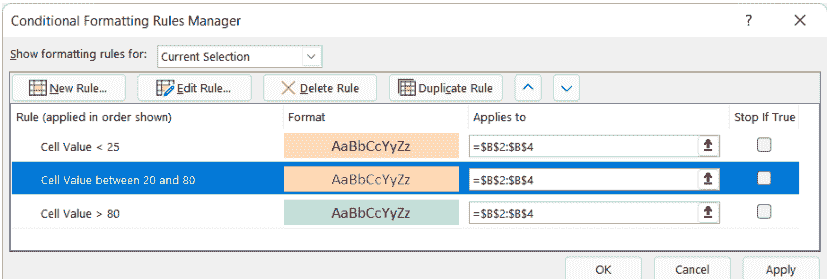

此编辑器可在 Excel 中通过 开始 | 条件格式 下拉菜单 | 管理规则 找到。

在此特定示例中，我们有三条规则：

- When the value is greater than 80, then set the cell to green
- When the value is less than 25, then set the cell to red
- When the value is greater than 20 and the value is less than 80, then set the cell to yellow

对注意的读者一个重要提示——请注意最后两个条件重叠。Excel 会为值为 22 的单元格选择什么颜色？图 1.6 显示了结果：


图 1.6 – 应用于电子表格的条件格式规则

如预期，值为 100 的单元格为绿色，值为 40 的单元格为黄色。你可能会（或可能不会）对值为 22 的单元格为红色感到惊讶。格式规则是如何决定应用哪两个可能规则中的哪一个的？

在这种情况下，答案是 salience。当规则之间存在冲突（即多条规则可以触发）时，Excel 条件格式执行它找到的第一条规则的操作。这就是值为 22 的单元格被格式化为红色的原因（因为该规则在列表中更高）。更强大的规则引擎提供了更高效的解决冲突规则的方法。现在，一个好习惯是尽可能保持规则简单，信任规则引擎来解决任何冲突，并在可能时验证结果。

### Microsoft Office 365 中的其他规则引擎

如果你已成为 Microsoft Office 中隐藏规则引擎的粉丝，请看 Outlook 中的收件箱规则功能。它也包含一个规则引擎来帮助你应对众多电子邮件。

## 不要使用 Excel 作为规则引擎

我们不建议使用 Excel 作为规则引擎。虽然条件格式规则的 when 部分可以包含一些逻辑（用户可以在 Excel 中使用几乎任何公式），但 then 部分则受限得多——它只允许设置单元格颜色或格式。这导致规则之间交互有限——一条规则触发的结果无法创建或更改其他规则开始的条件。


### 更强大的业务规则引擎

在本章中，到目前为止，我们已经描述了你在使用 Excel 时可能遇到的问题，以及 AI（尤其是基于规则的 AI）如何帮助解决这些问题。如果没有工具来实现这些想法，它们就没有太大用处，而且你会很高兴地知道，确实存在更强大的规则引擎。

我们不会（现在）在这些规则引擎上深入探讨太多细节，因为下一章才会开始介绍。目前，我们只想证明它们存在、易于使用，并且遵循我们之前介绍的同样的 when…then 格式。图 1.7 展示了一个更强大的业务规则引擎示例：

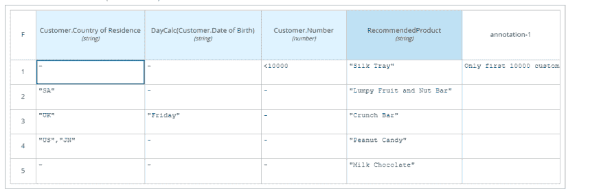

图 1.7 – 引导式业务规则编辑器

图 1.7 展示了在引导式编辑器中编写的示例业务规则，我们将在第 3 章和第 4 章中看到该编辑器。它使用了我们现在已经熟悉的 when…then 格式。表格的前三列是 when 条件，第四列是条件满足后执行的操作。

请记住，这是一个基于 Web 的编辑器，因此很容易使用。这些规则以可执行格式保存，随时可以在规则引擎中运行。

即使不详细解释该规则，也很容易看出什么会触发它，以及触发后会发生什么。当一个人居住在特定地点时，就向他推荐一种特定的巧克力（糖果）棒。

> **我们的规则信息存储在哪里？**
> 如果你有 Excel 背景，习惯于引用其他单元格中的值（如 =A4），你可能会想知道上例中的“居住国家/地区”等值来自哪里。目前，你可以将其视为 Excel 中的命名区域——一个让事情更清晰的便捷名称。

当我们开始研究规则引擎等更强大的工具时，结果发现，理解诸如“数据存储在哪里”或“数据从哪里来”等细节会带来很多隐藏的力量。引入这个概念的最佳方式是了解 Excel 为我们做的一些非常巧妙的事情。

### 将 Excel 拆分为不同部分

我们使用 Excel 的次数太多，以至于不会停下来思考它有多强大。虽然 Excel 看起来像一个整体，但它可以分解为许多不同的组件。*图 1.8* 展示了一种将 Excel 分解为不同部分的简单方法。

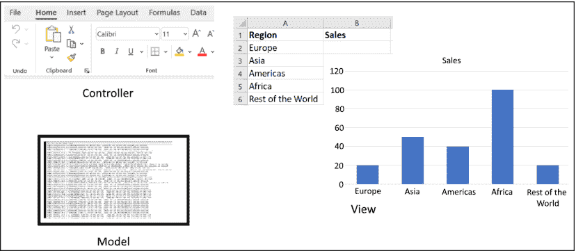

图 1.8 – Excel 拆分为简单的模型、视图、控制器部分

这种模式是将 Excel 分解为更简单的部分，每个部分都有一个关键任务：

-   你通过**控制器**向 Excel 发出命令。通常，这意味着在工具栏、菜单或页面其他位置单击命令，这会使 Excel 执行*某些操作*。这个*操作*通常会改变模型。
-   **模型**是 Excel 存储数据的方式。如果你之前导入过 CSV 或其他非 Excel 格式，你可能对此有更清晰的认识。这些格式是*纯数据*，不包含任何函数或 VBA 代码。
-   Excel 可以将这些数据呈现为一个或多个视图。当模型更新时，视图会自动更新。在此示例中，有两个视图，都显示同一模型的不同表示形式——一个以表格格式显示按区域划分的销售额，另一个以图表形式显示。

由于 Excel 由*许多不同部分*组成，其中许多部分在后台运行，因此我们可以挑选和使用我们想要的部分。本书建议将*控制器*替换为更新 Excel 模型（数据文件）的业务规则引擎解决方案。这样，我们无需进行大量重复点击即可获得所需输出，一切都可以自动化，并且我们仍然可以在 Excel 中查看输出。

这是我们在*图 1.2* 中介绍的解决方案的更复杂版本。它允许我们将 Excel 中的数据与单独文件中的业务规则分开，从而使解决方案更加稳健。在第 8 章中，我们将看到如何在单个工作流中组合多种不同方法（手动 Excel 编辑和自动化业务规则）。

> **设计模式**
> 有些人会认为我们描述 Excel 的方式接近于 Model View Controller 设计模式。关键点在于，不要将 Excel 视为一个单一的整体块，而是由许多不同组件组成。本书建议在保留其他仍然熟悉且有用的组件的同时，替换和升级一些关键组件。

### 还有其他可用的解决方案

你可能会在一本关于规则引擎和 AI 的书中读到“还有其他可用的解决方案”而感到惊讶。这些解决方案可能如下：

-   **基于代码**：例如，学习 Python 等语言可以让你获得编写脚本和自动化许多 Excel 任务的工具。虽然非常适合重复性任务，但要注意不要遇到我们之前描述的*知识消失在代码中*的问题。
-   **无代码或低代码工具**：例如，Microsoft Power Automate。这些工具允许你在工作流中将许多简单步骤串联起来。当你有一个需要做出更复杂决策的步骤时，业务规则引擎可以很好地补充这种方法。我们将在*第 8 章*开始研究 Power Automate（将其与规则引擎结合使用）。
-   **纯 AI 和数据科学**：我们之前提到，规则只是众多 AI 类型中的一种。Excel 具有一些出色的统计模型特性和扩展，而 Python 将为你提供更多。当你没有答案，但你知道答案隐藏在你拥有的大量数据中（某处）时，我们推荐使用这种方法。

更有可能的是，最适合你的解决方案将包含所有这些元素。我们将在本书后半部分介绍更多这些方法。我们将让你了解有哪些工具可用，以及它们如何组合起来增强基于业务规则和 Excel 的方法。

### 面向未来的投资

银行是技术的早期采用者，它们在第一代大型机出现时就购买了这些技术。它们的业务规则是用 COBOL（一种早期编程语言）编写的。问题在于，它们的业务知识消失在代码中——现在有几家银行仍被困在使用旧式大型机的境地。这意味着如果你是 COBOL 程序员，就有了工作保障，但对那些与新的金融科技初创公司竞争的银行来说却很艰难。

when…then 格式的可读性要高得多。虽然业务规则引擎和规则标准将继续发展，但在最坏的情况下，规则是自带文档的，可以用出现的任何新方法重写。10 年后，人们还能像现在一样清楚地理解你的电子表格吗？

### 总结

在本章中，你了解到在使用 Excel 时遇到挫折的不止你一个人，但它是一个太重要的工具，不能放弃。我们研究了一些可以解决你面临的部分问题的企业解决方案，但这些方案通常在你能够使用之前需要跨越过大的鸿沟。为了尝试跨越这道鸿沟，我们审视了可能使用 Excel 的核心业务问题，并发现 AI，特别是基于规则的方法，或许能够提供帮助。

一个令人惊喜的好消息是，业务规则非常熟悉，我们可能已经在不知不觉中使用过它们。我们发现，Excel 实际上比我们给予它的评价要强大得多，我们不需要完全替换它，只需升级某些部分——如果我们不害怕深入探究其内部机制的话。我们还提到，虽然还有其他解决方案可用，但基于业务规则的方法是一项不错的投资，因为它内置了很大一部分面向未来的特性。

我们承诺在本书中提供针对 Excel 问题的实用解决方案。下一章将开始兑现这些承诺，我们将从业务规则引擎的概念转向实际可以下载并运行的引擎。

## 选择 AI 和业务规则引擎——为什么选择 Drools 和 KIE？

在上一章中，你了解了基于规则的 AI 方法如何帮助解决你的 Excel 问题。然而，如果不选择一个完整的业务规则引擎来执行你的规则，你就无法走得很远。

本章将带你了解市场上潜在的规则引擎解决方案，并选择一个我们将在全书中使用的方案。它还会告诉你为什么不仅要考虑解决当前问题，还要考虑将来如何与同事合作以及扩展你的解决方案。为此，我们将执行以下操作：

-   了解阅读本书的不同类型读者，并找出你属于哪一类
-   考察许多可用的规则引擎，并根据我们的标准对其进行评估
-   解释为什么开源在支持方面提供了巨大优势，以及它如何帮助我们确认现在选择哪个规则引擎
-   更好地理解企业软件，并了解规则引擎在更广泛的业务解决方案中的位置，从而确保我们的选择在未来也是正确的
-   学习如何在开源世界中寻求帮助
-   介绍用于支持运行规则引擎示例的项目
-   考察我们可以托管和运行业务规则的四种不同方式

到本书结束时，你将能够使用 KIE/Drools 规则引擎构建更强大的解决方案，扩展你在 Excel 中能做的事情。由于在现实生活中部署这些扩展解决方案的很大一部分涉及与同事合作，因此从了解你属于哪类读者开始会很有帮助。


## 你是出于个人原因还是业务原因阅读这本书？

你很可能会发现自己符合以下其中一种情况：

- **个人使用或探索：** 你拥有正在尝试这些示例的笔记本电脑，主要目的是提升自己的技能。虽然你可以完全自由地安装软件（这是好事），但如果出现问题，你没有 IT 帮助台可以求助（这就不太好了）。

- **业务用户：** 作为组织内最早尝试 AI 和业务规则的人之一，你仍然以提升技能为驱动，但你可能也心中有某个业务问题。很可能你笔记本上可安装的软件会受到限制。好的一面是，有 IT 帮助台为你提供支持。虽然你的同事可能不了解业务规则引擎，但他们可以帮助你按照这些说明进行设置。

- **业务用户，加入现有规则项目：** 这本书是由负责业务规则项目的团队交给你，帮助你快速上手。很可能他们已经完成了大部分技术设置。阅读本章仍然很有价值，这样你就能更了解他们所选的技术。

无论你处于何种情况，本书都将一步步带你完成说明。首先，我们需要选择一个要安装的业务规则引擎。

## 选择哪款业务规则引擎

我们在上一章看到，规则引擎可以嵌入在许多你意想不到的地方（例如 Excel 和 Outlook）。市面上存在数百个类似规则引擎的项目。那么，我们如何筛选出其中一款来运行本书中的 *动手* 示例呢？我们将基于以下标准进行筛选：

- 我们需要一个面向业务用户的、用于编辑规则的良好用户界面。这排除了 *Jess* 和 *Prolog*，它们功能非常强大，但需要大量的技术知识。

- 该产品的核心重点应该是规则。例如，本书后面我们会看到其他产品使用工作流（例如 *Microsoft Power Automate*）。这些产品很适合按顺序执行步骤，但决策能力没有那么强大。

- 由于你处于 *学习* 或 *尝试* 阶段，你希望它不仅可以免费下载，而且未来也无需支付高昂的许可费用。我们稍后会解释开源为何适合这一点，但就目前而言，这排除了 *Trisotec*、*TIBCO* 和 *FICO* 等完全商业化的厂商。

- 该程序必须能由 Excel 高级用户下载并安装。这排除了 *Microsoft Biztalk Server*，它是一款功能非常强大的产品，但需要在 Windows Server 版本上运行。

- 如果我们要投入时间学习一款产品，我们希望它已经存在一段时间并且拥有活跃的社区——从而增加它能持续到未来的可能性。这排除了许多小型爱好或概念验证型规则引擎。

- 如果一切顺利，我们可能会说服同事采用该规则引擎，如果它来自 *知名* 厂商会更容易做到。这排除了 *Hyperon*（`Hyperon.io`）等小型厂商，这可能是最严厉的排除，因为它是一款功能非常强大的产品，背后还有一个活跃的团队。

KIE 和 Drools 主要由 Red Hat 和 IBM 支持，满足了所有这些标准，使其成为我们运行本书大部分示例的选择。KIE 和 Drools 为我们提供了以下功能：

- **业务规则管理体系（BRMS）：** 我们放弃的大多数替代方案只有核心规则引擎，但没有太多其他功能。由于 KIE 和 Drools 提供了核心引擎 *和* 规则编写工具，因此编写和管理业务规则要容易得多。

- **决策模型与标注（DMN）编辑器：** 这是一种行业标准的建模规则方式，这意味着你在本书中读到的许多内容也适用于其他工具。KIE Sandbox、VS Code 插件以及基于 Web 的 Business Central 编辑器意味着你可以使用更强大的诊断工具，超出此标准。

- **Apache 2.0 许可证（开源）：** 我们将在本章后面讨论开源。关键信息是，该许可证让你在部署业务规则时拥有广泛的选择，并且无需预先付费。

## 名称的含义——KIE、Kogito 还是 Drools？

在本章中，我们几乎把 KIE、Drools 和 Kogito 当作同一个项目。虽然这三个项目协同工作非常紧密，但了解它们之间存在根本差异是有用的：

- 最初的业务规则社区项目是 **Drools**。虽然可以直接与 Drools 交互（许多高级项目就是这样做的），但我们采用了更简单的方法，使用 KIE 提供的工具。Drools 主页可在 `https://www.drools.org/` 找到。

- **KIE**（或 **Knowledge is Everything**）是 Drools 现在所属的上层项目。例如，它提供了 KIE Sandbox，我们将在 *第 3 章* 开始使用它来编辑规则和决策模型。它还提供了其他知识管理工具，例如集成机器学习和规则，我们将在 *第 11 章* 讨论。KIE 主页可在 `https://www.kie.org/` 找到。

- **Kogito** 项目为 KIE 解决方案赋予了云能力。它允许 Drools 和其他 KIE 项目成为云环境中的一等公民，我们将在 *第 5 章和第 10 章* 部署规则时利用这一点。Kogito 主页可在 `https://kogito.kie.org/` 找到。

作为上层项目，KIE 还提供了我们在这本书中不涉及的其他工具。**OptaPlanner** 是一个利用 Drools 的项目，可以被描述为 Excel 中 Solver 工具的更加强大的版本。**jBPM** 是一种业务流程管理工具（或工作流引擎），允许我们以正确的顺序编排关键业务步骤。我们将在 *第 8 章* 中再次简要介绍 jBPM。有关这两个工具的更多信息可在 KIE 主页上找到。

最后，IBM 和 Red Hat 已发布了这些产品的大多数商业版本。你可能会看到 **Red Hat Decision Manager** 或 **IBM Decision Manager Open Edition** 名称。为简单起见，我们不会使用这些公司名称，即使我们在这本书中讨论的大部分内容也涵盖了这些产品。

现在我们对 KIE、Kogito 和 Drools 项目有了更好的了解，让我们确认选择它们作为我们的规则引擎是否正确。

## 为什么选择 KIE 和 Drools 作为我们的规则引擎？

让我们再次回顾我们的标准，并解释 KIE 和 Drools 如何满足它们：

- KIE 和 Drools 为我们提供了多种编辑规则的选项，特别是面向业务用户的功能强大但易于使用的基于 Web 的编辑器。

- KIE 的 Drools 组件是一个非常复杂的规则引擎。虽然它集成到更广泛的工具包中，但也可以单独使用。

- KIE 和 Drools 可作为开源技术使用。这意味着你可以免费试用，无需现在或将来承诺付费。

- KIE 和 Drools 基于 Java，因此可在各种环境中运行。它也是可扩展的，例如使其更易于与 Excel 配合使用。

- Drools（KIE 的核心组件之一）自 2001 年以来一直作为一个极其活跃的开源项目运行，并通过 Kogito 计划最近交付了几个关键升级。

- KIE 和 Drools 由 Red Hat 和 IBM 支持，通过社区协作不断发展。*在 IT 行业曾经有句说法叫 Nobody ever got fired for buying IBM products*。在与同事讨论以让他们支持你的解决方案时，提到 IBM 会有所帮助。

**我需要使用另一款规则引擎——现在怎么办？**
从前面的列表中阅读，以及在 Google 上搜索这些产品，你会看到有许多不同 *类型* 的规则引擎，通常作为更大的企业解决方案的一部分。虽然我们强调 KIE 是最强大的同时也最容易入门的，但请放心，你在这本书中学到的许多内容都可以应用到其他产品中。

你可以理解我们为何如此推崇 KIE 和 Drools。但前面的两点似乎自相矛盾。KIE 如何能同时得到一个充满活力的社区和一家大型跨国公司（即 Red Hat 和 IBM）的支持？要解释这一点，以及为什么这是好事，我们需要了解 Red Hat 和 IBM 的商业模式。


## 开源与红帽及 IBM 的商业模式

想象一下，你买了一块地，正在盖自己的房子。理论上这很简单。网上有标准方案，包括建筑图纸、所需材料清单，以及如何组装起来的视频。对于更复杂的部分（管道和电气），你可以聘请有相应资质的人，给他们指示，让他们完成那部分工作。

你可以把这类说明称为**开源**——你可能以前听说过这个词。在软件世界中，开源意味着构建 Kogito/Drools 等产品所需的全部说明都可以在网上免费获取。更棒的是，由于这些说明可以由计算机执行，只要设置得当，你只需按下按钮，一切就能自动构建完成。很简单——就像盖房子一样，*如果你知道自己在做什么，就会觉得容易。*

那么，为什么人们常常选择不自己构建软件，或者不自己盖房子呢？

有时你想要的是已经造好的东西——只需转动钥匙就能使用。有时你没有时间或技能——购买别人已经做好的东西也不错。有时你需要一个保证，确保一切都能按你期望的方式运行——而向大型供应商（如微软的 Excel，或红帽和 IBM）付费所带来的安心感，能让你晚上睡得更安稳。

这就是红帽的盈利方式。它把软件的设计方案免费放到网上，以增加使用人数。但如果你需要预构建的产品或额外的支持，你可以购买企业级订阅。这是一种非常成功的方式。IBM 在 2018 年以约 340 亿美元收购了红帽，此后其价值还在不断增长。

对你而言，决定使用红帽产品（如 KIE 和 Drools）意味着两件好事：

-   你可以自由下载和使用该软件，并且知道在任何时候都不会突然收到账单。这种方式的主要网站是 www.drools.org 和 https://kogito.kie.org/。
-   如果你或你的同事需要企业级支持的安心感，你可以选择购买商业支持合同。该产品的主要网站是 https://www.redhat.com/en/products/process-automation。

本书的大多数读者可能永远不需要 IBM 和红帽的商业支持。但即便如此，知道这些支持存在也是件好事。那么，让我们聚焦于 KIE 开源给你带来的好处。

## KIE 的开源如何帮助你

在某些方面，Excel 电子表格（指文件本身，而非微软程序）的源文件是开放可见的。由于大多数电子表格文件没有密码保护，如果你拿到别人的电子表格副本，通常可以打开它并了解其工作原理。

在合理范围内（例如，如果你与创建者在同一家公司工作），你可以更新这个 Excel 表格，让它变得更好。这很有用，例如，当原始作者离开公司，而这份表格对维持业务运转至关重要时。

开源意味着你可以获得软件设计的全部细节，而不是仅仅下载一个无法更改的最终二进制文件。这意味着你可以修改、构建和运行该软件，无论是现在还是将来——即使原始供应商倒闭了也没关系。

开源由一套工具支持，这些工具便于共享源代码文件，并将其构建为可用的软件。虽然有软件许可协议，但这些协议的重点是确保源代码保持开放，并在现在和将来都得到活跃社区的支持。

红帽在 https://www.redhat.com/en/topics/open-source/what-is-open-source 上提供了更多关于开源运动背景、许可证类型及其对我们的意义的详细信息。Kogito/Drools 规则引擎采用标准的、对商业友好的 Apache 许可证发布。该许可证保证你可以访问，而无需分享你对其所做的任何修改。

仔细想想，这种*源代码访问权*在软件世界中并不常见。你通常不能把它们拆开并改进。但开放访问意味着你有一系列支持选项。如果你不喜欢主要供应商的支持，你可以自由地从各种社区和付费选项中获得帮助。

因此，对于阅读本书的大多数人来说，开源的优势如下：

-   当你尝试 Kogito（构建概念验证）时，有一个社区可以帮助你解决问题
-   当你决定在生产环境中长期使用 Kogito 时，它为你提供了路线图和长期访问 Kogito 工具的途径（例如，在真实的业务场景中使用它）

## 从概念验证到生产环境，以及中间的一切

刚开始使用 Excel 时，我们常常先*摆弄*它，以找到解决眼前问题的方法。如果可行，我们很快就会在日常工作中使用它，而不多加思考——通常就在同一台笔记本电脑上。这是快速应对问题的好方法，但我们经常发现自己在*弄坏*现有的 Excel 表格以引入新功能。

对于企业软件（如 KIE 和 Kogito），这些步骤类似，但要正式得多。在本书的大部分篇幅中，我们都处于**概念验证**阶段，尝试使用 Kogito 看看它是否能帮助我们。

在最后几章中，我们将讨论如何在**生产**环境中部署基于 Kogito 的解决方案，用于实际应用，在经验丰富的同事帮助下，部署到另一台计算机上。在此之前，这些同事会帮助我们让解决方案通过正式的**开发**和**测试**阶段，确保项目能满足我们的需求。

虽然有些贡献者将开源本身视为目的，但我们在本书中采取更务实的方法。让我们聚焦三个优势——开源如何更安全、开源如何为你提供额外支持，以及 KIE/Drools 作为开源项目提供的具体资源。

## 开源可以更安全

本书中提出的技术和解决方案是安全的……不是因为我说它们安全，而是因为你（和你的同事）可以审计软件和解决方案的来源。以下几点会让你非常安心：

-   项目的源代码可见，所以你可以在运行代码之前检查它
-   这些项目通常由 IBM（红帽）和 Docker 等大型供应商赞助，并有大量文档介绍如何使用这些技术设置安全的生产环境
-   示例在容器内运行，因此你可以限制对其他资源的访问（即使出问题，危害也更小）

然而，务必记住，本书中的示例强调的是易用性而非安全性。例如，我们将使用的 KIE 沙箱规则编辑器版本没有用户名或密码。这很好（因为少了一件事阻止你运行示例），但当你决定从试用转向日常业务系统使用时，请与你的 IT 同事沟通。一个最佳实践是建立一个全新的、安全的环境来部署你的工作。相关操作说明可以在项目网站上找到。请参阅 KIE、Kogito 和 Drools 资源部分。

## 在 Drools（或任何开源项目）中寻求帮助

在开源世界中，知道去哪里寻求帮助很容易。我们将在本章后面介绍我们将使用的三个项目的主要网站。由于大多数开源项目都托管在 GitHub.com 等平台上，一旦你熟悉了它的布局，你会发现导航非常容易。

目前，可以把 GitHub 想象成 OneDrive 或 SharePoint 的更强大版本，并且周围有一个社区。图 2.1 展示了 Drools（规则引擎）在 GitHub 上的主页截图。所有托管在 GitHub 上的项目都会遵循这种格式：

> **引擎盖下的秘密**
> 每当我买车（汽车）时，我通常会打开引擎盖，看看发动机舱。我不知道自己为什么这样做——我不会自己动手修理。也许我只是想确认发动机存在、看起来干净，并且能认出在哪里加机油和水。
>
> 看下面截图时请记住这一点。知道我们更懂技术的同事将在哪里工作是有好处的。但实际上，我们要找的是两三个我们可以实际使用的友好链接。


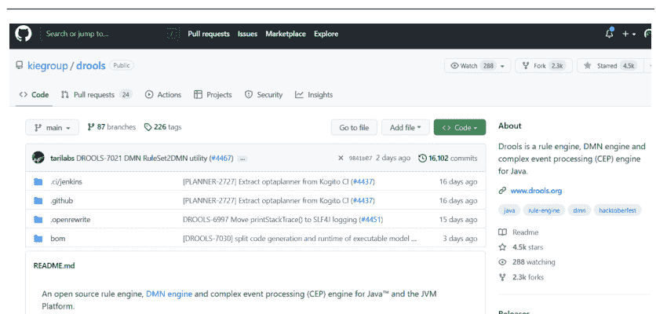

## 图 2.1 – GitHub 上的 Drools 主页

我们简化了 https://github.com/kiegroup/drools 的截图，因为 GitHub 主页上还有更多文件和文件夹（屏幕中左部的文件夹图标）。如果你想，这些文件允许你完全从源代码修改和构建 Drools/Kogito 规则引擎。但在本书中我们不会这样做，所以让我们看看这个页面上我们需要使用的信息：

-   右上角有一个“关于”（About）部分，提供项目的一行摘要。由于它将项目描述为规则引擎，我们知道我们找对了地方。它还链接到主项目网站（drools.org），我们几分钟后会去探索，并提供用户支持的邮件列表。
-   左下角是 readme.md——对项目更详细的描述。它重复了网站的链接，但也分享了更多指向项目文档的链接。
-   左上角是协作工具（例如 Code 和 Branches 或 Main）。我们不会详细讨论这些，但如果你确实想了解世界各地数百人如何使用这些工具在复杂产品上协作，请参阅 George Lomidze 在 Packt 出版的书籍《Git and GitHub: The Complete Git and GitHub Course》，可在 https://www.packtpub.com/product/git-and-github-the-complete-git-and-github-course-video/9781800204003 获取。
-   页面右侧是项目活跃度指标，例如关注人数、星标、分叉数和发布版本。不出所料，这是一个非常活跃的项目——我们不会要求你把时间投入到一个不那么活跃的项目上。
-   右下角虽然没有显示，但那里是项目的贡献者。在撰写本文时，有 200 多位贡献者，这使其成为 GitHub 上最活跃的项目之一。很高兴看到项目背后有*真实的人*。

我们稍后会回到 GitHub，并将其作为保存业务规则的更详细的工具，届时会在*第 5 章*中讨论。在那里，我们将有机会熟悉标准的 GitHub 页面布局。

## 在开源世界中寻求帮助的最佳方式

虽然很容易找到*在哪里*寻求帮助，但我不想让你留下这样的印象：这 200 位贡献者只是坐在那里等着你的电话。虽然他们对 KIE 项目充满热情，但这些都是忙碌的人，都有日常工作（就像你一样）。知道*如何*寻求帮助会给你带来更好的结果。简单来说，多一点谦逊，并先尽力尝试自己解决问题，会大有帮助。

> **先试试你的同事**
> 以下*如何寻求帮助*的步骤，无论是在 IT 服务台与同事合作，还是在开源社区寻求帮助，都同样适用。

以下是遇到问题时应遵循的步骤。你可能以前在 Excel 社区论坛上寻求过帮助。如果是这样，以下步骤对你来说应该都不陌生：

-   1. 始终假设这是你自己的错误，而不是你所使用的底层项目的问题。百分之九十的情况下，当你一步一步排查时，你会发现拼写错误、网络连接问题，或者某个简单的误解。如果你带着一个结果证明是你自己的错误、而且是非常简单的错误去联系项目开发者，你会失去很多信誉。
-   2. **阅读精彩手册（RTFM）** 是古老的经验之谈，再加上**搜索精彩网络（STFW）**。虽然我们在本书中学习的材料对我们来说是新的，但以前有很多人尝试过类似的事情。花点时间阅读这本书和在线文档，并仔细检查你正在遵循的其他任何说明。
-   3. 用谷歌搜索任何错误消息。错误消息是非常好的搜索词，因为它们通常非常具体。搜索引擎会推荐大量值得调查的页面来帮助解决问题。
-   4. 关掉再打开。你的 IT 服务台会要求你重启笔记本电脑来解决一个难以修复的问题，这只有一半是开玩笑。一个不那么激进的方法是关闭并重新打开各个软件（例如，网页浏览器，或重新启动 Docker 桌面服务）。现代软件很复杂，有许多移动部件，很容易彼此失去同步。重新打开它们会给它们一个全新的开始，并使所有不同部分更有可能正确对齐。
-   5. 确保你在正确的地方寻找帮助和信息。请记住，本书结合了多个不同的项目和技术（Excel、Drools、Docker、Azure、Power Automate 和 OpenShift、Visual Studio 等）。在 Drools 邮件列表中问一个 Excel 专属问题，不太可能得到回复。
-   6. 寻找类似的问题。在搜索邮件列表和网络时，要乐于阅读与你当前问题相似但不完全匹配的问题。解决其他项目所采取的一些步骤也可能对你有所帮助。
-   7. 四只眼睛胜过两只。我数不清有多少次同事在看了我的项目几分钟内就发现了问题。即使他们对那种技术没有专业知识，情况也是如此——有时新鲜的视角就足够了。至少，在讲述你在做什么以及随后的问答过程中，会解锁一些让你更接近解决方案的建议。
-   8. 使你的问题自成一体。很少有人会有和你完全一样的设置。在提问时，你越能去除特殊的设置步骤，能帮助你的人就会越多。如果你能附上重现问题的步骤（以步骤 1、2、3 的格式或代码示例），那就更好了。
-   9. 让你的问题变得聪明。你是在寻求帮助，而社区没有义务回复你。花时间让你的问题清晰简洁会提高你成功的几率。Eric Raymond 写的一本著名的提问智慧指南可以在这里找到：https://github.com/selfteaching/How-To-Ask-Questions-The-Smart-Way。
-   10. 再检查一遍。在提问之前，通读前面所有步骤，并记录你已经采取的步骤。这将使你在提问时获得信誉，并避免收到你已经尝试过的建议而产生挫败感。
-   11. 现在，也只有现在，发布你的问题并等待。既然你在寻求社区支持，你需要为延迟收到答案（如果有答案的话）做好准备。你可能不会收到完整的答案，但会收到逐步接近解决方案的步骤。对一些人来说，这没问题。但如果及时的支持对你来说是必须的，那么可能值得考虑 Red Hat 和其他供应商的商业支持选项。

你会注意到，我们（还）没有提供实际提问的位置。我们很快就会分享这些。开源社区很友好，但可能在过去被懒惰的问题消磨了耐心。所以稍加思考，你的问题就会脱颖而出并得到回答。

当你找到一个解决方案（或部分解决方案）时，通过邮件列表或该社区的帮助论坛分享回来。虽然这是善行，但从更实际的角度来说，这将有助于提升你在社区中的声誉，并使你将来更有可能获得帮助。

既然你知道了如何提问，让我们看看与 Kogito/Drools 项目相关的一个可以提问的地方。

## KIE、Kogito 和 Drools 资源

我们已经接触了 Kogito/Drools 项目的许多方面。我们已经看到了项目的各个组件，以及 Drools 规则引擎。我们已经看到了 Red Hat 和 IBM 开源及商业支持项目的双重性质。我们也看到了 Drools GitHub 网站是了解更多项目和寻求帮助的跳板。

虽然这本书会引导你了解开始使用业务规则所需的一切，但我们希望你获得更多资源来深入学习、探索和提问关于 KIE/Drools 规则引擎的问题。

在点击下面的链接之前，请记住，文档是为那些已经熟悉业务规则和底层技术的人编写的。随着你阅读本书的深入，这些文档对你来说会变得更容易理解。不要被这些网站上现在分享的信息的复杂性和细节所淹没：

-   正如我们之前查看 Drools GitHub 网站时所看到的，Drools 主网站是 https://www.drools.org/。
-   此网站顶部的导航栏包含指向总括社区（KIE）的链接。其中许多链接（但不是全部）与业务规则引擎相关——例如，Kogito 项目主页位于 https://kogito.kie.org/。
-   有关该产品企业版 Red Hat Decision Manager 的更多信息，可以在 https://developers.redhat.com/products/red-hat-decision-manager/overview 找到，这在向同事论证使用基于规则的解决方案的商业理由时尤其有用。

这三个链接最有可能持续有效，而以下链接可能会随着时间而改变。如果其中有任何链接失效，你应该能够搜索到更新的链接：

-   由于读者的起点是 KIE Sandbox，因此主 KIE 页面上列出的资源可能最适合首先查看：https://kogito.kie.org/get-started/。这里列出了项目的主要指南、示例和技术文档。
-   Kogito 文档随每个版本更新，并更详细地介绍了我们在本书中重点介绍的功能。它可以在线获取，地址为 https://docs.kogito.kie.org/latest/html_single/。
-   请记住，在底层，Kogito 使用 Drools 规则引擎来驱动决策服务。该网站上有大量规则引擎文档，位于 https://www.drools.org/learn/documentation.html。随着时间推移，这些文档对业务用户越来越友好，但其中一些可能更适合技术开发人员。


- 在 https://www.drools.org/learn/video.html 网站上有很多有用的视频，以及托管在 KIE YouTube 频道上的视频，网址为 https://www.youtube.com/channel/UCUjeymTM-TrwHs36388VRbw。
- 我们之前谈到过如何与开源项目邮件列表互动并在其中提问。主要 Drools 列表为 https://groups.google.com/g/drools-setup 和 https://groups.google.com/g/drools-usage。还有一个更偏向技术的 Kogito 邮件列表，网址为 https://groups.google.com/g/kogito-development/c/18JqnqYTQA。
- Drools 网站上列出了其他良好的帮助来源，网址为 https://www.drools.org/community/getHelp.html。其中一个关键的外部支持站点是 Stack Overflow 上的 Drools，网址为 https://stackoverflow.com/questions/tagged/drools，上面提供了有关如何通过该站点与他人互动的良好说明。
- 你目前可能用不到，但除了托管在 GitHub 上的源代码外，从源代码构建项目的说明可以在 https://www.drools.org/code/sourceCode.html 找到。同样，项目开发者有一个实时聊天频道（类似于 Teams/Slack），网址为 https://kie.zulipchat.com/。虽然知道他们在哪里是件好事，但大多数读者不会直接与他们互动。相反，让我们提醒自己 IBM 和 Red Hat 赞助该项目，并在 https://www.drools.org/product/services.html 提供支持选项。

我们刚刚强调的某些资源只有在你探索后续章节时才会有意义。在阅读本书的过程中，请定期回来看这一节；每次你都会从中获得更多收获。网络上还有大量其他教程，针对不同技术水平编写，随着你阅读章节的推进，值得去探索。

## 回馈社区

即使你不是开发者，你也可以为开源社区做出贡献。这可能只是简单地在邮件列表中发布你之前提出的问题的答案（一旦你找到了）。或者它可能涉及提交错误报告（如果团队要求），或编写和更新文档。

作为 Excel 高级用户，你的技能和时间非常宝贵。只需要愿意学习项目的工作方式并找到需要你帮助的领域即可。技能多样性正是开源项目能够运作的原因。

现在我们对 Kogito 作为开源企业软件有了更多了解，让我们来看看它帮助我们构建的解决方案类型。

## 如何设计和构建企业解决方案

你在上一章中看到，在解决 Excel 问题时，你正朝着更稳健的企业型解决方案迈进。我们解释说，与 Excel 不同，企业解决方案是由许多人构建的，但也可以由许多人同时使用。

当你评估 KIE/Drools 是否能解决你与 Excel 的即时问题时，你需要知道它将长期解决你的问题。这就是我们包含本节的原因——关于设计和构建企业解决方案的足够内容。它应该向你保证，你有一个路线图，可以在更长的时间内将 Kogito 作为更大系统的一部分部署和支持。

本书中你已经看到，企业软件世界与 Excel 世界相似但也非常不同：

- 在上一章中，我们将 Excel 分解为三个部分（模型/数据，以及视图和控制器）。无论我们使用 Kogito 构建什么企业系统，都需要具备这三个部分。
- 在本章中，我们提到与 Excel 中更随意的处理方式不同，企业系统会经历概念验证、开发、构建、测试和生产的生活周期。会有正式流程和团队在每个阶段之间移动。

让我们更详细地查看这些关键部分，以便你了解 Kogito/Drools 如何融入更大的图景。让我们从你将要合作的团队开始。

## 与团队合作

在本章开始时，我们询问了你的当前情况——你是在企业环境中工作（有或没有官方支持），还是处于个人学习的早期阶段，但仍可能在商业环境中应用这些技能。

无论你的情况如何，你可能已经注意到，与由一个人支持的单个文件工作不同，我们正逐渐转向由整个团队支持的系统。花点时间仔细研究团队中的不同角色，这有助于你更好地与他们合作：

- **业务知识专家**：那就是你。你了解业务如何运行（或希望如何运行），以便团队可以将流程转化为适当的技術。
- **软件架构师**：勾勒出软件解决方案的设计，并在工具和技术的使用上做出关键决策。
- **UX 或用户界面专家**：负责设计系统与用户交互的所有元素，使其尽可能易于使用。
- **开发人员**：使用 Java、C# 和 Python 等语言编写系统的复杂部分。
- **测试人员**：在系统接近完成时尝试破坏系统。虽然其他团队成员可能并不完全欣赏这一点，但他们会暗自高兴，因为问题或错误越早发现，修复起来就越容易、越快。
- **项目经理**：负责整个团队按时、按规格、按预算交付整个系统。
- **系统或云管理员**：负责在开发、测试和生产阶段运行系统的基础设施。通常，他们会是第一个在系统在*现实生活中*运行时标记问题的。

对于较小的项目，多个角色可以合并。或者，更大的组织可能有团队将这些角色拆分。无论如何，你作为业务知识专家的角色对整个团队至关重要，优秀的业务专家对于交付使组织有效运行的系统来说是无价的。

## 软件架构师做什么

就像建筑师设计房屋一样，企业软件架构师设计企业软件。两者都是很棒的工作，有许多技术精湛且很有主见的人。一些软件架构师可能会对我在下图中提出的“一刀切”企业解决方案感到不满。

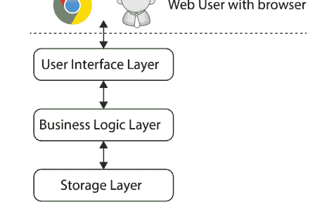

图 2.2 – 一刀切的企业软件图

*图 2.2* 很简单，但显示了大多数系统的工作方式：从用户获取信息，以某种方式处理它，然后存储在某处。将设计拆分为三个层级后，更容易理解每个层级的作用：

- **用户界面层**与*真实*的人进行通信。通常，这是一个网页。但如果我们想改为语音界面（如 Amazon Alexa）或 3D 角色，我们只需更改这一层。
- **业务逻辑层**是我们对用户信息进行操作的地方。它可能会使用所选日期来建议航班，更新你的银行余额，或执行运行业务所需的任何其他流程。
- 除非你希望在几秒钟内忘记一切，否则你的企业软件需要一个**存储层**。传统上，这些是 Oracle 或 Microsoft SQL Server 等数据库（可认为是更稳健、更大的 Excel 版本）。更近期的技术针对云进行了优化，可以处理数亿用户。重点是我们不太关心技术，只要它在需要时存储和检索信息即可。

通常，每个层只做一件事。尽管该图示暗示一切都在一台计算机上运行，但不必如此。每个层都可以在自己的容器中（稍后会详细介绍），托管在不同国家的不同数据中心。

毫不奇怪，本书我们主要关注业务逻辑层，因为 Drools 规则引擎将部署在那里。但当我们介绍示例时，我们需要为你提供用户界面和存储层以便开始。

毫无疑问，有了部署业务规则的长期路线图，你会感到安心。但值得提醒自己，许多软件架构师只处理过业务逻辑层以 Python、C# 和 Java 等语言编码的系统。还记得我们在上一章讨论的*业务规则消失在代码中*的问题吗？那正是同样的问题。

如果你需要说服你的软件架构师同事在业务逻辑层使用业务规则引擎，请向他们说明以下几点：

- **层分离：** 用于存储数据和创建用户界面的工具和框架已存在。规则引擎为业务层提供了类似的框架。它使代码在不同层之间泄漏的可能性降低。这是企业架构师的关键主题，他们试图设计每个组件只做一件事并且做得好的系统。
- **知识管理：** 业务规则，即知识，是任何大型企业软件的核心。在本书提出的方法中，规则可以由业务用户编写，并且同一个规则文件可以被管理和执行，避免了因沟通不畅而产生的错误。规则引擎可以成为管理对业务至关重要的所有知识的自然归属。你将能够以人类可读的格式编写说*做什么*而不是*怎么做*的业务规则。
- **版本控制和编写：** Kogito/Drools 附带的工具允许业务知识在与代码部署不同的时间线上进行测试和部署。例如，在在线房屋贷款申请中，贷款规则可以独立于网站的更改而更新。这使企业能够快速应对不断变化的环境，而不会引入新错误的风险。
- **速度和可扩展性：** 在云中部署时，时间（和所需的计算资源）就是金钱。规则引擎的工作方式在数学上比人工编写的代码更高效，因为它们基于 PHREAK 算法（Rete 的演进）用于基于 DRL 的规则，以及 DMN 引擎中的高效算法，用于快速有效的决策。


- **审计：** 与其他类型的 AI 不同，规则系统旨在解释特定决策是如何以及为何做出的。虽然通过手工编写的代码也可以实现这一点，但在实践中却相当困难，因为你通常需要逐行检查日志文件才能获得相同的信息

我们花了几页篇幅进行长期思考，以确认我们选择 KIE/Drools 规则引擎的学习投入是值得的。我们已确认它现在就能为我们解决问题，并为我们未来持续使用提供可扩展的路径。

但我们有一个更紧迫的问题。我们正处于 *概念验证* 阶段，目前还没有一支完整的团队来帮助我们构建它。我们需要引入支持项目来填补这一空白，以便你能轻松运行书中的示例。

## 支持 Kogito、KIE 和 Drools 的容器

本书重点关注规则引擎。但本书的另一个关键目标是帮助你从使用基于 Excel 的解决方案（运行在你的桌面上）过渡到更强大的企业级解决方案，这些解决方案可以同时被许多人使用。容器使这一旅程变得更容易，所以让我们快速了解一下这项技术是什么以及我们将如何使用它。

> **我真的需要学习容器吗？**
> 
> 简短的回答是否定的。这是一本关于 Excel 和 Kogito/Drools 规则引擎的书，即使你只专注于这些领域，你在日常工作中也能获得价值。
> 
> 但很可能其他人会对你所做的事情感兴趣，并希望为你的业务规则做出贡献和/或运行它们。容器技术可以帮助你更有效地协作和部署你的规则。

在某种程度上，你在使用 Excel 时已经使用过类似容器的东西。对于大多数电子表格，你只需与他人共享——并且知道它们能正常工作，无论他们笔记本电脑上的具体设置如何。这在他们使用其他类型的电子表格时也（大多）成立——例如 OpenOffice 或 Google Sheets。Excel 作为你的容器隐藏了所有软件复杂性——它就是能工作。你的同事可以像你制作的那样查看电子表格。

随着 Kogito、KIE 和 Drools 的使用，一旦我们超越本书前半部分在线沙盒中的第一个示例，就会使用更复杂的软件。因此，作为作者，我面临一个挑战——我该如何以易于使用的方式将这款软件交到你的手中？让我们逐步分析选项：

- 对你来说最简单的选择是我亲自在你的笔记本电脑上安装软件。但由于我只有一个人，而读者有数千人，这并不是一个现实的解决方案。
- 下一种方法是给你一套详细的说明供你遵循。你是一名 Excel 高级用户，如果一切顺利，你有合理的机会做对——

但如果在 20 个步骤中的多于一个步骤出现问题会怎样？每台计算机的设置都不同，没有办法给出简单的说明来涵盖所有可能性。

- 最后一种选择是将运行本书示例所需的工具打包在一起——我们称之为 **镜像**。然后我们可以将此镜像提供给你，放入你笔记本电脑上的预先准备好的空间中（我们称之为 **容器**）。如果容器不仅仅是一个存储文件的地方，而是能够以某种方式保证镜像在所有机器上以完全相同的方式运行，那将是理想的解决方案。这就是 **Docker** 和其他容器化技术所提供的。

容器以其名称命名，源自你看到的卡车、火车和货船背后的集装箱。它们具有类似的目的，即移动软件。只要一切都装进容器中，一切就能正常工作——无论里面是什么，同一台起重机都可以将集装箱装卸到船上。

## 容器是一件大事

很难低估软件容器化有多重要。

例如，在类似书籍的上一版本中，如果一切顺利，运行示例的技术需要 2-3 小时才能安装。但尽管它针对的是更技术性的受众，事情仍可能出错——部分原因是每个人的笔记本电脑设置都不同。

在幕后，容器方法使我们能够使用 KIE 沙盒软件，该软件将在下一章中用于编写我们的第一个规则，并使我们能够在 2-3 分钟内开始编写规则。

我们将在后面的章节中更详细地介绍容器，因为我们希望为你提供从本地运行和编辑规则到在稳健、可扩展的生产环境中部署规则的顺畅路径。

容器现在被广泛使用。因此，虽然我们选择了 Docker（因为它具有最用户友好的桌面工具），但在 https://opencontainers.org/ 上列出了替代工具，包括 Podman。正如你在第 10 章中看到的，我们也可以使用 Microsoft Azure、Red Hat、Amazon 和 Google 在云中运行相同的容器。我们将在后面的章节中安装和使用 Docker 运行示例时了解更多关于 Docker 的信息。

在结束这个话题之前，值得强调容器的安全优势——尤其是如果你需要向同事征求安装 Docker 的许可。容器（正如其名称所暗示的）与运行它们的计算机完全隔离。即使你可能觉得可以信任我作为作者（毕竟，我们已经进入了本书的第二章），并且你可以检查其中运行的内容和源代码，Docker 仍会将代码隔离在其自己的容器中，为你提供另一层安全性。

## Windows、Mac 和 Linux

由于我们使用 Docker 和容器，本书中使用的所有示例都将在最近版本的 Windows、Mac 和 Linux 上运行（只要你的机器符合 Docker 硬件规格）。我们有关安装 Docker 的详细说明将侧重于 Windows，但 Linux 和 Mac 机器的替代说明可在网上免费获得。

现在我们已经了解了支持技术，让我们看看它们为你运行这些书籍示例提供的选择。

## 四种不同的业务规则工作方式

现在我们了解了容器，让我们看看我们将如何使用它们来运行业务规则，因为我们将阅读本书。记住，与 Excel 不同，编辑规则的工具选择与运行规则的引擎选择是分开的。我们以一种保持简单的方式在此处介绍四种主要选择，但你仍然可以选择在它们之间进行挑选。

这些选项从最简单的开始，逐步提升到更强大的。这与我们从 Excel 到企业级解决方案的旅程一致。在全部四种建议中，我们继续从笔记本电脑使用 Excel 并调用业务规则引擎，无论它位于何处：

- 1. **在 KIE 沙盒在线编辑，使用笔记本电脑上的 KIE 扩展服务作为引擎：** 这是我们开始使用的解决方案，因为它最易于使用。它隐藏了大量复杂性，这对于入门非常棒，但最适合单用户。
- 2. **在 KIE 沙盒在线编辑，使用 OpenShift 在云中运行我们的规则：** 我们将在 *第 5 章* 中介绍这种方法，利用 KIE 与 OpenShift 之间的集成。*附录 B* 给出了这种方法的变体——我们使用 codespaces（托管在 Azure 云中）做类似的事情，但使用 VS Code 作为编辑器。
- 3. **在你的笔记本电脑或其他你有权访问的计算机上的容器中托管编辑器和引擎：** 一旦你安装了 Docker，在其中运行 Kogito 容器镜像就很容易。我们将其作为向使用 Red Hat 以外的提供商（例如 Microsoft、Amazon 或 Google）在云中部署规则迈进的垫脚石。容器也可能是你的 IT 部门在贵组织内部部署 KIE 工具和 Drools 规则引擎的首选方式（将所有知识保留在内部）。我们在 *第 10 章* 中介绍这种方法。
- 4. **最终的方法是自行设置技术栈：** 如果你具备技术知识（或认识一位具备技术知识的同事），这相对简单。我们不会详细介绍，尽管 *附录 B* 中提供了一些提示。完整的说明可在我们之前分享的 KIE 和 Drools 链接中找到。这使你完全控制业务规则的部署方式。


四种不同的运行本书示例的方式看起来可能很多，但每个读者的电脑都不同，硬件、软件和配置的组合有数十亿种，不可能全部测试。

例如，一些组织可能会阻止你下载和运行 .exe 文件（这是使用 KIE Sandbox 的第一个选项所需的）。在这种情况下，用户可以跳过前面，直接使用云端方法来运行示例。通过提供四种替代方案，我们更有可能让每个读者都能运行示例。

> **需要一些自行组装**
> 
> IKEA 家具以其设计而闻名，但也以平包装并需要自行组装著称。通常，我第一次装不成功，但我愿意再试一次，并在需要时寻求帮助。
> 
> KIE 与其他企业软件类似。你需要按照说明操作才能使其运行。虽然这些步骤并不困难，但这与 Excel 世界（为你预先构建好）会大不相同。如果你不喜欢自行组装也没关系；你应该能够在不费太多力气的情况下完成到 *第 9 章*。到那时，希望我们能说服你，业务规则的强大功能使付出的努力物有所值。

### 摘要

在本章中，我们更深入地了解了你作为读者的情况，以及在你阅读本书的过程中，同事可能为你提供的支持程度。

我们查看了可用的不同业务规则引擎，以及我们为何推荐在本书中使用 Kogito/Drools，并看到了 Red Hat 的一些其他有趣项目的 glimpse。由于开源是这一决策的关键部分，我们查看了社区提供的支持，并看到了可以让我们更深入了解该技术的资源。

由于我们将在 KIE 项目上投入大量时间，我们提供了关于将其作为更广泛软件解决方案的一部分部署给您和您的团队带来的长期利益的保证。这包括了解企业解决方案比 Excel 更强大也更复杂、从事这些解决方案的人员团队，以及 KIE 和 Drools 如何融入这一整体企业解决方案。

最后，由于并非每个人在阅读本书时都拥有这样的团队，我们将容器作为支持技术进行了探讨。这使我们作为 Excel 强大用户能够快速启动，同时仍然为我们提供路线图，以便在真实的业务环境中部署我们所学到的内容。

前两章介绍了 Excel 的问题，以及业务规则如何解决它们。因此，你会很高兴地听到，在下一章中，我们将编写我们的第一个业务规则。

## 编写我们的第一个业务规则

现在我们准备编写第一个业务规则，入门就像打开浏览器一样简单。大多数现代浏览器都可以 – Chrome、Safari 或 Edge。截至撰写时，Firefox 的当前版本缺少运行 KIE Sandbox 的功能，但这很快可能会得到解决。在浏览器中，访问 http://dmn.new（镜像于 https://sandbox.kie.org）。你应该会看到类似图 3.1 所示的页面：

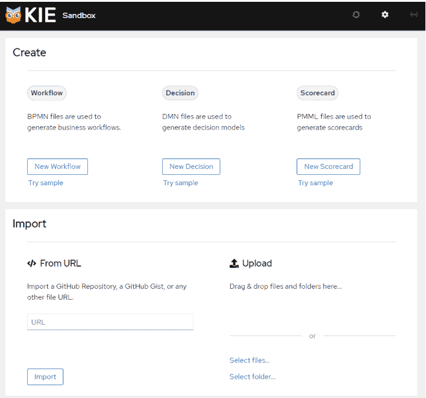

图 3.1 – KIE Sandbox 主屏幕

KIE 编辑器正在投入大量时间进行演进，因此此截图与你在笔记本电脑上看到的内容可能存在一些差异。然而，无需担心，因为决策编辑器基于 DMN 标准（稍后会详细介绍），因此任何差异很可能只是外观上的。

在 KIE Sandbox 主页上，有三个选项：

- 我们将在第 8 章中介绍工作流，AI 和决策服务在 Excel 和 Power Automate 工作流中的应用
- Scorecards 与 PMML 和机器学习相关，这是我们在 *第 11 章* 中将要涵盖的主题
- 现在，我们对决策/规则感兴趣

点击 **New Decision**（如图 *图 3.1* 所示），类似 *图 3.2* 的 KIE 决策编辑器将会出现：

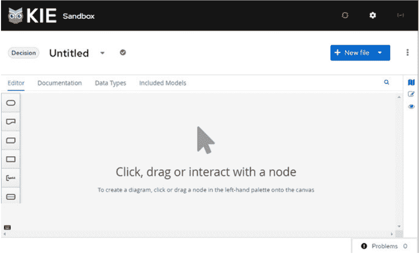

图 3.2 – KIE Sandbox 中的 KIE 决策编辑器

我们知道我们来对地方了，因为在左上角的 KIE 标志下方写着 **Decision**。这个屏幕上有许多内容。我们将在接下来的几页中通过 `Hello World` 示例逐步介绍这个 **用户界面 (UI)** 的各个元素。

### 参观

你可能会看到一个弹出菜单，KIE 提供 5 分钟的介绍参观。花几分钟时间玩一下这个参观是值得的，这也是熟悉屏幕的另一种方式。点击 **Skip Tour** 将带你返回主 KIE 决策编辑器。

这个模型看起来不错，但描述性不强。双击每个形状可以编辑其名称。由于 DMN 是为业务用户设计的，你可以 pretty much 按你喜欢的方式命名它们（命名限制比 Excel 少），但对于本示例，如果你使用 `greeting` 作为决策节点名称，并使用 `name` 作为 InputData 节点名称会更容易，如 *图 3.5* 所示：

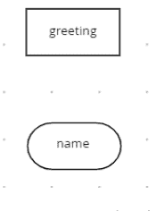

很好 – 现在我们很清楚我们期望传入一个名称（圆角框），我们将做出决定回复哪个问候语（矩形框）。

虽然在这个简单的图表中很明显，我们仍然需要明确告诉 KIE 决策中使用了哪些数据。我们可以通过从 name（InputData）节点绘制箭头到 greeting（Decision）节点来做到这一点。

首先点击 name 节点，以便在其周围出现额外的图标，如 *图 3.6* 所示：

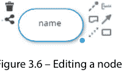

我们稍后会回到其他图标，但现在，点击箭头按钮（**Create DMN information requirement**）。这允许你从数据绘制箭头到 `greeting` 节点。箭头的方向很重要，因此请确保你的图表看起来像 *图 3.7*：

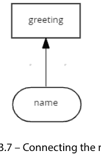

根据图表中可以看到的内容，KIE 现在知道我们希望将名称输入到 greeting 决策中。但我们仍然没有告诉 KIE 它将如何做出决策 – 让我们现在修复它。点击矩形框 **greeting** 节点，如图 3.8 所示：


图 3.8 – 编辑节点属性

然后，从出现的图标中，点击 **Edit** 图标（中间左侧的带铅笔的正方形）。屏幕将更改为类似图 3.9 的截图：

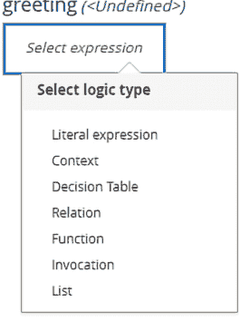

图 3.9 – 编辑决策节点类型

你可能需要点击 **Select expression** 框以查看此下拉菜单，显示可用的不同逻辑类型。选择 **Literal expression**。

> > **编辑器的一个怪癖**
> >
> > 小心 – 在当前版本的 KIE Sandbox 中，一旦你选择了逻辑类型，就无法更改它。
> >
> > 如果你选择了错误的表达式类型，你将需要返回到主决策图，删除整个 greeting 节点，然后创建一个全新的节点（包括重命名节点并将其连接到 InputData 节点）。

我们稍后会介绍不同的逻辑类型，但可以把它想象成你在 Excel 中输入的函数。你应该会看到如图 3.10 所示的 Literal expression 编辑器：

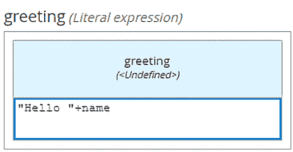

图 3.10 – 表达式已添加到决策节点

在图 3.10 中，我们已经在框中输入了公式 – 我们使用了 "Hello "+name 函数。

与 Excel 类似，在输入表达式时，请注意拼写正确，注意双引号，并确保名称与我们为 InputData 节点命名的名称匹配。在框式编辑器中输入时，应该会出现弹出建议来指导你。

### 框式表达式和 FEEL

像这样在框中输入公式应该感觉很熟悉 – 它非常像 Excel。毫不奇怪，它们被称为 **框式表达式**。框式表达式使用的语言称为 **Friendly Enough Expression Language (FEEL)** – 一种最初来自 Oracle 的标准。你将在接下来的章节中看到它非常强大。但就本示例而言，只需理解它与 Excel 函数相似，但并不完全相同。

编辑完成后，点击 **Back to Untitled** 链接返回到主决策图。虽然你已编辑了决策标准（并且表达式已保存），但图表仍将看起来像之前的图 3.7。别担心，你可以点击节点，然后再次编辑；你会看到表达式已成功保存。

拥有图形编辑器是很好的，因为图表很容易理解。然而，一个缺点是遵循图形说明可能很棘手 – 尤其是因为一步做错可能导致你得到非常不同的结果。

因此，本书（以及所有章节）中的决策模型示例都可以在本书的 GitHub 页面上找到（ https://github.com/PacktPublishing/Business-Rule-Engines-and-AI-for-Excel-Power-Users ）。本章后面“从其他来源上传决策模型”部分展示了如何将这些示例加载到你的本地沙盒中（提示 – 非常容易！）。

我们已成功在网页编辑器中设计了第一个 Hello World 规则。但要运行它，我们需要先下载一个程序。


## KIE Sandbox 扩展服务

Excel 非常方便——它将编辑和执行公式的应用程序捆绑到一个软件包中。大多数企业软件（包括 KIE/Drools）将这些步骤拆分为单独的步骤——你在一个工具中编辑规则，然后有意识地决定执行它们，通常使用单独的软件包。虽然工作量稍大，但这意味着你在编辑时不会意外地 *破坏* 某些东西，这使得你的规则解决方案更加稳健。

到目前为止在本章中，我们一直在使用在线 KIE 编辑器。但我们需要一种方式来执行我们的决策和规则。为此，我们需要 KIE Sandbox 扩展服务。

浏览器在过去 20 年里取得了长足的进步——以至于很容易忘记 KIE Sandbox 编辑器并不是一个原生的桌面应用程序。虽然诸如 WebAssembly 之类的工具在未来有可能使体验更加顺畅，但很难让 KIE 或 Drools 这样复杂、面向企业的软件完全在浏览器中运行。或者至少让它在浏览器中运行，使其行为 *完全* 与企业 IT 团队部署时一样。这很重要，因为你不希望规则在那时行为不同而出现任何意外。

幸运的是，KIE 团队有一个非常好的解决方案——他们提取了规则引擎的核心要素并将其打包，以便可以轻松下载和运行。这意味着我们在编辑规则时可以获得即时反馈，并且可以确信当我们稍后部署完整解决方案时，规则的运行方式相同。这个打包版本称为 **KIE Sandbox 扩展服务**，我们将在下一节中下载它。

> **谨慎行事是有回报的——但你可能需要征求许可**
> 
> 提醒一下——虽然无需安装，但在 Windows 上，扩展服务打包为 .exe 文件。虽然我们信任该文件的来源（参见 *第 2 章，选择 AI 和业务规则引擎——为什么选择 Drools 和 KIE？* 中的 *开放可能更安全* 部分），但 Windows 会更加谨慎，因为 .exe 文件非常强大，在错误的人手中可能会造成损害。这适用于大多数软件，而不仅仅是 KIE 的工具。

根据经验，你在下一节中遇到的绝大多数问题都是因为你的 IT 部门出于安全原因阻止了下载或运行 .exe 文件。有替代方案，例如部署到云端（我们将在 *第 5 章* 中介绍，并在 *第 10 章* 中再次介绍）。但 KIE 扩展服务支持的编辑规则、测试规则循环非常高效，值得你申请运行它的权限。

让我们逐步了解下载、回答一些简单的安全问题、启动扩展服务，然后连接到 KIE Sandbox 的步骤。

## 下载和运行 KIE 扩展服务

KIE Sandbox 扩展服务打包使其尽可能易于使用。

在 KIE Sandbox 网页的右上角，你应该会看到类似图 3.11 的消息。你可能需要最大化 KIE Sandbox 窗口才能完全看到它。

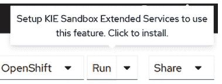

图 3.11 – 提醒安装扩展服务

此警告消息仅在你未安装 KIE 扩展服务时出现。幸运的是，点击安装是修复它的第一步。在看到解释扩展服务是什么的屏幕后（点击 Setup 进入下一步），你应该会看到类似图 3.12 的面板：

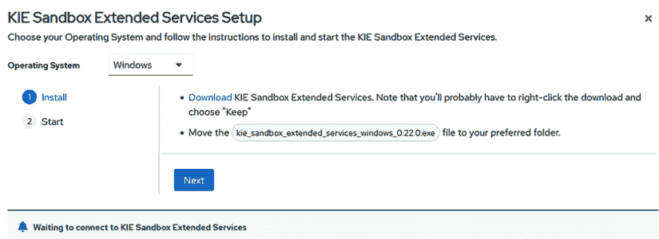

图 3.12 – KIE Sandbox 扩展服务下载屏幕

这是 KIE Sandbox 扩展服务设置屏幕，允许你选择要下载的适当软件包。选择你的操作系统，然后点击下载以获取所需文件。

> 想获取直接下载链接吗？
> KIE Sandbox 中的下载 URL 链接到 https://github.com/kiegroup/kie-tools/releases —— 通常，你取最新版本，虽然你也可以选择较早的版本。构建扩展服务工具的源代码也发布在此站点上，以防你或你的 IT 同事希望出于安全原因对其进行审计。

文件完全下载后，前往你保存它的位置，然后双击打开并运行它。同样，值得记住的是，一些 IT 部门可能会阻止你执行此操作。如果发生这种情况，你会看到错误消息，并且需要联系他们请求移除任何阻止。

即使你有权限运行它，Windows 也会再次检查你是否知道自己在做什么。在 Windows 11 上，你会看到类似图 3.13 的屏幕；其他版本的 Windows 会有类似内容：

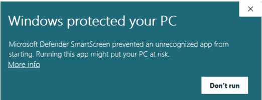

图 3.13 – Windows 11 EXE 警告屏幕

如果你看到类似的警告屏幕，点击 更多信息。你应该有选项可以继续运行。

你也可能会收到来自 Windows Defender（或类似防病毒软件）的警告，如图 3.14 所示：


图 3.14 – Windows Defender 权限屏幕

KIE Sandbox 扩展服务本质上是一个迷你 Web 服务器（以便在线编辑器可以与其通信），因此它需要通过网络进行通信。这是正常的，因此你可以通过点击 **允许访问** 按钮向 Windows Defender 确认这一点。

幸运的是，这些安全检查只需执行一次。如果你看到类似 *图 3.15 和 3.16* 的两个屏幕，一切都运行正常。


图 3.15 – 编辑器中的确认

*图 3.15* 显示了 KIE Sandbox 编辑器中一切运行正常的确认消息。

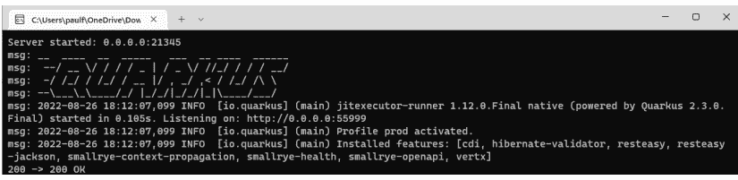

图 3.16 – 扩展服务正在运行

*图 3.16* 显示了在后台打开的控制台窗口。两个关键消息是开始时的 *Server started* 和结束时的 *200 -> 200 OK*，表明必要的服务已启动。

## 故障排除 KIE Sandbox 扩展服务

我再重复一遍——出现问题的最可能原因是你的 IT 部门的安全限制。如果你遇到安装问题，请重试下载过程（注意任何警告消息），并联系你的同事以获取运行所需的权限。

如果不是这种情况，请查看上一章中的 *如何寻求帮助* 部分。还值得尝试以下额外步骤：

- 在控制台窗口（*图 3.16*）中查找任何有用的错误消息。
- 重启你的笔记本电脑（显然，这也会重启你的浏览器）。每次重启后，你需要找到 KIE Sandbox 扩展服务文件并双击它以手动启动。它默认不会自动运行。

那么，当你在 KIE Sandbox 页面上输入值时，浏览器和你新安装的 KIE 扩展服务之间发生了什么？

1. 当你在输入字段中编辑值时，浏览器中会触发一个事件。
2. KIE Sandbox 网页（使用标准 JavaScript）将输入值转换为称为 **Javascript Object Notation (JSON)** 的格式。它还包含需要执行的决策模型（以 XML 格式）的副本。有关这两种格式的更多信息将在本书后面介绍。
3. KIE Sandbox 网页调用扩展服务，将值传递给它。此过程类似于在浏览器中打开一个网页。
4. 扩展服务（由 KIE/Drools 提供支持）将决策模型编译为可工作的格式。然后 KIE/Drools 引擎执行图表，将输入信息（名称）传递给它。
5. 结果被传回 KIE Sandbox 网页并处理，以便可以显示结果。

如果你好奇想亲眼看看这些步骤，浏览器中的开发者工具将允许你更详细地窥探幕后。我们不需要这样做，因为 KIE 会为我们处理所有细节。

你们中有些人可能急于从 Excel 中调用此过程，那么请查看 *第 6 章*，我们在其中开始将 Excel 与 KIE/Drools 规则引擎链接起来。但就目前而言，KIE Sandbox 为我们提供了一个强大的环境来编辑和运行我们的决策模型。

如果我们要编辑更多决策模型来编写规则，那么值得更详细地研究它们。

## 更多关于决策模型的信息

由于我们直接进入示例并专注于获得一个可工作的业务规则，我们只对决策模型有一点了解。官方称为 **DMN**，其三个主要好处如下：

- **决策模型对业务用户可访问。** 你可以将 `Hello World` 示例与同事分享，让他们在没有任何技术培训的情况下理解发生了什么。
- **决策模型可执行。** 与其他图表不同，无需技术同事将其翻译成可执行代码。我们可能在 Excel 中将此视为理所当然，但这是一个激进的想法。在其他解决方案中，图表和代码经常脱节，因此我们永远无法完全确定业务决策过程。由于决策模型可执行，我们没有这个问题——图表中的内容就是决策的方式。


- 像 Drools 这样的规则引擎并不是执行决策模型（Decision Model）的唯一方式。它非常有效，也是本书重点关注的方式。
- 决策模型使用的 FEEL 语言中提供的某些表达式可以由业务规则引擎执行，但无法优化。实际上，你会重视这种灵活性，只有当你的 FEEL 表达式变得过于复杂而难以理解时才会关心。此时，你可以将表达式重写为决策表格式（即业务规则）。我们将在 *第 4 章* 中介绍决策表。
- 在决策模型中，重点在于要做出的决策，然后才是我们如何做出该决策。在我们之前的示例中，你首先创建了决策节点（*respond to greeting*），然后才创建了如何做出该决策的规则（*answer Hello + name*）。可以使用 KIE/Drools 在没有任何图形化决策节点的情况下创建业务规则。业务规则引擎然后可以完全自由地决定何时触发——对于某些具有数十万条业务规则的应用而言，这是一种更强大的方法。

实际上，决策模型非常易于理解，图形化编辑器也非常强大，使其成为进入业务规则世界的绝佳入口。随着你在本书之外进一步探索，请记住这种细微的差异。

## UI 概览

我们的 Hello World 示例是一个很好的开始，但显然，决策模型和规则可以做得更多。让我们稍微扩展一下我们的 Hello World 示例，并在过程中探索 KIE Sandbox。

开始时，你可能已经注意到 KIE Sandbox 决策模型屏幕右下角标记为 **Problems** 的蓝色框，如 *图 3.18* 所示：

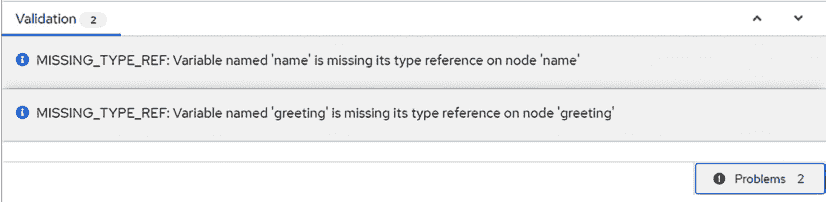

这是你点击 **Problems** 按钮时显示的屏幕。但这些消息是什么意思？什么是变量，又如何会缺少类型引用？让我们解释一下变量和类型是什么。

## 什么是变量？

你几乎肯定在 Excel 中输入过公式来相加两个单元格——例如 = A1+B1。在这种情况下，你是在告诉 Excel 去名为 A1 的框（单元格）中取值，并将其与 Excel 在框（单元格）B1 中找到的值相加。如果框（单元格）中的值发生变化，公式返回的结果也会发生变化。将 A1 和 B1 视为变量。

如果你在 Excel 中使用过命名范围，你就更接近于决策模型、KIE/Drools 以及大多数现代计算机语言使用变量的方式。你的变量可以取任何你喜欢的名字——在这种情况下，是个人的名字。

我们决策图中的输入节点是一种变量类型，但创建它们还有其他方法，我们将在下一章看到。

## 什么是类型？

通常，Excel 会很好地为你管理数据类型。大多数时候，你不需要考虑它——你可以将任何值（数字、文本或布尔值如 true 和 false）放入单元格，Excel 会尽力处理它。KIE 使用的 FEEL 语言允许类似的东西——它被称为 Any 数据类型。

有时在 Excel 中，最好指定我们使用的变量（或单元格）的类型——例如，告诉 Excel 我们处理的是日期而不是数字。

KIE 也是如此。虽然你可以使用 Any 数据类型，但最好指定你正在使用的数据类型。这有助于 KIE 减少业务规则中难以找到的错误。除了我们可能从 Excel 熟悉的许多数据类型外，KIE 还有更多强大的数据类型，我们将在第 4 章中进一步探索。

值得庆幸的是，这些错误只是警告，并不会阻止决策模型产生结果。这些错误消息是在提醒你做正确的事情。让我们让 KIE 高兴起来，并在我们的示例中指定数据类型。

## 如何修复这些错误

转到我们的决策模型并选择 name 输入节点，如 *图 3.19* 左侧所示：

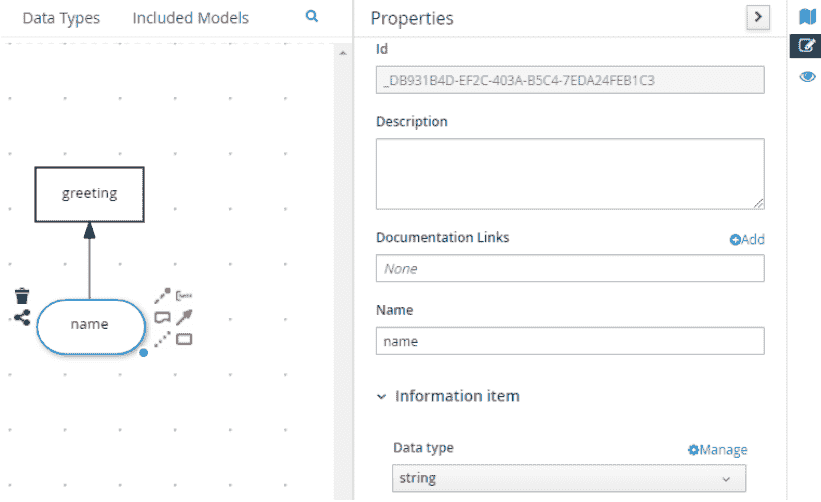

图 3.19 — 将 name 数据类型更改为 string

在此图中，我们已经点击了屏幕右上角的 *Properties* 图标，以在右侧打开 **Properties** 面板。

然后我们将 Data type 设置为 **string**（图的右下角）。*String* 只是文本的另一种名称。

一旦我们做出此更改，**Error** 面板中的其中一个错误应该会消失，因为我们告诉 KIE 预期此节点提供字符串作为输入类型。

对于 *greeting* 节点也是类似的过程（右键单击该节点，编辑属性，并将 Data type 设置为 **string**）。第二个警告错误应该会被清除，因为我们告诉 KIE 该决策节点以文本作为其输入类型。

## 为我们的决策模型命名

到目前为止，我们的决策模型被称为 **Untitled**，但我们可以做得更好。双击屏幕左上角名称 **Untitled**，即可将其重命名为 `Hello World`，如 *图 3.20* 所示：

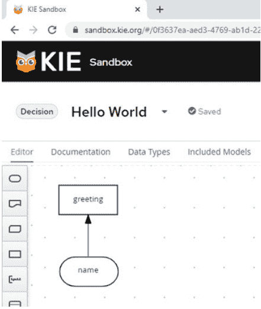

图 3.20 – 更改我们的 DMN 模型名称

如果你想导出副本，请点击屏幕右上角的 **Share** 按钮，如我们在 *图 3.3* 中看到的那样。如 *图 3.21* 所示，这将允许你下载当前图表的 DMN 文件副本：


图 3.21 – 下载 DMN 图表

如果你愿意，可以在 Notepad 或类似编辑器中打开下载的文件（使用的布局是 XML）。该文件的格式是决策模型 OMG 规范的一部分，这意味着你应该能够在另一家厂商的工具中执行此 DMN 文件。在幕后，XML 格式使我们将在 *第 5 章* 中介绍的高级代码编辑和协作技术成为可能。

但实际上，你主要会使用图形化编辑器，而此下载功能的主要用途是使其更容易与同事共享决策模型。

## 先前的自动保存决策模型

你会注意到我们谈论的是 *导出* 而不是 *保存* 决策模型。这是因为 KIE 会在浏览器存储中自动保存 DMN 模型，这是大多数现代网络浏览器的标准功能。这意味着即使我们关闭浏览器并重新打开它，它也不会消失。

让我们试试——关闭并重新打开 https://sandbox.kie.org/#/ 的浏览器。如果你查看 KIE 主页底部，你会看到类似图 3.22 的内容：


图 3.22 – 最近的模型

随着你创建和编辑更多决策模型，近期模型列表会增长。虽然浏览器存储相当稳健，但它对每个浏览器都是唯一的。如果你使用笔记本电脑上的 Chrome 和 Edge，每个浏览器都会有自己的近期模型列表。虽然这对我们现在来说足够好了，但我们将在第 5 章看到一种更可共享、更稳健的模型存储机制。

## 从其他来源上传决策模型

在离开 KIE Sandbox 主页之前，值得强调一下我们之前跳过的一个功能。屏幕右侧有如图 3.23 所示的选项：

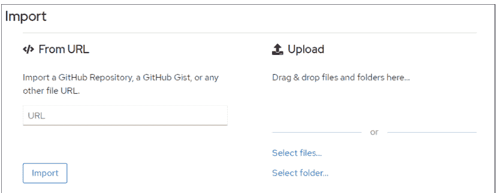

图 3.23 – 在 KIE Sandbox 主页上导入和上传 DMN 模型

这些选项允许你从 URL（网页地址）导入之前创建的决策模型，或上传已在计算机上的文件。随着我们在本书记载其余示例，我们通常会提供包含完成结果的文件以便更容易跟进。此屏幕将允许你轻松地将这些示例文件导入到本地 KIE 沙盒中。

让我们继续在我们刚刚创建的示例基础上构建。

## 更完善的问候决策模型

现在我们知道可以导入示例，我们可以在接下来的几页中加快一点速度。我们仍将逐步完成示例说明，我们可能会通过这样做学到更多，但我们有导入最终决策模型的安全网，以防任何步骤不够清楚。

我们的 Hello World 决策模型不错，但我们知道可以做得更多。让我们尝试做一些更复杂的事情。我们将为你提供两种跟进此示例的方式。

## 选项 1 – 导入示例

虽然我希望你按照我们在其他选项中列出的逐步说明进行操作，但以下是导入示例决策模型的快捷方式：

- 1. 前往 GitHub 书籍示例页面 https://github.com/PacktPublishing/AI-and-Business-Rules-for-Excel-Power-Users 并下载 03_sample_02_Good Morning.dmn 模型到你的笔记本电脑。
- 2. 要下载它，请点击 GitHub 上的文件名；将打开一个显示文件的网页。点击此页面的 raw 按钮以仅查看文件内容，不带格式。
- 3. 在浏览器中右键单击原始内容并选择另存为...。选择文件名时，请检查你选择的是所有文件而不是 txt，因为这会导致文件名出现问题。
- 4. 打开 Windows 资源管理器，确保在菜单中勾选了 view... file extensions。前往你保存文件的位置，并仔细检查文件末尾是否没有被添加 .txt。
- 5. 如图 3.23 所示打开 KIE Sandbox 主页。点击 Select files 并选择你刚刚下载的决策模型。
- 6. 点击 ok 导入模型——你应该会看到如图 3.24 的决策模型。

仍然值得阅读逐步说明以了解我们是如何构建此决策模型的。


## 选项 2 – 分步说明

我们的分步说明从我们在图 3.20 中最后看到的 Hello World 决策模型开始。我们将对其进行以下更改，以获得如图 3.24 所示的决策模型：

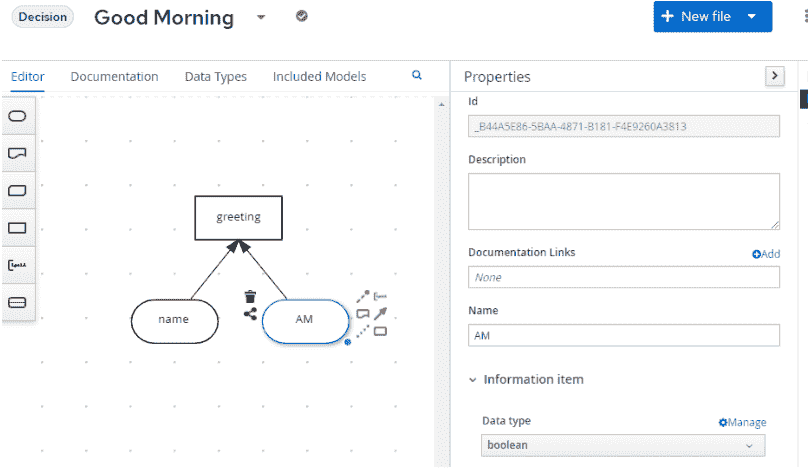
图 3.24 – 添加第二个数据节点

为此，请按照以下步骤操作：

- 1. 双击决策模型名称，并将其重命名为 Good Morning。
- 2. 向图表添加一个新的数据节点（从左侧菜单拖放）。
- 3. 双击此数据节点并将其重命名为 AM。
- 4. 选择 AM 数据节点，单击出现的箭头节点，然后拖动箭头将其连接到问候决策节点。请注意箭头方向 – 它应从 AM 节点指向问候节点。
- 5. 选择 AM 数据节点，然后单击属性图标（屏幕右上角），以显示属性编辑器面板。
- 6. 使用属性编辑器，将 AM 数据节点的 Data type 更改为 boolean。

## Boolean 数据类型

你可能在 Excel 中使用过 Boolean 数据类型 – 它们要么是 True 要么是 False。与 Excel 一样，还有第三种 Boolean 类型为空，表示未提供任何值。

有时，空值的影响会表现为 Required Dependency ... not found 消息，当我们传入值时该消息会消失。在运行示例时请记住这一点。

现在我们向决策节点提供了额外信息，我们希望更新决策以利用它。为此，请按照以下步骤操作：

- 1. 在我们的决策模型中选择问候决策节点。
- 2. 单击中间左侧出现的编辑按钮作为上下文菜单。
- 3. 使用框式编辑器，将表达式更新为 if AM then "Good Morning "+name else "Good Afternoon "+name。
- 4. 结果应如下图 3.25 所示 – 请注意编辑器已捕获文本，但除非我们拖动框式编辑器右侧以展开它，否则不会在屏幕上显示全部内容：

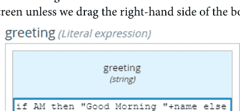
图 3.25 – 更新决策表达式

- 5. 单击屏幕左下角的 Problems 选项卡，查看 KIE 是否突出显示了任何问题。错误的主要来源是文本周围引号的字符使用错误 – 它与你在 Excel 中使用的相同双引号字符。

毫无疑问你迫不及待想尝试这些更改。与之前的示例一样，单击屏幕右上角的 Run … as Form 菜单并输入如图 3.26 所示的值：

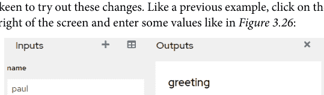
图 3.26 – 更新后的输入/输出表单

在 **Inputs** 侧，你会看到我们的两个输入已自动列出 – 一个用于输入名称的文本框和一个用于我们的 Boolean **AM** 值的复选框。与之前一样，当我们更新值时，决策模型会对其进行评估并输出一个值 – 在本例中，是一个合适时间的问候语。

在我们的决策节点中，表达式框使用了 FEEL 表达式（**If** ... **Else**）来根据 **AM** 框是否被选中来决定说 **Good Morning** 还是 **Good Afternoon**。

> **What is greeting (null)?**
> 你可能注意到在向表单输入任何值之前，输出中可能会出现一条消息，例如 **greeting (null)**。
> 
> 这是因为我们 Boolean 中的空值 – 因为我们传入了空值，KIE 没有足够的信息做出决策。与其 KIE 隐藏此问题，它会通过返回 null 消息来告知我们。

这仍然是一个相对简单的示例 – 我们只是触及了 FEEL 表达式语言的表面。我们尚未开始将多个决策节点串联起来以做出更复杂的决策。我们也尚未引入将业务决策拆分为非常简单的 **when ... then** 规则的决策表。但你已经可以开始看到将原本塞进难以阅读的 Excel 表达式中的内容编辑为更清晰的决策模型的强大之处。

我们将在下一章中介绍所有这些内容。但在进入更强大的工具之前，值得完成我们对 KIE Sandbox 的巡览，因为还有几个我们会觉得有用的其他功能。

## KIE Sandbox 中的其他 UI 元素

在 KIE Sandbox 的决策模型页面上，如果我们单击 *Decision Navigator* 图标（右上角类似旗帜的图标），KIE 将显示 **Decision Navigator**，如图 3.27 所示：

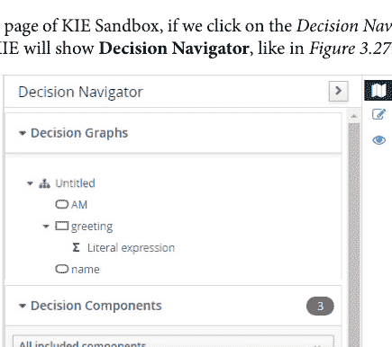
图 3.27 – Decision Navigator 视图

**Decision Navigator** 视图是表示同一决策模型的另一种布局 – 这次是以树状结构显示。所有节点都相同，但更容易看到节点的内容（例如，当我们使用字面表达式来做出决策时）。单击 **Decision Navigator** 中的元素将跳转到图表的相关部分。

屏幕右侧还有 **Explore diagram**。图标看起来像一只眼睛，如图 3.28 所突出显示：

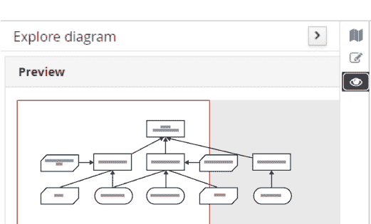
图 3.28 – Explore diagram

**Explore diagram** 对于探索更大的决策模型非常有用 – 这就是为什么图 3.28 显示的是随 KIE 提供的更复杂的示例决策模型。虽然你无法阅读单个节点上的文本，但它允许你缩小以看到更大的图景。

返回决策模型编辑器，在我们的模型名称正下方，你会看到四个选项卡，如图 3.29 所示：

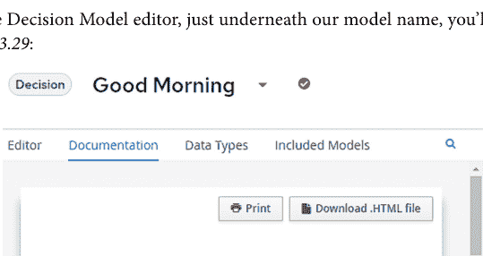
图 3.29 – 文档选项卡

让我们来看一下这些选项卡：

- **Editor** 是我们在本章中一直使用的可视化决策模型编辑器。
- **Documentation** 将我们的决策模型总结为易于导出的格式（例如 PDF）。我们可以将这些 PDF 文档与更广泛的团队共享并检查对业务决策的一致性。
- **Data Types** 允许我们构建更复杂的数据类型，我们将在下一章中探索。我们在示例中也涉及过这些。
- **Included Models** 允许我们包含其他决策模型，以便我们用于构建业务决策。我们不必将决策塞进一个决策模型中。

最后，我们模型名称旁边的向下箭头是快捷方式，允许我们快速在创建的其他决策模型之间导航。

## 注 – KIE Sandbox 仅是一个沙箱

更准确地说，KIE Sandbox Extended Services 只是一个开发工具。编辑决策模型的流畅性很容易让人印象深刻，你也应该如此！KIE Sandbox 编辑器是 OMG 决策模型标准的最佳、最稳健的实现之一，体现了 IBM 和 Red Hat 团队投入的时间和精力。

然而，请记住运行时（KIE Sandbox Extended Services）只是一个便利工具，可帮助你在构建时评估决策模型。它只能在你的本地机器上运行，仅你可访问，因此不适合作为稳定解决方案部署。在 *第 5 章和第 10 章*，我们将向你展示如何在真正稳健、可扩展的企业解决方案中运行你的业务规则。

### 总结

我们在本章中完成了很多工作 – 我们从将业务规则作为抽象概念讨论，到使用 KIE Sandbox 等实用工具执行业务规则。

在这一过程中，我们看到了决策模型是表示业务规则的另一种方式，其高度可视化格式使我们能够快速构建两个示例。我们下载并运行了 KIE Sandbox Extended Services 来评估我们的决策模型，并看到了我们可以基于其做出决策的几种不同数据类型。

我们巡览了 UI 以了解如何导入和导出决策模型，以及在哪里访问 KIE 为我们自动保存的先前模型。我们还看到了决策模型的其他视图，当与同事共享以供验证时尤其有用。

然而，本章中有几个关键点让我们理解决策模型、规则引擎和 FEEL 表达式语言比我们之前探索的要强大得多。让我们在下一章继续留在 KIE Sandbox 中，进行深入探索，以了解这些工具赋予你的强大功能。


